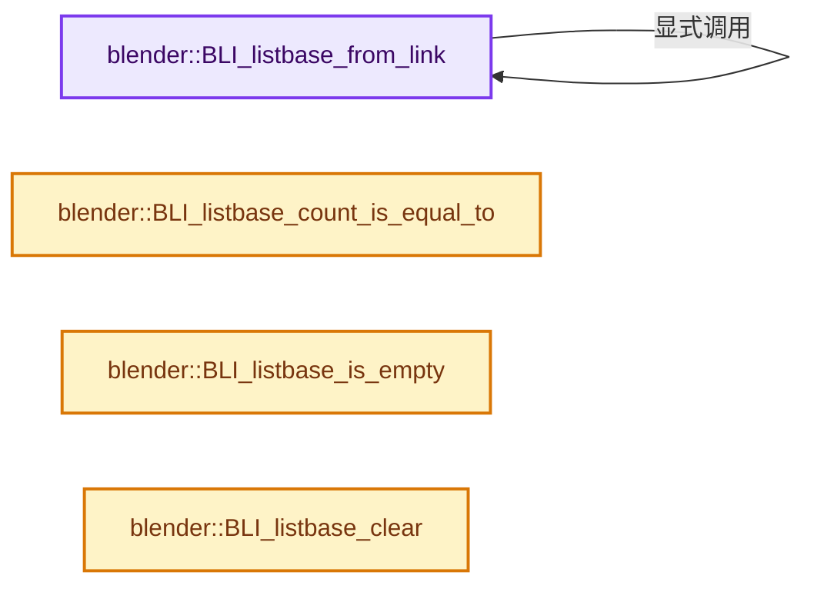
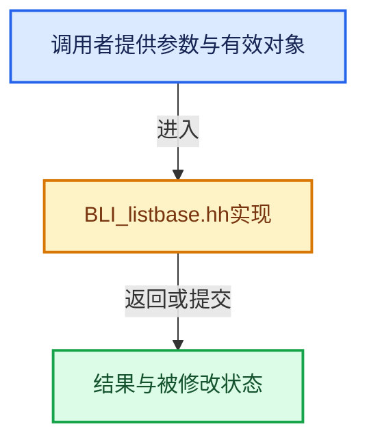

# 实现依赖专题：source/blender/blenlib/BLI_listbase.hh

[实现依赖导航](../README.md) · [符号索引](../../00-课程指南/02-源码与提交索引/符号依赖与实现索引.md)

本专题从正文实际调用进入，集中保存共享实现。函数有稳定锚点，可从调用处直接跳到对应完整函数；递归与互相调用通过回链组织。

## 本文件的实现关系






## 完整成员与函数实现

<a id="f-c2fa8aa0bf6b15f7"></a>

### `blender::BLI_listbase_from_link`

实现位置：[source/blender/blenlib/BLI_listbase.hh](../../../../../../source/blender/blenlib/BLI_listbase.hh) · L44—L48。

接口参数：

- `T *some_link`

**教学注释版**

<!-- annotated:8a9753caefec9c -->

```cpp
template<typename T> ListBaseT<T> BLI_listbase_from_link(T *some_link)
{
  const ListBase list = BLI_listbase_from_link(reinterpret_cast<Link *>(some_link));
  return ListBaseT<T>{static_cast<T *>(list.first_), static_cast<T *>(list.last_)};
}
```

<details>
<summary>核对原始源码：source/blender/blenlib/BLI_listbase.hh · L44—L48</summary>

<!-- original:8a9753caefec9c:source/blender/blenlib/BLI_listbase.hh:44:48 -->

```cpp
template<typename T> ListBaseT<T> BLI_listbase_from_link(T *some_link)
{
  const ListBase list = BLI_listbase_from_link(reinterpret_cast<Link *>(some_link));
  return ListBaseT<T>{static_cast<T *>(list.first_), static_cast<T *>(list.last_)};
}
```

</details>

**结果出口**

- `return ListBaseT<T>{static_cast<T *>(list.first_), static_cast<T *>(list.last_)};`

**继续追踪实现**

- `BLI_listbase_from_link` → [blender::BLI_listbase_from_link · L44](BLI_listbase.hh.md#f-c2fa8aa0bf6b15f7)。

<a id="f-9be68a37ba7b7e5b"></a>

### `blender::BLI_listbase_count_is_equal_to`

实现位置：[source/blender/blenlib/BLI_listbase.hh](../../../../../../source/blender/blenlib/BLI_listbase.hh) · L239—L242。

接口参数：

- `const ListBase *listbase`
- `const int count_cmp`

**教学注释版**

<!-- annotated:60d999194673a4 -->

```cpp
BLI_INLINE bool BLI_listbase_count_is_equal_to(const ListBase *listbase, const int count_cmp)
{
  return BLI_listbase_count_at_most(listbase, count_cmp + 1) == count_cmp;
}
```

<details>
<summary>核对原始源码：source/blender/blenlib/BLI_listbase.hh · L239—L242</summary>

<!-- original:60d999194673a4:source/blender/blenlib/BLI_listbase.hh:239:242 -->

```cpp
BLI_INLINE bool BLI_listbase_count_is_equal_to(const ListBase *listbase, const int count_cmp)
{
  return BLI_listbase_count_at_most(listbase, count_cmp + 1) == count_cmp;
}
```

</details>

**结果出口**

- `return BLI_listbase_count_at_most(listbase, count_cmp + 1) == count_cmp;`

**继续追踪实现**

- `BLI_listbase_count_at_most` → [blender::BLI_listbase_count_at_most · L518](intern/listbase.cc.md#f-8e9896af547c33c3)。

<a id="f-b225ef49078904fd"></a>

### `blender::BLI_listbase_is_empty`

实现位置：[source/blender/blenlib/BLI_listbase.hh](../../../../../../source/blender/blenlib/BLI_listbase.hh) · L302—L305。

接口参数：

- `const ListBase *lb`

**教学注释版**

<!-- annotated:40b79f9fea8317 -->

```cpp
BLI_INLINE bool BLI_listbase_is_empty(const ListBase *lb)
{
  return (lb->first_ == static_cast<void *>(nullptr));
}
```

<details>
<summary>核对原始源码：source/blender/blenlib/BLI_listbase.hh · L302—L305</summary>

<!-- original:40b79f9fea8317:source/blender/blenlib/BLI_listbase.hh:302:305 -->

```cpp
BLI_INLINE bool BLI_listbase_is_empty(const ListBase *lb)
{
  return (lb->first_ == static_cast<void *>(nullptr));
}
```

</details>

**结果出口**

- `return (lb->first_ == static_cast<void *>(nullptr));`

**继续追踪实现**

本实现没有需要继续展开的显式调用；检查返回表达式、对象转换和调用者前置条件。

<a id="f-e7175128de2ddae7"></a>

### `blender::BLI_listbase_clear`

实现位置：[source/blender/blenlib/BLI_listbase.hh](../../../../../../source/blender/blenlib/BLI_listbase.hh) · L306—L309。

接口参数：

- `ListBase *lb`

**教学注释版**

<!-- annotated:9da0861fee34df -->

```cpp
BLI_INLINE void BLI_listbase_clear(ListBase *lb)
{
  lb->first_ = lb->last_ = static_cast<void *>(nullptr);
}
```

<details>
<summary>核对原始源码：source/blender/blenlib/BLI_listbase.hh · L306—L309</summary>

<!-- original:9da0861fee34df:source/blender/blenlib/BLI_listbase.hh:306:309 -->

```cpp
BLI_INLINE void BLI_listbase_clear(ListBase *lb)
{
  lb->first_ = lb->last_ = static_cast<void *>(nullptr);
}
```

</details>

**沿实际写入检查状态**

- `lb->first_ = lb->last_ = static_cast<void *>(nullptr);`

**继续追踪实现**

本实现没有需要继续展开的显式调用；检查返回表达式、对象转换和调用者前置条件。
