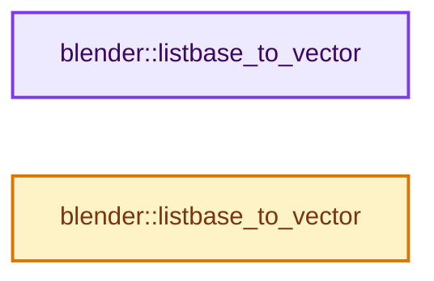
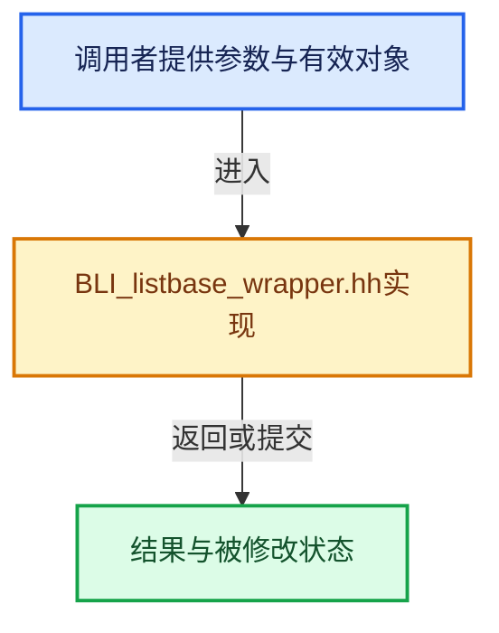

# 实现依赖专题：source/blender/blenlib/BLI_listbase_wrapper.hh

[实现依赖导航](../README.md) · [符号索引](../../00-课程指南/02-源码与提交索引/符号依赖与实现索引.md)

本专题从正文实际调用进入，集中保存共享实现。函数有稳定锚点，可从调用处直接跳到对应完整函数；递归与互相调用通过回链组织。

## 本文件的实现关系






## 完整成员与函数实现

<a id="f-b0cea130e4ff7d2d"></a>

### `blender::listbase_to_vector`

实现位置：[source/blender/blenlib/BLI_listbase_wrapper.hh](../../../../../../source/blender/blenlib/BLI_listbase_wrapper.hh) · L105—L113。

接口参数：

- `ListBase &list`

**教学注释版**

<!-- annotated:80f3753d9eb8a1 -->

```cpp
template<typename T> Vector<T *> listbase_to_vector(ListBase &list)
{
  Vector<T *> vector;

  for (T *item : ListBaseWrapper<T>(list)) {
    // [讲解] vector.append：在尾部建立新元素，必要时先扩大存储。
    vector.append(item);
  }
  return vector;
}
```

<details>
<summary>核对原始源码：source/blender/blenlib/BLI_listbase_wrapper.hh · L105—L113</summary>

<!-- original:80f3753d9eb8a1:source/blender/blenlib/BLI_listbase_wrapper.hh:105:113 -->

```cpp
template<typename T> Vector<T *> listbase_to_vector(ListBase &list)
{
  Vector<T *> vector;

  for (T *item : ListBaseWrapper<T>(list)) {
    vector.append(item);
  }
  return vector;
}
```

</details>

**结果出口**

- `return vector;`

**继续追踪实现**

- `ListBaseWrapper<T>` → [调用协议](../../00-课程指南/01-路线与规范/模板宏与动态分派协议.md)：函数指针、局部可调用对象或未展开的宏；必须结合调用者环境。调用位置L109。
- `vector.append` → [blender::Vector::append · L498](../../01-基础容器与现代CPP/11-Vector插入删除与重排.md#f-5bde268a69e443ec)；[blender::Vector::append · L502](../../01-基础容器与现代CPP/11-Vector插入删除与重排.md#f-591e0b15e6308532)。同名重载需按实参类型选择。

<a id="f-bd2c65ca1fc9128c"></a>

### `blender::listbase_to_vector`

实现位置：[source/blender/blenlib/BLI_listbase_wrapper.hh](../../../../../../source/blender/blenlib/BLI_listbase_wrapper.hh) · L118—L126。

接口参数：

- `const ListBase &list`

**教学注释版**

<!-- annotated:2786d41d3dd3d3 -->

```cpp
template<typename T> Vector<T *> listbase_to_vector(const ListBase &list)
{
  Vector<T *> vector;

  for (T *item : ConstListBaseWrapper<T>(list)) {
    // [讲解] vector.append：在尾部建立新元素，必要时先扩大存储。
    vector.append(item);
  }
  return vector;
}
```

<details>
<summary>核对原始源码：source/blender/blenlib/BLI_listbase_wrapper.hh · L118—L126</summary>

<!-- original:2786d41d3dd3d3:source/blender/blenlib/BLI_listbase_wrapper.hh:118:126 -->

```cpp
template<typename T> Vector<T *> listbase_to_vector(const ListBase &list)
{
  Vector<T *> vector;

  for (T *item : ConstListBaseWrapper<T>(list)) {
    vector.append(item);
  }
  return vector;
}
```

</details>

**结果出口**

- `return vector;`

**继续追踪实现**

- `ConstListBaseWrapper<T>` → [调用协议](../../00-课程指南/01-路线与规范/模板宏与动态分派协议.md)：函数指针、局部可调用对象或未展开的宏；必须结合调用者环境。调用位置L122。
- `vector.append` → [blender::Vector::append · L498](../../01-基础容器与现代CPP/11-Vector插入删除与重排.md#f-5bde268a69e443ec)；[blender::Vector::append · L502](../../01-基础容器与现代CPP/11-Vector插入删除与重排.md#f-591e0b15e6308532)。同名重载需按实参类型选择。
