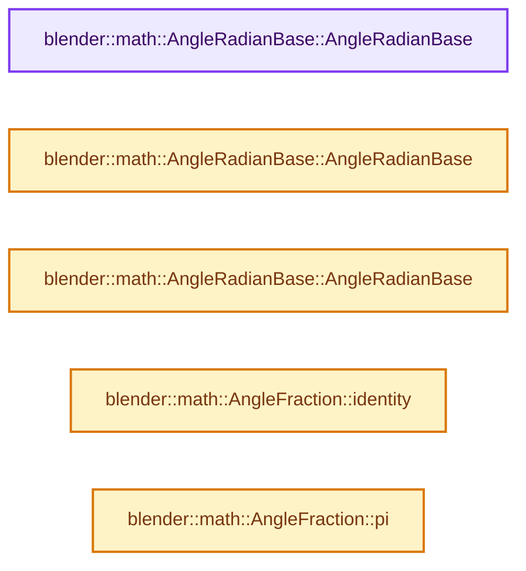
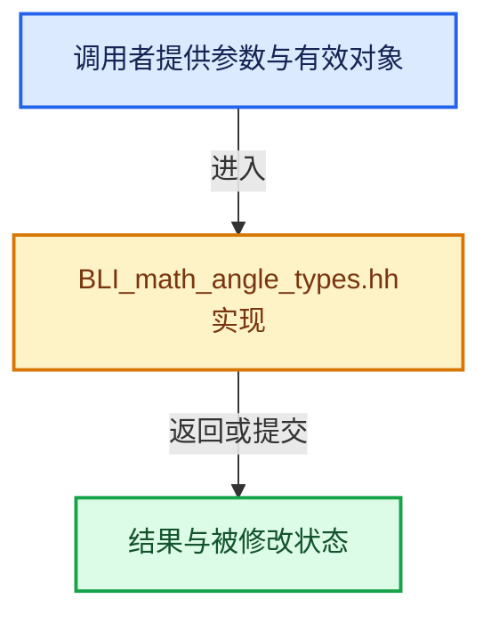

# 实现依赖专题：source/blender/blenlib/BLI_math_angle_types.hh

[实现依赖导航](../README.md) · [符号索引](../../00-课程指南/02-源码与提交索引/符号依赖与实现索引.md)

本专题从正文实际调用进入，集中保存共享实现。函数有稳定锚点，可从调用处直接跳到对应完整函数；递归与互相调用通过回链组织。

## 本文件的实现关系






## 完整成员与函数实现

<a id="f-56c0a0a9daeba2a1"></a>

### `blender::math::AngleRadianBase::AngleRadianBase`

实现位置：[source/blender/blenlib/BLI_math_angle_types.hh](../../../../../../source/blender/blenlib/BLI_math_angle_types.hh) · L38—L38。

**教学注释版**

<!-- annotated:29bd2c31290c9c -->

```cpp
  AngleRadianBase() = default;
```

<details>
<summary>核对原始源码：source/blender/blenlib/BLI_math_angle_types.hh · L38—L38</summary>

<!-- original:29bd2c31290c9c:source/blender/blenlib/BLI_math_angle_types.hh:38:38 -->

```cpp
  AngleRadianBase() = default;
```

</details>

**继续追踪实现**

本实现没有需要继续展开的显式调用；检查返回表达式、对象转换和调用者前置条件。

<a id="f-f89be2cbf842de9c"></a>

### `blender::math::AngleRadianBase::AngleRadianBase`

实现位置：[source/blender/blenlib/BLI_math_angle_types.hh](../../../../../../source/blender/blenlib/BLI_math_angle_types.hh) · L40—L40。

接口参数：

- `const T &radian`

**教学注释版**

<!-- annotated:d6010904049681 -->

```cpp
  AngleRadianBase(const T &radian) : value_(radian) {};
```

<details>
<summary>核对原始源码：source/blender/blenlib/BLI_math_angle_types.hh · L40—L40</summary>

<!-- original:d6010904049681:source/blender/blenlib/BLI_math_angle_types.hh:40:40 -->

```cpp
  AngleRadianBase(const T &radian) : value_(radian) {};
```

</details>

**继续追踪实现**

本实现没有需要继续展开的显式调用；检查返回表达式、对象转换和调用者前置条件。

<a id="f-e23eac0ca5e736c4"></a>

### `blender::math::AngleRadianBase::AngleRadianBase`

实现位置：[source/blender/blenlib/BLI_math_angle_types.hh](../../../../../../source/blender/blenlib/BLI_math_angle_types.hh) · L41—L41。

接口参数：

- `const T &cos`
- `const T &sin`

**教学注释版**

<!-- annotated:00f7d7ee45c21c -->

```cpp
  explicit AngleRadianBase(const T &cos, const T &sin) : value_(math::atan2(sin, cos)) {};
```

<details>
<summary>核对原始源码：source/blender/blenlib/BLI_math_angle_types.hh · L41—L41</summary>

<!-- original:00f7d7ee45c21c:source/blender/blenlib/BLI_math_angle_types.hh:41:41 -->

```cpp
  explicit AngleRadianBase(const T &cos, const T &sin) : value_(math::atan2(sin, cos)) {};
```

</details>

**继续追踪实现**

本实现没有需要继续展开的显式调用；检查返回表达式、对象转换和调用者前置条件。

<a id="f-3aeb82e761d43e0b"></a>

### `blender::math::AngleFraction::identity`

实现位置：[source/blender/blenlib/BLI_math_angle_types.hh](../../../../../../source/blender/blenlib/BLI_math_angle_types.hh) · L393—L396。

**教学注释版**

<!-- annotated:5a8498e29d13d9 -->

```cpp
  static AngleFraction identity()
  {
    return {0};
  }
```

<details>
<summary>核对原始源码：source/blender/blenlib/BLI_math_angle_types.hh · L393—L396</summary>

<!-- original:5a8498e29d13d9:source/blender/blenlib/BLI_math_angle_types.hh:393:396 -->

```cpp
  static AngleFraction identity()
  {
    return {0};
  }
```

</details>

**结果出口**

- `return {0};`

**继续追踪实现**

本实现没有需要继续展开的显式调用；检查返回表达式、对象转换和调用者前置条件。

<a id="f-b0841a09e4cef4c6"></a>

### `blender::math::AngleFraction::pi`

实现位置：[source/blender/blenlib/BLI_math_angle_types.hh](../../../../../../source/blender/blenlib/BLI_math_angle_types.hh) · L398—L401。

**教学注释版**

<!-- annotated:a5b5af67de1682 -->

```cpp
  static AngleFraction pi()
  {
    return {1};
  }
```

<details>
<summary>核对原始源码：source/blender/blenlib/BLI_math_angle_types.hh · L398—L401</summary>

<!-- original:a5b5af67de1682:source/blender/blenlib/BLI_math_angle_types.hh:398:401 -->

```cpp
  static AngleFraction pi()
  {
    return {1};
  }
```

</details>

**结果出口**

- `return {1};`

**继续追踪实现**

本实现没有需要继续展开的显式调用；检查返回表达式、对象转换和调用者前置条件。
