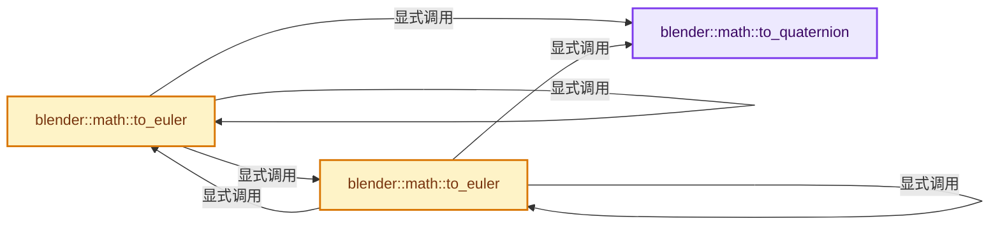
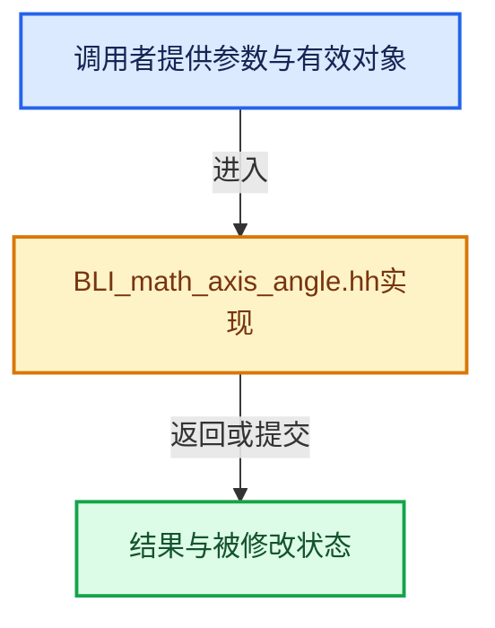

# 实现依赖专题：source/blender/blenlib/BLI_math_axis_angle.hh

[实现依赖导航](../README.md) · [符号索引](../../00-课程指南/02-源码与提交索引/符号依赖与实现索引.md)

本专题从正文实际调用进入，集中保存共享实现。函数有稳定锚点，可从调用处直接跳到对应完整函数；递归与互相调用通过回链组织。

## 本文件的实现关系






## 完整成员与函数实现

<a id="f-a87213edc1fe438e"></a>

### `blender::math::to_quaternion`

实现位置：[source/blender/blenlib/BLI_math_axis_angle.hh](../../../../../../source/blender/blenlib/BLI_math_axis_angle.hh) · L70—L81。

接口参数：

- `const AxisAngleBase<T, AngleT> &axis_angle`

**教学注释版**

<!-- annotated:3937e8964d2193 -->

```cpp
template<typename T, typename AngleT>
QuaternionBase<T> to_quaternion(const AxisAngleBase<T, AngleT> &axis_angle)
{
  BLI_assert(math::is_unit_scale(axis_angle.axis()));

  AngleT half_angle = axis_angle.angle() / 2;
  T hs = math::sin(half_angle);
  T hc = math::cos(half_angle);

  VecBase<T, 3> xyz = axis_angle.axis() * hs;
  return QuaternionBase<T>(hc, xyz.x, xyz.y, xyz.z);
}
```

<details>
<summary>核对原始源码：source/blender/blenlib/BLI_math_axis_angle.hh · L70—L81</summary>

<!-- original:3937e8964d2193:source/blender/blenlib/BLI_math_axis_angle.hh:70:81 -->

```cpp
template<typename T, typename AngleT>
QuaternionBase<T> to_quaternion(const AxisAngleBase<T, AngleT> &axis_angle)
{
  BLI_assert(math::is_unit_scale(axis_angle.axis()));

  AngleT half_angle = axis_angle.angle() / 2;
  T hs = math::sin(half_angle);
  T hc = math::cos(half_angle);

  VecBase<T, 3> xyz = axis_angle.axis() * hs;
  return QuaternionBase<T>(hc, xyz.x, xyz.y, xyz.z);
}
```

</details>

**结果出口**

- `return QuaternionBase<T>(hc, xyz.x, xyz.y, xyz.z);`

**继续追踪实现**

- `BLI_assert` → [BLI_assert · L48](BLI_assert.hh.md#m-57a88495704d)；[BLI_assert · L63](BLI_assert.hh.md#m-d07050020cb5)。宏定义由构建条件选择。
- `math::is_unit_scale` → [blender::math::is_unit_scale · L463](BLI_math_vector.hh.md#f-5ff2739590caa903)；[blender::math::is_unit_scale · L125](BLI_math_quaternion.hh.md#f-29e97a29f06db326)；[blender::math::is_unit_scale · L637](BLI_math_matrix.hh.md#f-d7f4cb1a4f1945c7)。同名重载需按实参类型选择。
- `axis_angle.axis` → [blender::math::AxisAngleBase::axis · L69](BLI_math_axis_angle_types.hh.md#f-ffc482a3b15d6eb6)。
- `axis_angle.angle` → [blender::math::AxisAngleBase::angle · L74](BLI_math_axis_angle_types.hh.md#f-24de75ca8d520823)。
- `math::sin` → [外部契约](https://eel.is/c++draft/)：这个边界按实际表达式及所属类型核对参数、返回值、寿命与失败行为。这里提供接口入口，不声称已解释该第三方版本的内部实现。
- `math::cos` → [外部契约](https://eel.is/c++draft/)：这个边界按实际表达式及所属类型核对参数、返回值、寿命与失败行为。这里提供接口入口，不声称已解释该第三方版本的内部实现。
- `QuaternionBase<T>` → [blender::math::QuaternionBase::QuaternionBase · L39](BLI_math_quaternion_types.hh.md#f-1302d78c153ef0b9)；[blender::math::QuaternionBase::QuaternionBase · L41](BLI_math_quaternion_types.hh.md#f-1281fc5da909c263)；[blender::math::QuaternionBase::QuaternionBase · L48](BLI_math_quaternion_types.hh.md#f-92c30790ecf497c6)；[blender::math::QuaternionBase::QuaternionBase · L53](BLI_math_quaternion_types.hh.md#f-f5909ed2b96d6d44)。同名重载需按实参类型选择。

<a id="f-cf4f96441320136c"></a>

### `blender::math::to_euler`

实现位置：[source/blender/blenlib/BLI_math_axis_angle.hh](../../../../../../source/blender/blenlib/BLI_math_axis_angle.hh) · L89—L94。

接口参数：

- `const AxisAngleBase<T, AngleT> &axis_angle`
- `EulerOrder order`

**教学注释版**

<!-- annotated:1866eba8b9d294 -->

```cpp
template<typename T, typename AngleT>
Euler3Base<T> to_euler(const AxisAngleBase<T, AngleT> &axis_angle, EulerOrder order)
{
  /* Use quaternions as intermediate representation for now... */
  return to_euler(to_quaternion(axis_angle), order);
}
```

<details>
<summary>核对原始源码：source/blender/blenlib/BLI_math_axis_angle.hh · L89—L94</summary>

<!-- original:1866eba8b9d294:source/blender/blenlib/BLI_math_axis_angle.hh:89:94 -->

```cpp
template<typename T, typename AngleT>
Euler3Base<T> to_euler(const AxisAngleBase<T, AngleT> &axis_angle, EulerOrder order)
{
  /* Use quaternions as intermediate representation for now... */
  return to_euler(to_quaternion(axis_angle), order);
}
```

</details>

**结果出口**

- `return to_euler(to_quaternion(axis_angle), order);`

**继续追踪实现**

- `to_euler` → [blender::math::to_euler · L89](BLI_math_axis_angle.hh.md#f-cf4f96441320136c)；[blender::math::to_euler · L96](BLI_math_axis_angle.hh.md#f-0504122b0027e01e)。同名重载需按实参类型选择。
- `to_quaternion` → [blender::math::to_quaternion · L70](BLI_math_axis_angle.hh.md#f-a87213edc1fe438e)。

<a id="f-0504122b0027e01e"></a>

### `blender::math::to_euler`

实现位置：[source/blender/blenlib/BLI_math_axis_angle.hh](../../../../../../source/blender/blenlib/BLI_math_axis_angle.hh) · L96—L112。

接口参数：

- `const AxisAngleBase<T, AngleT> &axis_angle`

**教学注释版**

<!-- annotated:d873628902652d -->

```cpp
template<typename T, typename AngleT>
EulerXYZBase<T> to_euler(const AxisAngleBase<T, AngleT> &axis_angle)
{
  /* Check easy and exact conversions first. */
  const VecBase<T, 3> axis = axis_angle.axis();
  if (axis.x == T(1)) {
    return EulerXYZBase<T>(T(axis_angle.angle()), T(0), T(0));
  }
  if (axis.y == T(1)) {
    return EulerXYZBase<T>(T(0), T(axis_angle.angle()), T(0));
  }
  if (axis.z == T(1)) {
    return EulerXYZBase<T>(T(0), T(0), T(axis_angle.angle()));
  }
  /* Use quaternions as intermediate representation for now... */
  return to_euler(to_quaternion(axis_angle));
}
```

<details>
<summary>核对原始源码：source/blender/blenlib/BLI_math_axis_angle.hh · L96—L112</summary>

<!-- original:d873628902652d:source/blender/blenlib/BLI_math_axis_angle.hh:96:112 -->

```cpp
template<typename T, typename AngleT>
EulerXYZBase<T> to_euler(const AxisAngleBase<T, AngleT> &axis_angle)
{
  /* Check easy and exact conversions first. */
  const VecBase<T, 3> axis = axis_angle.axis();
  if (axis.x == T(1)) {
    return EulerXYZBase<T>(T(axis_angle.angle()), T(0), T(0));
  }
  if (axis.y == T(1)) {
    return EulerXYZBase<T>(T(0), T(axis_angle.angle()), T(0));
  }
  if (axis.z == T(1)) {
    return EulerXYZBase<T>(T(0), T(0), T(axis_angle.angle()));
  }
  /* Use quaternions as intermediate representation for now... */
  return to_euler(to_quaternion(axis_angle));
}
```

</details>

**结果出口**

- `return EulerXYZBase<T>(T(axis_angle.angle()), T(0), T(0));`
- `return EulerXYZBase<T>(T(0), T(axis_angle.angle()), T(0));`
- `return EulerXYZBase<T>(T(0), T(0), T(axis_angle.angle()));`
- `return to_euler(to_quaternion(axis_angle));`

**继续追踪实现**

- `axis_angle.axis` → [blender::math::AxisAngleBase::axis · L69](BLI_math_axis_angle_types.hh.md#f-ffc482a3b15d6eb6)。
- `T` → [DiagSplit::T · L96](../07-Intern运行时与平台/cycles/subd/split.cpp.md#f-d5d0885c790cc4e4)。
- `EulerXYZBase<T>` → [blender::math::EulerXYZBase::EulerXYZBase · L139](BLI_math_euler_types.hh.md#f-4b5930b188762577)；[blender::math::EulerXYZBase::EulerXYZBase · L144](BLI_math_euler_types.hh.md#f-fb79082297f8eb7a)；[blender::math::EulerXYZBase::EulerXYZBase · L146](BLI_math_euler_types.hh.md#f-e415bd8fa35027a1)；[blender::math::EulerXYZBase::EulerXYZBase · L152](BLI_math_euler_types.hh.md#f-801148022321d382)。同名重载需按实参类型选择。
- `axis_angle.angle` → [blender::math::AxisAngleBase::angle · L74](BLI_math_axis_angle_types.hh.md#f-24de75ca8d520823)。
- `to_euler` → [blender::math::to_euler · L89](BLI_math_axis_angle.hh.md#f-cf4f96441320136c)；[blender::math::to_euler · L96](BLI_math_axis_angle.hh.md#f-0504122b0027e01e)。同名重载需按实参类型选择。
- `to_quaternion` → [blender::math::to_quaternion · L70](BLI_math_axis_angle.hh.md#f-a87213edc1fe438e)。
