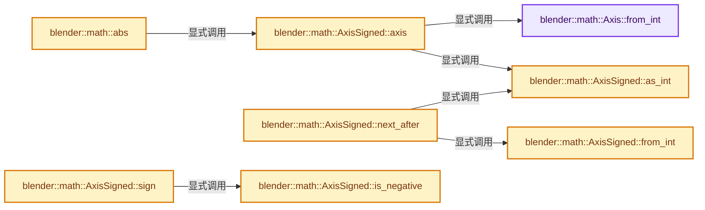
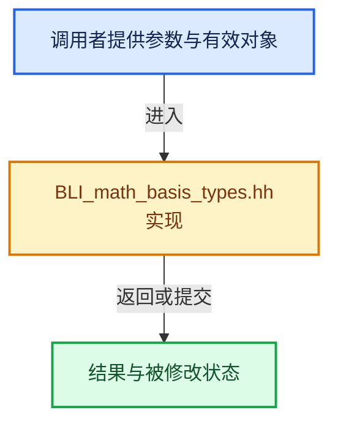

# 实现依赖专题：source/blender/blenlib/BLI_math_basis_types.hh

[实现依赖导航](../README.md) · [符号索引](../../00-课程指南/02-源码与提交索引/符号依赖与实现索引.md)

本专题从正文实际调用进入，集中保存共享实现。函数有稳定锚点，可从调用处直接跳到对应完整函数；递归与互相调用通过回链组织。

## 本文件的实现关系






## 相关类型布局与成员入口

<a id="t-ef2f63ee0ed5"></a>

### `blender::math::Axis::Value`

原始声明：[source/blender/blenlib/BLI_math_basis_types.hh](../../../../../../source/blender/blenlib/BLI_math_basis_types.hh) · L44—L49。

以下保留类的数据声明与编译条件，成员函数实现通过后面的精确链接阅读。

<!-- annotated:387c2e41d82157 -->

```cpp
  enum class Value : int8_t {
    /* Must start at 0. Used as indices in tables and vectors. */
    X = 0,
    Y,
    Z,
  };
```

<details>
<summary>核对原始源码：source/blender/blenlib/BLI_math_basis_types.hh · L44—L49</summary>

<!-- original:387c2e41d82157:source/blender/blenlib/BLI_math_basis_types.hh:44:49 -->

```cpp
  enum class Value : int8_t {
    /* Must start at 0. Used as indices in tables and vectors. */
    X = 0,
    Y,
    Z,
  };
```

</details>


<a id="t-fde967b6970e"></a>

### `blender::math::AxisSigned::Value`

原始声明：[source/blender/blenlib/BLI_math_basis_types.hh](../../../../../../source/blender/blenlib/BLI_math_basis_types.hh) · L103—L112。

以下保留类的数据声明与编译条件，成员函数实现通过后面的精确链接阅读。

<!-- annotated:a8c5f17a2fd9ce -->

```cpp
  enum class Value : int8_t {
    /* Match #eTrackToAxis_Modes */
    /* Must start at 0. Used as indices in tables and vectors. */
    X_POS = 0,
    Y_POS = 1,
    Z_POS = 2,
    X_NEG = 3,
    Y_NEG = 4,
    Z_NEG = 5,
  };
```

<details>
<summary>核对原始源码：source/blender/blenlib/BLI_math_basis_types.hh · L103—L112</summary>

<!-- original:a8c5f17a2fd9ce:source/blender/blenlib/BLI_math_basis_types.hh:103:112 -->

```cpp
  enum class Value : int8_t {
    /* Match #eTrackToAxis_Modes */
    /* Must start at 0. Used as indices in tables and vectors. */
    X_POS = 0,
    Y_POS = 1,
    Z_POS = 2,
    X_NEG = 3,
    Y_NEG = 4,
    Z_NEG = 5,
  };
```

</details>


## 完整成员与函数实现

<a id="f-a0985b6e620c0758"></a>

### `blender::math::Axis::from_int`

实现位置：[source/blender/blenlib/BLI_math_basis_types.hh](../../../../../../source/blender/blenlib/BLI_math_basis_types.hh) · L72—L77。

接口参数：

- `const int axis_int`

**教学注释版**

<!-- annotated:ba90be71c2e0a3 -->

```cpp
  constexpr static Axis from_int(const int axis_int)
  {
    const Axis axis = static_cast<Value>(axis_int);
    BLI_assert(Axis::X <= axis && axis <= Axis::Z);
    return axis;
  }
```

<details>
<summary>核对原始源码：source/blender/blenlib/BLI_math_basis_types.hh · L72—L77</summary>

<!-- original:ba90be71c2e0a3:source/blender/blenlib/BLI_math_basis_types.hh:72:77 -->

```cpp
  constexpr static Axis from_int(const int axis_int)
  {
    const Axis axis = static_cast<Value>(axis_int);
    BLI_assert(Axis::X <= axis && axis <= Axis::Z);
    return axis;
  }
```

</details>

**结果出口**

- `return axis;`

**继续追踪实现**

- `BLI_assert` → [BLI_assert · L48](BLI_assert.hh.md#m-57a88495704d)；[BLI_assert · L63](BLI_assert.hh.md#m-d07050020cb5)。宏定义由构建条件选择。

<a id="f-d7db2102ce5ce5af"></a>

### `blender::math::AxisSigned::from_int`

实现位置：[source/blender/blenlib/BLI_math_basis_types.hh](../../../../../../source/blender/blenlib/BLI_math_basis_types.hh) · L131—L136。

接口参数：

- `int axis_int`

**教学注释版**

<!-- annotated:64842e0fb1e8c5 -->

```cpp
  constexpr static AxisSigned from_int(int axis_int)
  {
    const AxisSigned axis = static_cast<Value>(axis_int);
    BLI_assert(AxisSigned::X_POS <= axis && axis <= AxisSigned::Z_NEG);
    return axis;
  }
```

<details>
<summary>核对原始源码：source/blender/blenlib/BLI_math_basis_types.hh · L131—L136</summary>

<!-- original:64842e0fb1e8c5:source/blender/blenlib/BLI_math_basis_types.hh:131:136 -->

```cpp
  constexpr static AxisSigned from_int(int axis_int)
  {
    const AxisSigned axis = static_cast<Value>(axis_int);
    BLI_assert(AxisSigned::X_POS <= axis && axis <= AxisSigned::Z_NEG);
    return axis;
  }
```

</details>

**结果出口**

- `return axis;`

**继续追踪实现**

- `BLI_assert` → [BLI_assert · L48](BLI_assert.hh.md#m-57a88495704d)；[BLI_assert · L63](BLI_assert.hh.md#m-d07050020cb5)。宏定义由构建条件选择。

<a id="f-68163041fdd275d1"></a>

### `blender::math::AxisSigned::axis`

实现位置：[source/blender/blenlib/BLI_math_basis_types.hh](../../../../../../source/blender/blenlib/BLI_math_basis_types.hh) · L139—L142。

**教学注释版**

<!-- annotated:71accbd9f37253 -->

```cpp
  constexpr Axis axis() const
  {
    return Axis::from_int(this->as_int() % 3);
  }
```

<details>
<summary>核对原始源码：source/blender/blenlib/BLI_math_basis_types.hh · L139—L142</summary>

<!-- original:71accbd9f37253:source/blender/blenlib/BLI_math_basis_types.hh:139:142 -->

```cpp
  constexpr Axis axis() const
  {
    return Axis::from_int(this->as_int() % 3);
  }
```

</details>

**结果出口**

- `return Axis::from_int(this->as_int() % 3);`

**继续追踪实现**

- `Axis::from_int` → [blender::math::Axis::from_int · L72](BLI_math_basis_types.hh.md#f-a0985b6e620c0758)。
- `this->as_int` → [blender::math::AxisSigned::as_int · L162](BLI_math_basis_types.hh.md#f-b904c5aa5e89465a)。

<a id="f-8cc505da5bc0eab6"></a>

### `blender::math::AxisSigned::next_after`

实现位置：[source/blender/blenlib/BLI_math_basis_types.hh](../../../../../../source/blender/blenlib/BLI_math_basis_types.hh) · L151—L154。

**教学注释版**

<!-- annotated:9038aec570e2fe -->

```cpp
  AxisSigned next_after() const
  {
    return from_int((this->as_int() + 1) % 6);
  }
```

<details>
<summary>核对原始源码：source/blender/blenlib/BLI_math_basis_types.hh · L151—L154</summary>

<!-- original:9038aec570e2fe:source/blender/blenlib/BLI_math_basis_types.hh:151:154 -->

```cpp
  AxisSigned next_after() const
  {
    return from_int((this->as_int() + 1) % 6);
  }
```

</details>

**结果出口**

- `return from_int((this->as_int() + 1) % 6);`

**继续追踪实现**

- `from_int` → [blender::math::AxisSigned::from_int · L131](BLI_math_basis_types.hh.md#f-d7db2102ce5ce5af)。
- `this->as_int` → [blender::math::AxisSigned::as_int · L162](BLI_math_basis_types.hh.md#f-b904c5aa5e89465a)。

<a id="f-b904c5aa5e89465a"></a>

### `blender::math::AxisSigned::as_int`

实现位置：[source/blender/blenlib/BLI_math_basis_types.hh](../../../../../../source/blender/blenlib/BLI_math_basis_types.hh) · L162—L165。

**教学注释版**

<!-- annotated:d28e0706ebe79c -->

```cpp
  constexpr int as_int() const
  {
    return int(axis_);
  }
```

<details>
<summary>核对原始源码：source/blender/blenlib/BLI_math_basis_types.hh · L162—L165</summary>

<!-- original:d28e0706ebe79c:source/blender/blenlib/BLI_math_basis_types.hh:162:165 -->

```cpp
  constexpr int as_int() const
  {
    return int(axis_);
  }
```

</details>

**结果出口**

- `return int(axis_);`

**继续追踪实现**

本实现没有需要继续展开的显式调用；检查返回表达式、对象转换和调用者前置条件。

<a id="f-2de595b7c52c9a63"></a>

### `blender::math::AxisSigned::sign`

实现位置：[source/blender/blenlib/BLI_math_basis_types.hh](../../../../../../source/blender/blenlib/BLI_math_basis_types.hh) · L168—L171。

**教学注释版**

<!-- annotated:91c2be085d13d6 -->

```cpp
  constexpr int sign() const
  {
    return is_negative() ? -1 : 1;
  }
```

<details>
<summary>核对原始源码：source/blender/blenlib/BLI_math_basis_types.hh · L168—L171</summary>

<!-- original:91c2be085d13d6:source/blender/blenlib/BLI_math_basis_types.hh:168:171 -->

```cpp
  constexpr int sign() const
  {
    return is_negative() ? -1 : 1;
  }
```

</details>

**结果出口**

- `return is_negative() ? -1 : 1;`

**继续追踪实现**

- `is_negative` → [blender::math::AxisSigned::is_negative · L174](BLI_math_basis_types.hh.md#f-bdc2bd118ba6c193)。

<a id="f-bdc2bd118ba6c193"></a>

### `blender::math::AxisSigned::is_negative`

实现位置：[source/blender/blenlib/BLI_math_basis_types.hh](../../../../../../source/blender/blenlib/BLI_math_basis_types.hh) · L174—L177。

**教学注释版**

<!-- annotated:0e266b24ee92c2 -->

```cpp
  constexpr bool is_negative() const
  {
    return int(axis_) > int(Value::Z_POS);
  }
```

<details>
<summary>核对原始源码：source/blender/blenlib/BLI_math_basis_types.hh · L174—L177</summary>

<!-- original:0e266b24ee92c2:source/blender/blenlib/BLI_math_basis_types.hh:174:177 -->

```cpp
  constexpr bool is_negative() const
  {
    return int(axis_) > int(Value::Z_POS);
  }
```

</details>

**结果出口**

- `return int(axis_) > int(Value::Z_POS);`

**继续追踪实现**

本实现没有需要继续展开的显式调用；检查返回表达式、对象转换和调用者前置条件。

<a id="f-a137ffce39989ffc"></a>

### `blender::math::abs`

实现位置：[source/blender/blenlib/BLI_math_basis_types.hh](../../../../../../source/blender/blenlib/BLI_math_basis_types.hh) · L201—L204。

接口参数：

- `const AxisSigned &axis`

**教学注释版**

<!-- annotated:ddc7411b91cf44 -->

```cpp
template<> inline AxisSigned abs(const AxisSigned &axis)
{
  return axis.axis();
}
```

<details>
<summary>核对原始源码：source/blender/blenlib/BLI_math_basis_types.hh · L201—L204</summary>

<!-- original:ddc7411b91cf44:source/blender/blenlib/BLI_math_basis_types.hh:201:204 -->

```cpp
template<> inline AxisSigned abs(const AxisSigned &axis)
{
  return axis.axis();
}
```

</details>

**结果出口**

- `return axis.axis();`

**继续追踪实现**

- `axis.axis` → [blender::math::AxisSigned::axis · L139](BLI_math_basis_types.hh.md#f-68163041fdd275d1)。

<a id="f-7adf39762e9224c7"></a>

### `blender::math::sign`

实现位置：[source/blender/blenlib/BLI_math_basis_types.hh](../../../../../../source/blender/blenlib/BLI_math_basis_types.hh) · L206—L209。

接口参数：

- `const AxisSigned &axis`

**教学注释版**

<!-- annotated:a809a0b165ddfd -->

```cpp
[[nodiscard]] inline int sign(const AxisSigned &axis)
{
  return axis.sign();
}
```

<details>
<summary>核对原始源码：source/blender/blenlib/BLI_math_basis_types.hh · L206—L209</summary>

<!-- original:a809a0b165ddfd:source/blender/blenlib/BLI_math_basis_types.hh:206:209 -->

```cpp
[[nodiscard]] inline int sign(const AxisSigned &axis)
{
  return axis.sign();
}
```

</details>

**结果出口**

- `return axis.sign();`

**继续追踪实现**

- `axis.sign` → [blender::math::AxisSigned::sign · L168](BLI_math_basis_types.hh.md#f-2de595b7c52c9a63)。

<a id="f-0cb9fb63f068f85e"></a>

### `blender::math::cross`

实现位置：[source/blender/blenlib/BLI_math_basis_types.hh](../../../../../../source/blender/blenlib/BLI_math_basis_types.hh) · L217—L319。

接口参数：

- `const AxisSigned a`
- `const AxisSigned b`

**教学注释版**

<!-- annotated:80538413518b45 -->

```cpp
[[nodiscard]] inline AxisSigned cross(const AxisSigned a, const AxisSigned b)
{
  BLI_assert_msg(abs(a) != abs(b), "Axes must not be colinear.");
  switch (a) {
    case AxisSigned::X_POS:
      switch (b) {
        case AxisSigned::X_POS:
          break; /* Ill-defined. */
        case AxisSigned::Y_POS:
          return AxisSigned::Z_POS;
        case AxisSigned::Z_POS:
          return AxisSigned::Y_NEG;
        case AxisSigned::X_NEG:
          break; /* Ill-defined. */
        case AxisSigned::Y_NEG:
          return AxisSigned::Z_NEG;
        case AxisSigned::Z_NEG:
          return AxisSigned::Y_POS;
      }
      break;
    case AxisSigned::Y_POS:
      switch (b) {
        case AxisSigned::X_POS:
          return AxisSigned::Z_NEG;
        case AxisSigned::Y_POS:
          break; /* Ill-defined. */
        case AxisSigned::Z_POS:
          return AxisSigned::X_POS;
        case AxisSigned::X_NEG:
          return AxisSigned::Z_POS;
        case AxisSigned::Y_NEG:
          break; /* Ill-defined. */
        case AxisSigned::Z_NEG:
          return AxisSigned::X_NEG;
      }
      break;
    case AxisSigned::Z_POS:
      switch (b) {
        case AxisSigned::X_POS:
          return AxisSigned::Y_POS;
        case AxisSigned::Y_POS:
          return AxisSigned::X_NEG;
        case AxisSigned::Z_POS:
          break; /* Ill-defined. */
        case AxisSigned::X_NEG:
          return AxisSigned::Y_NEG;
        case AxisSigned::Y_NEG:
          return AxisSigned::X_POS;
        case AxisSigned::Z_NEG:
          break; /* Ill-defined. */
      }
      break;
    case AxisSigned::X_NEG:
      switch (b) {
        case AxisSigned::X_POS:
          break; /* Ill-defined. */
        case AxisSigned::Y_POS:
          return AxisSigned::Z_NEG;
        case AxisSigned::Z_POS:
          return AxisSigned::Y_POS;
        case AxisSigned::X_NEG:
          break; /* Ill-defined. */
        case AxisSigned::Y_NEG:
          return AxisSigned::Z_POS;
        case AxisSigned::Z_NEG:
          return AxisSigned::Y_NEG;
      }
      break;
    case AxisSigned::Y_NEG:
      switch (b) {
        case AxisSigned::X_POS:
          return AxisSigned::Z_POS;
        case AxisSigned::Y_POS:
          break; /* Ill-defined. */
        case AxisSigned::Z_POS:
          return AxisSigned::X_NEG;
        case AxisSigned::X_NEG:
          return AxisSigned::Z_NEG;
        case AxisSigned::Y_NEG:
          break; /* Ill-defined. */
        case AxisSigned::Z_NEG:
          return AxisSigned::X_POS;
      }
      break;
    case AxisSigned::Z_NEG:
      switch (b) {
        case AxisSigned::X_POS:
          return AxisSigned::Y_NEG;
        case AxisSigned::Y_POS:
          return AxisSigned::X_POS;
        case AxisSigned::Z_POS:
          break; /* Ill-defined. */
        case AxisSigned::X_NEG:
          return AxisSigned::Y_POS;
        case AxisSigned::Y_NEG:
          return AxisSigned::X_NEG;
        case AxisSigned::Z_NEG:
          break; /* Ill-defined. */
      }
      break;
  }
  return a.next_after();
}
```

<details>
<summary>核对原始源码：source/blender/blenlib/BLI_math_basis_types.hh · L217—L319</summary>

<!-- original:80538413518b45:source/blender/blenlib/BLI_math_basis_types.hh:217:319 -->

```cpp
[[nodiscard]] inline AxisSigned cross(const AxisSigned a, const AxisSigned b)
{
  BLI_assert_msg(abs(a) != abs(b), "Axes must not be colinear.");
  switch (a) {
    case AxisSigned::X_POS:
      switch (b) {
        case AxisSigned::X_POS:
          break; /* Ill-defined. */
        case AxisSigned::Y_POS:
          return AxisSigned::Z_POS;
        case AxisSigned::Z_POS:
          return AxisSigned::Y_NEG;
        case AxisSigned::X_NEG:
          break; /* Ill-defined. */
        case AxisSigned::Y_NEG:
          return AxisSigned::Z_NEG;
        case AxisSigned::Z_NEG:
          return AxisSigned::Y_POS;
      }
      break;
    case AxisSigned::Y_POS:
      switch (b) {
        case AxisSigned::X_POS:
          return AxisSigned::Z_NEG;
        case AxisSigned::Y_POS:
          break; /* Ill-defined. */
        case AxisSigned::Z_POS:
          return AxisSigned::X_POS;
        case AxisSigned::X_NEG:
          return AxisSigned::Z_POS;
        case AxisSigned::Y_NEG:
          break; /* Ill-defined. */
        case AxisSigned::Z_NEG:
          return AxisSigned::X_NEG;
      }
      break;
    case AxisSigned::Z_POS:
      switch (b) {
        case AxisSigned::X_POS:
          return AxisSigned::Y_POS;
        case AxisSigned::Y_POS:
          return AxisSigned::X_NEG;
        case AxisSigned::Z_POS:
          break; /* Ill-defined. */
        case AxisSigned::X_NEG:
          return AxisSigned::Y_NEG;
        case AxisSigned::Y_NEG:
          return AxisSigned::X_POS;
        case AxisSigned::Z_NEG:
          break; /* Ill-defined. */
      }
      break;
    case AxisSigned::X_NEG:
      switch (b) {
        case AxisSigned::X_POS:
          break; /* Ill-defined. */
        case AxisSigned::Y_POS:
          return AxisSigned::Z_NEG;
        case AxisSigned::Z_POS:
          return AxisSigned::Y_POS;
        case AxisSigned::X_NEG:
          break; /* Ill-defined. */
        case AxisSigned::Y_NEG:
          return AxisSigned::Z_POS;
        case AxisSigned::Z_NEG:
          return AxisSigned::Y_NEG;
      }
      break;
    case AxisSigned::Y_NEG:
      switch (b) {
        case AxisSigned::X_POS:
          return AxisSigned::Z_POS;
        case AxisSigned::Y_POS:
          break; /* Ill-defined. */
        case AxisSigned::Z_POS:
          return AxisSigned::X_NEG;
        case AxisSigned::X_NEG:
          return AxisSigned::Z_NEG;
        case AxisSigned::Y_NEG:
          break; /* Ill-defined. */
        case AxisSigned::Z_NEG:
          return AxisSigned::X_POS;
      }
      break;
    case AxisSigned::Z_NEG:
      switch (b) {
        case AxisSigned::X_POS:
          return AxisSigned::Y_NEG;
        case AxisSigned::Y_POS:
          return AxisSigned::X_POS;
        case AxisSigned::Z_POS:
          break; /* Ill-defined. */
        case AxisSigned::X_NEG:
          return AxisSigned::Y_POS;
        case AxisSigned::Y_NEG:
          return AxisSigned::X_NEG;
        case AxisSigned::Z_NEG:
          break; /* Ill-defined. */
      }
      break;
  }
  return a.next_after();
}
```

</details>

**结果出口**

- `return AxisSigned::Z_POS;`
- `return AxisSigned::Y_NEG;`
- `return AxisSigned::Z_NEG;`
- `return AxisSigned::Y_POS;`
- `return AxisSigned::X_POS;`
- `return AxisSigned::X_NEG;`
- `return a.next_after();`

**继续追踪实现**

- `BLI_assert_msg` → [BLI_assert_msg · L55](BLI_assert.hh.md#m-695eed20dceb)；[BLI_assert_msg · L64](BLI_assert.hh.md#m-7de5563de4db)。宏定义由构建条件选择。
- `abs` → [blender::math::abs · L201](BLI_math_basis_types.hh.md#f-a137ffce39989ffc)。
- `a.next_after` → [blender::math::AxisSigned::next_after · L151](BLI_math_basis_types.hh.md#f-8cc505da5bc0eab6)。

<a id="f-a92f2c18af81ba84"></a>

### `blender::math::CartesianBasis::x`

实现位置：[source/blender/blenlib/BLI_math_basis_types.hh](../../../../../../source/blender/blenlib/BLI_math_basis_types.hh) · L365—L368。

**教学注释版**

<!-- annotated:97737053641c0c -->

```cpp
  const AxisSigned &x() const
  {
    return axes.x;
  }
```

<details>
<summary>核对原始源码：source/blender/blenlib/BLI_math_basis_types.hh · L365—L368</summary>

<!-- original:97737053641c0c:source/blender/blenlib/BLI_math_basis_types.hh:365:368 -->

```cpp
  const AxisSigned &x() const
  {
    return axes.x;
  }
```

</details>

**结果出口**

- `return axes.x;`

**继续追踪实现**

本实现没有需要继续展开的显式调用；检查返回表达式、对象转换和调用者前置条件。

<a id="f-9da73bad1138b021"></a>

### `blender::math::CartesianBasis::y`

实现位置：[source/blender/blenlib/BLI_math_basis_types.hh](../../../../../../source/blender/blenlib/BLI_math_basis_types.hh) · L370—L373。

**教学注释版**

<!-- annotated:0bdbdba19fdbe7 -->

```cpp
  const AxisSigned &y() const
  {
    return axes.y;
  }
```

<details>
<summary>核对原始源码：source/blender/blenlib/BLI_math_basis_types.hh · L370—L373</summary>

<!-- original:0bdbdba19fdbe7:source/blender/blenlib/BLI_math_basis_types.hh:370:373 -->

```cpp
  const AxisSigned &y() const
  {
    return axes.y;
  }
```

</details>

**结果出口**

- `return axes.y;`

**继续追踪实现**

本实现没有需要继续展开的显式调用；检查返回表达式、对象转换和调用者前置条件。

<a id="f-9d7b454e60e36914"></a>

### `blender::math::CartesianBasis::z`

实现位置：[source/blender/blenlib/BLI_math_basis_types.hh](../../../../../../source/blender/blenlib/BLI_math_basis_types.hh) · L375—L378。

**教学注释版**

<!-- annotated:901c22bfc0a3a9 -->

```cpp
  const AxisSigned &z() const
  {
    return axes.z;
  }
```

<details>
<summary>核对原始源码：source/blender/blenlib/BLI_math_basis_types.hh · L375—L378</summary>

<!-- original:901c22bfc0a3a9:source/blender/blenlib/BLI_math_basis_types.hh:375:378 -->

```cpp
  const AxisSigned &z() const
  {
    return axes.z;
  }
```

</details>

**结果出口**

- `return axes.z;`

**继续追踪实现**

本实现没有需要继续展开的显式调用；检查返回表达式、对象转换和调用者前置条件。

<a id="f-33c7e9a43bae100b"></a>

### `blender::math::CartesianBasis::x`

实现位置：[source/blender/blenlib/BLI_math_basis_types.hh](../../../../../../source/blender/blenlib/BLI_math_basis_types.hh) · L380—L383。

**教学注释版**

<!-- annotated:7f297f493653db -->

```cpp
  AxisSigned &x()
  {
    return axes.x;
  }
```

<details>
<summary>核对原始源码：source/blender/blenlib/BLI_math_basis_types.hh · L380—L383</summary>

<!-- original:7f297f493653db:source/blender/blenlib/BLI_math_basis_types.hh:380:383 -->

```cpp
  AxisSigned &x()
  {
    return axes.x;
  }
```

</details>

**结果出口**

- `return axes.x;`

**继续追踪实现**

本实现没有需要继续展开的显式调用；检查返回表达式、对象转换和调用者前置条件。

<a id="f-343724128ed05577"></a>

### `blender::math::CartesianBasis::y`

实现位置：[source/blender/blenlib/BLI_math_basis_types.hh](../../../../../../source/blender/blenlib/BLI_math_basis_types.hh) · L385—L388。

**教学注释版**

<!-- annotated:a99f0f07cb417e -->

```cpp
  AxisSigned &y()
  {
    return axes.y;
  }
```

<details>
<summary>核对原始源码：source/blender/blenlib/BLI_math_basis_types.hh · L385—L388</summary>

<!-- original:a99f0f07cb417e:source/blender/blenlib/BLI_math_basis_types.hh:385:388 -->

```cpp
  AxisSigned &y()
  {
    return axes.y;
  }
```

</details>

**结果出口**

- `return axes.y;`

**继续追踪实现**

本实现没有需要继续展开的显式调用；检查返回表达式、对象转换和调用者前置条件。

<a id="f-e99e39c266d5291d"></a>

### `blender::math::CartesianBasis::z`

实现位置：[source/blender/blenlib/BLI_math_basis_types.hh](../../../../../../source/blender/blenlib/BLI_math_basis_types.hh) · L390—L393。

**教学注释版**

<!-- annotated:8090fe70b9b501 -->

```cpp
  AxisSigned &z()
  {
    return axes.z;
  }
```

<details>
<summary>核对原始源码：source/blender/blenlib/BLI_math_basis_types.hh · L390—L393</summary>

<!-- original:8090fe70b9b501:source/blender/blenlib/BLI_math_basis_types.hh:390:393 -->

```cpp
  AxisSigned &z()
  {
    return axes.z;
  }
```

</details>

**结果出口**

- `return axes.z;`

**继续追踪实现**

本实现没有需要继续展开的显式调用；检查返回表达式、对象转换和调用者前置条件。

<a id="f-a151fd44ae743502"></a>

### `blender::math::transform_point`

实现位置：[source/blender/blenlib/BLI_math_basis_types.hh](../../../../../../source/blender/blenlib/BLI_math_basis_types.hh) · L445—L454。

接口参数：

- `const CartesianBasis &basis`
- `const VecBase<T, 3> &v`

**教学注释版**

<!-- annotated:92e1f5bc5c8e74 -->

```cpp
template<typename T>
[[nodiscard]] inline VecBase<T, 3> transform_point(const CartesianBasis &basis,
                                                   const VecBase<T, 3> &v)
{
  VecBase<T, 3> result;
  result[basis.x().axis().as_int()] = basis.x().is_negative() ? -v[0] : v[0];
  result[basis.y().axis().as_int()] = basis.y().is_negative() ? -v[1] : v[1];
  result[basis.z().axis().as_int()] = basis.z().is_negative() ? -v[2] : v[2];
  return result;
}
```

<details>
<summary>核对原始源码：source/blender/blenlib/BLI_math_basis_types.hh · L445—L454</summary>

<!-- original:92e1f5bc5c8e74:source/blender/blenlib/BLI_math_basis_types.hh:445:454 -->

```cpp
template<typename T>
[[nodiscard]] inline VecBase<T, 3> transform_point(const CartesianBasis &basis,
                                                   const VecBase<T, 3> &v)
{
  VecBase<T, 3> result;
  result[basis.x().axis().as_int()] = basis.x().is_negative() ? -v[0] : v[0];
  result[basis.y().axis().as_int()] = basis.y().is_negative() ? -v[1] : v[1];
  result[basis.z().axis().as_int()] = basis.z().is_negative() ? -v[2] : v[2];
  return result;
}
```

</details>

**结果出口**

- `return result;`

**继续追踪实现**

- `basis.x().axis().as_int` → [调用协议](../../00-课程指南/01-路线与规范/模板宏与动态分派协议.md)：接收对象类型依赖auto、返回值或模板实例；不按同名猜测目标。调用位置L450。
- `basis.x().axis` → [调用协议](../../00-课程指南/01-路线与规范/模板宏与动态分派协议.md)：接收对象类型依赖auto、返回值或模板实例；不按同名猜测目标。调用位置L450。
- `basis.x` → [blender::math::CartesianBasis::x · L365](BLI_math_basis_types.hh.md#f-a92f2c18af81ba84)；[blender::math::CartesianBasis::x · L380](BLI_math_basis_types.hh.md#f-33c7e9a43bae100b)。同名重载需按实参类型选择。
- `basis.x().is_negative` → [调用协议](../../00-课程指南/01-路线与规范/模板宏与动态分派协议.md)：接收对象类型依赖auto、返回值或模板实例；不按同名猜测目标。调用位置L450。
- `basis.y().axis().as_int` → [调用协议](../../00-课程指南/01-路线与规范/模板宏与动态分派协议.md)：接收对象类型依赖auto、返回值或模板实例；不按同名猜测目标。调用位置L451。
- `basis.y().axis` → [调用协议](../../00-课程指南/01-路线与规范/模板宏与动态分派协议.md)：接收对象类型依赖auto、返回值或模板实例；不按同名猜测目标。调用位置L451。
- `basis.y` → [blender::math::CartesianBasis::y · L370](BLI_math_basis_types.hh.md#f-9da73bad1138b021)；[blender::math::CartesianBasis::y · L385](BLI_math_basis_types.hh.md#f-343724128ed05577)。同名重载需按实参类型选择。
- `basis.y().is_negative` → [调用协议](../../00-课程指南/01-路线与规范/模板宏与动态分派协议.md)：接收对象类型依赖auto、返回值或模板实例；不按同名猜测目标。调用位置L451。
- `basis.z().axis().as_int` → [调用协议](../../00-课程指南/01-路线与规范/模板宏与动态分派协议.md)：接收对象类型依赖auto、返回值或模板实例；不按同名猜测目标。调用位置L452。
- `basis.z().axis` → [调用协议](../../00-课程指南/01-路线与规范/模板宏与动态分派协议.md)：接收对象类型依赖auto、返回值或模板实例；不按同名猜测目标。调用位置L452。
- `basis.z` → [blender::math::CartesianBasis::z · L375](BLI_math_basis_types.hh.md#f-9d7b454e60e36914)；[blender::math::CartesianBasis::z · L390](BLI_math_basis_types.hh.md#f-e99e39c266d5291d)。同名重载需按实参类型选择。
- `basis.z().is_negative` → [调用协议](../../00-课程指南/01-路线与规范/模板宏与动态分派协议.md)：接收对象类型依赖auto、返回值或模板实例；不按同名猜测目标。调用位置L452。

<a id="f-76b56b37f151208d"></a>

### `blender::math::invert`

实现位置：[source/blender/blenlib/BLI_math_basis_types.hh](../../../../../../source/blender/blenlib/BLI_math_basis_types.hh) · L460—L477。

接口参数：

- `const CartesianBasis &basis`

**教学注释版**

<!-- annotated:b62864cd92c729 -->

```cpp
[[nodiscard]] inline CartesianBasis invert(const CartesianBasis &basis)
{
  /* Returns the column where the `axis` is found in. The sign is taken from the axis value. */
  auto search_axis = [](const CartesianBasis &basis, const Axis axis) {
    if (basis.x().axis() == axis) {
      return basis.x().is_negative() ? AxisSigned::X_NEG : AxisSigned::X_POS;
    }
    if (basis.y().axis() == axis) {
      return basis.y().is_negative() ? AxisSigned::Y_NEG : AxisSigned::Y_POS;
    }
    return basis.z().is_negative() ? AxisSigned::Z_NEG : AxisSigned::Z_POS;
  };
  CartesianBasis result;
  result.x() = search_axis(basis, Axis::X);
  result.y() = search_axis(basis, Axis::Y);
  result.z() = search_axis(basis, Axis::Z);
  return result;
}
```

<details>
<summary>核对原始源码：source/blender/blenlib/BLI_math_basis_types.hh · L460—L477</summary>

<!-- original:b62864cd92c729:source/blender/blenlib/BLI_math_basis_types.hh:460:477 -->

```cpp
[[nodiscard]] inline CartesianBasis invert(const CartesianBasis &basis)
{
  /* Returns the column where the `axis` is found in. The sign is taken from the axis value. */
  auto search_axis = [](const CartesianBasis &basis, const Axis axis) {
    if (basis.x().axis() == axis) {
      return basis.x().is_negative() ? AxisSigned::X_NEG : AxisSigned::X_POS;
    }
    if (basis.y().axis() == axis) {
      return basis.y().is_negative() ? AxisSigned::Y_NEG : AxisSigned::Y_POS;
    }
    return basis.z().is_negative() ? AxisSigned::Z_NEG : AxisSigned::Z_POS;
  };
  CartesianBasis result;
  result.x() = search_axis(basis, Axis::X);
  result.y() = search_axis(basis, Axis::Y);
  result.z() = search_axis(basis, Axis::Z);
  return result;
}
```

</details>

**结果出口**

- `return basis.x().is_negative() ? AxisSigned::X_NEG : AxisSigned::X_POS;`
- `return basis.y().is_negative() ? AxisSigned::Y_NEG : AxisSigned::Y_POS;`
- `return basis.z().is_negative() ? AxisSigned::Z_NEG : AxisSigned::Z_POS;`
- `return result;`

**继续追踪实现**

- `basis.x().axis` → [调用协议](../../00-课程指南/01-路线与规范/模板宏与动态分派协议.md)：接收对象类型依赖auto、返回值或模板实例；不按同名猜测目标。调用位置L464。
- `basis.x` → [blender::math::CartesianBasis::x · L365](BLI_math_basis_types.hh.md#f-a92f2c18af81ba84)；[blender::math::CartesianBasis::x · L380](BLI_math_basis_types.hh.md#f-33c7e9a43bae100b)。同名重载需按实参类型选择。
- `basis.x().is_negative` → [调用协议](../../00-课程指南/01-路线与规范/模板宏与动态分派协议.md)：接收对象类型依赖auto、返回值或模板实例；不按同名猜测目标。调用位置L465。
- `basis.y().axis` → [调用协议](../../00-课程指南/01-路线与规范/模板宏与动态分派协议.md)：接收对象类型依赖auto、返回值或模板实例；不按同名猜测目标。调用位置L467。
- `basis.y` → [blender::math::CartesianBasis::y · L370](BLI_math_basis_types.hh.md#f-9da73bad1138b021)；[blender::math::CartesianBasis::y · L385](BLI_math_basis_types.hh.md#f-343724128ed05577)。同名重载需按实参类型选择。
- `basis.y().is_negative` → [调用协议](../../00-课程指南/01-路线与规范/模板宏与动态分派协议.md)：接收对象类型依赖auto、返回值或模板实例；不按同名猜测目标。调用位置L468。
- `basis.z().is_negative` → [调用协议](../../00-课程指南/01-路线与规范/模板宏与动态分派协议.md)：接收对象类型依赖auto、返回值或模板实例；不按同名猜测目标。调用位置L470。
- `basis.z` → [blender::math::CartesianBasis::z · L375](BLI_math_basis_types.hh.md#f-9d7b454e60e36914)；[blender::math::CartesianBasis::z · L390](BLI_math_basis_types.hh.md#f-e99e39c266d5291d)。同名重载需按实参类型选择。
- `result.x` → [blender::math::CartesianBasis::x · L365](BLI_math_basis_types.hh.md#f-a92f2c18af81ba84)；[blender::math::CartesianBasis::x · L380](BLI_math_basis_types.hh.md#f-33c7e9a43bae100b)。同名重载需按实参类型选择。
- `search_axis` → [调用协议](../../00-课程指南/01-路线与规范/模板宏与动态分派协议.md)：局部可调用对象，须结合其初始化与捕获环境。调用位置L473。
- `result.y` → [blender::math::CartesianBasis::y · L370](BLI_math_basis_types.hh.md#f-9da73bad1138b021)；[blender::math::CartesianBasis::y · L385](BLI_math_basis_types.hh.md#f-343724128ed05577)。同名重载需按实参类型选择。
- `result.z` → [blender::math::CartesianBasis::z · L375](BLI_math_basis_types.hh.md#f-9d7b454e60e36914)；[blender::math::CartesianBasis::z · L390](BLI_math_basis_types.hh.md#f-e99e39c266d5291d)。同名重载需按实参类型选择。
