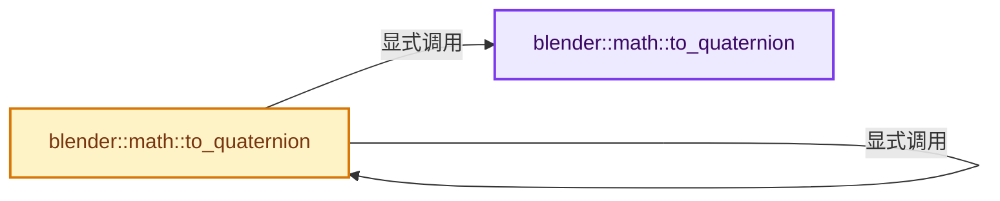

# 实现依赖专题：source/blender/blenlib/BLI_math_euler.hh

[实现依赖导航](../README.md) · [符号索引](../../00-课程指南/02-源码与提交索引/符号依赖与实现索引.md)

本专题从正文实际调用进入，集中保存共享实现。函数有稳定锚点，可从调用处直接跳到对应完整函数；递归与互相调用通过回链组织。

## 本文件的实现关系




## 完整成员与函数实现

<a id="f-dfb9029b915ba7ec"></a>

### `blender::math::to_quaternion`

实现位置：[source/blender/blenlib/BLI_math_euler.hh](../../../../../../source/blender/blenlib/BLI_math_euler.hh) · L50—L73。

接口参数：

- `const EulerXYZBase<T> &eul`

**教学注释版**

<!-- annotated:7fb9517e1edcb8 -->

```cpp
template<typename T> QuaternionBase<T> to_quaternion(const EulerXYZBase<T> &eul)
{
  using AngleT = typename EulerXYZBase<T>::AngleT;
  const AngleT h_angle_i = eul.x() / 2;
  const AngleT h_angle_j = eul.y() / 2;
  const AngleT h_angle_k = eul.z() / 2;
  const T cos_i = math::cos(h_angle_i);
  const T cos_j = math::cos(h_angle_j);
  const T cos_k = math::cos(h_angle_k);
  const T sin_i = math::sin(h_angle_i);
  const T sin_j = math::sin(h_angle_j);
  const T sin_k = math::sin(h_angle_k);
  const T cos_cos = cos_i * cos_k;
  const T cos_sin = cos_i * sin_k;
  const T sin_cos = sin_i * cos_k;
  const T sin_sin = sin_i * sin_k;

  QuaternionBase<T> quat;
  quat.w = cos_j * cos_cos + sin_j * sin_sin;
  quat.x = cos_j * sin_cos - sin_j * cos_sin;
  quat.y = cos_j * sin_sin + sin_j * cos_cos;
  quat.z = cos_j * cos_sin - sin_j * sin_cos;
  return quat;
}
```

<details>
<summary>核对原始源码：source/blender/blenlib/BLI_math_euler.hh · L50—L73</summary>

<!-- original:7fb9517e1edcb8:source/blender/blenlib/BLI_math_euler.hh:50:73 -->

```cpp
template<typename T> QuaternionBase<T> to_quaternion(const EulerXYZBase<T> &eul)
{
  using AngleT = typename EulerXYZBase<T>::AngleT;
  const AngleT h_angle_i = eul.x() / 2;
  const AngleT h_angle_j = eul.y() / 2;
  const AngleT h_angle_k = eul.z() / 2;
  const T cos_i = math::cos(h_angle_i);
  const T cos_j = math::cos(h_angle_j);
  const T cos_k = math::cos(h_angle_k);
  const T sin_i = math::sin(h_angle_i);
  const T sin_j = math::sin(h_angle_j);
  const T sin_k = math::sin(h_angle_k);
  const T cos_cos = cos_i * cos_k;
  const T cos_sin = cos_i * sin_k;
  const T sin_cos = sin_i * cos_k;
  const T sin_sin = sin_i * sin_k;

  QuaternionBase<T> quat;
  quat.w = cos_j * cos_cos + sin_j * sin_sin;
  quat.x = cos_j * sin_cos - sin_j * cos_sin;
  quat.y = cos_j * sin_sin + sin_j * cos_cos;
  quat.z = cos_j * cos_sin - sin_j * sin_cos;
  return quat;
}
```

</details>

**沿实际写入检查状态**

- `quat.w = cos_j * cos_cos + sin_j * sin_sin;`
- `quat.x = cos_j * sin_cos - sin_j * cos_sin;`
- `quat.y = cos_j * sin_sin + sin_j * cos_cos;`
- `quat.z = cos_j * cos_sin - sin_j * sin_cos;`

**结果出口**

- `return quat;`

**继续追踪实现**

- `eul.x` → [调用协议](../../00-课程指南/01-路线与规范/模板宏与动态分派协议.md)：由接收对象具体类型或运行时策略提供实现。调用位置L53。
- `eul.y` → [调用协议](../../00-课程指南/01-路线与规范/模板宏与动态分派协议.md)：由接收对象具体类型或运行时策略提供实现。调用位置L54。
- `eul.z` → [调用协议](../../00-课程指南/01-路线与规范/模板宏与动态分派协议.md)：由接收对象具体类型或运行时策略提供实现。调用位置L55。
- `math::cos` → [外部契约](https://eel.is/c++draft/)：这个边界按实际表达式及所属类型核对参数、返回值、寿命与失败行为。这里提供接口入口，不声称已解释该第三方版本的内部实现。
- `math::sin` → [外部契约](https://eel.is/c++draft/)：这个边界按实际表达式及所属类型核对参数、返回值、寿命与失败行为。这里提供接口入口，不声称已解释该第三方版本的内部实现。

<a id="f-e3803542ea9383ea"></a>

### `blender::math::to_quaternion`

实现位置：[source/blender/blenlib/BLI_math_euler.hh](../../../../../../source/blender/blenlib/BLI_math_euler.hh) · L75—L90。

接口参数：

- `const Euler3Base<T> &eulO`

**教学注释版**

<!-- annotated:7be8deb277338a -->

```cpp
template<typename T> QuaternionBase<T> to_quaternion(const Euler3Base<T> &eulO)
{
  /* Swizzle to XYZ. */
  EulerXYZBase<T> eul_xyz{eulO.ijk()};
  /* Flip with parity. */
  eul_xyz.y() = eulO.parity() ? -eul_xyz.y() : eul_xyz.y();
  /* Quaternion conversion. */
  QuaternionBase<T> quat = to_quaternion(eul_xyz);
  /* Swizzle back from XYZ. */
  VecBase<T, 3> quat_xyz;
  quat_xyz[eulO.i_index()] = quat.x;
  quat_xyz[eulO.j_index()] = eulO.parity() ? -quat.y : quat.y;
  quat_xyz[eulO.k_index()] = quat.z;

  return {quat.w, UNPACK3(quat_xyz)};
}
```

<details>
<summary>核对原始源码：source/blender/blenlib/BLI_math_euler.hh · L75—L90</summary>

<!-- original:7be8deb277338a:source/blender/blenlib/BLI_math_euler.hh:75:90 -->

```cpp
template<typename T> QuaternionBase<T> to_quaternion(const Euler3Base<T> &eulO)
{
  /* Swizzle to XYZ. */
  EulerXYZBase<T> eul_xyz{eulO.ijk()};
  /* Flip with parity. */
  eul_xyz.y() = eulO.parity() ? -eul_xyz.y() : eul_xyz.y();
  /* Quaternion conversion. */
  QuaternionBase<T> quat = to_quaternion(eul_xyz);
  /* Swizzle back from XYZ. */
  VecBase<T, 3> quat_xyz;
  quat_xyz[eulO.i_index()] = quat.x;
  quat_xyz[eulO.j_index()] = eulO.parity() ? -quat.y : quat.y;
  quat_xyz[eulO.k_index()] = quat.z;

  return {quat.w, UNPACK3(quat_xyz)};
}
```

</details>

**结果出口**

- `return {quat.w, UNPACK3(quat_xyz)};`

**继续追踪实现**

- `eulO.ijk` → [blender::math::Euler3Base::ijk · L279](BLI_math_euler_types.hh.md#f-041bf3c023b8c183)；[blender::math::Euler3Base::ijk · L283](BLI_math_euler_types.hh.md#f-5911031b29ac571f)。同名重载需按实参类型选择。
- `eul_xyz.y` → [调用协议](../../00-课程指南/01-路线与规范/模板宏与动态分派协议.md)：由接收对象具体类型或运行时策略提供实现。调用位置L80。
- `eulO.parity` → [blender::math::Euler3Base::parity · L351](BLI_math_euler_types.hh.md#f-bfefe8df5b9453de)。
- `to_quaternion` → [blender::math::to_quaternion · L50](BLI_math_euler.hh.md#f-dfb9029b915ba7ec)；[blender::math::to_quaternion · L75](BLI_math_euler.hh.md#f-e3803542ea9383ea)。同名重载需按实参类型选择。
- `eulO.i_index` → [blender::math::Euler3Base::i_index · L371](BLI_math_euler_types.hh.md#f-fa3c4c3544a20d04)。
- `eulO.j_index` → [blender::math::Euler3Base::j_index · L392](BLI_math_euler_types.hh.md#f-27a230f6f9420279)。
- `eulO.k_index` → [blender::math::Euler3Base::k_index · L413](BLI_math_euler_types.hh.md#f-c567f24891171510)。
- `UNPACK3` → [UNPACK3 · L23](../07-Intern运行时与平台/ghost/intern/GHOST_utildefines.hh.md#m-f882324eb80a)；[UNPACK3 · L235](BLI_utildefines.hh.md#m-bbbbdcf09d3b)；[UNPACK3 · L14](../08-其他Blender模块/gpu/shaders/common/gpu_shader_utildefines.bsl.hh.md#m-b4e3357a0310)。宏定义由构建条件选择。
