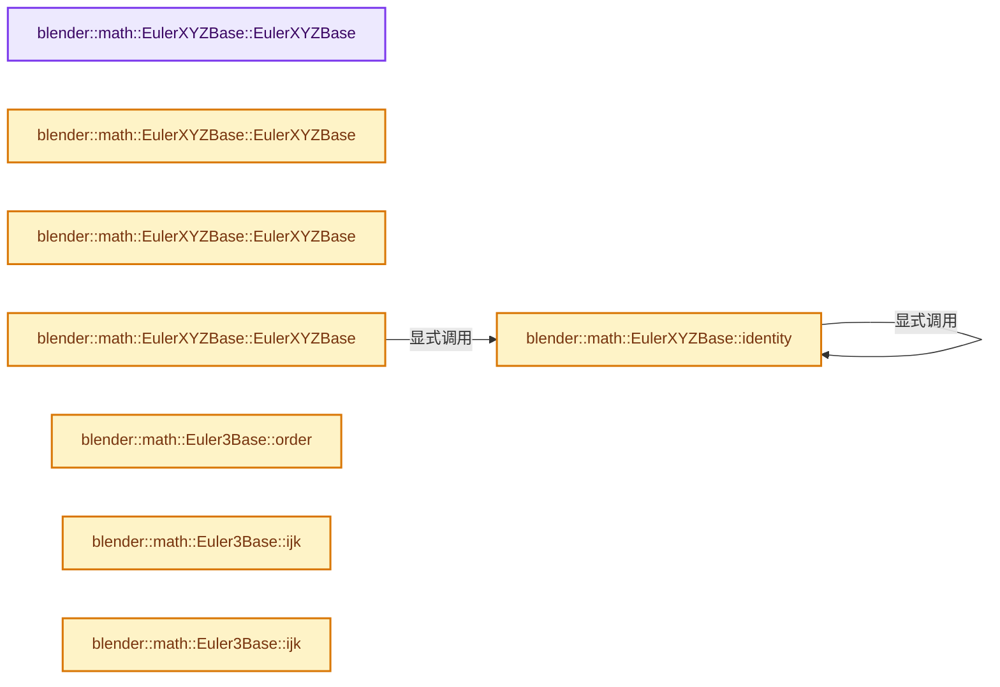
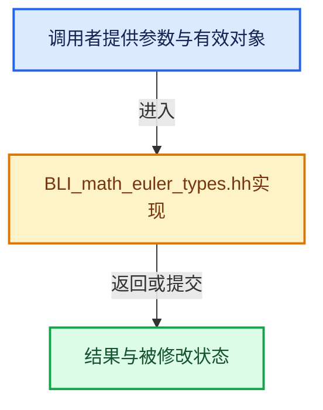

# 实现依赖专题：source/blender/blenlib/BLI_math_euler_types.hh

[实现依赖导航](../README.md) · [符号索引](../../00-课程指南/02-源码与提交索引/符号依赖与实现索引.md)

本专题从正文实际调用进入，集中保存共享实现。函数有稳定锚点，可从调用处直接跳到对应完整函数；递归与互相调用通过回链组织。

## 本文件的实现关系






## 完整成员与函数实现

<a id="f-4b5930b188762577"></a>

### `blender::math::EulerXYZBase::EulerXYZBase`

实现位置：[source/blender/blenlib/BLI_math_euler_types.hh](../../../../../../source/blender/blenlib/BLI_math_euler_types.hh) · L139—L139。

**教学注释版**

<!-- annotated:2ade7a3322433c -->

```cpp
  EulerXYZBase() = default;
```

<details>
<summary>核对原始源码：source/blender/blenlib/BLI_math_euler_types.hh · L139—L139</summary>

<!-- original:2ade7a3322433c:source/blender/blenlib/BLI_math_euler_types.hh:139:139 -->

```cpp
  EulerXYZBase() = default;
```

</details>

**继续追踪实现**

本实现没有需要继续展开的显式调用；检查返回表达式、对象转换和调用者前置条件。

<a id="f-fb79082297f8eb7a"></a>

### `blender::math::EulerXYZBase::EulerXYZBase`

实现位置：[source/blender/blenlib/BLI_math_euler_types.hh](../../../../../../source/blender/blenlib/BLI_math_euler_types.hh) · L144—L144。

接口参数：

- `const VecBase<AngleU, 3> &vec`

**教学注释版**

<!-- annotated:12442ac3ef7081 -->

```cpp
  template<typename AngleU> EulerXYZBase(const VecBase<AngleU, 3> &vec) : EulerBase<T>(vec) {};
```

<details>
<summary>核对原始源码：source/blender/blenlib/BLI_math_euler_types.hh · L144—L144</summary>

<!-- original:12442ac3ef7081:source/blender/blenlib/BLI_math_euler_types.hh:144:144 -->

```cpp
  template<typename AngleU> EulerXYZBase(const VecBase<AngleU, 3> &vec) : EulerBase<T>(vec) {};
```

</details>

**继续追踪实现**

本实现没有需要继续展开的显式调用；检查返回表达式、对象转换和调用者前置条件。

<a id="f-e415bd8fa35027a1"></a>

### `blender::math::EulerXYZBase::EulerXYZBase`

实现位置：[source/blender/blenlib/BLI_math_euler_types.hh](../../../../../../source/blender/blenlib/BLI_math_euler_types.hh) · L146—L146。

接口参数：

- `const AngleT &x`
- `const AngleT &y`
- `const AngleT &z`

**教学注释版**

<!-- annotated:8f53650cd421c6 -->

```cpp
  EulerXYZBase(const AngleT &x, const AngleT &y, const AngleT &z) : EulerBase<T>(x, y, z) {};
```

<details>
<summary>核对原始源码：source/blender/blenlib/BLI_math_euler_types.hh · L146—L146</summary>

<!-- original:8f53650cd421c6:source/blender/blenlib/BLI_math_euler_types.hh:146:146 -->

```cpp
  EulerXYZBase(const AngleT &x, const AngleT &y, const AngleT &z) : EulerBase<T>(x, y, z) {};
```

</details>

**继续追踪实现**

本实现没有需要继续展开的显式调用；检查返回表达式、对象转换和调用者前置条件。

<a id="f-801148022321d382"></a>

### `blender::math::EulerXYZBase::EulerXYZBase`

实现位置：[source/blender/blenlib/BLI_math_euler_types.hh](../../../../../../source/blender/blenlib/BLI_math_euler_types.hh) · L152—L156。

接口参数：

- `const Axis axis`
- `const AngleT &angle`

**教学注释版**

<!-- annotated:646543cb80bd85 -->

```cpp
  EulerXYZBase(const Axis axis, const AngleT &angle)
  {
    *this = identity();
    this->xyz_[axis] = angle;
  }
```

<details>
<summary>核对原始源码：source/blender/blenlib/BLI_math_euler_types.hh · L152—L156</summary>

<!-- original:646543cb80bd85:source/blender/blenlib/BLI_math_euler_types.hh:152:156 -->

```cpp
  EulerXYZBase(const Axis axis, const AngleT &angle)
  {
    *this = identity();
    this->xyz_[axis] = angle;
  }
```

</details>

**沿实际写入检查状态**

- `this->xyz_[axis] = angle;`

**继续追踪实现**

- `identity` → [blender::math::EulerXYZBase::identity · L160](BLI_math_euler_types.hh.md#f-9769abe8b1478922)。

<a id="f-9769abe8b1478922"></a>

### `blender::math::EulerXYZBase::identity`

实现位置：[source/blender/blenlib/BLI_math_euler_types.hh](../../../../../../source/blender/blenlib/BLI_math_euler_types.hh) · L160—L165。

**教学注释版**

<!-- annotated:6fdfcb7a035e05 -->

```cpp
  static EulerXYZBase identity()
  {
    return {AngleRadianBase<T>::identity(),
            AngleRadianBase<T>::identity(),
            AngleRadianBase<T>::identity()};
  }
```

<details>
<summary>核对原始源码：source/blender/blenlib/BLI_math_euler_types.hh · L160—L165</summary>

<!-- original:6fdfcb7a035e05:source/blender/blenlib/BLI_math_euler_types.hh:160:165 -->

```cpp
  static EulerXYZBase identity()
  {
    return {AngleRadianBase<T>::identity(),
            AngleRadianBase<T>::identity(),
            AngleRadianBase<T>::identity()};
  }
```

</details>

**结果出口**

- `return {AngleRadianBase<T>::identity(),`

**继续追踪实现**

- `AngleRadianBase<T>::identity` → [blender::math::EulerXYZBase::identity · L160](BLI_math_euler_types.hh.md#f-9769abe8b1478922)。

<a id="f-fab1792bfc8e4d1d"></a>

### `blender::math::Euler3Base::order`

实现位置：[source/blender/blenlib/BLI_math_euler_types.hh](../../../../../../source/blender/blenlib/BLI_math_euler_types.hh) · L270—L273。

**教学注释版**

<!-- annotated:8dcbd4732cc070 -->

```cpp
  const EulerOrder &order() const
  {
    return order_;
  }
```

<details>
<summary>核对原始源码：source/blender/blenlib/BLI_math_euler_types.hh · L270—L273</summary>

<!-- original:8dcbd4732cc070:source/blender/blenlib/BLI_math_euler_types.hh:270:273 -->

```cpp
  const EulerOrder &order() const
  {
    return order_;
  }
```

</details>

**结果出口**

- `return order_;`

**继续追踪实现**

本实现没有需要继续展开的显式调用；检查返回表达式、对象转换和调用者前置条件。

<a id="f-041bf3c023b8c183"></a>

### `blender::math::Euler3Base::ijk`

实现位置：[source/blender/blenlib/BLI_math_euler_types.hh](../../../../../../source/blender/blenlib/BLI_math_euler_types.hh) · L279—L282。

**教学注释版**

<!-- annotated:b8eba967790589 -->

```cpp
  Swizzle ijk()
  {
    return Swizzle{*this};
  }
```

<details>
<summary>核对原始源码：source/blender/blenlib/BLI_math_euler_types.hh · L279—L282</summary>

<!-- original:b8eba967790589:source/blender/blenlib/BLI_math_euler_types.hh:279:282 -->

```cpp
  Swizzle ijk()
  {
    return Swizzle{*this};
  }
```

</details>

**结果出口**

- `return Swizzle{*this};`

**继续追踪实现**

本实现没有需要继续展开的显式调用；检查返回表达式、对象转换和调用者前置条件。

<a id="f-5911031b29ac571f"></a>

### `blender::math::Euler3Base::ijk`

实现位置：[source/blender/blenlib/BLI_math_euler_types.hh](../../../../../../source/blender/blenlib/BLI_math_euler_types.hh) · L283—L286。

**教学注释版**

<!-- annotated:207bcab1330b01 -->

```cpp
  VecBase<AngleT, 3> ijk() const
  {
    return {i(), j(), k()};
  }
```

<details>
<summary>核对原始源码：source/blender/blenlib/BLI_math_euler_types.hh · L283—L286</summary>

<!-- original:207bcab1330b01:source/blender/blenlib/BLI_math_euler_types.hh:283:286 -->

```cpp
  VecBase<AngleT, 3> ijk() const
  {
    return {i(), j(), k()};
  }
```

</details>

**结果出口**

- `return {i(), j(), k()};`

**继续追踪实现**

- `i` → [blender::math::Euler3Base::i · L292](BLI_math_euler_types.hh.md#f-489131b8534a9621)；[blender::math::Euler3Base::i · L304](BLI_math_euler_types.hh.md#f-ddd9fa2af4009415)。同名重载需按实参类型选择。
- `j` → [blender::math::Euler3Base::j · L296](BLI_math_euler_types.hh.md#f-649eb44628c301ef)；[blender::math::Euler3Base::j · L308](BLI_math_euler_types.hh.md#f-4b31148a589472b9)。同名重载需按实参类型选择。
- `k` → [blender::math::Euler3Base::k · L300](BLI_math_euler_types.hh.md#f-6825b0d657055bf1)；[blender::math::Euler3Base::k · L312](BLI_math_euler_types.hh.md#f-4b562b4adb3a2323)。同名重载需按实参类型选择。

<a id="f-489131b8534a9621"></a>

### `blender::math::Euler3Base::i`

实现位置：[source/blender/blenlib/BLI_math_euler_types.hh](../../../../../../source/blender/blenlib/BLI_math_euler_types.hh) · L292—L295。

**教学注释版**

<!-- annotated:88d7e997c3a6cc -->

```cpp
  const AngleT &i() const
  {
    return this->xyz_[i_index()];
  }
```

<details>
<summary>核对原始源码：source/blender/blenlib/BLI_math_euler_types.hh · L292—L295</summary>

<!-- original:88d7e997c3a6cc:source/blender/blenlib/BLI_math_euler_types.hh:292:295 -->

```cpp
  const AngleT &i() const
  {
    return this->xyz_[i_index()];
  }
```

</details>

**结果出口**

- `return this->xyz_[i_index()];`

**继续追踪实现**

- `i_index` → [blender::math::Euler3Base::i_index · L371](BLI_math_euler_types.hh.md#f-fa3c4c3544a20d04)。

<a id="f-649eb44628c301ef"></a>

### `blender::math::Euler3Base::j`

实现位置：[source/blender/blenlib/BLI_math_euler_types.hh](../../../../../../source/blender/blenlib/BLI_math_euler_types.hh) · L296—L299。

**教学注释版**

<!-- annotated:3d9da8fe04a8f6 -->

```cpp
  const AngleT &j() const
  {
    return this->xyz_[j_index()];
  }
```

<details>
<summary>核对原始源码：source/blender/blenlib/BLI_math_euler_types.hh · L296—L299</summary>

<!-- original:3d9da8fe04a8f6:source/blender/blenlib/BLI_math_euler_types.hh:296:299 -->

```cpp
  const AngleT &j() const
  {
    return this->xyz_[j_index()];
  }
```

</details>

**结果出口**

- `return this->xyz_[j_index()];`

**继续追踪实现**

- `j_index` → [blender::math::Euler3Base::j_index · L392](BLI_math_euler_types.hh.md#f-27a230f6f9420279)。

<a id="f-6825b0d657055bf1"></a>

### `blender::math::Euler3Base::k`

实现位置：[source/blender/blenlib/BLI_math_euler_types.hh](../../../../../../source/blender/blenlib/BLI_math_euler_types.hh) · L300—L303。

**教学注释版**

<!-- annotated:87a2e621aea595 -->

```cpp
  const AngleT &k() const
  {
    return this->xyz_[k_index()];
  }
```

<details>
<summary>核对原始源码：source/blender/blenlib/BLI_math_euler_types.hh · L300—L303</summary>

<!-- original:87a2e621aea595:source/blender/blenlib/BLI_math_euler_types.hh:300:303 -->

```cpp
  const AngleT &k() const
  {
    return this->xyz_[k_index()];
  }
```

</details>

**结果出口**

- `return this->xyz_[k_index()];`

**继续追踪实现**

- `k_index` → [blender::math::Euler3Base::k_index · L413](BLI_math_euler_types.hh.md#f-c567f24891171510)。

<a id="f-ddd9fa2af4009415"></a>

### `blender::math::Euler3Base::i`

实现位置：[source/blender/blenlib/BLI_math_euler_types.hh](../../../../../../source/blender/blenlib/BLI_math_euler_types.hh) · L304—L307。

**教学注释版**

<!-- annotated:f0aa6369325e43 -->

```cpp
  AngleT &i()
  {
    return this->xyz_[i_index()];
  }
```

<details>
<summary>核对原始源码：source/blender/blenlib/BLI_math_euler_types.hh · L304—L307</summary>

<!-- original:f0aa6369325e43:source/blender/blenlib/BLI_math_euler_types.hh:304:307 -->

```cpp
  AngleT &i()
  {
    return this->xyz_[i_index()];
  }
```

</details>

**结果出口**

- `return this->xyz_[i_index()];`

**继续追踪实现**

- `i_index` → [blender::math::Euler3Base::i_index · L371](BLI_math_euler_types.hh.md#f-fa3c4c3544a20d04)。

<a id="f-4b31148a589472b9"></a>

### `blender::math::Euler3Base::j`

实现位置：[source/blender/blenlib/BLI_math_euler_types.hh](../../../../../../source/blender/blenlib/BLI_math_euler_types.hh) · L308—L311。

**教学注释版**

<!-- annotated:870a3e3f0d6299 -->

```cpp
  AngleT &j()
  {
    return this->xyz_[j_index()];
  }
```

<details>
<summary>核对原始源码：source/blender/blenlib/BLI_math_euler_types.hh · L308—L311</summary>

<!-- original:870a3e3f0d6299:source/blender/blenlib/BLI_math_euler_types.hh:308:311 -->

```cpp
  AngleT &j()
  {
    return this->xyz_[j_index()];
  }
```

</details>

**结果出口**

- `return this->xyz_[j_index()];`

**继续追踪实现**

- `j_index` → [blender::math::Euler3Base::j_index · L392](BLI_math_euler_types.hh.md#f-27a230f6f9420279)。

<a id="f-4b562b4adb3a2323"></a>

### `blender::math::Euler3Base::k`

实现位置：[source/blender/blenlib/BLI_math_euler_types.hh](../../../../../../source/blender/blenlib/BLI_math_euler_types.hh) · L312—L315。

**教学注释版**

<!-- annotated:20d4466c31f29e -->

```cpp
  AngleT &k()
  {
    return this->xyz_[k_index()];
  }
```

<details>
<summary>核对原始源码：source/blender/blenlib/BLI_math_euler_types.hh · L312—L315</summary>

<!-- original:20d4466c31f29e:source/blender/blenlib/BLI_math_euler_types.hh:312:315 -->

```cpp
  AngleT &k()
  {
    return this->xyz_[k_index()];
  }
```

</details>

**结果出口**

- `return this->xyz_[k_index()];`

**继续追踪实现**

- `k_index` → [blender::math::Euler3Base::k_index · L413](BLI_math_euler_types.hh.md#f-c567f24891171510)。

<a id="f-bfefe8df5b9453de"></a>

### `blender::math::Euler3Base::parity`

实现位置：[source/blender/blenlib/BLI_math_euler_types.hh](../../../../../../source/blender/blenlib/BLI_math_euler_types.hh) · L351—L366。

**教学注释版**

<!-- annotated:6370e05f3d54bf -->

```cpp
  bool parity() const
  {
    switch (order_) {
      default:
        BLI_assert_unreachable();
        return false;
      case XYZ:
      case ZXY:
      case YZX:
        return false;
      case XZY:
      case YXZ:
      case ZYX:
        return true;
    }
  }
```

<details>
<summary>核对原始源码：source/blender/blenlib/BLI_math_euler_types.hh · L351—L366</summary>

<!-- original:6370e05f3d54bf:source/blender/blenlib/BLI_math_euler_types.hh:351:366 -->

```cpp
  bool parity() const
  {
    switch (order_) {
      default:
        BLI_assert_unreachable();
        return false;
      case XYZ:
      case ZXY:
      case YZX:
        return false;
      case XZY:
      case YXZ:
      case ZYX:
        return true;
    }
  }
```

</details>

**结果出口**

- `return false;`
- `return true;`

**继续追踪实现**

- `BLI_assert_unreachable` → [BLI_assert_unreachable · L77](BLI_assert.hh.md#m-7a2d91a67d8e)。宏定义由构建条件选择。

<a id="f-fa3c4c3544a20d04"></a>

### `blender::math::Euler3Base::i_index`

实现位置：[source/blender/blenlib/BLI_math_euler_types.hh](../../../../../../source/blender/blenlib/BLI_math_euler_types.hh) · L371—L387。

**教学注释版**

<!-- annotated:f6ea35127a325e -->

```cpp
  int i_index() const
  {
    switch (order_) {
      default:
        BLI_assert_unreachable();
        return 0;
      case XYZ:
      case XZY:
        return 0;
      case YXZ:
      case YZX:
        return 1;
      case ZXY:
      case ZYX:
        return 2;
    }
  }
```

<details>
<summary>核对原始源码：source/blender/blenlib/BLI_math_euler_types.hh · L371—L387</summary>

<!-- original:f6ea35127a325e:source/blender/blenlib/BLI_math_euler_types.hh:371:387 -->

```cpp
  int i_index() const
  {
    switch (order_) {
      default:
        BLI_assert_unreachable();
        return 0;
      case XYZ:
      case XZY:
        return 0;
      case YXZ:
      case YZX:
        return 1;
      case ZXY:
      case ZYX:
        return 2;
    }
  }
```

</details>

**结果出口**

- `return 0;`
- `return 1;`
- `return 2;`

**继续追踪实现**

- `BLI_assert_unreachable` → [BLI_assert_unreachable · L77](BLI_assert.hh.md#m-7a2d91a67d8e)。宏定义由构建条件选择。

<a id="f-27a230f6f9420279"></a>

### `blender::math::Euler3Base::j_index`

实现位置：[source/blender/blenlib/BLI_math_euler_types.hh](../../../../../../source/blender/blenlib/BLI_math_euler_types.hh) · L392—L408。

**教学注释版**

<!-- annotated:aa89956cedb7cc -->

```cpp
  int j_index() const
  {
    switch (order_) {
      default:
        BLI_assert_unreachable();
        return 0;
      case YXZ:
      case ZXY:
        return 0;
      case XYZ:
      case ZYX:
        return 1;
      case XZY:
      case YZX:
        return 2;
    }
  }
```

<details>
<summary>核对原始源码：source/blender/blenlib/BLI_math_euler_types.hh · L392—L408</summary>

<!-- original:aa89956cedb7cc:source/blender/blenlib/BLI_math_euler_types.hh:392:408 -->

```cpp
  int j_index() const
  {
    switch (order_) {
      default:
        BLI_assert_unreachable();
        return 0;
      case YXZ:
      case ZXY:
        return 0;
      case XYZ:
      case ZYX:
        return 1;
      case XZY:
      case YZX:
        return 2;
    }
  }
```

</details>

**结果出口**

- `return 0;`
- `return 1;`
- `return 2;`

**继续追踪实现**

- `BLI_assert_unreachable` → [BLI_assert_unreachable · L77](BLI_assert.hh.md#m-7a2d91a67d8e)。宏定义由构建条件选择。

<a id="f-c567f24891171510"></a>

### `blender::math::Euler3Base::k_index`

实现位置：[source/blender/blenlib/BLI_math_euler_types.hh](../../../../../../source/blender/blenlib/BLI_math_euler_types.hh) · L413—L429。

**教学注释版**

<!-- annotated:6bd47d6b749836 -->

```cpp
  int k_index() const
  {
    switch (order_) {
      default:
        BLI_assert_unreachable();
        return 0;
      case YZX:
      case ZYX:
        return 0;
      case XZY:
      case ZXY:
        return 1;
      case XYZ:
      case YXZ:
        return 2;
    }
  }
```

<details>
<summary>核对原始源码：source/blender/blenlib/BLI_math_euler_types.hh · L413—L429</summary>

<!-- original:6bd47d6b749836:source/blender/blenlib/BLI_math_euler_types.hh:413:429 -->

```cpp
  int k_index() const
  {
    switch (order_) {
      default:
        BLI_assert_unreachable();
        return 0;
      case YZX:
      case ZYX:
        return 0;
      case XZY:
      case ZXY:
        return 1;
      case XYZ:
      case YXZ:
        return 2;
    }
  }
```

</details>

**结果出口**

- `return 0;`
- `return 1;`
- `return 2;`

**继续追踪实现**

- `BLI_assert_unreachable` → [BLI_assert_unreachable · L77](BLI_assert.hh.md#m-7a2d91a67d8e)。宏定义由构建条件选择。
