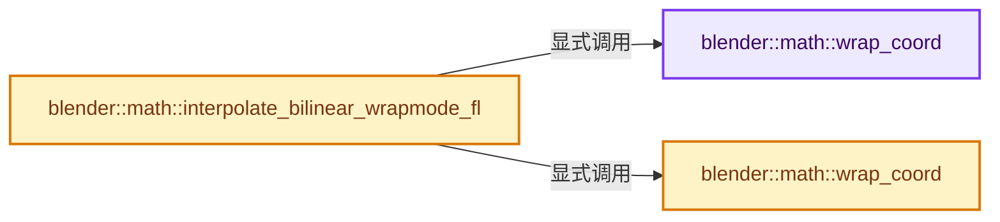
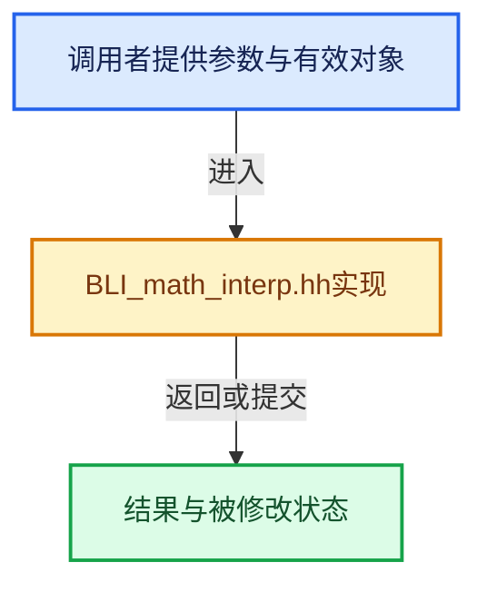

# 实现依赖专题：source/blender/blenlib/BLI_math_interp.hh

[实现依赖导航](../README.md) · [符号索引](../../00-课程指南/02-源码与提交索引/符号依赖与实现索引.md)

本专题从正文实际调用进入，集中保存共享实现。函数有稳定锚点，可从调用处直接跳到对应完整函数；递归与互相调用通过回链组织。

## 本文件的实现关系






## 完整成员与函数实现

<a id="f-b80f3186589fa2f8"></a>

### `blender::math::wrap_coord`

实现位置：[source/blender/blenlib/BLI_math_interp.hh](../../../../../../source/blender/blenlib/BLI_math_interp.hh) · L48—L73。

接口参数：

- `float u`
- `int32_t size`
- `InterpWrapMode wrap`

**教学注释版**

<!-- annotated:ba927401802ce4 -->

```cpp
BLI_INLINE int32_t wrap_coord(float u, int32_t size, InterpWrapMode wrap)
{
  if (u >= 0) {
    if (u < float(size)) {
      return int32_t(u);
    }
    switch (wrap) {
      default: /* case InterpWrapMode::Extend: */
        return size - 1;
      case InterpWrapMode::Repeat:
        return int32_t(uint32_t(u) % uint32_t(size));
      case InterpWrapMode::Border:
        return -1;
    }
  }
  switch (wrap) {
    default: /* case InterpWrapMode::Extend: */
      return 0;
    case InterpWrapMode::Repeat: {
      int32_t x = int32_t(uint32_t(-floorf(u)) % uint32_t(size));
      return x ? size - x : 0;
    }
    case InterpWrapMode::Border:
      return -1;
  }
}
```

<details>
<summary>核对原始源码：source/blender/blenlib/BLI_math_interp.hh · L48—L73</summary>

<!-- original:ba927401802ce4:source/blender/blenlib/BLI_math_interp.hh:48:73 -->

```cpp
BLI_INLINE int32_t wrap_coord(float u, int32_t size, InterpWrapMode wrap)
{
  if (u >= 0) {
    if (u < float(size)) {
      return int32_t(u);
    }
    switch (wrap) {
      default: /* case InterpWrapMode::Extend: */
        return size - 1;
      case InterpWrapMode::Repeat:
        return int32_t(uint32_t(u) % uint32_t(size));
      case InterpWrapMode::Border:
        return -1;
    }
  }
  switch (wrap) {
    default: /* case InterpWrapMode::Extend: */
      return 0;
    case InterpWrapMode::Repeat: {
      int32_t x = int32_t(uint32_t(-floorf(u)) % uint32_t(size));
      return x ? size - x : 0;
    }
    case InterpWrapMode::Border:
      return -1;
  }
}
```

</details>

**结果出口**

- `return int32_t(u);`
- `return size - 1;`
- `return int32_t(uint32_t(u) % uint32_t(size));`
- `return -1;`
- `return 0;`
- `return x ? size - x : 0;`

**继续追踪实现**

- `floorf` → [floorf · L22](../07-Intern运行时与平台/cycles/kernel/svm/radial_tiling_shared.h.md#m-fb64dda1b0f0)；[floorf · L44](../07-Intern运行时与平台/cycles/kernel/svm/radial_tiling_shared.h.md#m-25e4a157b53d)；[floorf · L75](../07-Intern运行时与平台/cycles/kernel/svm/radial_tiling_shared.h.md#m-e128f662cbe8)；[floorf · L26](intern/radial_tiling_shared.hh.md#m-ebadf845d492)；[floorf · L48](intern/radial_tiling_shared.hh.md#m-efe0b148573a)；[floorf · L79](intern/radial_tiling_shared.hh.md#m-9df2f26758e8)；[floorf · L22](../07-Intern运行时与平台/cycles/kernel/osl/shaders/node_radial_tiling_shared.h.md#m-6b2e29ad4b19)；[floorf · L44](../07-Intern运行时与平台/cycles/kernel/osl/shaders/node_radial_tiling_shared.h.md#m-f90222d9b445)；[floorf · L75](../07-Intern运行时与平台/cycles/kernel/osl/shaders/node_radial_tiling_shared.h.md#m-938380992bb5)；[floorf · L172](../07-Intern运行时与平台/cycles/kernel/device/oneapi/compat.h.md#m-176475a253a6)；[floorf · L270](../07-Intern运行时与平台/cycles/kernel/device/metal/compat.h.md#m-fb37dbc77698)；[floorf · L49](../08-其他Blender模块/gpu/GPU_shader_shared_utils.hh.md#m-e7115fdd7560)；[floorf · L70](../08-其他Blender模块/gpu/GPU_shader_shared_utils.hh.md#m-aee5f6a438e4)。宏定义由构建条件选择。

<a id="f-05114b69a428ae86"></a>

### `blender::math::wrap_coord`

实现位置：[source/blender/blenlib/BLI_math_interp.hh](../../../../../../source/blender/blenlib/BLI_math_interp.hh) · L229—L236。

接口参数：

- `float u`
- `int32_t size`

**教学注释版**

<!-- annotated:9ed41c48b5091a -->

```cpp
[[nodiscard]] inline int32_t wrap_coord(float u, int32_t size)
{
  if (u < 0) {
    int32_t x = int(uint32_t(-floor(u)) % uint32_t(size));
    return x ? size - x : 0;
  }
  return int(uint32_t(u) % uint32_t(size));
}
```

<details>
<summary>核对原始源码：source/blender/blenlib/BLI_math_interp.hh · L229—L236</summary>

<!-- original:9ed41c48b5091a:source/blender/blenlib/BLI_math_interp.hh:229:236 -->

```cpp
[[nodiscard]] inline int32_t wrap_coord(float u, int32_t size)
{
  if (u < 0) {
    int32_t x = int(uint32_t(-floor(u)) % uint32_t(size));
    return x ? size - x : 0;
  }
  return int(uint32_t(u) % uint32_t(size));
}
```

</details>

**结果出口**

- `return x ? size - x : 0;`
- `return int(uint32_t(u) % uint32_t(size));`

**继续追踪实现**

- `floor` → [外部契约](https://eel.is/c++draft/)：这个边界按实际表达式及所属类型核对参数、返回值、寿命与失败行为。这里提供接口入口，不声称已解释该第三方版本的内部实现。

<a id="f-198dd9afe05eedc9"></a>

### `blender::math::interpolate_bilinear_wrapmode_fl`

实现位置：[source/blender/blenlib/BLI_math_interp.hh](../../../../../../source/blender/blenlib/BLI_math_interp.hh) · L290—L378。

接口参数：

- `const float *buffer`
- `float *output`
- `int width`
- `int height`
- `int components`
- `float u`
- `float v`
- `InterpWrapMode wrap_x`
- `InterpWrapMode wrap_y`

**教学注释版**

<!-- annotated:14953e77129702 -->

```cpp
BLI_INLINE void interpolate_bilinear_wrapmode_fl(const float *buffer,
                                                 float *output,
                                                 int width,
                                                 int height,
                                                 int components,
                                                 float u,
                                                 float v,
                                                 InterpWrapMode wrap_x,
                                                 InterpWrapMode wrap_y)
{
  BLI_assert(buffer && output);
  BLI_assert(components > 0 && components <= 4);

  int x1 = wrap_coord(u, width, wrap_x);
  int x2 = wrap_coord(u + 1, width, wrap_x);
  int y1 = wrap_coord(v, height, wrap_y);
  int y2 = wrap_coord(v + 1, height, wrap_y);

  const float *row1, *row2, *row3, *row4;
  const float empty[4] = {0.0f, 0.0f, 0.0f, 0.0f};

  row1 = buffer + (int64_t(width) * y1 + x1) * components;
  row2 = buffer + (int64_t(width) * y2 + x1) * components;
  row3 = buffer + (int64_t(width) * y1 + x2) * components;
  row4 = buffer + (int64_t(width) * y2 + x2) * components;

  if (wrap_x == InterpWrapMode::Border) {
    if (x1 < 0) {
      row1 = empty;
      row2 = empty;
    }
    if (x2 < 0) {
      row3 = empty;
      row4 = empty;
    }
  }
  if (wrap_y == InterpWrapMode::Border) {
    if (y1 < 0) {
      row1 = empty;
      row3 = empty;
    }
    if (y2 < 0) {
      row2 = empty;
      row4 = empty;
    }
  }

  /* Finally, do interpolation. */
  float a = u - floorf(u);
  float b = v - floorf(v);
  float a_b = a * b;
  float ma_b = (1.0f - a) * b;
  float a_mb = a * (1.0f - b);
  float ma_mb = (1.0f - a) * (1.0f - b);

  if (components == 1) {
    output[0] = ma_mb * row1[0] + a_mb * row3[0] + ma_b * row2[0] + a_b * row4[0];
  }
  else if (components == 2) {
    output[0] = ma_mb * row1[0] + a_mb * row3[0] + ma_b * row2[0] + a_b * row4[0];
    output[1] = ma_mb * row1[1] + a_mb * row3[1] + ma_b * row2[1] + a_b * row4[1];
  }
  else if (components == 3) {
    output[0] = ma_mb * row1[0] + a_mb * row3[0] + ma_b * row2[0] + a_b * row4[0];
    output[1] = ma_mb * row1[1] + a_mb * row3[1] + ma_b * row2[1] + a_b * row4[1];
    output[2] = ma_mb * row1[2] + a_mb * row3[2] + ma_b * row2[2] + a_b * row4[2];
  }
  else {
#if BLI_HAVE_SSE2
    __m128 rgba1 = _mm_loadu_ps(row1);
    __m128 rgba2 = _mm_loadu_ps(row2);
    __m128 rgba3 = _mm_loadu_ps(row3);
    __m128 rgba4 = _mm_loadu_ps(row4);
    rgba1 = _mm_mul_ps(_mm_set1_ps(ma_mb), rgba1);
    rgba2 = _mm_mul_ps(_mm_set1_ps(ma_b), rgba2);
    rgba3 = _mm_mul_ps(_mm_set1_ps(a_mb), rgba3);
    rgba4 = _mm_mul_ps(_mm_set1_ps(a_b), rgba4);
    __m128 rgba13 = _mm_add_ps(rgba1, rgba3);
    __m128 rgba24 = _mm_add_ps(rgba2, rgba4);
    __m128 rgba = _mm_add_ps(rgba13, rgba24);
    _mm_storeu_ps(output, rgba);
#else
    output[0] = ma_mb * row1[0] + a_mb * row3[0] + ma_b * row2[0] + a_b * row4[0];
    output[1] = ma_mb * row1[1] + a_mb * row3[1] + ma_b * row2[1] + a_b * row4[1];
    output[2] = ma_mb * row1[2] + a_mb * row3[2] + ma_b * row2[2] + a_b * row4[2];
    output[3] = ma_mb * row1[3] + a_mb * row3[3] + ma_b * row2[3] + a_b * row4[3];
#endif
  }
}
```

<details>
<summary>核对原始源码：source/blender/blenlib/BLI_math_interp.hh · L290—L378</summary>

<!-- original:14953e77129702:source/blender/blenlib/BLI_math_interp.hh:290:378 -->

```cpp
BLI_INLINE void interpolate_bilinear_wrapmode_fl(const float *buffer,
                                                 float *output,
                                                 int width,
                                                 int height,
                                                 int components,
                                                 float u,
                                                 float v,
                                                 InterpWrapMode wrap_x,
                                                 InterpWrapMode wrap_y)
{
  BLI_assert(buffer && output);
  BLI_assert(components > 0 && components <= 4);

  int x1 = wrap_coord(u, width, wrap_x);
  int x2 = wrap_coord(u + 1, width, wrap_x);
  int y1 = wrap_coord(v, height, wrap_y);
  int y2 = wrap_coord(v + 1, height, wrap_y);

  const float *row1, *row2, *row3, *row4;
  const float empty[4] = {0.0f, 0.0f, 0.0f, 0.0f};

  row1 = buffer + (int64_t(width) * y1 + x1) * components;
  row2 = buffer + (int64_t(width) * y2 + x1) * components;
  row3 = buffer + (int64_t(width) * y1 + x2) * components;
  row4 = buffer + (int64_t(width) * y2 + x2) * components;

  if (wrap_x == InterpWrapMode::Border) {
    if (x1 < 0) {
      row1 = empty;
      row2 = empty;
    }
    if (x2 < 0) {
      row3 = empty;
      row4 = empty;
    }
  }
  if (wrap_y == InterpWrapMode::Border) {
    if (y1 < 0) {
      row1 = empty;
      row3 = empty;
    }
    if (y2 < 0) {
      row2 = empty;
      row4 = empty;
    }
  }

  /* Finally, do interpolation. */
  float a = u - floorf(u);
  float b = v - floorf(v);
  float a_b = a * b;
  float ma_b = (1.0f - a) * b;
  float a_mb = a * (1.0f - b);
  float ma_mb = (1.0f - a) * (1.0f - b);

  if (components == 1) {
    output[0] = ma_mb * row1[0] + a_mb * row3[0] + ma_b * row2[0] + a_b * row4[0];
  }
  else if (components == 2) {
    output[0] = ma_mb * row1[0] + a_mb * row3[0] + ma_b * row2[0] + a_b * row4[0];
    output[1] = ma_mb * row1[1] + a_mb * row3[1] + ma_b * row2[1] + a_b * row4[1];
  }
  else if (components == 3) {
    output[0] = ma_mb * row1[0] + a_mb * row3[0] + ma_b * row2[0] + a_b * row4[0];
    output[1] = ma_mb * row1[1] + a_mb * row3[1] + ma_b * row2[1] + a_b * row4[1];
    output[2] = ma_mb * row1[2] + a_mb * row3[2] + ma_b * row2[2] + a_b * row4[2];
  }
  else {
#if BLI_HAVE_SSE2
    __m128 rgba1 = _mm_loadu_ps(row1);
    __m128 rgba2 = _mm_loadu_ps(row2);
    __m128 rgba3 = _mm_loadu_ps(row3);
    __m128 rgba4 = _mm_loadu_ps(row4);
    rgba1 = _mm_mul_ps(_mm_set1_ps(ma_mb), rgba1);
    rgba2 = _mm_mul_ps(_mm_set1_ps(ma_b), rgba2);
    rgba3 = _mm_mul_ps(_mm_set1_ps(a_mb), rgba3);
    rgba4 = _mm_mul_ps(_mm_set1_ps(a_b), rgba4);
    __m128 rgba13 = _mm_add_ps(rgba1, rgba3);
    __m128 rgba24 = _mm_add_ps(rgba2, rgba4);
    __m128 rgba = _mm_add_ps(rgba13, rgba24);
    _mm_storeu_ps(output, rgba);
#else
    output[0] = ma_mb * row1[0] + a_mb * row3[0] + ma_b * row2[0] + a_b * row4[0];
    output[1] = ma_mb * row1[1] + a_mb * row3[1] + ma_b * row2[1] + a_b * row4[1];
    output[2] = ma_mb * row1[2] + a_mb * row3[2] + ma_b * row2[2] + a_b * row4[2];
    output[3] = ma_mb * row1[3] + a_mb * row3[3] + ma_b * row2[3] + a_b * row4[3];
#endif
  }
}
```

</details>

**沿实际写入检查状态**

- `row1 = buffer + (int64_t(width) * y1 + x1) * components;`
- `row2 = buffer + (int64_t(width) * y2 + x1) * components;`
- `row3 = buffer + (int64_t(width) * y1 + x2) * components;`
- `row4 = buffer + (int64_t(width) * y2 + x2) * components;`
- `row1 = empty;`
- `row2 = empty;`
- `row3 = empty;`
- `row4 = empty;`
- `output[0] = ma_mb * row1[0] + a_mb * row3[0] + ma_b * row2[0] + a_b * row4[0];`
- `output[1] = ma_mb * row1[1] + a_mb * row3[1] + ma_b * row2[1] + a_b * row4[1];`
- `output[2] = ma_mb * row1[2] + a_mb * row3[2] + ma_b * row2[2] + a_b * row4[2];`
- `rgba1 = _mm_mul_ps(_mm_set1_ps(ma_mb), rgba1);`
- `rgba2 = _mm_mul_ps(_mm_set1_ps(ma_b), rgba2);`
- `rgba3 = _mm_mul_ps(_mm_set1_ps(a_mb), rgba3);`
- `rgba4 = _mm_mul_ps(_mm_set1_ps(a_b), rgba4);`
- `output[3] = ma_mb * row1[3] + a_mb * row3[3] + ma_b * row2[3] + a_b * row4[3];`

**继续追踪实现**

- `BLI_assert` → [BLI_assert · L48](BLI_assert.hh.md#m-57a88495704d)；[BLI_assert · L63](BLI_assert.hh.md#m-d07050020cb5)。宏定义由构建条件选择。
- `wrap_coord` → [blender::math::wrap_coord · L48](BLI_math_interp.hh.md#f-b80f3186589fa2f8)；[blender::math::wrap_coord · L229](BLI_math_interp.hh.md#f-05114b69a428ae86)。同名重载需按实参类型选择。
- `floorf` → [floorf · L22](../07-Intern运行时与平台/cycles/kernel/svm/radial_tiling_shared.h.md#m-fb64dda1b0f0)；[floorf · L44](../07-Intern运行时与平台/cycles/kernel/svm/radial_tiling_shared.h.md#m-25e4a157b53d)；[floorf · L75](../07-Intern运行时与平台/cycles/kernel/svm/radial_tiling_shared.h.md#m-e128f662cbe8)；[floorf · L26](intern/radial_tiling_shared.hh.md#m-ebadf845d492)；[floorf · L48](intern/radial_tiling_shared.hh.md#m-efe0b148573a)；[floorf · L79](intern/radial_tiling_shared.hh.md#m-9df2f26758e8)；[floorf · L22](../07-Intern运行时与平台/cycles/kernel/osl/shaders/node_radial_tiling_shared.h.md#m-6b2e29ad4b19)；[floorf · L44](../07-Intern运行时与平台/cycles/kernel/osl/shaders/node_radial_tiling_shared.h.md#m-f90222d9b445)；[floorf · L75](../07-Intern运行时与平台/cycles/kernel/osl/shaders/node_radial_tiling_shared.h.md#m-938380992bb5)；[floorf · L172](../07-Intern运行时与平台/cycles/kernel/device/oneapi/compat.h.md#m-176475a253a6)；[floorf · L270](../07-Intern运行时与平台/cycles/kernel/device/metal/compat.h.md#m-fb37dbc77698)；[floorf · L49](../08-其他Blender模块/gpu/GPU_shader_shared_utils.hh.md#m-e7115fdd7560)；[floorf · L70](../08-其他Blender模块/gpu/GPU_shader_shared_utils.hh.md#m-aee5f6a438e4)。宏定义由构建条件选择。
- `_mm_loadu_ps` → [调用协议](../../00-课程指南/01-路线与规范/模板宏与动态分派协议.md)：函数指针、局部可调用对象或未展开的宏；必须结合调用者环境。调用位置L359。
- `_mm_mul_ps` → [调用协议](../../00-课程指南/01-路线与规范/模板宏与动态分派协议.md)：函数指针、局部可调用对象或未展开的宏；必须结合调用者环境。调用位置L363。
- `_mm_set1_ps` → [调用协议](../../00-课程指南/01-路线与规范/模板宏与动态分派协议.md)：函数指针、局部可调用对象或未展开的宏；必须结合调用者环境。调用位置L363。
- `_mm_add_ps` → [调用协议](../../00-课程指南/01-路线与规范/模板宏与动态分派协议.md)：函数指针、局部可调用对象或未展开的宏；必须结合调用者环境。调用位置L367。
- `_mm_storeu_ps` → [调用协议](../../00-课程指南/01-路线与规范/模板宏与动态分派协议.md)：函数指针、局部可调用对象或未展开的宏；必须结合调用者环境。调用位置L370。
