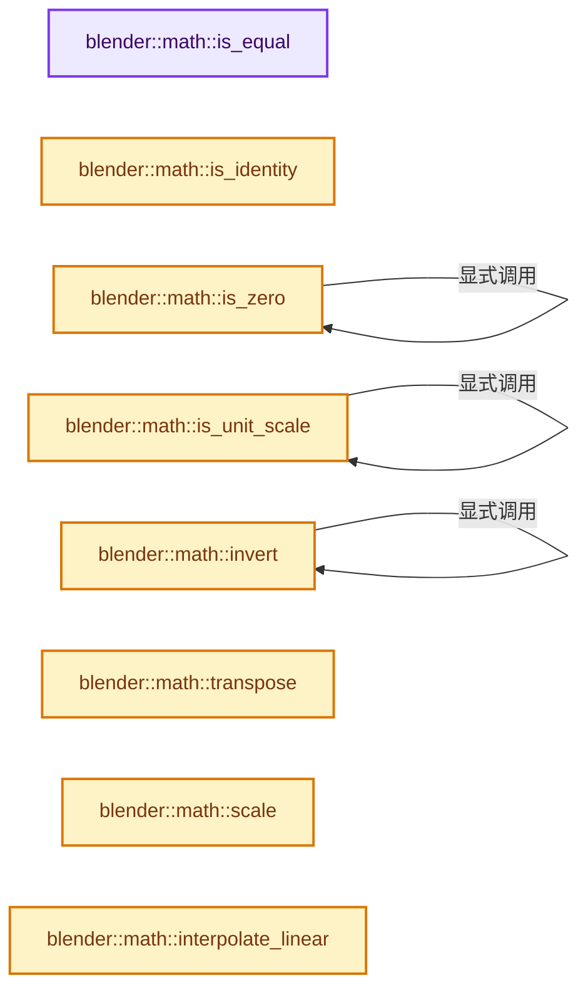

# 实现依赖专题：source/blender/blenlib/BLI_math_matrix.hh

[实现依赖导航](../README.md) · [符号索引](../../00-课程指南/02-源码与提交索引/符号依赖与实现索引.md)

本专题从正文实际调用进入，集中保存共享实现。函数有稳定锚点，可从调用处直接跳到对应完整函数；递归与互相调用通过回链组织。

## 本文件的实现关系




## 完整成员与函数实现

<a id="f-86b4ef8483834e4e"></a>

### `blender::math::is_equal`

实现位置：[source/blender/blenlib/BLI_math_matrix.hh](../../../../../../source/blender/blenlib/BLI_math_matrix.hh) · L509—L522。

接口参数：

- `const MatBase<T, NumCol, NumRow> &a`
- `const MatBase<T, NumCol, NumRow> &b`
- `const T epsilon = T(0)`

**教学注释版**

<!-- annotated:fc47e2cf705a8d -->

```cpp
template<typename T, int NumCol, int NumRow>
[[nodiscard]] inline bool is_equal(const MatBase<T, NumCol, NumRow> &a,
                                   const MatBase<T, NumCol, NumRow> &b,
                                   const T epsilon = T(0))
{
  for (int i = 0; i < NumCol; i++) {
    for (int j = 0; j < NumRow; j++) {
      if (math::abs(a[i][j] - b[i][j]) > epsilon) {
        return false;
      }
    }
  }
  return true;
}
```

<details>
<summary>核对原始源码：source/blender/blenlib/BLI_math_matrix.hh · L509—L522</summary>

<!-- original:fc47e2cf705a8d:source/blender/blenlib/BLI_math_matrix.hh:509:522 -->

```cpp
template<typename T, int NumCol, int NumRow>
[[nodiscard]] inline bool is_equal(const MatBase<T, NumCol, NumRow> &a,
                                   const MatBase<T, NumCol, NumRow> &b,
                                   const T epsilon = T(0))
{
  for (int i = 0; i < NumCol; i++) {
    for (int j = 0; j < NumRow; j++) {
      if (math::abs(a[i][j] - b[i][j]) > epsilon) {
        return false;
      }
    }
  }
  return true;
}
```

</details>

**结果出口**

- `return false;`
- `return true;`

**继续追踪实现**

- `math::abs` → [blender::math::abs · L38](BLI_math_vector.hh.md#f-e755530125bc2198)；[blender::math::abs · L201](BLI_math_basis_types.hh.md#f-a137ffce39989ffc)；[blender::math::abs · L33](BLI_math_base.hh.md#f-a2c9c981f4e8420c)。同名重载需按实参类型选择。

<a id="f-1e04397ebb6e35bb"></a>

### `blender::math::is_identity`

实现位置：[source/blender/blenlib/BLI_math_matrix.hh](../../../../../../source/blender/blenlib/BLI_math_matrix.hh) · L527—L538。

接口参数：

- `const MatBase<T, NumCol, NumRow> &mat`

**教学注释版**

<!-- annotated:9b20edc016f480 -->

```cpp
template<typename T, int NumCol, int NumRow>
[[nodiscard]] inline bool is_identity(const MatBase<T, NumCol, NumRow> &mat)
{
  for (int i = 0; i < NumCol; i++) {
    for (int j = 0; j < NumRow; j++) {
      if (mat[i][j] != (i != j ? 0.0f : 1.0f)) {
        return false;
      }
    }
  }
  return true;
}
```

<details>
<summary>核对原始源码：source/blender/blenlib/BLI_math_matrix.hh · L527—L538</summary>

<!-- original:9b20edc016f480:source/blender/blenlib/BLI_math_matrix.hh:527:538 -->

```cpp
template<typename T, int NumCol, int NumRow>
[[nodiscard]] inline bool is_identity(const MatBase<T, NumCol, NumRow> &mat)
{
  for (int i = 0; i < NumCol; i++) {
    for (int j = 0; j < NumRow; j++) {
      if (mat[i][j] != (i != j ? 0.0f : 1.0f)) {
        return false;
      }
    }
  }
  return true;
}
```

</details>

**结果出口**

- `return false;`
- `return true;`

**继续追踪实现**

本实现没有需要继续展开的显式调用；检查返回表达式、对象转换和调用者前置条件。

<a id="f-b879ac524126b464"></a>

### `blender::math::is_zero`

实现位置：[source/blender/blenlib/BLI_math_matrix.hh](../../../../../../source/blender/blenlib/BLI_math_matrix.hh) · L593—L602。

接口参数：

- `const MatBase<T, NumCol, NumRow> &mat`

**教学注释版**

<!-- annotated:e3725f572d7291 -->

```cpp
template<typename T, int NumCol, int NumRow>
inline bool is_zero(const MatBase<T, NumCol, NumRow> &mat)
{
  for (int i = 0; i < NumCol; i++) {
    if (!is_zero(mat[i])) {
      return false;
    }
  }
  return true;
}
```

<details>
<summary>核对原始源码：source/blender/blenlib/BLI_math_matrix.hh · L593—L602</summary>

<!-- original:e3725f572d7291:source/blender/blenlib/BLI_math_matrix.hh:593:602 -->

```cpp
template<typename T, int NumCol, int NumRow>
inline bool is_zero(const MatBase<T, NumCol, NumRow> &mat)
{
  for (int i = 0; i < NumCol; i++) {
    if (!is_zero(mat[i])) {
      return false;
    }
  }
  return true;
}
```

</details>

**结果出口**

- `return false;`
- `return true;`

**继续追踪实现**

- `is_zero` → [blender::math::is_zero · L593](BLI_math_matrix.hh.md#f-b879ac524126b464)。

<a id="f-d7f4cb1a4f1945c7"></a>

### `blender::math::is_unit_scale`

实现位置：[source/blender/blenlib/BLI_math_matrix.hh](../../../../../../source/blender/blenlib/BLI_math_matrix.hh) · L637—L646。

接口参数：

- `const MatBase<T, NumCol, NumRow> &m`

**教学注释版**

<!-- annotated:ee3fe30e07019e -->

```cpp
template<typename T, int NumCol, int NumRow>
[[nodiscard]] inline bool is_unit_scale(const MatBase<T, NumCol, NumRow> &m)
{
  for (int i = 0; i < NumCol; i++) {
    if (!is_unit_scale(m[i])) {
      return false;
    }
  }
  return true;
}
```

<details>
<summary>核对原始源码：source/blender/blenlib/BLI_math_matrix.hh · L637—L646</summary>

<!-- original:ee3fe30e07019e:source/blender/blenlib/BLI_math_matrix.hh:637:646 -->

```cpp
template<typename T, int NumCol, int NumRow>
[[nodiscard]] inline bool is_unit_scale(const MatBase<T, NumCol, NumRow> &m)
{
  for (int i = 0; i < NumCol; i++) {
    if (!is_unit_scale(m[i])) {
      return false;
    }
  }
  return true;
}
```

</details>

**结果出口**

- `return false;`
- `return true;`

**继续追踪实现**

- `is_unit_scale` → [blender::math::is_unit_scale · L637](BLI_math_matrix.hh.md#f-d7f4cb1a4f1945c7)。

<a id="f-2b50b5262b2a9121"></a>

### `blender::math::invert`

实现位置：[source/blender/blenlib/BLI_math_matrix.hh](../../../../../../source/blender/blenlib/BLI_math_matrix.hh) · L648—L654。

接口参数：

- `const MatBase<T, Size, Size> &mat`

**教学注释版**

<!-- annotated:3bfe500adb9189 -->

```cpp
template<typename T, int Size>
[[nodiscard]] MatBase<T, Size, Size> invert(const MatBase<T, Size, Size> &mat)
{
  bool success;
  /* Explicit template parameter to please MSVC. */
  return invert<T, Size>(mat, success);
}
```

<details>
<summary>核对原始源码：source/blender/blenlib/BLI_math_matrix.hh · L648—L654</summary>

<!-- original:3bfe500adb9189:source/blender/blenlib/BLI_math_matrix.hh:648:654 -->

```cpp
template<typename T, int Size>
[[nodiscard]] MatBase<T, Size, Size> invert(const MatBase<T, Size, Size> &mat)
{
  bool success;
  /* Explicit template parameter to please MSVC. */
  return invert<T, Size>(mat, success);
}
```

</details>

**结果出口**

- `return invert<T, Size>(mat, success);`

**继续追踪实现**

- `invert<T, Size>` → [blender::math::invert · L648](BLI_math_matrix.hh.md#f-2b50b5262b2a9121)。

<a id="f-3e15c82dc61a01f4"></a>

### `blender::math::transpose`

实现位置：[source/blender/blenlib/BLI_math_matrix.hh](../../../../../../source/blender/blenlib/BLI_math_matrix.hh) · L656—L662。

接口参数：

- `const MatBase<T, NumRow, NumCol> &mat`

**教学注释版**

<!-- annotated:f374557f28e6ab -->

```cpp
template<typename T, int NumCol, int NumRow>
[[nodiscard]] MatBase<T, NumCol, NumRow> transpose(const MatBase<T, NumRow, NumCol> &mat)
{
  MatBase<T, NumCol, NumRow> result;
  unroll<NumCol>([&](auto i) { unroll<NumRow>([&](auto j) { result[i][j] = mat[j][i]; }); });
  return result;
}
```

<details>
<summary>核对原始源码：source/blender/blenlib/BLI_math_matrix.hh · L656—L662</summary>

<!-- original:f374557f28e6ab:source/blender/blenlib/BLI_math_matrix.hh:656:662 -->

```cpp
template<typename T, int NumCol, int NumRow>
[[nodiscard]] MatBase<T, NumCol, NumRow> transpose(const MatBase<T, NumRow, NumCol> &mat)
{
  MatBase<T, NumCol, NumRow> result;
  unroll<NumCol>([&](auto i) { unroll<NumRow>([&](auto j) { result[i][j] = mat[j][i]; }); });
  return result;
}
```

</details>

**结果出口**

- `return result;`

**继续追踪实现**

- `unroll<NumCol>` → [blender::unroll · L27](BLI_unroll.hh.md#f-c417075e14f42b3b)。
- `unroll<NumRow>` → [blender::unroll · L27](BLI_unroll.hh.md#f-c417075e14f42b3b)。

<a id="f-197f7b3dee8e1df5"></a>

### `blender::math::scale`

实现位置：[source/blender/blenlib/BLI_math_matrix.hh](../../../../../../source/blender/blenlib/BLI_math_matrix.hh) · L724—L733。

接口参数：

- `const MatBase<T, NumCol, NumRow> &mat`
- `const VectorT &scale`

**教学注释版**

<!-- annotated:a5e897dae48b9a -->

```cpp
template<typename T, int NumCol, int NumRow, typename VectorT>
[[nodiscard]] MatBase<T, NumCol, NumRow> scale(const MatBase<T, NumCol, NumRow> &mat,
                                               const VectorT &scale)
{
  BLI_STATIC_ASSERT(VectorT::type_length <= NumCol,
                    "Scale should be less or equal to the matrix in column count.");
  MatBase<T, NumCol, NumRow> result = mat;
  unroll<VectorT::type_length>([&](auto c) { result[c] *= scale[c]; });
  return result;
}
```

<details>
<summary>核对原始源码：source/blender/blenlib/BLI_math_matrix.hh · L724—L733</summary>

<!-- original:a5e897dae48b9a:source/blender/blenlib/BLI_math_matrix.hh:724:733 -->

```cpp
template<typename T, int NumCol, int NumRow, typename VectorT>
[[nodiscard]] MatBase<T, NumCol, NumRow> scale(const MatBase<T, NumCol, NumRow> &mat,
                                               const VectorT &scale)
{
  BLI_STATIC_ASSERT(VectorT::type_length <= NumCol,
                    "Scale should be less or equal to the matrix in column count.");
  MatBase<T, NumCol, NumRow> result = mat;
  unroll<VectorT::type_length>([&](auto c) { result[c] *= scale[c]; });
  return result;
}
```

</details>

**结果出口**

- `return result;`

**继续追踪实现**

- `BLI_STATIC_ASSERT` → [BLI_STATIC_ASSERT · L68](BLI_assert.hh.md#m-2847bd43464c)；[BLI_STATIC_ASSERT · L37](../08-其他Blender模块/gpu/GPU_shader_shared_utils.hh.md#m-84775b53af8c)；[BLI_STATIC_ASSERT · L58](../08-其他Blender模块/gpu/GPU_shader_shared_utils.hh.md#m-4227322768f0)。宏定义由构建条件选择。
- `unroll<VectorT::type_length>` → [blender::unroll · L27](BLI_unroll.hh.md#f-c417075e14f42b3b)。

<a id="f-5247488ab3d13df8"></a>

### `blender::math::interpolate_linear`

实现位置：[source/blender/blenlib/BLI_math_matrix.hh](../../../../../../source/blender/blenlib/BLI_math_matrix.hh) · L735—L743。

接口参数：

- `const MatBase<T, NumCol, NumRow> &a`
- `const MatBase<T, NumCol, NumRow> &b`
- `T t`

**教学注释版**

<!-- annotated:e9ab5a70cf4b54 -->

```cpp
template<typename T, int NumCol, int NumRow>
[[nodiscard]] MatBase<T, NumCol, NumRow> interpolate_linear(const MatBase<T, NumCol, NumRow> &a,
                                                            const MatBase<T, NumCol, NumRow> &b,
                                                            T t)
{
  MatBase<T, NumCol, NumRow> result;
  unroll<NumCol>([&](auto c) { result[c] = interpolate(a[c], b[c], t); });
  return result;
}
```

<details>
<summary>核对原始源码：source/blender/blenlib/BLI_math_matrix.hh · L735—L743</summary>

<!-- original:e9ab5a70cf4b54:source/blender/blenlib/BLI_math_matrix.hh:735:743 -->

```cpp
template<typename T, int NumCol, int NumRow>
[[nodiscard]] MatBase<T, NumCol, NumRow> interpolate_linear(const MatBase<T, NumCol, NumRow> &a,
                                                            const MatBase<T, NumCol, NumRow> &b,
                                                            T t)
{
  MatBase<T, NumCol, NumRow> result;
  unroll<NumCol>([&](auto c) { result[c] = interpolate(a[c], b[c], t); });
  return result;
}
```

</details>

**结果出口**

- `return result;`

**继续追踪实现**

- `unroll<NumCol>` → [blender::unroll · L27](BLI_unroll.hh.md#f-c417075e14f42b3b)。
- `interpolate` → [blender::math::interpolate · L636](BLI_math_vector.hh.md#f-d612b6d6ab1b6e7c)；[blender::math::interpolate · L303](BLI_math_quaternion.hh.md#f-48b9ace2a9c6185c)；[blender::math::interpolate · L17](BLI_math_color.hh.md#f-eb5ef92b0f8c0926)；[blender::math::interpolate · L28](BLI_math_color.hh.md#f-2a9e33ec55979ab6)；[blender::math::interpolate · L278](BLI_math_base.hh.md#f-2629b871528f6528)。同名重载需按实参类型选择。

<a id="f-2235cb6f5ec7ff18"></a>

### `blender::math::normalize`

实现位置：[source/blender/blenlib/BLI_math_matrix.hh](../../../../../../source/blender/blenlib/BLI_math_matrix.hh) · L745—L760。

接口参数：

- `const MatView<T, NumCol, NumRow, SrcNumCol, SrcNumRow, SrcStartCol, SrcStartRow, SrcAlignment>
         &a`

**教学注释版**

<!-- annotated:87475119c6a04e -->

```cpp
template<typename T,
         int NumCol,
         int NumRow,
         int SrcNumCol,
         int SrcNumRow,
         int SrcStartCol,
         int SrcStartRow,
         int SrcAlignment>
[[nodiscard]] MatBase<T, NumCol, NumRow> normalize(
    const MatView<T, NumCol, NumRow, SrcNumCol, SrcNumRow, SrcStartCol, SrcStartRow, SrcAlignment>
        &a)
{
  MatBase<T, NumCol, NumRow> result;
  unroll<NumCol>([&](auto i) { result[i] = math::normalize(a[i]); });
  return result;
}
```

<details>
<summary>核对原始源码：source/blender/blenlib/BLI_math_matrix.hh · L745—L760</summary>

<!-- original:87475119c6a04e:source/blender/blenlib/BLI_math_matrix.hh:745:760 -->

```cpp
template<typename T,
         int NumCol,
         int NumRow,
         int SrcNumCol,
         int SrcNumRow,
         int SrcStartCol,
         int SrcStartRow,
         int SrcAlignment>
[[nodiscard]] MatBase<T, NumCol, NumRow> normalize(
    const MatView<T, NumCol, NumRow, SrcNumCol, SrcNumRow, SrcStartCol, SrcStartRow, SrcAlignment>
        &a)
{
  MatBase<T, NumCol, NumRow> result;
  unroll<NumCol>([&](auto i) { result[i] = math::normalize(a[i]); });
  return result;
}
```

</details>

**结果出口**

- `return result;`

**继续追踪实现**

- `unroll<NumCol>` → [blender::unroll · L27](BLI_unroll.hh.md#f-c417075e14f42b3b)。
- `math::normalize` → [blender::math::normalize · L745](BLI_math_matrix.hh.md#f-2235cb6f5ec7ff18)；[blender::math::normalize · L783](BLI_math_matrix.hh.md#f-0386bc4ee9ac7425)。同名重载需按实参类型选择。

<a id="f-ead911aedd52a799"></a>

### `blender::math::normalize_and_get_size`

实现位置：[source/blender/blenlib/BLI_math_matrix.hh](../../../../../../source/blender/blenlib/BLI_math_matrix.hh) · L762—L781。

接口参数：

- `const MatView<T, NumCol, NumRow, SrcNumCol, SrcNumRow, SrcStartCol, SrcStartRow, SrcAlignment>
         &a`
- `VectorT &r_size`

**教学注释版**

<!-- annotated:63a84b05b61176 -->

```cpp
template<typename T,
         int NumCol,
         int NumRow,
         int SrcNumCol,
         int SrcNumRow,
         int SrcStartCol,
         int SrcStartRow,
         int SrcAlignment,
         typename VectorT>
[[nodiscard]] MatBase<T, NumCol, NumRow> normalize_and_get_size(
    const MatView<T, NumCol, NumRow, SrcNumCol, SrcNumRow, SrcStartCol, SrcStartRow, SrcAlignment>
        &a,
    VectorT &r_size)
{
  BLI_STATIC_ASSERT(VectorT::type_length == NumCol,
                    "r_size dimension should be equal to matrix column count.");
  MatBase<T, NumCol, NumRow> result;
  unroll<NumCol>([&](auto i) { result[i] = math::normalize_and_get_length(a[i], r_size[i]); });
  return result;
}
```

<details>
<summary>核对原始源码：source/blender/blenlib/BLI_math_matrix.hh · L762—L781</summary>

<!-- original:63a84b05b61176:source/blender/blenlib/BLI_math_matrix.hh:762:781 -->

```cpp
template<typename T,
         int NumCol,
         int NumRow,
         int SrcNumCol,
         int SrcNumRow,
         int SrcStartCol,
         int SrcStartRow,
         int SrcAlignment,
         typename VectorT>
[[nodiscard]] MatBase<T, NumCol, NumRow> normalize_and_get_size(
    const MatView<T, NumCol, NumRow, SrcNumCol, SrcNumRow, SrcStartCol, SrcStartRow, SrcAlignment>
        &a,
    VectorT &r_size)
{
  BLI_STATIC_ASSERT(VectorT::type_length == NumCol,
                    "r_size dimension should be equal to matrix column count.");
  MatBase<T, NumCol, NumRow> result;
  unroll<NumCol>([&](auto i) { result[i] = math::normalize_and_get_length(a[i], r_size[i]); });
  return result;
}
```

</details>

**结果出口**

- `return result;`

**继续追踪实现**

- `BLI_STATIC_ASSERT` → [BLI_STATIC_ASSERT · L68](BLI_assert.hh.md#m-2847bd43464c)；[BLI_STATIC_ASSERT · L37](../08-其他Blender模块/gpu/GPU_shader_shared_utils.hh.md#m-84775b53af8c)；[BLI_STATIC_ASSERT · L58](../08-其他Blender模块/gpu/GPU_shader_shared_utils.hh.md#m-4227322768f0)。宏定义由构建条件选择。
- `unroll<NumCol>` → [blender::unroll · L27](BLI_unroll.hh.md#f-c417075e14f42b3b)。
- `math::normalize_and_get_length` → [blender::math::normalize_and_get_length · L526](BLI_math_vector.hh.md#f-77d1393eb1349806)；[blender::math::normalize_and_get_length · L250](BLI_math_quaternion.hh.md#f-6fcf25529d2136aa)。同名重载需按实参类型选择。

<a id="f-0386bc4ee9ac7425"></a>

### `blender::math::normalize`

实现位置：[source/blender/blenlib/BLI_math_matrix.hh](../../../../../../source/blender/blenlib/BLI_math_matrix.hh) · L783—L789。

接口参数：

- `const MatBase<T, NumCol, NumRow> &a`

**教学注释版**

<!-- annotated:5a5faf4a66c7d5 -->

```cpp
template<typename T, int NumCol, int NumRow>
[[nodiscard]] MatBase<T, NumCol, NumRow> normalize(const MatBase<T, NumCol, NumRow> &a)
{
  MatBase<T, NumCol, NumRow> result;
  unroll<NumCol>([&](auto i) { result[i] = math::normalize(a[i]); });
  return result;
}
```

<details>
<summary>核对原始源码：source/blender/blenlib/BLI_math_matrix.hh · L783—L789</summary>

<!-- original:5a5faf4a66c7d5:source/blender/blenlib/BLI_math_matrix.hh:783:789 -->

```cpp
template<typename T, int NumCol, int NumRow>
[[nodiscard]] MatBase<T, NumCol, NumRow> normalize(const MatBase<T, NumCol, NumRow> &a)
{
  MatBase<T, NumCol, NumRow> result;
  unroll<NumCol>([&](auto i) { result[i] = math::normalize(a[i]); });
  return result;
}
```

</details>

**结果出口**

- `return result;`

**继续追踪实现**

- `unroll<NumCol>` → [blender::unroll · L27](BLI_unroll.hh.md#f-c417075e14f42b3b)。
- `math::normalize` → [blender::math::normalize · L745](BLI_math_matrix.hh.md#f-2235cb6f5ec7ff18)；[blender::math::normalize · L783](BLI_math_matrix.hh.md#f-0386bc4ee9ac7425)。同名重载需按实参类型选择。

<a id="f-370933554de05ddb"></a>

### `blender::math::normalize_and_get_size`

实现位置：[source/blender/blenlib/BLI_math_matrix.hh](../../../../../../source/blender/blenlib/BLI_math_matrix.hh) · L791—L800。

接口参数：

- `const MatBase<T, NumCol, NumRow> &a`
- `VectorT &r_size`

**教学注释版**

<!-- annotated:dd3f07017626db -->

```cpp
template<typename T, int NumCol, int NumRow, typename VectorT>
[[nodiscard]] MatBase<T, NumCol, NumRow> normalize_and_get_size(
    const MatBase<T, NumCol, NumRow> &a, VectorT &r_size)
{
  BLI_STATIC_ASSERT(VectorT::type_length == NumCol,
                    "r_size dimension should be equal to matrix column count.");
  MatBase<T, NumCol, NumRow> result;
  unroll<NumCol>([&](auto i) { result[i] = math::normalize_and_get_length(a[i], r_size[i]); });
  return result;
}
```

<details>
<summary>核对原始源码：source/blender/blenlib/BLI_math_matrix.hh · L791—L800</summary>

<!-- original:dd3f07017626db:source/blender/blenlib/BLI_math_matrix.hh:791:800 -->

```cpp
template<typename T, int NumCol, int NumRow, typename VectorT>
[[nodiscard]] MatBase<T, NumCol, NumRow> normalize_and_get_size(
    const MatBase<T, NumCol, NumRow> &a, VectorT &r_size)
{
  BLI_STATIC_ASSERT(VectorT::type_length == NumCol,
                    "r_size dimension should be equal to matrix column count.");
  MatBase<T, NumCol, NumRow> result;
  unroll<NumCol>([&](auto i) { result[i] = math::normalize_and_get_length(a[i], r_size[i]); });
  return result;
}
```

</details>

**结果出口**

- `return result;`

**继续追踪实现**

- `BLI_STATIC_ASSERT` → [BLI_STATIC_ASSERT · L68](BLI_assert.hh.md#m-2847bd43464c)；[BLI_STATIC_ASSERT · L37](../08-其他Blender模块/gpu/GPU_shader_shared_utils.hh.md#m-84775b53af8c)；[BLI_STATIC_ASSERT · L58](../08-其他Blender模块/gpu/GPU_shader_shared_utils.hh.md#m-4227322768f0)。宏定义由构建条件选择。
- `unroll<NumCol>` → [blender::unroll · L27](BLI_unroll.hh.md#f-c417075e14f42b3b)。
- `math::normalize_and_get_length` → [blender::math::normalize_and_get_length · L526](BLI_math_vector.hh.md#f-77d1393eb1349806)；[blender::math::normalize_and_get_length · L250](BLI_math_quaternion.hh.md#f-6fcf25529d2136aa)。同名重载需按实参类型选择。

<a id="f-ea0787bfb0f72b85"></a>

### `blender::math::detail::normalized_to_angle`

实现位置：[source/blender/blenlib/BLI_math_matrix.hh](../../../../../../source/blender/blenlib/BLI_math_matrix.hh) · L804—L808。

接口参数：

- `const MatBase<T, 2, 2> &mat`

**教学注释版**

<!-- annotated:6b63a243183749 -->

```cpp
template<typename T> AngleRadianBase<T> normalized_to_angle(const MatBase<T, 2, 2> &mat)
{
  BLI_assert(math::is_unit_scale(mat));
  return AngleRadianBase(mat[0][0], mat[0][1]);
}
```

<details>
<summary>核对原始源码：source/blender/blenlib/BLI_math_matrix.hh · L804—L808</summary>

<!-- original:6b63a243183749:source/blender/blenlib/BLI_math_matrix.hh:804:808 -->

```cpp
template<typename T> AngleRadianBase<T> normalized_to_angle(const MatBase<T, 2, 2> &mat)
{
  BLI_assert(math::is_unit_scale(mat));
  return AngleRadianBase(mat[0][0], mat[0][1]);
}
```

</details>

**结果出口**

- `return AngleRadianBase(mat[0][0], mat[0][1]);`

**继续追踪实现**

- `BLI_assert` → [BLI_assert · L48](BLI_assert.hh.md#m-57a88495704d)；[BLI_assert · L63](BLI_assert.hh.md#m-d07050020cb5)。宏定义由构建条件选择。
- `math::is_unit_scale` → [blender::math::is_unit_scale · L637](BLI_math_matrix.hh.md#f-d7f4cb1a4f1945c7)。
- `AngleRadianBase` → [blender::math::AngleRadianBase::AngleRadianBase · L38](BLI_math_angle_types.hh.md#f-56c0a0a9daeba2a1)；[blender::math::AngleRadianBase::AngleRadianBase · L40](BLI_math_angle_types.hh.md#f-f89be2cbf842de9c)；[blender::math::AngleRadianBase::AngleRadianBase · L41](BLI_math_angle_types.hh.md#f-e23eac0ca5e736c4)。同名重载需按实参类型选择。

<a id="f-62dcf0f5cd0185c5"></a>

### `blender::math::detail::normalized_to_eul2`

实现位置：[source/blender/blenlib/BLI_math_matrix.hh](../../../../../../source/blender/blenlib/BLI_math_matrix.hh) · L810—L832。

接口参数：

- `const MatBase<T, 3, 3> &mat`
- `EulerXYZBase<T> &eul1`
- `EulerXYZBase<T> &eul2`

**教学注释版**

<!-- annotated:881498e762c016 -->

```cpp
template<typename T>
void normalized_to_eul2(const MatBase<T, 3, 3> &mat, EulerXYZBase<T> &eul1, EulerXYZBase<T> &eul2)
{
  BLI_assert(math::is_unit_scale(mat));

  const T cy = math::hypot(mat[0][0], mat[0][1]);
  if (cy > T(16) * std::numeric_limits<T>::epsilon()) {
    eul1.x() = math::atan2(mat[1][2], mat[2][2]);
    eul1.y() = math::atan2(-mat[0][2], cy);
    eul1.z() = math::atan2(mat[0][1], mat[0][0]);

    eul2.x() = math::atan2(-mat[1][2], -mat[2][2]);
    eul2.y() = math::atan2(-mat[0][2], -cy);
    eul2.z() = math::atan2(-mat[0][1], -mat[0][0]);
  }
  else {
    eul1.x() = math::atan2(-mat[2][1], mat[1][1]);
    eul1.y() = math::atan2(-mat[0][2], cy);
    eul1.z() = 0.0f;

    eul2 = eul1;
  }
}
```

<details>
<summary>核对原始源码：source/blender/blenlib/BLI_math_matrix.hh · L810—L832</summary>

<!-- original:881498e762c016:source/blender/blenlib/BLI_math_matrix.hh:810:832 -->

```cpp
template<typename T>
void normalized_to_eul2(const MatBase<T, 3, 3> &mat, EulerXYZBase<T> &eul1, EulerXYZBase<T> &eul2)
{
  BLI_assert(math::is_unit_scale(mat));

  const T cy = math::hypot(mat[0][0], mat[0][1]);
  if (cy > T(16) * std::numeric_limits<T>::epsilon()) {
    eul1.x() = math::atan2(mat[1][2], mat[2][2]);
    eul1.y() = math::atan2(-mat[0][2], cy);
    eul1.z() = math::atan2(mat[0][1], mat[0][0]);

    eul2.x() = math::atan2(-mat[1][2], -mat[2][2]);
    eul2.y() = math::atan2(-mat[0][2], -cy);
    eul2.z() = math::atan2(-mat[0][1], -mat[0][0]);
  }
  else {
    eul1.x() = math::atan2(-mat[2][1], mat[1][1]);
    eul1.y() = math::atan2(-mat[0][2], cy);
    eul1.z() = 0.0f;

    eul2 = eul1;
  }
}
```

</details>

**沿实际写入检查状态**

- `eul2 = eul1;`

**继续追踪实现**

- `BLI_assert` → [BLI_assert · L48](BLI_assert.hh.md#m-57a88495704d)；[BLI_assert · L63](BLI_assert.hh.md#m-d07050020cb5)。宏定义由构建条件选择。
- `math::is_unit_scale` → [blender::math::is_unit_scale · L637](BLI_math_matrix.hh.md#f-d7f4cb1a4f1945c7)。
- `math::hypot` → [blender::math::hypot · L273](BLI_math_base.hh.md#f-6af018d10aeab067)。
- `T` → [DiagSplit::T · L96](../07-Intern运行时与平台/cycles/subd/split.cpp.md#f-d5d0885c790cc4e4)。
- `std::numeric_limits<T>::epsilon` → [外部契约](https://eel.is/c++draft/)：这个边界按实际表达式及所属类型核对参数、返回值、寿命与失败行为。这里提供接口入口，不声称已解释该第三方版本的内部实现。
- `eul1.x` → [调用协议](../../00-课程指南/01-路线与规范/模板宏与动态分派协议.md)：由接收对象具体类型或运行时策略提供实现。调用位置L817。
- `math::atan2` → [blender::math::atan2 · L268](BLI_math_base.hh.md#f-97a0b24e14551058)。
- `eul1.y` → [调用协议](../../00-课程指南/01-路线与规范/模板宏与动态分派协议.md)：由接收对象具体类型或运行时策略提供实现。调用位置L818。
- `eul1.z` → [调用协议](../../00-课程指南/01-路线与规范/模板宏与动态分派协议.md)：由接收对象具体类型或运行时策略提供实现。调用位置L819。
- `eul2.x` → [调用协议](../../00-课程指南/01-路线与规范/模板宏与动态分派协议.md)：由接收对象具体类型或运行时策略提供实现。调用位置L821。
- `eul2.y` → [调用协议](../../00-课程指南/01-路线与规范/模板宏与动态分派协议.md)：由接收对象具体类型或运行时策略提供实现。调用位置L822。
- `eul2.z` → [调用协议](../../00-课程指南/01-路线与规范/模板宏与动态分派协议.md)：由接收对象具体类型或运行时策略提供实现。调用位置L823。

<a id="f-32cc78cab66f8d6a"></a>

### `blender::math::detail::normalized_to_eul2`

实现位置：[source/blender/blenlib/BLI_math_matrix.hh](../../../../../../source/blender/blenlib/BLI_math_matrix.hh) · L833—L863。

接口参数：

- `const MatBase<T, 3, 3> &mat`
- `Euler3Base<T> &eul1`
- `Euler3Base<T> &eul2`

**教学注释版**

<!-- annotated:ae8e1db4744de7 -->

```cpp
template<typename T>
void normalized_to_eul2(const MatBase<T, 3, 3> &mat, Euler3Base<T> &eul1, Euler3Base<T> &eul2)
{
  BLI_assert(math::is_unit_scale(mat));
  const int i_index = eul1.i_index();
  const int j_index = eul1.j_index();
  const int k_index = eul1.k_index();

  const T cy = math::hypot(mat[i_index][i_index], mat[i_index][j_index]);
  if (cy > T(16) * std::numeric_limits<T>::epsilon()) {
    eul1.i() = math::atan2(mat[j_index][k_index], mat[k_index][k_index]);
    eul1.j() = math::atan2(-mat[i_index][k_index], cy);
    eul1.k() = math::atan2(mat[i_index][j_index], mat[i_index][i_index]);

    eul2.i() = math::atan2(-mat[j_index][k_index], -mat[k_index][k_index]);
    eul2.j() = math::atan2(-mat[i_index][k_index], -cy);
    eul2.k() = math::atan2(-mat[i_index][j_index], -mat[i_index][i_index]);
  }
  else {
    eul1.i() = math::atan2(-mat[k_index][j_index], mat[j_index][j_index]);
    eul1.j() = math::atan2(-mat[i_index][k_index], cy);
    eul1.k() = 0.0f;

    eul2 = eul1;
  }

  if (eul1.parity()) {
    eul1 = -eul1;
    eul2 = -eul2;
  }
}
```

<details>
<summary>核对原始源码：source/blender/blenlib/BLI_math_matrix.hh · L833—L863</summary>

<!-- original:ae8e1db4744de7:source/blender/blenlib/BLI_math_matrix.hh:833:863 -->

```cpp
template<typename T>
void normalized_to_eul2(const MatBase<T, 3, 3> &mat, Euler3Base<T> &eul1, Euler3Base<T> &eul2)
{
  BLI_assert(math::is_unit_scale(mat));
  const int i_index = eul1.i_index();
  const int j_index = eul1.j_index();
  const int k_index = eul1.k_index();

  const T cy = math::hypot(mat[i_index][i_index], mat[i_index][j_index]);
  if (cy > T(16) * std::numeric_limits<T>::epsilon()) {
    eul1.i() = math::atan2(mat[j_index][k_index], mat[k_index][k_index]);
    eul1.j() = math::atan2(-mat[i_index][k_index], cy);
    eul1.k() = math::atan2(mat[i_index][j_index], mat[i_index][i_index]);

    eul2.i() = math::atan2(-mat[j_index][k_index], -mat[k_index][k_index]);
    eul2.j() = math::atan2(-mat[i_index][k_index], -cy);
    eul2.k() = math::atan2(-mat[i_index][j_index], -mat[i_index][i_index]);
  }
  else {
    eul1.i() = math::atan2(-mat[k_index][j_index], mat[j_index][j_index]);
    eul1.j() = math::atan2(-mat[i_index][k_index], cy);
    eul1.k() = 0.0f;

    eul2 = eul1;
  }

  if (eul1.parity()) {
    eul1 = -eul1;
    eul2 = -eul2;
  }
}
```

</details>

**沿实际写入检查状态**

- `eul2 = eul1;`
- `eul1 = -eul1;`
- `eul2 = -eul2;`

**继续追踪实现**

- `BLI_assert` → [BLI_assert · L48](BLI_assert.hh.md#m-57a88495704d)；[BLI_assert · L63](BLI_assert.hh.md#m-d07050020cb5)。宏定义由构建条件选择。
- `math::is_unit_scale` → [blender::math::is_unit_scale · L637](BLI_math_matrix.hh.md#f-d7f4cb1a4f1945c7)。
- `eul1.i_index` → [blender::math::Euler3Base::i_index · L371](BLI_math_euler_types.hh.md#f-fa3c4c3544a20d04)。
- `eul1.j_index` → [blender::math::Euler3Base::j_index · L392](BLI_math_euler_types.hh.md#f-27a230f6f9420279)。
- `eul1.k_index` → [blender::math::Euler3Base::k_index · L413](BLI_math_euler_types.hh.md#f-c567f24891171510)。
- `math::hypot` → [blender::math::hypot · L273](BLI_math_base.hh.md#f-6af018d10aeab067)。
- `T` → [DiagSplit::T · L96](../07-Intern运行时与平台/cycles/subd/split.cpp.md#f-d5d0885c790cc4e4)。
- `std::numeric_limits<T>::epsilon` → [外部契约](https://eel.is/c++draft/)：这个边界按实际表达式及所属类型核对参数、返回值、寿命与失败行为。这里提供接口入口，不声称已解释该第三方版本的内部实现。
- `eul1.i` → [blender::math::Euler3Base::i · L292](BLI_math_euler_types.hh.md#f-489131b8534a9621)；[blender::math::Euler3Base::i · L304](BLI_math_euler_types.hh.md#f-ddd9fa2af4009415)。同名重载需按实参类型选择。
- `math::atan2` → [blender::math::atan2 · L268](BLI_math_base.hh.md#f-97a0b24e14551058)。
- `eul1.j` → [blender::math::Euler3Base::j · L296](BLI_math_euler_types.hh.md#f-649eb44628c301ef)；[blender::math::Euler3Base::j · L308](BLI_math_euler_types.hh.md#f-4b31148a589472b9)。同名重载需按实参类型选择。
- `eul1.k` → [blender::math::Euler3Base::k · L300](BLI_math_euler_types.hh.md#f-6825b0d657055bf1)；[blender::math::Euler3Base::k · L312](BLI_math_euler_types.hh.md#f-4b562b4adb3a2323)。同名重载需按实参类型选择。
- `eul2.i` → [blender::math::Euler3Base::i · L292](BLI_math_euler_types.hh.md#f-489131b8534a9621)；[blender::math::Euler3Base::i · L304](BLI_math_euler_types.hh.md#f-ddd9fa2af4009415)。同名重载需按实参类型选择。
- `eul2.j` → [blender::math::Euler3Base::j · L296](BLI_math_euler_types.hh.md#f-649eb44628c301ef)；[blender::math::Euler3Base::j · L308](BLI_math_euler_types.hh.md#f-4b31148a589472b9)。同名重载需按实参类型选择。
- `eul2.k` → [blender::math::Euler3Base::k · L300](BLI_math_euler_types.hh.md#f-6825b0d657055bf1)；[blender::math::Euler3Base::k · L312](BLI_math_euler_types.hh.md#f-4b562b4adb3a2323)。同名重载需按实参类型选择。
- `eul1.parity` → [blender::math::Euler3Base::parity · L351](BLI_math_euler_types.hh.md#f-bfefe8df5b9453de)。

<a id="f-ca5479c573e92c71"></a>

### `blender::math::detail::normalized_to_quat_fast`

实现位置：[source/blender/blenlib/BLI_math_matrix.hh](../../../../../../source/blender/blenlib/BLI_math_matrix.hh) · L876—L978。

接口参数：

- `const MatBase<T, 3, 3> &mat`

**教学注释版**

<!-- annotated:88964939e8de60 -->

```cpp
template<typename T> QuaternionBase<T> normalized_to_quat_fast(const MatBase<T, 3, 3> &mat)
{
  BLI_assert(math::is_unit_scale(mat));
  /* Caller must ensure matrices aren't negative for valid results, see: #24291, #94231. */
  BLI_assert(!math::is_negative(mat));

  QuaternionBase<T> q;

  /* Method outlined by Mike Day, ref: https://math.stackexchange.com/a/3183435/220949
   * with an additional `sqrtf(..)` for higher precision result.
   * Removing the `sqrt` causes tests to fail unless the precision is set to 1e-6 or larger. */

  if (mat[2][2] < 0.0f) {
    if (mat[0][0] > mat[1][1]) {
      const T trace = 1.0f + mat[0][0] - mat[1][1] - mat[2][2];
      T s = 2.0f * math::sqrt(trace);
      if (mat[1][2] < mat[2][1]) {
        /* Ensure W is non-negative for a canonical result. */
        s = -s;
      }
      q.x = 0.25f * s;
      s = 1.0f / s;
      q.w = (mat[1][2] - mat[2][1]) * s;
      q.y = (mat[0][1] + mat[1][0]) * s;
      q.z = (mat[2][0] + mat[0][2]) * s;
      if ((trace == 1.0f) && (q.w == 0.0f && q.y == 0.0f && q.z == 0.0f)) [[unlikely]] {
        /* Avoids the need to normalize the degenerate case. */
        q.x = 1.0f;
      }
    }
    else {
      const T trace = 1.0f - mat[0][0] + mat[1][1] - mat[2][2];
      T s = 2.0f * math::sqrt(trace);
      if (mat[2][0] < mat[0][2]) {
        /* Ensure W is non-negative for a canonical result. */
        s = -s;
      }
      q.y = 0.25f * s;
      s = 1.0f / s;
      q.w = (mat[2][0] - mat[0][2]) * s;
      q.x = (mat[0][1] + mat[1][0]) * s;
      q.z = (mat[1][2] + mat[2][1]) * s;
      if ((trace == 1.0f) && (q.w == 0.0f && q.x == 0.0f && q.z == 0.0f)) [[unlikely]] {
        /* Avoids the need to normalize the degenerate case. */
        q.y = 1.0f;
      }
    }
  }
  else {
    if (mat[0][0] < -mat[1][1]) {
      const T trace = 1.0f - mat[0][0] - mat[1][1] + mat[2][2];
      T s = 2.0f * math::sqrt(trace);
      if (mat[0][1] < mat[1][0]) {
        /* Ensure W is non-negative for a canonical result. */
        s = -s;
      }
      q.z = 0.25f * s;
      s = 1.0f / s;
      q.w = (mat[0][1] - mat[1][0]) * s;
      q.x = (mat[2][0] + mat[0][2]) * s;
      q.y = (mat[1][2] + mat[2][1]) * s;
      if ((trace == 1.0f) && (q.w == 0.0f && q.x == 0.0f && q.y == 0.0f)) [[unlikely]] {
        /* Avoids the need to normalize the degenerate case. */
        q.z = 1.0f;
      }
    }
    else {
      /* NOTE(@ideasman42): A zero matrix will fall through to this block,
       * needed so a zero scaled matrices to return a quaternion without rotation, see: #101848.
       */
      const T trace = 1.0f + mat[0][0] + mat[1][1] + mat[2][2];
      T s = 2.0f * math::sqrt(trace);
      q.w = 0.25f * s;
      s = 1.0f / s;
      q.x = (mat[1][2] - mat[2][1]) * s;
      q.y = (mat[2][0] - mat[0][2]) * s;
      q.z = (mat[0][1] - mat[1][0]) * s;
      if ((trace == 1.0f) && (q.x == 0.0f && q.y == 0.0f && q.z == 0.0f)) [[unlikely]] {
        /* Avoids the need to normalize the degenerate case. */
        q.w = 1.0f;
      }
    }
  }

  BLI_assert(!(q.w < 0.0f));

  /* Sometimes normalization is necessary due to round-off errors in the above
   * calculations. The comparison here uses tighter tolerances than
   * BLI_ASSERT_UNIT_QUAT(), so it's likely that even after a few more
   * transformations the quaternion will still be considered unit-ish. */
  const T q_len_squared = q.x * q.x + q.y * q.y + q.z * q.z + q.w * q.w;
  const T threshold = 0.0002f /* #BLI_ASSERT_UNIT_EPSILON */;
  if (math::abs(q_len_squared - 1.0f) >= threshold) {
    const T q_len_inv = 1.0 / math::sqrt(q_len_squared);
    q.x *= q_len_inv;
    q.y *= q_len_inv;
    q.z *= q_len_inv;
    q.w *= q_len_inv;
  }

  BLI_assert(math::is_unit_scale(VecBase<T, 4>(q)));
  return q;
}
```

<details>
<summary>核对原始源码：source/blender/blenlib/BLI_math_matrix.hh · L876—L978</summary>

<!-- original:88964939e8de60:source/blender/blenlib/BLI_math_matrix.hh:876:978 -->

```cpp
template<typename T> QuaternionBase<T> normalized_to_quat_fast(const MatBase<T, 3, 3> &mat)
{
  BLI_assert(math::is_unit_scale(mat));
  /* Caller must ensure matrices aren't negative for valid results, see: #24291, #94231. */
  BLI_assert(!math::is_negative(mat));

  QuaternionBase<T> q;

  /* Method outlined by Mike Day, ref: https://math.stackexchange.com/a/3183435/220949
   * with an additional `sqrtf(..)` for higher precision result.
   * Removing the `sqrt` causes tests to fail unless the precision is set to 1e-6 or larger. */

  if (mat[2][2] < 0.0f) {
    if (mat[0][0] > mat[1][1]) {
      const T trace = 1.0f + mat[0][0] - mat[1][1] - mat[2][2];
      T s = 2.0f * math::sqrt(trace);
      if (mat[1][2] < mat[2][1]) {
        /* Ensure W is non-negative for a canonical result. */
        s = -s;
      }
      q.x = 0.25f * s;
      s = 1.0f / s;
      q.w = (mat[1][2] - mat[2][1]) * s;
      q.y = (mat[0][1] + mat[1][0]) * s;
      q.z = (mat[2][0] + mat[0][2]) * s;
      if ((trace == 1.0f) && (q.w == 0.0f && q.y == 0.0f && q.z == 0.0f)) [[unlikely]] {
        /* Avoids the need to normalize the degenerate case. */
        q.x = 1.0f;
      }
    }
    else {
      const T trace = 1.0f - mat[0][0] + mat[1][1] - mat[2][2];
      T s = 2.0f * math::sqrt(trace);
      if (mat[2][0] < mat[0][2]) {
        /* Ensure W is non-negative for a canonical result. */
        s = -s;
      }
      q.y = 0.25f * s;
      s = 1.0f / s;
      q.w = (mat[2][0] - mat[0][2]) * s;
      q.x = (mat[0][1] + mat[1][0]) * s;
      q.z = (mat[1][2] + mat[2][1]) * s;
      if ((trace == 1.0f) && (q.w == 0.0f && q.x == 0.0f && q.z == 0.0f)) [[unlikely]] {
        /* Avoids the need to normalize the degenerate case. */
        q.y = 1.0f;
      }
    }
  }
  else {
    if (mat[0][0] < -mat[1][1]) {
      const T trace = 1.0f - mat[0][0] - mat[1][1] + mat[2][2];
      T s = 2.0f * math::sqrt(trace);
      if (mat[0][1] < mat[1][0]) {
        /* Ensure W is non-negative for a canonical result. */
        s = -s;
      }
      q.z = 0.25f * s;
      s = 1.0f / s;
      q.w = (mat[0][1] - mat[1][0]) * s;
      q.x = (mat[2][0] + mat[0][2]) * s;
      q.y = (mat[1][2] + mat[2][1]) * s;
      if ((trace == 1.0f) && (q.w == 0.0f && q.x == 0.0f && q.y == 0.0f)) [[unlikely]] {
        /* Avoids the need to normalize the degenerate case. */
        q.z = 1.0f;
      }
    }
    else {
      /* NOTE(@ideasman42): A zero matrix will fall through to this block,
       * needed so a zero scaled matrices to return a quaternion without rotation, see: #101848.
       */
      const T trace = 1.0f + mat[0][0] + mat[1][1] + mat[2][2];
      T s = 2.0f * math::sqrt(trace);
      q.w = 0.25f * s;
      s = 1.0f / s;
      q.x = (mat[1][2] - mat[2][1]) * s;
      q.y = (mat[2][0] - mat[0][2]) * s;
      q.z = (mat[0][1] - mat[1][0]) * s;
      if ((trace == 1.0f) && (q.x == 0.0f && q.y == 0.0f && q.z == 0.0f)) [[unlikely]] {
        /* Avoids the need to normalize the degenerate case. */
        q.w = 1.0f;
      }
    }
  }

  BLI_assert(!(q.w < 0.0f));

  /* Sometimes normalization is necessary due to round-off errors in the above
   * calculations. The comparison here uses tighter tolerances than
   * BLI_ASSERT_UNIT_QUAT(), so it's likely that even after a few more
   * transformations the quaternion will still be considered unit-ish. */
  const T q_len_squared = q.x * q.x + q.y * q.y + q.z * q.z + q.w * q.w;
  const T threshold = 0.0002f /* #BLI_ASSERT_UNIT_EPSILON */;
  if (math::abs(q_len_squared - 1.0f) >= threshold) {
    const T q_len_inv = 1.0 / math::sqrt(q_len_squared);
    q.x *= q_len_inv;
    q.y *= q_len_inv;
    q.z *= q_len_inv;
    q.w *= q_len_inv;
  }

  BLI_assert(math::is_unit_scale(VecBase<T, 4>(q)));
  return q;
}
```

</details>

**沿实际写入检查状态**

- `s = -s;`
- `q.x = 0.25f * s;`
- `s = 1.0f / s;`
- `q.w = (mat[1][2] - mat[2][1]) * s;`
- `q.y = (mat[0][1] + mat[1][0]) * s;`
- `q.z = (mat[2][0] + mat[0][2]) * s;`
- `q.x = 1.0f;`
- `q.y = 0.25f * s;`
- `q.w = (mat[2][0] - mat[0][2]) * s;`
- `q.x = (mat[0][1] + mat[1][0]) * s;`
- `q.z = (mat[1][2] + mat[2][1]) * s;`
- `q.y = 1.0f;`
- `q.z = 0.25f * s;`
- `q.w = (mat[0][1] - mat[1][0]) * s;`
- `q.x = (mat[2][0] + mat[0][2]) * s;`
- `q.y = (mat[1][2] + mat[2][1]) * s;`
- `q.z = 1.0f;`
- `q.w = 0.25f * s;`
- `q.x = (mat[1][2] - mat[2][1]) * s;`
- `q.y = (mat[2][0] - mat[0][2]) * s;`
- `q.z = (mat[0][1] - mat[1][0]) * s;`
- `q.w = 1.0f;`
- `q.x *= q_len_inv;`
- `q.y *= q_len_inv;`
- `q.z *= q_len_inv;`
- `q.w *= q_len_inv;`

**结果出口**

- `return q;`

**继续追踪实现**

- `BLI_assert` → [BLI_assert · L48](BLI_assert.hh.md#m-57a88495704d)；[BLI_assert · L63](BLI_assert.hh.md#m-d07050020cb5)。宏定义由构建条件选择。
- `math::is_unit_scale` → [blender::math::is_unit_scale · L637](BLI_math_matrix.hh.md#f-d7f4cb1a4f1945c7)。
- `math::is_negative` → [blender::math::is_negative · L143](intern/math_matrix.cc.md#f-e64cbbc72a405f83)；[blender::math::is_negative · L148](intern/math_matrix.cc.md#f-45e6f0a41831fd92)。同名重载需按实参类型选择。
- `math::sqrt` → [外部契约](https://eel.is/c++draft/)：这个边界按实际表达式及所属类型核对参数、返回值、寿命与失败行为。这里提供接口入口，不声称已解释该第三方版本的内部实现。
- `math::abs` → [blender::math::abs · L38](BLI_math_vector.hh.md#f-e755530125bc2198)；[blender::math::abs · L201](BLI_math_basis_types.hh.md#f-a137ffce39989ffc)；[blender::math::abs · L33](BLI_math_base.hh.md#f-a2c9c981f4e8420c)。同名重载需按实参类型选择。
- `VecBase<T, 4>` → [blender::VecBase](BLI_math_vector_swizzle.hh.md#t-9c59a01258f4)；[blender::VecBase](../08-其他Blender模块/editors/include/ED_select_utils.hh.md#t-c1920adf2214)；[blender::VecBase](../08-其他Blender模块/makesdna/DNA_particle_types.h.md#t-5e33cefae34a)；[VecBase](../08-其他Blender模块/gpu/shaders/compat/gpu_shader_cxx_vector.hh.md#t-5371944ef97f)。

<a id="f-2bf8e087cd786d2d"></a>

### `blender::math::detail::normalized_to_quat_with_checks`

实现位置：[source/blender/blenlib/BLI_math_matrix.hh](../../../../../../source/blender/blenlib/BLI_math_matrix.hh) · L980—L990。

接口参数：

- `const MatBase<T, 3, 3> &mat`

**教学注释版**

<!-- annotated:dce174f0e08dfd -->

```cpp
template<typename T> QuaternionBase<T> normalized_to_quat_with_checks(const MatBase<T, 3, 3> &mat)
{
  const T det = math::determinant(mat);
  if (!std::isfinite(det)) [[unlikely]] {
    return QuaternionBase<T>::identity();
  }
  if (det < T(0)) [[unlikely]] {
    return normalized_to_quat_fast(-mat);
  }
  return normalized_to_quat_fast(mat);
}
```

<details>
<summary>核对原始源码：source/blender/blenlib/BLI_math_matrix.hh · L980—L990</summary>

<!-- original:dce174f0e08dfd:source/blender/blenlib/BLI_math_matrix.hh:980:990 -->

```cpp
template<typename T> QuaternionBase<T> normalized_to_quat_with_checks(const MatBase<T, 3, 3> &mat)
{
  const T det = math::determinant(mat);
  if (!std::isfinite(det)) [[unlikely]] {
    return QuaternionBase<T>::identity();
  }
  if (det < T(0)) [[unlikely]] {
    return normalized_to_quat_fast(-mat);
  }
  return normalized_to_quat_fast(mat);
}
```

</details>

**结果出口**

- `return QuaternionBase<T>::identity();`
- `return normalized_to_quat_fast(-mat);`
- `return normalized_to_quat_fast(mat);`

**继续追踪实现**

- `math::determinant` → [blender::math::determinant · L131](intern/math_matrix.cc.md#f-f8bee3c591c62f5f)。
- `std::isfinite` → [外部契约](https://eel.is/c++draft/)：这个边界按实际表达式及所属类型核对参数、返回值、寿命与失败行为。这里提供接口入口，不声称已解释该第三方版本的内部实现。
- `QuaternionBase<T>::identity` → [blender::math::QuaternionBase::identity · L58](BLI_math_quaternion_types.hh.md#f-c1a640a83f35968e)；[blender::math::DualQuaternionBase::identity · L242](BLI_math_quaternion_types.hh.md#f-d863b2e53282ca9e)。同名重载需按实参类型选择。
- `T` → [DiagSplit::T · L96](../07-Intern运行时与平台/cycles/subd/split.cpp.md#f-d5d0885c790cc4e4)。
- `normalized_to_quat_fast` → [blender::math::detail::normalized_to_quat_fast · L876](BLI_math_matrix.hh.md#f-ca5479c573e92c71)。

<a id="f-cfe61acbc5d05777"></a>

### `blender::math::detail::to_angle`

实现位置：[source/blender/blenlib/BLI_math_matrix.hh](../../../../../../source/blender/blenlib/BLI_math_matrix.hh) · L1175—L1193。

接口参数：

- `const MatBase<T, 2, 2> &mat`

**教学注释版**

<!-- annotated:58fc34384be0eb -->

```cpp
extern template MatBase<float, 2, 2> from_rotation(const AngleRadian &rotation);
extern template MatBase<float, 3, 3> from_rotation(const AngleRadian &rotation);
extern template MatBase<float, 3, 3> from_rotation(const EulerXYZ &rotation);
extern template MatBase<float, 4, 4> from_rotation(const EulerXYZ &rotation);
extern template MatBase<float, 3, 3> from_rotation(const Euler3 &rotation);
extern template MatBase<float, 4, 4> from_rotation(const Euler3 &rotation);
extern template MatBase<float, 3, 3> from_rotation(const Quaternion &rotation);
extern template MatBase<float, 4, 4> from_rotation(const Quaternion &rotation);
extern template MatBase<float, 3, 3> from_rotation(const AxisAngle &rotation);
extern template MatBase<float, 4, 4> from_rotation(const AxisAngle &rotation);
extern template MatBase<float, 3, 3> from_rotation(const AxisAngleCartesian &rotation);
extern template MatBase<float, 4, 4> from_rotation(const AxisAngleCartesian &rotation);

}  // namespace detail

template<typename T> [[nodiscard]] inline AngleRadianBase<T> to_angle(const MatBase<T, 2, 2> &mat)
{
  return detail::normalized_to_angle(mat);
}
```

<details>
<summary>核对原始源码：source/blender/blenlib/BLI_math_matrix.hh · L1175—L1193</summary>

<!-- original:58fc34384be0eb:source/blender/blenlib/BLI_math_matrix.hh:1175:1193 -->

```cpp
extern template MatBase<float, 2, 2> from_rotation(const AngleRadian &rotation);
extern template MatBase<float, 3, 3> from_rotation(const AngleRadian &rotation);
extern template MatBase<float, 3, 3> from_rotation(const EulerXYZ &rotation);
extern template MatBase<float, 4, 4> from_rotation(const EulerXYZ &rotation);
extern template MatBase<float, 3, 3> from_rotation(const Euler3 &rotation);
extern template MatBase<float, 4, 4> from_rotation(const Euler3 &rotation);
extern template MatBase<float, 3, 3> from_rotation(const Quaternion &rotation);
extern template MatBase<float, 4, 4> from_rotation(const Quaternion &rotation);
extern template MatBase<float, 3, 3> from_rotation(const AxisAngle &rotation);
extern template MatBase<float, 4, 4> from_rotation(const AxisAngle &rotation);
extern template MatBase<float, 3, 3> from_rotation(const AxisAngleCartesian &rotation);
extern template MatBase<float, 4, 4> from_rotation(const AxisAngleCartesian &rotation);

}  // namespace detail

template<typename T> [[nodiscard]] inline AngleRadianBase<T> to_angle(const MatBase<T, 2, 2> &mat)
{
  return detail::normalized_to_angle(mat);
}
```

</details>

**结果出口**

- `return detail::normalized_to_angle(mat);`

**继续追踪实现**

- `detail::normalized_to_angle` → [blender::math::detail::normalized_to_angle · L804](BLI_math_matrix.hh.md#f-ea0787bfb0f72b85)。

<a id="f-0e25804ca5565010"></a>

### `blender::math::detail::to_euler`

实现位置：[source/blender/blenlib/BLI_math_matrix.hh](../../../../../../source/blender/blenlib/BLI_math_matrix.hh) · L1195—L1203。

接口参数：

- `const MatBase<T, 3, 3> &mat`
- `EulerOrder order`

**教学注释版**

<!-- annotated:0d5f156dd9c14a -->

```cpp
template<typename T>
[[nodiscard]] inline Euler3Base<T> to_euler(const MatBase<T, 3, 3> &mat, EulerOrder order)
{
  Euler3Base<T> eul1(order), eul2(order);
  detail::normalized_to_eul2(mat, eul1, eul2);
  /* Return best, which is just the one with lowest values in it. */
  return (length_manhattan(VecBase<T, 3>(eul1)) > length_manhattan(VecBase<T, 3>(eul2))) ? eul2 :
                                                                                           eul1;
}
```

<details>
<summary>核对原始源码：source/blender/blenlib/BLI_math_matrix.hh · L1195—L1203</summary>

<!-- original:0d5f156dd9c14a:source/blender/blenlib/BLI_math_matrix.hh:1195:1203 -->

```cpp
template<typename T>
[[nodiscard]] inline Euler3Base<T> to_euler(const MatBase<T, 3, 3> &mat, EulerOrder order)
{
  Euler3Base<T> eul1(order), eul2(order);
  detail::normalized_to_eul2(mat, eul1, eul2);
  /* Return best, which is just the one with lowest values in it. */
  return (length_manhattan(VecBase<T, 3>(eul1)) > length_manhattan(VecBase<T, 3>(eul2))) ? eul2 :
                                                                                           eul1;
}
```

</details>

**结果出口**

- `return (length_manhattan(VecBase<T, 3>(eul1)) > length_manhattan(VecBase<T, 3>(eul2))) ? eul2 :`

**继续追踪实现**

- `detail::normalized_to_eul2` → [blender::math::detail::normalized_to_eul2 · L810](BLI_math_matrix.hh.md#f-62dcf0f5cd0185c5)；[blender::math::detail::normalized_to_eul2 · L833](BLI_math_matrix.hh.md#f-32cc78cab66f8d6a)。同名重载需按实参类型选择。
- `length_manhattan` → [调用协议](../../00-课程指南/01-路线与规范/模板宏与动态分派协议.md)：函数指针、局部可调用对象或未展开的宏；必须结合调用者环境。调用位置L1201。
- `VecBase<T, 3>` → [blender::VecBase](BLI_math_vector_swizzle.hh.md#t-9c59a01258f4)；[blender::VecBase](../08-其他Blender模块/editors/include/ED_select_utils.hh.md#t-c1920adf2214)；[blender::VecBase](../08-其他Blender模块/makesdna/DNA_particle_types.h.md#t-5e33cefae34a)；[VecBase](../08-其他Blender模块/gpu/shaders/compat/gpu_shader_cxx_vector.hh.md#t-5371944ef97f)。

<a id="f-e53b69dd8ff8d9ec"></a>

### `blender::math::detail::to_euler`

实现位置：[source/blender/blenlib/BLI_math_matrix.hh](../../../../../../source/blender/blenlib/BLI_math_matrix.hh) · L1205—L1212。

接口参数：

- `const MatBase<T, 3, 3> &mat`

**教学注释版**

<!-- annotated:4481fb30d3450a -->

```cpp
template<typename T> [[nodiscard]] inline EulerXYZBase<T> to_euler(const MatBase<T, 3, 3> &mat)
{
  EulerXYZBase<T> eul1, eul2;
  detail::normalized_to_eul2(mat, eul1, eul2);
  /* Return best, which is just the one with lowest values in it. */
  return (length_manhattan(VecBase<T, 3>(eul1)) > length_manhattan(VecBase<T, 3>(eul2))) ? eul2 :
                                                                                           eul1;
}
```

<details>
<summary>核对原始源码：source/blender/blenlib/BLI_math_matrix.hh · L1205—L1212</summary>

<!-- original:4481fb30d3450a:source/blender/blenlib/BLI_math_matrix.hh:1205:1212 -->

```cpp
template<typename T> [[nodiscard]] inline EulerXYZBase<T> to_euler(const MatBase<T, 3, 3> &mat)
{
  EulerXYZBase<T> eul1, eul2;
  detail::normalized_to_eul2(mat, eul1, eul2);
  /* Return best, which is just the one with lowest values in it. */
  return (length_manhattan(VecBase<T, 3>(eul1)) > length_manhattan(VecBase<T, 3>(eul2))) ? eul2 :
                                                                                           eul1;
}
```

</details>

**结果出口**

- `return (length_manhattan(VecBase<T, 3>(eul1)) > length_manhattan(VecBase<T, 3>(eul2))) ? eul2 :`

**继续追踪实现**

- `detail::normalized_to_eul2` → [blender::math::detail::normalized_to_eul2 · L810](BLI_math_matrix.hh.md#f-62dcf0f5cd0185c5)；[blender::math::detail::normalized_to_eul2 · L833](BLI_math_matrix.hh.md#f-32cc78cab66f8d6a)。同名重载需按实参类型选择。
- `length_manhattan` → [调用协议](../../00-课程指南/01-路线与规范/模板宏与动态分派协议.md)：函数指针、局部可调用对象或未展开的宏；必须结合调用者环境。调用位置L1210。
- `VecBase<T, 3>` → [blender::VecBase](BLI_math_vector_swizzle.hh.md#t-9c59a01258f4)；[blender::VecBase](../08-其他Blender模块/editors/include/ED_select_utils.hh.md#t-c1920adf2214)；[blender::VecBase](../08-其他Blender模块/makesdna/DNA_particle_types.h.md#t-5e33cefae34a)；[VecBase](../08-其他Blender模块/gpu/shaders/compat/gpu_shader_cxx_vector.hh.md#t-5371944ef97f)。

<a id="f-f7765318927d0392"></a>

### `blender::math::detail::to_euler`

实现位置：[source/blender/blenlib/BLI_math_matrix.hh](../../../../../../source/blender/blenlib/BLI_math_matrix.hh) · L1214—L1219。

接口参数：

- `const MatBase<T, 4, 4> &mat`
- `EulerOrder order`

**教学注释版**

<!-- annotated:ce34e8e6bcdfa4 -->

```cpp
template<typename T>
[[nodiscard]] inline Euler3Base<T> to_euler(const MatBase<T, 4, 4> &mat, EulerOrder order)
{
  /* TODO(fclem): Avoid the copy with 3x3 ref. */
  return to_euler<T>(MatBase<T, 3, 3>(mat), order);
}
```

<details>
<summary>核对原始源码：source/blender/blenlib/BLI_math_matrix.hh · L1214—L1219</summary>

<!-- original:ce34e8e6bcdfa4:source/blender/blenlib/BLI_math_matrix.hh:1214:1219 -->

```cpp
template<typename T>
[[nodiscard]] inline Euler3Base<T> to_euler(const MatBase<T, 4, 4> &mat, EulerOrder order)
{
  /* TODO(fclem): Avoid the copy with 3x3 ref. */
  return to_euler<T>(MatBase<T, 3, 3>(mat), order);
}
```

</details>

**结果出口**

- `return to_euler<T>(MatBase<T, 3, 3>(mat), order);`

**继续追踪实现**

- `to_euler<T>` → [blender::math::detail::to_euler · L1195](BLI_math_matrix.hh.md#f-0e25804ca5565010)；[blender::math::detail::to_euler · L1205](BLI_math_matrix.hh.md#f-e53b69dd8ff8d9ec)；[blender::math::detail::to_euler · L1214](BLI_math_matrix.hh.md#f-f7765318927d0392)；[blender::math::detail::to_euler · L1221](BLI_math_matrix.hh.md#f-5dc0d14e88a80f48)。同名重载需按实参类型选择。
- `MatBase<T, 3, 3>` → [blender::MatBase](BLI_math_matrix_types.hh.md#t-db449c66b820)；[MatBase](../08-其他Blender模块/gpu/shaders/compat/gpu_shader_cxx_matrix.hh.md#t-0f893bc818e9)。

<a id="f-5dc0d14e88a80f48"></a>

### `blender::math::detail::to_euler`

实现位置：[source/blender/blenlib/BLI_math_matrix.hh](../../../../../../source/blender/blenlib/BLI_math_matrix.hh) · L1221—L1225。

接口参数：

- `const MatBase<T, 4, 4> &mat`

**教学注释版**

<!-- annotated:02b0a96a8849d5 -->

```cpp
template<typename T> [[nodiscard]] inline EulerXYZBase<T> to_euler(const MatBase<T, 4, 4> &mat)
{
  /* TODO(fclem): Avoid the copy with 3x3 ref. */
  return to_euler<T>(MatBase<T, 3, 3>(mat));
}
```

<details>
<summary>核对原始源码：source/blender/blenlib/BLI_math_matrix.hh · L1221—L1225</summary>

<!-- original:02b0a96a8849d5:source/blender/blenlib/BLI_math_matrix.hh:1221:1225 -->

```cpp
template<typename T> [[nodiscard]] inline EulerXYZBase<T> to_euler(const MatBase<T, 4, 4> &mat)
{
  /* TODO(fclem): Avoid the copy with 3x3 ref. */
  return to_euler<T>(MatBase<T, 3, 3>(mat));
}
```

</details>

**结果出口**

- `return to_euler<T>(MatBase<T, 3, 3>(mat));`

**继续追踪实现**

- `to_euler<T>` → [blender::math::detail::to_euler · L1195](BLI_math_matrix.hh.md#f-0e25804ca5565010)；[blender::math::detail::to_euler · L1205](BLI_math_matrix.hh.md#f-e53b69dd8ff8d9ec)；[blender::math::detail::to_euler · L1214](BLI_math_matrix.hh.md#f-f7765318927d0392)；[blender::math::detail::to_euler · L1221](BLI_math_matrix.hh.md#f-5dc0d14e88a80f48)。同名重载需按实参类型选择。
- `MatBase<T, 3, 3>` → [blender::MatBase](BLI_math_matrix_types.hh.md#t-db449c66b820)；[MatBase](../08-其他Blender模块/gpu/shaders/compat/gpu_shader_cxx_matrix.hh.md#t-0f893bc818e9)。

<a id="f-63fc7b714a6ec992"></a>

### `blender::math::detail::to_quaternion`

实现位置：[source/blender/blenlib/BLI_math_matrix.hh](../../../../../../source/blender/blenlib/BLI_math_matrix.hh) · L1273—L1277。

接口参数：

- `const MatBase<T, 3, 3> &mat`

**教学注释版**

<!-- annotated:3450d439032724 -->

```cpp
template<typename T>
[[nodiscard]] inline QuaternionBase<T> to_quaternion(const MatBase<T, 3, 3> &mat)
{
  return detail::normalized_to_quat_with_checks(mat);
}
```

<details>
<summary>核对原始源码：source/blender/blenlib/BLI_math_matrix.hh · L1273—L1277</summary>

<!-- original:3450d439032724:source/blender/blenlib/BLI_math_matrix.hh:1273:1277 -->

```cpp
template<typename T>
[[nodiscard]] inline QuaternionBase<T> to_quaternion(const MatBase<T, 3, 3> &mat)
{
  return detail::normalized_to_quat_with_checks(mat);
}
```

</details>

**结果出口**

- `return detail::normalized_to_quat_with_checks(mat);`

**继续追踪实现**

- `detail::normalized_to_quat_with_checks` → [blender::math::detail::normalized_to_quat_with_checks · L980](BLI_math_matrix.hh.md#f-2bf8e087cd786d2d)。

<a id="f-fd9041e2120c35b0"></a>

### `blender::math::detail::to_quaternion`

实现位置：[source/blender/blenlib/BLI_math_matrix.hh](../../../../../../source/blender/blenlib/BLI_math_matrix.hh) · L1279—L1284。

接口参数：

- `const MatBase<T, 4, 4> &mat`

**教学注释版**

<!-- annotated:86cbd67a158f3f -->

```cpp
template<typename T>
[[nodiscard]] inline QuaternionBase<T> to_quaternion(const MatBase<T, 4, 4> &mat)
{
  /* TODO(fclem): Avoid the copy with 3x3 ref. */
  return to_quaternion<T>(MatBase<T, 3, 3>(mat));
}
```

<details>
<summary>核对原始源码：source/blender/blenlib/BLI_math_matrix.hh · L1279—L1284</summary>

<!-- original:86cbd67a158f3f:source/blender/blenlib/BLI_math_matrix.hh:1279:1284 -->

```cpp
template<typename T>
[[nodiscard]] inline QuaternionBase<T> to_quaternion(const MatBase<T, 4, 4> &mat)
{
  /* TODO(fclem): Avoid the copy with 3x3 ref. */
  return to_quaternion<T>(MatBase<T, 3, 3>(mat));
}
```

</details>

**结果出口**

- `return to_quaternion<T>(MatBase<T, 3, 3>(mat));`

**继续追踪实现**

- `to_quaternion<T>` → [blender::math::detail::to_quaternion · L1273](BLI_math_matrix.hh.md#f-63fc7b714a6ec992)；[blender::math::detail::to_quaternion · L1279](BLI_math_matrix.hh.md#f-fd9041e2120c35b0)。同名重载需按实参类型选择。
- `MatBase<T, 3, 3>` → [blender::MatBase](BLI_math_matrix_types.hh.md#t-db449c66b820)；[MatBase](../08-其他Blender模块/gpu/shaders/compat/gpu_shader_cxx_matrix.hh.md#t-0f893bc818e9)。

<a id="f-78254b695f3d0fa1"></a>

### `blender::math::detail::detail::to_rotation`

实现位置：[source/blender/blenlib/BLI_math_matrix.hh](../../../../../../source/blender/blenlib/BLI_math_matrix.hh) · L1326—L1330。

接口参数：

- `const MatBase<T, 2, 2> &mat`
- `AngleRadianBase<T> &r_rotation`

**教学注释版**

<!-- annotated:bb4fbce5b2834c -->

```cpp
template<typename T>
inline void to_rotation(const MatBase<T, 2, 2> &mat, AngleRadianBase<T> &r_rotation)
{
  r_rotation = to_angle<T>(mat);
}
```

<details>
<summary>核对原始源码：source/blender/blenlib/BLI_math_matrix.hh · L1326—L1330</summary>

<!-- original:bb4fbce5b2834c:source/blender/blenlib/BLI_math_matrix.hh:1326:1330 -->

```cpp
template<typename T>
inline void to_rotation(const MatBase<T, 2, 2> &mat, AngleRadianBase<T> &r_rotation)
{
  r_rotation = to_angle<T>(mat);
}
```

</details>

**沿实际写入检查状态**

- `r_rotation = to_angle<T>(mat);`

**继续追踪实现**

- `to_angle<T>` → [blender::math::detail::to_angle · L1175](BLI_math_matrix.hh.md#f-cfe61acbc5d05777)。

<a id="f-fc02a67ec937d949"></a>

### `blender::math::detail::detail::to_rotation`

实现位置：[source/blender/blenlib/BLI_math_matrix.hh](../../../../../../source/blender/blenlib/BLI_math_matrix.hh) · L1332—L1336。

接口参数：

- `const MatBase<T, 3, 3> &mat`
- `QuaternionBase<T> &r_rotation`

**教学注释版**

<!-- annotated:023e1ffc15a572 -->

```cpp
template<typename T>
inline void to_rotation(const MatBase<T, 3, 3> &mat, QuaternionBase<T> &r_rotation)
{
  r_rotation = to_quaternion<T>(mat);
}
```

<details>
<summary>核对原始源码：source/blender/blenlib/BLI_math_matrix.hh · L1332—L1336</summary>

<!-- original:023e1ffc15a572:source/blender/blenlib/BLI_math_matrix.hh:1332:1336 -->

```cpp
template<typename T>
inline void to_rotation(const MatBase<T, 3, 3> &mat, QuaternionBase<T> &r_rotation)
{
  r_rotation = to_quaternion<T>(mat);
}
```

</details>

**沿实际写入检查状态**

- `r_rotation = to_quaternion<T>(mat);`

**继续追踪实现**

- `to_quaternion<T>` → [blender::math::detail::to_quaternion · L1273](BLI_math_matrix.hh.md#f-63fc7b714a6ec992)；[blender::math::detail::to_quaternion · L1279](BLI_math_matrix.hh.md#f-fd9041e2120c35b0)。同名重载需按实参类型选择。

<a id="f-598413c27b4ad14d"></a>

### `blender::math::detail::detail::to_rotation`

实现位置：[source/blender/blenlib/BLI_math_matrix.hh](../../../../../../source/blender/blenlib/BLI_math_matrix.hh) · L1338—L1342。

接口参数：

- `const MatBase<T, 3, 3> &mat`
- `EulerXYZBase<T> &r_rotation`

**教学注释版**

<!-- annotated:8bc4811aca910f -->

```cpp
template<typename T>
inline void to_rotation(const MatBase<T, 3, 3> &mat, EulerXYZBase<T> &r_rotation)
{
  r_rotation = to_euler<T>(mat);
}
```

<details>
<summary>核对原始源码：source/blender/blenlib/BLI_math_matrix.hh · L1338—L1342</summary>

<!-- original:8bc4811aca910f:source/blender/blenlib/BLI_math_matrix.hh:1338:1342 -->

```cpp
template<typename T>
inline void to_rotation(const MatBase<T, 3, 3> &mat, EulerXYZBase<T> &r_rotation)
{
  r_rotation = to_euler<T>(mat);
}
```

</details>

**沿实际写入检查状态**

- `r_rotation = to_euler<T>(mat);`

**继续追踪实现**

- `to_euler<T>` → [blender::math::detail::to_euler · L1195](BLI_math_matrix.hh.md#f-0e25804ca5565010)；[blender::math::detail::to_euler · L1205](BLI_math_matrix.hh.md#f-e53b69dd8ff8d9ec)；[blender::math::detail::to_euler · L1214](BLI_math_matrix.hh.md#f-f7765318927d0392)；[blender::math::detail::to_euler · L1221](BLI_math_matrix.hh.md#f-5dc0d14e88a80f48)。同名重载需按实参类型选择。

<a id="f-bc57f49fb0bfd687"></a>

### `blender::math::detail::detail::to_rotation`

实现位置：[source/blender/blenlib/BLI_math_matrix.hh](../../../../../../source/blender/blenlib/BLI_math_matrix.hh) · L1344—L1348。

接口参数：

- `const MatBase<T, 3, 3> &mat`
- `Euler3Base<T> &r_rotation`

**教学注释版**

<!-- annotated:312d02acd47383 -->

```cpp
template<typename T>
inline void to_rotation(const MatBase<T, 3, 3> &mat, Euler3Base<T> &r_rotation)
{
  r_rotation = to_euler<T>(mat, r_rotation.order());
}
```

<details>
<summary>核对原始源码：source/blender/blenlib/BLI_math_matrix.hh · L1344—L1348</summary>

<!-- original:312d02acd47383:source/blender/blenlib/BLI_math_matrix.hh:1344:1348 -->

```cpp
template<typename T>
inline void to_rotation(const MatBase<T, 3, 3> &mat, Euler3Base<T> &r_rotation)
{
  r_rotation = to_euler<T>(mat, r_rotation.order());
}
```

</details>

**沿实际写入检查状态**

- `r_rotation = to_euler<T>(mat, r_rotation.order());`

**继续追踪实现**

- `to_euler<T>` → [blender::math::detail::to_euler · L1195](BLI_math_matrix.hh.md#f-0e25804ca5565010)；[blender::math::detail::to_euler · L1205](BLI_math_matrix.hh.md#f-e53b69dd8ff8d9ec)；[blender::math::detail::to_euler · L1214](BLI_math_matrix.hh.md#f-f7765318927d0392)；[blender::math::detail::to_euler · L1221](BLI_math_matrix.hh.md#f-5dc0d14e88a80f48)。同名重载需按实参类型选择。
- `r_rotation.order` → [blender::math::Euler3Base::order · L270](BLI_math_euler_types.hh.md#f-fab1792bfc8e4d1d)。

<a id="f-d199033631bc0247"></a>

### `blender::math::detail::to_rot_scale`

实现位置：[source/blender/blenlib/BLI_math_matrix.hh](../../../../../../source/blender/blenlib/BLI_math_matrix.hh) · L1352—L1365。

接口参数：

- `const MatBase<T, 2, 2> &mat`
- `AngleRadianBase<T> &r_rotation`
- `VecBase<T, 2> &r_scale`

**教学注释版**

<!-- annotated:4e0adc6c9f6654 -->

```cpp
template<bool AllowNegativeScale, typename T>
inline void to_rot_scale(const MatBase<T, 2, 2> &mat,
                         AngleRadianBase<T> &r_rotation,
                         VecBase<T, 2> &r_scale)
{
  MatBase<T, 2, 2> normalized_mat = normalize_and_get_size(mat, r_scale);
  if constexpr (AllowNegativeScale) {
    if (is_negative(normalized_mat)) [[unlikely]] {
      normalized_mat = -normalized_mat;
      r_scale = -r_scale;
    }
  }
  detail::to_rotation<T>(normalized_mat, r_rotation);
}
```

<details>
<summary>核对原始源码：source/blender/blenlib/BLI_math_matrix.hh · L1352—L1365</summary>

<!-- original:4e0adc6c9f6654:source/blender/blenlib/BLI_math_matrix.hh:1352:1365 -->

```cpp
template<bool AllowNegativeScale, typename T>
inline void to_rot_scale(const MatBase<T, 2, 2> &mat,
                         AngleRadianBase<T> &r_rotation,
                         VecBase<T, 2> &r_scale)
{
  MatBase<T, 2, 2> normalized_mat = normalize_and_get_size(mat, r_scale);
  if constexpr (AllowNegativeScale) {
    if (is_negative(normalized_mat)) [[unlikely]] {
      normalized_mat = -normalized_mat;
      r_scale = -r_scale;
    }
  }
  detail::to_rotation<T>(normalized_mat, r_rotation);
}
```

</details>

**沿实际写入检查状态**

- `normalized_mat = -normalized_mat;`
- `r_scale = -r_scale;`

**继续追踪实现**

- `normalize_and_get_size` → [blender::math::normalize_and_get_size · L762](BLI_math_matrix.hh.md#f-ead911aedd52a799)；[blender::math::normalize_and_get_size · L791](BLI_math_matrix.hh.md#f-370933554de05ddb)。同名重载需按实参类型选择。
- `is_negative` → [调用协议](../../00-课程指南/01-路线与规范/模板宏与动态分派协议.md)：函数指针、局部可调用对象或未展开的宏；必须结合调用者环境。调用位置L1359。
- `detail::to_rotation<T>` → [blender::math::detail::detail::to_rotation · L1326](BLI_math_matrix.hh.md#f-78254b695f3d0fa1)；[blender::math::detail::detail::to_rotation · L1332](BLI_math_matrix.hh.md#f-fc02a67ec937d949)；[blender::math::detail::detail::to_rotation · L1338](BLI_math_matrix.hh.md#f-598413c27b4ad14d)；[blender::math::detail::detail::to_rotation · L1344](BLI_math_matrix.hh.md#f-bc57f49fb0bfd687)。同名重载需按实参类型选择。

<a id="f-7308bd8773ff8dd4"></a>

### `blender::math::detail::to_loc_rot_scale`

实现位置：[source/blender/blenlib/BLI_math_matrix.hh](../../../../../../source/blender/blenlib/BLI_math_matrix.hh) · L1367—L1375。

接口参数：

- `const MatBase<T, 3, 3> &mat`
- `VecBase<T, 2> &r_location`
- `AngleRadianBase<T> &r_rotation`
- `VecBase<T, 2> &r_scale`

**教学注释版**

<!-- annotated:26230d29eafcbc -->

```cpp
template<bool AllowNegativeScale, typename T>
inline void to_loc_rot_scale(const MatBase<T, 3, 3> &mat,
                             VecBase<T, 2> &r_location,
                             AngleRadianBase<T> &r_rotation,
                             VecBase<T, 2> &r_scale)
{
  r_location = mat.location();
  to_rot_scale<AllowNegativeScale>(MatBase<T, 2, 2>(mat), r_rotation, r_scale);
}
```

<details>
<summary>核对原始源码：source/blender/blenlib/BLI_math_matrix.hh · L1367—L1375</summary>

<!-- original:26230d29eafcbc:source/blender/blenlib/BLI_math_matrix.hh:1367:1375 -->

```cpp
template<bool AllowNegativeScale, typename T>
inline void to_loc_rot_scale(const MatBase<T, 3, 3> &mat,
                             VecBase<T, 2> &r_location,
                             AngleRadianBase<T> &r_rotation,
                             VecBase<T, 2> &r_scale)
{
  r_location = mat.location();
  to_rot_scale<AllowNegativeScale>(MatBase<T, 2, 2>(mat), r_rotation, r_scale);
}
```

</details>

**沿实际写入检查状态**

- `r_location = mat.location();`

**继续追踪实现**

- `mat.location` → [blender::MatBase::location · L263](BLI_math_matrix_types.hh.md#f-41affe8232e34068)；[blender::MatBase::location · L291](BLI_math_matrix_types.hh.md#f-73aca610b7db6123)。同名重载需按实参类型选择。
- `to_rot_scale<AllowNegativeScale>` → [blender::math::detail::to_rot_scale · L1352](BLI_math_matrix.hh.md#f-d199033631bc0247)；[blender::math::detail::to_rot_scale · L1377](BLI_math_matrix.hh.md#f-dbdedeafb176408c)。同名重载需按实参类型选择。
- `MatBase<T, 2, 2>` → [blender::MatBase](BLI_math_matrix_types.hh.md#t-db449c66b820)；[MatBase](../08-其他Blender模块/gpu/shaders/compat/gpu_shader_cxx_matrix.hh.md#t-0f893bc818e9)。

<a id="f-dbdedeafb176408c"></a>

### `blender::math::detail::to_rot_scale`

实现位置：[source/blender/blenlib/BLI_math_matrix.hh](../../../../../../source/blender/blenlib/BLI_math_matrix.hh) · L1377—L1390。

接口参数：

- `const MatBase<T, 3, 3> &mat`
- `RotationT &r_rotation`
- `VecBase<T, 3> &r_scale`

**教学注释版**

<!-- annotated:b3e07f9fc07462 -->

```cpp
template<bool AllowNegativeScale, typename T, typename RotationT>
inline void to_rot_scale(const MatBase<T, 3, 3> &mat,
                         RotationT &r_rotation,
                         VecBase<T, 3> &r_scale)
{
  MatBase<T, 3, 3> normalized_mat = normalize_and_get_size(mat, r_scale);
  if constexpr (AllowNegativeScale) {
    if (is_negative(normalized_mat)) [[unlikely]] {
      normalized_mat = -normalized_mat;
      r_scale = -r_scale;
    }
  }
  detail::to_rotation<T>(normalized_mat, r_rotation);
}
```

<details>
<summary>核对原始源码：source/blender/blenlib/BLI_math_matrix.hh · L1377—L1390</summary>

<!-- original:b3e07f9fc07462:source/blender/blenlib/BLI_math_matrix.hh:1377:1390 -->

```cpp
template<bool AllowNegativeScale, typename T, typename RotationT>
inline void to_rot_scale(const MatBase<T, 3, 3> &mat,
                         RotationT &r_rotation,
                         VecBase<T, 3> &r_scale)
{
  MatBase<T, 3, 3> normalized_mat = normalize_and_get_size(mat, r_scale);
  if constexpr (AllowNegativeScale) {
    if (is_negative(normalized_mat)) [[unlikely]] {
      normalized_mat = -normalized_mat;
      r_scale = -r_scale;
    }
  }
  detail::to_rotation<T>(normalized_mat, r_rotation);
}
```

</details>

**沿实际写入检查状态**

- `normalized_mat = -normalized_mat;`
- `r_scale = -r_scale;`

**继续追踪实现**

- `normalize_and_get_size` → [blender::math::normalize_and_get_size · L762](BLI_math_matrix.hh.md#f-ead911aedd52a799)；[blender::math::normalize_and_get_size · L791](BLI_math_matrix.hh.md#f-370933554de05ddb)。同名重载需按实参类型选择。
- `is_negative` → [调用协议](../../00-课程指南/01-路线与规范/模板宏与动态分派协议.md)：函数指针、局部可调用对象或未展开的宏；必须结合调用者环境。调用位置L1384。
- `detail::to_rotation<T>` → [blender::math::detail::detail::to_rotation · L1326](BLI_math_matrix.hh.md#f-78254b695f3d0fa1)；[blender::math::detail::detail::to_rotation · L1332](BLI_math_matrix.hh.md#f-fc02a67ec937d949)；[blender::math::detail::detail::to_rotation · L1338](BLI_math_matrix.hh.md#f-598413c27b4ad14d)；[blender::math::detail::detail::to_rotation · L1344](BLI_math_matrix.hh.md#f-bc57f49fb0bfd687)。同名重载需按实参类型选择。

<a id="f-e25157bf06cec54b"></a>

### `blender::math::detail::to_loc_rot_scale`

实现位置：[source/blender/blenlib/BLI_math_matrix.hh](../../../../../../source/blender/blenlib/BLI_math_matrix.hh) · L1392—L1400。

接口参数：

- `const MatBase<T, 4, 4> &mat`
- `VecBase<T, 3> &r_location`
- `RotationT &r_rotation`
- `VecBase<T, 3> &r_scale`

**教学注释版**

<!-- annotated:26d54753c1fcfe -->

```cpp
template<bool AllowNegativeScale, typename T, typename RotationT>
inline void to_loc_rot_scale(const MatBase<T, 4, 4> &mat,
                             VecBase<T, 3> &r_location,
                             RotationT &r_rotation,
                             VecBase<T, 3> &r_scale)
{
  r_location = mat.location();
  to_rot_scale<AllowNegativeScale>(MatBase<T, 3, 3>(mat), r_rotation, r_scale);
}
```

<details>
<summary>核对原始源码：source/blender/blenlib/BLI_math_matrix.hh · L1392—L1400</summary>

<!-- original:26d54753c1fcfe:source/blender/blenlib/BLI_math_matrix.hh:1392:1400 -->

```cpp
template<bool AllowNegativeScale, typename T, typename RotationT>
inline void to_loc_rot_scale(const MatBase<T, 4, 4> &mat,
                             VecBase<T, 3> &r_location,
                             RotationT &r_rotation,
                             VecBase<T, 3> &r_scale)
{
  r_location = mat.location();
  to_rot_scale<AllowNegativeScale>(MatBase<T, 3, 3>(mat), r_rotation, r_scale);
}
```

</details>

**沿实际写入检查状态**

- `r_location = mat.location();`

**继续追踪实现**

- `mat.location` → [blender::MatBase::location · L263](BLI_math_matrix_types.hh.md#f-41affe8232e34068)；[blender::MatBase::location · L291](BLI_math_matrix_types.hh.md#f-73aca610b7db6123)。同名重载需按实参类型选择。
- `to_rot_scale<AllowNegativeScale>` → [blender::math::detail::to_rot_scale · L1352](BLI_math_matrix.hh.md#f-d199033631bc0247)；[blender::math::detail::to_rot_scale · L1377](BLI_math_matrix.hh.md#f-dbdedeafb176408c)。同名重载需按实参类型选择。
- `MatBase<T, 3, 3>` → [blender::MatBase](BLI_math_matrix_types.hh.md#t-db449c66b820)；[MatBase](../08-其他Blender模块/gpu/shaders/compat/gpu_shader_cxx_matrix.hh.md#t-0f893bc818e9)。

<a id="f-e49993b2853b7640"></a>

### `blender::math::detail::to_loc_rot_scale_safe`

实现位置：[source/blender/blenlib/BLI_math_matrix.hh](../../../../../../source/blender/blenlib/BLI_math_matrix.hh) · L1406—L1420。

接口参数：

- `const MatBase<T, 4, 4> &mat`
- `VecBase<T, 3> &r_location`
- `RotationT &r_rotation`
- `VecBase<T, 3> &r_scale`

**教学注释版**

<!-- annotated:1222c41f42d9fe -->

```cpp
template<bool AllowNegativeScale, typename T, typename RotationT>
inline void to_loc_rot_scale_safe(const MatBase<T, 4, 4> &mat,
                                  VecBase<T, 3> &r_location,
                                  RotationT &r_rotation,
                                  VecBase<T, 3> &r_scale)
{
  EulerXYZBase<T> euler_rotation;
  to_loc_rot_scale<AllowNegativeScale>(mat, r_location, euler_rotation, r_scale);
  if constexpr (std::is_same_v<std::decay_t<RotationT>, QuaternionBase<T>>) {
    r_rotation = to_quaternion(euler_rotation);
  }
  else {
    r_rotation = RotationT(euler_rotation);
  }
}
```

<details>
<summary>核对原始源码：source/blender/blenlib/BLI_math_matrix.hh · L1406—L1420</summary>

<!-- original:1222c41f42d9fe:source/blender/blenlib/BLI_math_matrix.hh:1406:1420 -->

```cpp
template<bool AllowNegativeScale, typename T, typename RotationT>
inline void to_loc_rot_scale_safe(const MatBase<T, 4, 4> &mat,
                                  VecBase<T, 3> &r_location,
                                  RotationT &r_rotation,
                                  VecBase<T, 3> &r_scale)
{
  EulerXYZBase<T> euler_rotation;
  to_loc_rot_scale<AllowNegativeScale>(mat, r_location, euler_rotation, r_scale);
  if constexpr (std::is_same_v<std::decay_t<RotationT>, QuaternionBase<T>>) {
    r_rotation = to_quaternion(euler_rotation);
  }
  else {
    r_rotation = RotationT(euler_rotation);
  }
}
```

</details>

**沿实际写入检查状态**

- `r_rotation = to_quaternion(euler_rotation);`
- `r_rotation = RotationT(euler_rotation);`

**继续追踪实现**

- `to_loc_rot_scale<AllowNegativeScale>` → [blender::math::detail::to_loc_rot_scale · L1367](BLI_math_matrix.hh.md#f-7308bd8773ff8dd4)；[blender::math::detail::to_loc_rot_scale · L1392](BLI_math_matrix.hh.md#f-e25157bf06cec54b)。同名重载需按实参类型选择。
- `to_quaternion` → [blender::math::detail::to_quaternion · L1273](BLI_math_matrix.hh.md#f-63fc7b714a6ec992)；[blender::math::detail::to_quaternion · L1279](BLI_math_matrix.hh.md#f-fd9041e2120c35b0)。同名重载需按实参类型选择。
- `RotationT` → [调用协议](../../00-课程指南/01-路线与规范/模板宏与动态分派协议.md)：函数指针、局部可调用对象或未展开的宏；必须结合调用者环境。调用位置L1418。
