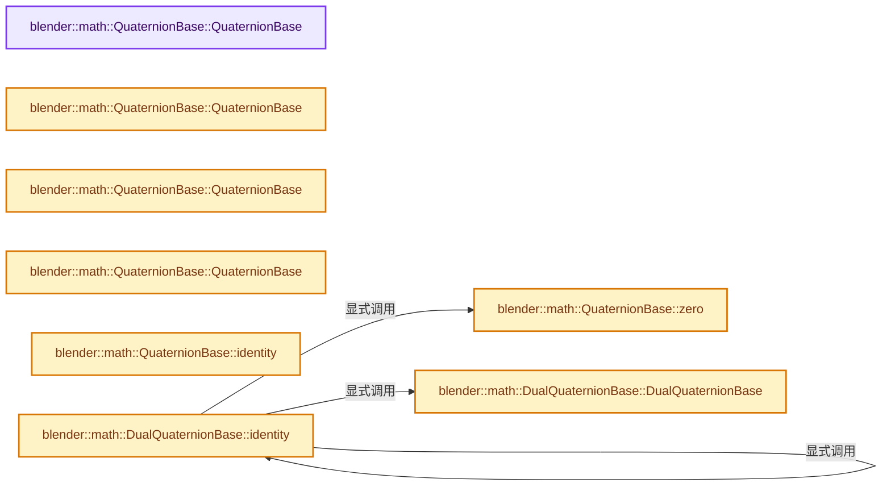
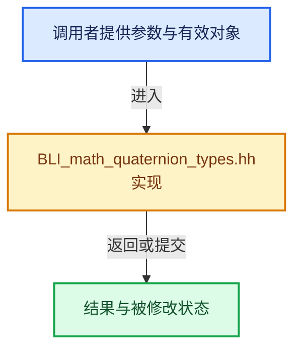

# 实现依赖专题：source/blender/blenlib/BLI_math_quaternion_types.hh

[实现依赖导航](../README.md) · [符号索引](../../00-课程指南/02-源码与提交索引/符号依赖与实现索引.md)

本专题从正文实际调用进入，集中保存共享实现。函数有稳定锚点，可从调用处直接跳到对应完整函数；递归与互相调用通过回链组织。

## 本文件的实现关系






## 完整成员与函数实现

<a id="f-1302d78c153ef0b9"></a>

### `blender::math::QuaternionBase::QuaternionBase`

实现位置：[source/blender/blenlib/BLI_math_quaternion_types.hh](../../../../../../source/blender/blenlib/BLI_math_quaternion_types.hh) · L39—L39。

**教学注释版**

<!-- annotated:422fe45fe774da -->

```cpp
  QuaternionBase() = default;
```

<details>
<summary>核对原始源码：source/blender/blenlib/BLI_math_quaternion_types.hh · L39—L39</summary>

<!-- original:422fe45fe774da:source/blender/blenlib/BLI_math_quaternion_types.hh:39:39 -->

```cpp
  QuaternionBase() = default;
```

</details>

**继续追踪实现**

本实现没有需要继续展开的显式调用；检查返回表达式、对象转换和调用者前置条件。

<a id="f-1281fc5da909c263"></a>

### `blender::math::QuaternionBase::QuaternionBase`

实现位置：[source/blender/blenlib/BLI_math_quaternion_types.hh](../../../../../../source/blender/blenlib/BLI_math_quaternion_types.hh) · L41—L42。

接口参数：

- `const T &new_w`
- `const T &new_x`
- `const T &new_y`
- `const T &new_z`

**教学注释版**

<!-- annotated:a45f9148b4276f -->

```cpp
  QuaternionBase(const T &new_w, const T &new_x, const T &new_y, const T &new_z)
      : w(new_w), x(new_x), y(new_y), z(new_z) {};
```

<details>
<summary>核对原始源码：source/blender/blenlib/BLI_math_quaternion_types.hh · L41—L42</summary>

<!-- original:a45f9148b4276f:source/blender/blenlib/BLI_math_quaternion_types.hh:41:42 -->

```cpp
  QuaternionBase(const T &new_w, const T &new_x, const T &new_y, const T &new_z)
      : w(new_w), x(new_x), y(new_y), z(new_z) {};
```

</details>

**继续追踪实现**

本实现没有需要继续展开的显式调用；检查返回表达式、对象转换和调用者前置条件。

<a id="f-92c30790ecf497c6"></a>

### `blender::math::QuaternionBase::QuaternionBase`

实现位置：[source/blender/blenlib/BLI_math_quaternion_types.hh](../../../../../../source/blender/blenlib/BLI_math_quaternion_types.hh) · L48—L48。

接口参数：

- `const VecBase<T, 4> &vec`

**教学注释版**

<!-- annotated:0031a0a71ab505 -->

```cpp
  explicit QuaternionBase(const VecBase<T, 4> &vec) : QuaternionBase(UNPACK4(vec)) {};
```

<details>
<summary>核对原始源码：source/blender/blenlib/BLI_math_quaternion_types.hh · L48—L48</summary>

<!-- original:0031a0a71ab505:source/blender/blenlib/BLI_math_quaternion_types.hh:48:48 -->

```cpp
  explicit QuaternionBase(const VecBase<T, 4> &vec) : QuaternionBase(UNPACK4(vec)) {};
```

</details>

**继续追踪实现**

本实现没有需要继续展开的显式调用；检查返回表达式、对象转换和调用者前置条件。

<a id="f-f5909ed2b96d6d44"></a>

### `blender::math::QuaternionBase::QuaternionBase`

实现位置：[source/blender/blenlib/BLI_math_quaternion_types.hh](../../../../../../source/blender/blenlib/BLI_math_quaternion_types.hh) · L53—L54。

接口参数：

- `const T &real`
- `const VecBase<T, 3> &imaginary`

**教学注释版**

<!-- annotated:c9c87e9af9ca60 -->

```cpp
  QuaternionBase(const T &real, const VecBase<T, 3> &imaginary)
      : QuaternionBase(real, UNPACK3(imaginary)) {};
```

<details>
<summary>核对原始源码：source/blender/blenlib/BLI_math_quaternion_types.hh · L53—L54</summary>

<!-- original:c9c87e9af9ca60:source/blender/blenlib/BLI_math_quaternion_types.hh:53:54 -->

```cpp
  QuaternionBase(const T &real, const VecBase<T, 3> &imaginary)
      : QuaternionBase(real, UNPACK3(imaginary)) {};
```

</details>

**继续追踪实现**

本实现没有需要继续展开的显式调用；检查返回表达式、对象转换和调用者前置条件。

<a id="f-c1a640a83f35968e"></a>

### `blender::math::QuaternionBase::identity`

实现位置：[source/blender/blenlib/BLI_math_quaternion_types.hh](../../../../../../source/blender/blenlib/BLI_math_quaternion_types.hh) · L58—L61。

**教学注释版**

<!-- annotated:c358cd5f41b3e2 -->

```cpp
  static QuaternionBase identity()
  {
    return {1, 0, 0, 0};
  }
```

<details>
<summary>核对原始源码：source/blender/blenlib/BLI_math_quaternion_types.hh · L58—L61</summary>

<!-- original:c358cd5f41b3e2:source/blender/blenlib/BLI_math_quaternion_types.hh:58:61 -->

```cpp
  static QuaternionBase identity()
  {
    return {1, 0, 0, 0};
  }
```

</details>

**结果出口**

- `return {1, 0, 0, 0};`

**继续追踪实现**

本实现没有需要继续展开的显式调用；检查返回表达式、对象转换和调用者前置条件。

<a id="f-63906ec497f704b5"></a>

### `blender::math::QuaternionBase::zero`

实现位置：[source/blender/blenlib/BLI_math_quaternion_types.hh](../../../../../../source/blender/blenlib/BLI_math_quaternion_types.hh) · L64—L67。

**教学注释版**

<!-- annotated:9f4b91bae92ece -->

```cpp
  static QuaternionBase zero()
  {
    return {0, 0, 0, 0};
  }
```

<details>
<summary>核对原始源码：source/blender/blenlib/BLI_math_quaternion_types.hh · L64—L67</summary>

<!-- original:9f4b91bae92ece:source/blender/blenlib/BLI_math_quaternion_types.hh:64:67 -->

```cpp
  static QuaternionBase zero()
  {
    return {0, 0, 0, 0};
  }
```

</details>

**结果出口**

- `return {0, 0, 0, 0};`

**继续追踪实现**

本实现没有需要继续展开的显式调用；检查返回表达式、对象转换和调用者前置条件。

<a id="f-5ca8635dcee97897"></a>

### `blender::math::DualQuaternionBase::DualQuaternionBase`

实现位置：[source/blender/blenlib/BLI_math_quaternion_types.hh](../../../../../../source/blender/blenlib/BLI_math_quaternion_types.hh) · L226—L226。

**教学注释版**

<!-- annotated:e205aeb9092336 -->

```cpp
  DualQuaternionBase() = delete;
```

<details>
<summary>核对原始源码：source/blender/blenlib/BLI_math_quaternion_types.hh · L226—L226</summary>

<!-- original:e205aeb9092336:source/blender/blenlib/BLI_math_quaternion_types.hh:226:226 -->

```cpp
  DualQuaternionBase() = delete;
```

</details>

**继续追踪实现**

本实现没有需要继续展开的显式调用；检查返回表达式、对象转换和调用者前置条件。

<a id="f-d863b2e53282ca9e"></a>

### `blender::math::DualQuaternionBase::identity`

实现位置：[source/blender/blenlib/BLI_math_quaternion_types.hh](../../../../../../source/blender/blenlib/BLI_math_quaternion_types.hh) · L242—L245。

**教学注释版**

<!-- annotated:57f1bc002fc0db -->

```cpp
  static DualQuaternionBase identity()
  {
    return DualQuaternionBase(QuaternionBase<T>::identity(), QuaternionBase<T>::zero());
  }
```

<details>
<summary>核对原始源码：source/blender/blenlib/BLI_math_quaternion_types.hh · L242—L245</summary>

<!-- original:57f1bc002fc0db:source/blender/blenlib/BLI_math_quaternion_types.hh:242:245 -->

```cpp
  static DualQuaternionBase identity()
  {
    return DualQuaternionBase(QuaternionBase<T>::identity(), QuaternionBase<T>::zero());
  }
```

</details>

**结果出口**

- `return DualQuaternionBase(QuaternionBase<T>::identity(), QuaternionBase<T>::zero());`

**继续追踪实现**

- `DualQuaternionBase` → [blender::math::DualQuaternionBase::DualQuaternionBase · L226](BLI_math_quaternion_types.hh.md#f-5ca8635dcee97897)。
- `QuaternionBase<T>::identity` → [blender::math::DualQuaternionBase::identity · L242](BLI_math_quaternion_types.hh.md#f-d863b2e53282ca9e)。
- `QuaternionBase<T>::zero` → [blender::math::QuaternionBase::zero · L64](BLI_math_quaternion_types.hh.md#f-63906ec497f704b5)。

<a id="f-db5930ac0203c674"></a>

### `blender::math::is_normalized`

实现位置：[source/blender/blenlib/BLI_math_quaternion_types.hh](../../../../../../source/blender/blenlib/BLI_math_quaternion_types.hh) · L301—L304。

接口参数：

- `const DualQuaternionBase<T> &dq`

**教学注释版**

<!-- annotated:2387bea22d3564 -->

```cpp
template<typename T> [[nodiscard]] inline bool is_normalized(const DualQuaternionBase<T> &dq)
{
  return dq.quat_weight == T(1);
}
```

<details>
<summary>核对原始源码：source/blender/blenlib/BLI_math_quaternion_types.hh · L301—L304</summary>

<!-- original:2387bea22d3564:source/blender/blenlib/BLI_math_quaternion_types.hh:301:304 -->

```cpp
template<typename T> [[nodiscard]] inline bool is_normalized(const DualQuaternionBase<T> &dq)
{
  return dq.quat_weight == T(1);
}
```

</details>

**结果出口**

- `return dq.quat_weight == T(1);`

**继续追踪实现**

- `T` → [DiagSplit::T · L96](../07-Intern运行时与平台/cycles/subd/split.cpp.md#f-d5d0885c790cc4e4)。
