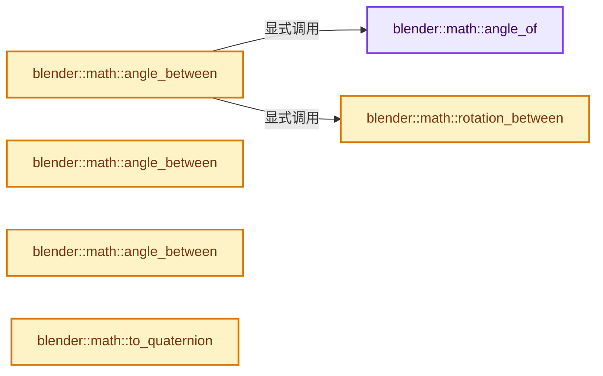
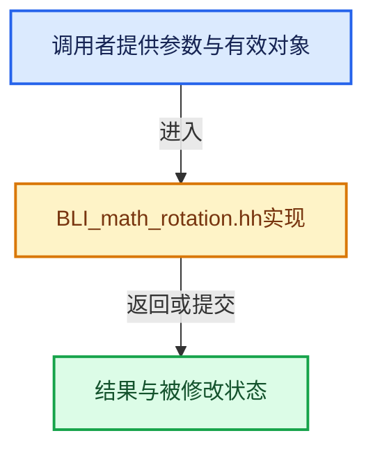

# 实现依赖专题：source/blender/blenlib/BLI_math_rotation.hh

[实现依赖导航](../README.md) · [符号索引](../../00-课程指南/02-源码与提交索引/符号依赖与实现索引.md)

本专题从正文实际调用进入，集中保存共享实现。函数有稳定锚点，可从调用处直接跳到对应完整函数；递归与互相调用通过回链组织。

## 本文件的实现关系






## 完整成员与函数实现

<a id="f-73671e5a45b2bd4b"></a>

### `blender::math::angle_of`

实现位置：[source/blender/blenlib/BLI_math_rotation.hh](../../../../../../source/blender/blenlib/BLI_math_rotation.hh) · L125—L129。

接口参数：

- `const QuaternionBase<T> &q`

**教学注释版**

<!-- annotated:aa3d0146f9649e -->

```cpp
template<typename T> [[nodiscard]] AngleRadianBase<T> angle_of(const QuaternionBase<T> &q)
{
  BLI_assert(is_unit_scale(q));
  return T(2) * math::safe_acos(q.w);
}
```

<details>
<summary>核对原始源码：source/blender/blenlib/BLI_math_rotation.hh · L125—L129</summary>

<!-- original:aa3d0146f9649e:source/blender/blenlib/BLI_math_rotation.hh:125:129 -->

```cpp
template<typename T> [[nodiscard]] AngleRadianBase<T> angle_of(const QuaternionBase<T> &q)
{
  BLI_assert(is_unit_scale(q));
  return T(2) * math::safe_acos(q.w);
}
```

</details>

**结果出口**

- `return T(2) * math::safe_acos(q.w);`

**继续追踪实现**

- `BLI_assert` → [BLI_assert · L48](BLI_assert.hh.md#m-57a88495704d)；[BLI_assert · L63](BLI_assert.hh.md#m-d07050020cb5)。宏定义由构建条件选择。
- `is_unit_scale` → [blender::math::is_unit_scale · L463](BLI_math_vector.hh.md#f-5ff2739590caa903)；[blender::math::is_unit_scale · L125](BLI_math_quaternion.hh.md#f-29e97a29f06db326)；[blender::math::is_unit_scale · L637](BLI_math_matrix.hh.md#f-d7f4cb1a4f1945c7)。同名重载需按实参类型选择。
- `T` → [DiagSplit::T · L96](../07-Intern运行时与平台/cycles/subd/split.cpp.md#f-d5d0885c790cc4e4)。
- `math::safe_acos` → [blender::math::safe_acos · L229](BLI_math_base.hh.md#f-e550783e6f1c1e90)。

<a id="f-b19459f175a6ddcb"></a>

### `blender::math::angle_between`

实现位置：[source/blender/blenlib/BLI_math_rotation.hh](../../../../../../source/blender/blenlib/BLI_math_rotation.hh) · L151—L156。

接口参数：

- `const QuaternionBase<T> &a`
- `const QuaternionBase<T> &b`

**教学注释版**

<!-- annotated:e1aef97ba0b414 -->

```cpp
template<typename T>
[[nodiscard]] AngleRadianBase<T> angle_between(const QuaternionBase<T> &a,
                                               const QuaternionBase<T> &b)
{
  return angle_of(rotation_between(a, b));
}
```

<details>
<summary>核对原始源码：source/blender/blenlib/BLI_math_rotation.hh · L151—L156</summary>

<!-- original:e1aef97ba0b414:source/blender/blenlib/BLI_math_rotation.hh:151:156 -->

```cpp
template<typename T>
[[nodiscard]] AngleRadianBase<T> angle_between(const QuaternionBase<T> &a,
                                               const QuaternionBase<T> &b)
{
  return angle_of(rotation_between(a, b));
}
```

</details>

**结果出口**

- `return angle_of(rotation_between(a, b));`

**继续追踪实现**

- `angle_of` → [blender::math::angle_of · L125](BLI_math_rotation.hh.md#f-73671e5a45b2bd4b)。
- `rotation_between` → [blender::math::rotation_between · L226](BLI_math_rotation.hh.md#f-4902fc330ef1c332)。

<a id="f-30033a924d07192e"></a>

### `blender::math::angle_between`

实现位置：[source/blender/blenlib/BLI_math_rotation.hh](../../../../../../source/blender/blenlib/BLI_math_rotation.hh) · L157—L163。

接口参数：

- `const VecBase<T, 3> &a`
- `const VecBase<T, 3> &b`

**教学注释版**

<!-- annotated:fdce8999ee72bf -->

```cpp
template<typename T>
[[nodiscard]] AngleRadianBase<T> angle_between(const VecBase<T, 3> &a, const VecBase<T, 3> &b)
{
  BLI_assert(is_unit_scale(a));
  BLI_assert(is_unit_scale(b));
  return math::safe_acos(dot(a, b));
}
```

<details>
<summary>核对原始源码：source/blender/blenlib/BLI_math_rotation.hh · L157—L163</summary>

<!-- original:fdce8999ee72bf:source/blender/blenlib/BLI_math_rotation.hh:157:163 -->

```cpp
template<typename T>
[[nodiscard]] AngleRadianBase<T> angle_between(const VecBase<T, 3> &a, const VecBase<T, 3> &b)
{
  BLI_assert(is_unit_scale(a));
  BLI_assert(is_unit_scale(b));
  return math::safe_acos(dot(a, b));
}
```

</details>

**结果出口**

- `return math::safe_acos(dot(a, b));`

**继续追踪实现**

- `BLI_assert` → [BLI_assert · L48](BLI_assert.hh.md#m-57a88495704d)；[BLI_assert · L63](BLI_assert.hh.md#m-d07050020cb5)。宏定义由构建条件选择。
- `is_unit_scale` → [blender::math::is_unit_scale · L463](BLI_math_vector.hh.md#f-5ff2739590caa903)；[blender::math::is_unit_scale · L125](BLI_math_quaternion.hh.md#f-29e97a29f06db326)；[blender::math::is_unit_scale · L637](BLI_math_matrix.hh.md#f-d7f4cb1a4f1945c7)。同名重载需按实参类型选择。
- `math::safe_acos` → [blender::math::safe_acos · L229](BLI_math_base.hh.md#f-e550783e6f1c1e90)。
- `dot` → [blender::math::dot · L430](BLI_math_vector.hh.md#f-6f0c6a081b107428)；[blender::math::dot · L198](BLI_math_quaternion.hh.md#f-5b1ef457981dbc76)。同名重载需按实参类型选择。

<a id="f-a35fe0ed487c166d"></a>

### `blender::math::angle_between`

实现位置：[source/blender/blenlib/BLI_math_rotation.hh](../../../../../../source/blender/blenlib/BLI_math_rotation.hh) · L164—L174。

接口参数：

- `const AxisSigned a`
- `const AxisSigned b`

**教学注释版**

<!-- annotated:39c47e8d104593 -->

```cpp
template<typename T>
[[nodiscard]] AngleFraction<T> angle_between(const AxisSigned a, const AxisSigned b)
{
  if (a == b) {
    return AngleFraction<T>::identity();
  }
  if (abs(a) == abs(b)) {
    return AngleFraction<T>::pi();
  }
  return AngleFraction<T>::pi() / 2;
}
```

<details>
<summary>核对原始源码：source/blender/blenlib/BLI_math_rotation.hh · L164—L174</summary>

<!-- original:39c47e8d104593:source/blender/blenlib/BLI_math_rotation.hh:164:174 -->

```cpp
template<typename T>
[[nodiscard]] AngleFraction<T> angle_between(const AxisSigned a, const AxisSigned b)
{
  if (a == b) {
    return AngleFraction<T>::identity();
  }
  if (abs(a) == abs(b)) {
    return AngleFraction<T>::pi();
  }
  return AngleFraction<T>::pi() / 2;
}
```

</details>

**结果出口**

- `return AngleFraction<T>::identity();`
- `return AngleFraction<T>::pi();`
- `return AngleFraction<T>::pi() / 2;`

**继续追踪实现**

- `AngleFraction<T>::identity` → [blender::math::AngleFraction::identity · L393](BLI_math_angle_types.hh.md#f-3aeb82e761d43e0b)。
- `abs` → [blender::math::abs · L38](BLI_math_vector.hh.md#f-e755530125bc2198)；[blender::math::abs · L201](BLI_math_basis_types.hh.md#f-a137ffce39989ffc)；[blender::math::abs · L33](BLI_math_base.hh.md#f-a2c9c981f4e8420c)。同名重载需按实参类型选择。
- `AngleFraction<T>::pi` → [blender::math::AngleFraction::pi · L398](BLI_math_angle_types.hh.md#f-b0841a09e4cef4c6)。

<a id="f-4902fc330ef1c332"></a>

### `blender::math::rotation_between`

实现位置：[source/blender/blenlib/BLI_math_rotation.hh](../../../../../../source/blender/blenlib/BLI_math_rotation.hh) · L226—L231。

接口参数：

- `const QuaternionBase<T> &a`
- `const QuaternionBase<T> &b`

**教学注释版**

<!-- annotated:db07f05c358d9b -->

```cpp
template<typename T>
[[nodiscard]] QuaternionBase<T> rotation_between(const QuaternionBase<T> &a,
                                                 const QuaternionBase<T> &b)
{
  return invert(a) * b;
}
```

<details>
<summary>核对原始源码：source/blender/blenlib/BLI_math_rotation.hh · L226—L231</summary>

<!-- original:db07f05c358d9b:source/blender/blenlib/BLI_math_rotation.hh:226:231 -->

```cpp
template<typename T>
[[nodiscard]] QuaternionBase<T> rotation_between(const QuaternionBase<T> &a,
                                                 const QuaternionBase<T> &b)
{
  return invert(a) * b;
}
```

</details>

**结果出口**

- `return invert(a) * b;`

**继续追踪实现**

- `invert` → [blender::math::invert · L234](BLI_math_quaternion.hh.md#f-7ba965075f461895)；[blender::math::invert · L648](BLI_math_matrix.hh.md#f-2b50b5262b2a9121)；[blender::math::invert · L460](BLI_math_basis_types.hh.md#f-76b56b37f151208d)。同名重载需按实参类型选择。

<a id="f-8368957aa016c3c4"></a>

### `blender::math::to_quaternion`

实现位置：[source/blender/blenlib/BLI_math_rotation.hh](../../../../../../source/blender/blenlib/BLI_math_rotation.hh) · L400—L473。

接口参数：

- `const CartesianBasis &rotation`

**教学注释版**

<!-- annotated:7b914e13453b95 -->

```cpp
template<typename T> QuaternionBase<T> to_quaternion(const CartesianBasis &rotation)
{
  /**
   * There are only 6 * 4 = 24 possible valid orthonormal orientations.
   * We precompute them and store them inside this switch using a key.
   * Generated using `generate_axes_to_quaternion_switch_cases()`.
   */
  constexpr auto map = [](AxisSigned x, AxisSigned y, AxisSigned z) {
    return x.as_int() << 16 | y.as_int() << 8 | z.as_int();
  };

  switch (map(rotation.axes.x, rotation.axes.y, rotation.axes.z)) {
    default:
      return QuaternionBase<T>::identity();
    case map(AxisSigned::Z_POS, AxisSigned::X_POS, AxisSigned::Y_POS):
      return QuaternionBase<T>{T(0.5), T(-0.5), T(-0.5), T(-0.5)};
    case map(AxisSigned::Y_NEG, AxisSigned::X_POS, AxisSigned::Z_POS):
      return QuaternionBase<T>{
          T(rcp(std::numbers::sqrt2)), T(0), T(0), T(-rcp(std::numbers::sqrt2))};
    case map(AxisSigned::Z_NEG, AxisSigned::X_POS, AxisSigned::Y_NEG):
      return QuaternionBase<T>{T(0.5), T(0.5), T(0.5), T(-0.5)};
    case map(AxisSigned::Y_POS, AxisSigned::X_POS, AxisSigned::Z_NEG):
      return QuaternionBase<T>{
          T(0), T(rcp(std::numbers::sqrt2)), T(rcp(std::numbers::sqrt2)), T(0)};
    case map(AxisSigned::Z_NEG, AxisSigned::Y_POS, AxisSigned::X_POS):
      return QuaternionBase<T>{
          T(rcp(std::numbers::sqrt2)), T(0), T(rcp(std::numbers::sqrt2)), T(0)};
    case map(AxisSigned::Z_POS, AxisSigned::Y_POS, AxisSigned::X_NEG):
      return QuaternionBase<T>{
          T(rcp(std::numbers::sqrt2)), T(0), T(-rcp(std::numbers::sqrt2)), T(0)};
    case map(AxisSigned::X_NEG, AxisSigned::Y_POS, AxisSigned::Z_NEG):
      return QuaternionBase<T>{T(0), T(0), T(1), T(0)};
    case map(AxisSigned::Y_POS, AxisSigned::Z_POS, AxisSigned::X_POS):
      return QuaternionBase<T>{T(0.5), T(0.5), T(0.5), T(0.5)};
    case map(AxisSigned::X_NEG, AxisSigned::Z_POS, AxisSigned::Y_POS):
      return QuaternionBase<T>{
          T(0), T(0), T(rcp(std::numbers::sqrt2)), T(rcp(std::numbers::sqrt2))};
    case map(AxisSigned::Y_NEG, AxisSigned::Z_POS, AxisSigned::X_NEG):
      return QuaternionBase<T>{T(0.5), T(0.5), T(-0.5), T(-0.5)};
    case map(AxisSigned::X_POS, AxisSigned::Z_POS, AxisSigned::Y_NEG):
      return QuaternionBase<T>{
          T(rcp(std::numbers::sqrt2)), T(rcp(std::numbers::sqrt2)), T(0), T(0)};
    case map(AxisSigned::Z_NEG, AxisSigned::X_NEG, AxisSigned::Y_POS):
      return QuaternionBase<T>{T(0.5), T(-0.5), T(0.5), T(0.5)};
    case map(AxisSigned::Y_POS, AxisSigned::X_NEG, AxisSigned::Z_POS):
      return QuaternionBase<T>{
          T(rcp(std::numbers::sqrt2)), T(0), T(0), T(rcp(std::numbers::sqrt2))};
    case map(AxisSigned::Z_POS, AxisSigned::X_NEG, AxisSigned::Y_NEG):
      return QuaternionBase<T>{T(0.5), T(0.5), T(-0.5), T(0.5)};
    case map(AxisSigned::Y_NEG, AxisSigned::X_NEG, AxisSigned::Z_NEG):
      return QuaternionBase<T>{
          T(0), T(-rcp(std::numbers::sqrt2)), T(rcp(std::numbers::sqrt2)), T(0)};
    case map(AxisSigned::Z_POS, AxisSigned::Y_NEG, AxisSigned::X_POS):
      return QuaternionBase<T>{
          T(0), T(rcp(std::numbers::sqrt2)), T(0), T(rcp(std::numbers::sqrt2))};
    case map(AxisSigned::X_NEG, AxisSigned::Y_NEG, AxisSigned::Z_POS):
      return QuaternionBase<T>{T(0), T(0), T(0), T(1)};
    case map(AxisSigned::Z_NEG, AxisSigned::Y_NEG, AxisSigned::X_NEG):
      return QuaternionBase<T>{
          T(0), T(-rcp(std::numbers::sqrt2)), T(0), T(rcp(std::numbers::sqrt2))};
    case map(AxisSigned::X_POS, AxisSigned::Y_NEG, AxisSigned::Z_NEG):
      return QuaternionBase<T>{T(0), T(1), T(0), T(0)};
    case map(AxisSigned::Y_NEG, AxisSigned::Z_NEG, AxisSigned::X_POS):
      return QuaternionBase<T>{T(0.5), T(-0.5), T(0.5), T(-0.5)};
    case map(AxisSigned::X_POS, AxisSigned::Z_NEG, AxisSigned::Y_POS):
      return QuaternionBase<T>{
          T(rcp(std::numbers::sqrt2)), T(-rcp(std::numbers::sqrt2)), T(0), T(0)};
    case map(AxisSigned::Y_POS, AxisSigned::Z_NEG, AxisSigned::X_NEG):
      return QuaternionBase<T>{T(0.5), T(-0.5), T(-0.5), T(0.5)};
    case map(AxisSigned::X_NEG, AxisSigned::Z_NEG, AxisSigned::Y_NEG):
      return QuaternionBase<T>{
          T(0), T(0), T(-rcp(std::numbers::sqrt2)), T(rcp(std::numbers::sqrt2))};
  }
}
```

<details>
<summary>核对原始源码：source/blender/blenlib/BLI_math_rotation.hh · L400—L473</summary>

<!-- original:7b914e13453b95:source/blender/blenlib/BLI_math_rotation.hh:400:473 -->

```cpp
template<typename T> QuaternionBase<T> to_quaternion(const CartesianBasis &rotation)
{
  /**
   * There are only 6 * 4 = 24 possible valid orthonormal orientations.
   * We precompute them and store them inside this switch using a key.
   * Generated using `generate_axes_to_quaternion_switch_cases()`.
   */
  constexpr auto map = [](AxisSigned x, AxisSigned y, AxisSigned z) {
    return x.as_int() << 16 | y.as_int() << 8 | z.as_int();
  };

  switch (map(rotation.axes.x, rotation.axes.y, rotation.axes.z)) {
    default:
      return QuaternionBase<T>::identity();
    case map(AxisSigned::Z_POS, AxisSigned::X_POS, AxisSigned::Y_POS):
      return QuaternionBase<T>{T(0.5), T(-0.5), T(-0.5), T(-0.5)};
    case map(AxisSigned::Y_NEG, AxisSigned::X_POS, AxisSigned::Z_POS):
      return QuaternionBase<T>{
          T(rcp(std::numbers::sqrt2)), T(0), T(0), T(-rcp(std::numbers::sqrt2))};
    case map(AxisSigned::Z_NEG, AxisSigned::X_POS, AxisSigned::Y_NEG):
      return QuaternionBase<T>{T(0.5), T(0.5), T(0.5), T(-0.5)};
    case map(AxisSigned::Y_POS, AxisSigned::X_POS, AxisSigned::Z_NEG):
      return QuaternionBase<T>{
          T(0), T(rcp(std::numbers::sqrt2)), T(rcp(std::numbers::sqrt2)), T(0)};
    case map(AxisSigned::Z_NEG, AxisSigned::Y_POS, AxisSigned::X_POS):
      return QuaternionBase<T>{
          T(rcp(std::numbers::sqrt2)), T(0), T(rcp(std::numbers::sqrt2)), T(0)};
    case map(AxisSigned::Z_POS, AxisSigned::Y_POS, AxisSigned::X_NEG):
      return QuaternionBase<T>{
          T(rcp(std::numbers::sqrt2)), T(0), T(-rcp(std::numbers::sqrt2)), T(0)};
    case map(AxisSigned::X_NEG, AxisSigned::Y_POS, AxisSigned::Z_NEG):
      return QuaternionBase<T>{T(0), T(0), T(1), T(0)};
    case map(AxisSigned::Y_POS, AxisSigned::Z_POS, AxisSigned::X_POS):
      return QuaternionBase<T>{T(0.5), T(0.5), T(0.5), T(0.5)};
    case map(AxisSigned::X_NEG, AxisSigned::Z_POS, AxisSigned::Y_POS):
      return QuaternionBase<T>{
          T(0), T(0), T(rcp(std::numbers::sqrt2)), T(rcp(std::numbers::sqrt2))};
    case map(AxisSigned::Y_NEG, AxisSigned::Z_POS, AxisSigned::X_NEG):
      return QuaternionBase<T>{T(0.5), T(0.5), T(-0.5), T(-0.5)};
    case map(AxisSigned::X_POS, AxisSigned::Z_POS, AxisSigned::Y_NEG):
      return QuaternionBase<T>{
          T(rcp(std::numbers::sqrt2)), T(rcp(std::numbers::sqrt2)), T(0), T(0)};
    case map(AxisSigned::Z_NEG, AxisSigned::X_NEG, AxisSigned::Y_POS):
      return QuaternionBase<T>{T(0.5), T(-0.5), T(0.5), T(0.5)};
    case map(AxisSigned::Y_POS, AxisSigned::X_NEG, AxisSigned::Z_POS):
      return QuaternionBase<T>{
          T(rcp(std::numbers::sqrt2)), T(0), T(0), T(rcp(std::numbers::sqrt2))};
    case map(AxisSigned::Z_POS, AxisSigned::X_NEG, AxisSigned::Y_NEG):
      return QuaternionBase<T>{T(0.5), T(0.5), T(-0.5), T(0.5)};
    case map(AxisSigned::Y_NEG, AxisSigned::X_NEG, AxisSigned::Z_NEG):
      return QuaternionBase<T>{
          T(0), T(-rcp(std::numbers::sqrt2)), T(rcp(std::numbers::sqrt2)), T(0)};
    case map(AxisSigned::Z_POS, AxisSigned::Y_NEG, AxisSigned::X_POS):
      return QuaternionBase<T>{
          T(0), T(rcp(std::numbers::sqrt2)), T(0), T(rcp(std::numbers::sqrt2))};
    case map(AxisSigned::X_NEG, AxisSigned::Y_NEG, AxisSigned::Z_POS):
      return QuaternionBase<T>{T(0), T(0), T(0), T(1)};
    case map(AxisSigned::Z_NEG, AxisSigned::Y_NEG, AxisSigned::X_NEG):
      return QuaternionBase<T>{
          T(0), T(-rcp(std::numbers::sqrt2)), T(0), T(rcp(std::numbers::sqrt2))};
    case map(AxisSigned::X_POS, AxisSigned::Y_NEG, AxisSigned::Z_NEG):
      return QuaternionBase<T>{T(0), T(1), T(0), T(0)};
    case map(AxisSigned::Y_NEG, AxisSigned::Z_NEG, AxisSigned::X_POS):
      return QuaternionBase<T>{T(0.5), T(-0.5), T(0.5), T(-0.5)};
    case map(AxisSigned::X_POS, AxisSigned::Z_NEG, AxisSigned::Y_POS):
      return QuaternionBase<T>{
          T(rcp(std::numbers::sqrt2)), T(-rcp(std::numbers::sqrt2)), T(0), T(0)};
    case map(AxisSigned::Y_POS, AxisSigned::Z_NEG, AxisSigned::X_NEG):
      return QuaternionBase<T>{T(0.5), T(-0.5), T(-0.5), T(0.5)};
    case map(AxisSigned::X_NEG, AxisSigned::Z_NEG, AxisSigned::Y_NEG):
      return QuaternionBase<T>{
          T(0), T(0), T(-rcp(std::numbers::sqrt2)), T(rcp(std::numbers::sqrt2))};
  }
}
```

</details>

**结果出口**

- `return x.as_int() << 16 | y.as_int() << 8 | z.as_int();`
- `return QuaternionBase<T>::identity();`
- `return QuaternionBase<T>{T(0.5), T(-0.5), T(-0.5), T(-0.5)};`
- `return QuaternionBase<T>{`
- `return QuaternionBase<T>{T(0.5), T(0.5), T(0.5), T(-0.5)};`
- `return QuaternionBase<T>{T(0), T(0), T(1), T(0)};`
- `return QuaternionBase<T>{T(0.5), T(0.5), T(0.5), T(0.5)};`
- `return QuaternionBase<T>{T(0.5), T(0.5), T(-0.5), T(-0.5)};`
- `return QuaternionBase<T>{T(0.5), T(-0.5), T(0.5), T(0.5)};`
- `return QuaternionBase<T>{T(0.5), T(0.5), T(-0.5), T(0.5)};`
- `return QuaternionBase<T>{T(0), T(0), T(0), T(1)};`
- `return QuaternionBase<T>{T(0), T(1), T(0), T(0)};`
- `return QuaternionBase<T>{T(0.5), T(-0.5), T(0.5), T(-0.5)};`
- `return QuaternionBase<T>{T(0.5), T(-0.5), T(-0.5), T(0.5)};`

**继续追踪实现**

- `x.as_int` → [blender::math::AxisSigned::as_int · L162](BLI_math_basis_types.hh.md#f-b904c5aa5e89465a)。
- `y.as_int` → [blender::math::AxisSigned::as_int · L162](BLI_math_basis_types.hh.md#f-b904c5aa5e89465a)。
- `z.as_int` → [blender::math::AxisSigned::as_int · L162](BLI_math_basis_types.hh.md#f-b904c5aa5e89465a)。
- `map` → [调用协议](../../00-课程指南/01-路线与规范/模板宏与动态分派协议.md)：局部可调用对象，须结合其初始化与捕获环境。调用位置L411。
- `QuaternionBase<T>::identity` → [blender::math::QuaternionBase::identity · L58](BLI_math_quaternion_types.hh.md#f-c1a640a83f35968e)；[blender::math::DualQuaternionBase::identity · L242](BLI_math_quaternion_types.hh.md#f-d863b2e53282ca9e)。同名重载需按实参类型选择。
- `T` → [DiagSplit::T · L96](../07-Intern运行时与平台/cycles/subd/split.cpp.md#f-d5d0885c790cc4e4)。
- `rcp` → [blender::math::rcp · L403](BLI_math_vector.hh.md#f-e187fc1a1e97a02d)；[blender::math::rcp · L160](BLI_math_base.hh.md#f-034c4463ce7f9151)。同名重载需按实参类型选择。
