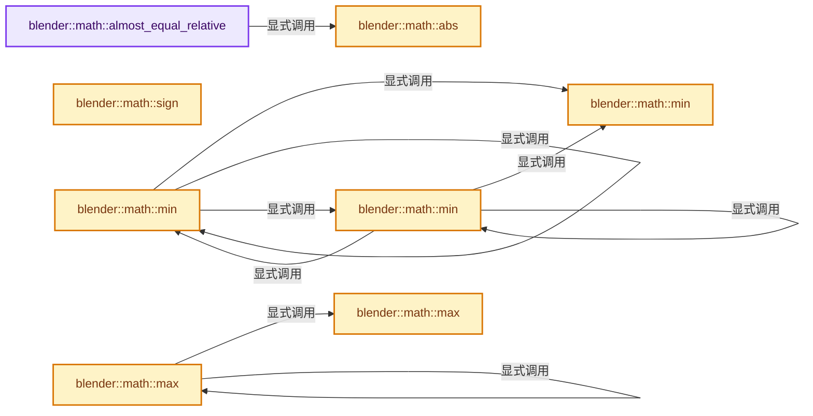

# 实现依赖专题：source/blender/blenlib/BLI_math_vector.hh

[实现依赖导航](../README.md) · [符号索引](../../00-课程指南/02-源码与提交索引/符号依赖与实现索引.md)

本专题从正文实际调用进入，集中保存共享实现。函数有稳定锚点，可从调用处直接跳到对应完整函数；递归与互相调用通过回链组织。

## 本文件的实现关系




## 完整成员与函数实现

<a id="f-9505b735b139eb36"></a>

### `blender::math::almost_equal_relative`

实现位置：[source/blender/blenlib/BLI_math_vector.hh](../../../../../../source/blender/blenlib/BLI_math_vector.hh) · L24—L36。

接口参数：

- `const VecBase<T, Size> &a`
- `const VecBase<T, Size> &b`
- `const T &epsilon_factor`

**教学注释版**

<!-- annotated:cac656c7dfef28 -->

```cpp
template<typename T, int Size>
[[nodiscard]] inline bool almost_equal_relative(const VecBase<T, Size> &a,
                                                const VecBase<T, Size> &b,
                                                const T &epsilon_factor)
{
  for (int i = 0; i < Size; i++) {
    const float epsilon = epsilon_factor * math::abs(a[i]);
    if (math::distance(a[i], b[i]) > epsilon) {
      return false;
    }
  }
  return true;
}
```

<details>
<summary>核对原始源码：source/blender/blenlib/BLI_math_vector.hh · L24—L36</summary>

<!-- original:cac656c7dfef28:source/blender/blenlib/BLI_math_vector.hh:24:36 -->

```cpp
template<typename T, int Size>
[[nodiscard]] inline bool almost_equal_relative(const VecBase<T, Size> &a,
                                                const VecBase<T, Size> &b,
                                                const T &epsilon_factor)
{
  for (int i = 0; i < Size; i++) {
    const float epsilon = epsilon_factor * math::abs(a[i]);
    if (math::distance(a[i], b[i]) > epsilon) {
      return false;
    }
  }
  return true;
}
```

</details>

**结果出口**

- `return false;`
- `return true;`

**继续追踪实现**

- `math::abs` → [blender::math::abs · L38](BLI_math_vector.hh.md#f-e755530125bc2198)。
- `math::distance` → [blender::math::distance · L485](BLI_math_vector.hh.md#f-0a0df9b41ececd7b)。

<a id="f-e755530125bc2198"></a>

### `blender::math::abs`

实现位置：[source/blender/blenlib/BLI_math_vector.hh](../../../../../../source/blender/blenlib/BLI_math_vector.hh) · L38—L45。

接口参数：

- `const VecBase<T, Size> &a`

**教学注释版**

<!-- annotated:81a646447c5169 -->

```cpp
template<typename T, int Size> [[nodiscard]] inline VecBase<T, Size> abs(const VecBase<T, Size> &a)
{
  VecBase<T, Size> result;
  for (int i = 0; i < Size; i++) {
    result[i] = a[i] >= 0 ? a[i] : -a[i];
  }
  return result;
}
```

<details>
<summary>核对原始源码：source/blender/blenlib/BLI_math_vector.hh · L38—L45</summary>

<!-- original:81a646447c5169:source/blender/blenlib/BLI_math_vector.hh:38:45 -->

```cpp
template<typename T, int Size> [[nodiscard]] inline VecBase<T, Size> abs(const VecBase<T, Size> &a)
{
  VecBase<T, Size> result;
  for (int i = 0; i < Size; i++) {
    result[i] = a[i] >= 0 ? a[i] : -a[i];
  }
  return result;
}
```

</details>

**沿实际写入检查状态**

- `result[i] = a[i] >= 0 ? a[i] : -a[i];`

**结果出口**

- `return result;`

**继续追踪实现**

本实现没有需要继续展开的显式调用；检查返回表达式、对象转换和调用者前置条件。

<a id="f-b7253f6f10bbfe6e"></a>

### `blender::math::sign`

实现位置：[source/blender/blenlib/BLI_math_vector.hh](../../../../../../source/blender/blenlib/BLI_math_vector.hh) · L50—L54。

接口参数：

- `const VecBase<T, Size> &a`

**教学注释版**

<!-- annotated:467828df044771 -->

```cpp
template<typename T, int Size>
[[nodiscard]] inline VecBase<T, Size> sign(const VecBase<T, Size> &a)
{
  BLI_UNROLL_MATH_VEC_OP_VEC(math::sign, a);
}
```

<details>
<summary>核对原始源码：source/blender/blenlib/BLI_math_vector.hh · L50—L54</summary>

<!-- original:467828df044771:source/blender/blenlib/BLI_math_vector.hh:50:54 -->

```cpp
template<typename T, int Size>
[[nodiscard]] inline VecBase<T, Size> sign(const VecBase<T, Size> &a)
{
  BLI_UNROLL_MATH_VEC_OP_VEC(math::sign, a);
}
```

</details>

**继续追踪实现**

- `BLI_UNROLL_MATH_VEC_OP_VEC` → [BLI_UNROLL_MATH_VEC_OP_VEC · L61](BLI_math_vector_unroll.hh.md#m-f099b15d7818)。宏定义由构建条件选择。

<a id="f-ee6ead51e4bb3364"></a>

### `blender::math::min`

实现位置：[source/blender/blenlib/BLI_math_vector.hh](../../../../../../source/blender/blenlib/BLI_math_vector.hh) · L56—L60。

接口参数：

- `const VecBase<T, Size> &a`
- `const VecBase<T, Size> &b`

**教学注释版**

<!-- annotated:1f301b14730c76 -->

```cpp
template<typename T, int Size>
[[nodiscard]] inline VecBase<T, Size> min(const VecBase<T, Size> &a, const VecBase<T, Size> &b)
{
  BLI_UNROLL_MATH_VEC_FUNC_VEC_VEC(math::min, a, b);
}
```

<details>
<summary>核对原始源码：source/blender/blenlib/BLI_math_vector.hh · L56—L60</summary>

<!-- original:1f301b14730c76:source/blender/blenlib/BLI_math_vector.hh:56:60 -->

```cpp
template<typename T, int Size>
[[nodiscard]] inline VecBase<T, Size> min(const VecBase<T, Size> &a, const VecBase<T, Size> &b)
{
  BLI_UNROLL_MATH_VEC_FUNC_VEC_VEC(math::min, a, b);
}
```

</details>

**继续追踪实现**

- `BLI_UNROLL_MATH_VEC_FUNC_VEC_VEC` → [BLI_UNROLL_MATH_VEC_FUNC_VEC_VEC · L42](BLI_math_vector_unroll.hh.md#m-14828625a8ed)。宏定义由构建条件选择。

<a id="f-f65ce48b3051cce3"></a>

### `blender::math::min`

实现位置：[source/blender/blenlib/BLI_math_vector.hh](../../../../../../source/blender/blenlib/BLI_math_vector.hh) · L65—L76。

接口参数：

- `Span<VecBase<T, Size>> values`

**教学注释版**

<!-- annotated:1962f40fe8b3fc -->

```cpp
template<typename T, int Size>
[[nodiscard]] inline VecBase<T, Size> min(Span<VecBase<T, Size>> values)
{
  // [讲解] values.is_empty：查询视图长度或生成对应有效索引区间。
  BLI_assert(!values.is_empty());

  VecBase<T, Size> result = values[0];
  // [讲解] values.drop_front：从两端裁去或选取一定数量元素形成新视图。
  for (const VecBase<T, Size> &v : values.drop_front(1)) {
    result = min(result, v);
  }

  return result;
}
```

<details>
<summary>核对原始源码：source/blender/blenlib/BLI_math_vector.hh · L65—L76</summary>

<!-- original:1962f40fe8b3fc:source/blender/blenlib/BLI_math_vector.hh:65:76 -->

```cpp
template<typename T, int Size>
[[nodiscard]] inline VecBase<T, Size> min(Span<VecBase<T, Size>> values)
{
  BLI_assert(!values.is_empty());

  VecBase<T, Size> result = values[0];
  for (const VecBase<T, Size> &v : values.drop_front(1)) {
    result = min(result, v);
  }

  return result;
}
```

</details>

**沿实际写入检查状态**

- `result = min(result, v);`

**结果出口**

- `return result;`

**继续追踪实现**

- `BLI_assert` → [BLI_assert · L48](BLI_assert.hh.md#m-57a88495704d)；[BLI_assert · L63](BLI_assert.hh.md#m-d07050020cb5)。宏定义由构建条件选择。
- `values.is_empty` → [blender::Span::is_empty · L264](../../01-基础容器与现代CPP/05-Span只读连续视图.md#f-8cc1d7ba8feb50e6)。
- `values.drop_front` → [blender::Span::drop_front · L175](../../01-基础容器与现代CPP/05-Span只读连续视图.md#f-932897accbde3413)。
- `min` → [blender::math::min · L56](BLI_math_vector.hh.md#f-ee6ead51e4bb3364)；[blender::math::min · L65](BLI_math_vector.hh.md#f-f65ce48b3051cce3)；[blender::math::min · L81](BLI_math_vector.hh.md#f-9c602d29fab41795)。同名重载需按实参类型选择。

<a id="f-9c602d29fab41795"></a>

### `blender::math::min`

实现位置：[source/blender/blenlib/BLI_math_vector.hh](../../../../../../source/blender/blenlib/BLI_math_vector.hh) · L81—L85。

接口参数：

- `std::initializer_list<VecBase<T, Size>> values`

**教学注释版**

<!-- annotated:c8cc923625e4da -->

```cpp
template<typename T, int Size>
[[nodiscard]] inline VecBase<T, Size> min(std::initializer_list<VecBase<T, Size>> values)
{
  return min(Span(values));
}
```

<details>
<summary>核对原始源码：source/blender/blenlib/BLI_math_vector.hh · L81—L85</summary>

<!-- original:c8cc923625e4da:source/blender/blenlib/BLI_math_vector.hh:81:85 -->

```cpp
template<typename T, int Size>
[[nodiscard]] inline VecBase<T, Size> min(std::initializer_list<VecBase<T, Size>> values)
{
  return min(Span(values));
}
```

</details>

**结果出口**

- `return min(Span(values));`

**继续追踪实现**

- `min` → [blender::math::min · L56](BLI_math_vector.hh.md#f-ee6ead51e4bb3364)；[blender::math::min · L65](BLI_math_vector.hh.md#f-f65ce48b3051cce3)；[blender::math::min · L81](BLI_math_vector.hh.md#f-9c602d29fab41795)。同名重载需按实参类型选择。
- `Span` → [blender::Span](BLI_span.hh.md#t-8765a8e0c1d5)；[blender::Span](BLI_index_range.hh.md#t-86091874a1c0)；[blender::Span](../08-其他Blender模块/makesdna/DNA_pointcloud_types.h.md#t-112aa6ed842c)；[blender::Span](../08-其他Blender模块/makesdna/DNA_node_types.h.md#t-49ec6fbb9b69)；[blender::Span](../08-其他Blender模块/makesdna/DNA_mesh_types.h.md#t-184fd48fb638)；[blender::Span](../08-其他Blender模块/makesdna/DNA_anim_types.h.md#t-d841071994c2)；[blender::Span](../08-其他Blender模块/makesrna/RNA_path_fwd.hh.md#t-4dbb08969e41)。

<a id="f-9be564a293777d6b"></a>

### `blender::math::max`

实现位置：[source/blender/blenlib/BLI_math_vector.hh](../../../../../../source/blender/blenlib/BLI_math_vector.hh) · L87—L91。

接口参数：

- `const VecBase<T, Size> &a`
- `const VecBase<T, Size> &b`

**教学注释版**

<!-- annotated:b5e1c68ae62317 -->

```cpp
template<typename T, int Size>
[[nodiscard]] inline VecBase<T, Size> max(const VecBase<T, Size> &a, const VecBase<T, Size> &b)
{
  BLI_UNROLL_MATH_VEC_FUNC_VEC_VEC(math::max, a, b);
}
```

<details>
<summary>核对原始源码：source/blender/blenlib/BLI_math_vector.hh · L87—L91</summary>

<!-- original:b5e1c68ae62317:source/blender/blenlib/BLI_math_vector.hh:87:91 -->

```cpp
template<typename T, int Size>
[[nodiscard]] inline VecBase<T, Size> max(const VecBase<T, Size> &a, const VecBase<T, Size> &b)
{
  BLI_UNROLL_MATH_VEC_FUNC_VEC_VEC(math::max, a, b);
}
```

</details>

**继续追踪实现**

- `BLI_UNROLL_MATH_VEC_FUNC_VEC_VEC` → [BLI_UNROLL_MATH_VEC_FUNC_VEC_VEC · L42](BLI_math_vector_unroll.hh.md#m-14828625a8ed)。宏定义由构建条件选择。

<a id="f-ce32dff37d0af3bc"></a>

### `blender::math::max`

实现位置：[source/blender/blenlib/BLI_math_vector.hh](../../../../../../source/blender/blenlib/BLI_math_vector.hh) · L96—L107。

接口参数：

- `Span<VecBase<T, Size>> values`

**教学注释版**

<!-- annotated:5f9ac11d2d7aac -->

```cpp
template<typename T, int Size>
[[nodiscard]] inline VecBase<T, Size> max(Span<VecBase<T, Size>> values)
{
  // [讲解] values.is_empty：查询视图长度或生成对应有效索引区间。
  BLI_assert(!values.is_empty());

  VecBase<T, Size> result = values[0];
  // [讲解] values.drop_front：从两端裁去或选取一定数量元素形成新视图。
  for (const VecBase<T, Size> &v : values.drop_front(1)) {
    result = max(result, v);
  }

  return result;
}
```

<details>
<summary>核对原始源码：source/blender/blenlib/BLI_math_vector.hh · L96—L107</summary>

<!-- original:5f9ac11d2d7aac:source/blender/blenlib/BLI_math_vector.hh:96:107 -->

```cpp
template<typename T, int Size>
[[nodiscard]] inline VecBase<T, Size> max(Span<VecBase<T, Size>> values)
{
  BLI_assert(!values.is_empty());

  VecBase<T, Size> result = values[0];
  for (const VecBase<T, Size> &v : values.drop_front(1)) {
    result = max(result, v);
  }

  return result;
}
```

</details>

**沿实际写入检查状态**

- `result = max(result, v);`

**结果出口**

- `return result;`

**继续追踪实现**

- `BLI_assert` → [BLI_assert · L48](BLI_assert.hh.md#m-57a88495704d)；[BLI_assert · L63](BLI_assert.hh.md#m-d07050020cb5)。宏定义由构建条件选择。
- `values.is_empty` → [blender::Span::is_empty · L264](../../01-基础容器与现代CPP/05-Span只读连续视图.md#f-8cc1d7ba8feb50e6)。
- `values.drop_front` → [blender::Span::drop_front · L175](../../01-基础容器与现代CPP/05-Span只读连续视图.md#f-932897accbde3413)。
- `max` → [blender::math::max · L87](BLI_math_vector.hh.md#f-9be564a293777d6b)；[blender::math::max · L96](BLI_math_vector.hh.md#f-ce32dff37d0af3bc)；[blender::math::max · L112](BLI_math_vector.hh.md#f-668eb1fcf1fa8292)。同名重载需按实参类型选择。

<a id="f-668eb1fcf1fa8292"></a>

### `blender::math::max`

实现位置：[source/blender/blenlib/BLI_math_vector.hh](../../../../../../source/blender/blenlib/BLI_math_vector.hh) · L112—L116。

接口参数：

- `std::initializer_list<VecBase<T, Size>> values`

**教学注释版**

<!-- annotated:6f88d0aac92aa9 -->

```cpp
template<typename T, int Size>
[[nodiscard]] inline VecBase<T, Size> max(std::initializer_list<VecBase<T, Size>> values)
{
  return max(Span(values));
}
```

<details>
<summary>核对原始源码：source/blender/blenlib/BLI_math_vector.hh · L112—L116</summary>

<!-- original:6f88d0aac92aa9:source/blender/blenlib/BLI_math_vector.hh:112:116 -->

```cpp
template<typename T, int Size>
[[nodiscard]] inline VecBase<T, Size> max(std::initializer_list<VecBase<T, Size>> values)
{
  return max(Span(values));
}
```

</details>

**结果出口**

- `return max(Span(values));`

**继续追踪实现**

- `max` → [blender::math::max · L87](BLI_math_vector.hh.md#f-9be564a293777d6b)；[blender::math::max · L96](BLI_math_vector.hh.md#f-ce32dff37d0af3bc)；[blender::math::max · L112](BLI_math_vector.hh.md#f-668eb1fcf1fa8292)。同名重载需按实参类型选择。
- `Span` → [blender::Span](BLI_span.hh.md#t-8765a8e0c1d5)；[blender::Span](BLI_index_range.hh.md#t-86091874a1c0)；[blender::Span](../08-其他Blender模块/makesdna/DNA_pointcloud_types.h.md#t-112aa6ed842c)；[blender::Span](../08-其他Blender模块/makesdna/DNA_node_types.h.md#t-49ec6fbb9b69)；[blender::Span](../08-其他Blender模块/makesdna/DNA_mesh_types.h.md#t-184fd48fb638)；[blender::Span](../08-其他Blender模块/makesdna/DNA_anim_types.h.md#t-d841071994c2)；[blender::Span](../08-其他Blender模块/makesrna/RNA_path_fwd.hh.md#t-4dbb08969e41)。

<a id="f-65702e97e59fc41e"></a>

### `blender::math::clamp`

实现位置：[source/blender/blenlib/BLI_math_vector.hh](../../../../../../source/blender/blenlib/BLI_math_vector.hh) · L118—L128。

接口参数：

- `const VecBase<T, Size> &a`
- `const VecBase<T, Size> &min`
- `const VecBase<T, Size> &max`

**教学注释版**

<!-- annotated:9beb55eeebccd8 -->

```cpp
template<typename T, int Size>
[[nodiscard]] inline VecBase<T, Size> clamp(const VecBase<T, Size> &a,
                                            const VecBase<T, Size> &min,
                                            const VecBase<T, Size> &max)
{
  VecBase<T, Size> result = a;
  for (int i = 0; i < Size; i++) {
    result[i] = math::clamp(result[i], min[i], max[i]);
  }
  return result;
}
```

<details>
<summary>核对原始源码：source/blender/blenlib/BLI_math_vector.hh · L118—L128</summary>

<!-- original:9beb55eeebccd8:source/blender/blenlib/BLI_math_vector.hh:118:128 -->

```cpp
template<typename T, int Size>
[[nodiscard]] inline VecBase<T, Size> clamp(const VecBase<T, Size> &a,
                                            const VecBase<T, Size> &min,
                                            const VecBase<T, Size> &max)
{
  VecBase<T, Size> result = a;
  for (int i = 0; i < Size; i++) {
    result[i] = math::clamp(result[i], min[i], max[i]);
  }
  return result;
}
```

</details>

**沿实际写入检查状态**

- `result[i] = math::clamp(result[i], min[i], max[i]);`

**结果出口**

- `return result;`

**继续追踪实现**

- `math::clamp` → [blender::math::clamp · L118](BLI_math_vector.hh.md#f-65702e97e59fc41e)；[blender::math::clamp · L130](BLI_math_vector.hh.md#f-0365873940e23a11)。同名重载需按实参类型选择。

<a id="f-0365873940e23a11"></a>

### `blender::math::clamp`

实现位置：[source/blender/blenlib/BLI_math_vector.hh](../../../../../../source/blender/blenlib/BLI_math_vector.hh) · L130—L138。

接口参数：

- `const VecBase<T, Size> &a`
- `const T &min`
- `const T &max`

**教学注释版**

<!-- annotated:07bb9eddfd65bf -->

```cpp
template<typename T, int Size>
[[nodiscard]] inline VecBase<T, Size> clamp(const VecBase<T, Size> &a, const T &min, const T &max)
{
  VecBase<T, Size> result = a;
  for (int i = 0; i < Size; i++) {
    result[i] = math::clamp(result[i], min, max);
  }
  return result;
}
```

<details>
<summary>核对原始源码：source/blender/blenlib/BLI_math_vector.hh · L130—L138</summary>

<!-- original:07bb9eddfd65bf:source/blender/blenlib/BLI_math_vector.hh:130:138 -->

```cpp
template<typename T, int Size>
[[nodiscard]] inline VecBase<T, Size> clamp(const VecBase<T, Size> &a, const T &min, const T &max)
{
  VecBase<T, Size> result = a;
  for (int i = 0; i < Size; i++) {
    result[i] = math::clamp(result[i], min, max);
  }
  return result;
}
```

</details>

**沿实际写入检查状态**

- `result[i] = math::clamp(result[i], min, max);`

**结果出口**

- `return result;`

**继续追踪实现**

- `math::clamp` → [blender::math::clamp · L118](BLI_math_vector.hh.md#f-65702e97e59fc41e)；[blender::math::clamp · L130](BLI_math_vector.hh.md#f-0365873940e23a11)。同名重载需按实参类型选择。

<a id="f-63a20db59a1da3e5"></a>

### `blender::math::mod`

实现位置：[source/blender/blenlib/BLI_math_vector.hh](../../../../../../source/blender/blenlib/BLI_math_vector.hh) · L157—L161。

接口参数：

- `const VecBase<T, Size> &a`
- `const VecBase<T, Size> &b`

**教学注释版**

<!-- annotated:e56c1706782ad4 -->

```cpp
template<typename T, int Size>
[[nodiscard]] inline VecBase<T, Size> mod(const VecBase<T, Size> &a, const VecBase<T, Size> &b)
{
  BLI_UNROLL_MATH_VEC_FUNC_VEC_VEC(math::mod, a, b);
}
```

<details>
<summary>核对原始源码：source/blender/blenlib/BLI_math_vector.hh · L157—L161</summary>

<!-- original:e56c1706782ad4:source/blender/blenlib/BLI_math_vector.hh:157:161 -->

```cpp
template<typename T, int Size>
[[nodiscard]] inline VecBase<T, Size> mod(const VecBase<T, Size> &a, const VecBase<T, Size> &b)
{
  BLI_UNROLL_MATH_VEC_FUNC_VEC_VEC(math::mod, a, b);
}
```

</details>

**继续追踪实现**

- `BLI_UNROLL_MATH_VEC_FUNC_VEC_VEC` → [BLI_UNROLL_MATH_VEC_FUNC_VEC_VEC · L42](BLI_math_vector_unroll.hh.md#m-14828625a8ed)。宏定义由构建条件选择。

<a id="f-f0283c16ea40d512"></a>

### `blender::math::mod`

实现位置：[source/blender/blenlib/BLI_math_vector.hh](../../../../../../source/blender/blenlib/BLI_math_vector.hh) · L163—L172。

接口参数：

- `const VecBase<T, Size> &a`
- `const T &b`

**教学注释版**

<!-- annotated:3f13a34490aa0b -->

```cpp
template<typename T, int Size>
[[nodiscard]] inline VecBase<T, Size> mod(const VecBase<T, Size> &a, const T &b)
{
  BLI_assert(b != 0);
  VecBase<T, Size> result;
  for (int i = 0; i < Size; i++) {
    result[i] = math::mod(a[i], b);
  }
  return result;
}
```

<details>
<summary>核对原始源码：source/blender/blenlib/BLI_math_vector.hh · L163—L172</summary>

<!-- original:3f13a34490aa0b:source/blender/blenlib/BLI_math_vector.hh:163:172 -->

```cpp
template<typename T, int Size>
[[nodiscard]] inline VecBase<T, Size> mod(const VecBase<T, Size> &a, const T &b)
{
  BLI_assert(b != 0);
  VecBase<T, Size> result;
  for (int i = 0; i < Size; i++) {
    result[i] = math::mod(a[i], b);
  }
  return result;
}
```

</details>

**沿实际写入检查状态**

- `result[i] = math::mod(a[i], b);`

**结果出口**

- `return result;`

**继续追踪实现**

- `BLI_assert` → [BLI_assert · L48](BLI_assert.hh.md#m-57a88495704d)；[BLI_assert · L63](BLI_assert.hh.md#m-d07050020cb5)。宏定义由构建条件选择。
- `math::mod` → [blender::math::mod · L157](BLI_math_vector.hh.md#f-63a20db59a1da3e5)；[blender::math::mod · L163](BLI_math_vector.hh.md#f-f0283c16ea40d512)。同名重载需按实参类型选择。

<a id="f-6c1248be60a2c7c0"></a>

### `blender::math::square`

实现位置：[source/blender/blenlib/BLI_math_vector.hh](../../../../../../source/blender/blenlib/BLI_math_vector.hh) · L278—L282。

接口参数：

- `const VecBase<T, Size> &a`

**教学注释版**

<!-- annotated:875f3552addb46 -->

```cpp
template<typename T, int Size>
[[nodiscard]] inline VecBase<T, Size> square(const VecBase<T, Size> &a)
{
  BLI_UNROLL_MATH_VEC_OP_VEC(math::square, a);
}
```

<details>
<summary>核对原始源码：source/blender/blenlib/BLI_math_vector.hh · L278—L282</summary>

<!-- original:875f3552addb46:source/blender/blenlib/BLI_math_vector.hh:278:282 -->

```cpp
template<typename T, int Size>
[[nodiscard]] inline VecBase<T, Size> square(const VecBase<T, Size> &a)
{
  BLI_UNROLL_MATH_VEC_OP_VEC(math::square, a);
}
```

</details>

**继续追踪实现**

- `BLI_UNROLL_MATH_VEC_OP_VEC` → [BLI_UNROLL_MATH_VEC_OP_VEC · L61](BLI_math_vector_unroll.hh.md#m-f099b15d7818)。宏定义由构建条件选择。

<a id="f-d0ca25e982d9489c"></a>

### `blender::math::min_max`

实现位置：[source/blender/blenlib/BLI_math_vector.hh](../../../../../../source/blender/blenlib/BLI_math_vector.hh) · L331—L336。

接口参数：

- `const VecBase<T, Size> &vector`
- `VecBase<T, Size> &min`
- `VecBase<T, Size> &max`

**教学注释版**

<!-- annotated:1b26e56b545f54 -->

```cpp
template<typename T, int Size>
inline void min_max(const VecBase<T, Size> &vector, VecBase<T, Size> &min, VecBase<T, Size> &max)
{
  min = math::min(vector, min);
  max = math::max(vector, max);
}
```

<details>
<summary>核对原始源码：source/blender/blenlib/BLI_math_vector.hh · L331—L336</summary>

<!-- original:1b26e56b545f54:source/blender/blenlib/BLI_math_vector.hh:331:336 -->

```cpp
template<typename T, int Size>
inline void min_max(const VecBase<T, Size> &vector, VecBase<T, Size> &min, VecBase<T, Size> &max)
{
  min = math::min(vector, min);
  max = math::max(vector, max);
}
```

</details>

**沿实际写入检查状态**

- `min = math::min(vector, min);`
- `max = math::max(vector, max);`

**继续追踪实现**

- `math::min` → [调用协议](../../00-课程指南/01-路线与规范/模板宏与动态分派协议.md)：局部可调用对象，须结合其初始化与捕获环境。调用位置L334。
- `math::max` → [调用协议](../../00-课程指南/01-路线与规范/模板宏与动态分派协议.md)：局部可调用对象，须结合其初始化与捕获环境。调用位置L335。

<a id="f-ab8c82f9a578f2d4"></a>

### `blender::math::safe_divide`

实现位置：[source/blender/blenlib/BLI_math_vector.hh](../../../../../../source/blender/blenlib/BLI_math_vector.hh) · L341—L346。

接口参数：

- `const VecBase<T, Size> &a`
- `const VecBase<T, Size> &b`

**教学注释版**

<!-- annotated:f109e09b486f9c -->

```cpp
template<typename T, int Size>
[[nodiscard]] inline VecBase<T, Size> safe_divide(const VecBase<T, Size> &a,
                                                  const VecBase<T, Size> &b)
{
  BLI_UNROLL_MATH_VEC_FUNC_VEC_VEC(math::safe_divide, a, b);
}
```

<details>
<summary>核对原始源码：source/blender/blenlib/BLI_math_vector.hh · L341—L346</summary>

<!-- original:f109e09b486f9c:source/blender/blenlib/BLI_math_vector.hh:341:346 -->

```cpp
template<typename T, int Size>
[[nodiscard]] inline VecBase<T, Size> safe_divide(const VecBase<T, Size> &a,
                                                  const VecBase<T, Size> &b)
{
  BLI_UNROLL_MATH_VEC_FUNC_VEC_VEC(math::safe_divide, a, b);
}
```

</details>

**继续追踪实现**

- `BLI_UNROLL_MATH_VEC_FUNC_VEC_VEC` → [BLI_UNROLL_MATH_VEC_FUNC_VEC_VEC · L42](BLI_math_vector_unroll.hh.md#m-14828625a8ed)。宏定义由构建条件选择。

<a id="f-0d22d4b64f9b5c0e"></a>

### `blender::math::safe_divide`

实现位置：[source/blender/blenlib/BLI_math_vector.hh](../../../../../../source/blender/blenlib/BLI_math_vector.hh) · L351—L355。

接口参数：

- `const VecBase<T, Size> &a`
- `const T &b`

**教学注释版**

<!-- annotated:c32e4cccc4bab8 -->

```cpp
template<typename T, int Size>
[[nodiscard]] inline VecBase<T, Size> safe_divide(const VecBase<T, Size> &a, const T &b)
{
  return (b != 0) ? a / b : VecBase<T, Size>(0.0f);
}
```

<details>
<summary>核对原始源码：source/blender/blenlib/BLI_math_vector.hh · L351—L355</summary>

<!-- original:c32e4cccc4bab8:source/blender/blenlib/BLI_math_vector.hh:351:355 -->

```cpp
template<typename T, int Size>
[[nodiscard]] inline VecBase<T, Size> safe_divide(const VecBase<T, Size> &a, const T &b)
{
  return (b != 0) ? a / b : VecBase<T, Size>(0.0f);
}
```

</details>

**结果出口**

- `return (b != 0) ? a / b : VecBase<T, Size>(0.0f);`

**继续追踪实现**

- `VecBase<T, Size>` → [blender::VecBase](BLI_math_vector_swizzle.hh.md#t-9c59a01258f4)；[blender::VecBase](../08-其他Blender模块/editors/include/ED_select_utils.hh.md#t-c1920adf2214)；[blender::VecBase](../08-其他Blender模块/makesdna/DNA_particle_types.h.md#t-5e33cefae34a)；[VecBase](../08-其他Blender模块/gpu/shaders/compat/gpu_shader_cxx_vector.hh.md#t-5371944ef97f)。

<a id="f-1bcb65cf7579edc2"></a>

### `blender::math::round`

实现位置：[source/blender/blenlib/BLI_math_vector.hh](../../../../../../source/blender/blenlib/BLI_math_vector.hh) · L363—L367。

接口参数：

- `const VecBase<T, Size> &a`

**教学注释版**

<!-- annotated:c7e5562e71e77b -->

```cpp
template<typename T, int Size>
[[nodiscard]] inline VecBase<T, Size> round(const VecBase<T, Size> &a)
{
  BLI_UNROLL_MATH_VEC_OP_VEC(math::round, a);
}
```

<details>
<summary>核对原始源码：source/blender/blenlib/BLI_math_vector.hh · L363—L367</summary>

<!-- original:c7e5562e71e77b:source/blender/blenlib/BLI_math_vector.hh:363:367 -->

```cpp
template<typename T, int Size>
[[nodiscard]] inline VecBase<T, Size> round(const VecBase<T, Size> &a)
{
  BLI_UNROLL_MATH_VEC_OP_VEC(math::round, a);
}
```

</details>

**继续追踪实现**

- `BLI_UNROLL_MATH_VEC_OP_VEC` → [BLI_UNROLL_MATH_VEC_OP_VEC · L61](BLI_math_vector_unroll.hh.md#m-f099b15d7818)。宏定义由构建条件选择。

<a id="f-e187fc1a1e97a02d"></a>

### `blender::math::rcp`

实现位置：[source/blender/blenlib/BLI_math_vector.hh](../../../../../../source/blender/blenlib/BLI_math_vector.hh) · L403—L406。

接口参数：

- `const VecBase<T, Size> &a`

**教学注释版**

<!-- annotated:98bfaa731c4ee1 -->

```cpp
template<typename T, int Size> [[nodiscard]] inline VecBase<T, Size> rcp(const VecBase<T, Size> &a)
{
  BLI_UNROLL_MATH_VEC_OP_VEC(math::rcp, a);
}
```

<details>
<summary>核对原始源码：source/blender/blenlib/BLI_math_vector.hh · L403—L406</summary>

<!-- original:98bfaa731c4ee1:source/blender/blenlib/BLI_math_vector.hh:403:406 -->

```cpp
template<typename T, int Size> [[nodiscard]] inline VecBase<T, Size> rcp(const VecBase<T, Size> &a)
{
  BLI_UNROLL_MATH_VEC_OP_VEC(math::rcp, a);
}
```

</details>

**继续追踪实现**

- `BLI_UNROLL_MATH_VEC_OP_VEC` → [BLI_UNROLL_MATH_VEC_OP_VEC · L61](BLI_math_vector_unroll.hh.md#m-f099b15d7818)。宏定义由构建条件选择。

<a id="f-2ab396fe1193778b"></a>

### `blender::math::safe_rcp`

实现位置：[source/blender/blenlib/BLI_math_vector.hh](../../../../../../source/blender/blenlib/BLI_math_vector.hh) · L412—L416。

接口参数：

- `const VecBase<T, Size> &a`

**教学注释版**

<!-- annotated:ce1da4ca5d2601 -->

```cpp
template<typename T, int Size>
[[nodiscard]] inline VecBase<T, Size> safe_rcp(const VecBase<T, Size> &a)
{
  BLI_UNROLL_MATH_VEC_OP_VEC(math::safe_rcp, a);
}
```

<details>
<summary>核对原始源码：source/blender/blenlib/BLI_math_vector.hh · L412—L416</summary>

<!-- original:ce1da4ca5d2601:source/blender/blenlib/BLI_math_vector.hh:412:416 -->

```cpp
template<typename T, int Size>
[[nodiscard]] inline VecBase<T, Size> safe_rcp(const VecBase<T, Size> &a)
{
  BLI_UNROLL_MATH_VEC_OP_VEC(math::safe_rcp, a);
}
```

</details>

**继续追踪实现**

- `BLI_UNROLL_MATH_VEC_OP_VEC` → [BLI_UNROLL_MATH_VEC_OP_VEC · L61](BLI_math_vector_unroll.hh.md#m-f099b15d7818)。宏定义由构建条件选择。

<a id="f-f880c123697186fe"></a>

### `blender::math::fract`

实现位置：[source/blender/blenlib/BLI_math_vector.hh](../../../../../../source/blender/blenlib/BLI_math_vector.hh) · L418—L422。

接口参数：

- `const VecBase<T, Size> &a`

**教学注释版**

<!-- annotated:dd2e4049a31d54 -->

```cpp
template<typename T, int Size>
[[nodiscard]] inline VecBase<T, Size> fract(const VecBase<T, Size> &a)
{
  BLI_UNROLL_MATH_VEC_OP_VEC(math::fract, a);
}
```

<details>
<summary>核对原始源码：source/blender/blenlib/BLI_math_vector.hh · L418—L422</summary>

<!-- original:dd2e4049a31d54:source/blender/blenlib/BLI_math_vector.hh:418:422 -->

```cpp
template<typename T, int Size>
[[nodiscard]] inline VecBase<T, Size> fract(const VecBase<T, Size> &a)
{
  BLI_UNROLL_MATH_VEC_OP_VEC(math::fract, a);
}
```

</details>

**继续追踪实现**

- `BLI_UNROLL_MATH_VEC_OP_VEC` → [BLI_UNROLL_MATH_VEC_OP_VEC · L61](BLI_math_vector_unroll.hh.md#m-f099b15d7818)。宏定义由构建条件选择。

<a id="f-6f0c6a081b107428"></a>

### `blender::math::dot`

实现位置：[source/blender/blenlib/BLI_math_vector.hh](../../../../../../source/blender/blenlib/BLI_math_vector.hh) · L430—L438。

接口参数：

- `const VecBase<T, Size> &a`
- `const VecBase<T, Size> &b`

**教学注释版**

<!-- annotated:3e0b4d88c4c815 -->

```cpp
template<typename T, int Size>
[[nodiscard]] inline T dot(const VecBase<T, Size> &a, const VecBase<T, Size> &b)
{
  T result = a[0] * b[0];
  for (int i = 1; i < Size; i++) {
    result += a[i] * b[i];
  }
  return result;
}
```

<details>
<summary>核对原始源码：source/blender/blenlib/BLI_math_vector.hh · L430—L438</summary>

<!-- original:3e0b4d88c4c815:source/blender/blenlib/BLI_math_vector.hh:430:438 -->

```cpp
template<typename T, int Size>
[[nodiscard]] inline T dot(const VecBase<T, Size> &a, const VecBase<T, Size> &b)
{
  T result = a[0] * b[0];
  for (int i = 1; i < Size; i++) {
    result += a[i] * b[i];
  }
  return result;
}
```

</details>

**沿实际写入检查状态**

- `result += a[i] * b[i];`

**结果出口**

- `return result;`

**继续追踪实现**

本实现没有需要继续展开的显式调用；检查返回表达式、对象转换和调用者前置条件。

<a id="f-b1e1749f57230265"></a>

### `blender::math::length_squared`

实现位置：[source/blender/blenlib/BLI_math_vector.hh](../../../../../../source/blender/blenlib/BLI_math_vector.hh) · L452—L455。

接口参数：

- `const VecBase<T, Size> &a`

**教学注释版**

<!-- annotated:ff2471dd497fd1 -->

```cpp
template<typename T, int Size> [[nodiscard]] inline T length_squared(const VecBase<T, Size> &a)
{
  return dot(a, a);
}
```

<details>
<summary>核对原始源码：source/blender/blenlib/BLI_math_vector.hh · L452—L455</summary>

<!-- original:ff2471dd497fd1:source/blender/blenlib/BLI_math_vector.hh:452:455 -->

```cpp
template<typename T, int Size> [[nodiscard]] inline T length_squared(const VecBase<T, Size> &a)
{
  return dot(a, a);
}
```

</details>

**结果出口**

- `return dot(a, a);`

**继续追踪实现**

- `dot` → [blender::math::dot · L430](BLI_math_vector.hh.md#f-6f0c6a081b107428)。

<a id="f-2c7dceafa898907c"></a>

### `blender::math::length`

实现位置：[source/blender/blenlib/BLI_math_vector.hh](../../../../../../source/blender/blenlib/BLI_math_vector.hh) · L457—L460。

接口参数：

- `const VecBase<T, Size> &a`

**教学注释版**

<!-- annotated:80f1fff8dfd2ba -->

```cpp
template<typename T, int Size> [[nodiscard]] inline T length(const VecBase<T, Size> &a)
{
  return math::sqrt(length_squared(a));
}
```

<details>
<summary>核对原始源码：source/blender/blenlib/BLI_math_vector.hh · L457—L460</summary>

<!-- original:80f1fff8dfd2ba:source/blender/blenlib/BLI_math_vector.hh:457:460 -->

```cpp
template<typename T, int Size> [[nodiscard]] inline T length(const VecBase<T, Size> &a)
{
  return math::sqrt(length_squared(a));
}
```

</details>

**结果出口**

- `return math::sqrt(length_squared(a));`

**继续追踪实现**

- `math::sqrt` → [外部契约](https://eel.is/c++draft/)：这个边界按实际表达式及所属类型核对参数、返回值、寿命与失败行为。这里提供接口入口，不声称已解释该第三方版本的内部实现。
- `length_squared` → [blender::math::length_squared · L452](BLI_math_vector.hh.md#f-b1e1749f57230265)。

<a id="f-5ff2739590caa903"></a>

### `blender::math::is_unit_scale`

实现位置：[source/blender/blenlib/BLI_math_vector.hh](../../../../../../source/blender/blenlib/BLI_math_vector.hh) · L463—L471。

接口参数：

- `const VecBase<T, Size> &v`

**教学注释版**

<!-- annotated:01c67a28661b0d -->

```cpp
template<typename T, int Size> [[nodiscard]] inline bool is_unit_scale(const VecBase<T, Size> &v)
{
  /* Checks are flipped so NAN doesn't assert because we're making sure the value was
   * normalized and in the case we don't want NAN to be raising asserts since there
   * is nothing to be done in that case. */
  const T test_unit = math::length_squared(v);
  return (!(math::abs(test_unit - T(1)) >= AssertUnitEpsilon<T>::value) ||
          !(math::abs(test_unit) >= AssertUnitEpsilon<T>::value));
}
```

<details>
<summary>核对原始源码：source/blender/blenlib/BLI_math_vector.hh · L463—L471</summary>

<!-- original:01c67a28661b0d:source/blender/blenlib/BLI_math_vector.hh:463:471 -->

```cpp
template<typename T, int Size> [[nodiscard]] inline bool is_unit_scale(const VecBase<T, Size> &v)
{
  /* Checks are flipped so NAN doesn't assert because we're making sure the value was
   * normalized and in the case we don't want NAN to be raising asserts since there
   * is nothing to be done in that case. */
  const T test_unit = math::length_squared(v);
  return (!(math::abs(test_unit - T(1)) >= AssertUnitEpsilon<T>::value) ||
          !(math::abs(test_unit) >= AssertUnitEpsilon<T>::value));
}
```

</details>

**结果出口**

- `return (!(math::abs(test_unit - T(1)) >= AssertUnitEpsilon<T>::value) ||`

**继续追踪实现**

- `math::length_squared` → [blender::math::length_squared · L452](BLI_math_vector.hh.md#f-b1e1749f57230265)。
- `math::abs` → [blender::math::abs · L38](BLI_math_vector.hh.md#f-e755530125bc2198)。
- `T` → [DiagSplit::T · L96](../07-Intern运行时与平台/cycles/subd/split.cpp.md#f-d5d0885c790cc4e4)。

<a id="f-b39a28ba63f85e71"></a>

### `blender::math::distance_squared`

实现位置：[source/blender/blenlib/BLI_math_vector.hh](../../../../../../source/blender/blenlib/BLI_math_vector.hh) · L479—L483。

接口参数：

- `const VecBase<T, Size> &a`
- `const VecBase<T, Size> &b`

**教学注释版**

<!-- annotated:9651788d6baff4 -->

```cpp
template<typename T, int Size>
[[nodiscard]] inline T distance_squared(const VecBase<T, Size> &a, const VecBase<T, Size> &b)
{
  return length_squared(a - b);
}
```

<details>
<summary>核对原始源码：source/blender/blenlib/BLI_math_vector.hh · L479—L483</summary>

<!-- original:9651788d6baff4:source/blender/blenlib/BLI_math_vector.hh:479:483 -->

```cpp
template<typename T, int Size>
[[nodiscard]] inline T distance_squared(const VecBase<T, Size> &a, const VecBase<T, Size> &b)
{
  return length_squared(a - b);
}
```

</details>

**结果出口**

- `return length_squared(a - b);`

**继续追踪实现**

- `length_squared` → [blender::math::length_squared · L452](BLI_math_vector.hh.md#f-b1e1749f57230265)。

<a id="f-0a0df9b41ececd7b"></a>

### `blender::math::distance`

实现位置：[source/blender/blenlib/BLI_math_vector.hh](../../../../../../source/blender/blenlib/BLI_math_vector.hh) · L485—L489。

接口参数：

- `const VecBase<T, Size> &a`
- `const VecBase<T, Size> &b`

**教学注释版**

<!-- annotated:5af6a495e5ca5f -->

```cpp
template<typename T, int Size>
[[nodiscard]] inline T distance(const VecBase<T, Size> &a, const VecBase<T, Size> &b)
{
  return length(a - b);
}
```

<details>
<summary>核对原始源码：source/blender/blenlib/BLI_math_vector.hh · L485—L489</summary>

<!-- original:5af6a495e5ca5f:source/blender/blenlib/BLI_math_vector.hh:485:489 -->

```cpp
template<typename T, int Size>
[[nodiscard]] inline T distance(const VecBase<T, Size> &a, const VecBase<T, Size> &b)
{
  return length(a - b);
}
```

</details>

**结果出口**

- `return length(a - b);`

**继续追踪实现**

- `length` → [blender::math::length · L457](BLI_math_vector.hh.md#f-2c7dceafa898907c)。

<a id="f-77d1393eb1349806"></a>

### `blender::math::normalize_and_get_length`

实现位置：[source/blender/blenlib/BLI_math_vector.hh](../../../../../../source/blender/blenlib/BLI_math_vector.hh) · L526—L540。

接口参数：

- `const VecBase<T, Size> &v`
- `T &out_length`

**教学注释版**

<!-- annotated:f204837630a7e1 -->

```cpp
template<typename T, int Size>
[[nodiscard]] inline VecBase<T, Size> normalize_and_get_length(const VecBase<T, Size> &v,
                                                               T &out_length)
{
  out_length = length_squared(v);
  /* A larger value causes normalize errors in a scaled down models with camera extreme close. */
  constexpr T threshold = std::is_same_v<T, double> ? 1.0e-70 : 1.0e-35f;
  if (out_length > threshold) {
    out_length = sqrt(out_length);
    return v / out_length;
  }
  /* Either the vector is small or one of it's values contained `nan`. */
  out_length = 0.0;
  return VecBase<T, Size>(0.0);
}
```

<details>
<summary>核对原始源码：source/blender/blenlib/BLI_math_vector.hh · L526—L540</summary>

<!-- original:f204837630a7e1:source/blender/blenlib/BLI_math_vector.hh:526:540 -->

```cpp
template<typename T, int Size>
[[nodiscard]] inline VecBase<T, Size> normalize_and_get_length(const VecBase<T, Size> &v,
                                                               T &out_length)
{
  out_length = length_squared(v);
  /* A larger value causes normalize errors in a scaled down models with camera extreme close. */
  constexpr T threshold = std::is_same_v<T, double> ? 1.0e-70 : 1.0e-35f;
  if (out_length > threshold) {
    out_length = sqrt(out_length);
    return v / out_length;
  }
  /* Either the vector is small or one of it's values contained `nan`. */
  out_length = 0.0;
  return VecBase<T, Size>(0.0);
}
```

</details>

**沿实际写入检查状态**

- `out_length = length_squared(v);`
- `out_length = sqrt(out_length);`
- `out_length = 0.0;`

**结果出口**

- `return v / out_length;`
- `return VecBase<T, Size>(0.0);`

**继续追踪实现**

- `length_squared` → [blender::math::length_squared · L452](BLI_math_vector.hh.md#f-b1e1749f57230265)。
- `sqrt` → [外部契约](https://eel.is/c++draft/)：这个边界按实际表达式及所属类型核对参数、返回值、寿命与失败行为。这里提供接口入口，不声称已解释该第三方版本的内部实现。
- `VecBase<T, Size>` → [blender::VecBase](BLI_math_vector_swizzle.hh.md#t-9c59a01258f4)；[blender::VecBase](../08-其他Blender模块/editors/include/ED_select_utils.hh.md#t-c1920adf2214)；[blender::VecBase](../08-其他Blender模块/makesdna/DNA_particle_types.h.md#t-5e33cefae34a)；[VecBase](../08-其他Blender模块/gpu/shaders/compat/gpu_shader_cxx_vector.hh.md#t-5371944ef97f)。

<a id="f-5bea914457e11f7f"></a>

### `blender::math::normalize`

实现位置：[source/blender/blenlib/BLI_math_vector.hh](../../../../../../source/blender/blenlib/BLI_math_vector.hh) · L542—L547。

接口参数：

- `const VecBase<T, Size> &v`

**教学注释版**

<!-- annotated:e1be82822d99ee -->

```cpp
template<typename T, int Size>
[[nodiscard]] inline VecBase<T, Size> normalize(const VecBase<T, Size> &v)
{
  T len;
  return normalize_and_get_length(v, len);
}
```

<details>
<summary>核对原始源码：source/blender/blenlib/BLI_math_vector.hh · L542—L547</summary>

<!-- original:e1be82822d99ee:source/blender/blenlib/BLI_math_vector.hh:542:547 -->

```cpp
template<typename T, int Size>
[[nodiscard]] inline VecBase<T, Size> normalize(const VecBase<T, Size> &v)
{
  T len;
  return normalize_and_get_length(v, len);
}
```

</details>

**结果出口**

- `return normalize_and_get_length(v, len);`

**继续追踪实现**

- `normalize_and_get_length` → [blender::math::normalize_and_get_length · L526](BLI_math_vector.hh.md#f-77d1393eb1349806)。

<a id="f-cb1b14dc107aa107"></a>

### `blender::math::cross`

实现位置：[source/blender/blenlib/BLI_math_vector.hh](../../../../../../source/blender/blenlib/BLI_math_vector.hh) · L549—L552。

接口参数：

- `const VecBase<T, 2> &a`
- `const VecBase<T, 2> &b`

**教学注释版**

<!-- annotated:784dfa95e35d07 -->

```cpp
template<typename T> [[nodiscard]] inline T cross(const VecBase<T, 2> &a, const VecBase<T, 2> &b)
{
  return a.x * b.y - a.y * b.x;
}
```

<details>
<summary>核对原始源码：source/blender/blenlib/BLI_math_vector.hh · L549—L552</summary>

<!-- original:784dfa95e35d07:source/blender/blenlib/BLI_math_vector.hh:549:552 -->

```cpp
template<typename T> [[nodiscard]] inline T cross(const VecBase<T, 2> &a, const VecBase<T, 2> &b)
{
  return a.x * b.y - a.y * b.x;
}
```

</details>

**结果出口**

- `return a.x * b.y - a.y * b.x;`

**继续追踪实现**

本实现没有需要继续展开的显式调用；检查返回表达式、对象转换和调用者前置条件。

<a id="f-8dcac1cc63a3672a"></a>

### `blender::math::cross`

实现位置：[source/blender/blenlib/BLI_math_vector.hh](../../../../../../source/blender/blenlib/BLI_math_vector.hh) · L562—L566。

接口参数：

- `const VecBase<T, 3> &a`
- `const VecBase<T, 3> &b`

**教学注释版**

<!-- annotated:6af54e5d0f52e8 -->

```cpp
template<typename T>
[[nodiscard]] inline VecBase<T, 3> cross(const VecBase<T, 3> &a, const VecBase<T, 3> &b)
{
  return {a.y * b.z - a.z * b.y, a.z * b.x - a.x * b.z, a.x * b.y - a.y * b.x};
}
```

<details>
<summary>核对原始源码：source/blender/blenlib/BLI_math_vector.hh · L562—L566</summary>

<!-- original:6af54e5d0f52e8:source/blender/blenlib/BLI_math_vector.hh:562:566 -->

```cpp
template<typename T>
[[nodiscard]] inline VecBase<T, 3> cross(const VecBase<T, 3> &a, const VecBase<T, 3> &b)
{
  return {a.y * b.z - a.z * b.y, a.z * b.x - a.x * b.z, a.x * b.y - a.y * b.x};
}
```

</details>

**结果出口**

- `return {a.y * b.z - a.z * b.y, a.z * b.x - a.x * b.z, a.x * b.y - a.y * b.x};`

**继续追踪实现**

本实现没有需要继续展开的显式调用；检查返回表达式、对象转换和调用者前置条件。

<a id="f-55793dc18b0e7912"></a>

### `blender::math::cross_poly`

实现位置：[source/blender/blenlib/BLI_math_vector.hh](../../../../../../source/blender/blenlib/BLI_math_vector.hh) · L584—L605。

接口参数：

- `Span<VecBase<T, 3>> poly`

**教学注释版**

<!-- annotated:2c68eec1353dba -->

```cpp
template<typename T> [[nodiscard]] inline VecBase<T, 3> cross_poly(Span<VecBase<T, 3>> poly)
{
  /* Newell's Method. */
  // [讲解] poly.size：查询视图长度或生成对应有效索引区间。
  int nv = int(poly.size());
  if (nv < 3) {
    return VecBase<T, 3>(0, 0, 0);
  }
  const VecBase<T, 3> *v_prev = &poly[nv - 1];
  const VecBase<T, 3> *v_curr = &poly[0];
  VecBase<T, 3> n(0, 0, 0);
  for (int i = 0; i < nv;) {
    n[0] = n[0] + ((*v_prev)[1] - (*v_curr)[1]) * ((*v_prev)[2] + (*v_curr)[2]);
    n[1] = n[1] + ((*v_prev)[2] - (*v_curr)[2]) * ((*v_prev)[0] + (*v_curr)[0]);
    n[2] = n[2] + ((*v_prev)[0] - (*v_curr)[0]) * ((*v_prev)[1] + (*v_curr)[1]);
    v_prev = v_curr;
    ++i;
    if (i < nv) {
      v_curr = &poly[i];
    }
  }
  return n;
}
```

<details>
<summary>核对原始源码：source/blender/blenlib/BLI_math_vector.hh · L584—L605</summary>

<!-- original:2c68eec1353dba:source/blender/blenlib/BLI_math_vector.hh:584:605 -->

```cpp
template<typename T> [[nodiscard]] inline VecBase<T, 3> cross_poly(Span<VecBase<T, 3>> poly)
{
  /* Newell's Method. */
  int nv = int(poly.size());
  if (nv < 3) {
    return VecBase<T, 3>(0, 0, 0);
  }
  const VecBase<T, 3> *v_prev = &poly[nv - 1];
  const VecBase<T, 3> *v_curr = &poly[0];
  VecBase<T, 3> n(0, 0, 0);
  for (int i = 0; i < nv;) {
    n[0] = n[0] + ((*v_prev)[1] - (*v_curr)[1]) * ((*v_prev)[2] + (*v_curr)[2]);
    n[1] = n[1] + ((*v_prev)[2] - (*v_curr)[2]) * ((*v_prev)[0] + (*v_curr)[0]);
    n[2] = n[2] + ((*v_prev)[0] - (*v_curr)[0]) * ((*v_prev)[1] + (*v_curr)[1]);
    v_prev = v_curr;
    ++i;
    if (i < nv) {
      v_curr = &poly[i];
    }
  }
  return n;
}
```

</details>

**沿实际写入检查状态**

- `n[0] = n[0] + ((*v_prev)[1] - (*v_curr)[1]) * ((*v_prev)[2] + (*v_curr)[2]);`
- `n[1] = n[1] + ((*v_prev)[2] - (*v_curr)[2]) * ((*v_prev)[0] + (*v_curr)[0]);`
- `n[2] = n[2] + ((*v_prev)[0] - (*v_curr)[0]) * ((*v_prev)[1] + (*v_curr)[1]);`
- `v_prev = v_curr;`
- `v_curr = &poly[i];`

**结果出口**

- `return VecBase<T, 3>(0, 0, 0);`
- `return n;`

**继续追踪实现**

- `poly.size` → [blender::Span::size · L256](../../01-基础容器与现代CPP/05-Span只读连续视图.md#f-5f80fa006089c998)。
- `VecBase<T, 3>` → [blender::VecBase](BLI_math_vector_swizzle.hh.md#t-9c59a01258f4)；[blender::VecBase](../08-其他Blender模块/editors/include/ED_select_utils.hh.md#t-c1920adf2214)；[blender::VecBase](../08-其他Blender模块/makesdna/DNA_particle_types.h.md#t-5e33cefae34a)；[VecBase](../08-其他Blender模块/gpu/shaders/compat/gpu_shader_cxx_vector.hh.md#t-5371944ef97f)。

<a id="f-34e7668cd63ec71f"></a>

### `blender::math::cross_tri`

实现位置：[source/blender/blenlib/BLI_math_vector.hh](../../../../../../source/blender/blenlib/BLI_math_vector.hh) · L611—L617。

接口参数：

- `const VecBase<T, 3> &v1`
- `const VecBase<T, 3> &v2`
- `const VecBase<T, 3> &v3`

**教学注释版**

<!-- annotated:613d1af5cd4aa2 -->

```cpp
template<typename T>
[[nodiscard]] inline VecBase<T, 3> cross_tri(const VecBase<T, 3> &v1,
                                             const VecBase<T, 3> &v2,
                                             const VecBase<T, 3> &v3)
{
  return cross(v1 - v2, v2 - v3);
}
```

<details>
<summary>核对原始源码：source/blender/blenlib/BLI_math_vector.hh · L611—L617</summary>

<!-- original:613d1af5cd4aa2:source/blender/blenlib/BLI_math_vector.hh:611:617 -->

```cpp
template<typename T>
[[nodiscard]] inline VecBase<T, 3> cross_tri(const VecBase<T, 3> &v1,
                                             const VecBase<T, 3> &v2,
                                             const VecBase<T, 3> &v3)
{
  return cross(v1 - v2, v2 - v3);
}
```

</details>

**结果出口**

- `return cross(v1 - v2, v2 - v3);`

**继续追踪实现**

- `cross` → [blender::math::cross · L549](BLI_math_vector.hh.md#f-cb1b14dc107aa107)；[blender::math::cross · L562](BLI_math_vector.hh.md#f-8dcac1cc63a3672a)。同名重载需按实参类型选择。

<a id="f-757fbf3642200b08"></a>

### `blender::math::normal_tri`

实现位置：[source/blender/blenlib/BLI_math_vector.hh](../../../../../../source/blender/blenlib/BLI_math_vector.hh) · L623—L629。

接口参数：

- `const VecBase<T, 3> &v1`
- `const VecBase<T, 3> &v2`
- `const VecBase<T, 3> &v3`

**教学注释版**

<!-- annotated:d6e51cbc16d2ec -->

```cpp
template<typename T>
[[nodiscard]] inline VecBase<T, 3> normal_tri(const VecBase<T, 3> &v1,
                                              const VecBase<T, 3> &v2,
                                              const VecBase<T, 3> &v3)
{
  return normalize(cross_tri(v1, v2, v3));
}
```

<details>
<summary>核对原始源码：source/blender/blenlib/BLI_math_vector.hh · L623—L629</summary>

<!-- original:d6e51cbc16d2ec:source/blender/blenlib/BLI_math_vector.hh:623:629 -->

```cpp
template<typename T>
[[nodiscard]] inline VecBase<T, 3> normal_tri(const VecBase<T, 3> &v1,
                                              const VecBase<T, 3> &v2,
                                              const VecBase<T, 3> &v3)
{
  return normalize(cross_tri(v1, v2, v3));
}
```

</details>

**结果出口**

- `return normalize(cross_tri(v1, v2, v3));`

**继续追踪实现**

- `normalize` → [blender::math::normalize · L542](BLI_math_vector.hh.md#f-5bea914457e11f7f)。
- `cross_tri` → [blender::math::cross_tri · L611](BLI_math_vector.hh.md#f-34e7668cd63ec71f)。

<a id="f-d612b6d6ab1b6e7c"></a>

### `blender::math::interpolate`

实现位置：[source/blender/blenlib/BLI_math_vector.hh](../../../../../../source/blender/blenlib/BLI_math_vector.hh) · L636—L642。

接口参数：

- `const VecBase<T, Size> &a`
- `const VecBase<T, Size> &b`
- `const FactorT &t`

**教学注释版**

<!-- annotated:d0f89ccd53096b -->

```cpp
template<typename T, typename FactorT, int Size>
[[nodiscard]] inline VecBase<T, Size> interpolate(const VecBase<T, Size> &a,
                                                  const VecBase<T, Size> &b,
                                                  const FactorT &t)
{
  return a * (1 - t) + b * t;
}
```

<details>
<summary>核对原始源码：source/blender/blenlib/BLI_math_vector.hh · L636—L642</summary>

<!-- original:d0f89ccd53096b:source/blender/blenlib/BLI_math_vector.hh:636:642 -->

```cpp
template<typename T, typename FactorT, int Size>
[[nodiscard]] inline VecBase<T, Size> interpolate(const VecBase<T, Size> &a,
                                                  const VecBase<T, Size> &b,
                                                  const FactorT &t)
{
  return a * (1 - t) + b * t;
}
```

</details>

**结果出口**

- `return a * (1 - t) + b * t;`

**继续追踪实现**

本实现没有需要继续展开的显式调用；检查返回表达式、对象转换和调用者前置条件。

<a id="f-383eeed0051cc8bd"></a>

### `blender::math::midpoint`

实现位置：[source/blender/blenlib/BLI_math_vector.hh](../../../../../../source/blender/blenlib/BLI_math_vector.hh) · L647—L652。

接口参数：

- `const VecBase<T, Size> &a`
- `const VecBase<T, Size> &b`

**教学注释版**

<!-- annotated:a3449d594ffa0e -->

```cpp
template<typename T, int Size>
[[nodiscard]] inline VecBase<T, Size> midpoint(const VecBase<T, Size> &a,
                                               const VecBase<T, Size> &b)
{
  return (a + b) * 0.5;
}
```

<details>
<summary>核对原始源码：source/blender/blenlib/BLI_math_vector.hh · L647—L652</summary>

<!-- original:a3449d594ffa0e:source/blender/blenlib/BLI_math_vector.hh:647:652 -->

```cpp
template<typename T, int Size>
[[nodiscard]] inline VecBase<T, Size> midpoint(const VecBase<T, Size> &a,
                                               const VecBase<T, Size> &b)
{
  return (a + b) * 0.5;
}
```

</details>

**结果出口**

- `return (a + b) * 0.5;`

**继续追踪实现**

本实现没有需要继续展开的显式调用；检查返回表达式、对象转换和调用者前置条件。

<a id="f-29bbd91a3e22182f"></a>

### `blender::math::dominant_axis`

实现位置：[source/blender/blenlib/BLI_math_vector.hh](../../../../../../source/blender/blenlib/BLI_math_vector.hh) · L668—L672。

接口参数：

- `const VecBase<T, 3> &a`

**教学注释版**

<!-- annotated:056c65a6da9e1b -->

```cpp
template<typename T> [[nodiscard]] inline int dominant_axis(const VecBase<T, 3> &a)
{
  VecBase<T, 3> b = abs(a);
  return ((b.x > b.y) ? ((b.x > b.z) ? 0 : 2) : ((b.y > b.z) ? 1 : 2));
}
```

<details>
<summary>核对原始源码：source/blender/blenlib/BLI_math_vector.hh · L668—L672</summary>

<!-- original:056c65a6da9e1b:source/blender/blenlib/BLI_math_vector.hh:668:672 -->

```cpp
template<typename T> [[nodiscard]] inline int dominant_axis(const VecBase<T, 3> &a)
{
  VecBase<T, 3> b = abs(a);
  return ((b.x > b.y) ? ((b.x > b.z) ? 0 : 2) : ((b.y > b.z) ? 1 : 2));
}
```

</details>

**结果出口**

- `return ((b.x > b.y) ? ((b.x > b.z) ? 0 : 2) : ((b.y > b.z) ? 1 : 2));`

**继续追踪实现**

- `abs` → [blender::math::abs · L38](BLI_math_vector.hh.md#f-e755530125bc2198)。

<a id="f-17b781b79639d9eb"></a>

### `blender::math::reduce_max`

实现位置：[source/blender/blenlib/BLI_math_vector.hh](../../../../../../source/blender/blenlib/BLI_math_vector.hh) · L677—L686。

接口参数：

- `const VecBase<T, Size> &a`

**教学注释版**

<!-- annotated:495dee687140fd -->

```cpp
template<typename T, int Size> [[nodiscard]] inline T reduce_max(const VecBase<T, Size> &a)
{
  T result = a[0];
  for (int i = 1; i < Size; i++) {
    if (a[i] > result) {
      result = a[i];
    }
  }
  return result;
}
```

<details>
<summary>核对原始源码：source/blender/blenlib/BLI_math_vector.hh · L677—L686</summary>

<!-- original:495dee687140fd:source/blender/blenlib/BLI_math_vector.hh:677:686 -->

```cpp
template<typename T, int Size> [[nodiscard]] inline T reduce_max(const VecBase<T, Size> &a)
{
  T result = a[0];
  for (int i = 1; i < Size; i++) {
    if (a[i] > result) {
      result = a[i];
    }
  }
  return result;
}
```

</details>

**沿实际写入检查状态**

- `result = a[i];`

**结果出口**

- `return result;`

**继续追踪实现**

本实现没有需要继续展开的显式调用；检查返回表达式、对象转换和调用者前置条件。

<a id="f-8d5f73d1881e019b"></a>

### `blender::math::reduce_min`

实现位置：[source/blender/blenlib/BLI_math_vector.hh](../../../../../../source/blender/blenlib/BLI_math_vector.hh) · L691—L700。

接口参数：

- `const VecBase<T, Size> &a`

**教学注释版**

<!-- annotated:a163cb09fe51ef -->

```cpp
template<typename T, int Size> [[nodiscard]] inline T reduce_min(const VecBase<T, Size> &a)
{
  T result = a[0];
  for (int i = 1; i < Size; i++) {
    if (a[i] < result) {
      result = a[i];
    }
  }
  return result;
}
```

<details>
<summary>核对原始源码：source/blender/blenlib/BLI_math_vector.hh · L691—L700</summary>

<!-- original:a163cb09fe51ef:source/blender/blenlib/BLI_math_vector.hh:691:700 -->

```cpp
template<typename T, int Size> [[nodiscard]] inline T reduce_min(const VecBase<T, Size> &a)
{
  T result = a[0];
  for (int i = 1; i < Size; i++) {
    if (a[i] < result) {
      result = a[i];
    }
  }
  return result;
}
```

</details>

**沿实际写入检查状态**

- `result = a[i];`

**结果出口**

- `return result;`

**继续追踪实现**

本实现没有需要继续展开的显式调用；检查返回表达式、对象转换和调用者前置条件。

<a id="f-70a8ff6ba55a933c"></a>

### `blender::math::reduce_add`

实现位置：[source/blender/blenlib/BLI_math_vector.hh](../../../../../../source/blender/blenlib/BLI_math_vector.hh) · L705—L712。

接口参数：

- `const VecBase<T, Size> &a`

**教学注释版**

<!-- annotated:063491265b62a6 -->

```cpp
template<typename T, int Size> [[nodiscard]] inline T reduce_add(const VecBase<T, Size> &a)
{
  T result = a[0];
  for (int i = 1; i < Size; i++) {
    result += a[i];
  }
  return result;
}
```

<details>
<summary>核对原始源码：source/blender/blenlib/BLI_math_vector.hh · L705—L712</summary>

<!-- original:063491265b62a6:source/blender/blenlib/BLI_math_vector.hh:705:712 -->

```cpp
template<typename T, int Size> [[nodiscard]] inline T reduce_add(const VecBase<T, Size> &a)
{
  T result = a[0];
  for (int i = 1; i < Size; i++) {
    result += a[i];
  }
  return result;
}
```

</details>

**沿实际写入检查状态**

- `result += a[i];`

**结果出口**

- `return result;`

**继续追踪实现**

本实现没有需要继续展开的显式调用；检查返回表达式、对象转换和调用者前置条件。

<a id="f-8b2d40dce62f0d6a"></a>

### `blender::math::average`

实现位置：[source/blender/blenlib/BLI_math_vector.hh](../../../../../../source/blender/blenlib/BLI_math_vector.hh) · L729—L732。

接口参数：

- `const VecBase<T, Size> &a`

**教学注释版**

<!-- annotated:bd15aa476c4361 -->

```cpp
template<typename T, int Size> [[nodiscard]] inline T average(const VecBase<T, Size> &a)
{
  return reduce_add(a) * (T(1) / T(Size));
}
```

<details>
<summary>核对原始源码：source/blender/blenlib/BLI_math_vector.hh · L729—L732</summary>

<!-- original:bd15aa476c4361:source/blender/blenlib/BLI_math_vector.hh:729:732 -->

```cpp
template<typename T, int Size> [[nodiscard]] inline T average(const VecBase<T, Size> &a)
{
  return reduce_add(a) * (T(1) / T(Size));
}
```

</details>

**结果出口**

- `return reduce_add(a) * (T(1) / T(Size));`

**继续追踪实现**

- `reduce_add` → [blender::math::reduce_add · L705](BLI_math_vector.hh.md#f-70a8ff6ba55a933c)。
- `T` → [DiagSplit::T · L96](../07-Intern运行时与平台/cycles/subd/split.cpp.md#f-d5d0885c790cc4e4)。

<a id="f-96ff5caf5461146e"></a>

### `blender::math::is_equal`

实现位置：[source/blender/blenlib/BLI_math_vector.hh](../../../../../../source/blender/blenlib/BLI_math_vector.hh) · L765—L776。

接口参数：

- `const VecBase<T, Size> &a`
- `const VecBase<T, Size> &b`
- `const T epsilon = T(0)`

**教学注释版**

<!-- annotated:f0fcdc4910c377 -->

```cpp
template<typename T, int Size>
[[nodiscard]] inline bool is_equal(const VecBase<T, Size> &a,
                                   const VecBase<T, Size> &b,
                                   const T epsilon = T(0))
{
  for (int i = 0; i < Size; i++) {
    if (math::abs(a[i] - b[i]) > epsilon) {
      return false;
    }
  }
  return true;
}
```

<details>
<summary>核对原始源码：source/blender/blenlib/BLI_math_vector.hh · L765—L776</summary>

<!-- original:f0fcdc4910c377:source/blender/blenlib/BLI_math_vector.hh:765:776 -->

```cpp
template<typename T, int Size>
[[nodiscard]] inline bool is_equal(const VecBase<T, Size> &a,
                                   const VecBase<T, Size> &b,
                                   const T epsilon = T(0))
{
  for (int i = 0; i < Size; i++) {
    if (math::abs(a[i] - b[i]) > epsilon) {
      return false;
    }
  }
  return true;
}
```

</details>

**结果出口**

- `return false;`
- `return true;`

**继续追踪实现**

- `math::abs` → [blender::math::abs · L38](BLI_math_vector.hh.md#f-e755530125bc2198)。

<a id="f-b05b3db842a9f17e"></a>

### `blender::math::is_zero`

实现位置：[source/blender/blenlib/BLI_math_vector.hh](../../../../../../source/blender/blenlib/BLI_math_vector.hh) · L784—L793。

接口参数：

- `const VecBase<T, Size> &a`
- `const T epsilon = T(0)`

**教学注释版**

<!-- annotated:e58b47eb566f1f -->

```cpp
template<typename T, int Size>
[[nodiscard]] inline bool is_zero(const VecBase<T, Size> &a, const T epsilon = T(0))
{
  for (int i = 0; i < Size; i++) {
    if (math::abs(a[i]) > epsilon) {
      return false;
    }
  }
  return true;
}
```

<details>
<summary>核对原始源码：source/blender/blenlib/BLI_math_vector.hh · L784—L793</summary>

<!-- original:e58b47eb566f1f:source/blender/blenlib/BLI_math_vector.hh:784:793 -->

```cpp
template<typename T, int Size>
[[nodiscard]] inline bool is_zero(const VecBase<T, Size> &a, const T epsilon = T(0))
{
  for (int i = 0; i < Size; i++) {
    if (math::abs(a[i]) > epsilon) {
      return false;
    }
  }
  return true;
}
```

</details>

**结果出口**

- `return false;`
- `return true;`

**继续追踪实现**

- `math::abs` → [blender::math::abs · L38](BLI_math_vector.hh.md#f-e755530125bc2198)。

<a id="f-e625d8325f871a0e"></a>

### `blender::math::is_unit`

实现位置：[source/blender/blenlib/BLI_math_vector.hh](../../../../../../source/blender/blenlib/BLI_math_vector.hh) · L812—L818。

接口参数：

- `const VecBase<T, Size> &a`
- `const T epsilon = T(10) * std::numeric_limits<T>::epsilon()`

**教学注释版**

<!-- annotated:27bb4650718f29 -->

```cpp
template<typename T, int Size>
[[nodiscard]] inline bool is_unit(const VecBase<T, Size> &a,
                                  const T epsilon = T(10) * std::numeric_limits<T>::epsilon())
{
  const T length = length_squared(a);
  return math::abs(length - T(1)) <= epsilon;
}
```

<details>
<summary>核对原始源码：source/blender/blenlib/BLI_math_vector.hh · L812—L818</summary>

<!-- original:27bb4650718f29:source/blender/blenlib/BLI_math_vector.hh:812:818 -->

```cpp
template<typename T, int Size>
[[nodiscard]] inline bool is_unit(const VecBase<T, Size> &a,
                                  const T epsilon = T(10) * std::numeric_limits<T>::epsilon())
{
  const T length = length_squared(a);
  return math::abs(length - T(1)) <= epsilon;
}
```

</details>

**结果出口**

- `return math::abs(length - T(1)) <= epsilon;`

**继续追踪实现**

- `length_squared` → [blender::math::length_squared · L452](BLI_math_vector.hh.md#f-b1e1749f57230265)。
- `math::abs` → [blender::math::abs · L38](BLI_math_vector.hh.md#f-e755530125bc2198)。
- `T` → [DiagSplit::T · L96](../07-Intern运行时与平台/cycles/subd/split.cpp.md#f-d5d0885c790cc4e4)。
