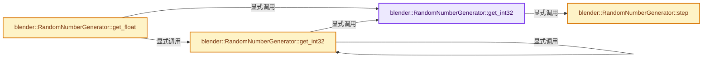
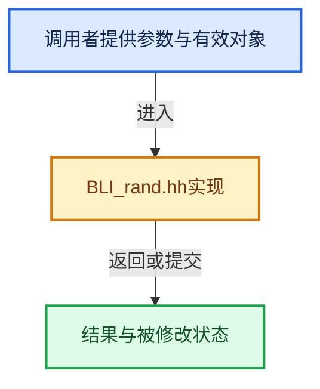

# 实现依赖专题：source/blender/blenlib/BLI_rand.hh

[实现依赖导航](../README.md) · [符号索引](../../00-课程指南/02-源码与提交索引/符号依赖与实现索引.md)

本专题从正文实际调用进入，集中保存共享实现。函数有稳定锚点，可从调用处直接跳到对应完整函数；递归与互相调用通过回链组织。

## 本文件的实现关系






## 完整成员与函数实现

<a id="f-2241ace1b1d89483"></a>

### `blender::RandomNumberGenerator::get_int32`

实现位置：[source/blender/blenlib/BLI_rand.hh](../../../../../../source/blender/blenlib/BLI_rand.hh) · L52—L56。

**教学注释版**

<!-- annotated:85a6ca98190de1 -->

```cpp
  int32_t get_int32()
  {
    this->step();
    return int32_t(x_ >> 17);
  }
```

<details>
<summary>核对原始源码：source/blender/blenlib/BLI_rand.hh · L52—L56</summary>

<!-- original:85a6ca98190de1:source/blender/blenlib/BLI_rand.hh:52:56 -->

```cpp
  int32_t get_int32()
  {
    this->step();
    return int32_t(x_ >> 17);
  }
```

</details>

**结果出口**

- `return int32_t(x_ >> 17);`

**继续追踪实现**

- `this->step` → [blender::RandomNumberGenerator::step · L143](BLI_rand.hh.md#f-181a45eb372b44e9)。

<a id="f-749e1881a54f698a"></a>

### `blender::RandomNumberGenerator::get_int32`

实现位置：[source/blender/blenlib/BLI_rand.hh](../../../../../../source/blender/blenlib/BLI_rand.hh) · L66—L70。

接口参数：

- `int32_t max_exclusive`

**教学注释版**

<!-- annotated:2c876933cef9bd -->

```cpp
  int32_t get_int32(int32_t max_exclusive)
  {
    BLI_assert(max_exclusive > 0);
    return this->get_int32() % max_exclusive;
  }
```

<details>
<summary>核对原始源码：source/blender/blenlib/BLI_rand.hh · L66—L70</summary>

<!-- original:2c876933cef9bd:source/blender/blenlib/BLI_rand.hh:66:70 -->

```cpp
  int32_t get_int32(int32_t max_exclusive)
  {
    BLI_assert(max_exclusive > 0);
    return this->get_int32() % max_exclusive;
  }
```

</details>

**结果出口**

- `return this->get_int32() % max_exclusive;`

**继续追踪实现**

- `BLI_assert` → [BLI_assert · L48](BLI_assert.hh.md#m-57a88495704d)；[BLI_assert · L63](BLI_assert.hh.md#m-d07050020cb5)。宏定义由构建条件选择。
- `this->get_int32` → [blender::RandomNumberGenerator::get_int32 · L52](BLI_rand.hh.md#f-2241ace1b1d89483)；[blender::RandomNumberGenerator::get_int32 · L66](BLI_rand.hh.md#f-749e1881a54f698a)。同名重载需按实参类型选择。

<a id="f-c43dc1f759b49ddb"></a>

### `blender::RandomNumberGenerator::get_float`

实现位置：[source/blender/blenlib/BLI_rand.hh](../../../../../../source/blender/blenlib/BLI_rand.hh) · L83—L86。

**教学注释版**

<!-- annotated:897ea647a7ae76 -->

```cpp
  float get_float()
  {
    return float(this->get_int32()) / 0x80000000;
  }
```

<details>
<summary>核对原始源码：source/blender/blenlib/BLI_rand.hh · L83—L86</summary>

<!-- original:897ea647a7ae76:source/blender/blenlib/BLI_rand.hh:83:86 -->

```cpp
  float get_float()
  {
    return float(this->get_int32()) / 0x80000000;
  }
```

</details>

**结果出口**

- `return float(this->get_int32()) / 0x80000000;`

**继续追踪实现**

- `this->get_int32` → [blender::RandomNumberGenerator::get_int32 · L52](BLI_rand.hh.md#f-2241ace1b1d89483)；[blender::RandomNumberGenerator::get_int32 · L66](BLI_rand.hh.md#f-749e1881a54f698a)。同名重载需按实参类型选择。

<a id="f-181a45eb372b44e9"></a>

### `blender::RandomNumberGenerator::step`

实现位置：[source/blender/blenlib/BLI_rand.hh](../../../../../../source/blender/blenlib/BLI_rand.hh) · L143—L150。

**教学注释版**

<!-- annotated:a0c1eff0de3f32 -->

```cpp
  void step()
  {
    constexpr uint64_t multiplier = 0x5DEECE66Dll;
    constexpr uint64_t addend = 0xB;
    constexpr uint64_t mask = 0x0000FFFFFFFFFFFFll;

    x_ = (multiplier * x_ + addend) & mask;
  }
```

<details>
<summary>核对原始源码：source/blender/blenlib/BLI_rand.hh · L143—L150</summary>

<!-- original:a0c1eff0de3f32:source/blender/blenlib/BLI_rand.hh:143:150 -->

```cpp
  void step()
  {
    constexpr uint64_t multiplier = 0x5DEECE66Dll;
    constexpr uint64_t addend = 0xB;
    constexpr uint64_t mask = 0x0000FFFFFFFFFFFFll;

    x_ = (multiplier * x_ + addend) & mask;
  }
```

</details>

**沿实际写入检查状态**

- `x_ = (multiplier * x_ + addend) & mask;`

**继续追踪实现**

本实现没有需要继续展开的显式调用；检查返回表达式、对象转换和调用者前置条件。
