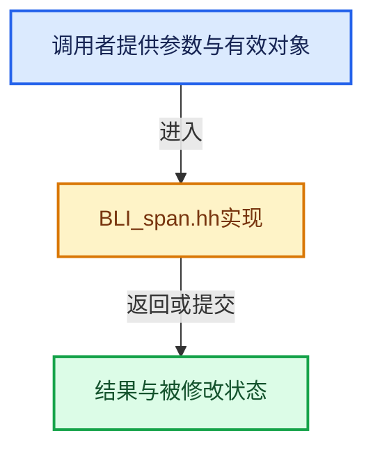

# 实现依赖专题：source/blender/blenlib/BLI_span.hh

[实现依赖导航](../README.md) · [符号索引](../../00-课程指南/02-源码与提交索引/符号依赖与实现索引.md)

本专题从正文实际调用进入，集中保存共享实现。函数有稳定锚点，可从调用处直接跳到对应完整函数；递归与互相调用通过回链组织。

## 本文件的实现关系





## 相关类型布局与成员入口

<a id="t-8765a8e0c1d5"></a>

### `blender::Span`

原始声明：[source/blender/blenlib/BLI_span.hh](../../../../../../source/blender/blenlib/BLI_span.hh) · L74—L441。

成员布局：

- `T data_`
- `int64_t size_`

以下保留类的数据声明与编译条件，成员函数实现通过后面的精确链接阅读。

<!-- annotated:8bd4d4969ff613 -->

```cpp
template<typename T> class Span {
 public:
  using value_type = T;
  using pointer = T *;
  using const_pointer = const T *;
  using reference = T &;
  using const_reference = const T &;
  using iterator = const T *;
  using size_type = int64_t;

 protected:
  const T *data_ = nullptr;
  int64_t size_ = 0;

 public:
  /**
   * Create a reference to an empty array.
   */
```

<details>
<summary>核对原始源码：source/blender/blenlib/BLI_span.hh · L74—L91</summary>

<!-- original:8bd4d4969ff613:source/blender/blenlib/BLI_span.hh:74:91 -->

```cpp
template<typename T> class Span {
 public:
  using value_type = T;
  using pointer = T *;
  using const_pointer = const T *;
  using reference = T &;
  using const_reference = const T &;
  using iterator = const T *;
  using size_type = int64_t;

 protected:
  const T *data_ = nullptr;
  int64_t size_ = 0;

 public:
  /**
   * Create a reference to an empty array.
   */
```

</details>

<!-- annotated:42111001c6faca -->

```cpp

```

<details>
<summary>核对原始源码：source/blender/blenlib/BLI_span.hh · L93—L93</summary>

<!-- original:42111001c6faca:source/blender/blenlib/BLI_span.hh:93:93 -->

```cpp

```

</details>

<!-- annotated:a0820d00717a37 -->

```cpp

```

<details>
<summary>核对原始源码：source/blender/blenlib/BLI_span.hh · L98—L98</summary>

<!-- original:a0820d00717a37:source/blender/blenlib/BLI_span.hh:98:98 -->

```cpp

```

</details>

<!-- annotated:52475ec5a81f25 -->

```cpp

  /**
   * Reference an initializer_list. Note that the data in the initializer_list is only valid until
   * the expression containing it is fully computed.
   *
   * Do:
   *  call_function_with_array({1, 2, 3, 4});
   *
   * Don't:
   *  Span<int> span = {1, 2, 3, 4};
   *  call_function_with_array(span);
   */
```

<details>
<summary>核对原始源码：source/blender/blenlib/BLI_span.hh · L106—L117</summary>

<!-- original:52475ec5a81f25:source/blender/blenlib/BLI_span.hh:106:117 -->

```cpp

  /**
   * Reference an initializer_list. Note that the data in the initializer_list is only valid until
   * the expression containing it is fully computed.
   *
   * Do:
   *  call_function_with_array({1, 2, 3, 4});
   *
   * Don't:
   *  Span<int> span = {1, 2, 3, 4};
   *  call_function_with_array(span);
   */
```

</details>

<!-- annotated:f47521ca28c801 -->

```cpp

```

<details>
<summary>核对原始源码：source/blender/blenlib/BLI_span.hh · L121—L121</summary>

<!-- original:f47521ca28c801:source/blender/blenlib/BLI_span.hh:121:121 -->

```cpp

```

</details>

<!-- annotated:86697f1e9ef087 -->

```cpp

```

<details>
<summary>核对原始源码：source/blender/blenlib/BLI_span.hh · L123—L123</summary>

<!-- original:86697f1e9ef087:source/blender/blenlib/BLI_span.hh:123:123 -->

```cpp

```

</details>

<!-- annotated:0e95f2ed7c72a2 -->

```cpp

  /**
   * Support implicit conversions like the one below:
   *   Span<T *> -> Span<const T *>
   */
```

<details>
<summary>核对原始源码：source/blender/blenlib/BLI_span.hh · L125—L129</summary>

<!-- original:0e95f2ed7c72a2:source/blender/blenlib/BLI_span.hh:125:129 -->

```cpp

  /**
   * Support implicit conversions like the one below:
   *   Span<T *> -> Span<const T *>
   */
```

</details>

<!-- annotated:619dfb307e12ef -->

```cpp

  /**
   * Returns a contiguous part of the array. This invokes undefined behavior when the start or size
   * is negative.
   */
```

<details>
<summary>核对原始源码：source/blender/blenlib/BLI_span.hh · L136—L140</summary>

<!-- original:619dfb307e12ef:source/blender/blenlib/BLI_span.hh:136:140 -->

```cpp

  /**
   * Returns a contiguous part of the array. This invokes undefined behavior when the start or size
   * is negative.
   */
```

</details>

<!-- annotated:10bac87ce4fc09 -->

```cpp

```

<details>
<summary>核对原始源码：source/blender/blenlib/BLI_span.hh · L148—L148</summary>

<!-- original:10bac87ce4fc09:source/blender/blenlib/BLI_span.hh:148:148 -->

```cpp

```

</details>

<!-- annotated:78cc48efa5af3d -->

```cpp

  /**
   * Returns a contiguous part of the array. This invokes undefined behavior when the start or size
   * is negative. Clamps the size of the new span so it fits in the current one.
   */
```

<details>
<summary>核对原始源码：source/blender/blenlib/BLI_span.hh · L153—L157</summary>

<!-- original:78cc48efa5af3d:source/blender/blenlib/BLI_span.hh:153:157 -->

```cpp

  /**
   * Returns a contiguous part of the array. This invokes undefined behavior when the start or size
   * is negative. Clamps the size of the new span so it fits in the current one.
   */
```

</details>

<!-- annotated:971f62ce377980 -->

```cpp

```

<details>
<summary>核对原始源码：source/blender/blenlib/BLI_span.hh · L165—L165</summary>

<!-- original:971f62ce377980:source/blender/blenlib/BLI_span.hh:165:165 -->

```cpp

```

</details>

<!-- annotated:c51cfe9a44f89d -->

```cpp

  /**
   * Returns a new Span with n elements removed from the beginning. This invokes undefined
   * behavior when n is negative.
   */
```

<details>
<summary>核对原始源码：source/blender/blenlib/BLI_span.hh · L170—L174</summary>

<!-- original:c51cfe9a44f89d:source/blender/blenlib/BLI_span.hh:170:174 -->

```cpp

  /**
   * Returns a new Span with n elements removed from the beginning. This invokes undefined
   * behavior when n is negative.
   */
```

</details>

<!-- annotated:3dad896933a82a -->

```cpp

  /**
   * Returns a new Span with n elements removed from the end. This invokes undefined behavior when
   * n is negative.
   */
```

<details>
<summary>核对原始源码：source/blender/blenlib/BLI_span.hh · L181—L185</summary>

<!-- original:3dad896933a82a:source/blender/blenlib/BLI_span.hh:181:185 -->

```cpp

  /**
   * Returns a new Span with n elements removed from the end. This invokes undefined behavior when
   * n is negative.
   */
```

</details>

<!-- annotated:a15528fdb82969 -->

```cpp

  /**
   * Returns a new Span that only contains the first n elements. This invokes undefined
   * behavior when n is negative.
   */
```

<details>
<summary>核对原始源码：source/blender/blenlib/BLI_span.hh · L192—L196</summary>

<!-- original:a15528fdb82969:source/blender/blenlib/BLI_span.hh:192:196 -->

```cpp

  /**
   * Returns a new Span that only contains the first n elements. This invokes undefined
   * behavior when n is negative.
   */
```

</details>

<!-- annotated:fac34562b0f00b -->

```cpp

  /**
   * Returns a new Span that only contains the last n elements. This invokes undefined
   * behavior when n is negative.
   */
```

<details>
<summary>核对原始源码：source/blender/blenlib/BLI_span.hh · L203—L207</summary>

<!-- original:fac34562b0f00b:source/blender/blenlib/BLI_span.hh:203:207 -->

```cpp

  /**
   * Returns a new Span that only contains the last n elements. This invokes undefined
   * behavior when n is negative.
   */
```

</details>

<!-- annotated:17885efc0d919b -->

```cpp

  /**
   * Returns the pointer to the beginning of the referenced array. This may be nullptr when the
   * size is zero.
   */
```

<details>
<summary>核对原始源码：source/blender/blenlib/BLI_span.hh · L214—L218</summary>

<!-- original:17885efc0d919b:source/blender/blenlib/BLI_span.hh:214:218 -->

```cpp

  /**
   * Returns the pointer to the beginning of the referenced array. This may be nullptr when the
   * size is zero.
   */
```

</details>

<!-- annotated:cf7eef0cfd9175 -->

```cpp

```

<details>
<summary>核对原始源码：source/blender/blenlib/BLI_span.hh · L223—L223</summary>

<!-- original:cf7eef0cfd9175:source/blender/blenlib/BLI_span.hh:223:223 -->

```cpp

```

</details>

<!-- annotated:ff6717bcf53f78 -->

```cpp

```

<details>
<summary>核对原始源码：source/blender/blenlib/BLI_span.hh · L232—L232</summary>

<!-- original:ff6717bcf53f78:source/blender/blenlib/BLI_span.hh:232:232 -->

```cpp

```

</details>

<!-- annotated:1015b2900bb637 -->

```cpp

  /**
   * Access an element in the array. This invokes undefined behavior when the index is out of
   * bounds.
   */
```

<details>
<summary>核对原始源码：source/blender/blenlib/BLI_span.hh · L241—L245</summary>

<!-- original:1015b2900bb637:source/blender/blenlib/BLI_span.hh:241:245 -->

```cpp

  /**
   * Access an element in the array. This invokes undefined behavior when the index is out of
   * bounds.
   */
```

</details>

<!-- annotated:a5985ca4fc0c3e -->

```cpp

  /**
   * Returns the number of elements in the referenced array.
   */
```

<details>
<summary>核对原始源码：source/blender/blenlib/BLI_span.hh · L252—L255</summary>

<!-- original:a5985ca4fc0c3e:source/blender/blenlib/BLI_span.hh:252:255 -->

```cpp

  /**
   * Returns the number of elements in the referenced array.
   */
```

</details>

<!-- annotated:b3f4d582a39044 -->

```cpp

  /**
   * Returns true if the size is zero.
   */
```

<details>
<summary>核对原始源码：source/blender/blenlib/BLI_span.hh · L260—L263</summary>

<!-- original:b3f4d582a39044:source/blender/blenlib/BLI_span.hh:260:263 -->

```cpp

  /**
   * Returns true if the size is zero.
   */
```

</details>

<!-- annotated:5981e3e2c58433 -->

```cpp

  /**
   * Returns the number of bytes referenced by this Span.
   */
```

<details>
<summary>核对原始源码：source/blender/blenlib/BLI_span.hh · L268—L271</summary>

<!-- original:5981e3e2c58433:source/blender/blenlib/BLI_span.hh:268:271 -->

```cpp

  /**
   * Returns the number of bytes referenced by this Span.
   */
```

</details>

<!-- annotated:6c871717637f8a -->

```cpp

  /**
   * Does a linear search to see of the value is in the array.
   * Returns true if it is, otherwise false.
   */
```

<details>
<summary>核对原始源码：source/blender/blenlib/BLI_span.hh · L276—L280</summary>

<!-- original:6c871717637f8a:source/blender/blenlib/BLI_span.hh:276:280 -->

```cpp

  /**
   * Does a linear search to see of the value is in the array.
   * Returns true if it is, otherwise false.
   */
```

</details>

<!-- annotated:757311c379a777 -->

```cpp

  /**
   * Does a constant time check to see if the pointer points to a value in the referenced array.
   * Return true if it is, otherwise false.
   */
```

<details>
<summary>核对原始源码：source/blender/blenlib/BLI_span.hh · L290—L294</summary>

<!-- original:757311c379a777:source/blender/blenlib/BLI_span.hh:290:294 -->

```cpp

  /**
   * Does a constant time check to see if the pointer points to a value in the referenced array.
   * Return true if it is, otherwise false.
   */
```

</details>

<!-- annotated:b3fd916542fa9c -->

```cpp

  /**
   * Does a linear search to count how often the value is in the array.
   * Returns the number of occurrences.
   */
```

<details>
<summary>核对原始源码：source/blender/blenlib/BLI_span.hh · L299—L303</summary>

<!-- original:b3fd916542fa9c:source/blender/blenlib/BLI_span.hh:299:303 -->

```cpp

  /**
   * Does a linear search to count how often the value is in the array.
   * Returns the number of occurrences.
   */
```

</details>

<!-- annotated:3ed5d8f1eeefe8 -->

```cpp

  /**
   * Return a reference to the first element in the array. This invokes undefined behavior when the
   * array is empty.
   */
```

<details>
<summary>核对原始源码：source/blender/blenlib/BLI_span.hh · L314—L318</summary>

<!-- original:3ed5d8f1eeefe8:source/blender/blenlib/BLI_span.hh:314:318 -->

```cpp

  /**
   * Return a reference to the first element in the array. This invokes undefined behavior when the
   * array is empty.
   */
```

</details>

<!-- annotated:2583afb062990f -->

```cpp

  /**
   * Returns a reference to the nth last element. This invokes undefined behavior when the span is
   * too short.
   */
```

<details>
<summary>核对原始源码：source/blender/blenlib/BLI_span.hh · L324—L328</summary>

<!-- original:2583afb062990f:source/blender/blenlib/BLI_span.hh:324:328 -->

```cpp

  /**
   * Returns a reference to the nth last element. This invokes undefined behavior when the span is
   * too short.
   */
```

</details>

<!-- annotated:8426d338748cad -->

```cpp

  /**
   * Check if the array contains duplicates. Does a linear search for every element. So the total
   * running time is O(n^2). Only use this for small arrays.
   */
```

<details>
<summary>核对原始源码：source/blender/blenlib/BLI_span.hh · L335—L339</summary>

<!-- original:8426d338748cad:source/blender/blenlib/BLI_span.hh:335:339 -->

```cpp

  /**
   * Check if the array contains duplicates. Does a linear search for every element. So the total
   * running time is O(n^2). Only use this for small arrays.
   */
```

</details>

<!-- annotated:863542894319bc -->

```cpp

  /**
   * Returns true when this and the other array have an element in common. This should only be
   * called on small arrays, because it has a running time of O(n*m) where n and m are the sizes of
   * the arrays.
   */
```

<details>
<summary>核对原始源码：source/blender/blenlib/BLI_span.hh · L356—L361</summary>

<!-- original:863542894319bc:source/blender/blenlib/BLI_span.hh:356:361 -->

```cpp

  /**
   * Returns true when this and the other array have an element in common. This should only be
   * called on small arrays, because it has a running time of O(n*m) where n and m are the sizes of
   * the arrays.
   */
```

</details>

<!-- annotated:8cac46a1db1745 -->

```cpp

  /**
   * Returns the index of the first occurrence of the given value. This invokes undefined behavior
   * when the value is not in the array.
   */
```

<details>
<summary>核对原始源码：source/blender/blenlib/BLI_span.hh · L376—L380</summary>

<!-- original:8cac46a1db1745:source/blender/blenlib/BLI_span.hh:376:380 -->

```cpp

  /**
   * Returns the index of the first occurrence of the given value. This invokes undefined behavior
   * when the value is not in the array.
   */
```

</details>

<!-- annotated:6218e8f59ef5b8 -->

```cpp

  /**
   * Returns the index of the first occurrence of the given value or -1 if it does not exist.
   */
```

<details>
<summary>核对原始源码：source/blender/blenlib/BLI_span.hh · L387—L390</summary>

<!-- original:6218e8f59ef5b8:source/blender/blenlib/BLI_span.hh:387:390 -->

```cpp

  /**
   * Returns the index of the first occurrence of the given value or -1 if it does not exist.
   */
```

</details>

<!-- annotated:523b3f30848d00 -->

```cpp

  /**
   * Utility to make it more convenient to iterate over all indices that can be used with this
   * array.
   */
```

<details>
<summary>核对原始源码：source/blender/blenlib/BLI_span.hh · L400—L404</summary>

<!-- original:523b3f30848d00:source/blender/blenlib/BLI_span.hh:400:404 -->

```cpp

  /**
   * Utility to make it more convenient to iterate over all indices that can be used with this
   * array.
   */
```

</details>

<!-- annotated:2e55227646af94 -->

```cpp

```

<details>
<summary>核对原始源码：source/blender/blenlib/BLI_span.hh · L409—L409</summary>

<!-- original:2e55227646af94:source/blender/blenlib/BLI_span.hh:409:409 -->

```cpp

```

</details>

<!-- annotated:34eb301a7a6240 -->

```cpp

  /**
   * Returns a new Span to the same underlying memory buffer. No conversions are done.
   */
```

<details>
<summary>核对原始源码：source/blender/blenlib/BLI_span.hh · L418—L421</summary>

<!-- original:34eb301a7a6240:source/blender/blenlib/BLI_span.hh:418:421 -->

```cpp

  /**
   * Returns a new Span to the same underlying memory buffer. No conversions are done.
   */
```

</details>

<!-- annotated:da84d24752e1c0 -->

```cpp

```

<details>
<summary>核对原始源码：source/blender/blenlib/BLI_span.hh · L428—L428</summary>

<!-- original:da84d24752e1c0:source/blender/blenlib/BLI_span.hh:428:428 -->

```cpp

```

</details>

<!-- annotated:3a3dd740ba5d01 -->

```cpp

```

<details>
<summary>核对原始源码：source/blender/blenlib/BLI_span.hh · L436—L436</summary>

<!-- original:3a3dd740ba5d01:source/blender/blenlib/BLI_span.hh:436:436 -->

```cpp

```

</details>

<!-- annotated:35910a5a7837e8 -->

```cpp
};
```

<details>
<summary>核对原始源码：source/blender/blenlib/BLI_span.hh · L441—L441</summary>

<!-- original:35910a5a7837e8:source/blender/blenlib/BLI_span.hh:441:441 -->

```cpp
};
```

</details>

- [Span](../../01-基础容器与现代CPP/05-Span只读连续视图.md#f-e40cbae1aae23eb8)
- [Span](../../01-基础容器与现代CPP/05-Span只读连续视图.md#f-8e13b31cdc54dc44)
- [Span](../../01-基础容器与现代CPP/05-Span只读连续视图.md#f-e3f5617e03851c03)
- [Span](../../01-基础容器与现代CPP/05-Span只读连续视图.md#f-6dbccc3a78910bb7)
- [Span](../../01-基础容器与现代CPP/05-Span只读连续视图.md#f-0692c02d691e68a6)
- [Span](../../01-基础容器与现代CPP/05-Span只读连续视图.md#f-45073fe4b3cefa46)
- [Span](../../01-基础容器与现代CPP/05-Span只读连续视图.md#f-b2e1b3c3e3349048)
- [slice](../../01-基础容器与现代CPP/05-Span只读连续视图.md#f-380a0e8fdcbd53cc)
- [slice](../../01-基础容器与现代CPP/05-Span只读连续视图.md#f-9b9c15e78dd54eec)
- [slice_safe](../../01-基础容器与现代CPP/05-Span只读连续视图.md#f-5ffbda70864e9d0b)
- [slice_safe](../../01-基础容器与现代CPP/05-Span只读连续视图.md#f-8438e78e505b5ff4)
- [drop_front](../../01-基础容器与现代CPP/05-Span只读连续视图.md#f-932897accbde3413)
- [drop_back](../../01-基础容器与现代CPP/05-Span只读连续视图.md#f-fbabd5706815d493)
- [take_front](../../01-基础容器与现代CPP/05-Span只读连续视图.md#f-1556b8b4aac9d42f)
- [take_back](../../01-基础容器与现代CPP/05-Span只读连续视图.md#f-6767e3f6b257ca29)
- [data](../../01-基础容器与现代CPP/05-Span只读连续视图.md#f-10c5889198935800)
- [begin](../../01-基础容器与现代CPP/05-Span只读连续视图.md#f-415883b512284f46)
- [end](../../01-基础容器与现代CPP/05-Span只读连续视图.md#f-a7d8b9e494c291a7)
- [rbegin](../../01-基础容器与现代CPP/05-Span只读连续视图.md#f-491ff42545304e78)
- [rend](../../01-基础容器与现代CPP/05-Span只读连续视图.md#f-cb6fb4c63c153082)
- [operator[]](05-Span%E5%8F%AA%E8%AF%BB%E8%BF%9E%E7%BB%AD%E8%A7%86%E5%9B%BE.md#f-3c6e7880d4bca267)
- [size](../../01-基础容器与现代CPP/05-Span只读连续视图.md#f-5f80fa006089c998)
- [is_empty](../../01-基础容器与现代CPP/05-Span只读连续视图.md#f-8cc1d7ba8feb50e6)
- [size_in_bytes](../../01-基础容器与现代CPP/05-Span只读连续视图.md#f-1369fbdcc037fcaf)
- [contains](../../01-基础容器与现代CPP/05-Span只读连续视图.md#f-7caee498c984f2c0)
- [contains_ptr](../../01-基础容器与现代CPP/05-Span只读连续视图.md#f-f4b5c58b844fb9c7)
- [count](../../01-基础容器与现代CPP/05-Span只读连续视图.md#f-998e4abcd2436f81)
- [first](../../01-基础容器与现代CPP/05-Span只读连续视图.md#f-d8c9bcc3e9757248)
- [last](../../01-基础容器与现代CPP/05-Span只读连续视图.md#f-a92146c285596891)
- [has_duplicates__linear_search](../../01-基础容器与现代CPP/05-Span只读连续视图.md#f-e8294f87972ebf36)
- [intersects__linear_search](../../01-基础容器与现代CPP/05-Span只读连续视图.md#f-bbb38418f7af8be3)
- [first_index](../../01-基础容器与现代CPP/05-Span只读连续视图.md#f-fb6b750e8096a830)
- [first_index_try](../../01-基础容器与现代CPP/05-Span只读连续视图.md#f-811ebd0e3e302c09)
- [index_range](../../01-基础容器与现代CPP/05-Span只读连续视图.md#f-caaa9b06e13e53e0)
- [hash](../../01-基础容器与现代CPP/05-Span只读连续视图.md#f-cc1fde6844ea8d5b)
- [cast](../../01-基础容器与现代CPP/05-Span只读连续视图.md#f-e082d823028af8f6)
- [operator==](../../01-基础容器与现代CPP/05-Span只读连续视图.md#f-2cde38f377f549a5)
- [operator!=](../../01-基础容器与现代CPP/05-Span只读连续视图.md#f-8ff6c8c81db2f3ae)

## 完整成员与函数实现
