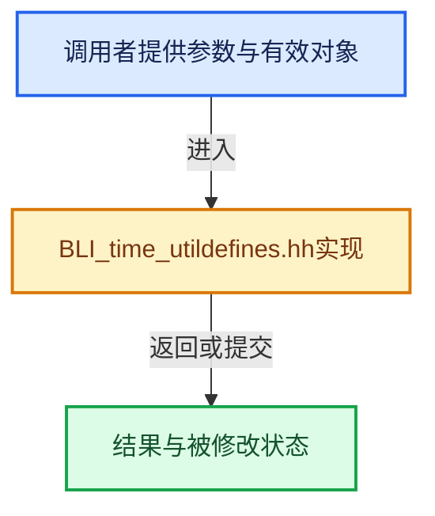

# 实现依赖专题：source/blender/blenlib/BLI_time_utildefines.hh

[实现依赖导航](../README.md) · [符号索引](../../00-课程指南/02-源码与提交索引/符号依赖与实现索引.md)

本专题从正文实际调用进入，集中保存共享实现。函数有稳定锚点，可从调用处直接跳到对应完整函数；递归与互相调用通过回链组织。

## 本文件的实现关系





<a id="m-646b4fe09e37"></a>

## 宏 `TIMEIT_START`

<!-- annotated:f58bddc19a02a2 -->

```cpp
#define TIMEIT_START(var) \
  { \
    double _timeit_##var = BLI_time_now_seconds(); \
    printf("time start (" #var "):  " AT "\n"); \
    fflush(stdout); \
    { \
      (void)0

```

<details>
<summary>核对原始源码：source/blender/blenlib/BLI_time_utildefines.hh · L15—L22</summary>

<!-- original:f58bddc19a02a2:source/blender/blenlib/BLI_time_utildefines.hh:15:22 -->

```cpp
#define TIMEIT_START(var) \
  { \
    double _timeit_##var = BLI_time_now_seconds(); \
    printf("time start (" #var "):  " AT "\n"); \
    fflush(stdout); \
    { \
      (void)0

```

</details>

宏在预处理阶段展开，参数替换、重复求值和条件编译应直接从该定义检查。与普通函数不同，宏不会自动提供参数类型检查；构建配置选择哪个定义需结合外围条件。

<a id="m-6e76ec35c4d4"></a>

## 宏 `TIMEIT_END`

<!-- annotated:0a3324e77861d9 -->

```cpp
#define TIMEIT_END(var) \
  } \
  printf("time end   (" #var \
         "): %.6f" \
         "  " AT "\n", \
         TIMEIT_VALUE(var)); \
  fflush(stdout); \
  } \
  (void)0

```

<details>
<summary>核对原始源码：source/blender/blenlib/BLI_time_utildefines.hh · L38—L47</summary>

<!-- original:0a3324e77861d9:source/blender/blenlib/BLI_time_utildefines.hh:38:47 -->

```cpp
#define TIMEIT_END(var) \
  } \
  printf("time end   (" #var \
         "): %.6f" \
         "  " AT "\n", \
         TIMEIT_VALUE(var)); \
  fflush(stdout); \
  } \
  (void)0

```

</details>

宏在预处理阶段展开，参数替换、重复求值和条件编译应直接从该定义检查。与普通函数不同，宏不会自动提供参数类型检查；构建配置选择哪个定义需结合外围条件。

<a id="m-ab8739b50e42"></a>

## 宏 `TIMEIT_START_AVERAGED`

<!-- annotated:00cedc11e582e0 -->

```cpp
#define TIMEIT_START_AVERAGED(var) \
  { \
    static float _sum_##var = 0.0f; \
    static float _num_##var = 0.0f; \
    double _timeit_##var = BLI_time_now_seconds(); \
    printf("time start    (" #var "):  " AT "\n"); \
    fflush(stdout); \
    { \
      (void)0

```

<details>
<summary>核对原始源码：source/blender/blenlib/BLI_time_utildefines.hh · L53—L62</summary>

<!-- original:00cedc11e582e0:source/blender/blenlib/BLI_time_utildefines.hh:53:62 -->

```cpp
#define TIMEIT_START_AVERAGED(var) \
  { \
    static float _sum_##var = 0.0f; \
    static float _num_##var = 0.0f; \
    double _timeit_##var = BLI_time_now_seconds(); \
    printf("time start    (" #var "):  " AT "\n"); \
    fflush(stdout); \
    { \
      (void)0

```

</details>

宏在预处理阶段展开，参数替换、重复求值和条件编译应直接从该定义检查。与普通函数不同，宏不会自动提供参数类型检查；构建配置选择哪个定义需结合外围条件。

<a id="m-3745f6818fb3"></a>

## 宏 `TIMEIT_END_AVERAGED`

<!-- annotated:6b12ada5c48858 -->

```cpp
#define TIMEIT_END_AVERAGED(var) \
  } \
  const float _delta_##var = TIMEIT_VALUE(var); \
  _sum_##var += _delta_##var; \
  _num_##var++; \
  printf("time end      (" #var \
         "): %.6f" \
         "  " AT "\n", \
         _delta_##var); \
  printf("time averaged (" #var "): %.6f (total: %.6f, in %d runs)\n", \
         (_sum_##var / _num_##var), \
         _sum_##var, \
         (int)_num_##var); \
  fflush(stdout); \
  } \
  (void)0

```

<details>
<summary>核对原始源码：source/blender/blenlib/BLI_time_utildefines.hh · L65—L81</summary>

<!-- original:6b12ada5c48858:source/blender/blenlib/BLI_time_utildefines.hh:65:81 -->

```cpp
#define TIMEIT_END_AVERAGED(var) \
  } \
  const float _delta_##var = TIMEIT_VALUE(var); \
  _sum_##var += _delta_##var; \
  _num_##var++; \
  printf("time end      (" #var \
         "): %.6f" \
         "  " AT "\n", \
         _delta_##var); \
  printf("time averaged (" #var "): %.6f (total: %.6f, in %d runs)\n", \
         (_sum_##var / _num_##var), \
         _sum_##var, \
         (int)_num_##var); \
  fflush(stdout); \
  } \
  (void)0

```

</details>

宏在预处理阶段展开，参数替换、重复求值和条件编译应直接从该定义检查。与普通函数不同，宏不会自动提供参数类型检查；构建配置选择哪个定义需结合外围条件。

## 完整成员与函数实现
