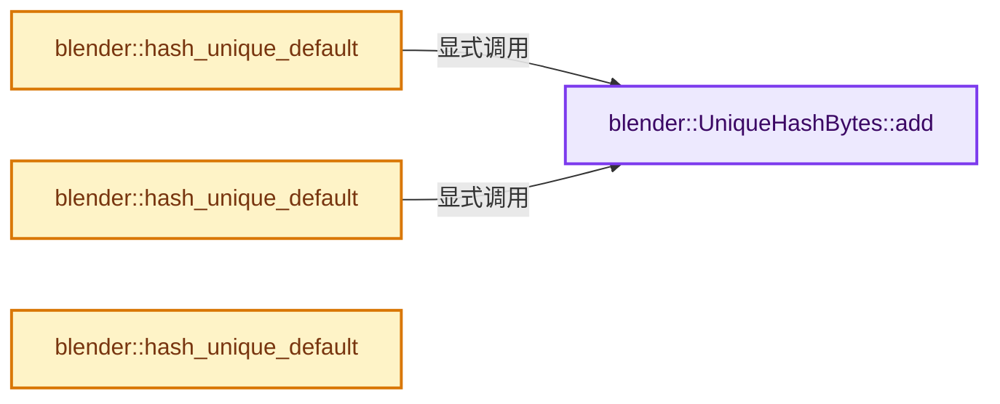
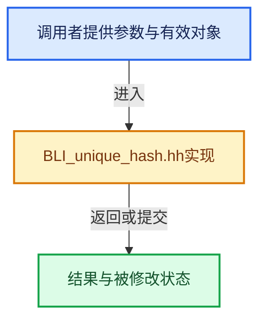

# 实现依赖专题：source/blender/blenlib/BLI_unique_hash.hh

[实现依赖导航](../README.md) · [符号索引](../../00-课程指南/02-源码与提交索引/符号依赖与实现索引.md)

本专题从正文实际调用进入，集中保存共享实现。函数有稳定锚点，可从调用处直接跳到对应完整函数；递归与互相调用通过回链组织。

## 本文件的实现关系






## 完整成员与函数实现

<a id="f-12ca7cac7556bc01"></a>

### `blender::UniqueHashBytes::add`

实现位置：[source/blender/blenlib/BLI_unique_hash.hh](../../../../../../source/blender/blenlib/BLI_unique_hash.hh) · L40—L44。

接口参数：

- `const T &value`

**教学注释版**

<!-- annotated:28919d6813f892 -->

```cpp
  template<typename T> void add(const T &value)
  {
    static_assert(std::is_trivially_copyable_v<T>);
    // [讲解] data.extend：将一段来源元素加入尾部。
    data.extend(reinterpret_cast<const std::byte *>(&value), sizeof(T));
  }
```

<details>
<summary>核对原始源码：source/blender/blenlib/BLI_unique_hash.hh · L40—L44</summary>

<!-- original:28919d6813f892:source/blender/blenlib/BLI_unique_hash.hh:40:44 -->

```cpp
  template<typename T> void add(const T &value)
  {
    static_assert(std::is_trivially_copyable_v<T>);
    data.extend(reinterpret_cast<const std::byte *>(&value), sizeof(T));
  }
```

</details>

**继续追踪实现**

- `data.extend` → [blender::Vector::extend · L595](../../01-基础容器与现代CPP/11-Vector插入删除与重排.md#f-fe6fcb7d09beded9)；[blender::Vector::extend · L599](../../01-基础容器与现代CPP/11-Vector插入删除与重排.md#f-40095c219019e2f9)；[blender::Vector::extend · L613](../../01-基础容器与现代CPP/11-Vector插入删除与重排.md#f-4d2e556cd7412fe4)；[blender::Vector::extend · L650](../../01-基础容器与现代CPP/11-Vector插入删除与重排.md#f-ae44ad8b3f05b082)。同名重载需按实参类型选择。

<a id="f-28441dc5fddcce1c"></a>

### `blender::hash_unique_default`

实现位置：[source/blender/blenlib/BLI_unique_hash.hh](../../../../../../source/blender/blenlib/BLI_unique_hash.hh) · L49—L54。

接口参数：

- `const T &value`
- `UniqueHashBytes &hash`

**教学注释版**

<!-- annotated:86633d81018fda -->

```cpp
template<typename T>
inline void hash_unique_default(const T &value, UniqueHashBytes &hash)
  requires(std::is_integral_v<T> || std::is_enum_v<T> || std::is_pointer_v<T>)
{
  hash.add(value);
}
```

<details>
<summary>核对原始源码：source/blender/blenlib/BLI_unique_hash.hh · L49—L54</summary>

<!-- original:86633d81018fda:source/blender/blenlib/BLI_unique_hash.hh:49:54 -->

```cpp
template<typename T>
inline void hash_unique_default(const T &value, UniqueHashBytes &hash)
  requires(std::is_integral_v<T> || std::is_enum_v<T> || std::is_pointer_v<T>)
{
  hash.add(value);
}
```

</details>

**继续追踪实现**

- `hash.add` → [blender::UniqueHashBytes::add · L40](BLI_unique_hash.hh.md#f-12ca7cac7556bc01)。

<a id="f-8db8be508683064d"></a>

### `blender::hash_unique_default`

实现位置：[source/blender/blenlib/BLI_unique_hash.hh](../../../../../../source/blender/blenlib/BLI_unique_hash.hh) · L56—L66。

接口参数：

- `const T &value`
- `UniqueHashBytes &hash`

**教学注释版**

<!-- annotated:15d4c0eb01d25e -->

```cpp
template<typename T>
inline void hash_unique_default(const T &value, UniqueHashBytes &hash)
  requires(std::is_floating_point_v<T>)
{
  if (value == 0) {
    hash.add(T(0));
  }
  else {
    hash.add(value);
  }
}
```

<details>
<summary>核对原始源码：source/blender/blenlib/BLI_unique_hash.hh · L56—L66</summary>

<!-- original:15d4c0eb01d25e:source/blender/blenlib/BLI_unique_hash.hh:56:66 -->

```cpp
template<typename T>
inline void hash_unique_default(const T &value, UniqueHashBytes &hash)
  requires(std::is_floating_point_v<T>)
{
  if (value == 0) {
    hash.add(T(0));
  }
  else {
    hash.add(value);
  }
}
```

</details>

**继续追踪实现**

- `hash.add` → [blender::UniqueHashBytes::add · L40](BLI_unique_hash.hh.md#f-12ca7cac7556bc01)。
- `T` → [DiagSplit::T · L96](../07-Intern运行时与平台/cycles/subd/split.cpp.md#f-d5d0885c790cc4e4)。

<a id="f-cebcef2e825553c8"></a>

### `blender::hash_unique_default`

实现位置：[source/blender/blenlib/BLI_unique_hash.hh](../../../../../../source/blender/blenlib/BLI_unique_hash.hh) · L68—L73。

接口参数：

- `const T &value`
- `UniqueHashBytes &hash`

**教学注释版**

<!-- annotated:65c8c4986a4ed9 -->

```cpp
template<typename T>
inline void hash_unique_default(const T &value, UniqueHashBytes &hash)
  requires requires { value.hash_unique(hash); }
{
  value.hash_unique(hash);
}
```

<details>
<summary>核对原始源码：source/blender/blenlib/BLI_unique_hash.hh · L68—L73</summary>

<!-- original:65c8c4986a4ed9:source/blender/blenlib/BLI_unique_hash.hh:68:73 -->

```cpp
template<typename T>
inline void hash_unique_default(const T &value, UniqueHashBytes &hash)
  requires requires { value.hash_unique(hash); }
{
  value.hash_unique(hash);
}
```

</details>

**继续追踪实现**

- `value.hash_unique` → [调用协议](../../00-课程指南/01-路线与规范/模板宏与动态分派协议.md)：T模板参数提供的操作协议。调用位置L72。
