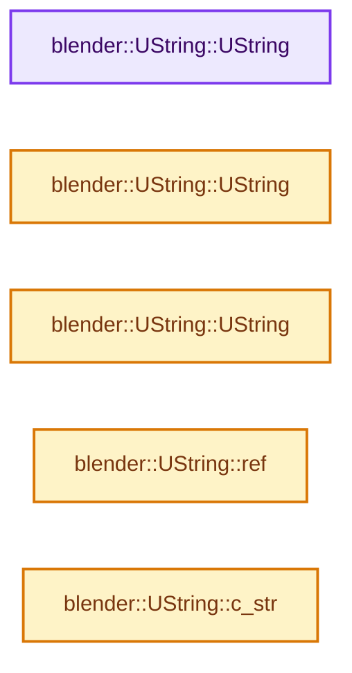
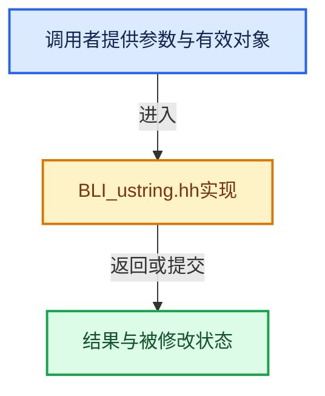

# 实现依赖专题：source/blender/blenlib/BLI_ustring.hh

[实现依赖导航](../README.md) · [符号索引](../../00-课程指南/02-源码与提交索引/符号依赖与实现索引.md)

本专题从正文实际调用进入，集中保存共享实现。函数有稳定锚点，可从调用处直接跳到对应完整函数；递归与互相调用通过回链组织。

## 本文件的实现关系






## 完整成员与函数实现

<a id="f-af044c001f6ab696"></a>

### `blender::UString::UString`

实现位置：[source/blender/blenlib/BLI_ustring.hh](../../../../../../source/blender/blenlib/BLI_ustring.hh) · L65—L65。

接口参数：

- `const blender::detail::UStringEntry *ptr`

**教学注释版**

<!-- annotated:c4af69dcdaca54 -->

```cpp
  explicit UString(const blender::detail::UStringEntry *ptr) : ptr_(ptr) {}
```

<details>
<summary>核对原始源码：source/blender/blenlib/BLI_ustring.hh · L65—L65</summary>

<!-- original:c4af69dcdaca54:source/blender/blenlib/BLI_ustring.hh:65:65 -->

```cpp
  explicit UString(const blender::detail::UStringEntry *ptr) : ptr_(ptr) {}
```

</details>

**继续追踪实现**

本实现没有需要继续展开的显式调用；检查返回表达式、对象转换和调用者前置条件。

<a id="f-acdd59bd65bf3333"></a>

### `blender::UString::UString`

实现位置：[source/blender/blenlib/BLI_ustring.hh](../../../../../../source/blender/blenlib/BLI_ustring.hh) · L68—L68。

**教学注释版**

<!-- annotated:f7b1c97e41140a -->

```cpp
  UString() = default;
```

<details>
<summary>核对原始源码：source/blender/blenlib/BLI_ustring.hh · L68—L68</summary>

<!-- original:f7b1c97e41140a:source/blender/blenlib/BLI_ustring.hh:68:68 -->

```cpp
  UString() = default;
```

</details>

**继续追踪实现**

本实现没有需要继续展开的显式调用；检查返回表达式、对象转换和调用者前置条件。

<a id="f-bc4cac73ffd771a5"></a>

### `blender::UString::UString`

实现位置：[source/blender/blenlib/BLI_ustring.hh](../../../../../../source/blender/blenlib/BLI_ustring.hh) · L69—L69。

接口参数：

- `const StringRef str`

**教学注释版**

<!-- annotated:62acb3bd47c22a -->

```cpp
  explicit UString(const StringRef str) : ptr_(&blender::detail::ustring_ensure_entry(str)) {}
```

<details>
<summary>核对原始源码：source/blender/blenlib/BLI_ustring.hh · L69—L69</summary>

<!-- original:62acb3bd47c22a:source/blender/blenlib/BLI_ustring.hh:69:69 -->

```cpp
  explicit UString(const StringRef str) : ptr_(&blender::detail::ustring_ensure_entry(str)) {}
```

</details>

**继续追踪实现**

本实现没有需要继续展开的显式调用；检查返回表达式、对象转换和调用者前置条件。

<a id="f-737f25fd4ae3f840"></a>

### `blender::UString::ref`

实现位置：[source/blender/blenlib/BLI_ustring.hh](../../../../../../source/blender/blenlib/BLI_ustring.hh) · L78—L81。

**教学注释版**

<!-- annotated:45aebe5803b7e3 -->

```cpp
  StringRefNull ref() const
  {
    return StringRefNull(ptr_->str);
  }
```

<details>
<summary>核对原始源码：source/blender/blenlib/BLI_ustring.hh · L78—L81</summary>

<!-- original:45aebe5803b7e3:source/blender/blenlib/BLI_ustring.hh:78:81 -->

```cpp
  StringRefNull ref() const
  {
    return StringRefNull(ptr_->str);
  }
```

</details>

**结果出口**

- `return StringRefNull(ptr_->str);`

**继续追踪实现**

- `StringRefNull` → [blender::StringRefNull::StringRefNull · L149](../../01-基础容器与现代CPP/15-StringRef字符串视图.md#f-ebc6ee5f8fc16390)；[blender::StringRefNull::StringRefNull · L496](../../01-基础容器与现代CPP/15-StringRef字符串视图.md#f-936c98fc0d9ae39e)；[blender::StringRefNull::StringRefNull · L502](../../01-基础容器与现代CPP/15-StringRef字符串视图.md#f-cf03ac0c28007ee0)；[blender::StringRefNull::StringRefNull · L512](../../01-基础容器与现代CPP/15-StringRef字符串视图.md#f-8a14273318bc57e1)；[blender::StringRefNull::StringRefNull · L523](../../01-基础容器与现代CPP/15-StringRef字符串视图.md#f-e1cc63a4ff92775b)。同名重载需按实参类型选择。

<a id="f-2ff40d65689d1a13"></a>

### `blender::UString::c_str`

实现位置：[source/blender/blenlib/BLI_ustring.hh](../../../../../../source/blender/blenlib/BLI_ustring.hh) · L88—L91。

**教学注释版**

<!-- annotated:056b4032e32dbc -->

```cpp
  const char *c_str() const
  {
    return ptr_->str.c_str();
  }
```

<details>
<summary>核对原始源码：source/blender/blenlib/BLI_ustring.hh · L88—L91</summary>

<!-- original:056b4032e32dbc:source/blender/blenlib/BLI_ustring.hh:88:91 -->

```cpp
  const char *c_str() const
  {
    return ptr_->str.c_str();
  }
```

</details>

**结果出口**

- `return ptr_->str.c_str();`

**继续追踪实现**

- `ptr_->str.c_str` → [调用协议](../../00-课程指南/01-路线与规范/模板宏与动态分派协议.md)：接收对象类型依赖auto、返回值或模板实例；不按同名猜测目标。调用位置L90。
