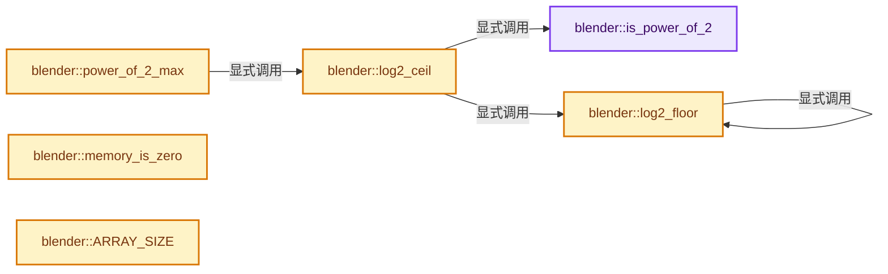
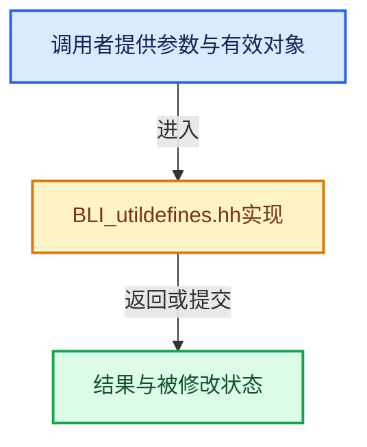

# 实现依赖专题：source/blender/blenlib/BLI_utildefines.hh

[实现依赖导航](../README.md) · [符号索引](../../00-课程指南/02-源码与提交索引/符号依赖与实现索引.md)

本专题从正文实际调用进入，集中保存共享实现。函数有稳定锚点，可从调用处直接跳到对应完整函数；递归与互相调用通过回链组织。

## 本文件的实现关系






<a id="m-958c70eca94e"></a>

## 宏 `INIT_MINMAX`

<!-- annotated:433355f0c41fcc -->

```cpp
#define INIT_MINMAX(min, max) \
  { \
    (min)[0] = (min)[1] = (min)[2] = 1.0e30f; \
    (max)[0] = (max)[1] = (max)[2] = -1.0e30f; \
  } \
  (void)0
#define INIT_MINMAX2(min, max) \
```

<details>
<summary>核对原始源码：source/blender/blenlib/BLI_utildefines.hh · L31—L37</summary>

<!-- original:433355f0c41fcc:source/blender/blenlib/BLI_utildefines.hh:31:37 -->

```cpp
#define INIT_MINMAX(min, max) \
  { \
    (min)[0] = (min)[1] = (min)[2] = 1.0e30f; \
    (max)[0] = (max)[1] = (max)[2] = -1.0e30f; \
  } \
  (void)0
#define INIT_MINMAX2(min, max) \
```

</details>

宏在预处理阶段展开，参数替换、重复求值和条件编译应直接从该定义检查。与普通函数不同，宏不会自动提供参数类型检查；构建配置选择哪个定义需结合外围条件。

<a id="m-6dd18722bafc"></a>

## 宏 `INIT_MINMAX2`

<!-- annotated:d00085cba50600 -->

```cpp
#define INIT_MINMAX2(min, max) \
  { \
    (min)[0] = (min)[1] = 1.0e30f; \
    (max)[0] = (max)[1] = -1.0e30f; \
  } \
  (void)0

```

<details>
<summary>核对原始源码：source/blender/blenlib/BLI_utildefines.hh · L37—L43</summary>

<!-- original:d00085cba50600:source/blender/blenlib/BLI_utildefines.hh:37:43 -->

```cpp
#define INIT_MINMAX2(min, max) \
  { \
    (min)[0] = (min)[1] = 1.0e30f; \
    (max)[0] = (max)[1] = -1.0e30f; \
  } \
  (void)0

```

</details>

宏在预处理阶段展开，参数替换、重复求值和条件编译应直接从该定义检查。与普通函数不同，宏不会自动提供参数类型检查；构建配置选择哪个定义需结合外围条件。

<a id="m-5df6b380a0ac"></a>

## 宏 `SWAP`

<!-- annotated:2b8958c54d1a96 -->

```cpp
#define SWAP(type, a, b) \
  { \
    type sw_ap; \
    CHECK_TYPE(a, type); \
    CHECK_TYPE(b, type); \
    sw_ap = (a); \
    (a) = (b); \
    (b) = sw_ap; \
  } \
  (void)0

```

<details>
<summary>核对原始源码：source/blender/blenlib/BLI_utildefines.hh · L50—L60</summary>

<!-- original:2b8958c54d1a96:source/blender/blenlib/BLI_utildefines.hh:50:60 -->

```cpp
#define SWAP(type, a, b) \
  { \
    type sw_ap; \
    CHECK_TYPE(a, type); \
    CHECK_TYPE(b, type); \
    sw_ap = (a); \
    (a) = (b); \
    (b) = sw_ap; \
  } \
  (void)0

```

</details>

宏在预处理阶段展开，参数替换、重复求值和条件编译应直接从该定义检查。与普通函数不同，宏不会自动提供参数类型检查；构建配置选择哪个定义需结合外围条件。

<a id="m-d6572de7cae0"></a>

## 宏 `ELEM`

<!-- annotated:d30a421de1208e -->

```cpp
#define ELEM(...) VA_NARGS_CALL_OVERLOAD(_VA_ELEM, __VA_ARGS__)

```

<details>
<summary>核对原始源码：source/blender/blenlib/BLI_utildefines.hh · L135—L136</summary>

<!-- original:d30a421de1208e:source/blender/blenlib/BLI_utildefines.hh:135:136 -->

```cpp
#define ELEM(...) VA_NARGS_CALL_OVERLOAD(_VA_ELEM, __VA_ARGS__)

```

</details>

宏在预处理阶段展开，参数替换、重复求值和条件编译应直接从该定义检查。与普通函数不同，宏不会自动提供参数类型检查；构建配置选择哪个定义需结合外围条件。

<a id="m-cbb89356c077"></a>

## 宏 `IS_EQF`

<!-- annotated:85ba91f814a0b9 -->

```cpp
#define IS_EQF(a, b) \
  (CHECK_TYPE_INLINE_NONCONST(a, float), \
   CHECK_TYPE_INLINE_NONCONST(b, float), \
   ((fabsf((float)((a) - (b))) >= (float)FLT_EPSILON) ? false : true))

```

<details>
<summary>核对原始源码：source/blender/blenlib/BLI_utildefines.hh · L150—L154</summary>

<!-- original:85ba91f814a0b9:source/blender/blenlib/BLI_utildefines.hh:150:154 -->

```cpp
#define IS_EQF(a, b) \
  (CHECK_TYPE_INLINE_NONCONST(a, float), \
   CHECK_TYPE_INLINE_NONCONST(b, float), \
   ((fabsf((float)((a) - (b))) >= (float)FLT_EPSILON) ? false : true))

```

</details>

宏在预处理阶段展开，参数替换、重复求值和条件编译应直接从该定义检查。与普通函数不同，宏不会自动提供参数类型检查；构建配置选择哪个定义需结合外围条件。

<a id="m-b5fb74be649a"></a>

## 宏 `IS_EQT`

<!-- annotated:c2724cce1cdba0 -->

```cpp
#define IS_EQT(a, b, c) (((a) > (b)) ? ((((a) - (b)) <= (c))) : (((((b) - (a)) <= (c)))))
#define IN_RANGE(a, b, c) (((b) < (c)) ? (((b) < (a) && (a) < (c))) : (((c) < (a) && (a) < (b))))
```

<details>
<summary>核对原始源码：source/blender/blenlib/BLI_utildefines.hh · L155—L156</summary>

<!-- original:c2724cce1cdba0:source/blender/blenlib/BLI_utildefines.hh:155:156 -->

```cpp
#define IS_EQT(a, b, c) (((a) > (b)) ? ((((a) - (b)) <= (c))) : (((((b) - (a)) <= (c)))))
#define IN_RANGE(a, b, c) (((b) < (c)) ? (((b) < (a) && (a) < (c))) : (((c) < (a) && (a) < (b))))
```

</details>

宏在预处理阶段展开，参数替换、重复求值和条件编译应直接从该定义检查。与普通函数不同，宏不会自动提供参数类型检查；构建配置选择哪个定义需结合外围条件。

<a id="m-867ccd307864"></a>

## 宏 `IN_RANGE_INCL`

<!-- annotated:c9fb4ccb7586c8 -->

```cpp
#define IN_RANGE_INCL(a, b, c) \
  (((b) < (c)) ? (((b) <= (a) && (a) <= (c))) : (((c) <= (a) && (a) <= (b))))

```

<details>
<summary>核对原始源码：source/blender/blenlib/BLI_utildefines.hh · L157—L159</summary>

<!-- original:c9fb4ccb7586c8:source/blender/blenlib/BLI_utildefines.hh:157:159 -->

```cpp
#define IN_RANGE_INCL(a, b, c) \
  (((b) < (c)) ? (((b) <= (a) && (a) <= (c))) : (((c) <= (a) && (a) <= (b))))

```

</details>

宏在预处理阶段展开，参数替换、重复求值和条件编译应直接从该定义检查。与普通函数不同，宏不会自动提供参数类型检查；构建配置选择哪个定义需结合外围条件。

<a id="m-69703e497120"></a>

## 宏 `CLAMP`

<!-- annotated:46efdeeeb48624 -->

```cpp
#define CLAMP(a, b, c) \
  { \
    if ((a) < (b)) { \
      (a) = (b); \
    } \
    else if ((a) > (c)) { \
      (a) = (c); \
    } \
  } \
  (void)0

```

<details>
<summary>核对原始源码：source/blender/blenlib/BLI_utildefines.hh · L200—L210</summary>

<!-- original:46efdeeeb48624:source/blender/blenlib/BLI_utildefines.hh:200:210 -->

```cpp
#define CLAMP(a, b, c) \
  { \
    if ((a) < (b)) { \
      (a) = (b); \
    } \
    else if ((a) > (c)) { \
      (a) = (c); \
    } \
  } \
  (void)0

```

</details>

宏在预处理阶段展开，参数替换、重复求值和条件编译应直接从该定义检查。与普通函数不同，宏不会自动提供参数类型检查；构建配置选择哪个定义需结合外围条件。

<a id="m-ff513c0bdcc5"></a>

## 宏 `CLAMP_MAX`

<!-- annotated:e5c98adf0fb1c3 -->

```cpp
#define CLAMP_MAX(a, c) \
  { \
    if ((a) > (c)) { \
      (a) = (c); \
    } \
  } \
  (void)0

```

<details>
<summary>核对原始源码：source/blender/blenlib/BLI_utildefines.hh · L211—L218</summary>

<!-- original:e5c98adf0fb1c3:source/blender/blenlib/BLI_utildefines.hh:211:218 -->

```cpp
#define CLAMP_MAX(a, c) \
  { \
    if ((a) > (c)) { \
      (a) = (c); \
    } \
  } \
  (void)0

```

</details>

宏在预处理阶段展开，参数替换、重复求值和条件编译应直接从该定义检查。与普通函数不同，宏不会自动提供参数类型检查；构建配置选择哪个定义需结合外围条件。

<a id="m-fd63318fbafb"></a>

## 宏 `CLAMP_MIN`

<!-- annotated:b0780693c9e254 -->

```cpp
#define CLAMP_MIN(a, b) \
  { \
    if ((a) < (b)) { \
      (a) = (b); \
    } \
  } \
  (void)0

```

<details>
<summary>核对原始源码：source/blender/blenlib/BLI_utildefines.hh · L219—L226</summary>

<!-- original:b0780693c9e254:source/blender/blenlib/BLI_utildefines.hh:219:226 -->

```cpp
#define CLAMP_MIN(a, b) \
  { \
    if ((a) < (b)) { \
      (a) = (b); \
    } \
  } \
  (void)0

```

</details>

宏在预处理阶段展开，参数替换、重复求值和条件编译应直接从该定义检查。与普通函数不同，宏不会自动提供参数类型检查；构建配置选择哪个定义需结合外围条件。

<a id="m-96ff8266d239"></a>

## 宏 `UNPACK2`

<!-- annotated:b219a28b7a1c77 -->

```cpp
#define UNPACK2(a) ((a)[0]), ((a)[1])
#define UNPACK3(a) UNPACK2(a), ((a)[2])
```

<details>
<summary>核对原始源码：source/blender/blenlib/BLI_utildefines.hh · L234—L235</summary>

<!-- original:b219a28b7a1c77:source/blender/blenlib/BLI_utildefines.hh:234:235 -->

```cpp
#define UNPACK2(a) ((a)[0]), ((a)[1])
#define UNPACK3(a) UNPACK2(a), ((a)[2])
```

</details>

宏在预处理阶段展开，参数替换、重复求值和条件编译应直接从该定义检查。与普通函数不同，宏不会自动提供参数类型检查；构建配置选择哪个定义需结合外围条件。

<a id="m-bbbbdcf09d3b"></a>

## 宏 `UNPACK3`

<!-- annotated:c3bc47bb3589ff -->

```cpp
#define UNPACK3(a) UNPACK2(a), ((a)[2])
#define UNPACK4(a) UNPACK3(a), ((a)[3])
```

<details>
<summary>核对原始源码：source/blender/blenlib/BLI_utildefines.hh · L235—L236</summary>

<!-- original:c3bc47bb3589ff:source/blender/blenlib/BLI_utildefines.hh:235:236 -->

```cpp
#define UNPACK3(a) UNPACK2(a), ((a)[2])
#define UNPACK4(a) UNPACK3(a), ((a)[3])
```

</details>

宏在预处理阶段展开，参数替换、重复求值和条件编译应直接从该定义检查。与普通函数不同，宏不会自动提供参数类型检查；构建配置选择哪个定义需结合外围条件。

<a id="m-42ac26c4645f"></a>

## 宏 `UNPACK4`

<!-- annotated:1e82419d19d5fa -->

```cpp
#define UNPACK4(a) UNPACK3(a), ((a)[3])
/* pre may be '&', '*' or func, post may be '->member' */
```

<details>
<summary>核对原始源码：source/blender/blenlib/BLI_utildefines.hh · L236—L237</summary>

<!-- original:1e82419d19d5fa:source/blender/blenlib/BLI_utildefines.hh:236:237 -->

```cpp
#define UNPACK4(a) UNPACK3(a), ((a)[3])
/* pre may be '&', '*' or func, post may be '->member' */
```

</details>

宏在预处理阶段展开，参数替换、重复求值和条件编译应直接从该定义检查。与普通函数不同，宏不会自动提供参数类型检查；构建配置选择哪个定义需结合外围条件。

<a id="m-5f3153de9317"></a>

## 宏 `UNPACK3_EX`

<!-- annotated:0e85e431c157c2 -->

```cpp
#define UNPACK3_EX(pre, a, post) UNPACK2_EX(pre, a, post), (pre((a)[2]) post)
#define UNPACK4_EX(pre, a, post) UNPACK3_EX(pre, a, post), (pre((a)[3]) post)
```

<details>
<summary>核对原始源码：source/blender/blenlib/BLI_utildefines.hh · L239—L240</summary>

<!-- original:0e85e431c157c2:source/blender/blenlib/BLI_utildefines.hh:239:240 -->

```cpp
#define UNPACK3_EX(pre, a, post) UNPACK2_EX(pre, a, post), (pre((a)[2]) post)
#define UNPACK4_EX(pre, a, post) UNPACK3_EX(pre, a, post), (pre((a)[3]) post)
```

</details>

宏在预处理阶段展开，参数替换、重复求值和条件编译应直接从该定义检查。与普通函数不同，宏不会自动提供参数类型检查；构建配置选择哪个定义需结合外围条件。

<a id="m-30d7eda81c62"></a>

## 宏 `UNPACK4_EX`

<!-- annotated:1a9d6bb9e86655 -->

```cpp
#define UNPACK4_EX(pre, a, post) UNPACK3_EX(pre, a, post), (pre((a)[3]) post)

```

<details>
<summary>核对原始源码：source/blender/blenlib/BLI_utildefines.hh · L240—L241</summary>

<!-- original:1a9d6bb9e86655:source/blender/blenlib/BLI_utildefines.hh:240:241 -->

```cpp
#define UNPACK4_EX(pre, a, post) UNPACK3_EX(pre, a, post), (pre((a)[3]) post)

```

</details>

宏在预处理阶段展开，参数替换、重复求值和条件编译应直接从该定义检查。与普通函数不同，宏不会自动提供参数类型检查；构建配置选择哪个定义需结合外围条件。

<a id="m-62bdc6b7ff96"></a>

## 宏 `ARRAY_HAS_ITEM`

<!-- annotated:48535bfb63e944 -->

```cpp
#define ARRAY_HAS_ITEM(arr_item, arr_start, arr_len) \
  (CHECK_TYPE_PAIR_INLINE(arr_start, arr_item), \
   ((size_t)((arr_item) - (arr_start)) < (size_t)(arr_len)))

```

<details>
<summary>核对原始源码：source/blender/blenlib/BLI_utildefines.hh · L248—L251</summary>

<!-- original:48535bfb63e944:source/blender/blenlib/BLI_utildefines.hh:248:251 -->

```cpp
#define ARRAY_HAS_ITEM(arr_item, arr_start, arr_len) \
  (CHECK_TYPE_PAIR_INLINE(arr_start, arr_item), \
   ((size_t)((arr_item) - (arr_start)) < (size_t)(arr_len)))

```

</details>

宏在预处理阶段展开，参数替换、重复求值和条件编译应直接从该定义检查。与普通函数不同，宏不会自动提供参数类型检查；构建配置选择哪个定义需结合外围条件。

<a id="m-80336b50a95e"></a>

## 宏 `ARRAY_SET_ITEMS`

<!-- annotated:c207985044adc7 -->

```cpp
#define ARRAY_SET_ITEMS(...) \
  { \
    VA_NARGS_CALL_OVERLOAD(_VA_ARRAY_SET_ITEMS, __VA_ARGS__); \
  } \
  (void)0

```

<details>
<summary>核对原始源码：source/blender/blenlib/BLI_utildefines.hh · L304—L309</summary>

<!-- original:c207985044adc7:source/blender/blenlib/BLI_utildefines.hh:304:309 -->

```cpp
#define ARRAY_SET_ITEMS(...) \
  { \
    VA_NARGS_CALL_OVERLOAD(_VA_ARRAY_SET_ITEMS, __VA_ARGS__); \
  } \
  (void)0

```

</details>

宏在预处理阶段展开，参数替换、重复求值和条件编译应直接从该定义检查。与普通函数不同，宏不会自动提供参数类型检查；构建配置选择哪个定义需结合外围条件。

<a id="m-c812e199f26c"></a>

## 宏 `POINTER_OFFSET`

<!-- annotated:d15ad4b0c00071 -->

```cpp
#define POINTER_OFFSET(v, ofs) \
  (reinterpret_cast<std::remove_reference_t<decltype(v)>>((char *)(v) + (ofs)))

```

<details>
<summary>核对原始源码：source/blender/blenlib/BLI_utildefines.hh · L316—L318</summary>

<!-- original:d15ad4b0c00071:source/blender/blenlib/BLI_utildefines.hh:316:318 -->

```cpp
#define POINTER_OFFSET(v, ofs) \
  (reinterpret_cast<std::remove_reference_t<decltype(v)>>((char *)(v) + (ofs)))

```

</details>

宏在预处理阶段展开，参数替换、重复求值和条件编译应直接从该定义检查。与普通函数不同，宏不会自动提供参数类型检查；构建配置选择哪个定义需结合外围条件。

<a id="m-17841357bb5a"></a>

## 宏 `POINTER_FROM_INT`

<!-- annotated:e78b2d2021b5a0 -->

```cpp
#define POINTER_FROM_INT(i) ((void *)(intptr_t)(i))
#define POINTER_AS_INT(i) ((void)0, ((int)(intptr_t)(i)))
```

<details>
<summary>核对原始源码：source/blender/blenlib/BLI_utildefines.hh · L321—L322</summary>

<!-- original:e78b2d2021b5a0:source/blender/blenlib/BLI_utildefines.hh:321:322 -->

```cpp
#define POINTER_FROM_INT(i) ((void *)(intptr_t)(i))
#define POINTER_AS_INT(i) ((void)0, ((int)(intptr_t)(i)))
```

</details>

宏在预处理阶段展开，参数替换、重复求值和条件编译应直接从该定义检查。与普通函数不同，宏不会自动提供参数类型检查；构建配置选择哪个定义需结合外围条件。

<a id="m-5c041fdc2f74"></a>

## 宏 `POINTER_AS_INT`

<!-- annotated:a05c32ef27faf3 -->

```cpp
#define POINTER_AS_INT(i) ((void)0, ((int)(intptr_t)(i)))

```

<details>
<summary>核对原始源码：source/blender/blenlib/BLI_utildefines.hh · L322—L323</summary>

<!-- original:a05c32ef27faf3:source/blender/blenlib/BLI_utildefines.hh:322:323 -->

```cpp
#define POINTER_AS_INT(i) ((void)0, ((int)(intptr_t)(i)))

```

</details>

宏在预处理阶段展开，参数替换、重复求值和条件编译应直接从该定义检查。与普通函数不同，宏不会自动提供参数类型检查；构建配置选择哪个定义需结合外围条件。

<a id="m-58aeca9d3c02"></a>

## 宏 `POINTER_FROM_UINT`

<!-- annotated:c0e2cd3c9454ea -->

```cpp
#define POINTER_FROM_UINT(i) ((void *)(uintptr_t)(i))
#define POINTER_AS_UINT(i) ((void)0, ((unsigned int)(uintptr_t)(i)))
```

<details>
<summary>核对原始源码：source/blender/blenlib/BLI_utildefines.hh · L324—L325</summary>

<!-- original:c0e2cd3c9454ea:source/blender/blenlib/BLI_utildefines.hh:324:325 -->

```cpp
#define POINTER_FROM_UINT(i) ((void *)(uintptr_t)(i))
#define POINTER_AS_UINT(i) ((void)0, ((unsigned int)(uintptr_t)(i)))
```

</details>

宏在预处理阶段展开，参数替换、重复求值和条件编译应直接从该定义检查。与普通函数不同，宏不会自动提供参数类型检查；构建配置选择哪个定义需结合外围条件。

<a id="m-c3ae6b4f740d"></a>

## 宏 `POINTER_AS_UINT`

<!-- annotated:33b2528c6221d3 -->

```cpp
#define POINTER_AS_UINT(i) ((void)0, ((unsigned int)(uintptr_t)(i)))

```

<details>
<summary>核对原始源码：source/blender/blenlib/BLI_utildefines.hh · L325—L326</summary>

<!-- original:33b2528c6221d3:source/blender/blenlib/BLI_utildefines.hh:325:326 -->

```cpp
#define POINTER_AS_UINT(i) ((void)0, ((unsigned int)(uintptr_t)(i)))

```

</details>

宏在预处理阶段展开，参数替换、重复求值和条件编译应直接从该定义检查。与普通函数不同，宏不会自动提供参数类型检查；构建配置选择哪个定义需结合外围条件。

<a id="m-d91e65e3ad3b"></a>

## 宏 `MEMCPY_STRUCT_AFTER`

<!-- annotated:30509f22a25975 -->

```cpp
#define MEMCPY_STRUCT_AFTER(struct_dst, struct_src, member) \
  { \
    CHECK_TYPE_NONCONST(struct_dst); \
    ((void)(struct_dst == struct_src), \
     memcpy((char *)(struct_dst) + OFFSETOF_STRUCT_AFTER(struct_dst, member), \
            (const char *)(struct_src) + OFFSETOF_STRUCT_AFTER(struct_dst, member), \
            sizeof(*(struct_dst)) - OFFSETOF_STRUCT_AFTER(struct_dst, member))); \
  } \
  ((void)0)

```

<details>
<summary>核对原始源码：source/blender/blenlib/BLI_utildefines.hh · L347—L356</summary>

<!-- original:30509f22a25975:source/blender/blenlib/BLI_utildefines.hh:347:356 -->

```cpp
#define MEMCPY_STRUCT_AFTER(struct_dst, struct_src, member) \
  { \
    CHECK_TYPE_NONCONST(struct_dst); \
    ((void)(struct_dst == struct_src), \
     memcpy((char *)(struct_dst) + OFFSETOF_STRUCT_AFTER(struct_dst, member), \
            (const char *)(struct_src) + OFFSETOF_STRUCT_AFTER(struct_dst, member), \
            sizeof(*(struct_dst)) - OFFSETOF_STRUCT_AFTER(struct_dst, member))); \
  } \
  ((void)0)

```

</details>

宏在预处理阶段展开，参数替换、重复求值和条件编译应直接从该定义检查。与普通函数不同，宏不会自动提供参数类型检查；构建配置选择哪个定义需结合外围条件。

<a id="m-30b1f74075b1"></a>

## 宏 `INIT_DEFAULT_STRUCT_AFTER`

<!-- annotated:74ae5321500b5b -->

```cpp
#define INIT_DEFAULT_STRUCT_AFTER(struct_dst, member) \
  { \
    const typename std::remove_reference<decltype(*(struct_dst))>::type struct_src; \
    BLI_assert(MEMCMP_STRUCT_AFTER_IS_ZERO_OR_EQUAL(struct_dst, &struct_src, member)); \
    MEMCPY_STRUCT_AFTER(struct_dst, &struct_src, member); \
  }

```

<details>
<summary>核对原始源码：source/blender/blenlib/BLI_utildefines.hh · L422—L428</summary>

<!-- original:74ae5321500b5b:source/blender/blenlib/BLI_utildefines.hh:422:428 -->

```cpp
#define INIT_DEFAULT_STRUCT_AFTER(struct_dst, member) \
  { \
    const typename std::remove_reference<decltype(*(struct_dst))>::type struct_src; \
    BLI_assert(MEMCMP_STRUCT_AFTER_IS_ZERO_OR_EQUAL(struct_dst, &struct_src, member)); \
    MEMCPY_STRUCT_AFTER(struct_dst, &struct_src, member); \
  }

```

</details>

宏在预处理阶段展开，参数替换、重复求值和条件编译应直接从该定义检查。与普通函数不同，宏不会自动提供参数类型检查；构建配置选择哪个定义需结合外围条件。

<a id="m-c7b745bcfad2"></a>

## 宏 `STREQ`

<!-- annotated:8287b5619a8c48 -->

```cpp
#define STREQ(a, b) (strcmp(a, b) == 0)
#define STRCASEEQ(a, b) (strcasecmp(a, b) == 0)
```

<details>
<summary>核对原始源码：source/blender/blenlib/BLI_utildefines.hh · L451—L452</summary>

<!-- original:8287b5619a8c48:source/blender/blenlib/BLI_utildefines.hh:451:452 -->

```cpp
#define STREQ(a, b) (strcmp(a, b) == 0)
#define STRCASEEQ(a, b) (strcasecmp(a, b) == 0)
```

</details>

宏在预处理阶段展开，参数替换、重复求值和条件编译应直接从该定义检查。与普通函数不同，宏不会自动提供参数类型检查；构建配置选择哪个定义需结合外围条件。

<a id="m-c74c1422ab62"></a>

## 宏 `STREQLEN`

<!-- annotated:7bf5126a5d9811 -->

```cpp
#define STREQLEN(a, b, n) (strncmp(a, b, n) == 0)
#define STRCASEEQLEN(a, b, n) (strncasecmp(a, b, n) == 0)
```

<details>
<summary>核对原始源码：source/blender/blenlib/BLI_utildefines.hh · L453—L454</summary>

<!-- original:7bf5126a5d9811:source/blender/blenlib/BLI_utildefines.hh:453:454 -->

```cpp
#define STREQLEN(a, b, n) (strncmp(a, b, n) == 0)
#define STRCASEEQLEN(a, b, n) (strncasecmp(a, b, n) == 0)
```

</details>

宏在预处理阶段展开，参数替换、重复求值和条件编译应直接从该定义检查。与普通函数不同，宏不会自动提供参数类型检查；构建配置选择哪个定义需结合外围条件。

<a id="m-afbbeb066fe7"></a>

## 宏 `STRPREFIX`

<!-- annotated:0a578274bb9b45 -->

```cpp
#define STRPREFIX(a, b) (strncmp((a), (b), strlen(b)) == 0)

```

<details>
<summary>核对原始源码：source/blender/blenlib/BLI_utildefines.hh · L456—L457</summary>

<!-- original:0a578274bb9b45:source/blender/blenlib/BLI_utildefines.hh:456:457 -->

```cpp
#define STRPREFIX(a, b) (strncmp((a), (b), strlen(b)) == 0)

```

</details>

宏在预处理阶段展开，参数替换、重复求值和条件编译应直接从该定义检查。与普通函数不同，宏不会自动提供参数类型检查；构建配置选择哪个定义需结合外围条件。

<a id="m-013582537634"></a>

## 宏 `UNUSED_VARS`

<!-- annotated:69fb57a7954f60 -->

```cpp
#define UNUSED_VARS(...) VA_NARGS_CALL_OVERLOAD(_VA_UNUSED_VARS_, __VA_ARGS__)

```

<details>
<summary>核对原始源码：source/blender/blenlib/BLI_utildefines.hh · L522—L523</summary>

<!-- original:69fb57a7954f60:source/blender/blenlib/BLI_utildefines.hh:522:523 -->

```cpp
#define UNUSED_VARS(...) VA_NARGS_CALL_OVERLOAD(_VA_UNUSED_VARS_, __VA_ARGS__)

```

</details>

宏在预处理阶段展开，参数替换、重复求值和条件编译应直接从该定义检查。与普通函数不同，宏不会自动提供参数类型检查；构建配置选择哪个定义需结合外围条件。

<a id="m-fea439f7d366"></a>

## 宏 `UNUSED_VARS_NDEBUG`

<!-- annotated:d35f4087fc146a -->

```cpp
#  define UNUSED_VARS_NDEBUG(...)
#else
```

<details>
<summary>核对原始源码：source/blender/blenlib/BLI_utildefines.hh · L526—L527</summary>

<!-- original:d35f4087fc146a:source/blender/blenlib/BLI_utildefines.hh:526:527 -->

```cpp
#  define UNUSED_VARS_NDEBUG(...)
#else
```

</details>

宏在预处理阶段展开，参数替换、重复求值和条件编译应直接从该定义检查。与普通函数不同，宏不会自动提供参数类型检查；构建配置选择哪个定义需结合外围条件。

<a id="m-a8f8cfac06c0"></a>

## 宏 `UNUSED_VARS_NDEBUG`

<!-- annotated:e8135ef8ef9129 -->

```cpp
#  define UNUSED_VARS_NDEBUG UNUSED_VARS
#endif
```

<details>
<summary>核对原始源码：source/blender/blenlib/BLI_utildefines.hh · L528—L529</summary>

<!-- original:e8135ef8ef9129:source/blender/blenlib/BLI_utildefines.hh:528:529 -->

```cpp
#  define UNUSED_VARS_NDEBUG UNUSED_VARS
#endif
```

</details>

宏在预处理阶段展开，参数替换、重复求值和条件编译应直接从该定义检查。与普通函数不同，宏不会自动提供参数类型检查；构建配置选择哪个定义需结合外围条件。

<a id="m-eeacc3e1dee8"></a>

## 宏 `LIKELY`

<!-- annotated:310d3ebe94e731 -->

```cpp
#  define LIKELY(x) __builtin_expect(!!(x), 1)
#  define UNLIKELY(x) __builtin_expect(!!(x), 0)
```

<details>
<summary>核对原始源码：source/blender/blenlib/BLI_utildefines.hh · L543—L544</summary>

<!-- original:310d3ebe94e731:source/blender/blenlib/BLI_utildefines.hh:543:544 -->

```cpp
#  define LIKELY(x) __builtin_expect(!!(x), 1)
#  define UNLIKELY(x) __builtin_expect(!!(x), 0)
```

</details>

宏在预处理阶段展开，参数替换、重复求值和条件编译应直接从该定义检查。与普通函数不同，宏不会自动提供参数类型检查；构建配置选择哪个定义需结合外围条件。

<a id="m-74644b8209a0"></a>

## 宏 `UNLIKELY`

<!-- annotated:90d5359dfbd16c -->

```cpp
#  define UNLIKELY(x) __builtin_expect(!!(x), 0)
#else
```

<details>
<summary>核对原始源码：source/blender/blenlib/BLI_utildefines.hh · L544—L545</summary>

<!-- original:90d5359dfbd16c:source/blender/blenlib/BLI_utildefines.hh:544:545 -->

```cpp
#  define UNLIKELY(x) __builtin_expect(!!(x), 0)
#else
```

</details>

宏在预处理阶段展开，参数替换、重复求值和条件编译应直接从该定义检查。与普通函数不同，宏不会自动提供参数类型检查；构建配置选择哪个定义需结合外围条件。

<a id="m-26b4114d7b77"></a>

## 宏 `LIKELY`

<!-- annotated:16daad58a00387 -->

```cpp
#  define LIKELY(x) (x)
#  define UNLIKELY(x) (x)
```

<details>
<summary>核对原始源码：source/blender/blenlib/BLI_utildefines.hh · L546—L547</summary>

<!-- original:16daad58a00387:source/blender/blenlib/BLI_utildefines.hh:546:547 -->

```cpp
#  define LIKELY(x) (x)
#  define UNLIKELY(x) (x)
```

</details>

宏在预处理阶段展开，参数替换、重复求值和条件编译应直接从该定义检查。与普通函数不同，宏不会自动提供参数类型检查；构建配置选择哪个定义需结合外围条件。

<a id="m-3a47ebab6298"></a>

## 宏 `UNLIKELY`

<!-- annotated:9115bcc97b16bc -->

```cpp
#  define UNLIKELY(x) (x)
#endif
```

<details>
<summary>核对原始源码：source/blender/blenlib/BLI_utildefines.hh · L547—L548</summary>

<!-- original:9115bcc97b16bc:source/blender/blenlib/BLI_utildefines.hh:547:548 -->

```cpp
#  define UNLIKELY(x) (x)
#endif
```

</details>

宏在预处理阶段展开，参数替换、重复求值和条件编译应直接从该定义检查。与普通函数不同，宏不会自动提供参数类型检查；构建配置选择哪个定义需结合外围条件。

<a id="m-8e0dc83e01a8"></a>

## 宏 `SET_FLAG_FROM_TEST`

<!-- annotated:5438c356e9e4e7 -->

```cpp
#define SET_FLAG_FROM_TEST(value, test, flag) \
  { \
    if (test) { \
      (value) |= (flag); \
    } \
    else { \
      (value) &= ~(flag); \
    } \
  } \
  ((void)0)

```

<details>
<summary>核对原始源码：source/blender/blenlib/BLI_utildefines.hh · L557—L567</summary>

<!-- original:5438c356e9e4e7:source/blender/blenlib/BLI_utildefines.hh:557:567 -->

```cpp
#define SET_FLAG_FROM_TEST(value, test, flag) \
  { \
    if (test) { \
      (value) |= (flag); \
    } \
    else { \
      (value) &= ~(flag); \
    } \
  } \
  ((void)0)

```

</details>

宏在预处理阶段展开，参数替换、重复求值和条件编译应直接从该定义检查。与普通函数不同，宏不会自动提供参数类型检查；构建配置选择哪个定义需结合外围条件。

<a id="m-8f538d1489f7"></a>

## 宏 `AT`

<!-- annotated:824b46220d4b90 -->

```cpp
#define AT __FILE__ ":" STRINGIFY(__LINE__)

```

<details>
<summary>核对原始源码：source/blender/blenlib/BLI_utildefines.hh · L575—L576</summary>

<!-- original:824b46220d4b90:source/blender/blenlib/BLI_utildefines.hh:575:576 -->

```cpp
#define AT __FILE__ ":" STRINGIFY(__LINE__)

```

</details>

宏在预处理阶段展开，参数替换、重复求值和条件编译应直接从该定义检查。与普通函数不同，宏不会自动提供参数类型检查；构建配置选择哪个定义需结合外围条件。

## 完整成员与函数实现

<a id="f-276f4f171955e1e9"></a>

### `blender::is_power_of_2`

实现位置：[source/blender/blenlib/BLI_utildefines.hh](../../../../../../source/blender/blenlib/BLI_utildefines.hh) · L170—L174。

接口参数：

- `const int64_t x`

**教学注释版**

<!-- annotated:b370be0ad3cbcc -->

```cpp
constexpr int64_t is_power_of_2(const int64_t x)
{
  BLI_assert(x >= 0);
  return (x & (x - 1)) == 0;
}
```

<details>
<summary>核对原始源码：source/blender/blenlib/BLI_utildefines.hh · L170—L174</summary>

<!-- original:b370be0ad3cbcc:source/blender/blenlib/BLI_utildefines.hh:170:174 -->

```cpp
constexpr int64_t is_power_of_2(const int64_t x)
{
  BLI_assert(x >= 0);
  return (x & (x - 1)) == 0;
}
```

</details>

**结果出口**

- `return (x & (x - 1)) == 0;`

**继续追踪实现**

- `BLI_assert` → [BLI_assert · L48](BLI_assert.hh.md#m-57a88495704d)；[BLI_assert · L63](BLI_assert.hh.md#m-d07050020cb5)。宏定义由构建条件选择。

<a id="f-6156427b768ba020"></a>

### `blender::log2_floor`

实现位置：[source/blender/blenlib/BLI_utildefines.hh](../../../../../../source/blender/blenlib/BLI_utildefines.hh) · L176—L180。

接口参数：

- `const int64_t x`

**教学注释版**

<!-- annotated:17b0bb74e4c1db -->

```cpp
constexpr int64_t log2_floor(const int64_t x)
{
  BLI_assert(x >= 0);
  return x <= 1 ? 0 : 1 + log2_floor(x >> 1);
}
```

<details>
<summary>核对原始源码：source/blender/blenlib/BLI_utildefines.hh · L176—L180</summary>

<!-- original:17b0bb74e4c1db:source/blender/blenlib/BLI_utildefines.hh:176:180 -->

```cpp
constexpr int64_t log2_floor(const int64_t x)
{
  BLI_assert(x >= 0);
  return x <= 1 ? 0 : 1 + log2_floor(x >> 1);
}
```

</details>

**结果出口**

- `return x <= 1 ? 0 : 1 + log2_floor(x >> 1);`

**继续追踪实现**

- `BLI_assert` → [BLI_assert · L48](BLI_assert.hh.md#m-57a88495704d)；[BLI_assert · L63](BLI_assert.hh.md#m-d07050020cb5)。宏定义由构建条件选择。
- `log2_floor` → [blender::log2_floor · L176](BLI_utildefines.hh.md#f-6156427b768ba020)。

<a id="f-b023b59157198c79"></a>

### `blender::log2_ceil`

实现位置：[source/blender/blenlib/BLI_utildefines.hh](../../../../../../source/blender/blenlib/BLI_utildefines.hh) · L182—L186。

接口参数：

- `const int64_t x`

**教学注释版**

<!-- annotated:44224099e93dbe -->

```cpp
constexpr int64_t log2_ceil(const int64_t x)
{
  BLI_assert(x >= 0);
  return (is_power_of_2(int(x))) ? log2_floor(x) : log2_floor(x) + 1;
}
```

<details>
<summary>核对原始源码：source/blender/blenlib/BLI_utildefines.hh · L182—L186</summary>

<!-- original:44224099e93dbe:source/blender/blenlib/BLI_utildefines.hh:182:186 -->

```cpp
constexpr int64_t log2_ceil(const int64_t x)
{
  BLI_assert(x >= 0);
  return (is_power_of_2(int(x))) ? log2_floor(x) : log2_floor(x) + 1;
}
```

</details>

**结果出口**

- `return (is_power_of_2(int(x))) ? log2_floor(x) : log2_floor(x) + 1;`

**继续追踪实现**

- `BLI_assert` → [BLI_assert · L48](BLI_assert.hh.md#m-57a88495704d)；[BLI_assert · L63](BLI_assert.hh.md#m-d07050020cb5)。宏定义由构建条件选择。
- `is_power_of_2` → [blender::is_power_of_2 · L170](BLI_utildefines.hh.md#f-276f4f171955e1e9)。
- `log2_floor` → [blender::log2_floor · L176](BLI_utildefines.hh.md#f-6156427b768ba020)。

<a id="f-51e7864f2a6087b7"></a>

### `blender::power_of_2_max`

实现位置：[source/blender/blenlib/BLI_utildefines.hh](../../../../../../source/blender/blenlib/BLI_utildefines.hh) · L188—L192。

接口参数：

- `const int64_t x`

**教学注释版**

<!-- annotated:4f9bfa1772aa14 -->

```cpp
constexpr int64_t power_of_2_max(const int64_t x)
{
  BLI_assert(x >= 0);
  return 1ll << log2_ceil(x);
}
```

<details>
<summary>核对原始源码：source/blender/blenlib/BLI_utildefines.hh · L188—L192</summary>

<!-- original:4f9bfa1772aa14:source/blender/blenlib/BLI_utildefines.hh:188:192 -->

```cpp
constexpr int64_t power_of_2_max(const int64_t x)
{
  BLI_assert(x >= 0);
  return 1ll << log2_ceil(x);
}
```

</details>

**结果出口**

- `return 1ll << log2_ceil(x);`

**继续追踪实现**

- `BLI_assert` → [BLI_assert · L48](BLI_assert.hh.md#m-57a88495704d)；[BLI_assert · L63](BLI_assert.hh.md#m-d07050020cb5)。宏定义由构建条件选择。
- `log2_ceil` → [blender::log2_ceil · L182](BLI_utildefines.hh.md#f-b023b59157198c79)。

<a id="f-6d4441bb32b741b4"></a>

### `blender::memory_is_zero`

实现位置：[source/blender/blenlib/BLI_utildefines.hh](../../../../../../source/blender/blenlib/BLI_utildefines.hh) · L375—L385。

接口参数：

- `const void *data`
- `const size_t size`

**教学注释版**

<!-- annotated:b0b58c28115524 -->

```cpp
constexpr bool memory_is_zero(const void *data, const size_t size)
{
  const char *arr_byte = static_cast<const char *>(data);
  const char *arr_end = static_cast<const char *>(data) + size;

  while ((arr_byte != arr_end) && (*arr_byte == 0)) {
    arr_byte++;
  }

  return (arr_byte == arr_end);
}
```

<details>
<summary>核对原始源码：source/blender/blenlib/BLI_utildefines.hh · L375—L385</summary>

<!-- original:b0b58c28115524:source/blender/blenlib/BLI_utildefines.hh:375:385 -->

```cpp
constexpr bool memory_is_zero(const void *data, const size_t size)
{
  const char *arr_byte = static_cast<const char *>(data);
  const char *arr_end = static_cast<const char *>(data) + size;

  while ((arr_byte != arr_end) && (*arr_byte == 0)) {
    arr_byte++;
  }

  return (arr_byte == arr_end);
}
```

</details>

**结果出口**

- `return (arr_byte == arr_end);`

**继续追踪实现**

本实现没有需要继续展开的显式调用；检查返回表达式、对象转换和调用者前置条件。

<a id="f-eaec3a7e47b85c7c"></a>

### `blender::ARRAY_SIZE`

实现位置：[source/blender/blenlib/BLI_utildefines.hh](../../../../../../source/blender/blenlib/BLI_utildefines.hh) · L608—L612。

接口参数：

- `const T (&arg)[N]`

**教学注释版**

<!-- annotated:ac0c5d13456bfb -->

```cpp
template<class T, size_t N> constexpr size_t ARRAY_SIZE(const T (&arg)[N]) noexcept
{
  (void)arg;
  return N;
}
```

<details>
<summary>核对原始源码：source/blender/blenlib/BLI_utildefines.hh · L608—L612</summary>

<!-- original:ac0c5d13456bfb:source/blender/blenlib/BLI_utildefines.hh:608:612 -->

```cpp
template<class T, size_t N> constexpr size_t ARRAY_SIZE(const T (&arg)[N]) noexcept
{
  (void)arg;
  return N;
}
```

</details>

**结果出口**

- `return N;`

**继续追踪实现**

本实现没有需要继续展开的显式调用；检查返回表达式、对象转换和调用者前置条件。

## AT与源码来源标记

AT将__FILE__、冒号和STRINGIFY(__LINE__)形成字符串字面量拼接。STRINGIFY通过预处理器的字符串化层级把行号值变成文本，而不是在运行时格式化。它传给分配器作为来源名称，既不参与容量计算，也不保证任何内存操作成功。
