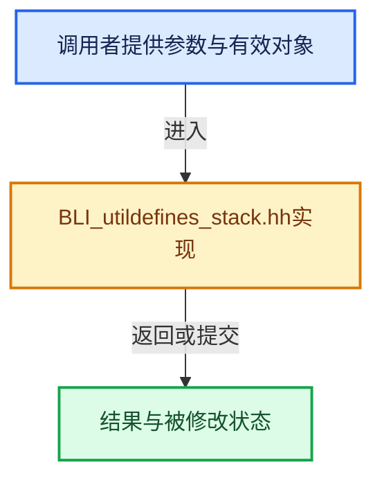

# 实现依赖专题：source/blender/blenlib/BLI_utildefines_stack.hh

[实现依赖导航](../README.md) · [符号索引](../../00-课程指南/02-源码与提交索引/符号依赖与实现索引.md)

本专题从正文实际调用进入，集中保存共享实现。函数有稳定锚点，可从调用处直接跳到对应完整函数；递归与互相调用通过回链组织。

## 本文件的实现关系





<a id="m-f46a6637d868"></a>

## 宏 `STACK_DECLARE`

<!-- annotated:2c78ff76707619 -->

```cpp
#  define STACK_DECLARE(stack) unsigned int _##stack##_index, _##stack##_num_alloc
#  define STACK_INIT(stack, stack_num) \
```

<details>
<summary>核对原始源码：source/blender/blenlib/BLI_utildefines_stack.hh · L16—L17</summary>

<!-- original:2c78ff76707619:source/blender/blenlib/BLI_utildefines_stack.hh:16:17 -->

```cpp
#  define STACK_DECLARE(stack) unsigned int _##stack##_index, _##stack##_num_alloc
#  define STACK_INIT(stack, stack_num) \
```

</details>

宏在预处理阶段展开，参数替换、重复求值和条件编译应直接从该定义检查。与普通函数不同，宏不会自动提供参数类型检查；构建配置选择哪个定义需结合外围条件。

<a id="m-4faf42665148"></a>

## 宏 `STACK_INIT`

<!-- annotated:dd9076a1e7e52f -->

```cpp
#  define STACK_INIT(stack, stack_num) \
    ((void)stack, \
     (void)((_##stack##_index) = 0), \
     (void)((_##stack##_num_alloc) = (unsigned int)(stack_num)))
#  define _STACK_SIZETEST(stack, off) \
```

<details>
<summary>核对原始源码：source/blender/blenlib/BLI_utildefines_stack.hh · L17—L21</summary>

<!-- original:dd9076a1e7e52f:source/blender/blenlib/BLI_utildefines_stack.hh:17:21 -->

```cpp
#  define STACK_INIT(stack, stack_num) \
    ((void)stack, \
     (void)((_##stack##_index) = 0), \
     (void)((_##stack##_num_alloc) = (unsigned int)(stack_num)))
#  define _STACK_SIZETEST(stack, off) \
```

</details>

宏在预处理阶段展开，参数替换、重复求值和条件编译应直接从该定义检查。与普通函数不同，宏不会自动提供参数类型检查；构建配置选择哪个定义需结合外围条件。

<a id="m-8fc157423707"></a>

## 宏 `STACK_DECLARE`

<!-- annotated:4ab82e0de0200e -->

```cpp
#  define STACK_DECLARE(stack) unsigned int _##stack##_index
#  define STACK_INIT(stack, stack_num) \
```

<details>
<summary>核对原始源码：source/blender/blenlib/BLI_utildefines_stack.hh · L26—L27</summary>

<!-- original:4ab82e0de0200e:source/blender/blenlib/BLI_utildefines_stack.hh:26:27 -->

```cpp
#  define STACK_DECLARE(stack) unsigned int _##stack##_index
#  define STACK_INIT(stack, stack_num) \
```

</details>

宏在预处理阶段展开，参数替换、重复求值和条件编译应直接从该定义检查。与普通函数不同，宏不会自动提供参数类型检查；构建配置选择哪个定义需结合外围条件。

<a id="m-dda4483df379"></a>

## 宏 `STACK_INIT`

<!-- annotated:3dae9c910a62fb -->

```cpp
#  define STACK_INIT(stack, stack_num) \
    ((void)stack, (void)((_##stack##_index) = 0), (void)(0 ? (stack_num) : 0))
#  define _STACK_SIZETEST(stack, off) (void)(stack), (void)(off)
```

<details>
<summary>核对原始源码：source/blender/blenlib/BLI_utildefines_stack.hh · L27—L29</summary>

<!-- original:3dae9c910a62fb:source/blender/blenlib/BLI_utildefines_stack.hh:27:29 -->

```cpp
#  define STACK_INIT(stack, stack_num) \
    ((void)stack, (void)((_##stack##_index) = 0), (void)(0 ? (stack_num) : 0))
#  define _STACK_SIZETEST(stack, off) (void)(stack), (void)(off)
```

</details>

宏在预处理阶段展开，参数替换、重复求值和条件编译应直接从该定义检查。与普通函数不同，宏不会自动提供参数类型检查；构建配置选择哪个定义需结合外围条件。

<a id="m-fc750f4e0a0a"></a>

## 宏 `STACK_SIZE`

<!-- annotated:91a515cb41e2e8 -->

```cpp
#define STACK_SIZE(stack) ((void)stack, (_##stack##_index))
#define STACK_CLEAR(stack) \
```

<details>
<summary>核对原始源码：source/blender/blenlib/BLI_utildefines_stack.hh · L35—L36</summary>

<!-- original:91a515cb41e2e8:source/blender/blenlib/BLI_utildefines_stack.hh:35:36 -->

```cpp
#define STACK_SIZE(stack) ((void)stack, (_##stack##_index))
#define STACK_CLEAR(stack) \
```

</details>

宏在预处理阶段展开，参数替换、重复求值和条件编译应直接从该定义检查。与普通函数不同，宏不会自动提供参数类型检查；构建配置选择哪个定义需结合外围条件。

<a id="m-9a5f4720c097"></a>

## 宏 `STACK_PUSH`

<!-- annotated:61e5f7a60454ea -->

```cpp
#define STACK_PUSH(stack, val) \
  ((void)stack, _STACK_SIZETEST(stack, 1), ((stack)[(_##stack##_index)++] = (val)))
#define STACK_PUSH_RET(stack) \
```

<details>
<summary>核对原始源码：source/blender/blenlib/BLI_utildefines_stack.hh · L43—L45</summary>

<!-- original:61e5f7a60454ea:source/blender/blenlib/BLI_utildefines_stack.hh:43:45 -->

```cpp
#define STACK_PUSH(stack, val) \
  ((void)stack, _STACK_SIZETEST(stack, 1), ((stack)[(_##stack##_index)++] = (val)))
#define STACK_PUSH_RET(stack) \
```

</details>

宏在预处理阶段展开，参数替换、重复求值和条件编译应直接从该定义检查。与普通函数不同，宏不会自动提供参数类型检查；构建配置选择哪个定义需结合外围条件。

<a id="m-e28247a32402"></a>

## 宏 `STACK_PUSH_RET`

<!-- annotated:543931e999317d -->

```cpp
#define STACK_PUSH_RET(stack) \
  ((void)stack, _STACK_SIZETEST(stack, 1), ((stack)[(_##stack##_index)++]))
#define STACK_PUSH_RET_PTR(stack) \
```

<details>
<summary>核对原始源码：source/blender/blenlib/BLI_utildefines_stack.hh · L45—L47</summary>

<!-- original:543931e999317d:source/blender/blenlib/BLI_utildefines_stack.hh:45:47 -->

```cpp
#define STACK_PUSH_RET(stack) \
  ((void)stack, _STACK_SIZETEST(stack, 1), ((stack)[(_##stack##_index)++]))
#define STACK_PUSH_RET_PTR(stack) \
```

</details>

宏在预处理阶段展开，参数替换、重复求值和条件编译应直接从该定义检查。与普通函数不同，宏不会自动提供参数类型检查；构建配置选择哪个定义需结合外围条件。

<a id="m-f81a6debaf84"></a>

## 宏 `STACK_PUSH_RET_PTR`

<!-- annotated:86aa04fd93609e -->

```cpp
#define STACK_PUSH_RET_PTR(stack) \
  ((void)stack, _STACK_SIZETEST(stack, 1), &((stack)[(_##stack##_index)++]))
/** take last item from stack */
```

<details>
<summary>核对原始源码：source/blender/blenlib/BLI_utildefines_stack.hh · L47—L49</summary>

<!-- original:86aa04fd93609e:source/blender/blenlib/BLI_utildefines_stack.hh:47:49 -->

```cpp
#define STACK_PUSH_RET_PTR(stack) \
  ((void)stack, _STACK_SIZETEST(stack, 1), &((stack)[(_##stack##_index)++]))
/** take last item from stack */
```

</details>

宏在预处理阶段展开，参数替换、重复求值和条件编译应直接从该定义检查。与普通函数不同，宏不会自动提供参数类型检查；构建配置选择哪个定义需结合外围条件。

<a id="m-a0bfacbfa370"></a>

## 宏 `STACK_POP`

<!-- annotated:d7b638055ac11d -->

```cpp
#define STACK_POP(stack) ((_##stack##_index) ? ((stack)[--(_##stack##_index)]) : NULL)
#define STACK_POP_PTR(stack) ((_##stack##_index) ? &((stack)[--(_##stack##_index)]) : NULL)
```

<details>
<summary>核对原始源码：source/blender/blenlib/BLI_utildefines_stack.hh · L50—L51</summary>

<!-- original:d7b638055ac11d:source/blender/blenlib/BLI_utildefines_stack.hh:50:51 -->

```cpp
#define STACK_POP(stack) ((_##stack##_index) ? ((stack)[--(_##stack##_index)]) : NULL)
#define STACK_POP_PTR(stack) ((_##stack##_index) ? &((stack)[--(_##stack##_index)]) : NULL)
```

</details>

宏在预处理阶段展开，参数替换、重复求值和条件编译应直接从该定义检查。与普通函数不同，宏不会自动提供参数类型检查；构建配置选择哪个定义需结合外围条件。

<a id="m-29af4d0778e7"></a>

## 宏 `STACK_POP_PTR`

<!-- annotated:337f48a429c45e -->

```cpp
#define STACK_POP_PTR(stack) ((_##stack##_index) ? &((stack)[--(_##stack##_index)]) : NULL)
#define STACK_POP_DEFAULT(stack, r) ((_##stack##_index) ? ((stack)[--(_##stack##_index)]) : (r))
```

<details>
<summary>核对原始源码：source/blender/blenlib/BLI_utildefines_stack.hh · L51—L52</summary>

<!-- original:337f48a429c45e:source/blender/blenlib/BLI_utildefines_stack.hh:51:52 -->

```cpp
#define STACK_POP_PTR(stack) ((_##stack##_index) ? &((stack)[--(_##stack##_index)]) : NULL)
#define STACK_POP_DEFAULT(stack, r) ((_##stack##_index) ? ((stack)[--(_##stack##_index)]) : (r))
```

</details>

宏在预处理阶段展开，参数替换、重复求值和条件编译应直接从该定义检查。与普通函数不同，宏不会自动提供参数类型检查；构建配置选择哪个定义需结合外围条件。

## 完整成员与函数实现
