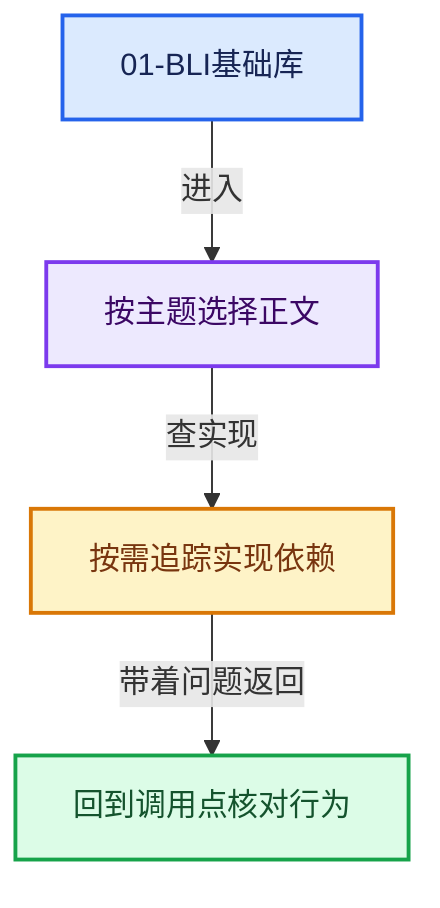
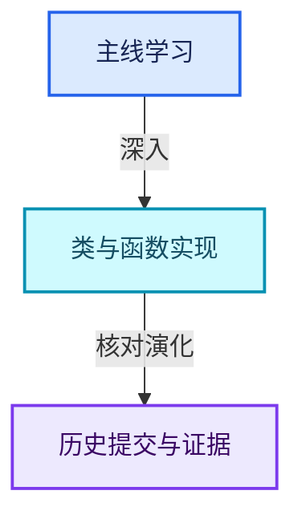

# 01-BLI基础库

[实现依赖总导航](../README.md)

## 模块公共接口

- [BLI_alloca.hh](BLI_alloca.hh.md)
- [BLI_allocator.hh](BLI_allocator.hh.md)
- [BLI_array_state.hh](BLI_array_state.hh.md)
- [BLI_array_utils_c.hh](BLI_array_utils_c.hh.md)
- [BLI_asan.hh](BLI_asan.hh.md)
- [BLI_assert.hh](BLI_assert.hh.md)
- [BLI_binary_search.hh](BLI_binary_search.hh.md)
- [BLI_bit_group_vector.hh](BLI_bit_group_vector.hh.md)
- [BLI_bit_ref.hh](BLI_bit_ref.hh.md)
- [BLI_bit_span_ops.hh](BLI_bit_span_ops.hh.md)
- [BLI_bit_span_to_index_ranges.hh](BLI_bit_span_to_index_ranges.hh.md)
- [BLI_bitmap.hh](BLI_bitmap.hh.md)
- [BLI_bounds_types.hh](BLI_bounds_types.hh.md)
- [BLI_color.hh](BLI_color.hh.md)
- [BLI_compiler_compat.hh](BLI_compiler_compat.hh.md)
- [BLI_compute_context.hh](BLI_compute_context.hh.md)
- [BLI_cpp_type.hh](BLI_cpp_type.hh.md)
- [BLI_disjoint_set.hh](BLI_disjoint_set.hh.md)
- [BLI_dot_export.hh](BLI_dot_export.hh.md)
- [BLI_dot_export_attribute_enums.hh](BLI_dot_export_attribute_enums.hh.md)
- [BLI_dynamic_stack_buffer.hh](BLI_dynamic_stack_buffer.hh.md)
- [BLI_endian_switch_inline.hh](BLI_endian_switch_inline.hh.md)
- [BLI_enumerable_thread_specific.hh](BLI_enumerable_thread_specific.hh.md)
- [BLI_execution_mode.hh](BLI_execution_mode.hh.md)
- [BLI_fileops.hh](BLI_fileops.hh.md)
- [BLI_fileops_types.hh](BLI_fileops_types.hh.md)
- [BLI_generic_vector_array.hh](BLI_generic_vector_array.hh.md)
- [BLI_generic_virtual_array.hh](BLI_generic_virtual_array.hh.md)
- [BLI_generic_virtual_vector_array.hh](BLI_generic_virtual_vector_array.hh.md)
- [BLI_ghash.hh](BLI_ghash.hh.md)
- [BLI_hash.hh](BLI_hash.hh.md)
- [BLI_hash_c.hh](BLI_hash_c.hh.md)
- [BLI_index_mask_expression.hh](BLI_index_mask_expression.hh.md)
- [BLI_index_range.hh](BLI_index_range.hh.md)
- [BLI_index_ranges_builder.hh](BLI_index_ranges_builder.hh.md)
- [BLI_iterator.hh](BLI_iterator.hh.md)
- [BLI_kdtree.hh](BLI_kdtree.hh.md)
- [BLI_kdtree_types.hh](BLI_kdtree_types.hh.md)
- [BLI_length_parameterize.hh](BLI_length_parameterize.hh.md)
- [BLI_link_utils.hh](BLI_link_utils.hh.md)
- [BLI_linklist.hh](BLI_linklist.hh.md)
- [BLI_linklist_stack.hh](BLI_linklist_stack.hh.md)
- [BLI_listbase.hh](BLI_listbase.hh.md)
- [BLI_listbase_wrapper.hh](BLI_listbase_wrapper.hh.md)
- [BLI_map.hh](BLI_map.hh.md)
- [BLI_math_angle_types.hh](BLI_math_angle_types.hh.md)
- [BLI_math_axis_angle.hh](BLI_math_axis_angle.hh.md)
- [BLI_math_axis_angle_types.hh](BLI_math_axis_angle_types.hh.md)
- [BLI_math_base.hh](BLI_math_base.hh.md)
- [BLI_math_base_c.hh](BLI_math_base_c.hh.md)
- [BLI_math_basis_types.hh](BLI_math_basis_types.hh.md)
- [BLI_math_color.hh](BLI_math_color.hh.md)
- [BLI_math_constants.hh](BLI_math_constants.hh.md)
- [BLI_math_euler.hh](BLI_math_euler.hh.md)
- [BLI_math_euler_types.hh](BLI_math_euler_types.hh.md)
- [BLI_math_interp.hh](BLI_math_interp.hh.md)
- [BLI_math_matrix.hh](BLI_math_matrix.hh.md)
- [BLI_math_matrix_c.hh](BLI_math_matrix_c.hh.md)
- [BLI_math_matrix_types.hh](BLI_math_matrix_types.hh.md)
- [BLI_math_quaternion.hh](BLI_math_quaternion.hh.md)
- [BLI_math_quaternion_types.hh](BLI_math_quaternion_types.hh.md)
- [BLI_math_rotation.hh](BLI_math_rotation.hh.md)
- [BLI_math_vector.hh](BLI_math_vector.hh.md)
- [BLI_math_vector_mpq_types.hh](BLI_math_vector_mpq_types.hh.md)
- [BLI_math_vector_swizzle.hh](BLI_math_vector_swizzle.hh.md)
- [BLI_math_vector_types.hh](BLI_math_vector_types.hh.md)
- [BLI_math_vector_unroll.hh](BLI_math_vector_unroll.hh.md)
- [BLI_memarena.hh](BLI_memarena.hh.md)
- [BLI_memory_cache.hh](BLI_memory_cache.hh.md)
- [BLI_memory_utils.hh](BLI_memory_utils.hh.md)
- [BLI_mempool.hh](BLI_mempool.hh.md)
- [BLI_mesh_intersect.hh](BLI_mesh_intersect.hh.md)
- [BLI_offset_indices.hh](BLI_offset_indices.hh.md)
- [BLI_offset_span.hh](BLI_offset_span.hh.md)
- [BLI_ordered_edge.hh](BLI_ordered_edge.hh.md)
- [BLI_parameter_pack_utils.hh](BLI_parameter_pack_utils.hh.md)
- [BLI_path_utils.hh](BLI_path_utils.hh.md)
- [BLI_polyfill_2d_beautify.hh](BLI_polyfill_2d_beautify.hh.md)
- [BLI_probing_strategies.hh](BLI_probing_strategies.hh.md)
- [BLI_rand.hh](BLI_rand.hh.md)
- [BLI_rect.hh](BLI_rect.hh.md)
- [BLI_serialize.hh](BLI_serialize.hh.md)
- [BLI_set.hh](BLI_set.hh.md)
- [BLI_sort.hh](BLI_sort.hh.md)
- [BLI_span.hh](BLI_span.hh.md)
- [BLI_string.hh](BLI_string.hh.md)
- [BLI_string_search.hh](BLI_string_search.hh.md)
- [BLI_string_utf8.hh](BLI_string_utf8.hh.md)
- [BLI_string_utils.hh](BLI_string_utils.hh.md)
- [BLI_task_c.hh](BLI_task_c.hh.md)
- [BLI_task_size_hints.hh](BLI_task_size_hints.hh.md)
- [BLI_time_utildefines.hh](BLI_time_utildefines.hh.md)
- [BLI_timeit.hh](BLI_timeit.hh.md)
- [BLI_unique_hash.hh](BLI_unique_hash.hh.md)
- [BLI_unique_sorted_indices.hh](BLI_unique_sorted_indices.hh.md)
- [BLI_unroll.hh](BLI_unroll.hh.md)
- [BLI_ustring.hh](BLI_ustring.hh.md)
- [BLI_utildefines.hh](BLI_utildefines.hh.md)
- [BLI_utildefines_stack.hh](BLI_utildefines_stack.hh.md)
- [BLI_vector.hh](BLI_vector.hh.md)
- [BLI_vector_set.hh](BLI_vector_set.hh.md)
- [BLI_virtual_array.hh](BLI_virtual_array.hh.md)
- [BLI_winstuff.hh](BLI_winstuff.hh.md)

## intern

- [array_utils.cc](intern/array_utils.cc.md)
- [astar.cc](intern/astar.cc.md)
- [bit_bool_conversion.cc](intern/bit_bool_conversion.cc.md)
- [bit_span.cc](intern/bit_span.cc.md)
- [bitmap.cc](intern/bitmap.cc.md)
- [BLI_dynstr.cc](intern/BLI_dynstr.cc.md)
- [BLI_filelist.cc](intern/BLI_filelist.cc.md)
- [BLI_ghash.cc](intern/BLI_ghash.cc.md)
- [BLI_ghash_utils.cc](intern/BLI_ghash_utils.cc.md)
- [BLI_heap.cc](intern/BLI_heap.cc.md)
- [BLI_heap_simple.cc](intern/BLI_heap_simple.cc.md)
- [BLI_kdopbvh.cc](intern/BLI_kdopbvh.cc.md)
- [BLI_linklist.cc](intern/BLI_linklist.cc.md)
- [BLI_memarena.cc](intern/BLI_memarena.cc.md)
- [BLI_memblock.cc](intern/BLI_memblock.cc.md)
- [BLI_mempool.cc](intern/BLI_mempool.cc.md)
- [BLI_mmap.cc](intern/BLI_mmap.cc.md)
- [BLI_subprocess.cc](intern/BLI_subprocess.cc.md)
- [boxpack_2d.cc](intern/boxpack_2d.cc.md)
- [cache_mutex.cc](intern/cache_mutex.cc.md)
- [compression.cc](intern/compression.cc.md)
- [cpp_types.cc](intern/cpp_types.cc.md)
- [delaunay_2d.cc](intern/delaunay_2d.cc.md)
- [dot_export.cc](intern/dot_export.cc.md)
- [easing.cc](intern/easing.cc.md)
- [endian_switch.cc](intern/endian_switch.cc.md)
- [expr_pylike_eval.cc](intern/expr_pylike_eval.cc.md)
- [fileops.cc](intern/fileops.cc.md)
- [fileops_c.cc](intern/fileops_c.cc.md)
- [filereader_file.cc](intern/filereader_file.cc.md)
- [filereader_gzip.cc](intern/filereader_gzip.cc.md)
- [filereader_memory.cc](intern/filereader_memory.cc.md)
- [filereader_zstd.cc](intern/filereader_zstd.cc.md)
- [fnmatch.cc](intern/fnmatch.cc.md)
- [generic_vector_array.cc](intern/generic_vector_array.cc.md)
- [generic_virtual_vector_array.cc](intern/generic_virtual_vector_array.cc.md)
- [gsqueue.cc](intern/gsqueue.cc.md)
- [hash_md5.cc](intern/hash_md5.cc.md)
- [hash_mm2a.cc](intern/hash_mm2a.cc.md)
- [hash_tables.cc](intern/hash_tables.cc.md)
- [implicit_sharing.cc](intern/implicit_sharing.cc.md)
- [index_mask_expression.cc](intern/index_mask_expression.cc.md)
- [index_range.cc](intern/index_range.cc.md)
- [jitter_2d.cc](intern/jitter_2d.cc.md)
- [lazy_threading.cc](intern/lazy_threading.cc.md)
- [length_parameterize.cc](intern/length_parameterize.cc.md)
- [listbase.cc](intern/listbase.cc.md)
- [math_base_inline.cc](intern/math_base_inline.cc.md)
- [math_base_safe_inline.cc](intern/math_base_safe_inline.cc.md)
- [math_bits_inline.cc](intern/math_bits_inline.cc.md)
- [math_color.cc](intern/math_color.cc.md)
- [math_color_blend_inline.cc](intern/math_color_blend_inline.cc.md)
- [math_color_inline.cc](intern/math_color_inline.cc.md)
- [math_geom.cc](intern/math_geom.cc.md)
- [math_geom_inline.cc](intern/math_geom_inline.cc.md)
- [math_half.cc](intern/math_half.cc.md)
- [math_interp.cc](intern/math_interp.cc.md)
- [math_matrix.cc](intern/math_matrix.cc.md)
- [math_matrix_c.cc](intern/math_matrix_c.cc.md)
- [math_rotation.cc](intern/math_rotation.cc.md)
- [math_rotation_c.cc](intern/math_rotation_c.cc.md)
- [math_solvers.cc](intern/math_solvers.cc.md)
- [math_statistics.cc](intern/math_statistics.cc.md)
- [math_vector.cc](intern/math_vector.cc.md)
- [math_vector_inline.cc](intern/math_vector_inline.cc.md)
- [memory_cache.cc](intern/memory_cache.cc.md)
- [memory_counter.cc](intern/memory_counter.cc.md)
- [mesh_boolean.cc](intern/mesh_boolean.cc.md)
- [mesh_intersect.cc](intern/mesh_intersect.cc.md)
- [noise.cc](intern/noise.cc.md)
- [noise_c.cc](intern/noise_c.cc.md)
- [path_utils.cc](intern/path_utils.cc.md)
- [polyfill_2d.cc](intern/polyfill_2d.cc.md)
- [polyfill_2d_beautify.cc](intern/polyfill_2d_beautify.cc.md)
- [quadric.cc](intern/quadric.cc.md)
- [radial_tiling_shared.hh](intern/radial_tiling_shared.hh.md)
- [rand.cc](intern/rand.cc.md)
- [rct.cc](intern/rct.cc.md)
- [scanfill.cc](intern/scanfill.cc.md)
- [session_uid.cc](intern/session_uid.cc.md)
- [sort.cc](intern/sort.cc.md)
- [stack.cc](intern/stack.cc.md)
- [storage.cc](intern/storage.cc.md)
- [string.cc](intern/string.cc.md)
- [string_cursor_utf8.cc](intern/string_cursor_utf8.cc.md)
- [string_ref.cc](intern/string_ref.cc.md)
- [string_search.cc](intern/string_search.cc.md)
- [string_utf8.cc](intern/string_utf8.cc.md)
- [string_utils.cc](intern/string_utils.cc.md)
- [system.cc](intern/system.cc.md)
- [task_iterator.cc](intern/task_iterator.cc.md)
- [tempfile.cc](intern/tempfile.cc.md)
- [threads.cc](intern/threads.cc.md)
- [time.cc](intern/time.cc.md)
- [vector.cc](intern/vector.cc.md)
- [voxel.cc](intern/voxel.cc.md)
- [winstuff.cc](intern/winstuff.cc.md)
- [winstuff_dir.cc](intern/winstuff_dir.cc.md)

## tests

- [BLI_cpp_type_test.cc](tests/BLI_cpp_type_test.cc.md)
- [BLI_path_utils_test.cc](tests/BLI_path_utils_test.cc.md)

