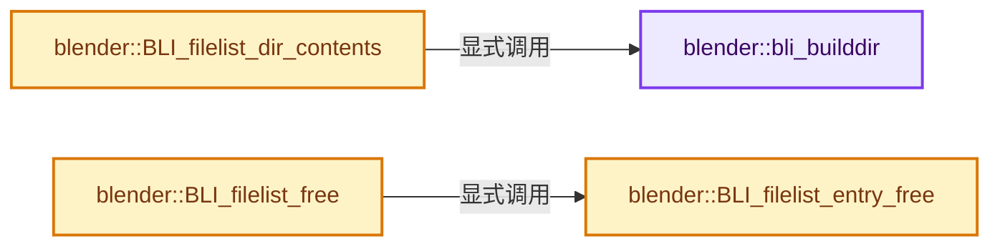

# 实现依赖专题：source/blender/blenlib/intern/BLI_filelist.cc

[实现依赖导航](../../README.md) · [符号索引](../../../00-课程指南/02-源码与提交索引/符号依赖与实现索引.md)

本专题从正文实际调用进入，集中保存共享实现。函数有稳定锚点，可从调用处直接跳到对应完整函数；递归与互相调用通过回链组织。

## 本文件的实现关系




## 完整成员与函数实现

<a id="f-bd8b509ec2af5316"></a>

### `blender::bli_builddir`

实现位置：[source/blender/blenlib/intern/BLI_filelist.cc](../../../../../../../source/blender/blenlib/intern/BLI_filelist.cc) · L111—L228。

接口参数：

- `BuildDirCtx *dir_ctx`
- `const char *dirname`

**教学注释版**

<!-- annotated:4b021170eee6db -->

```cpp
static void bli_builddir(BuildDirCtx *dir_ctx, const char *dirname)
{
  BLI_assert(!BLI_path_is_rel(dirname));
  DIR *dir = opendir(dirname);
  if (dir == nullptr) [[unlikely]] {
    fprintf(stderr,
            "Failed to open dir (%s): %s\n",
            errno ? strerror(errno) : "unknown error",
            dirname);
    return;
  }

  ListBaseT<dirlink> dirbase = {nullptr, nullptr};
  int newnum = 0;
  const dirent *fname;
  bool has_current = false, has_parent = false;

  char dirname_with_slash[FILE_MAXDIR + 1];
  size_t dirname_with_slash_len = BLI_strncpy_rlen(
      dirname_with_slash, dirname, sizeof(dirname_with_slash) - 1);

  if ((dirname_with_slash_len > 0) &&
      (BLI_path_slash_is_native_compat(dirname[dirname_with_slash_len - 1]) == false))
  {
    dirname_with_slash[dirname_with_slash_len++] = SEP;
    dirname_with_slash[dirname_with_slash_len] = '\0';
  }

  while ((fname = readdir(dir)) != nullptr) {
    // [讲解] malloc：取得原始存储，失败可返回空指针；不构造C++对象。必须与匹配释放接口及对象寿命管理结合。
    dirlink *const dlink = static_cast<dirlink *>(malloc(sizeof(dirlink)));
    if (dlink != nullptr) {
      dlink->name = BLI_strdup(fname->d_name);
      if (FILENAME_IS_PARENT(dlink->name)) {
        has_parent = true;
      }
      else if (FILENAME_IS_CURRENT(dlink->name)) {
        has_current = true;
      }
      BLI_addhead(&dirbase, dlink);
      newnum++;
    }
  }

  if (!has_parent) {
    char pardir[FILE_MAXDIR];

    STRNCPY(pardir, dirname);
    if (BLI_path_parent_dir(pardir) && (BLI_access(pardir, R_OK) == 0)) {
      dirlink *const dlink = static_cast<dirlink *>(malloc(sizeof(dirlink)));
      if (dlink != nullptr) {
        dlink->name = BLI_strdup(FILENAME_PARENT);
        BLI_addhead(&dirbase, dlink);
        newnum++;
      }
    }
  }
  if (!has_current) {
    dirlink *const dlink = static_cast<dirlink *>(malloc(sizeof(dirlink)));
    if (dlink != nullptr) {
      dlink->name = BLI_strdup(FILENAME_CURRENT);
      BLI_addhead(&dirbase, dlink);
      newnum++;
    }
  }

  if (newnum) {
    if (dir_ctx->files) {
      void *const tmp = MEM_realloc_uninitialized(
          dir_ctx->files, (dir_ctx->files_num + newnum) * sizeof(direntry));
      if (tmp) {
        dir_ctx->files = static_cast<direntry *>(tmp);
      }
      else { /* Reallocation may fail. */
        MEM_delete(dir_ctx->files);
        dir_ctx->files = nullptr;
      }
    }

    if (dir_ctx->files == nullptr) {
      dir_ctx->files = MEM_new_array_uninitialized<direntry>(size_t(newnum), __func__);
    }

    if (dir_ctx->files == nullptr) [[unlikely]] {
      fprintf(stderr, "Couldn't get memory for dir: %s\n", dirname);
      dir_ctx->files_num = 0;
    }
    else {
      dirlink *dlink = dirbase.first();
      direntry *file = &dir_ctx->files[dir_ctx->files_num];

      while (dlink) {
        // [讲解] memset：填充字节，不调用T构造函数，也不保证任意类型的全零表示是合法或期望值。
        memset(file, 0, sizeof(direntry));
        file->relname = dlink->name;
        file->path = BLI_string_joinN(dirname_with_slash, dlink->name);
        if (BLI_stat(file->path, &file->s) != -1) {
          file->type = file->s.st_mode;
        }
        else if (FILENAME_IS_CURRPAR(file->relname)) {
          /* Unfortunately a hack around UNC paths on WIN32,
           * which does not support `stat` on `\\SERVER\foo\..`. */
          file->type |= S_IFDIR;
        }
        dir_ctx->files_num++;
        file++;
        dlink = dlink->next;
      }

      qsort(dir_ctx->files,
            dir_ctx->files_num,
            sizeof(direntry),
            reinterpret_cast<int (*)(const void *, const void *)>(direntry_cmp));
    }

    BLI_freelist(&dirbase);
  }

  closedir(dir);
}
```

<details>
<summary>核对原始源码：source/blender/blenlib/intern/BLI_filelist.cc · L111—L228</summary>

<!-- original:4b021170eee6db:source/blender/blenlib/intern/BLI_filelist.cc:111:228 -->

```cpp
static void bli_builddir(BuildDirCtx *dir_ctx, const char *dirname)
{
  BLI_assert(!BLI_path_is_rel(dirname));
  DIR *dir = opendir(dirname);
  if (dir == nullptr) [[unlikely]] {
    fprintf(stderr,
            "Failed to open dir (%s): %s\n",
            errno ? strerror(errno) : "unknown error",
            dirname);
    return;
  }

  ListBaseT<dirlink> dirbase = {nullptr, nullptr};
  int newnum = 0;
  const dirent *fname;
  bool has_current = false, has_parent = false;

  char dirname_with_slash[FILE_MAXDIR + 1];
  size_t dirname_with_slash_len = BLI_strncpy_rlen(
      dirname_with_slash, dirname, sizeof(dirname_with_slash) - 1);

  if ((dirname_with_slash_len > 0) &&
      (BLI_path_slash_is_native_compat(dirname[dirname_with_slash_len - 1]) == false))
  {
    dirname_with_slash[dirname_with_slash_len++] = SEP;
    dirname_with_slash[dirname_with_slash_len] = '\0';
  }

  while ((fname = readdir(dir)) != nullptr) {
    dirlink *const dlink = static_cast<dirlink *>(malloc(sizeof(dirlink)));
    if (dlink != nullptr) {
      dlink->name = BLI_strdup(fname->d_name);
      if (FILENAME_IS_PARENT(dlink->name)) {
        has_parent = true;
      }
      else if (FILENAME_IS_CURRENT(dlink->name)) {
        has_current = true;
      }
      BLI_addhead(&dirbase, dlink);
      newnum++;
    }
  }

  if (!has_parent) {
    char pardir[FILE_MAXDIR];

    STRNCPY(pardir, dirname);
    if (BLI_path_parent_dir(pardir) && (BLI_access(pardir, R_OK) == 0)) {
      dirlink *const dlink = static_cast<dirlink *>(malloc(sizeof(dirlink)));
      if (dlink != nullptr) {
        dlink->name = BLI_strdup(FILENAME_PARENT);
        BLI_addhead(&dirbase, dlink);
        newnum++;
      }
    }
  }
  if (!has_current) {
    dirlink *const dlink = static_cast<dirlink *>(malloc(sizeof(dirlink)));
    if (dlink != nullptr) {
      dlink->name = BLI_strdup(FILENAME_CURRENT);
      BLI_addhead(&dirbase, dlink);
      newnum++;
    }
  }

  if (newnum) {
    if (dir_ctx->files) {
      void *const tmp = MEM_realloc_uninitialized(
          dir_ctx->files, (dir_ctx->files_num + newnum) * sizeof(direntry));
      if (tmp) {
        dir_ctx->files = static_cast<direntry *>(tmp);
      }
      else { /* Reallocation may fail. */
        MEM_delete(dir_ctx->files);
        dir_ctx->files = nullptr;
      }
    }

    if (dir_ctx->files == nullptr) {
      dir_ctx->files = MEM_new_array_uninitialized<direntry>(size_t(newnum), __func__);
    }

    if (dir_ctx->files == nullptr) [[unlikely]] {
      fprintf(stderr, "Couldn't get memory for dir: %s\n", dirname);
      dir_ctx->files_num = 0;
    }
    else {
      dirlink *dlink = dirbase.first();
      direntry *file = &dir_ctx->files[dir_ctx->files_num];

      while (dlink) {
        memset(file, 0, sizeof(direntry));
        file->relname = dlink->name;
        file->path = BLI_string_joinN(dirname_with_slash, dlink->name);
        if (BLI_stat(file->path, &file->s) != -1) {
          file->type = file->s.st_mode;
        }
        else if (FILENAME_IS_CURRPAR(file->relname)) {
          /* Unfortunately a hack around UNC paths on WIN32,
           * which does not support `stat` on `\\SERVER\foo\..`. */
          file->type |= S_IFDIR;
        }
        dir_ctx->files_num++;
        file++;
        dlink = dlink->next;
      }

      qsort(dir_ctx->files,
            dir_ctx->files_num,
            sizeof(direntry),
            reinterpret_cast<int (*)(const void *, const void *)>(direntry_cmp));
    }

    BLI_freelist(&dirbase);
  }

  closedir(dir);
}
```

</details>

**沿实际写入检查状态**

- `dirname_with_slash[dirname_with_slash_len] = '\0';`
- `dlink->name = BLI_strdup(fname->d_name);`
- `has_parent = true;`
- `has_current = true;`
- `dlink->name = BLI_strdup(FILENAME_PARENT);`
- `dlink->name = BLI_strdup(FILENAME_CURRENT);`
- `dir_ctx->files = static_cast<direntry *>(tmp);`
- `dir_ctx->files = nullptr;`
- `dir_ctx->files = MEM_new_array_uninitialized<direntry>(size_t(newnum), __func__);`
- `dir_ctx->files_num = 0;`
- `file->relname = dlink->name;`
- `file->path = BLI_string_joinN(dirname_with_slash, dlink->name);`
- `file->type = file->s.st_mode;`
- `file->type |= S_IFDIR;`
- `dlink = dlink->next;`

**继续追踪实现**

- `BLI_assert` → [BLI_assert · L48](../BLI_assert.hh.md#m-57a88495704d)；[BLI_assert · L63](../BLI_assert.hh.md#m-d07050020cb5)。宏定义由构建条件选择。
- `BLI_path_is_rel` → [BLI_path_is_rel · L536](path_utils.cc.md#f-d938443d331ba72c)。
- `opendir` → [opendir · L52](winstuff_dir.cc.md#f-8eddd2c8401dbec3)。
- `fprintf` → [外部契约](https://eel.is/c++draft/)：这个边界按实际表达式及所属类型核对参数、返回值、寿命与失败行为。这里提供接口入口，不声称已解释该第三方版本的内部实现。
- `strerror` → [调用协议](../../../00-课程指南/01-路线与规范/模板宏与动态分派协议.md)：函数指针、局部可调用对象或未展开的宏；必须结合调用者环境。调用位置L118。
- `BLI_strncpy_rlen` → [blender::BLI_strncpy_rlen · L121](string.cc.md#f-41d02d7e241b0968)。
- `BLI_path_slash_is_native_compat` → [blender::BLI_path_slash_is_native_compat · L765](../BLI_path_utils.hh.md#f-e95b7b29f428577d)。
- `readdir` → [readdir · L100](winstuff_dir.cc.md#f-f0893c7b3bd7aa91)。
- `malloc` → [外部契约](https://eel.is/c++draft/c.malloc)：取得原始存储，失败可返回空指针；不构造C++对象。必须与匹配释放接口及对象寿命管理结合。
- `BLI_strdup` → [blender::BLI_strdup · L43](string.cc.md#f-7e6d5c696c20c0e1)。
- `FILENAME_IS_PARENT` → [FILENAME_IS_PARENT · L821](../BLI_path_utils.hh.md#m-a1fce9c370c2)。宏定义由构建条件选择。
- `FILENAME_IS_CURRENT` → [FILENAME_IS_CURRENT · L822](../BLI_path_utils.hh.md#m-fae6802bc056)。宏定义由构建条件选择。
- `BLI_addhead` → [blender::BLI_addhead · L98](listbase.cc.md#f-fed3ad483fcdfeb9)。
- `STRNCPY` → [blender::STRNCPY · L690](../BLI_string.hh.md#f-6b2d861724026be6)。
- `BLI_path_parent_dir` → [BLI_path_parent_dir · L903](path_utils.cc.md#f-111df144f335a226)。
- `BLI_access` → [blender::BLI_access · L622](fileops_c.cc.md#f-00750a60825fff2c)；[blender::BLI_access · L1206](fileops_c.cc.md#f-23224ec3502629a0)。同名重载需按实参类型选择。
- `MEM_realloc_uninitialized` → [MEM_realloc_uninitialized · L118](../../07-Intern运行时与平台/guardedalloc/MEM_guardedalloc.h.md#m-813b7cd3fcff)。宏定义由构建条件选择。
- `MEM_delete` → [MEM_delete · L400](../../07-Intern运行时与平台/guardedalloc/MEM_guardedalloc.h.md#f-9049ffdd1682887c)。
- `MEM_new_array_uninitialized<direntry>` → [MEM_new_array_uninitialized · L608](../../07-Intern运行时与平台/guardedalloc/MEM_guardedalloc.h.md#f-b7103eae8eb57b05)；[MEM_new_array_uninitialized · L129](../../07-Intern运行时与平台/guardedalloc/intern/mallocn.cc.md#f-bf6ef4ddcfb6e5df)。同名重载需按实参类型选择。
- `dirbase.first` → [blender::ListBaseT::first · L102](../../08-其他Blender模块/makesdna/DNA_listBase.h.md#f-3d12ff35da057c9e)；[blender::ListBaseT::first · L106](../../08-其他Blender模块/makesdna/DNA_listBase.h.md#f-0df87c3480e059f9)。同名重载需按实参类型选择。
- `memset` → [外部契约](https://eel.is/c++draft/cstring.syn)：填充字节，不调用T构造函数，也不保证任意类型的全零表示是合法或期望值。
- `BLI_string_joinN` → [BLI_string_joinN · L317](../BLI_string_utils.hh.md#m-b49344536fd3)。宏定义由构建条件选择。
- `BLI_stat` → [blender::BLI_stat · L426](storage.cc.md#f-5b88a35ccd1bc680)；[blender::BLI_stat · L451](storage.cc.md#f-50297595484d5bcc)。同名重载需按实参类型选择。
- `FILENAME_IS_CURRPAR` → [FILENAME_IS_CURRPAR · L823](../BLI_path_utils.hh.md#m-f41bcdb4516d)。宏定义由构建条件选择。
- `qsort` → [调用协议](../../../00-课程指南/01-路线与规范/模板宏与动态分派协议.md)：函数指针、局部可调用对象或未展开的宏；必须结合调用者环境。调用位置L218。
- `BLI_freelist` → [blender::BLI_freelist · L490](listbase.cc.md#f-0c7d7fe45f4066b2)。
- `closedir` → [closedir · L129](winstuff_dir.cc.md#f-79e13f88b984b0fb)。

<a id="f-4e2c9b3e1fe3857e"></a>

### `blender::BLI_filelist_dir_contents`

实现位置：[source/blender/blenlib/intern/BLI_filelist.cc](../../../../../../../source/blender/blenlib/intern/BLI_filelist.cc) · L230—L249。

接口参数：

- `const char *dirname`
- `direntry **r_filelist`

**教学注释版**

<!-- annotated:19e37af9dcce39 -->

```cpp
uint BLI_filelist_dir_contents(const char *dirname, direntry **r_filelist)
{
  BuildDirCtx dir_ctx;

  dir_ctx.files_num = 0;
  dir_ctx.files = nullptr;

  bli_builddir(&dir_ctx, dirname);

  if (dir_ctx.files) {
    *r_filelist = dir_ctx.files;
  }
  else {
    /* Keep Blender happy. Blender stores this in a variable
     * where 0 has special meaning..... */
    *r_filelist = MEM_new_uninitialized<direntry>(__func__);
  }

  return dir_ctx.files_num;
}
```

<details>
<summary>核对原始源码：source/blender/blenlib/intern/BLI_filelist.cc · L230—L249</summary>

<!-- original:19e37af9dcce39:source/blender/blenlib/intern/BLI_filelist.cc:230:249 -->

```cpp
uint BLI_filelist_dir_contents(const char *dirname, direntry **r_filelist)
{
  BuildDirCtx dir_ctx;

  dir_ctx.files_num = 0;
  dir_ctx.files = nullptr;

  bli_builddir(&dir_ctx, dirname);

  if (dir_ctx.files) {
    *r_filelist = dir_ctx.files;
  }
  else {
    /* Keep Blender happy. Blender stores this in a variable
     * where 0 has special meaning..... */
    *r_filelist = MEM_new_uninitialized<direntry>(__func__);
  }

  return dir_ctx.files_num;
}
```

</details>

**沿实际写入检查状态**

- `dir_ctx.files_num = 0;`
- `dir_ctx.files = nullptr;`

**结果出口**

- `return dir_ctx.files_num;`

**继续追踪实现**

- `bli_builddir` → [blender::bli_builddir · L111](BLI_filelist.cc.md#f-bd8b509ec2af5316)。
- `MEM_new_uninitialized<direntry>` → [MEM_new_uninitialized · L590](../../07-Intern运行时与平台/guardedalloc/MEM_guardedalloc.h.md#f-c773b2e5b8fe70e4)；[MEM_new_uninitialized · L124](../../07-Intern运行时与平台/guardedalloc/intern/mallocn.cc.md#f-28a7e00a1e67f699)。同名重载需按实参类型选择。

<a id="f-3eb46541cb10be46"></a>

### `blender::BLI_filelist_entry_free`

实现位置：[source/blender/blenlib/intern/BLI_filelist.cc](../../../../../../../source/blender/blenlib/intern/BLI_filelist.cc) · L371—L379。

接口参数：

- `direntry *entry`

**教学注释版**

<!-- annotated:38f6ece16f8e93 -->

```cpp
void BLI_filelist_entry_free(direntry *entry)
{
  if (entry->relname) {
    MEM_delete(entry->relname);
  }
  if (entry->path) {
    MEM_delete(entry->path);
  }
}
```

<details>
<summary>核对原始源码：source/blender/blenlib/intern/BLI_filelist.cc · L371—L379</summary>

<!-- original:38f6ece16f8e93:source/blender/blenlib/intern/BLI_filelist.cc:371:379 -->

```cpp
void BLI_filelist_entry_free(direntry *entry)
{
  if (entry->relname) {
    MEM_delete(entry->relname);
  }
  if (entry->path) {
    MEM_delete(entry->path);
  }
}
```

</details>

**继续追踪实现**

- `MEM_delete` → [MEM_delete · L400](../../07-Intern运行时与平台/guardedalloc/MEM_guardedalloc.h.md#f-9049ffdd1682887c)。

<a id="f-f6982952b7b56e40"></a>

### `blender::BLI_filelist_free`

实现位置：[source/blender/blenlib/intern/BLI_filelist.cc](../../../../../../../source/blender/blenlib/intern/BLI_filelist.cc) · L381—L391。

接口参数：

- `direntry *filelist`
- `const uint nrentries`

**教学注释版**

<!-- annotated:5223c39438e046 -->

```cpp
void BLI_filelist_free(direntry *filelist, const uint nrentries)
{
  uint i;
  for (i = 0; i < nrentries; i++) {
    BLI_filelist_entry_free(&filelist[i]);
  }

  if (filelist != nullptr) {
    MEM_delete(filelist);
  }
}
```

<details>
<summary>核对原始源码：source/blender/blenlib/intern/BLI_filelist.cc · L381—L391</summary>

<!-- original:5223c39438e046:source/blender/blenlib/intern/BLI_filelist.cc:381:391 -->

```cpp
void BLI_filelist_free(direntry *filelist, const uint nrentries)
{
  uint i;
  for (i = 0; i < nrentries; i++) {
    BLI_filelist_entry_free(&filelist[i]);
  }

  if (filelist != nullptr) {
    MEM_delete(filelist);
  }
}
```

</details>

**继续追踪实现**

- `BLI_filelist_entry_free` → [blender::BLI_filelist_entry_free · L371](BLI_filelist.cc.md#f-3eb46541cb10be46)。
- `MEM_delete` → [MEM_delete · L400](../../07-Intern运行时与平台/guardedalloc/MEM_guardedalloc.h.md#f-9049ffdd1682887c)。
