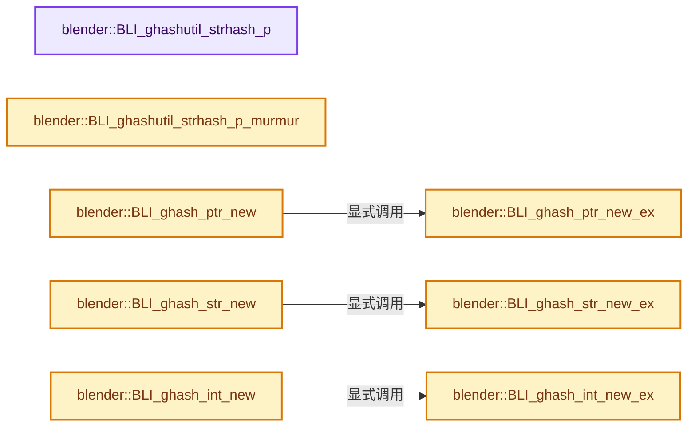

# 实现依赖专题：source/blender/blenlib/intern/BLI_ghash_utils.cc

[实现依赖导航](../../README.md) · [符号索引](../../../00-课程指南/02-源码与提交索引/符号依赖与实现索引.md)

本专题从正文实际调用进入，集中保存共享实现。函数有稳定锚点，可从调用处直接跳到对应完整函数；递归与互相调用通过回链组织。

## 本文件的实现关系




## 完整成员与函数实现

<a id="f-bcb422397f6d9735"></a>

### `blender::BLI_ghashutil_strhash_p`

实现位置：[source/blender/blenlib/intern/BLI_ghash_utils.cc](../../../../../../../source/blender/blenlib/intern/BLI_ghash_utils.cc) · L135—L145。

接口参数：

- `const void *ptr`

**教学注释版**

<!-- annotated:a646f0824e5ca0 -->

```cpp
uint BLI_ghashutil_strhash_p(const void *ptr)
{
  const signed char *p;
  uint h = 5381;

  for (p = static_cast<const signed char *>(ptr); *p != '\0'; p++) {
    h = ((h << 5) + h) + uint(*p);
  }

  return h;
}
```

<details>
<summary>核对原始源码：source/blender/blenlib/intern/BLI_ghash_utils.cc · L135—L145</summary>

<!-- original:a646f0824e5ca0:source/blender/blenlib/intern/BLI_ghash_utils.cc:135:145 -->

```cpp
uint BLI_ghashutil_strhash_p(const void *ptr)
{
  const signed char *p;
  uint h = 5381;

  for (p = static_cast<const signed char *>(ptr); *p != '\0'; p++) {
    h = ((h << 5) + h) + uint(*p);
  }

  return h;
}
```

</details>

**沿实际写入检查状态**

- `h = ((h << 5) + h) + uint(*p);`

**结果出口**

- `return h;`

**继续追踪实现**

本实现没有需要继续展开的显式调用；检查返回表达式、对象转换和调用者前置条件。

<a id="f-4e8630ae4ba9ea6c"></a>

### `blender::BLI_ghashutil_strhash_p_murmur`

实现位置：[source/blender/blenlib/intern/BLI_ghash_utils.cc](../../../../../../../source/blender/blenlib/intern/BLI_ghash_utils.cc) · L146—L151。

接口参数：

- `const void *ptr`

**教学注释版**

<!-- annotated:b65cf1fc4b8cb6 -->

```cpp
uint BLI_ghashutil_strhash_p_murmur(const void *ptr)
{
  const uchar *key = static_cast<const uchar *>(ptr);

  return BLI_hash_mm2(key, strlen(reinterpret_cast<const char *>(key)) + 1, 0);
}
```

<details>
<summary>核对原始源码：source/blender/blenlib/intern/BLI_ghash_utils.cc · L146—L151</summary>

<!-- original:b65cf1fc4b8cb6:source/blender/blenlib/intern/BLI_ghash_utils.cc:146:151 -->

```cpp
uint BLI_ghashutil_strhash_p_murmur(const void *ptr)
{
  const uchar *key = static_cast<const uchar *>(ptr);

  return BLI_hash_mm2(key, strlen(reinterpret_cast<const char *>(key)) + 1, 0);
}
```

</details>

**结果出口**

- `return BLI_hash_mm2(key, strlen(reinterpret_cast<const char *>(key)) + 1, 0);`

**继续追踪实现**

- `BLI_hash_mm2` → [blender::BLI_hash_mm2 · L102](hash_mm2a.cc.md#f-5be8e1cec230b6b9)。
- `strlen` → [外部契约](https://eel.is/c++draft/)：这个边界按实际表达式及所属类型核对参数、返回值、寿命与失败行为。这里提供接口入口，不声称已解释该第三方版本的内部实现。

<a id="f-f4d7c2cd7ac4ba01"></a>

### `blender::BLI_ghash_ptr_new_ex`

实现位置：[source/blender/blenlib/intern/BLI_ghash_utils.cc](../../../../../../../source/blender/blenlib/intern/BLI_ghash_utils.cc) · L191—L194。

接口参数：

- `const char *info`
- `const uint nentries_reserve`

**教学注释版**

<!-- annotated:b6ad24409369e7 -->

```cpp
GHash *BLI_ghash_ptr_new_ex(const char *info, const uint nentries_reserve)
{
  return BLI_ghash_new_ex(BLI_ghashutil_ptrhash, BLI_ghashutil_ptrcmp, info, nentries_reserve);
}
```

<details>
<summary>核对原始源码：source/blender/blenlib/intern/BLI_ghash_utils.cc · L191—L194</summary>

<!-- original:b6ad24409369e7:source/blender/blenlib/intern/BLI_ghash_utils.cc:191:194 -->

```cpp
GHash *BLI_ghash_ptr_new_ex(const char *info, const uint nentries_reserve)
{
  return BLI_ghash_new_ex(BLI_ghashutil_ptrhash, BLI_ghashutil_ptrcmp, info, nentries_reserve);
}
```

</details>

**结果出口**

- `return BLI_ghash_new_ex(BLI_ghashutil_ptrhash, BLI_ghashutil_ptrcmp, info, nentries_reserve);`

**继续追踪实现**

- `BLI_ghash_new_ex` → [blender::BLI_ghash_new_ex · L682](BLI_ghash.cc.md#f-3278e4b2e73103f7)。

<a id="f-3f62c3ad44129174"></a>

### `blender::BLI_ghash_ptr_new`

实现位置：[source/blender/blenlib/intern/BLI_ghash_utils.cc](../../../../../../../source/blender/blenlib/intern/BLI_ghash_utils.cc) · L195—L198。

接口参数：

- `const char *info`

**教学注释版**

<!-- annotated:38567c82b8b810 -->

```cpp
GHash *BLI_ghash_ptr_new(const char *info)
{
  return BLI_ghash_ptr_new_ex(info, 0);
}
```

<details>
<summary>核对原始源码：source/blender/blenlib/intern/BLI_ghash_utils.cc · L195—L198</summary>

<!-- original:38567c82b8b810:source/blender/blenlib/intern/BLI_ghash_utils.cc:195:198 -->

```cpp
GHash *BLI_ghash_ptr_new(const char *info)
{
  return BLI_ghash_ptr_new_ex(info, 0);
}
```

</details>

**结果出口**

- `return BLI_ghash_ptr_new_ex(info, 0);`

**继续追踪实现**

- `BLI_ghash_ptr_new_ex` → [blender::BLI_ghash_ptr_new_ex · L191](BLI_ghash_utils.cc.md#f-f4d7c2cd7ac4ba01)。

<a id="f-a86774f09da01c8f"></a>

### `blender::BLI_ghash_str_new_ex`

实现位置：[source/blender/blenlib/intern/BLI_ghash_utils.cc](../../../../../../../source/blender/blenlib/intern/BLI_ghash_utils.cc) · L200—L203。

接口参数：

- `const char *info`
- `const uint nentries_reserve`

**教学注释版**

<!-- annotated:2a0ad93cfddd0a -->

```cpp
GHash *BLI_ghash_str_new_ex(const char *info, const uint nentries_reserve)
{
  return BLI_ghash_new_ex(BLI_ghashutil_strhash_p, BLI_ghashutil_strcmp, info, nentries_reserve);
}
```

<details>
<summary>核对原始源码：source/blender/blenlib/intern/BLI_ghash_utils.cc · L200—L203</summary>

<!-- original:2a0ad93cfddd0a:source/blender/blenlib/intern/BLI_ghash_utils.cc:200:203 -->

```cpp
GHash *BLI_ghash_str_new_ex(const char *info, const uint nentries_reserve)
{
  return BLI_ghash_new_ex(BLI_ghashutil_strhash_p, BLI_ghashutil_strcmp, info, nentries_reserve);
}
```

</details>

**结果出口**

- `return BLI_ghash_new_ex(BLI_ghashutil_strhash_p, BLI_ghashutil_strcmp, info, nentries_reserve);`

**继续追踪实现**

- `BLI_ghash_new_ex` → [blender::BLI_ghash_new_ex · L682](BLI_ghash.cc.md#f-3278e4b2e73103f7)。

<a id="f-309ea1b9a9bbafdf"></a>

### `blender::BLI_ghash_str_new`

实现位置：[source/blender/blenlib/intern/BLI_ghash_utils.cc](../../../../../../../source/blender/blenlib/intern/BLI_ghash_utils.cc) · L204—L207。

接口参数：

- `const char *info`

**教学注释版**

<!-- annotated:27c26e85f768bd -->

```cpp
GHash *BLI_ghash_str_new(const char *info)
{
  return BLI_ghash_str_new_ex(info, 0);
}
```

<details>
<summary>核对原始源码：source/blender/blenlib/intern/BLI_ghash_utils.cc · L204—L207</summary>

<!-- original:27c26e85f768bd:source/blender/blenlib/intern/BLI_ghash_utils.cc:204:207 -->

```cpp
GHash *BLI_ghash_str_new(const char *info)
{
  return BLI_ghash_str_new_ex(info, 0);
}
```

</details>

**结果出口**

- `return BLI_ghash_str_new_ex(info, 0);`

**继续追踪实现**

- `BLI_ghash_str_new_ex` → [blender::BLI_ghash_str_new_ex · L200](BLI_ghash_utils.cc.md#f-a86774f09da01c8f)。

<a id="f-86b01b10a85a57de"></a>

### `blender::BLI_ghash_int_new_ex`

实现位置：[source/blender/blenlib/intern/BLI_ghash_utils.cc](../../../../../../../source/blender/blenlib/intern/BLI_ghash_utils.cc) · L209—L212。

接口参数：

- `const char *info`
- `const uint nentries_reserve`

**教学注释版**

<!-- annotated:6314be152d4276 -->

```cpp
GHash *BLI_ghash_int_new_ex(const char *info, const uint nentries_reserve)
{
  return BLI_ghash_new_ex(BLI_ghashutil_inthash_p, BLI_ghashutil_intcmp, info, nentries_reserve);
}
```

<details>
<summary>核对原始源码：source/blender/blenlib/intern/BLI_ghash_utils.cc · L209—L212</summary>

<!-- original:6314be152d4276:source/blender/blenlib/intern/BLI_ghash_utils.cc:209:212 -->

```cpp
GHash *BLI_ghash_int_new_ex(const char *info, const uint nentries_reserve)
{
  return BLI_ghash_new_ex(BLI_ghashutil_inthash_p, BLI_ghashutil_intcmp, info, nentries_reserve);
}
```

</details>

**结果出口**

- `return BLI_ghash_new_ex(BLI_ghashutil_inthash_p, BLI_ghashutil_intcmp, info, nentries_reserve);`

**继续追踪实现**

- `BLI_ghash_new_ex` → [blender::BLI_ghash_new_ex · L682](BLI_ghash.cc.md#f-3278e4b2e73103f7)。

<a id="f-0119cac76df32819"></a>

### `blender::BLI_ghash_int_new`

实现位置：[source/blender/blenlib/intern/BLI_ghash_utils.cc](../../../../../../../source/blender/blenlib/intern/BLI_ghash_utils.cc) · L213—L216。

接口参数：

- `const char *info`

**教学注释版**

<!-- annotated:f2cbf028f61b1f -->

```cpp
GHash *BLI_ghash_int_new(const char *info)
{
  return BLI_ghash_int_new_ex(info, 0);
}
```

<details>
<summary>核对原始源码：source/blender/blenlib/intern/BLI_ghash_utils.cc · L213—L216</summary>

<!-- original:f2cbf028f61b1f:source/blender/blenlib/intern/BLI_ghash_utils.cc:213:216 -->

```cpp
GHash *BLI_ghash_int_new(const char *info)
{
  return BLI_ghash_int_new_ex(info, 0);
}
```

</details>

**结果出口**

- `return BLI_ghash_int_new_ex(info, 0);`

**继续追踪实现**

- `BLI_ghash_int_new_ex` → [blender::BLI_ghash_int_new_ex · L209](BLI_ghash_utils.cc.md#f-86b01b10a85a57de)。
