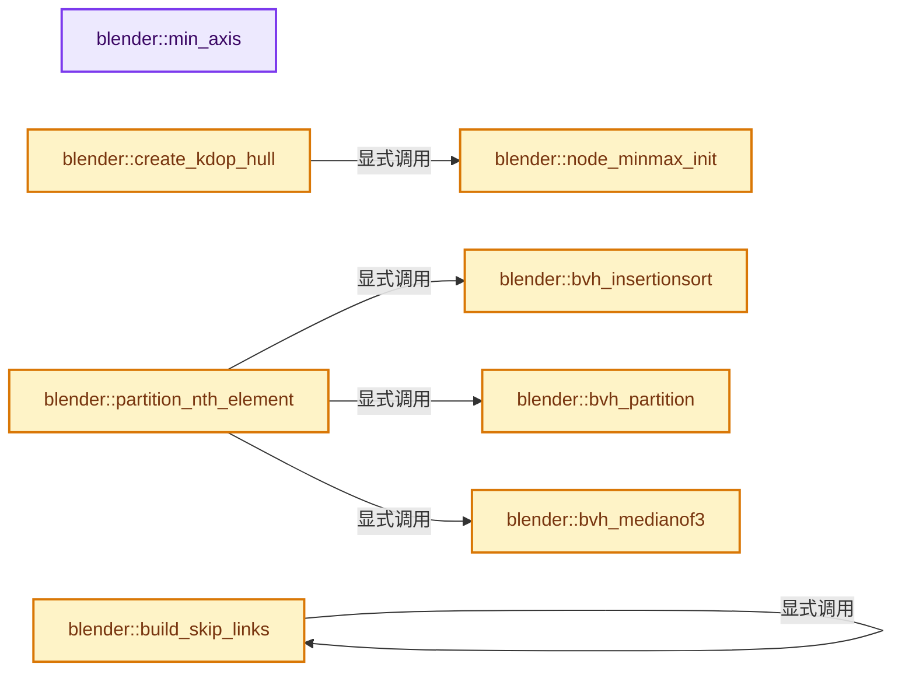
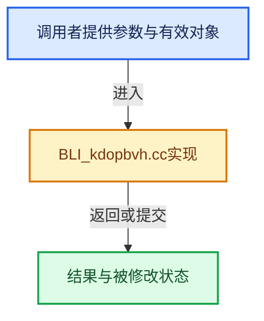

# 实现依赖专题：source/blender/blenlib/intern/BLI_kdopbvh.cc

[实现依赖导航](../../README.md) · [符号索引](../../../00-课程指南/02-源码与提交索引/符号依赖与实现索引.md)

本专题从正文实际调用进入，集中保存共享实现。函数有稳定锚点，可从调用处直接跳到对应完整函数；递归与互相调用通过回链组织。

## 本文件的实现关系






## 完整成员与函数实现

<a id="f-b852251fa4fc245a"></a>

### `blender::min_axis`

实现位置：[source/blender/blenlib/intern/BLI_kdopbvh.cc](../../../../../../../source/blender/blenlib/intern/BLI_kdopbvh.cc) · L211—L214。

接口参数：

- `axis_t a`
- `axis_t b`

**教学注释版**

<!-- annotated:a41185d38afc1d -->

```cpp
MINLINE axis_t min_axis(axis_t a, axis_t b)
{
  return (a < b) ? a : b;
}
```

<details>
<summary>核对原始源码：source/blender/blenlib/intern/BLI_kdopbvh.cc · L211—L214</summary>

<!-- original:a41185d38afc1d:source/blender/blenlib/intern/BLI_kdopbvh.cc:211:214 -->

```cpp
MINLINE axis_t min_axis(axis_t a, axis_t b)
{
  return (a < b) ? a : b;
}
```

</details>

**结果出口**

- `return (a < b) ? a : b;`

**继续追踪实现**

本实现没有需要继续展开的显式调用；检查返回表达式、对象转换和调用者前置条件。

<a id="f-e76ad3edfef2162f"></a>

### `blender::node_minmax_init`

实现位置：[source/blender/blenlib/intern/BLI_kdopbvh.cc](../../../../../../../source/blender/blenlib/intern/BLI_kdopbvh.cc) · L229—L238。

接口参数：

- `const BVHTree *tree`
- `BVHNode *node`

**教学注释版**

<!-- annotated:068d2215c5a035 -->

```cpp
static void node_minmax_init(const BVHTree *tree, BVHNode *node)
{
  axis_t axis_iter;
  float (*bv)[2] = reinterpret_cast<float (*)[2]>(node->bv);

  for (axis_iter = tree->start_axis; axis_iter != tree->stop_axis; axis_iter++) {
    bv[axis_iter][0] = FLT_MAX;
    bv[axis_iter][1] = -FLT_MAX;
  }
}
```

<details>
<summary>核对原始源码：source/blender/blenlib/intern/BLI_kdopbvh.cc · L229—L238</summary>

<!-- original:068d2215c5a035:source/blender/blenlib/intern/BLI_kdopbvh.cc:229:238 -->

```cpp
static void node_minmax_init(const BVHTree *tree, BVHNode *node)
{
  axis_t axis_iter;
  float (*bv)[2] = reinterpret_cast<float (*)[2]>(node->bv);

  for (axis_iter = tree->start_axis; axis_iter != tree->stop_axis; axis_iter++) {
    bv[axis_iter][0] = FLT_MAX;
    bv[axis_iter][1] = -FLT_MAX;
  }
}
```

</details>

**沿实际写入检查状态**

- `bv[axis_iter][0] = FLT_MAX;`
- `bv[axis_iter][1] = -FLT_MAX;`

**继续追踪实现**

本实现没有需要继续展开的显式调用；检查返回表达式、对象转换和调用者前置条件。

<a id="f-e6767c07ddb6beb1"></a>

### `blender::bvh_insertionsort`

实现位置：[source/blender/blenlib/intern/BLI_kdopbvh.cc](../../../../../../../source/blender/blenlib/intern/BLI_kdopbvh.cc) · L249—L262。

接口参数：

- `BVHNode **a`
- `int lo`
- `int hi`
- `int axis`

**教学注释版**

<!-- annotated:706e933a3dcded -->

```cpp
static void bvh_insertionsort(BVHNode **a, int lo, int hi, int axis)
{
  int i, j;
  BVHNode *t;
  for (i = lo; i < hi; i++) {
    j = i;
    t = a[i];
    while ((j != lo) && (t->bv[axis] < (a[j - 1])->bv[axis])) {
      a[j] = a[j - 1];
      j--;
    }
    a[j] = t;
  }
}
```

<details>
<summary>核对原始源码：source/blender/blenlib/intern/BLI_kdopbvh.cc · L249—L262</summary>

<!-- original:706e933a3dcded:source/blender/blenlib/intern/BLI_kdopbvh.cc:249:262 -->

```cpp
static void bvh_insertionsort(BVHNode **a, int lo, int hi, int axis)
{
  int i, j;
  BVHNode *t;
  for (i = lo; i < hi; i++) {
    j = i;
    t = a[i];
    while ((j != lo) && (t->bv[axis] < (a[j - 1])->bv[axis])) {
      a[j] = a[j - 1];
      j--;
    }
    a[j] = t;
  }
}
```

</details>

**沿实际写入检查状态**

- `j = i;`
- `t = a[i];`
- `a[j] = a[j - 1];`
- `a[j] = t;`

**继续追踪实现**

本实现没有需要继续展开的显式调用；检查返回表达式、对象转换和调用者前置条件。

<a id="f-f6a0997803210710"></a>

### `blender::bvh_partition`

实现位置：[source/blender/blenlib/intern/BLI_kdopbvh.cc](../../../../../../../source/blender/blenlib/intern/BLI_kdopbvh.cc) · L264—L281。

接口参数：

- `BVHNode **a`
- `int lo`
- `int hi`
- `const BVHNode *x`
- `int axis`

**教学注释版**

<!-- annotated:e407e5cc3e6db6 -->

```cpp
static int bvh_partition(BVHNode **a, int lo, int hi, const BVHNode *x, int axis)
{
  int i = lo, j = hi;
  while (true) {
    while (a[i]->bv[axis] < x->bv[axis]) {
      i++;
    }
    j--;
    while (x->bv[axis] < a[j]->bv[axis]) {
      j--;
    }
    if (!(i < j)) {
      return i;
    }
    SWAP(BVHNode *, a[i], a[j]);
    i++;
  }
}
```

<details>
<summary>核对原始源码：source/blender/blenlib/intern/BLI_kdopbvh.cc · L264—L281</summary>

<!-- original:e407e5cc3e6db6:source/blender/blenlib/intern/BLI_kdopbvh.cc:264:281 -->

```cpp
static int bvh_partition(BVHNode **a, int lo, int hi, const BVHNode *x, int axis)
{
  int i = lo, j = hi;
  while (true) {
    while (a[i]->bv[axis] < x->bv[axis]) {
      i++;
    }
    j--;
    while (x->bv[axis] < a[j]->bv[axis]) {
      j--;
    }
    if (!(i < j)) {
      return i;
    }
    SWAP(BVHNode *, a[i], a[j]);
    i++;
  }
}
```

</details>

**结果出口**

- `return i;`

**继续追踪实现**

本实现没有需要继续展开的显式调用；检查返回表达式、对象转换和调用者前置条件。

<a id="f-209c87792193b8ce"></a>

### `blender::bvh_medianof3`

实现位置：[source/blender/blenlib/intern/BLI_kdopbvh.cc](../../../../../../../source/blender/blenlib/intern/BLI_kdopbvh.cc) · L284—L303。

接口参数：

- `BVHNode **a`
- `int lo`
- `int mid`
- `int hi`
- `int axis`

**教学注释版**

<!-- annotated:37a4a7ea116d28 -->

```cpp
static BVHNode *bvh_medianof3(BVHNode **a, int lo, int mid, int hi, int axis)
{
  if ((a[mid])->bv[axis] < (a[lo])->bv[axis]) {
    if ((a[hi])->bv[axis] < (a[mid])->bv[axis]) {
      return a[mid];
    }
    if ((a[hi])->bv[axis] < (a[lo])->bv[axis]) {
      return a[hi];
    }
    return a[lo];
  }

  if ((a[hi])->bv[axis] < (a[mid])->bv[axis]) {
    if ((a[hi])->bv[axis] < (a[lo])->bv[axis]) {
      return a[lo];
    }
    return a[hi];
  }
  return a[mid];
}
```

<details>
<summary>核对原始源码：source/blender/blenlib/intern/BLI_kdopbvh.cc · L284—L303</summary>

<!-- original:37a4a7ea116d28:source/blender/blenlib/intern/BLI_kdopbvh.cc:284:303 -->

```cpp
static BVHNode *bvh_medianof3(BVHNode **a, int lo, int mid, int hi, int axis)
{
  if ((a[mid])->bv[axis] < (a[lo])->bv[axis]) {
    if ((a[hi])->bv[axis] < (a[mid])->bv[axis]) {
      return a[mid];
    }
    if ((a[hi])->bv[axis] < (a[lo])->bv[axis]) {
      return a[hi];
    }
    return a[lo];
  }

  if ((a[hi])->bv[axis] < (a[mid])->bv[axis]) {
    if ((a[hi])->bv[axis] < (a[lo])->bv[axis]) {
      return a[lo];
    }
    return a[hi];
  }
  return a[mid];
}
```

</details>

**结果出口**

- `return a[mid];`
- `return a[hi];`
- `return a[lo];`

**继续追踪实现**

本实现没有需要继续展开的显式调用；检查返回表达式、对象转换和调用者前置条件。

<a id="f-0b26f2922cc09658"></a>

### `blender::partition_nth_element`

实现位置：[source/blender/blenlib/intern/BLI_kdopbvh.cc](../../../../../../../source/blender/blenlib/intern/BLI_kdopbvh.cc) · L310—L323。

接口参数：

- `BVHNode **a`
- `int begin`
- `int end`
- `const int n`
- `const int axis`

**教学注释版**

<!-- annotated:fa72f19f5cec1e -->

```cpp
static void partition_nth_element(BVHNode **a, int begin, int end, const int n, const int axis)
{
  while (end - begin > 3) {
    const int cut = bvh_partition(
        a, begin, end, bvh_medianof3(a, begin, (begin + end) / 2, end - 1, axis), axis);
    if (cut <= n) {
      begin = cut;
    }
    else {
      end = cut;
    }
  }
  bvh_insertionsort(a, begin, end, axis);
}
```

<details>
<summary>核对原始源码：source/blender/blenlib/intern/BLI_kdopbvh.cc · L310—L323</summary>

<!-- original:fa72f19f5cec1e:source/blender/blenlib/intern/BLI_kdopbvh.cc:310:323 -->

```cpp
static void partition_nth_element(BVHNode **a, int begin, int end, const int n, const int axis)
{
  while (end - begin > 3) {
    const int cut = bvh_partition(
        a, begin, end, bvh_medianof3(a, begin, (begin + end) / 2, end - 1, axis), axis);
    if (cut <= n) {
      begin = cut;
    }
    else {
      end = cut;
    }
  }
  bvh_insertionsort(a, begin, end, axis);
}
```

</details>

**沿实际写入检查状态**

- `begin = cut;`
- `end = cut;`

**继续追踪实现**

- `bvh_partition` → [blender::bvh_partition · L264](BLI_kdopbvh.cc.md#f-f6a0997803210710)。
- `bvh_medianof3` → [blender::bvh_medianof3 · L284](BLI_kdopbvh.cc.md#f-209c87792193b8ce)。
- `bvh_insertionsort` → [blender::bvh_insertionsort · L249](BLI_kdopbvh.cc.md#f-e6767c07ddb6beb1)。

<a id="f-1852f88793e5e247"></a>

### `blender::build_skip_links`

实现位置：[source/blender/blenlib/intern/BLI_kdopbvh.cc](../../../../../../../source/blender/blenlib/intern/BLI_kdopbvh.cc) · L326—L343。

接口参数：

- `BVHTree *tree`
- `BVHNode *node`
- `BVHNode *left`
- `BVHNode *right`

**教学注释版**

<!-- annotated:37da6846b61d24 -->

```cpp
static void build_skip_links(BVHTree *tree, BVHNode *node, BVHNode *left, BVHNode *right)
{
  int i;

  node->skip[0] = left;
  node->skip[1] = right;

  for (i = 0; i < node->node_num; i++) {
    if (i + 1 < node->node_num) {
      build_skip_links(tree, node->children[i], left, node->children[i + 1]);
    }
    else {
      build_skip_links(tree, node->children[i], left, right);
    }

    left = node->children[i];
  }
}
```

<details>
<summary>核对原始源码：source/blender/blenlib/intern/BLI_kdopbvh.cc · L326—L343</summary>

<!-- original:37da6846b61d24:source/blender/blenlib/intern/BLI_kdopbvh.cc:326:343 -->

```cpp
static void build_skip_links(BVHTree *tree, BVHNode *node, BVHNode *left, BVHNode *right)
{
  int i;

  node->skip[0] = left;
  node->skip[1] = right;

  for (i = 0; i < node->node_num; i++) {
    if (i + 1 < node->node_num) {
      build_skip_links(tree, node->children[i], left, node->children[i + 1]);
    }
    else {
      build_skip_links(tree, node->children[i], left, right);
    }

    left = node->children[i];
  }
}
```

</details>

**沿实际写入检查状态**

- `node->skip[0] = left;`
- `node->skip[1] = right;`
- `left = node->children[i];`

**继续追踪实现**

- `build_skip_links` → [blender::build_skip_links · L326](BLI_kdopbvh.cc.md#f-1852f88793e5e247)。

<a id="f-3d210823439e4405"></a>

### `blender::create_kdop_hull`

实现位置：[source/blender/blenlib/intern/BLI_kdopbvh.cc](../../../../../../../source/blender/blenlib/intern/BLI_kdopbvh.cc) · L349—L370。

接口参数：

- `const BVHTree *tree`
- `BVHNode *node`
- `const float *co`
- `int numpoints`
- `int moving`

**教学注释版**

<!-- annotated:124c41cbe9987f -->

```cpp
static void create_kdop_hull(
    const BVHTree *tree, BVHNode *node, const float *co, int numpoints, int moving)
{
  float newminmax;
  float *bv = node->bv;
  int k;
  axis_t axis_iter;

  /* Don't initialize bounds for the moving case */
  if (!moving) {
    node_minmax_init(tree, node);
  }

  for (k = 0; k < numpoints; k++) {
    /* for all Axes. */
    for (axis_iter = tree->start_axis; axis_iter < tree->stop_axis; axis_iter++) {
      newminmax = dot_v3v3(&co[k * 3], bvhtree_kdop_axes[axis_iter]);
      // [讲解] std::min：按比较关系选取较小值；截断范围时还需先满足非负和可表示范围，min本身不会证明边界安全。
      bv[2 * axis_iter] = std::min(newminmax, bv[2 * axis_iter]);
      // [讲解] std::max：按比较关系选取较大值。本讲解中的增长公式同时满足最低请求和几何增长；若保存返回引用，还需注意实参寿命。
      bv[(2 * axis_iter) + 1] = std::max(newminmax, bv[(2 * axis_iter) + 1]);
    }
  }
}
```

<details>
<summary>核对原始源码：source/blender/blenlib/intern/BLI_kdopbvh.cc · L349—L370</summary>

<!-- original:124c41cbe9987f:source/blender/blenlib/intern/BLI_kdopbvh.cc:349:370 -->

```cpp
static void create_kdop_hull(
    const BVHTree *tree, BVHNode *node, const float *co, int numpoints, int moving)
{
  float newminmax;
  float *bv = node->bv;
  int k;
  axis_t axis_iter;

  /* Don't initialize bounds for the moving case */
  if (!moving) {
    node_minmax_init(tree, node);
  }

  for (k = 0; k < numpoints; k++) {
    /* for all Axes. */
    for (axis_iter = tree->start_axis; axis_iter < tree->stop_axis; axis_iter++) {
      newminmax = dot_v3v3(&co[k * 3], bvhtree_kdop_axes[axis_iter]);
      bv[2 * axis_iter] = std::min(newminmax, bv[2 * axis_iter]);
      bv[(2 * axis_iter) + 1] = std::max(newminmax, bv[(2 * axis_iter) + 1]);
    }
  }
}
```

</details>

**沿实际写入检查状态**

- `newminmax = dot_v3v3(&co[k * 3], bvhtree_kdop_axes[axis_iter]);`

**继续追踪实现**

- `node_minmax_init` → [blender::node_minmax_init · L229](BLI_kdopbvh.cc.md#f-e76ad3edfef2162f)。
- `dot_v3v3` → [blender::dot_v3v3 · L646](math_vector_inline.cc.md#f-c88befa67d07591a)。
- `std::min` → [外部契约](https://eel.is/c++draft/alg.min.max)：按比较关系选取较小值；截断范围时还需先满足非负和可表示范围，min本身不会证明边界安全。
- `std::max` → [外部契约](https://eel.is/c++draft/alg.min.max)：按比较关系选取较大值。本讲解中的增长公式同时满足最低请求和几何增长；若保存返回引用，还需注意实参寿命。

<a id="f-bacba5ead11b2d6f"></a>

### `blender::refit_kdop_hull`

实现位置：[source/blender/blenlib/intern/BLI_kdopbvh.cc](../../../../../../../source/blender/blenlib/intern/BLI_kdopbvh.cc) · L375—L396。

接口参数：

- `const BVHTree *tree`
- `BVHNode *node`
- `int start`
- `int end`

**教学注释版**

<!-- annotated:2e605f73c853dd -->

```cpp
static void refit_kdop_hull(const BVHTree *tree, BVHNode *node, int start, int end)
{
  float newmin, newmax;
  float *__restrict bv = node->bv;
  int j;
  axis_t axis_iter;

  node_minmax_init(tree, node);

  for (j = start; j < end; j++) {
    const float *__restrict node_bv = tree->nodes[j]->bv;

    /* for all Axes. */
    for (axis_iter = tree->start_axis; axis_iter < tree->stop_axis; axis_iter++) {
      newmin = node_bv[(2 * axis_iter)];
      // [讲解] std::min：按比较关系选取较小值；截断范围时还需先满足非负和可表示范围，min本身不会证明边界安全。
      bv[(2 * axis_iter)] = std::min(newmin, bv[(2 * axis_iter)]);

      newmax = node_bv[(2 * axis_iter) + 1];
      // [讲解] std::max：按比较关系选取较大值。本讲解中的增长公式同时满足最低请求和几何增长；若保存返回引用，还需注意实参寿命。
      bv[(2 * axis_iter) + 1] = std::max(newmax, bv[(2 * axis_iter) + 1]);
    }
  }
}
```

<details>
<summary>核对原始源码：source/blender/blenlib/intern/BLI_kdopbvh.cc · L375—L396</summary>

<!-- original:2e605f73c853dd:source/blender/blenlib/intern/BLI_kdopbvh.cc:375:396 -->

```cpp
static void refit_kdop_hull(const BVHTree *tree, BVHNode *node, int start, int end)
{
  float newmin, newmax;
  float *__restrict bv = node->bv;
  int j;
  axis_t axis_iter;

  node_minmax_init(tree, node);

  for (j = start; j < end; j++) {
    const float *__restrict node_bv = tree->nodes[j]->bv;

    /* for all Axes. */
    for (axis_iter = tree->start_axis; axis_iter < tree->stop_axis; axis_iter++) {
      newmin = node_bv[(2 * axis_iter)];
      bv[(2 * axis_iter)] = std::min(newmin, bv[(2 * axis_iter)]);

      newmax = node_bv[(2 * axis_iter) + 1];
      bv[(2 * axis_iter) + 1] = std::max(newmax, bv[(2 * axis_iter) + 1]);
    }
  }
}
```

</details>

**沿实际写入检查状态**

- `newmin = node_bv[(2 * axis_iter)];`
- `newmax = node_bv[(2 * axis_iter) + 1];`

**继续追踪实现**

- `node_minmax_init` → [blender::node_minmax_init · L229](BLI_kdopbvh.cc.md#f-e76ad3edfef2162f)。
- `std::min` → [外部契约](https://eel.is/c++draft/alg.min.max)：按比较关系选取较小值；截断范围时还需先满足非负和可表示范围，min本身不会证明边界安全。
- `std::max` → [外部契约](https://eel.is/c++draft/alg.min.max)：按比较关系选取较大值。本讲解中的增长公式同时满足最低请求和几何增长；若保存返回引用，还需注意实参寿命。

<a id="f-3ff57612fd69451c"></a>

### `blender::get_largest_axis`

实现位置：[source/blender/blenlib/intern/BLI_kdopbvh.cc](../../../../../../../source/blender/blenlib/intern/BLI_kdopbvh.cc) · L402—L419。

接口参数：

- `const float *bv`

**教学注释版**

<!-- annotated:abd159ff825f66 -->

```cpp
static char get_largest_axis(const float *bv)
{
  float middle_point[3];

  middle_point[0] = (bv[1]) - (bv[0]); /* x axis */
  middle_point[1] = (bv[3]) - (bv[2]); /* y axis */
  middle_point[2] = (bv[5]) - (bv[4]); /* z axis */
  if (middle_point[0] > middle_point[1]) {
    if (middle_point[0] > middle_point[2]) {
      return 1; /* max x axis */
    }
    return 5; /* max z axis */
  }
  if (middle_point[1] > middle_point[2]) {
    return 3; /* max y axis */
  }
  return 5; /* max z axis */
}
```

<details>
<summary>核对原始源码：source/blender/blenlib/intern/BLI_kdopbvh.cc · L402—L419</summary>

<!-- original:abd159ff825f66:source/blender/blenlib/intern/BLI_kdopbvh.cc:402:419 -->

```cpp
static char get_largest_axis(const float *bv)
{
  float middle_point[3];

  middle_point[0] = (bv[1]) - (bv[0]); /* x axis */
  middle_point[1] = (bv[3]) - (bv[2]); /* y axis */
  middle_point[2] = (bv[5]) - (bv[4]); /* z axis */
  if (middle_point[0] > middle_point[1]) {
    if (middle_point[0] > middle_point[2]) {
      return 1; /* max x axis */
    }
    return 5; /* max z axis */
  }
  if (middle_point[1] > middle_point[2]) {
    return 3; /* max y axis */
  }
  return 5; /* max z axis */
}
```

</details>

**沿实际写入检查状态**

- `middle_point[0] = (bv[1]) - (bv[0]); /* x axis */`
- `middle_point[1] = (bv[3]) - (bv[2]); /* y axis */`
- `middle_point[2] = (bv[5]) - (bv[4]); /* z axis */`

**结果出口**

- `return 1; /* max x axis */`
- `return 5; /* max z axis */`
- `return 3; /* max y axis */`

**继续追踪实现**

本实现没有需要继续展开的显式调用；检查返回表达式、对象转换和调用者前置条件。

<a id="f-98207bcd1863f10a"></a>

### `blender::node_join`

实现位置：[source/blender/blenlib/intern/BLI_kdopbvh.cc](../../../../../../../source/blender/blenlib/intern/BLI_kdopbvh.cc) · L425—L448。

接口参数：

- `BVHTree *tree`
- `BVHNode *node`

**教学注释版**

<!-- annotated:bf7e153904291a -->

```cpp
static void node_join(BVHTree *tree, BVHNode *node)
{
  int i;
  axis_t axis_iter;

  node_minmax_init(tree, node);

  for (i = 0; i < tree->tree_type; i++) {
    if (node->children[i]) {
      for (axis_iter = tree->start_axis; axis_iter < tree->stop_axis; axis_iter++) {
        /* update minimum */
        // [讲解] std::min：按比较关系选取较小值；截断范围时还需先满足非负和可表示范围，min本身不会证明边界安全。
        node->bv[(2 * axis_iter)] = std::min(node->children[i]->bv[(2 * axis_iter)],
                                             node->bv[(2 * axis_iter)]);

        /* update maximum */
        // [讲解] std::max：按比较关系选取较大值。本讲解中的增长公式同时满足最低请求和几何增长；若保存返回引用，还需注意实参寿命。
        node->bv[(2 * axis_iter) + 1] = std::max(node->children[i]->bv[(2 * axis_iter) + 1],
                                                 node->bv[(2 * axis_iter) + 1]);
      }
    }
    else {
      break;
    }
  }
}
```

<details>
<summary>核对原始源码：source/blender/blenlib/intern/BLI_kdopbvh.cc · L425—L448</summary>

<!-- original:bf7e153904291a:source/blender/blenlib/intern/BLI_kdopbvh.cc:425:448 -->

```cpp
static void node_join(BVHTree *tree, BVHNode *node)
{
  int i;
  axis_t axis_iter;

  node_minmax_init(tree, node);

  for (i = 0; i < tree->tree_type; i++) {
    if (node->children[i]) {
      for (axis_iter = tree->start_axis; axis_iter < tree->stop_axis; axis_iter++) {
        /* update minimum */
        node->bv[(2 * axis_iter)] = std::min(node->children[i]->bv[(2 * axis_iter)],
                                             node->bv[(2 * axis_iter)]);

        /* update maximum */
        node->bv[(2 * axis_iter) + 1] = std::max(node->children[i]->bv[(2 * axis_iter) + 1],
                                                 node->bv[(2 * axis_iter) + 1]);
      }
    }
    else {
      break;
    }
  }
}
```

</details>

**继续追踪实现**

- `node_minmax_init` → [blender::node_minmax_init · L229](BLI_kdopbvh.cc.md#f-e76ad3edfef2162f)。
- `std::min` → [外部契约](https://eel.is/c++draft/alg.min.max)：按比较关系选取较小值；截断范围时还需先满足非负和可表示范围，min本身不会证明边界安全。
- `std::max` → [外部契约](https://eel.is/c++draft/alg.min.max)：按比较关系选取较大值。本讲解中的增长公式同时满足最低请求和几何增长；若保存返回引用，还需注意实参寿命。

<a id="f-29c1248a5f71b82c"></a>

### `blender::bvhtree_print_tree`

实现位置：[source/blender/blenlib/intern/BLI_kdopbvh.cc](../../../../../../../source/blender/blenlib/intern/BLI_kdopbvh.cc) · L458—L479。

接口参数：

- `BVHTree *tree`
- `BVHNode *node`
- `int depth`

**教学注释版**

<!-- annotated:b6a8af174b1812 -->

```cpp
static void bvhtree_print_tree(BVHTree *tree, BVHNode *node, int depth)
{
  int i;
  axis_t axis_iter;

  for (i = 0; i < depth; i++) {
    printf(" ");
  }
  printf(" - %d (%ld): ", node->index, (long int)(node - tree->nodearray));
  for (axis_iter = (axis_t)(2 * tree->start_axis); axis_iter < (axis_t)(2 * tree->stop_axis);
       axis_iter++)
  {
    printf("%.3f ", node->bv[axis_iter]);
  }
  printf("\n");

  for (i = 0; i < tree->tree_type; i++) {
    if (node->children[i]) {
      bvhtree_print_tree(tree, node->children[i], depth + 1);
    }
  }
}
```

<details>
<summary>核对原始源码：source/blender/blenlib/intern/BLI_kdopbvh.cc · L458—L479</summary>

<!-- original:b6a8af174b1812:source/blender/blenlib/intern/BLI_kdopbvh.cc:458:479 -->

```cpp
static void bvhtree_print_tree(BVHTree *tree, BVHNode *node, int depth)
{
  int i;
  axis_t axis_iter;

  for (i = 0; i < depth; i++) {
    printf(" ");
  }
  printf(" - %d (%ld): ", node->index, (long int)(node - tree->nodearray));
  for (axis_iter = (axis_t)(2 * tree->start_axis); axis_iter < (axis_t)(2 * tree->stop_axis);
       axis_iter++)
  {
    printf("%.3f ", node->bv[axis_iter]);
  }
  printf("\n");

  for (i = 0; i < tree->tree_type; i++) {
    if (node->children[i]) {
      bvhtree_print_tree(tree, node->children[i], depth + 1);
    }
  }
}
```

</details>

**继续追踪实现**

- `printf` → [外部契约](https://eel.is/c++draft/)：这个边界按实际表达式及所属类型核对参数、返回值、寿命与失败行为。这里提供接口入口，不声称已解释该第三方版本的内部实现。
- `(axis_t)` → [调用协议](../../../00-课程指南/01-路线与规范/模板宏与动态分派协议.md)：函数指针、局部可调用对象或未展开的宏；必须结合调用者环境。调用位置L467。
- `bvhtree_print_tree` → [blender::bvhtree_print_tree · L458](BLI_kdopbvh.cc.md#f-29c1248a5f71b82c)。

<a id="f-7748f2b2a7f9f800"></a>

### `blender::bvhtree_info`

实现位置：[source/blender/blenlib/intern/BLI_kdopbvh.cc](../../../../../../../source/blender/blenlib/intern/BLI_kdopbvh.cc) · L481—L505。

接口参数：

- `BVHTree *tree`

**教学注释版**

<!-- annotated:89b633adcf0de0 -->

```cpp
static void bvhtree_info(BVHTree *tree)
{
  printf("BVHTree Info: tree_type = %d, axis = %d, epsilon = %f\n",
         tree->tree_type,
         tree->axis,
         tree->epsilon);
  printf("nodes = %d, branches = %d, leafs = %d\n",
         tree->branch_num + tree->leaf_num,
         tree->branch_num,
         tree->leaf_num);
  printf("Memory per node = %ubytes\n",
         uint(sizeof(BVHNode) + sizeof(BVHNode *) * tree->tree_type + sizeof(float) * tree->axis));
  const size_t nodebv_len = sizeof(float) * size_t(tree->axis) * size_t(tree->nodes_num_alloc);
  const size_t nodes_len = sizeof(BVHNode *) * size_t(tree->nodes_num_alloc);
  const size_t nodearray_len = sizeof(BVHNode) * size_t(tree->nodes_num_alloc);
  const size_t nodechild_len = sizeof(BVHNode *) * size_t(tree->tree_type) *
                               size_t(tree->nodes_num_alloc);

  printf("BV memory = %ubytes\n", uint(nodebv_len));

  printf("Total memory = %ubytes\n",
         uint(sizeof(BVHTree) + nodes_len + nodearray_len + nodechild_len + nodebv_len));

  bvhtree_print_tree(tree, tree->nodes[tree->leaf_num], 0);
}
```

<details>
<summary>核对原始源码：source/blender/blenlib/intern/BLI_kdopbvh.cc · L481—L505</summary>

<!-- original:89b633adcf0de0:source/blender/blenlib/intern/BLI_kdopbvh.cc:481:505 -->

```cpp
static void bvhtree_info(BVHTree *tree)
{
  printf("BVHTree Info: tree_type = %d, axis = %d, epsilon = %f\n",
         tree->tree_type,
         tree->axis,
         tree->epsilon);
  printf("nodes = %d, branches = %d, leafs = %d\n",
         tree->branch_num + tree->leaf_num,
         tree->branch_num,
         tree->leaf_num);
  printf("Memory per node = %ubytes\n",
         uint(sizeof(BVHNode) + sizeof(BVHNode *) * tree->tree_type + sizeof(float) * tree->axis));
  const size_t nodebv_len = sizeof(float) * size_t(tree->axis) * size_t(tree->nodes_num_alloc);
  const size_t nodes_len = sizeof(BVHNode *) * size_t(tree->nodes_num_alloc);
  const size_t nodearray_len = sizeof(BVHNode) * size_t(tree->nodes_num_alloc);
  const size_t nodechild_len = sizeof(BVHNode *) * size_t(tree->tree_type) *
                               size_t(tree->nodes_num_alloc);

  printf("BV memory = %ubytes\n", uint(nodebv_len));

  printf("Total memory = %ubytes\n",
         uint(sizeof(BVHTree) + nodes_len + nodearray_len + nodechild_len + nodebv_len));

  bvhtree_print_tree(tree, tree->nodes[tree->leaf_num], 0);
}
```

</details>

**继续追踪实现**

- `printf` → [外部契约](https://eel.is/c++draft/)：这个边界按实际表达式及所属类型核对参数、返回值、寿命与失败行为。这里提供接口入口，不声称已解释该第三方版本的内部实现。
- `bvhtree_print_tree` → [blender::bvhtree_print_tree · L458](BLI_kdopbvh.cc.md#f-29c1248a5f71b82c)。

<a id="f-76e9fdb2669a9b85"></a>

### `blender::bvhtree_verify`

实现位置：[source/blender/blenlib/intern/BLI_kdopbvh.cc](../../../../../../../source/blender/blenlib/intern/BLI_kdopbvh.cc) · L513—L557。

接口参数：

- `BVHTree *tree`

**教学注释版**

<!-- annotated:9793f5b8b57c9c -->

```cpp
static void bvhtree_verify(BVHTree *tree)
{
  int i, j, check = 0;

  /* check the pointer list */
  for (i = 0; i < tree->leaf_num; i++) {
    if (tree->nodes[i]->parent == nullptr) {
      printf("Leaf has no parent: %d\n", i);
    }
    else {
      for (j = 0; j < tree->tree_type; j++) {
        if (tree->nodes[i]->parent->children[j] == tree->nodes[i]) {
          check = 1;
        }
      }
      if (!check) {
        printf("Parent child relationship doesn't match: %d\n", i);
      }
      check = 0;
    }
  }

  /* check the leaf list */
  for (i = 0; i < tree->leaf_num; i++) {
    if (tree->nodearray[i].parent == nullptr) {
      printf("Leaf has no parent: %d\n", i);
    }
    else {
      for (j = 0; j < tree->tree_type; j++) {
        if (tree->nodearray[i].parent->children[j] == &tree->nodearray[i]) {
          check = 1;
        }
      }
      if (!check) {
        printf("Parent child relationship doesn't match: %d\n", i);
      }
      check = 0;
    }
  }

  printf("branches: %d, leafs: %d, total: %d\n",
         tree->branch_num,
         tree->leaf_num,
         tree->branch_num + tree->leaf_num);
}
```

<details>
<summary>核对原始源码：source/blender/blenlib/intern/BLI_kdopbvh.cc · L513—L557</summary>

<!-- original:9793f5b8b57c9c:source/blender/blenlib/intern/BLI_kdopbvh.cc:513:557 -->

```cpp
static void bvhtree_verify(BVHTree *tree)
{
  int i, j, check = 0;

  /* check the pointer list */
  for (i = 0; i < tree->leaf_num; i++) {
    if (tree->nodes[i]->parent == nullptr) {
      printf("Leaf has no parent: %d\n", i);
    }
    else {
      for (j = 0; j < tree->tree_type; j++) {
        if (tree->nodes[i]->parent->children[j] == tree->nodes[i]) {
          check = 1;
        }
      }
      if (!check) {
        printf("Parent child relationship doesn't match: %d\n", i);
      }
      check = 0;
    }
  }

  /* check the leaf list */
  for (i = 0; i < tree->leaf_num; i++) {
    if (tree->nodearray[i].parent == nullptr) {
      printf("Leaf has no parent: %d\n", i);
    }
    else {
      for (j = 0; j < tree->tree_type; j++) {
        if (tree->nodearray[i].parent->children[j] == &tree->nodearray[i]) {
          check = 1;
        }
      }
      if (!check) {
        printf("Parent child relationship doesn't match: %d\n", i);
      }
      check = 0;
    }
  }

  printf("branches: %d, leafs: %d, total: %d\n",
         tree->branch_num,
         tree->leaf_num,
         tree->branch_num + tree->leaf_num);
}
```

</details>

**沿实际写入检查状态**

- `check = 1;`
- `check = 0;`

**继续追踪实现**

- `printf` → [外部契约](https://eel.is/c++draft/)：这个边界按实际表达式及所属类型核对参数、返回值、寿命与失败行为。这里提供接口入口，不声称已解释该第三方版本的内部实现。

<a id="f-248dd84d8f38e219"></a>

### `blender::build_implicit_tree_helper`

实现位置：[source/blender/blenlib/intern/BLI_kdopbvh.cc](../../../../../../../source/blender/blenlib/intern/BLI_kdopbvh.cc) · L580—L606。

接口参数：

- `const BVHTree *tree`
- `BVHBuildHelper *data`

**教学注释版**

<!-- annotated:03cb16c0118278 -->

```cpp
static void build_implicit_tree_helper(const BVHTree *tree, BVHBuildHelper *data)
{
  int depth = 0;
  int remain;
  int nnodes;

  data->leafs_num = tree->leaf_num;
  data->tree_type = tree->tree_type;

  /* Calculate the smallest tree_type^n such that tree_type^n >= leafs_num */
  for (data->leafs_per_child[0] = 1; data->leafs_per_child[0] < data->leafs_num;
       data->leafs_per_child[0] *= data->tree_type)
  {
    /* pass */
  }

  data->branches_on_level[0] = 1;

  for (depth = 1; (depth < 32) && data->leafs_per_child[depth - 1]; depth++) {
    data->branches_on_level[depth] = data->branches_on_level[depth - 1] * data->tree_type;
    data->leafs_per_child[depth] = data->leafs_per_child[depth - 1] / data->tree_type;
  }

  remain = data->leafs_num - data->leafs_per_child[1];
  nnodes = (remain + data->tree_type - 2) / (data->tree_type - 1);
  data->remain_leafs = remain + nnodes;
}
```

<details>
<summary>核对原始源码：source/blender/blenlib/intern/BLI_kdopbvh.cc · L580—L606</summary>

<!-- original:03cb16c0118278:source/blender/blenlib/intern/BLI_kdopbvh.cc:580:606 -->

```cpp
static void build_implicit_tree_helper(const BVHTree *tree, BVHBuildHelper *data)
{
  int depth = 0;
  int remain;
  int nnodes;

  data->leafs_num = tree->leaf_num;
  data->tree_type = tree->tree_type;

  /* Calculate the smallest tree_type^n such that tree_type^n >= leafs_num */
  for (data->leafs_per_child[0] = 1; data->leafs_per_child[0] < data->leafs_num;
       data->leafs_per_child[0] *= data->tree_type)
  {
    /* pass */
  }

  data->branches_on_level[0] = 1;

  for (depth = 1; (depth < 32) && data->leafs_per_child[depth - 1]; depth++) {
    data->branches_on_level[depth] = data->branches_on_level[depth - 1] * data->tree_type;
    data->leafs_per_child[depth] = data->leafs_per_child[depth - 1] / data->tree_type;
  }

  remain = data->leafs_num - data->leafs_per_child[1];
  nnodes = (remain + data->tree_type - 2) / (data->tree_type - 1);
  data->remain_leafs = remain + nnodes;
}
```

</details>

**沿实际写入检查状态**

- `data->leafs_num = tree->leaf_num;`
- `data->tree_type = tree->tree_type;`
- `data->leafs_per_child[0] *= data->tree_type)`
- `data->branches_on_level[0] = 1;`
- `data->branches_on_level[depth] = data->branches_on_level[depth - 1] * data->tree_type;`
- `data->leafs_per_child[depth] = data->leafs_per_child[depth - 1] / data->tree_type;`
- `remain = data->leafs_num - data->leafs_per_child[1];`
- `nnodes = (remain + data->tree_type - 2) / (data->tree_type - 1);`
- `data->remain_leafs = remain + nnodes;`

**继续追踪实现**

本实现没有需要继续展开的显式调用；检查返回表达式、对象转换和调用者前置条件。

<a id="f-65a0d14f83477809"></a>

### `blender::implicit_leafs_index`

实现位置：[source/blender/blenlib/intern/BLI_kdopbvh.cc](../../../../../../../source/blender/blenlib/intern/BLI_kdopbvh.cc) · L611—L622。

接口参数：

- `const BVHBuildHelper *data`
- `const int depth`
- `const int child_index`

**教学注释版**

<!-- annotated:93523c4723dd70 -->

```cpp
static int implicit_leafs_index(const BVHBuildHelper *data, const int depth, const int child_index)
{
  int min_leaf_index = child_index * data->leafs_per_child[depth - 1];
  if (min_leaf_index <= data->remain_leafs) {
    return min_leaf_index;
  }
  if (data->leafs_per_child[depth]) {
    return data->leafs_num -
           (data->branches_on_level[depth - 1] - child_index) * data->leafs_per_child[depth];
  }
  return data->remain_leafs;
}
```

<details>
<summary>核对原始源码：source/blender/blenlib/intern/BLI_kdopbvh.cc · L611—L622</summary>

<!-- original:93523c4723dd70:source/blender/blenlib/intern/BLI_kdopbvh.cc:611:622 -->

```cpp
static int implicit_leafs_index(const BVHBuildHelper *data, const int depth, const int child_index)
{
  int min_leaf_index = child_index * data->leafs_per_child[depth - 1];
  if (min_leaf_index <= data->remain_leafs) {
    return min_leaf_index;
  }
  if (data->leafs_per_child[depth]) {
    return data->leafs_num -
           (data->branches_on_level[depth - 1] - child_index) * data->leafs_per_child[depth];
  }
  return data->remain_leafs;
}
```

</details>

**结果出口**

- `return min_leaf_index;`
- `return data->leafs_num -`
- `return data->remain_leafs;`

**继续追踪实现**

本实现没有需要继续展开的显式调用；检查返回表达式、对象转换和调用者前置条件。

<a id="f-5c804979eb8e3d3a"></a>

### `blender::implicit_needed_branches`

实现位置：[source/blender/blenlib/intern/BLI_kdopbvh.cc](../../../../../../../source/blender/blenlib/intern/BLI_kdopbvh.cc) · L654—L657。

接口参数：

- `int tree_type`
- `int leafs`

**教学注释版**

<!-- annotated:5b6c6987e3fbcf -->

```cpp
static int implicit_needed_branches(int tree_type, int leafs)
{
  return max_ii(1, (leafs + tree_type - 3) / (tree_type - 1));
}
```

<details>
<summary>核对原始源码：source/blender/blenlib/intern/BLI_kdopbvh.cc · L654—L657</summary>

<!-- original:5b6c6987e3fbcf:source/blender/blenlib/intern/BLI_kdopbvh.cc:654:657 -->

```cpp
static int implicit_needed_branches(int tree_type, int leafs)
{
  return max_ii(1, (leafs + tree_type - 3) / (tree_type - 1));
}
```

</details>

**结果出口**

- `return max_ii(1, (leafs + tree_type - 3) / (tree_type - 1));`

**继续追踪实现**

- `max_ii` → [blender::max_ii · L368](math_base_inline.cc.md#f-c45aa7b373adb94c)。

<a id="f-43bcf5f45f1a0507"></a>

### `blender::split_leafs`

实现位置：[source/blender/blenlib/intern/BLI_kdopbvh.cc](../../../../../../../source/blender/blenlib/intern/BLI_kdopbvh.cc) · L671—L684。

接口参数：

- `BVHNode **leafs_array`
- `const int nth[]`
- `const int partitions`
- `const int split_axis`

**教学注释版**

<!-- annotated:22dee19630f872 -->

```cpp
static void split_leafs(BVHNode **leafs_array,
                        const int nth[],
                        const int partitions,
                        const int split_axis)
{
  int i;
  for (i = 0; i < partitions - 1; i++) {
    if (nth[i] >= nth[partitions]) {
      break;
    }

    partition_nth_element(leafs_array, nth[i], nth[partitions], nth[i + 1], split_axis);
  }
}
```

<details>
<summary>核对原始源码：source/blender/blenlib/intern/BLI_kdopbvh.cc · L671—L684</summary>

<!-- original:22dee19630f872:source/blender/blenlib/intern/BLI_kdopbvh.cc:671:684 -->

```cpp
static void split_leafs(BVHNode **leafs_array,
                        const int nth[],
                        const int partitions,
                        const int split_axis)
{
  int i;
  for (i = 0; i < partitions - 1; i++) {
    if (nth[i] >= nth[partitions]) {
      break;
    }

    partition_nth_element(leafs_array, nth[i], nth[partitions], nth[i + 1], split_axis);
  }
}
```

</details>

**继续追踪实现**

- `partition_nth_element` → [blender::partition_nth_element · L310](BLI_kdopbvh.cc.md#f-0b26f2922cc09658)。

<a id="f-4684d8cecd1fc8c0"></a>

### `blender::non_recursive_bvh_div_nodes_task_cb`

实现位置：[source/blender/blenlib/intern/BLI_kdopbvh.cc](../../../../../../../source/blender/blenlib/intern/BLI_kdopbvh.cc) · L701—L765。

接口参数：

- `void *__restrict userdata`
- `const int j`
- `const TaskParallelTLS *__restrict`

**教学注释版**

<!-- annotated:c3f9782e67e13e -->

```cpp
static void non_recursive_bvh_div_nodes_task_cb(void *__restrict userdata,
                                                const int j,
                                                const TaskParallelTLS *__restrict /*tls*/)
{
  BVHDivNodesData *data = static_cast<BVHDivNodesData *>(userdata);

  int k;
  const int parent_level_index = j - data->i;
  BVHNode *parent = &data->branches_array[j];
  int nth_positions[MAX_TREETYPE + 1];
  char split_axis;

  int parent_leafs_begin = implicit_leafs_index(data->data, data->depth, parent_level_index);
  int parent_leafs_end = implicit_leafs_index(data->data, data->depth, parent_level_index + 1);

  /* This calculates the bounding box of this branch
   * and chooses the largest axis as the axis to divide leafs */
  refit_kdop_hull(data->tree, parent, parent_leafs_begin, parent_leafs_end);
  split_axis = get_largest_axis(parent->bv);

  /* Save split axis (this can be used on ray-tracing to speedup the query time) */
  parent->main_axis = split_axis / 2;

  /* Split the children along the split_axis, NOTE: its not needed to sort the whole leafs array
   * Only to assure that the elements are partitioned on a way that each child takes the elements
   * it would take in case the whole array was sorted.
   * Split_leafs takes care of that "sort" problem. */
  nth_positions[0] = parent_leafs_begin;
  nth_positions[data->tree_type] = parent_leafs_end;
  for (k = 1; k < data->tree_type; k++) {
    const int child_index = j * data->tree_type + data->tree_offset + k;
    /* child level index */
    const int child_level_index = child_index - data->first_of_next_level;
    nth_positions[k] = implicit_leafs_index(data->data, data->depth + 1, child_level_index);
  }

  split_leafs(data->leafs_array, nth_positions, data->tree_type, split_axis);

  /* Setup `children` and `node_num` counters
   * Not really needed but currently most of BVH code
   * relies on having an explicit children structure */
  for (k = 0; k < data->tree_type; k++) {
    const int child_index = j * data->tree_type + data->tree_offset + k;
    /* child level index */
    const int child_level_index = child_index - data->first_of_next_level;

    const int child_leafs_begin = implicit_leafs_index(
        data->data, data->depth + 1, child_level_index);
    const int child_leafs_end = implicit_leafs_index(
        data->data, data->depth + 1, child_level_index + 1);

    if (child_leafs_end - child_leafs_begin > 1) {
      parent->children[k] = &data->branches_array[child_index];
      parent->children[k]->parent = parent;
    }
    else if (child_leafs_end - child_leafs_begin == 1) {
      parent->children[k] = data->leafs_array[child_leafs_begin];
      parent->children[k]->parent = parent;
    }
    else {
      break;
    }
  }
  parent->node_num = char(k);
}
```

<details>
<summary>核对原始源码：source/blender/blenlib/intern/BLI_kdopbvh.cc · L701—L765</summary>

<!-- original:c3f9782e67e13e:source/blender/blenlib/intern/BLI_kdopbvh.cc:701:765 -->

```cpp
static void non_recursive_bvh_div_nodes_task_cb(void *__restrict userdata,
                                                const int j,
                                                const TaskParallelTLS *__restrict /*tls*/)
{
  BVHDivNodesData *data = static_cast<BVHDivNodesData *>(userdata);

  int k;
  const int parent_level_index = j - data->i;
  BVHNode *parent = &data->branches_array[j];
  int nth_positions[MAX_TREETYPE + 1];
  char split_axis;

  int parent_leafs_begin = implicit_leafs_index(data->data, data->depth, parent_level_index);
  int parent_leafs_end = implicit_leafs_index(data->data, data->depth, parent_level_index + 1);

  /* This calculates the bounding box of this branch
   * and chooses the largest axis as the axis to divide leafs */
  refit_kdop_hull(data->tree, parent, parent_leafs_begin, parent_leafs_end);
  split_axis = get_largest_axis(parent->bv);

  /* Save split axis (this can be used on ray-tracing to speedup the query time) */
  parent->main_axis = split_axis / 2;

  /* Split the children along the split_axis, NOTE: its not needed to sort the whole leafs array
   * Only to assure that the elements are partitioned on a way that each child takes the elements
   * it would take in case the whole array was sorted.
   * Split_leafs takes care of that "sort" problem. */
  nth_positions[0] = parent_leafs_begin;
  nth_positions[data->tree_type] = parent_leafs_end;
  for (k = 1; k < data->tree_type; k++) {
    const int child_index = j * data->tree_type + data->tree_offset + k;
    /* child level index */
    const int child_level_index = child_index - data->first_of_next_level;
    nth_positions[k] = implicit_leafs_index(data->data, data->depth + 1, child_level_index);
  }

  split_leafs(data->leafs_array, nth_positions, data->tree_type, split_axis);

  /* Setup `children` and `node_num` counters
   * Not really needed but currently most of BVH code
   * relies on having an explicit children structure */
  for (k = 0; k < data->tree_type; k++) {
    const int child_index = j * data->tree_type + data->tree_offset + k;
    /* child level index */
    const int child_level_index = child_index - data->first_of_next_level;

    const int child_leafs_begin = implicit_leafs_index(
        data->data, data->depth + 1, child_level_index);
    const int child_leafs_end = implicit_leafs_index(
        data->data, data->depth + 1, child_level_index + 1);

    if (child_leafs_end - child_leafs_begin > 1) {
      parent->children[k] = &data->branches_array[child_index];
      parent->children[k]->parent = parent;
    }
    else if (child_leafs_end - child_leafs_begin == 1) {
      parent->children[k] = data->leafs_array[child_leafs_begin];
      parent->children[k]->parent = parent;
    }
    else {
      break;
    }
  }
  parent->node_num = char(k);
}
```

</details>

**沿实际写入检查状态**

- `split_axis = get_largest_axis(parent->bv);`
- `parent->main_axis = split_axis / 2;`
- `nth_positions[0] = parent_leafs_begin;`
- `nth_positions[data->tree_type] = parent_leafs_end;`
- `nth_positions[k] = implicit_leafs_index(data->data, data->depth + 1, child_level_index);`
- `parent->children[k] = &data->branches_array[child_index];`
- `parent->children[k]->parent = parent;`
- `parent->children[k] = data->leafs_array[child_leafs_begin];`
- `parent->node_num = char(k);`

**继续追踪实现**

- `implicit_leafs_index` → [blender::implicit_leafs_index · L611](BLI_kdopbvh.cc.md#f-65a0d14f83477809)。
- `refit_kdop_hull` → [blender::refit_kdop_hull · L375](BLI_kdopbvh.cc.md#f-bacba5ead11b2d6f)。
- `get_largest_axis` → [blender::get_largest_axis · L402](BLI_kdopbvh.cc.md#f-3ff57612fd69451c)。
- `split_leafs` → [blender::split_leafs · L671](BLI_kdopbvh.cc.md#f-43bcf5f45f1a0507)。

<a id="f-6d52f17a0bcc3d54"></a>

### `blender::non_recursive_bvh_div_nodes`

实现位置：[source/blender/blenlib/intern/BLI_kdopbvh.cc](../../../../../../../source/blender/blenlib/intern/BLI_kdopbvh.cc) · L785—L856。

接口参数：

- `const BVHTree *tree`
- `BVHNode *branches_array`
- `BVHNode **leafs_array`
- `int leafs_num`

**教学注释版**

<!-- annotated:8be96d54e31b40 -->

```cpp
static void non_recursive_bvh_div_nodes(const BVHTree *tree,
                                        BVHNode *branches_array,
                                        BVHNode **leafs_array,
                                        int leafs_num)
{
  int i;

  const int tree_type = tree->tree_type;
  /* this value is 0 (on binary trees) and negative on the others */
  const int tree_offset = 2 - tree->tree_type;

  const int branches_num = implicit_needed_branches(tree_type, leafs_num);

  BVHBuildHelper data;
  int depth;

  {
    /* set parent from root node to nullptr */
    BVHNode *root = &branches_array[1];
    root->parent = nullptr;

    /* Most of bvhtree code relies on 1-leaf trees having at least one branch
     * We handle that special case here */
    if (leafs_num == 1) {
      refit_kdop_hull(tree, root, 0, leafs_num);
      root->main_axis = get_largest_axis(root->bv) / 2;
      root->node_num = 1;
      root->children[0] = leafs_array[0];
      root->children[0]->parent = root;
      return;
    }
  }

  build_implicit_tree_helper(tree, &data);

  BVHDivNodesData cb_data{};
  cb_data.tree = tree;
  cb_data.branches_array = branches_array;
  cb_data.leafs_array = leafs_array;
  cb_data.tree_type = tree_type;
  cb_data.tree_offset = tree_offset;
  cb_data.data = &data;
  cb_data.first_of_next_level = 0;
  cb_data.depth = 0;
  cb_data.i = 0;

  /* Loop tree levels (log N) loops */
  for (i = 1, depth = 1; i <= branches_num; i = i * tree_type + tree_offset, depth++) {
    const int first_of_next_level = i * tree_type + tree_offset;
    /* index of last branch on this level */
    const int i_stop = min_ii(first_of_next_level, branches_num + 1);

    /* Loop all branches on this level */
    cb_data.first_of_next_level = first_of_next_level;
    cb_data.i = i;
    cb_data.depth = depth;

    if (true) {
      TaskParallelSettings settings;
      BLI_parallel_range_settings_defaults(&settings);
      settings.use_threading = (leafs_num > KDOPBVH_THREAD_LEAF_THRESHOLD);
      BLI_task_parallel_range(i, i_stop, &cb_data, non_recursive_bvh_div_nodes_task_cb, &settings);
    }
    else {
      /* Less hassle for debugging. */
      TaskParallelTLS tls = {nullptr};
      for (int i_task = i; i_task < i_stop; i_task++) {
        non_recursive_bvh_div_nodes_task_cb(&cb_data, i_task, &tls);
      }
    }
  }
}
```

<details>
<summary>核对原始源码：source/blender/blenlib/intern/BLI_kdopbvh.cc · L785—L856</summary>

<!-- original:8be96d54e31b40:source/blender/blenlib/intern/BLI_kdopbvh.cc:785:856 -->

```cpp
static void non_recursive_bvh_div_nodes(const BVHTree *tree,
                                        BVHNode *branches_array,
                                        BVHNode **leafs_array,
                                        int leafs_num)
{
  int i;

  const int tree_type = tree->tree_type;
  /* this value is 0 (on binary trees) and negative on the others */
  const int tree_offset = 2 - tree->tree_type;

  const int branches_num = implicit_needed_branches(tree_type, leafs_num);

  BVHBuildHelper data;
  int depth;

  {
    /* set parent from root node to nullptr */
    BVHNode *root = &branches_array[1];
    root->parent = nullptr;

    /* Most of bvhtree code relies on 1-leaf trees having at least one branch
     * We handle that special case here */
    if (leafs_num == 1) {
      refit_kdop_hull(tree, root, 0, leafs_num);
      root->main_axis = get_largest_axis(root->bv) / 2;
      root->node_num = 1;
      root->children[0] = leafs_array[0];
      root->children[0]->parent = root;
      return;
    }
  }

  build_implicit_tree_helper(tree, &data);

  BVHDivNodesData cb_data{};
  cb_data.tree = tree;
  cb_data.branches_array = branches_array;
  cb_data.leafs_array = leafs_array;
  cb_data.tree_type = tree_type;
  cb_data.tree_offset = tree_offset;
  cb_data.data = &data;
  cb_data.first_of_next_level = 0;
  cb_data.depth = 0;
  cb_data.i = 0;

  /* Loop tree levels (log N) loops */
  for (i = 1, depth = 1; i <= branches_num; i = i * tree_type + tree_offset, depth++) {
    const int first_of_next_level = i * tree_type + tree_offset;
    /* index of last branch on this level */
    const int i_stop = min_ii(first_of_next_level, branches_num + 1);

    /* Loop all branches on this level */
    cb_data.first_of_next_level = first_of_next_level;
    cb_data.i = i;
    cb_data.depth = depth;

    if (true) {
      TaskParallelSettings settings;
      BLI_parallel_range_settings_defaults(&settings);
      settings.use_threading = (leafs_num > KDOPBVH_THREAD_LEAF_THRESHOLD);
      BLI_task_parallel_range(i, i_stop, &cb_data, non_recursive_bvh_div_nodes_task_cb, &settings);
    }
    else {
      /* Less hassle for debugging. */
      TaskParallelTLS tls = {nullptr};
      for (int i_task = i; i_task < i_stop; i_task++) {
        non_recursive_bvh_div_nodes_task_cb(&cb_data, i_task, &tls);
      }
    }
  }
}
```

</details>

**沿实际写入检查状态**

- `root->parent = nullptr;`
- `root->main_axis = get_largest_axis(root->bv) / 2;`
- `root->node_num = 1;`
- `root->children[0] = leafs_array[0];`
- `root->children[0]->parent = root;`
- `cb_data.tree = tree;`
- `cb_data.branches_array = branches_array;`
- `cb_data.leafs_array = leafs_array;`
- `cb_data.tree_type = tree_type;`
- `cb_data.tree_offset = tree_offset;`
- `cb_data.data = &data;`
- `cb_data.first_of_next_level = 0;`
- `cb_data.depth = 0;`
- `cb_data.i = 0;`
- `cb_data.first_of_next_level = first_of_next_level;`
- `cb_data.i = i;`
- `cb_data.depth = depth;`
- `settings.use_threading = (leafs_num > KDOPBVH_THREAD_LEAF_THRESHOLD);`

**继续追踪实现**

- `implicit_needed_branches` → [blender::implicit_needed_branches · L654](BLI_kdopbvh.cc.md#f-5c804979eb8e3d3a)。
- `refit_kdop_hull` → [blender::refit_kdop_hull · L375](BLI_kdopbvh.cc.md#f-bacba5ead11b2d6f)。
- `get_largest_axis` → [blender::get_largest_axis · L402](BLI_kdopbvh.cc.md#f-3ff57612fd69451c)。
- `build_implicit_tree_helper` → [blender::build_implicit_tree_helper · L580](BLI_kdopbvh.cc.md#f-248dd84d8f38e219)。
- `min_ii` → [blender::min_ii · L364](math_base_inline.cc.md#f-30336db35b2810b8)。
- `BLI_parallel_range_settings_defaults` → [blender::BLI_parallel_range_settings_defaults · L218](../BLI_task_c.hh.md#f-3858ad801a98e123)。
- `BLI_task_parallel_range` → [blender::BLI_task_parallel_range · L101](../../../11-Depsgraph与并行任务系统/08-任务隔离死锁与实战.md#f-9d237d7e4e78d7e2)。
- `non_recursive_bvh_div_nodes_task_cb` → [blender::non_recursive_bvh_div_nodes_task_cb · L701](BLI_kdopbvh.cc.md#f-4684d8cecd1fc8c0)。

<a id="f-4ec9d64950b835b8"></a>

### `blender::BLI_bvhtree_new`

实现位置：[source/blender/blenlib/intern/BLI_kdopbvh.cc](../../../../../../../source/blender/blenlib/intern/BLI_kdopbvh.cc) · L864—L933。

接口参数：

- `int maxsize`
- `float epsilon`
- `char tree_type`
- `char axis`

**教学注释版**

<!-- annotated:dccf7a2e950aca -->

```cpp
BVHTree *BLI_bvhtree_new(int maxsize, float epsilon, char tree_type, char axis)
{
  BLI_assert(tree_type >= 2 && tree_type <= MAX_TREETYPE);

  BVHTree *tree = MEM_new_zeroed<BVHTree>(__func__);

  /* tree epsilon must be >= FLT_EPSILON
   * so that tangent rays can still hit a bounding volume..
   * this bug would show up when casting a ray aligned with a KDOP-axis
   * and with an edge of 2 faces */
  epsilon = max_ff(FLT_EPSILON, epsilon);

  if (tree) {
    tree->epsilon = epsilon;
    tree->tree_type = tree_type;
    tree->axis = axis;

    if (axis == 26) {
      tree->start_axis = 0;
      tree->stop_axis = 13;
    }
    else if (axis == 18) {
      tree->start_axis = 7;
      tree->stop_axis = 13;
    }
    else if (axis == 14) {
      tree->start_axis = 0;
      tree->stop_axis = 7;
    }
    else if (axis == 8) { /* AABB */
      tree->start_axis = 0;
      tree->stop_axis = 4;
    }
    else if (axis == 6) { /* OBB */
      tree->start_axis = 0;
      tree->stop_axis = 3;
    }
    else {
      /* should never happen! */
      BLI_assert_unreachable();

      goto fail;
    }

    /* Allocate arrays */
    tree->nodes_num_alloc = maxsize + implicit_needed_branches(tree_type, maxsize) + tree_type;
    const int numnodes = tree->nodes_num_alloc;

    tree->nodes = MEM_new_array_zeroed<BVHNode *>(size_t(numnodes), "BVHNodes");
    tree->nodebv = MEM_new_array_zeroed<float>(axis * size_t(numnodes), "BVHNodeBV");
    tree->nodechild = MEM_new_array_zeroed<BVHNode *>(tree_type * size_t(numnodes), "BVHNodeBV");
    tree->nodearray = MEM_new_array_zeroed<BVHNode>(size_t(numnodes), "BVHNodeArray");

    if ((!tree->nodes) || (!tree->nodebv) || (!tree->nodechild) || (!tree->nodearray)) [[unlikely]]
    {
      goto fail;
    }

    /* link the dynamic bv and child links */
    for (int i = 0; i < numnodes; i++) {
      tree->nodearray[i].bv = &tree->nodebv[i * axis];
      tree->nodearray[i].children = &tree->nodechild[i * tree_type];
    }
  }
  return tree;

fail:
  BLI_bvhtree_free(tree);
  return nullptr;
}
```

<details>
<summary>核对原始源码：source/blender/blenlib/intern/BLI_kdopbvh.cc · L864—L933</summary>

<!-- original:dccf7a2e950aca:source/blender/blenlib/intern/BLI_kdopbvh.cc:864:933 -->

```cpp
BVHTree *BLI_bvhtree_new(int maxsize, float epsilon, char tree_type, char axis)
{
  BLI_assert(tree_type >= 2 && tree_type <= MAX_TREETYPE);

  BVHTree *tree = MEM_new_zeroed<BVHTree>(__func__);

  /* tree epsilon must be >= FLT_EPSILON
   * so that tangent rays can still hit a bounding volume..
   * this bug would show up when casting a ray aligned with a KDOP-axis
   * and with an edge of 2 faces */
  epsilon = max_ff(FLT_EPSILON, epsilon);

  if (tree) {
    tree->epsilon = epsilon;
    tree->tree_type = tree_type;
    tree->axis = axis;

    if (axis == 26) {
      tree->start_axis = 0;
      tree->stop_axis = 13;
    }
    else if (axis == 18) {
      tree->start_axis = 7;
      tree->stop_axis = 13;
    }
    else if (axis == 14) {
      tree->start_axis = 0;
      tree->stop_axis = 7;
    }
    else if (axis == 8) { /* AABB */
      tree->start_axis = 0;
      tree->stop_axis = 4;
    }
    else if (axis == 6) { /* OBB */
      tree->start_axis = 0;
      tree->stop_axis = 3;
    }
    else {
      /* should never happen! */
      BLI_assert_unreachable();

      goto fail;
    }

    /* Allocate arrays */
    tree->nodes_num_alloc = maxsize + implicit_needed_branches(tree_type, maxsize) + tree_type;
    const int numnodes = tree->nodes_num_alloc;

    tree->nodes = MEM_new_array_zeroed<BVHNode *>(size_t(numnodes), "BVHNodes");
    tree->nodebv = MEM_new_array_zeroed<float>(axis * size_t(numnodes), "BVHNodeBV");
    tree->nodechild = MEM_new_array_zeroed<BVHNode *>(tree_type * size_t(numnodes), "BVHNodeBV");
    tree->nodearray = MEM_new_array_zeroed<BVHNode>(size_t(numnodes), "BVHNodeArray");

    if ((!tree->nodes) || (!tree->nodebv) || (!tree->nodechild) || (!tree->nodearray)) [[unlikely]]
    {
      goto fail;
    }

    /* link the dynamic bv and child links */
    for (int i = 0; i < numnodes; i++) {
      tree->nodearray[i].bv = &tree->nodebv[i * axis];
      tree->nodearray[i].children = &tree->nodechild[i * tree_type];
    }
  }
  return tree;

fail:
  BLI_bvhtree_free(tree);
  return nullptr;
}
```

</details>

**沿实际写入检查状态**

- `epsilon = max_ff(FLT_EPSILON, epsilon);`
- `tree->epsilon = epsilon;`
- `tree->tree_type = tree_type;`
- `tree->axis = axis;`
- `tree->start_axis = 0;`
- `tree->stop_axis = 13;`
- `tree->start_axis = 7;`
- `tree->stop_axis = 7;`
- `tree->stop_axis = 4;`
- `tree->stop_axis = 3;`
- `tree->nodes_num_alloc = maxsize + implicit_needed_branches(tree_type, maxsize) + tree_type;`
- `tree->nodes = MEM_new_array_zeroed<BVHNode *>(size_t(numnodes), "BVHNodes");`
- `tree->nodebv = MEM_new_array_zeroed<float>(axis * size_t(numnodes), "BVHNodeBV");`
- `tree->nodechild = MEM_new_array_zeroed<BVHNode *>(tree_type * size_t(numnodes), "BVHNodeBV");`
- `tree->nodearray = MEM_new_array_zeroed<BVHNode>(size_t(numnodes), "BVHNodeArray");`
- `tree->nodearray[i].bv = &tree->nodebv[i * axis];`
- `tree->nodearray[i].children = &tree->nodechild[i * tree_type];`

**结果出口**

- `return tree;`
- `return nullptr;`

**继续追踪实现**

- `BLI_assert` → [BLI_assert · L48](../BLI_assert.hh.md#m-57a88495704d)；[BLI_assert · L63](../BLI_assert.hh.md#m-d07050020cb5)。宏定义由构建条件选择。
- `MEM_new_zeroed<BVHTree>` → [MEM_new_zeroed · L550](../../07-Intern运行时与平台/guardedalloc/MEM_guardedalloc.h.md#f-eeb1e2a7f57dd231)；[MEM_new_zeroed · L114](../../07-Intern运行时与平台/guardedalloc/intern/mallocn.cc.md#f-e04cf01c64c8b180)。同名重载需按实参类型选择。
- `max_ff` → [blender::max_ff · L325](math_base_inline.cc.md#f-05a351a3afd7dc2a)。
- `BLI_assert_unreachable` → [BLI_assert_unreachable · L77](../BLI_assert.hh.md#m-7a2d91a67d8e)。宏定义由构建条件选择。
- `implicit_needed_branches` → [blender::implicit_needed_branches · L654](BLI_kdopbvh.cc.md#f-5c804979eb8e3d3a)。
- `MEM_new_array_zeroed<BVHNode *>` → [MEM_new_array_zeroed · L566](../../07-Intern运行时与平台/guardedalloc/MEM_guardedalloc.h.md#f-3a0cf63fb5216500)；[MEM_new_array_zeroed · L119](../../07-Intern运行时与平台/guardedalloc/intern/mallocn.cc.md#f-6825557da566fdbe)。同名重载需按实参类型选择。
- `MEM_new_array_zeroed<float>` → [MEM_new_array_zeroed · L566](../../07-Intern运行时与平台/guardedalloc/MEM_guardedalloc.h.md#f-3a0cf63fb5216500)；[MEM_new_array_zeroed · L119](../../07-Intern运行时与平台/guardedalloc/intern/mallocn.cc.md#f-6825557da566fdbe)。同名重载需按实参类型选择。
- `MEM_new_array_zeroed<BVHNode>` → [MEM_new_array_zeroed · L566](../../07-Intern运行时与平台/guardedalloc/MEM_guardedalloc.h.md#f-3a0cf63fb5216500)；[MEM_new_array_zeroed · L119](../../07-Intern运行时与平台/guardedalloc/intern/mallocn.cc.md#f-6825557da566fdbe)。同名重载需按实参类型选择。
- `BLI_bvhtree_free` → [blender::BLI_bvhtree_free · L935](BLI_kdopbvh.cc.md#f-7dcbdb0a7d2476fe)。

<a id="f-7dcbdb0a7d2476fe"></a>

### `blender::BLI_bvhtree_free`

实现位置：[source/blender/blenlib/intern/BLI_kdopbvh.cc](../../../../../../../source/blender/blenlib/intern/BLI_kdopbvh.cc) · L935—L944。

接口参数：

- `BVHTree *tree`

**教学注释版**

<!-- annotated:cbfa978f396ee8 -->

```cpp
void BLI_bvhtree_free(BVHTree *tree)
{
  if (tree) {
    MEM_SAFE_DELETE(tree->nodes);
    MEM_SAFE_DELETE(tree->nodearray);
    MEM_SAFE_DELETE(tree->nodebv);
    MEM_SAFE_DELETE(tree->nodechild);
    MEM_delete(tree);
  }
}
```

<details>
<summary>核对原始源码：source/blender/blenlib/intern/BLI_kdopbvh.cc · L935—L944</summary>

<!-- original:cbfa978f396ee8:source/blender/blenlib/intern/BLI_kdopbvh.cc:935:944 -->

```cpp
void BLI_bvhtree_free(BVHTree *tree)
{
  if (tree) {
    MEM_SAFE_DELETE(tree->nodes);
    MEM_SAFE_DELETE(tree->nodearray);
    MEM_SAFE_DELETE(tree->nodebv);
    MEM_SAFE_DELETE(tree->nodechild);
    MEM_delete(tree);
  }
}
```

</details>

**继续追踪实现**

- `MEM_SAFE_DELETE` → [MEM_SAFE_DELETE · L436](../../07-Intern运行时与平台/guardedalloc/MEM_guardedalloc.h.md#m-eadb3bc5b902)。宏定义由构建条件选择。
- `MEM_delete` → [MEM_delete · L400](../../07-Intern运行时与平台/guardedalloc/MEM_guardedalloc.h.md#f-9049ffdd1682887c)。

<a id="f-623c82143d96130e"></a>

### `blender::BLI_bvhtree_balance`

实现位置：[source/blender/blenlib/intern/BLI_kdopbvh.cc](../../../../../../../source/blender/blenlib/intern/BLI_kdopbvh.cc) · L946—L976。

接口参数：

- `BVHTree *tree`

**教学注释版**

<!-- annotated:6399dac39f2ba6 -->

```cpp
void BLI_bvhtree_balance(BVHTree *tree)
{
  BVHNode **leafs_array = tree->nodes;

  /* This function should only be called once
   * (some big bug goes here if its being called more than once per tree) */
  BLI_assert(tree->branch_num == 0);

  /* Build the implicit tree */
  non_recursive_bvh_div_nodes(
      tree, tree->nodearray + (tree->leaf_num - 1), leafs_array, tree->leaf_num);

  /* current code expects the branches to be linked to the nodes array
   * we perform that linkage here */
  tree->branch_num = implicit_needed_branches(tree->tree_type, tree->leaf_num);
  for (int i = 0; i < tree->branch_num; i++) {
    tree->nodes[tree->leaf_num + i] = &tree->nodearray[tree->leaf_num + i];
  }

#ifdef USE_SKIP_LINKS
  build_skip_links(tree, tree->nodes[tree->leaf_num], nullptr, nullptr);
#endif

#ifdef USE_VERIFY_TREE
  bvhtree_verify(tree);
#endif

#ifdef USE_PRINT_TREE
  bvhtree_info(tree);
#endif
}
```

<details>
<summary>核对原始源码：source/blender/blenlib/intern/BLI_kdopbvh.cc · L946—L976</summary>

<!-- original:6399dac39f2ba6:source/blender/blenlib/intern/BLI_kdopbvh.cc:946:976 -->

```cpp
void BLI_bvhtree_balance(BVHTree *tree)
{
  BVHNode **leafs_array = tree->nodes;

  /* This function should only be called once
   * (some big bug goes here if its being called more than once per tree) */
  BLI_assert(tree->branch_num == 0);

  /* Build the implicit tree */
  non_recursive_bvh_div_nodes(
      tree, tree->nodearray + (tree->leaf_num - 1), leafs_array, tree->leaf_num);

  /* current code expects the branches to be linked to the nodes array
   * we perform that linkage here */
  tree->branch_num = implicit_needed_branches(tree->tree_type, tree->leaf_num);
  for (int i = 0; i < tree->branch_num; i++) {
    tree->nodes[tree->leaf_num + i] = &tree->nodearray[tree->leaf_num + i];
  }

#ifdef USE_SKIP_LINKS
  build_skip_links(tree, tree->nodes[tree->leaf_num], nullptr, nullptr);
#endif

#ifdef USE_VERIFY_TREE
  bvhtree_verify(tree);
#endif

#ifdef USE_PRINT_TREE
  bvhtree_info(tree);
#endif
}
```

</details>

**沿实际写入检查状态**

- `tree->branch_num = implicit_needed_branches(tree->tree_type, tree->leaf_num);`

**继续追踪实现**

- `BLI_assert` → [BLI_assert · L48](../BLI_assert.hh.md#m-57a88495704d)；[BLI_assert · L63](../BLI_assert.hh.md#m-d07050020cb5)。宏定义由构建条件选择。
- `non_recursive_bvh_div_nodes` → [blender::non_recursive_bvh_div_nodes · L785](BLI_kdopbvh.cc.md#f-6d52f17a0bcc3d54)。
- `implicit_needed_branches` → [blender::implicit_needed_branches · L654](BLI_kdopbvh.cc.md#f-5c804979eb8e3d3a)。
- `build_skip_links` → [blender::build_skip_links · L326](BLI_kdopbvh.cc.md#f-1852f88793e5e247)。
- `bvhtree_verify` → [blender::bvhtree_verify · L513](BLI_kdopbvh.cc.md#f-76e9fdb2669a9b85)。
- `bvhtree_info` → [blender::bvhtree_info · L481](BLI_kdopbvh.cc.md#f-7748f2b2a7f9f800)。

<a id="f-39e92d75e234bb02"></a>

### `blender::bvhtree_node_inflate`

实现位置：[source/blender/blenlib/intern/BLI_kdopbvh.cc](../../../../../../../source/blender/blenlib/intern/BLI_kdopbvh.cc) · L978—L986。

接口参数：

- `const BVHTree *tree`
- `BVHNode *node`
- `const float dist`

**教学注释版**

<!-- annotated:8f00995b173f59 -->

```cpp
static void bvhtree_node_inflate(const BVHTree *tree, BVHNode *node, const float dist)
{
  axis_t axis_iter;
  for (axis_iter = tree->start_axis; axis_iter < tree->stop_axis; axis_iter++) {
    float dist_corrected = dist * bvhtree_kdop_axes_length[axis_iter];
    node->bv[(2 * axis_iter)] -= dist_corrected;     /* minimum */
    node->bv[(2 * axis_iter) + 1] += dist_corrected; /* maximum */
  }
}
```

<details>
<summary>核对原始源码：source/blender/blenlib/intern/BLI_kdopbvh.cc · L978—L986</summary>

<!-- original:8f00995b173f59:source/blender/blenlib/intern/BLI_kdopbvh.cc:978:986 -->

```cpp
static void bvhtree_node_inflate(const BVHTree *tree, BVHNode *node, const float dist)
{
  axis_t axis_iter;
  for (axis_iter = tree->start_axis; axis_iter < tree->stop_axis; axis_iter++) {
    float dist_corrected = dist * bvhtree_kdop_axes_length[axis_iter];
    node->bv[(2 * axis_iter)] -= dist_corrected;     /* minimum */
    node->bv[(2 * axis_iter) + 1] += dist_corrected; /* maximum */
  }
}
```

</details>

**继续追踪实现**

本实现没有需要继续展开的显式调用；检查返回表达式、对象转换和调用者前置条件。

<a id="f-00e2c6f8e338e6a0"></a>

### `blender::BLI_bvhtree_insert`

实现位置：[source/blender/blenlib/intern/BLI_kdopbvh.cc](../../../../../../../source/blender/blenlib/intern/BLI_kdopbvh.cc) · L988—L1004。

接口参数：

- `BVHTree *tree`
- `int index`
- `const float co[3]`
- `int numpoints`

**教学注释版**

<!-- annotated:2756eadbdde342 -->

```cpp
void BLI_bvhtree_insert(BVHTree *tree, int index, const float co[3], int numpoints)
{
  BVHNode *node = nullptr;

  /* insert should only possible as long as tree->branch_num is 0 */
  BLI_assert(tree->branch_num <= 0);
  BLI_assert(tree->leaf_num < tree->nodes_num_alloc);

  node = tree->nodes[tree->leaf_num] = &(tree->nodearray[tree->leaf_num]);
  tree->leaf_num++;

  create_kdop_hull(tree, node, co, numpoints, 0);
  node->index = index;

  /* inflate the bv with some epsilon */
  bvhtree_node_inflate(tree, node, tree->epsilon);
}
```

<details>
<summary>核对原始源码：source/blender/blenlib/intern/BLI_kdopbvh.cc · L988—L1004</summary>

<!-- original:2756eadbdde342:source/blender/blenlib/intern/BLI_kdopbvh.cc:988:1004 -->

```cpp
void BLI_bvhtree_insert(BVHTree *tree, int index, const float co[3], int numpoints)
{
  BVHNode *node = nullptr;

  /* insert should only possible as long as tree->branch_num is 0 */
  BLI_assert(tree->branch_num <= 0);
  BLI_assert(tree->leaf_num < tree->nodes_num_alloc);

  node = tree->nodes[tree->leaf_num] = &(tree->nodearray[tree->leaf_num]);
  tree->leaf_num++;

  create_kdop_hull(tree, node, co, numpoints, 0);
  node->index = index;

  /* inflate the bv with some epsilon */
  bvhtree_node_inflate(tree, node, tree->epsilon);
}
```

</details>

**沿实际写入检查状态**

- `node = tree->nodes[tree->leaf_num] = &(tree->nodearray[tree->leaf_num]);`
- `node->index = index;`

**继续追踪实现**

- `BLI_assert` → [BLI_assert · L48](../BLI_assert.hh.md#m-57a88495704d)；[BLI_assert · L63](../BLI_assert.hh.md#m-d07050020cb5)。宏定义由构建条件选择。
- `create_kdop_hull` → [blender::create_kdop_hull · L349](BLI_kdopbvh.cc.md#f-3d210823439e4405)。
- `bvhtree_node_inflate` → [blender::bvhtree_node_inflate · L978](BLI_kdopbvh.cc.md#f-39e92d75e234bb02)。

<a id="f-36b2cffb3b48085c"></a>

### `blender::BLI_bvhtree_update_node`

实现位置：[source/blender/blenlib/intern/BLI_kdopbvh.cc](../../../../../../../source/blender/blenlib/intern/BLI_kdopbvh.cc) · L1006—L1028。

接口参数：

- `BVHTree *tree`
- `int index`
- `const float co[3]`
- `const float co_moving[3]`
- `int numpoints`

**教学注释版**

<!-- annotated:fec5b725317a0a -->

```cpp
bool BLI_bvhtree_update_node(
    BVHTree *tree, int index, const float co[3], const float co_moving[3], int numpoints)
{
  BVHNode *node = nullptr;

  /* check if index exists */
  if (index > tree->leaf_num) {
    return false;
  }

  node = tree->nodearray + index;

  create_kdop_hull(tree, node, co, numpoints, 0);

  if (co_moving) {
    create_kdop_hull(tree, node, co_moving, numpoints, 1);
  }

  /* inflate the bv with some epsilon */
  bvhtree_node_inflate(tree, node, tree->epsilon);

  return true;
}
```

<details>
<summary>核对原始源码：source/blender/blenlib/intern/BLI_kdopbvh.cc · L1006—L1028</summary>

<!-- original:fec5b725317a0a:source/blender/blenlib/intern/BLI_kdopbvh.cc:1006:1028 -->

```cpp
bool BLI_bvhtree_update_node(
    BVHTree *tree, int index, const float co[3], const float co_moving[3], int numpoints)
{
  BVHNode *node = nullptr;

  /* check if index exists */
  if (index > tree->leaf_num) {
    return false;
  }

  node = tree->nodearray + index;

  create_kdop_hull(tree, node, co, numpoints, 0);

  if (co_moving) {
    create_kdop_hull(tree, node, co_moving, numpoints, 1);
  }

  /* inflate the bv with some epsilon */
  bvhtree_node_inflate(tree, node, tree->epsilon);

  return true;
}
```

</details>

**沿实际写入检查状态**

- `node = tree->nodearray + index;`

**结果出口**

- `return false;`
- `return true;`

**继续追踪实现**

- `create_kdop_hull` → [blender::create_kdop_hull · L349](BLI_kdopbvh.cc.md#f-3d210823439e4405)。
- `bvhtree_node_inflate` → [blender::bvhtree_node_inflate · L978](BLI_kdopbvh.cc.md#f-39e92d75e234bb02)。

<a id="f-e564c1b3665cdaf2"></a>

### `blender::BLI_bvhtree_update_tree`

实现位置：[source/blender/blenlib/intern/BLI_kdopbvh.cc](../../../../../../../source/blender/blenlib/intern/BLI_kdopbvh.cc) · L1030—L1042。

接口参数：

- `BVHTree *tree`

**教学注释版**

<!-- annotated:bf4d14686c3d15 -->

```cpp
void BLI_bvhtree_update_tree(BVHTree *tree)
{
  /* Update bottom=>top
   * TRICKY: the way we build the tree all the children have an index greater than the parent
   * This allows us todo a bottom up update by starting on the bigger numbered branch. */

  BVHNode **root = tree->nodes + tree->leaf_num;
  BVHNode **index = tree->nodes + tree->leaf_num + tree->branch_num - 1;

  for (; index >= root; index--) {
    node_join(tree, *index);
  }
}
```

<details>
<summary>核对原始源码：source/blender/blenlib/intern/BLI_kdopbvh.cc · L1030—L1042</summary>

<!-- original:bf4d14686c3d15:source/blender/blenlib/intern/BLI_kdopbvh.cc:1030:1042 -->

```cpp
void BLI_bvhtree_update_tree(BVHTree *tree)
{
  /* Update bottom=>top
   * TRICKY: the way we build the tree all the children have an index greater than the parent
   * This allows us todo a bottom up update by starting on the bigger numbered branch. */

  BVHNode **root = tree->nodes + tree->leaf_num;
  BVHNode **index = tree->nodes + tree->leaf_num + tree->branch_num - 1;

  for (; index >= root; index--) {
    node_join(tree, *index);
  }
}
```

</details>

**继续追踪实现**

- `node_join` → [blender::node_join · L425](BLI_kdopbvh.cc.md#f-98207bcd1863f10a)。

<a id="f-65fb6578a78d4c5b"></a>

### `blender::BLI_bvhtree_get_epsilon`

实现位置：[source/blender/blenlib/intern/BLI_kdopbvh.cc](../../../../../../../source/blender/blenlib/intern/BLI_kdopbvh.cc) · L1053—L1056。

接口参数：

- `const BVHTree *tree`

**教学注释版**

<!-- annotated:f0a2816b460d81 -->

```cpp
float BLI_bvhtree_get_epsilon(const BVHTree *tree)
{
  return tree->epsilon;
}
```

<details>
<summary>核对原始源码：source/blender/blenlib/intern/BLI_kdopbvh.cc · L1053—L1056</summary>

<!-- original:f0a2816b460d81:source/blender/blenlib/intern/BLI_kdopbvh.cc:1053:1056 -->

```cpp
float BLI_bvhtree_get_epsilon(const BVHTree *tree)
{
  return tree->epsilon;
}
```

</details>

**结果出口**

- `return tree->epsilon;`

**继续追踪实现**

本实现没有需要继续展开的显式调用；检查返回表达式、对象转换和调用者前置条件。

<a id="f-f8f147b7949a84db"></a>

### `blender::tree_overlap_test`

实现位置：[source/blender/blenlib/intern/BLI_kdopbvh.cc](../../../../../../../source/blender/blenlib/intern/BLI_kdopbvh.cc) · L1083—L1100。

接口参数：

- `const BVHNode *node1`
- `const BVHNode *node2`
- `axis_t start_axis`
- `axis_t stop_axis`

**教学注释版**

<!-- annotated:96f96266ba0068 -->

```cpp
static bool tree_overlap_test(const BVHNode *node1,
                              const BVHNode *node2,
                              axis_t start_axis,
                              axis_t stop_axis)
{
  const float *bv1 = node1->bv + (start_axis << 1);
  const float *bv2 = node2->bv + (start_axis << 1);
  const float *bv1_end = node1->bv + (stop_axis << 1);

  /* test all axis if min + max overlap */
  for (; bv1 != bv1_end; bv1 += 2, bv2 += 2) {
    if ((bv1[0] > bv2[1]) || (bv2[0] > bv1[1])) {
      return false;
    }
  }

  return true;
}
```

<details>
<summary>核对原始源码：source/blender/blenlib/intern/BLI_kdopbvh.cc · L1083—L1100</summary>

<!-- original:96f96266ba0068:source/blender/blenlib/intern/BLI_kdopbvh.cc:1083:1100 -->

```cpp
static bool tree_overlap_test(const BVHNode *node1,
                              const BVHNode *node2,
                              axis_t start_axis,
                              axis_t stop_axis)
{
  const float *bv1 = node1->bv + (start_axis << 1);
  const float *bv2 = node2->bv + (start_axis << 1);
  const float *bv1_end = node1->bv + (stop_axis << 1);

  /* test all axis if min + max overlap */
  for (; bv1 != bv1_end; bv1 += 2, bv2 += 2) {
    if ((bv1[0] > bv2[1]) || (bv2[0] > bv1[1])) {
      return false;
    }
  }

  return true;
}
```

</details>

**结果出口**

- `return false;`
- `return true;`

**继续追踪实现**

本实现没有需要继续展开的显式调用；检查返回表达式、对象转换和调用者前置条件。

<a id="f-be6ac85bdbd7c7d2"></a>

### `blender::tree_overlap_traverse`

实现位置：[source/blender/blenlib/intern/BLI_kdopbvh.cc](../../../../../../../source/blender/blenlib/intern/BLI_kdopbvh.cc) · L1102—L1141。

接口参数：

- `BVHOverlapData_Thread *data_thread`
- `const BVHNode *node1`
- `const BVHNode *node2`

**教学注释版**

<!-- annotated:2ac633b575390d -->

```cpp
static void tree_overlap_traverse(BVHOverlapData_Thread *data_thread,
                                  const BVHNode *node1,
                                  const BVHNode *node2)
{
  const BVHOverlapData_Shared *data = data_thread->shared;
  int j;

  if (tree_overlap_test(node1, node2, data->start_axis, data->stop_axis)) {
    /* check if node1 is a leaf */
    if (!node1->node_num) {
      /* check if node2 is a leaf */
      if (!node2->node_num) {
        BVHTreeOverlap *overlap;

        if (node1 == node2) [[unlikely]] {
          return;
        }

        /* both leafs, insert overlap! */
        overlap = static_cast<BVHTreeOverlap *>(BLI_stack_push_r(data_thread->overlap));
        overlap->indexA = node1->index;
        overlap->indexB = node2->index;
      }
      else {
        for (j = 0; j < data->tree2->tree_type; j++) {
          if (node2->children[j]) {
            tree_overlap_traverse(data_thread, node1, node2->children[j]);
          }
        }
      }
    }
    else {
      for (j = 0; j < data->tree1->tree_type; j++) {
        if (node1->children[j]) {
          tree_overlap_traverse(data_thread, node1->children[j], node2);
        }
      }
    }
  }
}
```

<details>
<summary>核对原始源码：source/blender/blenlib/intern/BLI_kdopbvh.cc · L1102—L1141</summary>

<!-- original:2ac633b575390d:source/blender/blenlib/intern/BLI_kdopbvh.cc:1102:1141 -->

```cpp
static void tree_overlap_traverse(BVHOverlapData_Thread *data_thread,
                                  const BVHNode *node1,
                                  const BVHNode *node2)
{
  const BVHOverlapData_Shared *data = data_thread->shared;
  int j;

  if (tree_overlap_test(node1, node2, data->start_axis, data->stop_axis)) {
    /* check if node1 is a leaf */
    if (!node1->node_num) {
      /* check if node2 is a leaf */
      if (!node2->node_num) {
        BVHTreeOverlap *overlap;

        if (node1 == node2) [[unlikely]] {
          return;
        }

        /* both leafs, insert overlap! */
        overlap = static_cast<BVHTreeOverlap *>(BLI_stack_push_r(data_thread->overlap));
        overlap->indexA = node1->index;
        overlap->indexB = node2->index;
      }
      else {
        for (j = 0; j < data->tree2->tree_type; j++) {
          if (node2->children[j]) {
            tree_overlap_traverse(data_thread, node1, node2->children[j]);
          }
        }
      }
    }
    else {
      for (j = 0; j < data->tree1->tree_type; j++) {
        if (node1->children[j]) {
          tree_overlap_traverse(data_thread, node1->children[j], node2);
        }
      }
    }
  }
}
```

</details>

**沿实际写入检查状态**

- `overlap = static_cast<BVHTreeOverlap *>(BLI_stack_push_r(data_thread->overlap));`
- `overlap->indexA = node1->index;`
- `overlap->indexB = node2->index;`

**继续追踪实现**

- `tree_overlap_test` → [blender::tree_overlap_test · L1083](BLI_kdopbvh.cc.md#f-f8f147b7949a84db)。
- `BLI_stack_push_r` → [blender::BLI_stack_push_r · L106](stack.cc.md#f-c3af3ab25f8b7d74)。
- `tree_overlap_traverse` → [blender::tree_overlap_traverse · L1102](BLI_kdopbvh.cc.md#f-be6ac85bdbd7c7d2)。

<a id="f-1e4ca5d172cda07b"></a>

### `blender::tree_overlap_traverse_cb`

实现位置：[source/blender/blenlib/intern/BLI_kdopbvh.cc](../../../../../../../source/blender/blenlib/intern/BLI_kdopbvh.cc) · L1146—L1188。

接口参数：

- `BVHOverlapData_Thread *data_thread`
- `const BVHNode *node1`
- `const BVHNode *node2`

**教学注释版**

<!-- annotated:71c935d6913b93 -->

```cpp
static void tree_overlap_traverse_cb(BVHOverlapData_Thread *data_thread,
                                     const BVHNode *node1,
                                     const BVHNode *node2)
{
  BVHOverlapData_Shared *data = data_thread->shared;
  int j;

  if (tree_overlap_test(node1, node2, data->start_axis, data->stop_axis)) {
    /* check if node1 is a leaf */
    if (!node1->node_num) {
      /* check if node2 is a leaf */
      if (!node2->node_num) {
        BVHTreeOverlap *overlap;

        if (node1 == node2) [[unlikely]] {
          return;
        }

        /* only difference to tree_overlap_traverse! */
        if (data->callback(data->userdata, node1->index, node2->index, data_thread->thread)) {
          /* both leafs, insert overlap! */
          overlap = static_cast<BVHTreeOverlap *>(BLI_stack_push_r(data_thread->overlap));
          overlap->indexA = node1->index;
          overlap->indexB = node2->index;
        }
      }
      else {
        for (j = 0; j < data->tree2->tree_type; j++) {
          if (node2->children[j]) {
            tree_overlap_traverse_cb(data_thread, node1, node2->children[j]);
          }
        }
      }
    }
    else {
      for (j = 0; j < data->tree1->tree_type; j++) {
        if (node1->children[j]) {
          tree_overlap_traverse_cb(data_thread, node1->children[j], node2);
        }
      }
    }
  }
}
```

<details>
<summary>核对原始源码：source/blender/blenlib/intern/BLI_kdopbvh.cc · L1146—L1188</summary>

<!-- original:71c935d6913b93:source/blender/blenlib/intern/BLI_kdopbvh.cc:1146:1188 -->

```cpp
static void tree_overlap_traverse_cb(BVHOverlapData_Thread *data_thread,
                                     const BVHNode *node1,
                                     const BVHNode *node2)
{
  BVHOverlapData_Shared *data = data_thread->shared;
  int j;

  if (tree_overlap_test(node1, node2, data->start_axis, data->stop_axis)) {
    /* check if node1 is a leaf */
    if (!node1->node_num) {
      /* check if node2 is a leaf */
      if (!node2->node_num) {
        BVHTreeOverlap *overlap;

        if (node1 == node2) [[unlikely]] {
          return;
        }

        /* only difference to tree_overlap_traverse! */
        if (data->callback(data->userdata, node1->index, node2->index, data_thread->thread)) {
          /* both leafs, insert overlap! */
          overlap = static_cast<BVHTreeOverlap *>(BLI_stack_push_r(data_thread->overlap));
          overlap->indexA = node1->index;
          overlap->indexB = node2->index;
        }
      }
      else {
        for (j = 0; j < data->tree2->tree_type; j++) {
          if (node2->children[j]) {
            tree_overlap_traverse_cb(data_thread, node1, node2->children[j]);
          }
        }
      }
    }
    else {
      for (j = 0; j < data->tree1->tree_type; j++) {
        if (node1->children[j]) {
          tree_overlap_traverse_cb(data_thread, node1->children[j], node2);
        }
      }
    }
  }
}
```

</details>

**沿实际写入检查状态**

- `overlap = static_cast<BVHTreeOverlap *>(BLI_stack_push_r(data_thread->overlap));`
- `overlap->indexA = node1->index;`
- `overlap->indexB = node2->index;`

**继续追踪实现**

- `tree_overlap_test` → [blender::tree_overlap_test · L1083](BLI_kdopbvh.cc.md#f-f8f147b7949a84db)。
- `data->callback` → [调用协议](../../../00-课程指南/01-路线与规范/模板宏与动态分派协议.md)：由接收对象具体类型或运行时策略提供实现。调用位置L1165。
- `BLI_stack_push_r` → [blender::BLI_stack_push_r · L106](stack.cc.md#f-c3af3ab25f8b7d74)。
- `tree_overlap_traverse_cb` → [blender::tree_overlap_traverse_cb · L1146](BLI_kdopbvh.cc.md#f-1e4ca5d172cda07b)。

<a id="f-ea64dd2b84900cbf"></a>

### `blender::tree_overlap_traverse_num`

实现位置：[source/blender/blenlib/intern/BLI_kdopbvh.cc](../../../../../../../source/blender/blenlib/intern/BLI_kdopbvh.cc) · L1193—L1242。

接口参数：

- `BVHOverlapData_Thread *data_thread`
- `const BVHNode *node1`
- `const BVHNode *node2`

**教学注释版**

<!-- annotated:8e897338410e7a -->

```cpp
static bool tree_overlap_traverse_num(BVHOverlapData_Thread *data_thread,
                                      const BVHNode *node1,
                                      const BVHNode *node2)
{
  BVHOverlapData_Shared *data = data_thread->shared;
  int j;

  if (tree_overlap_test(node1, node2, data->start_axis, data->stop_axis)) {
    /* check if node1 is a leaf */
    if (!node1->node_num) {
      /* check if node2 is a leaf */
      if (!node2->node_num) {
        BVHTreeOverlap *overlap;

        if (node1 == node2) [[unlikely]] {
          return false;
        }

        /* only difference to tree_overlap_traverse! */
        if (!data->callback ||
            data->callback(data->userdata, node1->index, node2->index, data_thread->thread))
        {
          /* both leafs, insert overlap! */
          if (data_thread->overlap) {
            overlap = static_cast<BVHTreeOverlap *>(BLI_stack_push_r(data_thread->overlap));
            overlap->indexA = node1->index;
            overlap->indexB = node2->index;
          }
          return (--data_thread->max_interactions) == 0;
        }
      }
      else {
        for (j = 0; j < node2->node_num; j++) {
          if (tree_overlap_traverse_num(data_thread, node1, node2->children[j])) {
            return true;
          }
        }
      }
    }
    else {
      const uint max_interactions = data_thread->max_interactions;
      for (j = 0; j < node1->node_num; j++) {
        if (tree_overlap_traverse_num(data_thread, node1->children[j], node2)) {
          data_thread->max_interactions = max_interactions;
        }
      }
    }
  }
  return false;
}
```

<details>
<summary>核对原始源码：source/blender/blenlib/intern/BLI_kdopbvh.cc · L1193—L1242</summary>

<!-- original:8e897338410e7a:source/blender/blenlib/intern/BLI_kdopbvh.cc:1193:1242 -->

```cpp
static bool tree_overlap_traverse_num(BVHOverlapData_Thread *data_thread,
                                      const BVHNode *node1,
                                      const BVHNode *node2)
{
  BVHOverlapData_Shared *data = data_thread->shared;
  int j;

  if (tree_overlap_test(node1, node2, data->start_axis, data->stop_axis)) {
    /* check if node1 is a leaf */
    if (!node1->node_num) {
      /* check if node2 is a leaf */
      if (!node2->node_num) {
        BVHTreeOverlap *overlap;

        if (node1 == node2) [[unlikely]] {
          return false;
        }

        /* only difference to tree_overlap_traverse! */
        if (!data->callback ||
            data->callback(data->userdata, node1->index, node2->index, data_thread->thread))
        {
          /* both leafs, insert overlap! */
          if (data_thread->overlap) {
            overlap = static_cast<BVHTreeOverlap *>(BLI_stack_push_r(data_thread->overlap));
            overlap->indexA = node1->index;
            overlap->indexB = node2->index;
          }
          return (--data_thread->max_interactions) == 0;
        }
      }
      else {
        for (j = 0; j < node2->node_num; j++) {
          if (tree_overlap_traverse_num(data_thread, node1, node2->children[j])) {
            return true;
          }
        }
      }
    }
    else {
      const uint max_interactions = data_thread->max_interactions;
      for (j = 0; j < node1->node_num; j++) {
        if (tree_overlap_traverse_num(data_thread, node1->children[j], node2)) {
          data_thread->max_interactions = max_interactions;
        }
      }
    }
  }
  return false;
}
```

</details>

**沿实际写入检查状态**

- `overlap = static_cast<BVHTreeOverlap *>(BLI_stack_push_r(data_thread->overlap));`
- `overlap->indexA = node1->index;`
- `overlap->indexB = node2->index;`
- `data_thread->max_interactions = max_interactions;`

**结果出口**

- `return false;`
- `return (--data_thread->max_interactions) == 0;`
- `return true;`

**继续追踪实现**

- `tree_overlap_test` → [blender::tree_overlap_test · L1083](BLI_kdopbvh.cc.md#f-f8f147b7949a84db)。
- `data->callback` → [调用协议](../../../00-课程指南/01-路线与规范/模板宏与动态分派协议.md)：由接收对象具体类型或运行时策略提供实现。调用位置L1213。
- `BLI_stack_push_r` → [blender::BLI_stack_push_r · L106](stack.cc.md#f-c3af3ab25f8b7d74)。
- `tree_overlap_traverse_num` → [blender::tree_overlap_traverse_num · L1193](BLI_kdopbvh.cc.md#f-ea64dd2b84900cbf)。

<a id="f-694c61d721660967"></a>

### `blender::tree_overlap_invoke_traverse`

实现位置：[source/blender/blenlib/intern/BLI_kdopbvh.cc](../../../../../../../source/blender/blenlib/intern/BLI_kdopbvh.cc) · L1245—L1258。

接口参数：

- `BVHOverlapData_Thread *data`
- `const BVHNode *node1`
- `const BVHNode *node2`

**教学注释版**

<!-- annotated:8b7a27ac357270 -->

```cpp
static void tree_overlap_invoke_traverse(BVHOverlapData_Thread *data,
                                         const BVHNode *node1,
                                         const BVHNode *node2)
{
  if (data->max_interactions) {
    tree_overlap_traverse_num(data, node1, node2);
  }
  else if (data->shared->callback) {
    tree_overlap_traverse_cb(data, node1, node2);
  }
  else {
    tree_overlap_traverse(data, node1, node2);
  }
}
```

<details>
<summary>核对原始源码：source/blender/blenlib/intern/BLI_kdopbvh.cc · L1245—L1258</summary>

<!-- original:8b7a27ac357270:source/blender/blenlib/intern/BLI_kdopbvh.cc:1245:1258 -->

```cpp
static void tree_overlap_invoke_traverse(BVHOverlapData_Thread *data,
                                         const BVHNode *node1,
                                         const BVHNode *node2)
{
  if (data->max_interactions) {
    tree_overlap_traverse_num(data, node1, node2);
  }
  else if (data->shared->callback) {
    tree_overlap_traverse_cb(data, node1, node2);
  }
  else {
    tree_overlap_traverse(data, node1, node2);
  }
}
```

</details>

**继续追踪实现**

- `tree_overlap_traverse_num` → [blender::tree_overlap_traverse_num · L1193](BLI_kdopbvh.cc.md#f-ea64dd2b84900cbf)。
- `tree_overlap_traverse_cb` → [blender::tree_overlap_traverse_cb · L1146](BLI_kdopbvh.cc.md#f-1e4ca5d172cda07b)。
- `tree_overlap_traverse` → [blender::tree_overlap_traverse · L1102](BLI_kdopbvh.cc.md#f-be6ac85bdbd7c7d2)。

<a id="f-2dcea0f8b186affc"></a>

### `blender::tree_overlap_traverse_self_cb`

实现位置：[source/blender/blenlib/intern/BLI_kdopbvh.cc](../../../../../../../source/blender/blenlib/intern/BLI_kdopbvh.cc) · L1261—L1272。

接口参数：

- `BVHOverlapData_Thread *data_thread`
- `const BVHNode *node`

**教学注释版**

<!-- annotated:f1d7efc52c8885 -->

```cpp
static void tree_overlap_traverse_self_cb(BVHOverlapData_Thread *data_thread, const BVHNode *node)
{
  for (int i = 0; i < node->node_num; i++) {
    /* Recursively compute self-overlap within each child. */
    tree_overlap_traverse_self_cb(data_thread, node->children[i]);

    /* Compute overlap of pairs of children, testing each one only once (assume symmetry). */
    for (int j = i + 1; j < node->node_num; j++) {
      tree_overlap_traverse_cb(data_thread, node->children[i], node->children[j]);
    }
  }
}
```

<details>
<summary>核对原始源码：source/blender/blenlib/intern/BLI_kdopbvh.cc · L1261—L1272</summary>

<!-- original:f1d7efc52c8885:source/blender/blenlib/intern/BLI_kdopbvh.cc:1261:1272 -->

```cpp
static void tree_overlap_traverse_self_cb(BVHOverlapData_Thread *data_thread, const BVHNode *node)
{
  for (int i = 0; i < node->node_num; i++) {
    /* Recursively compute self-overlap within each child. */
    tree_overlap_traverse_self_cb(data_thread, node->children[i]);

    /* Compute overlap of pairs of children, testing each one only once (assume symmetry). */
    for (int j = i + 1; j < node->node_num; j++) {
      tree_overlap_traverse_cb(data_thread, node->children[i], node->children[j]);
    }
  }
}
```

</details>

**继续追踪实现**

- `tree_overlap_traverse_self_cb` → [blender::tree_overlap_traverse_self_cb · L1261](BLI_kdopbvh.cc.md#f-2dcea0f8b186affc)。
- `tree_overlap_traverse_cb` → [blender::tree_overlap_traverse_cb · L1146](BLI_kdopbvh.cc.md#f-1e4ca5d172cda07b)。

<a id="f-75801be4d17ff874"></a>

### `blender::tree_overlap_traverse_self`

实现位置：[source/blender/blenlib/intern/BLI_kdopbvh.cc](../../../../../../../source/blender/blenlib/intern/BLI_kdopbvh.cc) · L1275—L1286。

接口参数：

- `BVHOverlapData_Thread *data_thread`
- `const BVHNode *node`

**教学注释版**

<!-- annotated:7e0d7beef45fa1 -->

```cpp
static void tree_overlap_traverse_self(BVHOverlapData_Thread *data_thread, const BVHNode *node)
{
  for (int i = 0; i < node->node_num; i++) {
    /* Recursively compute self-overlap within each child. */
    tree_overlap_traverse_self(data_thread, node->children[i]);

    /* Compute overlap of pairs of children, testing each one only once (assume symmetry). */
    for (int j = i + 1; j < node->node_num; j++) {
      tree_overlap_traverse(data_thread, node->children[i], node->children[j]);
    }
  }
}
```

<details>
<summary>核对原始源码：source/blender/blenlib/intern/BLI_kdopbvh.cc · L1275—L1286</summary>

<!-- original:7e0d7beef45fa1:source/blender/blenlib/intern/BLI_kdopbvh.cc:1275:1286 -->

```cpp
static void tree_overlap_traverse_self(BVHOverlapData_Thread *data_thread, const BVHNode *node)
{
  for (int i = 0; i < node->node_num; i++) {
    /* Recursively compute self-overlap within each child. */
    tree_overlap_traverse_self(data_thread, node->children[i]);

    /* Compute overlap of pairs of children, testing each one only once (assume symmetry). */
    for (int j = i + 1; j < node->node_num; j++) {
      tree_overlap_traverse(data_thread, node->children[i], node->children[j]);
    }
  }
}
```

</details>

**继续追踪实现**

- `tree_overlap_traverse_self` → [blender::tree_overlap_traverse_self · L1275](BLI_kdopbvh.cc.md#f-75801be4d17ff874)。
- `tree_overlap_traverse` → [blender::tree_overlap_traverse · L1102](BLI_kdopbvh.cc.md#f-be6ac85bdbd7c7d2)。

<a id="f-6b09b7bce6ac9e8e"></a>

### `blender::tree_overlap_invoke_traverse_self`

实现位置：[source/blender/blenlib/intern/BLI_kdopbvh.cc](../../../../../../../source/blender/blenlib/intern/BLI_kdopbvh.cc) · L1289—L1298。

接口参数：

- `BVHOverlapData_Thread *data_thread`
- `const BVHNode *node`

**教学注释版**

<!-- annotated:335d825eaa6efb -->

```cpp
static void tree_overlap_invoke_traverse_self(BVHOverlapData_Thread *data_thread,
                                              const BVHNode *node)
{
  if (data_thread->shared->callback) {
    tree_overlap_traverse_self_cb(data_thread, node);
  }
  else {
    tree_overlap_traverse_self(data_thread, node);
  }
}
```

<details>
<summary>核对原始源码：source/blender/blenlib/intern/BLI_kdopbvh.cc · L1289—L1298</summary>

<!-- original:335d825eaa6efb:source/blender/blenlib/intern/BLI_kdopbvh.cc:1289:1298 -->

```cpp
static void tree_overlap_invoke_traverse_self(BVHOverlapData_Thread *data_thread,
                                              const BVHNode *node)
{
  if (data_thread->shared->callback) {
    tree_overlap_traverse_self_cb(data_thread, node);
  }
  else {
    tree_overlap_traverse_self(data_thread, node);
  }
}
```

</details>

**继续追踪实现**

- `tree_overlap_traverse_self_cb` → [blender::tree_overlap_traverse_self_cb · L1261](BLI_kdopbvh.cc.md#f-2dcea0f8b186affc)。
- `tree_overlap_traverse_self` → [blender::tree_overlap_traverse_self · L1275](BLI_kdopbvh.cc.md#f-75801be4d17ff874)。

<a id="f-c48bfeee4e03bb44"></a>

### `blender::BLI_bvhtree_overlap_thread_num`

实现位置：[source/blender/blenlib/intern/BLI_kdopbvh.cc](../../../../../../../source/blender/blenlib/intern/BLI_kdopbvh.cc) · L1300—L1303。

接口参数：

- `const BVHTree *tree`

**教学注释版**

<!-- annotated:aa7422f2cba59d -->

```cpp
int BLI_bvhtree_overlap_thread_num(const BVHTree *tree)
{
  // [讲解] std::min<int>：按比较关系选取较小值；截断范围时还需先满足非负和可表示范围，min本身不会证明边界安全。
  return std::min<int>(tree->tree_type, tree->nodes[tree->leaf_num]->node_num);
}
```

<details>
<summary>核对原始源码：source/blender/blenlib/intern/BLI_kdopbvh.cc · L1300—L1303</summary>

<!-- original:aa7422f2cba59d:source/blender/blenlib/intern/BLI_kdopbvh.cc:1300:1303 -->

```cpp
int BLI_bvhtree_overlap_thread_num(const BVHTree *tree)
{
  return std::min<int>(tree->tree_type, tree->nodes[tree->leaf_num]->node_num);
}
```

</details>

**结果出口**

- `return std::min<int>(tree->tree_type, tree->nodes[tree->leaf_num]->node_num);`

**继续追踪实现**

- `std::min<int>` → [外部契约](https://eel.is/c++draft/alg.min.max)：按比较关系选取较小值；截断范围时还需先满足非负和可表示范围，min本身不会证明边界安全。

<a id="f-bedc5db9a5edd8f4"></a>

### `blender::BLI_bvhtree_overlap_ex`

实现位置：[source/blender/blenlib/intern/BLI_kdopbvh.cc](../../../../../../../source/blender/blenlib/intern/BLI_kdopbvh.cc) · L1329—L1431。

接口参数：

- `const BVHTree *tree1`
- `const BVHTree *tree2`
- `uint *r_overlap_num`
- `BVHTree_OverlapCallback callback`
- `void *userdata`
- `const uint max_interactions`
- `const int flag`

**教学注释版**

<!-- annotated:3cb4a525cbb0ab -->

```cpp
BVHTreeOverlap *BLI_bvhtree_overlap_ex(
    const BVHTree *tree1,
    const BVHTree *tree2,
    uint *r_overlap_num,
    /* optional callback to test the overlap before adding (must be thread-safe!) */
    BVHTree_OverlapCallback callback,
    void *userdata,
    const uint max_interactions,
    const int flag)
{
  bool overlap_pairs = (flag & BVH_OVERLAP_RETURN_PAIRS) != 0;
  bool use_threading = (flag & BVH_OVERLAP_USE_THREADING) != 0 &&
                       (tree1->leaf_num > KDOPBVH_THREAD_LEAF_THRESHOLD);
  bool use_self = (flag & BVH_OVERLAP_SELF) != 0;

  /* 'RETURN_PAIRS' was not implemented without 'max_interactions'. */
  BLI_assert(overlap_pairs || max_interactions);
  /* Self-overlap does not support max interactions (it's not symmetrical). */
  BLI_assert(!use_self || (tree1 == tree2 && !max_interactions));

  const int root_node_len = BLI_bvhtree_overlap_thread_num(tree1);
  const int thread_num = use_threading ? root_node_len : 1;
  int j;
  size_t total = 0;
  BVHTreeOverlap *overlap = nullptr, *to = nullptr;
  BVHOverlapData_Shared data_shared;
  BVHOverlapData_Thread *data = BLI_array_alloca(data, size_t(thread_num));
  axis_t start_axis, stop_axis;

  /* check for compatibility of both trees (can't compare 14-DOP with 18-DOP) */
  if ((tree1->axis != tree2->axis) && (tree1->axis == 14 || tree2->axis == 14) &&
      (tree1->axis == 18 || tree2->axis == 18)) [[unlikely]]
  {
    BLI_assert(0);
    return nullptr;
  }

  if (use_self && tree1 != tree2) [[unlikely]] {
    use_self = false;
  }

  const BVHNode *root1 = tree1->nodes[tree1->leaf_num];
  const BVHNode *root2 = tree2->nodes[tree2->leaf_num];

  start_axis = min_axis(tree1->start_axis, tree2->start_axis);
  stop_axis = min_axis(tree1->stop_axis, tree2->stop_axis);

  /* fast check root nodes for collision before doing big splitting + traversal */
  if (!tree_overlap_test(root1, root2, start_axis, stop_axis)) {
    return nullptr;
  }

  data_shared.tree1 = tree1;
  data_shared.tree2 = tree2;
  data_shared.start_axis = start_axis;
  data_shared.stop_axis = stop_axis;
  data_shared.use_self = use_self;

  /* can be nullptr */
  data_shared.callback = callback;
  data_shared.userdata = userdata;

  for (j = 0; j < thread_num; j++) {
    /* init BVHOverlapData_Thread */
    data[j].shared = &data_shared;
    data[j].overlap = overlap_pairs ? BLI_stack_new(sizeof(BVHTreeOverlap), __func__) : nullptr;
    data[j].max_interactions = use_self ? 0 : max_interactions;

    /* for callback */
    data[j].thread = j;
  }

  if (use_threading) {
    TaskParallelSettings settings;
    BLI_parallel_range_settings_defaults(&settings);
    settings.min_iter_per_thread = 1;
    BLI_task_parallel_range(0, root_node_len, data, bvhtree_overlap_task_cb, &settings);
  }
  else if (use_self) {
    tree_overlap_invoke_traverse_self(data, root1);
  }
  else {
    tree_overlap_invoke_traverse(data, root1, root2);
  }

  if (overlap_pairs) {
    for (j = 0; j < thread_num; j++) {
      total += BLI_stack_count(data[j].overlap);
    }

    to = overlap = MEM_new_array_uninitialized<BVHTreeOverlap>(total, "BVHTreeOverlap");

    for (j = 0; j < thread_num; j++) {
      uint count = uint(BLI_stack_count(data[j].overlap));
      BLI_stack_pop_n(data[j].overlap, to, count);
      BLI_stack_free(data[j].overlap);
      to += count;
    }
    *r_overlap_num = uint(total);
  }

  return overlap;
}
```

<details>
<summary>核对原始源码：source/blender/blenlib/intern/BLI_kdopbvh.cc · L1329—L1431</summary>

<!-- original:3cb4a525cbb0ab:source/blender/blenlib/intern/BLI_kdopbvh.cc:1329:1431 -->

```cpp
BVHTreeOverlap *BLI_bvhtree_overlap_ex(
    const BVHTree *tree1,
    const BVHTree *tree2,
    uint *r_overlap_num,
    /* optional callback to test the overlap before adding (must be thread-safe!) */
    BVHTree_OverlapCallback callback,
    void *userdata,
    const uint max_interactions,
    const int flag)
{
  bool overlap_pairs = (flag & BVH_OVERLAP_RETURN_PAIRS) != 0;
  bool use_threading = (flag & BVH_OVERLAP_USE_THREADING) != 0 &&
                       (tree1->leaf_num > KDOPBVH_THREAD_LEAF_THRESHOLD);
  bool use_self = (flag & BVH_OVERLAP_SELF) != 0;

  /* 'RETURN_PAIRS' was not implemented without 'max_interactions'. */
  BLI_assert(overlap_pairs || max_interactions);
  /* Self-overlap does not support max interactions (it's not symmetrical). */
  BLI_assert(!use_self || (tree1 == tree2 && !max_interactions));

  const int root_node_len = BLI_bvhtree_overlap_thread_num(tree1);
  const int thread_num = use_threading ? root_node_len : 1;
  int j;
  size_t total = 0;
  BVHTreeOverlap *overlap = nullptr, *to = nullptr;
  BVHOverlapData_Shared data_shared;
  BVHOverlapData_Thread *data = BLI_array_alloca(data, size_t(thread_num));
  axis_t start_axis, stop_axis;

  /* check for compatibility of both trees (can't compare 14-DOP with 18-DOP) */
  if ((tree1->axis != tree2->axis) && (tree1->axis == 14 || tree2->axis == 14) &&
      (tree1->axis == 18 || tree2->axis == 18)) [[unlikely]]
  {
    BLI_assert(0);
    return nullptr;
  }

  if (use_self && tree1 != tree2) [[unlikely]] {
    use_self = false;
  }

  const BVHNode *root1 = tree1->nodes[tree1->leaf_num];
  const BVHNode *root2 = tree2->nodes[tree2->leaf_num];

  start_axis = min_axis(tree1->start_axis, tree2->start_axis);
  stop_axis = min_axis(tree1->stop_axis, tree2->stop_axis);

  /* fast check root nodes for collision before doing big splitting + traversal */
  if (!tree_overlap_test(root1, root2, start_axis, stop_axis)) {
    return nullptr;
  }

  data_shared.tree1 = tree1;
  data_shared.tree2 = tree2;
  data_shared.start_axis = start_axis;
  data_shared.stop_axis = stop_axis;
  data_shared.use_self = use_self;

  /* can be nullptr */
  data_shared.callback = callback;
  data_shared.userdata = userdata;

  for (j = 0; j < thread_num; j++) {
    /* init BVHOverlapData_Thread */
    data[j].shared = &data_shared;
    data[j].overlap = overlap_pairs ? BLI_stack_new(sizeof(BVHTreeOverlap), __func__) : nullptr;
    data[j].max_interactions = use_self ? 0 : max_interactions;

    /* for callback */
    data[j].thread = j;
  }

  if (use_threading) {
    TaskParallelSettings settings;
    BLI_parallel_range_settings_defaults(&settings);
    settings.min_iter_per_thread = 1;
    BLI_task_parallel_range(0, root_node_len, data, bvhtree_overlap_task_cb, &settings);
  }
  else if (use_self) {
    tree_overlap_invoke_traverse_self(data, root1);
  }
  else {
    tree_overlap_invoke_traverse(data, root1, root2);
  }

  if (overlap_pairs) {
    for (j = 0; j < thread_num; j++) {
      total += BLI_stack_count(data[j].overlap);
    }

    to = overlap = MEM_new_array_uninitialized<BVHTreeOverlap>(total, "BVHTreeOverlap");

    for (j = 0; j < thread_num; j++) {
      uint count = uint(BLI_stack_count(data[j].overlap));
      BLI_stack_pop_n(data[j].overlap, to, count);
      BLI_stack_free(data[j].overlap);
      to += count;
    }
    *r_overlap_num = uint(total);
  }

  return overlap;
}
```

</details>

**沿实际写入检查状态**

- `use_self = false;`
- `start_axis = min_axis(tree1->start_axis, tree2->start_axis);`
- `stop_axis = min_axis(tree1->stop_axis, tree2->stop_axis);`
- `data_shared.tree1 = tree1;`
- `data_shared.tree2 = tree2;`
- `data_shared.start_axis = start_axis;`
- `data_shared.stop_axis = stop_axis;`
- `data_shared.use_self = use_self;`
- `data_shared.callback = callback;`
- `data_shared.userdata = userdata;`
- `data[j].shared = &data_shared;`
- `data[j].overlap = overlap_pairs ? BLI_stack_new(sizeof(BVHTreeOverlap), __func__) : nullptr;`
- `data[j].max_interactions = use_self ? 0 : max_interactions;`
- `data[j].thread = j;`
- `settings.min_iter_per_thread = 1;`
- `total += BLI_stack_count(data[j].overlap);`
- `to = overlap = MEM_new_array_uninitialized<BVHTreeOverlap>(total, "BVHTreeOverlap");`
- `to += count;`

**结果出口**

- `return nullptr;`
- `return overlap;`

**继续追踪实现**

- `BLI_assert` → [BLI_assert · L48](../BLI_assert.hh.md#m-57a88495704d)；[BLI_assert · L63](../BLI_assert.hh.md#m-d07050020cb5)。宏定义由构建条件选择。
- `BLI_bvhtree_overlap_thread_num` → [blender::BLI_bvhtree_overlap_thread_num · L1300](BLI_kdopbvh.cc.md#f-c48bfeee4e03bb44)。
- `BLI_array_alloca` → [BLI_array_alloca · L18](../BLI_alloca.hh.md#m-6f2643116b59)。宏定义由构建条件选择。
- `min_axis` → [blender::min_axis · L211](BLI_kdopbvh.cc.md#f-b852251fa4fc245a)。
- `tree_overlap_test` → [blender::tree_overlap_test · L1083](BLI_kdopbvh.cc.md#f-f8f147b7949a84db)。
- `BLI_stack_new` → [blender::BLI_stack_new · L85](stack.cc.md#f-72ccc69502685ca2)。
- `BLI_parallel_range_settings_defaults` → [blender::BLI_parallel_range_settings_defaults · L218](../BLI_task_c.hh.md#f-3858ad801a98e123)。
- `BLI_task_parallel_range` → [blender::BLI_task_parallel_range · L101](../../../11-Depsgraph与并行任务系统/08-任务隔离死锁与实战.md#f-9d237d7e4e78d7e2)。
- `tree_overlap_invoke_traverse_self` → [blender::tree_overlap_invoke_traverse_self · L1289](BLI_kdopbvh.cc.md#f-6b09b7bce6ac9e8e)。
- `tree_overlap_invoke_traverse` → [blender::tree_overlap_invoke_traverse · L1245](BLI_kdopbvh.cc.md#f-694c61d721660967)。
- `BLI_stack_count` → [blender::BLI_stack_count · L231](stack.cc.md#f-d62c3e1e5663077b)。
- `MEM_new_array_uninitialized<BVHTreeOverlap>` → [MEM_new_array_uninitialized · L608](../../07-Intern运行时与平台/guardedalloc/MEM_guardedalloc.h.md#f-b7103eae8eb57b05)；[MEM_new_array_uninitialized · L129](../../07-Intern运行时与平台/guardedalloc/intern/mallocn.cc.md#f-bf6ef4ddcfb6e5df)。同名重载需按实参类型选择。
- `BLI_stack_pop_n` → [blender::BLI_stack_pop_n · L150](stack.cc.md#f-ba9a8412053b963f)。
- `BLI_stack_free` → [blender::BLI_stack_free · L99](stack.cc.md#f-f9bf85f0324bff40)。

<a id="f-8728854ac8dc9a94"></a>

### `blender::BLI_bvhtree_overlap`

实现位置：[source/blender/blenlib/intern/BLI_kdopbvh.cc](../../../../../../../source/blender/blenlib/intern/BLI_kdopbvh.cc) · L1433—L1448。

接口参数：

- `const BVHTree *tree1`
- `const BVHTree *tree2`
- `uint *r_overlap_num`
- `BVHTree_OverlapCallback callback`
- `void *userdata`

**教学注释版**

<!-- annotated:14deebaf696407 -->

```cpp
BVHTreeOverlap *BLI_bvhtree_overlap(
    const BVHTree *tree1,
    const BVHTree *tree2,
    uint *r_overlap_num,
    /* optional callback to test the overlap before adding (must be thread-safe!) */
    BVHTree_OverlapCallback callback,
    void *userdata)
{
  return BLI_bvhtree_overlap_ex(tree1,
                                tree2,
                                r_overlap_num,
                                callback,
                                userdata,
                                0,
                                BVH_OVERLAP_USE_THREADING | BVH_OVERLAP_RETURN_PAIRS);
}
```

<details>
<summary>核对原始源码：source/blender/blenlib/intern/BLI_kdopbvh.cc · L1433—L1448</summary>

<!-- original:14deebaf696407:source/blender/blenlib/intern/BLI_kdopbvh.cc:1433:1448 -->

```cpp
BVHTreeOverlap *BLI_bvhtree_overlap(
    const BVHTree *tree1,
    const BVHTree *tree2,
    uint *r_overlap_num,
    /* optional callback to test the overlap before adding (must be thread-safe!) */
    BVHTree_OverlapCallback callback,
    void *userdata)
{
  return BLI_bvhtree_overlap_ex(tree1,
                                tree2,
                                r_overlap_num,
                                callback,
                                userdata,
                                0,
                                BVH_OVERLAP_USE_THREADING | BVH_OVERLAP_RETURN_PAIRS);
}
```

</details>

**结果出口**

- `return BLI_bvhtree_overlap_ex(tree1,`

**继续追踪实现**

- `BLI_bvhtree_overlap_ex` → [blender::BLI_bvhtree_overlap_ex · L1329](BLI_kdopbvh.cc.md#f-bedc5db9a5edd8f4)。

<a id="f-a7f5483ddd4149ed"></a>

### `blender::BLI_bvhtree_overlap_self`

实现位置：[source/blender/blenlib/intern/BLI_kdopbvh.cc](../../../../../../../source/blender/blenlib/intern/BLI_kdopbvh.cc) · L1450—L1465。

接口参数：

- `const BVHTree *tree`
- `uint *r_overlap_num`
- `BVHTree_OverlapCallback callback`
- `void *userdata`

**教学注释版**

<!-- annotated:fe205fbab902e7 -->

```cpp
BVHTreeOverlap *BLI_bvhtree_overlap_self(
    const BVHTree *tree,
    uint *r_overlap_num,
    /* optional callback to test the overlap before adding (must be thread-safe!) */
    BVHTree_OverlapCallback callback,
    void *userdata)
{
  return BLI_bvhtree_overlap_ex(tree,
                                tree,
                                r_overlap_num,
                                callback,
                                userdata,
                                0,
                                BVH_OVERLAP_USE_THREADING | BVH_OVERLAP_RETURN_PAIRS |
                                    BVH_OVERLAP_SELF);
}
```

<details>
<summary>核对原始源码：source/blender/blenlib/intern/BLI_kdopbvh.cc · L1450—L1465</summary>

<!-- original:fe205fbab902e7:source/blender/blenlib/intern/BLI_kdopbvh.cc:1450:1465 -->

```cpp
BVHTreeOverlap *BLI_bvhtree_overlap_self(
    const BVHTree *tree,
    uint *r_overlap_num,
    /* optional callback to test the overlap before adding (must be thread-safe!) */
    BVHTree_OverlapCallback callback,
    void *userdata)
{
  return BLI_bvhtree_overlap_ex(tree,
                                tree,
                                r_overlap_num,
                                callback,
                                userdata,
                                0,
                                BVH_OVERLAP_USE_THREADING | BVH_OVERLAP_RETURN_PAIRS |
                                    BVH_OVERLAP_SELF);
}
```

</details>

**结果出口**

- `return BLI_bvhtree_overlap_ex(tree,`

**继续追踪实现**

- `BLI_bvhtree_overlap_ex` → [blender::BLI_bvhtree_overlap_ex · L1329](BLI_kdopbvh.cc.md#f-bedc5db9a5edd8f4)。

<a id="f-b8c02b065c5e3ce8"></a>

### `blender::calc_nearest_point_squared`

实现位置：[source/blender/blenlib/intern/BLI_kdopbvh.cc](../../../../../../../source/blender/blenlib/intern/BLI_kdopbvh.cc) · L1540—L1554。

接口参数：

- `const float proj[3]`
- `BVHNode *node`
- `float nearest[3]`

**教学注释版**

<!-- annotated:61b0928407b0a6 -->

```cpp
static float calc_nearest_point_squared(const float proj[3], BVHNode *node, float nearest[3])
{
  int i;
  const float *bv = node->bv;

  /* nearest on AABB hull */
  for (i = 0; i != 3; i++, bv += 2) {
    float val = proj[i];
    // [讲解] std::max：按比较关系选取较大值。本讲解中的增长公式同时满足最低请求和几何增长；若保存返回引用，还需注意实参寿命。
    val = std::max(bv[0], val);
    // [讲解] std::min：按比较关系选取较小值；截断范围时还需先满足非负和可表示范围，min本身不会证明边界安全。
    val = std::min(bv[1], val);
    nearest[i] = val;
  }

  return len_squared_v3v3(proj, nearest);
}
```

<details>
<summary>核对原始源码：source/blender/blenlib/intern/BLI_kdopbvh.cc · L1540—L1554</summary>

<!-- original:61b0928407b0a6:source/blender/blenlib/intern/BLI_kdopbvh.cc:1540:1554 -->

```cpp
static float calc_nearest_point_squared(const float proj[3], BVHNode *node, float nearest[3])
{
  int i;
  const float *bv = node->bv;

  /* nearest on AABB hull */
  for (i = 0; i != 3; i++, bv += 2) {
    float val = proj[i];
    val = std::max(bv[0], val);
    val = std::min(bv[1], val);
    nearest[i] = val;
  }

  return len_squared_v3v3(proj, nearest);
}
```

</details>

**沿实际写入检查状态**

- `val = std::max(bv[0], val);`
- `val = std::min(bv[1], val);`
- `nearest[i] = val;`

**结果出口**

- `return len_squared_v3v3(proj, nearest);`

**继续追踪实现**

- `std::max` → [外部契约](https://eel.is/c++draft/alg.min.max)：按比较关系选取较大值。本讲解中的增长公式同时满足最低请求和几何增长；若保存返回引用，还需注意实参寿命。
- `std::min` → [外部契约](https://eel.is/c++draft/alg.min.max)：按比较关系选取较小值；截断范围时还需先满足非负和可表示范围，min本身不会证明边界安全。
- `len_squared_v3v3` → [blender::len_squared_v3v3 · L794](math_vector_inline.cc.md#f-ae487ac3ef64aa87)。

<a id="f-b7b7606373ae8f1b"></a>

### `blender::dfs_find_nearest_dfs`

实现位置：[source/blender/blenlib/intern/BLI_kdopbvh.cc](../../../../../../../source/blender/blenlib/intern/BLI_kdopbvh.cc) · L1557—L1595。

接口参数：

- `BVHNearestData *data`
- `BVHNode *node`

**教学注释版**

<!-- annotated:a730b802a2bdb4 -->

```cpp
static void dfs_find_nearest_dfs(BVHNearestData *data, BVHNode *node)
{
  if (node->node_num == 0) {
    if (data->callback) {
      data->callback(data->userdata, node->index, data->co, &data->nearest);
    }
    else {
      data->nearest.index = node->index;
      data->nearest.dist_sq = calc_nearest_point_squared(data->proj, node, data->nearest.co);
    }
  }
  else {
    /* Better heuristic to pick the closest node to dive on */
    int i;
    float nearest[3];

    if (data->proj[node->main_axis] <= node->children[0]->bv[node->main_axis * 2 + 1]) {

      for (i = 0; i != node->node_num; i++) {
        if (calc_nearest_point_squared(data->proj, node->children[i], nearest) >=
            data->nearest.dist_sq)
        {
          continue;
        }
        dfs_find_nearest_dfs(data, node->children[i]);
      }
    }
    else {
      for (i = node->node_num - 1; i >= 0; i--) {
        if (calc_nearest_point_squared(data->proj, node->children[i], nearest) >=
            data->nearest.dist_sq)
        {
          continue;
        }
        dfs_find_nearest_dfs(data, node->children[i]);
      }
    }
  }
}
```

<details>
<summary>核对原始源码：source/blender/blenlib/intern/BLI_kdopbvh.cc · L1557—L1595</summary>

<!-- original:a730b802a2bdb4:source/blender/blenlib/intern/BLI_kdopbvh.cc:1557:1595 -->

```cpp
static void dfs_find_nearest_dfs(BVHNearestData *data, BVHNode *node)
{
  if (node->node_num == 0) {
    if (data->callback) {
      data->callback(data->userdata, node->index, data->co, &data->nearest);
    }
    else {
      data->nearest.index = node->index;
      data->nearest.dist_sq = calc_nearest_point_squared(data->proj, node, data->nearest.co);
    }
  }
  else {
    /* Better heuristic to pick the closest node to dive on */
    int i;
    float nearest[3];

    if (data->proj[node->main_axis] <= node->children[0]->bv[node->main_axis * 2 + 1]) {

      for (i = 0; i != node->node_num; i++) {
        if (calc_nearest_point_squared(data->proj, node->children[i], nearest) >=
            data->nearest.dist_sq)
        {
          continue;
        }
        dfs_find_nearest_dfs(data, node->children[i]);
      }
    }
    else {
      for (i = node->node_num - 1; i >= 0; i--) {
        if (calc_nearest_point_squared(data->proj, node->children[i], nearest) >=
            data->nearest.dist_sq)
        {
          continue;
        }
        dfs_find_nearest_dfs(data, node->children[i]);
      }
    }
  }
}
```

</details>

**沿实际写入检查状态**

- `data->nearest.index = node->index;`
- `data->nearest.dist_sq = calc_nearest_point_squared(data->proj, node, data->nearest.co);`

**继续追踪实现**

- `data->callback` → [调用协议](../../../00-课程指南/01-路线与规范/模板宏与动态分派协议.md)：由接收对象具体类型或运行时策略提供实现。调用位置L1561。
- `calc_nearest_point_squared` → [blender::calc_nearest_point_squared · L1540](BLI_kdopbvh.cc.md#f-b8c02b065c5e3ce8)。
- `dfs_find_nearest_dfs` → [blender::dfs_find_nearest_dfs · L1557](BLI_kdopbvh.cc.md#f-b7b7606373ae8f1b)。

<a id="f-b5b5a96e03860463"></a>

### `blender::dfs_find_nearest_begin`

实现位置：[source/blender/blenlib/intern/BLI_kdopbvh.cc](../../../../../../../source/blender/blenlib/intern/BLI_kdopbvh.cc) · L1597—L1605。

接口参数：

- `BVHNearestData *data`
- `BVHNode *node`

**教学注释版**

<!-- annotated:ff477827b8dbeb -->

```cpp
static void dfs_find_nearest_begin(BVHNearestData *data, BVHNode *node)
{
  float nearest[3], dist_sq;
  dist_sq = calc_nearest_point_squared(data->proj, node, nearest);
  if (dist_sq >= data->nearest.dist_sq) {
    return;
  }
  dfs_find_nearest_dfs(data, node);
}
```

<details>
<summary>核对原始源码：source/blender/blenlib/intern/BLI_kdopbvh.cc · L1597—L1605</summary>

<!-- original:ff477827b8dbeb:source/blender/blenlib/intern/BLI_kdopbvh.cc:1597:1605 -->

```cpp
static void dfs_find_nearest_begin(BVHNearestData *data, BVHNode *node)
{
  float nearest[3], dist_sq;
  dist_sq = calc_nearest_point_squared(data->proj, node, nearest);
  if (dist_sq >= data->nearest.dist_sq) {
    return;
  }
  dfs_find_nearest_dfs(data, node);
}
```

</details>

**沿实际写入检查状态**

- `dist_sq = calc_nearest_point_squared(data->proj, node, nearest);`

**继续追踪实现**

- `calc_nearest_point_squared` → [blender::calc_nearest_point_squared · L1540](BLI_kdopbvh.cc.md#f-b8c02b065c5e3ce8)。
- `dfs_find_nearest_dfs` → [blender::dfs_find_nearest_dfs · L1557](BLI_kdopbvh.cc.md#f-b7b7606373ae8f1b)。

<a id="f-ba1f7fbcdd560258"></a>

### `blender::heap_find_nearest_inner`

实现位置：[source/blender/blenlib/intern/BLI_kdopbvh.cc](../../../../../../../source/blender/blenlib/intern/BLI_kdopbvh.cc) · L1608—L1630。

接口参数：

- `BVHNearestData *data`
- `HeapSimple *heap`
- `BVHNode *node`

**教学注释版**

<!-- annotated:e7807c598fd631 -->

```cpp
static void heap_find_nearest_inner(BVHNearestData *data, HeapSimple *heap, BVHNode *node)
{
  if (node->node_num == 0) {
    if (data->callback) {
      data->callback(data->userdata, node->index, data->co, &data->nearest);
    }
    else {
      data->nearest.index = node->index;
      data->nearest.dist_sq = calc_nearest_point_squared(data->proj, node, data->nearest.co);
    }
  }
  else {
    float nearest[3];

    for (int i = 0; i != node->node_num; i++) {
      float dist_sq = calc_nearest_point_squared(data->proj, node->children[i], nearest);

      if (dist_sq < data->nearest.dist_sq) {
        BLI_heapsimple_insert(heap, dist_sq, node->children[i]);
      }
    }
  }
}
```

<details>
<summary>核对原始源码：source/blender/blenlib/intern/BLI_kdopbvh.cc · L1608—L1630</summary>

<!-- original:e7807c598fd631:source/blender/blenlib/intern/BLI_kdopbvh.cc:1608:1630 -->

```cpp
static void heap_find_nearest_inner(BVHNearestData *data, HeapSimple *heap, BVHNode *node)
{
  if (node->node_num == 0) {
    if (data->callback) {
      data->callback(data->userdata, node->index, data->co, &data->nearest);
    }
    else {
      data->nearest.index = node->index;
      data->nearest.dist_sq = calc_nearest_point_squared(data->proj, node, data->nearest.co);
    }
  }
  else {
    float nearest[3];

    for (int i = 0; i != node->node_num; i++) {
      float dist_sq = calc_nearest_point_squared(data->proj, node->children[i], nearest);

      if (dist_sq < data->nearest.dist_sq) {
        BLI_heapsimple_insert(heap, dist_sq, node->children[i]);
      }
    }
  }
}
```

</details>

**沿实际写入检查状态**

- `data->nearest.index = node->index;`
- `data->nearest.dist_sq = calc_nearest_point_squared(data->proj, node, data->nearest.co);`

**继续追踪实现**

- `data->callback` → [调用协议](../../../00-课程指南/01-路线与规范/模板宏与动态分派协议.md)：由接收对象具体类型或运行时策略提供实现。调用位置L1612。
- `calc_nearest_point_squared` → [blender::calc_nearest_point_squared · L1540](BLI_kdopbvh.cc.md#f-b8c02b065c5e3ce8)。
- `BLI_heapsimple_insert` → [blender::BLI_heapsimple_insert · L179](BLI_heap_simple.cc.md#f-c4ee1de332620e54)。

<a id="f-edf021044b7d0602"></a>

### `blender::heap_find_nearest_begin`

实现位置：[source/blender/blenlib/intern/BLI_kdopbvh.cc](../../../../../../../source/blender/blenlib/intern/BLI_kdopbvh.cc) · L1632—L1651。

接口参数：

- `BVHNearestData *data`
- `BVHNode *root`

**教学注释版**

<!-- annotated:5f136d908acefd -->

```cpp
static void heap_find_nearest_begin(BVHNearestData *data, BVHNode *root)
{
  float nearest[3];
  float dist_sq = calc_nearest_point_squared(data->proj, root, nearest);

  if (dist_sq < data->nearest.dist_sq) {
    HeapSimple *heap = BLI_heapsimple_new_ex(32);

    heap_find_nearest_inner(data, heap, root);

    while (!BLI_heapsimple_is_empty(heap) &&
           BLI_heapsimple_top_value(heap) < data->nearest.dist_sq)
    {
      BVHNode *node = static_cast<BVHNode *>(BLI_heapsimple_pop_min(heap));
      heap_find_nearest_inner(data, heap, node);
    }

    BLI_heapsimple_free(heap, nullptr);
  }
}
```

<details>
<summary>核对原始源码：source/blender/blenlib/intern/BLI_kdopbvh.cc · L1632—L1651</summary>

<!-- original:5f136d908acefd:source/blender/blenlib/intern/BLI_kdopbvh.cc:1632:1651 -->

```cpp
static void heap_find_nearest_begin(BVHNearestData *data, BVHNode *root)
{
  float nearest[3];
  float dist_sq = calc_nearest_point_squared(data->proj, root, nearest);

  if (dist_sq < data->nearest.dist_sq) {
    HeapSimple *heap = BLI_heapsimple_new_ex(32);

    heap_find_nearest_inner(data, heap, root);

    while (!BLI_heapsimple_is_empty(heap) &&
           BLI_heapsimple_top_value(heap) < data->nearest.dist_sq)
    {
      BVHNode *node = static_cast<BVHNode *>(BLI_heapsimple_pop_min(heap));
      heap_find_nearest_inner(data, heap, node);
    }

    BLI_heapsimple_free(heap, nullptr);
  }
}
```

</details>

**继续追踪实现**

- `calc_nearest_point_squared` → [blender::calc_nearest_point_squared · L1540](BLI_kdopbvh.cc.md#f-b8c02b065c5e3ce8)。
- `BLI_heapsimple_new_ex` → [blender::BLI_heapsimple_new_ex · L141](BLI_heap_simple.cc.md#f-15503c6b9cfe9a5d)。
- `heap_find_nearest_inner` → [blender::heap_find_nearest_inner · L1608](BLI_kdopbvh.cc.md#f-ba1f7fbcdd560258)。
- `BLI_heapsimple_is_empty` → [blender::BLI_heapsimple_is_empty · L190](BLI_heap_simple.cc.md#f-60afd1a8a46caf7d)。
- `BLI_heapsimple_top_value` → [blender::BLI_heapsimple_top_value · L200](BLI_heap_simple.cc.md#f-c362b8505b720a52)。
- `BLI_heapsimple_pop_min` → [blender::BLI_heapsimple_pop_min · L207](BLI_heap_simple.cc.md#f-3a4fc124a9118a1e)。
- `BLI_heapsimple_free` → [blender::BLI_heapsimple_free · L156](BLI_heap_simple.cc.md#f-f2457cb8cc09bc60)。

<a id="f-4ac7d37d8a02ad4d"></a>

### `blender::BLI_bvhtree_find_nearest_ex`

实现位置：[source/blender/blenlib/intern/BLI_kdopbvh.cc](../../../../../../../source/blender/blenlib/intern/BLI_kdopbvh.cc) · L1653—L1700。

接口参数：

- `const BVHTree *tree`
- `const float co[3]`
- `BVHTreeNearest *nearest`
- `BVHTree_NearestPointCallback callback`
- `void *userdata`
- `int flag`

**教学注释版**

<!-- annotated:c2091f57cded16 -->

```cpp
int BLI_bvhtree_find_nearest_ex(const BVHTree *tree,
                                const float co[3],
                                BVHTreeNearest *nearest,
                                BVHTree_NearestPointCallback callback,
                                void *userdata,
                                int flag)
{
  axis_t axis_iter;

  BVHNearestData data;
  BVHNode *root = tree->nodes[tree->leaf_num];

  /* init data to search */
  data.tree = tree;
  data.co = co;

  data.callback = callback;
  data.userdata = userdata;

  for (axis_iter = data.tree->start_axis; axis_iter != data.tree->stop_axis; axis_iter++) {
    data.proj[axis_iter] = dot_v3v3(data.co, bvhtree_kdop_axes[axis_iter]);
  }

  if (nearest) {
    // [讲解] memcpy：复制字节，源与目标不应重叠。类型生命周期、对齐和可复制表示须由调用者证明，不是任意对象的复制构造。
    memcpy(&data.nearest, nearest, sizeof(*nearest));
  }
  else {
    data.nearest.index = -1;
    data.nearest.dist_sq = FLT_MAX;
  }

  /* dfs search */
  if (root) {
    if (flag & BVH_NEAREST_OPTIMAL_ORDER) {
      heap_find_nearest_begin(&data, root);
    }
    else {
      dfs_find_nearest_begin(&data, root);
    }
  }

  /* copy back results */
  if (nearest) {
    memcpy(nearest, &data.nearest, sizeof(*nearest));
  }

  return data.nearest.index;
}
```

<details>
<summary>核对原始源码：source/blender/blenlib/intern/BLI_kdopbvh.cc · L1653—L1700</summary>

<!-- original:c2091f57cded16:source/blender/blenlib/intern/BLI_kdopbvh.cc:1653:1700 -->

```cpp
int BLI_bvhtree_find_nearest_ex(const BVHTree *tree,
                                const float co[3],
                                BVHTreeNearest *nearest,
                                BVHTree_NearestPointCallback callback,
                                void *userdata,
                                int flag)
{
  axis_t axis_iter;

  BVHNearestData data;
  BVHNode *root = tree->nodes[tree->leaf_num];

  /* init data to search */
  data.tree = tree;
  data.co = co;

  data.callback = callback;
  data.userdata = userdata;

  for (axis_iter = data.tree->start_axis; axis_iter != data.tree->stop_axis; axis_iter++) {
    data.proj[axis_iter] = dot_v3v3(data.co, bvhtree_kdop_axes[axis_iter]);
  }

  if (nearest) {
    memcpy(&data.nearest, nearest, sizeof(*nearest));
  }
  else {
    data.nearest.index = -1;
    data.nearest.dist_sq = FLT_MAX;
  }

  /* dfs search */
  if (root) {
    if (flag & BVH_NEAREST_OPTIMAL_ORDER) {
      heap_find_nearest_begin(&data, root);
    }
    else {
      dfs_find_nearest_begin(&data, root);
    }
  }

  /* copy back results */
  if (nearest) {
    memcpy(nearest, &data.nearest, sizeof(*nearest));
  }

  return data.nearest.index;
}
```

</details>

**沿实际写入检查状态**

- `data.tree = tree;`
- `data.co = co;`
- `data.callback = callback;`
- `data.userdata = userdata;`
- `data.proj[axis_iter] = dot_v3v3(data.co, bvhtree_kdop_axes[axis_iter]);`
- `data.nearest.index = -1;`
- `data.nearest.dist_sq = FLT_MAX;`

**结果出口**

- `return data.nearest.index;`

**继续追踪实现**

- `dot_v3v3` → [blender::dot_v3v3 · L646](math_vector_inline.cc.md#f-c88befa67d07591a)。
- `memcpy` → [外部契约](https://eel.is/c++draft/cstring.syn)：复制字节，源与目标不应重叠。类型生命周期、对齐和可复制表示须由调用者证明，不是任意对象的复制构造。
- `heap_find_nearest_begin` → [blender::heap_find_nearest_begin · L1632](BLI_kdopbvh.cc.md#f-edf021044b7d0602)。
- `dfs_find_nearest_begin` → [blender::dfs_find_nearest_begin · L1597](BLI_kdopbvh.cc.md#f-b5b5a96e03860463)。

<a id="f-2f91a6b71b29b922"></a>

### `blender::BLI_bvhtree_find_nearest`

实现位置：[source/blender/blenlib/intern/BLI_kdopbvh.cc](../../../../../../../source/blender/blenlib/intern/BLI_kdopbvh.cc) · L1702—L1709。

接口参数：

- `const BVHTree *tree`
- `const float co[3]`
- `BVHTreeNearest *nearest`
- `BVHTree_NearestPointCallback callback`
- `void *userdata`

**教学注释版**

<!-- annotated:7f8626faf5f726 -->

```cpp
int BLI_bvhtree_find_nearest(const BVHTree *tree,
                             const float co[3],
                             BVHTreeNearest *nearest,
                             BVHTree_NearestPointCallback callback,
                             void *userdata)
{
  return BLI_bvhtree_find_nearest_ex(tree, co, nearest, callback, userdata, 0);
}
```

<details>
<summary>核对原始源码：source/blender/blenlib/intern/BLI_kdopbvh.cc · L1702—L1709</summary>

<!-- original:7f8626faf5f726:source/blender/blenlib/intern/BLI_kdopbvh.cc:1702:1709 -->

```cpp
int BLI_bvhtree_find_nearest(const BVHTree *tree,
                             const float co[3],
                             BVHTreeNearest *nearest,
                             BVHTree_NearestPointCallback callback,
                             void *userdata)
{
  return BLI_bvhtree_find_nearest_ex(tree, co, nearest, callback, userdata, 0);
}
```

</details>

**结果出口**

- `return BLI_bvhtree_find_nearest_ex(tree, co, nearest, callback, userdata, 0);`

**继续追踪实现**

- `BLI_bvhtree_find_nearest_ex` → [blender::BLI_bvhtree_find_nearest_ex · L1653](BLI_kdopbvh.cc.md#f-4ac7d37d8a02ad4d)。

<a id="f-db84ca3cc7fa1c40"></a>

### `blender::ray_nearest_hit`

实现位置：[source/blender/blenlib/intern/BLI_kdopbvh.cc](../../../../../../../source/blender/blenlib/intern/BLI_kdopbvh.cc) · L1805—L1839。

接口参数：

- `const BVHRayCastData *data`
- `const float bv[6]`

**教学注释版**

<!-- annotated:ad299c27ea24fe -->

```cpp
static float ray_nearest_hit(const BVHRayCastData *data, const float bv[6])
{
  int i;

  float low = 0, upper = data->hit.dist;

  for (i = 0; i != 3; i++, bv += 2) {
    if (data->ray_dot_axis[i] == 0.0f) {
      /* axis aligned ray */
      if (data->ray.origin[i] < bv[0] - data->ray.radius ||
          data->ray.origin[i] > bv[1] + data->ray.radius)
      {
        return FLT_MAX;
      }
    }
    else {
      float ll = (bv[0] - data->ray.radius - data->ray.origin[i]) / data->ray_dot_axis[i];
      float lu = (bv[1] + data->ray.radius - data->ray.origin[i]) / data->ray_dot_axis[i];

      if (data->ray_dot_axis[i] > 0.0f) {
        // [讲解] std::max：按比较关系选取较大值。本讲解中的增长公式同时满足最低请求和几何增长；若保存返回引用，还需注意实参寿命。
        low = std::max(ll, low);
        // [讲解] std::min：按比较关系选取较小值；截断范围时还需先满足非负和可表示范围，min本身不会证明边界安全。
        upper = std::min(lu, upper);
      }
      else {
        low = std::max(lu, low);
        upper = std::min(ll, upper);
      }

      if (low > upper) {
        return FLT_MAX;
      }
    }
  }
  return low;
}
```

<details>
<summary>核对原始源码：source/blender/blenlib/intern/BLI_kdopbvh.cc · L1805—L1839</summary>

<!-- original:ad299c27ea24fe:source/blender/blenlib/intern/BLI_kdopbvh.cc:1805:1839 -->

```cpp
static float ray_nearest_hit(const BVHRayCastData *data, const float bv[6])
{
  int i;

  float low = 0, upper = data->hit.dist;

  for (i = 0; i != 3; i++, bv += 2) {
    if (data->ray_dot_axis[i] == 0.0f) {
      /* axis aligned ray */
      if (data->ray.origin[i] < bv[0] - data->ray.radius ||
          data->ray.origin[i] > bv[1] + data->ray.radius)
      {
        return FLT_MAX;
      }
    }
    else {
      float ll = (bv[0] - data->ray.radius - data->ray.origin[i]) / data->ray_dot_axis[i];
      float lu = (bv[1] + data->ray.radius - data->ray.origin[i]) / data->ray_dot_axis[i];

      if (data->ray_dot_axis[i] > 0.0f) {
        low = std::max(ll, low);
        upper = std::min(lu, upper);
      }
      else {
        low = std::max(lu, low);
        upper = std::min(ll, upper);
      }

      if (low > upper) {
        return FLT_MAX;
      }
    }
  }
  return low;
}
```

</details>

**沿实际写入检查状态**

- `low = std::max(ll, low);`
- `upper = std::min(lu, upper);`
- `low = std::max(lu, low);`
- `upper = std::min(ll, upper);`

**结果出口**

- `return FLT_MAX;`
- `return low;`

**继续追踪实现**

- `std::max` → [外部契约](https://eel.is/c++draft/alg.min.max)：按比较关系选取较大值。本讲解中的增长公式同时满足最低请求和几何增长；若保存返回引用，还需注意实参寿命。
- `std::min` → [外部契约](https://eel.is/c++draft/alg.min.max)：按比较关系选取较小值；截断范围时还需先满足非负和可表示范围，min本身不会证明边界安全。

<a id="f-93ce63a621969094"></a>

### `blender::fast_ray_nearest_hit`

实现位置：[source/blender/blenlib/intern/BLI_kdopbvh.cc](../../../../../../../source/blender/blenlib/intern/BLI_kdopbvh.cc) · L1848—L1866。

接口参数：

- `const BVHRayCastData *data`
- `const BVHNode *node`

**教学注释版**

<!-- annotated:75d4d2abb829ee -->

```cpp
static float fast_ray_nearest_hit(const BVHRayCastData *data, const BVHNode *node)
{
  const float *bv = node->bv;

  float t1x = (bv[data->index[0]] - data->ray.origin[0]) * data->idot_axis[0];
  float t2x = (bv[data->index[1]] - data->ray.origin[0]) * data->idot_axis[0];
  float t1y = (bv[data->index[2]] - data->ray.origin[1]) * data->idot_axis[1];
  float t2y = (bv[data->index[3]] - data->ray.origin[1]) * data->idot_axis[1];
  float t1z = (bv[data->index[4]] - data->ray.origin[2]) * data->idot_axis[2];
  float t2z = (bv[data->index[5]] - data->ray.origin[2]) * data->idot_axis[2];

  if ((t1x > t2y || t2x < t1y || t1x > t2z || t2x < t1z || t1y > t2z || t2y < t1z) ||
      (t2x < 0.0f || t2y < 0.0f || t2z < 0.0f) ||
      (t1x > data->hit.dist || t1y > data->hit.dist || t1z > data->hit.dist))
  {
    return FLT_MAX;
  }
  // [讲解] std::max：按比较关系选取较大值。本讲解中的增长公式同时满足最低请求和几何增长；若保存返回引用，还需注意实参寿命。
  return std::max({t1x, t1y, t1z});
}
```

<details>
<summary>核对原始源码：source/blender/blenlib/intern/BLI_kdopbvh.cc · L1848—L1866</summary>

<!-- original:75d4d2abb829ee:source/blender/blenlib/intern/BLI_kdopbvh.cc:1848:1866 -->

```cpp
static float fast_ray_nearest_hit(const BVHRayCastData *data, const BVHNode *node)
{
  const float *bv = node->bv;

  float t1x = (bv[data->index[0]] - data->ray.origin[0]) * data->idot_axis[0];
  float t2x = (bv[data->index[1]] - data->ray.origin[0]) * data->idot_axis[0];
  float t1y = (bv[data->index[2]] - data->ray.origin[1]) * data->idot_axis[1];
  float t2y = (bv[data->index[3]] - data->ray.origin[1]) * data->idot_axis[1];
  float t1z = (bv[data->index[4]] - data->ray.origin[2]) * data->idot_axis[2];
  float t2z = (bv[data->index[5]] - data->ray.origin[2]) * data->idot_axis[2];

  if ((t1x > t2y || t2x < t1y || t1x > t2z || t2x < t1z || t1y > t2z || t2y < t1z) ||
      (t2x < 0.0f || t2y < 0.0f || t2z < 0.0f) ||
      (t1x > data->hit.dist || t1y > data->hit.dist || t1z > data->hit.dist))
  {
    return FLT_MAX;
  }
  return std::max({t1x, t1y, t1z});
}
```

</details>

**结果出口**

- `return FLT_MAX;`
- `return std::max({t1x, t1y, t1z});`

**继续追踪实现**

- `std::max` → [外部契约](https://eel.is/c++draft/alg.min.max)：按比较关系选取较大值。本讲解中的增长公式同时满足最低请求和几何增长；若保存返回引用，还需注意实参寿命。

<a id="f-318a90006a87f839"></a>

### `blender::dfs_raycast`

实现位置：[source/blender/blenlib/intern/BLI_kdopbvh.cc](../../../../../../../source/blender/blenlib/intern/BLI_kdopbvh.cc) · L1868—L1904。

接口参数：

- `BVHRayCastData *data`
- `BVHNode *node`

**教学注释版**

<!-- annotated:5c66c6d74a2bd9 -->

```cpp
static void dfs_raycast(BVHRayCastData *data, BVHNode *node)
{
  int i;

  /* ray-bv is really fast.. and simple tests revealed its worth to test it
   * before calling the ray-primitive functions */
  /* XXX: temporary solution for particles until fast_ray_nearest_hit supports ray.radius */
  float dist = (data->ray.radius == 0.0f) ? fast_ray_nearest_hit(data, node) :
                                            ray_nearest_hit(data, node->bv);
  if (dist >= data->hit.dist) {
    return;
  }

  if (node->node_num == 0) {
    if (data->callback) {
      data->callback(data->userdata, node->index, &data->ray, &data->hit);
    }
    else {
      data->hit.index = node->index;
      data->hit.dist = dist;
      madd_v3_v3v3fl(data->hit.co, data->ray.origin, data->ray.direction, dist);
    }
  }
  else {
    /* pick loop direction to dive into the tree (based on ray direction and split axis) */
    if (data->ray_dot_axis[node->main_axis] > 0.0f) {
      for (i = 0; i != node->node_num; i++) {
        dfs_raycast(data, node->children[i]);
      }
    }
    else {
      for (i = node->node_num - 1; i >= 0; i--) {
        dfs_raycast(data, node->children[i]);
      }
    }
  }
}
```

<details>
<summary>核对原始源码：source/blender/blenlib/intern/BLI_kdopbvh.cc · L1868—L1904</summary>

<!-- original:5c66c6d74a2bd9:source/blender/blenlib/intern/BLI_kdopbvh.cc:1868:1904 -->

```cpp
static void dfs_raycast(BVHRayCastData *data, BVHNode *node)
{
  int i;

  /* ray-bv is really fast.. and simple tests revealed its worth to test it
   * before calling the ray-primitive functions */
  /* XXX: temporary solution for particles until fast_ray_nearest_hit supports ray.radius */
  float dist = (data->ray.radius == 0.0f) ? fast_ray_nearest_hit(data, node) :
                                            ray_nearest_hit(data, node->bv);
  if (dist >= data->hit.dist) {
    return;
  }

  if (node->node_num == 0) {
    if (data->callback) {
      data->callback(data->userdata, node->index, &data->ray, &data->hit);
    }
    else {
      data->hit.index = node->index;
      data->hit.dist = dist;
      madd_v3_v3v3fl(data->hit.co, data->ray.origin, data->ray.direction, dist);
    }
  }
  else {
    /* pick loop direction to dive into the tree (based on ray direction and split axis) */
    if (data->ray_dot_axis[node->main_axis] > 0.0f) {
      for (i = 0; i != node->node_num; i++) {
        dfs_raycast(data, node->children[i]);
      }
    }
    else {
      for (i = node->node_num - 1; i >= 0; i--) {
        dfs_raycast(data, node->children[i]);
      }
    }
  }
}
```

</details>

**沿实际写入检查状态**

- `data->hit.index = node->index;`
- `data->hit.dist = dist;`

**继续追踪实现**

- `fast_ray_nearest_hit` → [blender::fast_ray_nearest_hit · L1848](BLI_kdopbvh.cc.md#f-93ce63a621969094)。
- `ray_nearest_hit` → [blender::ray_nearest_hit · L1805](BLI_kdopbvh.cc.md#f-db84ca3cc7fa1c40)。
- `data->callback` → [调用协议](../../../00-课程指南/01-路线与规范/模板宏与动态分派协议.md)：由接收对象具体类型或运行时策略提供实现。调用位置L1883。
- `madd_v3_v3v3fl` → [blender::madd_v3_v3v3fl · L514](math_vector_inline.cc.md#f-862faf7c108f3bb8)。
- `dfs_raycast` → [blender::dfs_raycast · L1868](BLI_kdopbvh.cc.md#f-318a90006a87f839)。

<a id="f-73791388470a6844"></a>

### `blender::dfs_raycast_all`

实现位置：[source/blender/blenlib/intern/BLI_kdopbvh.cc](../../../../../../../source/blender/blenlib/intern/BLI_kdopbvh.cc) · L1909—L1942。

接口参数：

- `BVHRayCastData *data`
- `BVHNode *node`

**教学注释版**

<!-- annotated:4955a5b68f03d0 -->

```cpp
static void dfs_raycast_all(BVHRayCastData *data, BVHNode *node)
{
  int i;

  /* ray-bv is really fast.. and simple tests revealed its worth to test it
   * before calling the ray-primitive functions */
  /* XXX: temporary solution for particles until fast_ray_nearest_hit supports ray.radius */
  float dist = (data->ray.radius == 0.0f) ? fast_ray_nearest_hit(data, node) :
                                            ray_nearest_hit(data, node->bv);
  if (dist >= data->hit.dist) {
    return;
  }

  if (node->node_num == 0) {
    /* no need to check for 'data->callback' (using 'all' only makes sense with a callback). */
    dist = data->hit.dist;
    data->callback(data->userdata, node->index, &data->ray, &data->hit);
    data->hit.index = -1;
    data->hit.dist = dist;
  }
  else {
    /* pick loop direction to dive into the tree (based on ray direction and split axis) */
    if (data->ray_dot_axis[node->main_axis] > 0.0f) {
      for (i = 0; i != node->node_num; i++) {
        dfs_raycast_all(data, node->children[i]);
      }
    }
    else {
      for (i = node->node_num - 1; i >= 0; i--) {
        dfs_raycast_all(data, node->children[i]);
      }
    }
  }
}
```

<details>
<summary>核对原始源码：source/blender/blenlib/intern/BLI_kdopbvh.cc · L1909—L1942</summary>

<!-- original:4955a5b68f03d0:source/blender/blenlib/intern/BLI_kdopbvh.cc:1909:1942 -->

```cpp
static void dfs_raycast_all(BVHRayCastData *data, BVHNode *node)
{
  int i;

  /* ray-bv is really fast.. and simple tests revealed its worth to test it
   * before calling the ray-primitive functions */
  /* XXX: temporary solution for particles until fast_ray_nearest_hit supports ray.radius */
  float dist = (data->ray.radius == 0.0f) ? fast_ray_nearest_hit(data, node) :
                                            ray_nearest_hit(data, node->bv);
  if (dist >= data->hit.dist) {
    return;
  }

  if (node->node_num == 0) {
    /* no need to check for 'data->callback' (using 'all' only makes sense with a callback). */
    dist = data->hit.dist;
    data->callback(data->userdata, node->index, &data->ray, &data->hit);
    data->hit.index = -1;
    data->hit.dist = dist;
  }
  else {
    /* pick loop direction to dive into the tree (based on ray direction and split axis) */
    if (data->ray_dot_axis[node->main_axis] > 0.0f) {
      for (i = 0; i != node->node_num; i++) {
        dfs_raycast_all(data, node->children[i]);
      }
    }
    else {
      for (i = node->node_num - 1; i >= 0; i--) {
        dfs_raycast_all(data, node->children[i]);
      }
    }
  }
}
```

</details>

**沿实际写入检查状态**

- `dist = data->hit.dist;`
- `data->hit.index = -1;`
- `data->hit.dist = dist;`

**继续追踪实现**

- `fast_ray_nearest_hit` → [blender::fast_ray_nearest_hit · L1848](BLI_kdopbvh.cc.md#f-93ce63a621969094)。
- `ray_nearest_hit` → [blender::ray_nearest_hit · L1805](BLI_kdopbvh.cc.md#f-db84ca3cc7fa1c40)。
- `data->callback` → [调用协议](../../../00-课程指南/01-路线与规范/模板宏与动态分派协议.md)：由接收对象具体类型或运行时策略提供实现。调用位置L1925。
- `dfs_raycast_all` → [blender::dfs_raycast_all · L1909](BLI_kdopbvh.cc.md#f-73791388470a6844)。

<a id="f-bd0f7595bed4b6ca"></a>

### `blender::bvhtree_ray_cast_data_precalc`

实现位置：[source/blender/blenlib/intern/BLI_kdopbvh.cc](../../../../../../../source/blender/blenlib/intern/BLI_kdopbvh.cc) · L1944—L1977。

接口参数：

- `BVHRayCastData *data`
- `int flag`

**教学注释版**

<!-- annotated:04fca50ef63b0c -->

```cpp
static void bvhtree_ray_cast_data_precalc(BVHRayCastData *data, int flag)
{
  int i;

  for (i = 0; i < 3; i++) {
    data->ray_dot_axis[i] = dot_v3v3(data->ray.direction, bvhtree_kdop_axes[i]);

    if (fabsf(data->ray_dot_axis[i]) < FLT_EPSILON) {
      data->ray_dot_axis[i] = 0.0f;
      /* Sign is not important in this case, `data->index` is adjusted anyway. */
      data->idot_axis[i] = FLT_MAX;
    }
    else {
      data->idot_axis[i] = 1.0f / data->ray_dot_axis[i];
    }

    data->index[2 * i] = data->idot_axis[i] < 0.0f ? 1 : 0;
    data->index[2 * i + 1] = 1 - data->index[2 * i];
    data->index[2 * i] += 2 * i;
    data->index[2 * i + 1] += 2 * i;
  }

#ifdef USE_KDOPBVH_WATERTIGHT
  if (flag & BVH_RAYCAST_WATERTIGHT) {
    isect_ray_tri_watertight_v3_precalc(&data->isect_precalc, data->ray.direction);
    data->ray.isect_precalc = &data->isect_precalc;
  }
  else {
    data->ray.isect_precalc = nullptr;
  }
#else
  UNUSED_VARS(flag);
#endif
}
```

<details>
<summary>核对原始源码：source/blender/blenlib/intern/BLI_kdopbvh.cc · L1944—L1977</summary>

<!-- original:04fca50ef63b0c:source/blender/blenlib/intern/BLI_kdopbvh.cc:1944:1977 -->

```cpp
static void bvhtree_ray_cast_data_precalc(BVHRayCastData *data, int flag)
{
  int i;

  for (i = 0; i < 3; i++) {
    data->ray_dot_axis[i] = dot_v3v3(data->ray.direction, bvhtree_kdop_axes[i]);

    if (fabsf(data->ray_dot_axis[i]) < FLT_EPSILON) {
      data->ray_dot_axis[i] = 0.0f;
      /* Sign is not important in this case, `data->index` is adjusted anyway. */
      data->idot_axis[i] = FLT_MAX;
    }
    else {
      data->idot_axis[i] = 1.0f / data->ray_dot_axis[i];
    }

    data->index[2 * i] = data->idot_axis[i] < 0.0f ? 1 : 0;
    data->index[2 * i + 1] = 1 - data->index[2 * i];
    data->index[2 * i] += 2 * i;
    data->index[2 * i + 1] += 2 * i;
  }

#ifdef USE_KDOPBVH_WATERTIGHT
  if (flag & BVH_RAYCAST_WATERTIGHT) {
    isect_ray_tri_watertight_v3_precalc(&data->isect_precalc, data->ray.direction);
    data->ray.isect_precalc = &data->isect_precalc;
  }
  else {
    data->ray.isect_precalc = nullptr;
  }
#else
  UNUSED_VARS(flag);
#endif
}
```

</details>

**沿实际写入检查状态**

- `data->ray_dot_axis[i] = dot_v3v3(data->ray.direction, bvhtree_kdop_axes[i]);`
- `data->ray_dot_axis[i] = 0.0f;`
- `data->idot_axis[i] = FLT_MAX;`
- `data->idot_axis[i] = 1.0f / data->ray_dot_axis[i];`
- `data->ray.isect_precalc = &data->isect_precalc;`
- `data->ray.isect_precalc = nullptr;`

**继续追踪实现**

- `dot_v3v3` → [blender::dot_v3v3 · L646](math_vector_inline.cc.md#f-c88befa67d07591a)。
- `fabsf` → [fabsf · L21](../../07-Intern运行时与平台/cycles/kernel/svm/radial_tiling_shared.h.md#m-02cc4c69cfb3)；[fabsf · L43](../../07-Intern运行时与平台/cycles/kernel/svm/radial_tiling_shared.h.md#m-04effe61803b)；[fabsf · L74](../../07-Intern运行时与平台/cycles/kernel/svm/radial_tiling_shared.h.md#m-927dd4eba7dc)；[fabsf · L25](radial_tiling_shared.hh.md#m-8348d6b3d08f)；[fabsf · L47](radial_tiling_shared.hh.md#m-13b7e0b6d84f)；[fabsf · L78](radial_tiling_shared.hh.md#m-326c83464a0d)；[fabsf · L21](../../07-Intern运行时与平台/cycles/kernel/osl/shaders/node_radial_tiling_shared.h.md#m-7c3ee12fc119)；[fabsf · L43](../../07-Intern运行时与平台/cycles/kernel/osl/shaders/node_radial_tiling_shared.h.md#m-9112db0e2dd1)；[fabsf · L74](../../07-Intern运行时与平台/cycles/kernel/osl/shaders/node_radial_tiling_shared.h.md#m-ee4e61908a6f)；[fabsf · L167](../../07-Intern运行时与平台/cycles/kernel/device/oneapi/compat.h.md#m-b039ee6c1601)；[fabsf · L265](../../07-Intern运行时与平台/cycles/kernel/device/metal/compat.h.md#m-6b21869e9f3f)。宏定义由构建条件选择。
- `isect_ray_tri_watertight_v3_precalc` → [blender::isect_ray_tri_watertight_v3_precalc · L1945](math_geom.cc.md#f-c10872530267edab)。
- `UNUSED_VARS` → [UNUSED_VARS · L522](../BLI_utildefines.hh.md#m-013582537634)；[UNUSED_VARS · L41](../../08-其他Blender模块/gpu/GPU_shader_shared_utils.hh.md#m-05d9d7a33da0)；[UNUSED_VARS · L62](../../08-其他Blender模块/gpu/GPU_shader_shared_utils.hh.md#m-e12c683a4aca)。宏定义由构建条件选择。

<a id="f-08d53e516a08936a"></a>

### `blender::BLI_bvhtree_ray_cast_ex`

实现位置：[source/blender/blenlib/intern/BLI_kdopbvh.cc](../../../../../../../source/blender/blenlib/intern/BLI_kdopbvh.cc) · L1979—L2022。

接口参数：

- `const BVHTree *tree`
- `const float co[3]`
- `const float dir[3]`
- `float radius`
- `BVHTreeRayHit *hit`
- `BVHTree_RayCastCallback callback`
- `void *userdata`
- `int flag`

**教学注释版**

<!-- annotated:06bc1da473e13e -->

```cpp
int BLI_bvhtree_ray_cast_ex(const BVHTree *tree,
                            const float co[3],
                            const float dir[3],
                            float radius,
                            BVHTreeRayHit *hit,
                            BVHTree_RayCastCallback callback,
                            void *userdata,
                            int flag)
{
  BVHRayCastData data;
  BVHNode *root = tree->nodes[tree->leaf_num];

  BLI_ASSERT_UNIT_V3(dir);

  data.tree = tree;

  data.callback = callback;
  data.userdata = userdata;

  copy_v3_v3(data.ray.origin, co);
  copy_v3_v3(data.ray.direction, dir);
  data.ray.radius = radius;

  bvhtree_ray_cast_data_precalc(&data, flag);

  if (hit) {
    // [讲解] memcpy：复制字节，源与目标不应重叠。类型生命周期、对齐和可复制表示须由调用者证明，不是任意对象的复制构造。
    memcpy(&data.hit, hit, sizeof(*hit));
  }
  else {
    data.hit.index = -1;
    data.hit.dist = BVH_RAYCAST_DIST_MAX;
  }

  if (root) {
    dfs_raycast(&data, root);
    //      iterative_raycast(&data, root);
  }

  if (hit) {
    memcpy(hit, &data.hit, sizeof(*hit));
  }

  return data.hit.index;
}
```

<details>
<summary>核对原始源码：source/blender/blenlib/intern/BLI_kdopbvh.cc · L1979—L2022</summary>

<!-- original:06bc1da473e13e:source/blender/blenlib/intern/BLI_kdopbvh.cc:1979:2022 -->

```cpp
int BLI_bvhtree_ray_cast_ex(const BVHTree *tree,
                            const float co[3],
                            const float dir[3],
                            float radius,
                            BVHTreeRayHit *hit,
                            BVHTree_RayCastCallback callback,
                            void *userdata,
                            int flag)
{
  BVHRayCastData data;
  BVHNode *root = tree->nodes[tree->leaf_num];

  BLI_ASSERT_UNIT_V3(dir);

  data.tree = tree;

  data.callback = callback;
  data.userdata = userdata;

  copy_v3_v3(data.ray.origin, co);
  copy_v3_v3(data.ray.direction, dir);
  data.ray.radius = radius;

  bvhtree_ray_cast_data_precalc(&data, flag);

  if (hit) {
    memcpy(&data.hit, hit, sizeof(*hit));
  }
  else {
    data.hit.index = -1;
    data.hit.dist = BVH_RAYCAST_DIST_MAX;
  }

  if (root) {
    dfs_raycast(&data, root);
    //      iterative_raycast(&data, root);
  }

  if (hit) {
    memcpy(hit, &data.hit, sizeof(*hit));
  }

  return data.hit.index;
}
```

</details>

**沿实际写入检查状态**

- `data.tree = tree;`
- `data.callback = callback;`
- `data.userdata = userdata;`
- `data.ray.radius = radius;`
- `data.hit.index = -1;`
- `data.hit.dist = BVH_RAYCAST_DIST_MAX;`

**结果出口**

- `return data.hit.index;`

**继续追踪实现**

- `BLI_ASSERT_UNIT_V3` → [BLI_ASSERT_UNIT_V3 · L315](../BLI_math_base_c.hh.md#m-7f347402189a)；[BLI_ASSERT_UNIT_V3 · L359](../BLI_math_base_c.hh.md#m-fe91af053d50)。宏定义由构建条件选择。
- `copy_v3_v3` → [blender::copy_v3_v3 · L47](math_vector_inline.cc.md#f-037a0d5fa5060bd6)。
- `bvhtree_ray_cast_data_precalc` → [blender::bvhtree_ray_cast_data_precalc · L1944](BLI_kdopbvh.cc.md#f-bd0f7595bed4b6ca)。
- `memcpy` → [外部契约](https://eel.is/c++draft/cstring.syn)：复制字节，源与目标不应重叠。类型生命周期、对齐和可复制表示须由调用者证明，不是任意对象的复制构造。
- `dfs_raycast` → [blender::dfs_raycast · L1868](BLI_kdopbvh.cc.md#f-318a90006a87f839)。

<a id="f-08a730292e373fbd"></a>

### `blender::BLI_bvhtree_ray_cast`

实现位置：[source/blender/blenlib/intern/BLI_kdopbvh.cc](../../../../../../../source/blender/blenlib/intern/BLI_kdopbvh.cc) · L2024—L2034。

接口参数：

- `const BVHTree *tree`
- `const float co[3]`
- `const float dir[3]`
- `float radius`
- `BVHTreeRayHit *hit`
- `BVHTree_RayCastCallback callback`
- `void *userdata`

**教学注释版**

<!-- annotated:52f2b4b4f47041 -->

```cpp
int BLI_bvhtree_ray_cast(const BVHTree *tree,
                         const float co[3],
                         const float dir[3],
                         float radius,
                         BVHTreeRayHit *hit,
                         BVHTree_RayCastCallback callback,
                         void *userdata)
{
  return BLI_bvhtree_ray_cast_ex(
      tree, co, dir, radius, hit, callback, userdata, BVH_RAYCAST_DEFAULT);
}
```

<details>
<summary>核对原始源码：source/blender/blenlib/intern/BLI_kdopbvh.cc · L2024—L2034</summary>

<!-- original:52f2b4b4f47041:source/blender/blenlib/intern/BLI_kdopbvh.cc:2024:2034 -->

```cpp
int BLI_bvhtree_ray_cast(const BVHTree *tree,
                         const float co[3],
                         const float dir[3],
                         float radius,
                         BVHTreeRayHit *hit,
                         BVHTree_RayCastCallback callback,
                         void *userdata)
{
  return BLI_bvhtree_ray_cast_ex(
      tree, co, dir, radius, hit, callback, userdata, BVH_RAYCAST_DEFAULT);
}
```

</details>

**结果出口**

- `return BLI_bvhtree_ray_cast_ex(`

**继续追踪实现**

- `BLI_bvhtree_ray_cast_ex` → [blender::BLI_bvhtree_ray_cast_ex · L1979](BLI_kdopbvh.cc.md#f-08d53e516a08936a)。

<a id="f-5d0de02207a479a3"></a>

### `blender::BLI_bvhtree_ray_cast_all_ex`

实现位置：[source/blender/blenlib/intern/BLI_kdopbvh.cc](../../../../../../../source/blender/blenlib/intern/BLI_kdopbvh.cc) · L2063—L2095。

接口参数：

- `const BVHTree *tree`
- `const float co[3]`
- `const float dir[3]`
- `float radius`
- `float hit_dist`
- `BVHTree_RayCastCallback callback`
- `void *userdata`
- `int flag`

**教学注释版**

<!-- annotated:374f6c9598ec2b -->

```cpp
void BLI_bvhtree_ray_cast_all_ex(const BVHTree *tree,
                                 const float co[3],
                                 const float dir[3],
                                 float radius,
                                 float hit_dist,
                                 BVHTree_RayCastCallback callback,
                                 void *userdata,
                                 int flag)
{
  BVHRayCastData data;
  BVHNode *root = tree->nodes[tree->leaf_num];

  BLI_ASSERT_UNIT_V3(dir);
  BLI_assert(callback != nullptr);

  data.tree = tree;

  data.callback = callback;
  data.userdata = userdata;

  copy_v3_v3(data.ray.origin, co);
  copy_v3_v3(data.ray.direction, dir);
  data.ray.radius = radius;

  bvhtree_ray_cast_data_precalc(&data, flag);

  data.hit.index = -1;
  data.hit.dist = hit_dist;

  if (root) {
    dfs_raycast_all(&data, root);
  }
}
```

<details>
<summary>核对原始源码：source/blender/blenlib/intern/BLI_kdopbvh.cc · L2063—L2095</summary>

<!-- original:374f6c9598ec2b:source/blender/blenlib/intern/BLI_kdopbvh.cc:2063:2095 -->

```cpp
void BLI_bvhtree_ray_cast_all_ex(const BVHTree *tree,
                                 const float co[3],
                                 const float dir[3],
                                 float radius,
                                 float hit_dist,
                                 BVHTree_RayCastCallback callback,
                                 void *userdata,
                                 int flag)
{
  BVHRayCastData data;
  BVHNode *root = tree->nodes[tree->leaf_num];

  BLI_ASSERT_UNIT_V3(dir);
  BLI_assert(callback != nullptr);

  data.tree = tree;

  data.callback = callback;
  data.userdata = userdata;

  copy_v3_v3(data.ray.origin, co);
  copy_v3_v3(data.ray.direction, dir);
  data.ray.radius = radius;

  bvhtree_ray_cast_data_precalc(&data, flag);

  data.hit.index = -1;
  data.hit.dist = hit_dist;

  if (root) {
    dfs_raycast_all(&data, root);
  }
}
```

</details>

**沿实际写入检查状态**

- `data.tree = tree;`
- `data.callback = callback;`
- `data.userdata = userdata;`
- `data.ray.radius = radius;`
- `data.hit.index = -1;`
- `data.hit.dist = hit_dist;`

**继续追踪实现**

- `BLI_ASSERT_UNIT_V3` → [BLI_ASSERT_UNIT_V3 · L315](../BLI_math_base_c.hh.md#m-7f347402189a)；[BLI_ASSERT_UNIT_V3 · L359](../BLI_math_base_c.hh.md#m-fe91af053d50)。宏定义由构建条件选择。
- `BLI_assert` → [BLI_assert · L48](../BLI_assert.hh.md#m-57a88495704d)；[BLI_assert · L63](../BLI_assert.hh.md#m-d07050020cb5)。宏定义由构建条件选择。
- `copy_v3_v3` → [blender::copy_v3_v3 · L47](math_vector_inline.cc.md#f-037a0d5fa5060bd6)。
- `bvhtree_ray_cast_data_precalc` → [blender::bvhtree_ray_cast_data_precalc · L1944](BLI_kdopbvh.cc.md#f-bd0f7595bed4b6ca)。
- `dfs_raycast_all` → [blender::dfs_raycast_all · L1909](BLI_kdopbvh.cc.md#f-73791388470a6844)。

<a id="f-258c482a6f7bed35"></a>

### `blender::BLI_bvhtree_ray_cast_all`

实现位置：[source/blender/blenlib/intern/BLI_kdopbvh.cc](../../../../../../../source/blender/blenlib/intern/BLI_kdopbvh.cc) · L2097—L2107。

接口参数：

- `const BVHTree *tree`
- `const float co[3]`
- `const float dir[3]`
- `float radius`
- `float hit_dist`
- `BVHTree_RayCastCallback callback`
- `void *userdata`

**教学注释版**

<!-- annotated:4308d4fe4761e0 -->

```cpp
void BLI_bvhtree_ray_cast_all(const BVHTree *tree,
                              const float co[3],
                              const float dir[3],
                              float radius,
                              float hit_dist,
                              BVHTree_RayCastCallback callback,
                              void *userdata)
{
  BLI_bvhtree_ray_cast_all_ex(
      tree, co, dir, radius, hit_dist, callback, userdata, BVH_RAYCAST_DEFAULT);
}
```

<details>
<summary>核对原始源码：source/blender/blenlib/intern/BLI_kdopbvh.cc · L2097—L2107</summary>

<!-- original:4308d4fe4761e0:source/blender/blenlib/intern/BLI_kdopbvh.cc:2097:2107 -->

```cpp
void BLI_bvhtree_ray_cast_all(const BVHTree *tree,
                              const float co[3],
                              const float dir[3],
                              float radius,
                              float hit_dist,
                              BVHTree_RayCastCallback callback,
                              void *userdata)
{
  BLI_bvhtree_ray_cast_all_ex(
      tree, co, dir, radius, hit_dist, callback, userdata, BVH_RAYCAST_DEFAULT);
}
```

</details>

**继续追踪实现**

- `BLI_bvhtree_ray_cast_all_ex` → [blender::BLI_bvhtree_ray_cast_all_ex · L2063](BLI_kdopbvh.cc.md#f-5d0de02207a479a3)。
