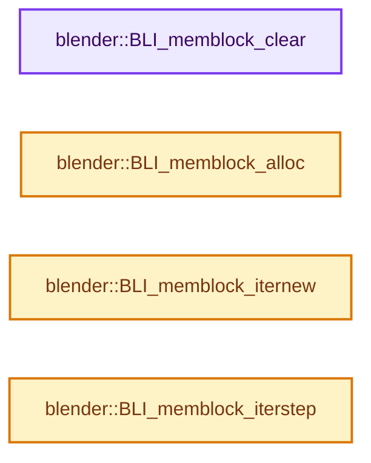

# 实现依赖专题：source/blender/blenlib/intern/BLI_memblock.cc

[实现依赖导航](../../README.md) · [符号索引](../../../00-课程指南/02-源码与提交索引/符号依赖与实现索引.md)

本专题从正文实际调用进入，集中保存共享实现。函数有稳定锚点，可从调用处直接跳到对应完整函数；递归与互相调用通过回链组织。

## 本文件的实现关系




## 完整成员与函数实现

<a id="f-a6d13b29e6f9fca7"></a>

### `blender::BLI_memblock_clear`

实现位置：[source/blender/blenlib/intern/BLI_memblock.cc](../../../../../../../source/blender/blenlib/intern/BLI_memblock.cc) · L88—L116。

接口参数：

- `BLI_memblock *mblk`
- `MemblockValFreeFP free_callback`

**教学注释版**

<!-- annotated:c73cbf97ee1c7a -->

```cpp
void BLI_memblock_clear(BLI_memblock *mblk, MemblockValFreeFP free_callback)
{
  int elem_per_chunk = mblk->chunk_size / mblk->elem_size;
  int last_used_chunk = mblk->elem_next / elem_per_chunk;

  if (free_callback) {
    for (int i = mblk->elem_last; i >= mblk->elem_next; i--) {
      int chunk_idx = i / elem_per_chunk;
      int elem_idx = i - elem_per_chunk * chunk_idx;
      void *val = static_cast<char *>(mblk->chunk_list[chunk_idx]) + mblk->elem_size * elem_idx;
      free_callback(val);
    }
  }

  for (int i = last_used_chunk + 1; i < mblk->chunk_len; i++) {
    MEM_SAFE_DELETE_VOID(mblk->chunk_list[i]);
  }

  if (last_used_chunk + 1 < mblk->chunk_len - CHUNK_LIST_SIZE) [[unlikely]] {
    mblk->chunk_len -= CHUNK_LIST_SIZE;
    mblk->chunk_list = static_cast<void **>(
        MEM_realloc_zeroed(mblk->chunk_list, sizeof(void *) * uint(mblk->chunk_len)));
  }

  mblk->elem_last = mblk->elem_next - 1;
  mblk->elem_next = 0;
  mblk->elem_next_ofs = 0;
  mblk->chunk_next = 0;
}
```

<details>
<summary>核对原始源码：source/blender/blenlib/intern/BLI_memblock.cc · L88—L116</summary>

<!-- original:c73cbf97ee1c7a:source/blender/blenlib/intern/BLI_memblock.cc:88:116 -->

```cpp
void BLI_memblock_clear(BLI_memblock *mblk, MemblockValFreeFP free_callback)
{
  int elem_per_chunk = mblk->chunk_size / mblk->elem_size;
  int last_used_chunk = mblk->elem_next / elem_per_chunk;

  if (free_callback) {
    for (int i = mblk->elem_last; i >= mblk->elem_next; i--) {
      int chunk_idx = i / elem_per_chunk;
      int elem_idx = i - elem_per_chunk * chunk_idx;
      void *val = static_cast<char *>(mblk->chunk_list[chunk_idx]) + mblk->elem_size * elem_idx;
      free_callback(val);
    }
  }

  for (int i = last_used_chunk + 1; i < mblk->chunk_len; i++) {
    MEM_SAFE_DELETE_VOID(mblk->chunk_list[i]);
  }

  if (last_used_chunk + 1 < mblk->chunk_len - CHUNK_LIST_SIZE) [[unlikely]] {
    mblk->chunk_len -= CHUNK_LIST_SIZE;
    mblk->chunk_list = static_cast<void **>(
        MEM_realloc_zeroed(mblk->chunk_list, sizeof(void *) * uint(mblk->chunk_len)));
  }

  mblk->elem_last = mblk->elem_next - 1;
  mblk->elem_next = 0;
  mblk->elem_next_ofs = 0;
  mblk->chunk_next = 0;
}
```

</details>

**沿实际写入检查状态**

- `mblk->chunk_len -= CHUNK_LIST_SIZE;`
- `mblk->chunk_list = static_cast<void **>(`
- `mblk->elem_last = mblk->elem_next - 1;`
- `mblk->elem_next = 0;`
- `mblk->elem_next_ofs = 0;`
- `mblk->chunk_next = 0;`

**继续追踪实现**

- `free_callback` → [调用协议](../../../00-课程指南/01-路线与规范/模板宏与动态分派协议.md)：局部可调用对象，须结合其初始化与捕获环境。调用位置L98。
- `MEM_SAFE_DELETE_VOID` → [MEM_SAFE_DELETE_VOID · L448](../../07-Intern运行时与平台/guardedalloc/MEM_guardedalloc.h.md#m-66e7eff3d7bc)。宏定义由构建条件选择。
- `MEM_realloc_zeroed` → [MEM_realloc_zeroed · L119](../../07-Intern运行时与平台/guardedalloc/MEM_guardedalloc.h.md#m-db4054295a6d)。宏定义由构建条件选择。

<a id="f-190dab22a7827201"></a>

### `blender::BLI_memblock_alloc`

实现位置：[source/blender/blenlib/intern/BLI_memblock.cc](../../../../../../../source/blender/blenlib/intern/BLI_memblock.cc) · L118—L145。

接口参数：

- `BLI_memblock *mblk`

**教学注释版**

<!-- annotated:2bdc4c9c2cee71 -->

```cpp
void *BLI_memblock_alloc(BLI_memblock *mblk)
{
  /* Bookkeeping. */
  // [讲解] std::max：按比较关系选取较大值。本讲解中的增长公式同时满足最低请求和几何增长；若保存返回引用，还需注意实参寿命。
  mblk->elem_last = std::max(mblk->elem_last, mblk->elem_next);
  mblk->elem_next++;

  void *ptr = static_cast<char *>(mblk->chunk_list[mblk->chunk_next]) + mblk->elem_next_ofs;

  mblk->elem_next_ofs += mblk->elem_size;

  if (mblk->elem_next_ofs == mblk->chunk_max_ofs) {
    mblk->elem_next_ofs = 0;
    mblk->chunk_next++;

    if (mblk->chunk_next >= mblk->chunk_len) [[unlikely]] {
      mblk->chunk_len += CHUNK_LIST_SIZE;
      mblk->chunk_list = static_cast<void **>(
          MEM_realloc_zeroed(mblk->chunk_list, sizeof(void *) * uint(mblk->chunk_len)));
    }

    if (mblk->chunk_list[mblk->chunk_next] == nullptr) [[unlikely]] {
      // [讲解] MEM_new_uninitialized_aligned：把公开MEM分配接口转交给当前选择的对齐分配后端。
      mblk->chunk_list[mblk->chunk_next] = MEM_new_uninitialized_aligned(
          uint(mblk->chunk_size), 32, "BLI_memblock chunk");
      // [讲解] memset：填充字节，不调用T构造函数，也不保证任意类型的全零表示是合法或期望值。
      memset(mblk->chunk_list[mblk->chunk_next], 0x0, uint(mblk->chunk_size));
    }
  }
  return ptr;
}
```

<details>
<summary>核对原始源码：source/blender/blenlib/intern/BLI_memblock.cc · L118—L145</summary>

<!-- original:2bdc4c9c2cee71:source/blender/blenlib/intern/BLI_memblock.cc:118:145 -->

```cpp
void *BLI_memblock_alloc(BLI_memblock *mblk)
{
  /* Bookkeeping. */
  mblk->elem_last = std::max(mblk->elem_last, mblk->elem_next);
  mblk->elem_next++;

  void *ptr = static_cast<char *>(mblk->chunk_list[mblk->chunk_next]) + mblk->elem_next_ofs;

  mblk->elem_next_ofs += mblk->elem_size;

  if (mblk->elem_next_ofs == mblk->chunk_max_ofs) {
    mblk->elem_next_ofs = 0;
    mblk->chunk_next++;

    if (mblk->chunk_next >= mblk->chunk_len) [[unlikely]] {
      mblk->chunk_len += CHUNK_LIST_SIZE;
      mblk->chunk_list = static_cast<void **>(
          MEM_realloc_zeroed(mblk->chunk_list, sizeof(void *) * uint(mblk->chunk_len)));
    }

    if (mblk->chunk_list[mblk->chunk_next] == nullptr) [[unlikely]] {
      mblk->chunk_list[mblk->chunk_next] = MEM_new_uninitialized_aligned(
          uint(mblk->chunk_size), 32, "BLI_memblock chunk");
      memset(mblk->chunk_list[mblk->chunk_next], 0x0, uint(mblk->chunk_size));
    }
  }
  return ptr;
}
```

</details>

**沿实际写入检查状态**

- `mblk->elem_last = std::max(mblk->elem_last, mblk->elem_next);`
- `mblk->elem_next_ofs += mblk->elem_size;`
- `mblk->elem_next_ofs = 0;`
- `mblk->chunk_len += CHUNK_LIST_SIZE;`
- `mblk->chunk_list = static_cast<void **>(`
- `mblk->chunk_list[mblk->chunk_next] = MEM_new_uninitialized_aligned(`

**结果出口**

- `return ptr;`

**继续追踪实现**

- `std::max` → [外部契约](https://eel.is/c++draft/alg.min.max)：按比较关系选取较大值。本讲解中的增长公式同时满足最低请求和几何增长；若保存返回引用，还需注意实参寿命。
- `MEM_realloc_zeroed` → [MEM_realloc_zeroed · L119](../../07-Intern运行时与平台/guardedalloc/MEM_guardedalloc.h.md#m-db4054295a6d)。宏定义由构建条件选择。
- `MEM_new_uninitialized_aligned` → [MEM_new_uninitialized_aligned · L134](../../07-Intern运行时与平台/guardedalloc/intern/mallocn.cc.md#f-9f3d21bd7da93c68)。
- `memset` → [外部契约](https://eel.is/c++draft/cstring.syn)：填充字节，不调用T构造函数，也不保证任意类型的全零表示是合法或期望值。

<a id="f-52fb1466bf6f1e1b"></a>

### `blender::BLI_memblock_iternew`

实现位置：[source/blender/blenlib/intern/BLI_memblock.cc](../../../../../../../source/blender/blenlib/intern/BLI_memblock.cc) · L147—L157。

接口参数：

- `BLI_memblock *mblk`
- `BLI_memblock_iter *iter`

**教学注释版**

<!-- annotated:92ce495aa5af8c -->

```cpp
void BLI_memblock_iternew(BLI_memblock *mblk, BLI_memblock_iter *iter)
{
  /* Small copy of the memblock used for better cache coherence. */
  iter->chunk_list = mblk->chunk_list;
  iter->end_index = mblk->elem_next;
  iter->cur_index = 0;
  iter->chunk_idx = 0;
  iter->elem_ofs = 0;
  iter->elem_size = mblk->elem_size;
  iter->chunk_max_ofs = mblk->chunk_max_ofs;
}
```

<details>
<summary>核对原始源码：source/blender/blenlib/intern/BLI_memblock.cc · L147—L157</summary>

<!-- original:92ce495aa5af8c:source/blender/blenlib/intern/BLI_memblock.cc:147:157 -->

```cpp
void BLI_memblock_iternew(BLI_memblock *mblk, BLI_memblock_iter *iter)
{
  /* Small copy of the memblock used for better cache coherence. */
  iter->chunk_list = mblk->chunk_list;
  iter->end_index = mblk->elem_next;
  iter->cur_index = 0;
  iter->chunk_idx = 0;
  iter->elem_ofs = 0;
  iter->elem_size = mblk->elem_size;
  iter->chunk_max_ofs = mblk->chunk_max_ofs;
}
```

</details>

**沿实际写入检查状态**

- `iter->chunk_list = mblk->chunk_list;`
- `iter->end_index = mblk->elem_next;`
- `iter->cur_index = 0;`
- `iter->chunk_idx = 0;`
- `iter->elem_ofs = 0;`
- `iter->elem_size = mblk->elem_size;`
- `iter->chunk_max_ofs = mblk->chunk_max_ofs;`

**继续追踪实现**

本实现没有需要继续展开的显式调用；检查返回表达式、对象转换和调用者前置条件。

<a id="f-a0debeabd7fa0878"></a>

### `blender::BLI_memblock_iterstep`

实现位置：[source/blender/blenlib/intern/BLI_memblock.cc](../../../../../../../source/blender/blenlib/intern/BLI_memblock.cc) · L159—L176。

接口参数：

- `BLI_memblock_iter *iter`

**教学注释版**

<!-- annotated:a1ea10484b2395 -->

```cpp
void *BLI_memblock_iterstep(BLI_memblock_iter *iter)
{
  if (iter->cur_index == iter->end_index) {
    return nullptr;
  }

  iter->cur_index++;

  void *ptr = static_cast<char *>(iter->chunk_list[iter->chunk_idx]) + iter->elem_ofs;

  iter->elem_ofs += iter->elem_size;

  if (iter->elem_ofs == iter->chunk_max_ofs) {
    iter->elem_ofs = 0;
    iter->chunk_idx++;
  }
  return ptr;
}
```

<details>
<summary>核对原始源码：source/blender/blenlib/intern/BLI_memblock.cc · L159—L176</summary>

<!-- original:a1ea10484b2395:source/blender/blenlib/intern/BLI_memblock.cc:159:176 -->

```cpp
void *BLI_memblock_iterstep(BLI_memblock_iter *iter)
{
  if (iter->cur_index == iter->end_index) {
    return nullptr;
  }

  iter->cur_index++;

  void *ptr = static_cast<char *>(iter->chunk_list[iter->chunk_idx]) + iter->elem_ofs;

  iter->elem_ofs += iter->elem_size;

  if (iter->elem_ofs == iter->chunk_max_ofs) {
    iter->elem_ofs = 0;
    iter->chunk_idx++;
  }
  return ptr;
}
```

</details>

**沿实际写入检查状态**

- `iter->elem_ofs += iter->elem_size;`
- `iter->elem_ofs = 0;`

**结果出口**

- `return nullptr;`
- `return ptr;`

**继续追踪实现**

本实现没有需要继续展开的显式调用；检查返回表达式、对象转换和调用者前置条件。
