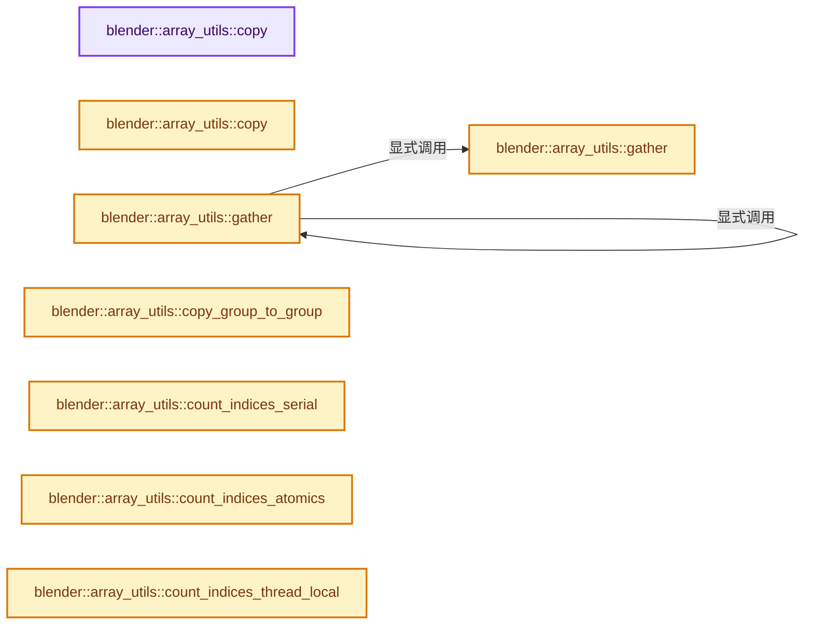
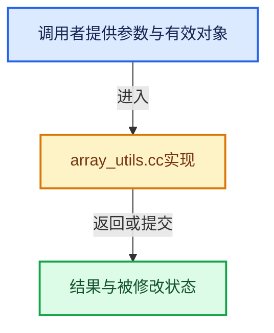

# 实现依赖专题：source/blender/blenlib/intern/array_utils.cc

[实现依赖导航](../../README.md) · [符号索引](../../../00-课程指南/02-源码与提交索引/符号依赖与实现索引.md)

本专题从正文实际调用进入，集中保存共享实现。函数有稳定锚点，可从调用处直接跳到对应完整函数；递归与互相调用通过回链组织。

## 本文件的实现关系






## 完整成员与函数实现

<a id="f-245f7c23437cf35f"></a>

### `blender::array_utils::copy`

实现位置：[source/blender/blenlib/intern/array_utils.cc](../../../../../../../source/blender/blenlib/intern/array_utils.cc) · L27—L41。

接口参数：

- `const GVArray &src`
- `GMutableSpan dst`
- `const exec_mode::Mode mode`

**教学注释版**

<!-- annotated:bb18094dc0f621 -->

```cpp
void copy(const GVArray &src, GMutableSpan dst, const exec_mode::Mode mode)
{
  PRF_scope_with_name("array_utils::copy", ProfileCategory::Default);
  BLI_assert(src.type() == dst.type());
  BLI_assert(src.size() == dst.size());
  if (!mode.is_parallel) {
    src.materialize(src.index_range(), dst.data());
  }
  else {
    const int64_t grain_size = calc_copy_grain_size(mode, src.type().size);
    threading::parallel_for(src.index_range(), grain_size, [&](const IndexRange range) {
      src.materialize(range, dst.data());
    });
  }
}
```

<details>
<summary>核对原始源码：source/blender/blenlib/intern/array_utils.cc · L27—L41</summary>

<!-- original:bb18094dc0f621:source/blender/blenlib/intern/array_utils.cc:27:41 -->

```cpp
void copy(const GVArray &src, GMutableSpan dst, const exec_mode::Mode mode)
{
  PRF_scope_with_name("array_utils::copy", ProfileCategory::Default);
  BLI_assert(src.type() == dst.type());
  BLI_assert(src.size() == dst.size());
  if (!mode.is_parallel) {
    src.materialize(src.index_range(), dst.data());
  }
  else {
    const int64_t grain_size = calc_copy_grain_size(mode, src.type().size);
    threading::parallel_for(src.index_range(), grain_size, [&](const IndexRange range) {
      src.materialize(range, dst.data());
    });
  }
}
```

</details>

**继续追踪实现**

- `PRF_scope_with_name` → [PRF_scope_with_name · L52](../../07-Intern运行时与平台/profile/PRF_profile.hh.md#m-adc22c3a3f8c)；[PRF_scope_with_name · L91](../../07-Intern运行时与平台/profile/PRF_profile.hh.md#m-3cbbaddb89c4)。宏定义由构建条件选择。
- `BLI_assert` → [BLI_assert · L48](../BLI_assert.hh.md#m-57a88495704d)；[BLI_assert · L63](../BLI_assert.hh.md#m-d07050020cb5)。宏定义由构建条件选择。
- `src.type` → [调用协议](../../../00-课程指南/01-路线与规范/模板宏与动态分派协议.md)：由接收对象具体类型或运行时策略提供实现。调用位置L30。
- `dst.type` → [blender::GMutableSpan::type · L182](../../../03-内存分配与运行时类型/11-GSpan与GArray.md#f-74385040046c86d5)。
- `src.size` → [调用协议](../../../00-课程指南/01-路线与规范/模板宏与动态分派协议.md)：由接收对象具体类型或运行时策略提供实现。调用位置L31。
- `dst.size` → [blender::GMutableSpan::size · L198](../../../03-内存分配与运行时类型/11-GSpan与GArray.md#f-ecf8873167fb66c8)。
- `src.materialize` → [调用协议](../../../00-课程指南/01-路线与规范/模板宏与动态分派协议.md)：由接收对象具体类型或运行时策略提供实现。调用位置L33。
- `src.index_range` → [调用协议](../../../00-课程指南/01-路线与规范/模板宏与动态分派协议.md)：由接收对象具体类型或运行时策略提供实现。调用位置L33。
- `dst.data` → [blender::GMutableSpan::data · L208](../../../03-内存分配与运行时类型/11-GSpan与GArray.md#f-f951536a0bdbb159)。
- `calc_copy_grain_size` → [blender::array_utils::calc_copy_grain_size · L26](../../../01-基础容器与现代CPP/20-容器选择与独立实现.md#f-c6af31786a6d8b20)；[blender::array_utils::calc_copy_grain_size · L33](../../../01-基础容器与现代CPP/20-容器选择与独立实现.md#f-c68d314ea462aa55)。同名重载需按实参类型选择。
- `threading::parallel_for` → [blender::threading::parallel_for · L68](../../../11-Depsgraph与并行任务系统/07-任务池与TBB接入.md#f-838294754c24426c)。

<a id="f-6170524934215b36"></a>

### `blender::array_utils::copy`

实现位置：[source/blender/blenlib/intern/array_utils.cc](../../../../../../../source/blender/blenlib/intern/array_utils.cc) · L43—L61。

接口参数：

- `const GVArray &src`
- `const IndexMask &selection`
- `GMutableSpan dst`
- `const exec_mode::Mode mode`

**教学注释版**

<!-- annotated:c1ed37df2ebefc -->

```cpp
void copy(const GVArray &src,
          const IndexMask &selection,
          GMutableSpan dst,
          const exec_mode::Mode mode)
{
  PRF_scope_with_name("array_utils::copy", ProfileCategory::Default);
  BLI_assert(src.type() == dst.type());
  BLI_assert(src.size() >= selection.min_array_size());
  BLI_assert(dst.size() >= selection.min_array_size());
  if (!mode.is_parallel) {
    src.materialize(selection, dst.data());
  }
  else {
    const int64_t grain_size = calc_copy_grain_size(mode, src.type().size);
    threading::parallel_for(selection.index_range(), grain_size, [&](const IndexRange range) {
      src.materialize(selection.slice(range), dst.data());
    });
  }
}
```

<details>
<summary>核对原始源码：source/blender/blenlib/intern/array_utils.cc · L43—L61</summary>

<!-- original:c1ed37df2ebefc:source/blender/blenlib/intern/array_utils.cc:43:61 -->

```cpp
void copy(const GVArray &src,
          const IndexMask &selection,
          GMutableSpan dst,
          const exec_mode::Mode mode)
{
  PRF_scope_with_name("array_utils::copy", ProfileCategory::Default);
  BLI_assert(src.type() == dst.type());
  BLI_assert(src.size() >= selection.min_array_size());
  BLI_assert(dst.size() >= selection.min_array_size());
  if (!mode.is_parallel) {
    src.materialize(selection, dst.data());
  }
  else {
    const int64_t grain_size = calc_copy_grain_size(mode, src.type().size);
    threading::parallel_for(selection.index_range(), grain_size, [&](const IndexRange range) {
      src.materialize(selection.slice(range), dst.data());
    });
  }
}
```

</details>

**继续追踪实现**

- `PRF_scope_with_name` → [PRF_scope_with_name · L52](../../07-Intern运行时与平台/profile/PRF_profile.hh.md#m-adc22c3a3f8c)；[PRF_scope_with_name · L91](../../07-Intern运行时与平台/profile/PRF_profile.hh.md#m-3cbbaddb89c4)。宏定义由构建条件选择。
- `BLI_assert` → [BLI_assert · L48](../BLI_assert.hh.md#m-57a88495704d)；[BLI_assert · L63](../BLI_assert.hh.md#m-d07050020cb5)。宏定义由构建条件选择。
- `src.type` → [调用协议](../../../00-课程指南/01-路线与规范/模板宏与动态分派协议.md)：由接收对象具体类型或运行时策略提供实现。调用位置L49。
- `dst.type` → [blender::GMutableSpan::type · L182](../../../03-内存分配与运行时类型/11-GSpan与GArray.md#f-74385040046c86d5)。
- `src.size` → [调用协议](../../../00-课程指南/01-路线与规范/模板宏与动态分派协议.md)：由接收对象具体类型或运行时策略提供实现。调用位置L50。
- `selection.min_array_size` → [blender::index_mask::IndexMask::min_array_size · L782](../../../04-虚拟数组与索引选择/09-分段存储与遍历.md#f-f3a460d74b4fc7d6)。
- `dst.size` → [blender::GMutableSpan::size · L198](../../../03-内存分配与运行时类型/11-GSpan与GArray.md#f-ecf8873167fb66c8)。
- `src.materialize` → [调用协议](../../../00-课程指南/01-路线与规范/模板宏与动态分派协议.md)：由接收对象具体类型或运行时策略提供实现。调用位置L53。
- `dst.data` → [blender::GMutableSpan::data · L208](../../../03-内存分配与运行时类型/11-GSpan与GArray.md#f-f951536a0bdbb159)。
- `calc_copy_grain_size` → [blender::array_utils::calc_copy_grain_size · L26](../../../01-基础容器与现代CPP/20-容器选择与独立实现.md#f-c6af31786a6d8b20)；[blender::array_utils::calc_copy_grain_size · L33](../../../01-基础容器与现代CPP/20-容器选择与独立实现.md#f-c68d314ea462aa55)。同名重载需按实参类型选择。
- `threading::parallel_for` → [blender::threading::parallel_for · L68](../../../11-Depsgraph与并行任务系统/07-任务池与TBB接入.md#f-838294754c24426c)。
- `selection.index_range` → [blender::index_mask::IndexMask::index_range · L753](../../../04-虚拟数组与索引选择/09-分段存储与遍历.md#f-749c399cf5bc4035)。
- `selection.slice` → [blender::index_mask::IndexMask::slice · L125](../../../04-虚拟数组与索引选择/10-IndexMask构建与并行.md#f-ff79fd755a945991)；[blender::index_mask::IndexMask::slice · L144](../../../04-虚拟数组与索引选择/10-IndexMask构建与并行.md#f-c8b1c9029be81481)。同名重载需按实参类型选择。

<a id="f-5c2b501b03ddbb1f"></a>

### `blender::array_utils::gather`

实现位置：[source/blender/blenlib/intern/array_utils.cc](../../../../../../../source/blender/blenlib/intern/array_utils.cc) · L63—L80。

接口参数：

- `const GVArray &src`
- `const IndexMask &indices`
- `GMutableSpan dst`
- `const exec_mode::Mode mode`

**教学注释版**

<!-- annotated:2e61f916a28e89 -->

```cpp
void gather(const GVArray &src,
            const IndexMask &indices,
            GMutableSpan dst,
            const exec_mode::Mode mode)
{
  PRF_scope_with_name("array_utils::gather", ProfileCategory::Default);
  BLI_assert(src.type() == dst.type());
  BLI_assert(indices.size() == dst.size());
  if (!mode.is_parallel) {
    src.materialize_compressed(indices, dst.data());
  }
  else {
    const int64_t grain_size = calc_copy_grain_size(mode, src.type().size);
    threading::parallel_for(indices.index_range(), grain_size, [&](const IndexRange range) {
      src.materialize_compressed(indices.slice(range), dst.slice(range).data());
    });
  }
}
```

<details>
<summary>核对原始源码：source/blender/blenlib/intern/array_utils.cc · L63—L80</summary>

<!-- original:2e61f916a28e89:source/blender/blenlib/intern/array_utils.cc:63:80 -->

```cpp
void gather(const GVArray &src,
            const IndexMask &indices,
            GMutableSpan dst,
            const exec_mode::Mode mode)
{
  PRF_scope_with_name("array_utils::gather", ProfileCategory::Default);
  BLI_assert(src.type() == dst.type());
  BLI_assert(indices.size() == dst.size());
  if (!mode.is_parallel) {
    src.materialize_compressed(indices, dst.data());
  }
  else {
    const int64_t grain_size = calc_copy_grain_size(mode, src.type().size);
    threading::parallel_for(indices.index_range(), grain_size, [&](const IndexRange range) {
      src.materialize_compressed(indices.slice(range), dst.slice(range).data());
    });
  }
}
```

</details>

**继续追踪实现**

- `PRF_scope_with_name` → [PRF_scope_with_name · L52](../../07-Intern运行时与平台/profile/PRF_profile.hh.md#m-adc22c3a3f8c)；[PRF_scope_with_name · L91](../../07-Intern运行时与平台/profile/PRF_profile.hh.md#m-3cbbaddb89c4)。宏定义由构建条件选择。
- `BLI_assert` → [BLI_assert · L48](../BLI_assert.hh.md#m-57a88495704d)；[BLI_assert · L63](../BLI_assert.hh.md#m-d07050020cb5)。宏定义由构建条件选择。
- `src.type` → [调用协议](../../../00-课程指南/01-路线与规范/模板宏与动态分派协议.md)：由接收对象具体类型或运行时策略提供实现。调用位置L69。
- `dst.type` → [blender::GMutableSpan::type · L182](../../../03-内存分配与运行时类型/11-GSpan与GArray.md#f-74385040046c86d5)。
- `indices.size` → [blender::index_mask::IndexMask::size · L743](../../../04-虚拟数组与索引选择/09-分段存储与遍历.md#f-0163b32abc9a0d9c)。
- `dst.size` → [blender::GMutableSpan::size · L198](../../../03-内存分配与运行时类型/11-GSpan与GArray.md#f-ecf8873167fb66c8)。
- `src.materialize_compressed` → [调用协议](../../../00-课程指南/01-路线与规范/模板宏与动态分派协议.md)：由接收对象具体类型或运行时策略提供实现。调用位置L72。
- `dst.data` → [blender::GMutableSpan::data · L208](../../../03-内存分配与运行时类型/11-GSpan与GArray.md#f-f951536a0bdbb159)。
- `calc_copy_grain_size` → [blender::array_utils::calc_copy_grain_size · L26](../../../01-基础容器与现代CPP/20-容器选择与独立实现.md#f-c6af31786a6d8b20)；[blender::array_utils::calc_copy_grain_size · L33](../../../01-基础容器与现代CPP/20-容器选择与独立实现.md#f-c68d314ea462aa55)。同名重载需按实参类型选择。
- `threading::parallel_for` → [blender::threading::parallel_for · L68](../../../11-Depsgraph与并行任务系统/07-任务池与TBB接入.md#f-838294754c24426c)。
- `indices.index_range` → [blender::index_mask::IndexMask::index_range · L753](../../../04-虚拟数组与索引选择/09-分段存储与遍历.md#f-749c399cf5bc4035)。
- `indices.slice` → [blender::index_mask::IndexMask::slice · L125](../../../04-虚拟数组与索引选择/10-IndexMask构建与并行.md#f-ff79fd755a945991)；[blender::index_mask::IndexMask::slice · L144](../../../04-虚拟数组与索引选择/10-IndexMask构建与并行.md#f-c8b1c9029be81481)。同名重载需按实参类型选择。
- `dst.slice(range).data` → [调用协议](../../../00-课程指南/01-路线与规范/模板宏与动态分派协议.md)：接收对象类型依赖auto、返回值或模板实例；不按同名猜测目标。调用位置L77。
- `dst.slice` → [blender::GMutableSpan::slice · L227](../../../03-内存分配与运行时类型/11-GSpan与GArray.md#f-d7f8e350bc3a5156)；[blender::GMutableSpan::slice · L235](../../../03-内存分配与运行时类型/11-GSpan与GArray.md#f-b1101d4d9009fa75)。同名重载需按实参类型选择。

<a id="f-ea4dd9e673fe81e4"></a>

### `blender::array_utils::gather`

实现位置：[source/blender/blenlib/intern/array_utils.cc](../../../../../../../source/blender/blenlib/intern/array_utils.cc) · L82—L88。

接口参数：

- `const GSpan src`
- `const IndexMask &indices`
- `GMutableSpan dst`
- `const exec_mode::Mode mode`

**教学注释版**

<!-- annotated:fee5280722596a -->

```cpp
void gather(const GSpan src,
            const IndexMask &indices,
            GMutableSpan dst,
            const exec_mode::Mode mode)
{
  gather(GVArray::from_span(src), indices, dst, mode);
}
```

<details>
<summary>核对原始源码：source/blender/blenlib/intern/array_utils.cc · L82—L88</summary>

<!-- original:fee5280722596a:source/blender/blenlib/intern/array_utils.cc:82:88 -->

```cpp
void gather(const GSpan src,
            const IndexMask &indices,
            GMutableSpan dst,
            const exec_mode::Mode mode)
{
  gather(GVArray::from_span(src), indices, dst, mode);
}
```

</details>

**继续追踪实现**

- `gather` → [blender::array_utils::gather · L63](array_utils.cc.md#f-5c2b501b03ddbb1f)；[blender::array_utils::gather · L82](array_utils.cc.md#f-ea4dd9e673fe81e4)。同名重载需按实参类型选择。
- `GVArray::from_span` → [blender::GVArray::from_span · L895](../../../04-虚拟数组与索引选择/05-GVArray运行时类型.md#f-e8b978ca15febb67)。

<a id="f-dba9d4fdfd9985a4"></a>

### `blender::array_utils::copy_group_to_group`

实现位置：[source/blender/blenlib/intern/array_utils.cc](../../../../../../../source/blender/blenlib/intern/array_utils.cc) · L90—L100。

接口参数：

- `const OffsetIndices<int> src_offsets`
- `const OffsetIndices<int> dst_offsets`
- `const IndexMask &selection`
- `const GSpan src`
- `GMutableSpan dst`

**教学注释版**

<!-- annotated:61bc77d89d1061 -->

```cpp
void copy_group_to_group(const OffsetIndices<int> src_offsets,
                         const OffsetIndices<int> dst_offsets,
                         const IndexMask &selection,
                         const GSpan src,
                         GMutableSpan dst)
{
  /* Each group might be large, so a threaded copy might make sense here too. */
  selection.foreach_index(
      [&](const int i) { dst.slice(dst_offsets[i]).copy_from(src.slice(src_offsets[i])); },
      exec_mode::grain_size(512));
}
```

<details>
<summary>核对原始源码：source/blender/blenlib/intern/array_utils.cc · L90—L100</summary>

<!-- original:61bc77d89d1061:source/blender/blenlib/intern/array_utils.cc:90:100 -->

```cpp
void copy_group_to_group(const OffsetIndices<int> src_offsets,
                         const OffsetIndices<int> dst_offsets,
                         const IndexMask &selection,
                         const GSpan src,
                         GMutableSpan dst)
{
  /* Each group might be large, so a threaded copy might make sense here too. */
  selection.foreach_index(
      [&](const int i) { dst.slice(dst_offsets[i]).copy_from(src.slice(src_offsets[i])); },
      exec_mode::grain_size(512));
}
```

</details>

**继续追踪实现**

- `selection.foreach_index` → [blender::index_mask::IndexMask::foreach_index · L855](../../../04-虚拟数组与索引选择/09-分段存储与遍历.md#f-cd6cd317e2e2812c)。
- `dst.slice(dst_offsets[i]).copy_from` → [调用协议](../../../00-课程指南/01-路线与规范/模板宏与动态分派协议.md)：接收对象类型依赖auto、返回值或模板实例；不按同名猜测目标。调用位置L98。
- `dst.slice` → [blender::GMutableSpan::slice · L227](../../../03-内存分配与运行时类型/11-GSpan与GArray.md#f-d7f8e350bc3a5156)；[blender::GMutableSpan::slice · L235](../../../03-内存分配与运行时类型/11-GSpan与GArray.md#f-b1101d4d9009fa75)。同名重载需按实参类型选择。
- `src.slice` → [blender::GSpan::slice · L99](../../../03-内存分配与运行时类型/11-GSpan与GArray.md#f-c7f535c5dacdc816)；[blender::GSpan::slice · L107](../../../03-内存分配与运行时类型/11-GSpan与GArray.md#f-13774c4cd5408fa2)。同名重载需按实参类型选择。
- `exec_mode::grain_size` → [blender::exec_mode::grain_size · L79](../BLI_execution_mode.hh.md#f-0b4fc2f9fa6e66e7)。

<a id="f-d957afc75c2f0ceb"></a>

### `blender::array_utils::count_indices_serial`

实现位置：[source/blender/blenlib/intern/array_utils.cc](../../../../../../../source/blender/blenlib/intern/array_utils.cc) · L102—L107。

接口参数：

- `const Span<int> indices`
- `MutableSpan<int> counts`

**教学注释版**

<!-- annotated:afa6db63c60306 -->

```cpp
static void count_indices_serial(const Span<int> indices, MutableSpan<int> counts)
{
  for (const int i : indices) {
    counts[i]++;
  }
}
```

<details>
<summary>核对原始源码：source/blender/blenlib/intern/array_utils.cc · L102—L107</summary>

<!-- original:afa6db63c60306:source/blender/blenlib/intern/array_utils.cc:102:107 -->

```cpp
static void count_indices_serial(const Span<int> indices, MutableSpan<int> counts)
{
  for (const int i : indices) {
    counts[i]++;
  }
}
```

</details>

**继续追踪实现**

本实现没有需要继续展开的显式调用；检查返回表达式、对象转换和调用者前置条件。

<a id="f-511de3ae22a335eb"></a>

### `blender::array_utils::count_indices_atomics`

实现位置：[source/blender/blenlib/intern/array_utils.cc](../../../../../../../source/blender/blenlib/intern/array_utils.cc) · L109—L116。

接口参数：

- `const Span<int> indices`
- `MutableSpan<int> counts`

**教学注释版**

<!-- annotated:6b3cca87543bc8 -->

```cpp
static void count_indices_atomics(const Span<int> indices, MutableSpan<int> counts)
{
  // [讲解] indices.index_range：查询视图长度或生成对应有效索引区间。
  threading::parallel_for(indices.index_range(), 4096, [&](const IndexRange range) {
    // [讲解] indices.slice：建立原连续范围的子视图。
    for (const int i : indices.slice(range)) {
      atomic_add_and_fetch_int32(&counts[i], 1);
    }
  });
}
```

<details>
<summary>核对原始源码：source/blender/blenlib/intern/array_utils.cc · L109—L116</summary>

<!-- original:6b3cca87543bc8:source/blender/blenlib/intern/array_utils.cc:109:116 -->

```cpp
static void count_indices_atomics(const Span<int> indices, MutableSpan<int> counts)
{
  threading::parallel_for(indices.index_range(), 4096, [&](const IndexRange range) {
    for (const int i : indices.slice(range)) {
      atomic_add_and_fetch_int32(&counts[i], 1);
    }
  });
}
```

</details>

**继续追踪实现**

- `threading::parallel_for` → [blender::threading::parallel_for · L68](../../../11-Depsgraph与并行任务系统/07-任务池与TBB接入.md#f-838294754c24426c)。
- `indices.index_range` → [blender::Span::index_range · L405](../../../01-基础容器与现代CPP/05-Span只读连续视图.md#f-caaa9b06e13e53e0)。
- `indices.slice` → [blender::Span::slice · L141](../../../01-基础容器与现代CPP/05-Span只读连续视图.md#f-380a0e8fdcbd53cc)；[blender::Span::slice · L149](../../../01-基础容器与现代CPP/05-Span只读连续视图.md#f-9b9c15e78dd54eec)。同名重载需按实参类型选择。
- `atomic_add_and_fetch_int32` → [atomic_add_and_fetch_int32 · L431](../../07-Intern运行时与平台/atomic/intern/atomic_ops_unix.h.md#f-98d5d8af368ec4f4)；[atomic_add_and_fetch_int32 · L497](../../07-Intern运行时与平台/atomic/intern/atomic_ops_unix.h.md#f-7cf413299744198a)；[atomic_add_and_fetch_int32 · L178](../../07-Intern运行时与平台/atomic/intern/atomic_ops_msvc.h.md#f-ad0d6431f7ff3567)。同名重载需按实参类型选择。

<a id="f-3979f7c234363f37"></a>

### `blender::array_utils::count_indices_thread_local`

实现位置：[source/blender/blenlib/intern/array_utils.cc](../../../../../../../source/blender/blenlib/intern/array_utils.cc) · L118—L145。

接口参数：

- `const Span<int> indices`
- `MutableSpan<int> counts`
- `const int64_t max_threads`

**教学注释版**

<!-- annotated:5fd630c603c856 -->

```cpp
static void count_indices_thread_local(const Span<int> indices,
                                       MutableSpan<int> counts,
                                       const int64_t max_threads)
{
  /* Count into thread local buffers, parallelized with chunks of indices. The
   * number of threads is limited to avoid using more memory and memory bandwidth
   * than helpful. */
  // [讲解] counts.size：查询视图长度或生成对应有效索引区间。
  const int64_t groups_num = counts.size();
  threading::EnumerableThreadSpecific<Array<int>> counts_by_thread(
      [&]() { return Array<int>(groups_num, 0); });
  threading::max_threads_task(max_threads, [&]() {
    // [讲解] indices.index_range：查询视图长度或生成对应有效索引区间。
    threading::parallel_for(indices.index_range(), 4096, [&](const IndexRange range) {
      Array<int> &local_counts = counts_by_thread.local();
      // [讲解] indices.slice：建立原连续范围的子视图。
      for (const int i : indices.slice(range)) {
        local_counts[i]++;
      }
    });
  });

  /* Sum counts for all threads. */
  threading::parallel_for(IndexRange(groups_num), 4096, [&](const IndexRange range) {
    for (const Array<int> &local_counts : counts_by_thread) {
      for (const int64_t i : range) {
        counts[i] += local_counts[i];
      }
    }
  });
}
```

<details>
<summary>核对原始源码：source/blender/blenlib/intern/array_utils.cc · L118—L145</summary>

<!-- original:5fd630c603c856:source/blender/blenlib/intern/array_utils.cc:118:145 -->

```cpp
static void count_indices_thread_local(const Span<int> indices,
                                       MutableSpan<int> counts,
                                       const int64_t max_threads)
{
  /* Count into thread local buffers, parallelized with chunks of indices. The
   * number of threads is limited to avoid using more memory and memory bandwidth
   * than helpful. */
  const int64_t groups_num = counts.size();
  threading::EnumerableThreadSpecific<Array<int>> counts_by_thread(
      [&]() { return Array<int>(groups_num, 0); });
  threading::max_threads_task(max_threads, [&]() {
    threading::parallel_for(indices.index_range(), 4096, [&](const IndexRange range) {
      Array<int> &local_counts = counts_by_thread.local();
      for (const int i : indices.slice(range)) {
        local_counts[i]++;
      }
    });
  });

  /* Sum counts for all threads. */
  threading::parallel_for(IndexRange(groups_num), 4096, [&](const IndexRange range) {
    for (const Array<int> &local_counts : counts_by_thread) {
      for (const int64_t i : range) {
        counts[i] += local_counts[i];
      }
    }
  });
}
```

</details>

**沿实际写入检查状态**

- `counts[i] += local_counts[i];`

**继续追踪实现**

- `counts.size` → [blender::MutableSpan::size · L499](../../../01-基础容器与现代CPP/06-MutableSpan可写视图.md#f-1de6a66839c304a8)；[blender::gpu::shader::parser::MutableSpan::size · L87](../../08-其他Blender模块/gpu/shader_tool/utils.hh.md#f-5e684af6ee7990e9)。同名重载需按实参类型选择。
- `Array<int>` → [blender::Array::Array · L78](../../../01-基础容器与现代CPP/07-Array构造与存储.md#f-001fd5eb3c658238)；[blender::Array::Array · L84](../../../01-基础容器与现代CPP/07-Array构造与存储.md#f-674e2f10361a462b)；[blender::Array::Array · L89](../../../01-基础容器与现代CPP/07-Array构造与存储.md#f-aa1e5908a9b67557)；[blender::Array::Array · L103](../../../01-基础容器与现代CPP/07-Array构造与存储.md#f-b141be39084346f3)；[blender::Array::Array · L110](../../../01-基础容器与现代CPP/07-Array构造与存储.md#f-452e276f39e81a2a)；[blender::Array::Array · L123](../../../01-基础容器与现代CPP/07-Array构造与存储.md#f-646aa58152ec44f6)；[blender::Array::Array · L135](../../../01-基础容器与现代CPP/07-Array构造与存储.md#f-0a9de4a549125f99)；[blender::Array::Array · L168](../../../01-基础容器与现代CPP/07-Array构造与存储.md#f-31f001eb92069e9d)；[blender::Array::Array · L176](../../../01-基础容器与现代CPP/07-Array构造与存储.md#f-cf8148f06fc6747a)；[blender::Array::Array · L178](../../../01-基础容器与现代CPP/07-Array构造与存储.md#f-2ddca2fb9dd964b3)。同名重载需按实参类型选择。
- `threading::max_threads_task` → [blender::threading::max_threads_task · L238](../../../11-Depsgraph与并行任务系统/07-任务池与TBB接入.md#f-caf66416559a5d62)。
- `threading::parallel_for` → [blender::threading::parallel_for · L68](../../../11-Depsgraph与并行任务系统/07-任务池与TBB接入.md#f-838294754c24426c)。
- `indices.index_range` → [blender::Span::index_range · L405](../../../01-基础容器与现代CPP/05-Span只读连续视图.md#f-caaa9b06e13e53e0)。
- `counts_by_thread.local` → [blender::threading::EnumerableThreadSpecific::local · L51](../BLI_enumerable_thread_specific.hh.md#f-38c6c32570e94c93)；[blender::threading::EnumerableThreadSpecific::local · L87](../BLI_enumerable_thread_specific.hh.md#f-3c8975467b7a35ba)。同名重载需按实参类型选择。
- `indices.slice` → [blender::Span::slice · L141](../../../01-基础容器与现代CPP/05-Span只读连续视图.md#f-380a0e8fdcbd53cc)；[blender::Span::slice · L149](../../../01-基础容器与现代CPP/05-Span只读连续视图.md#f-9b9c15e78dd54eec)。同名重载需按实参类型选择。
- `IndexRange` → [blender::IndexRange](../BLI_index_range.hh.md#t-caa3466d6776)；[blender::gpu::shader::parser::IndexRange](../../08-其他Blender模块/gpu/shader_tool/utils.hh.md#t-82d2bd4ea71c)；[blender::IndexRange](../../08-其他Blender模块/makesdna/DNA_node_types.h.md#t-0448cc889d39)。

<a id="f-edf8c2e3ad390d06"></a>

### `blender::array_utils::count_indices`

实现位置：[source/blender/blenlib/intern/array_utils.cc](../../../../../../../source/blender/blenlib/intern/array_utils.cc) · L147—L188。

接口参数：

- `const Span<int> indices`
- `MutableSpan<int> counts`

**教学注释版**

<!-- annotated:707783e3cdecdf -->

```cpp
void count_indices(const Span<int> indices, MutableSpan<int> counts)
{
  PRF_scope_with_name("array_utils::count_indices", ProfileCategory::Default);

  // [讲解] indices.size：查询视图长度或生成对应有效索引区间。
  const int64_t indices_num = indices.size();
  // [讲解] std::max<int64_t>：按比较关系选取较大值。本讲解中的增长公式同时满足最低请求和几何增长；若保存返回引用，还需注意实参寿命。
  const int64_t groups_num = std::max<int64_t>(counts.size(), 1);

  /* Thread local is fastest when the number of groups is small enough that the
   * counters can stay in the per core caches. */
  constexpr int64_t max_thread_local_groups = 1 << 18;
  if (groups_num <= max_thread_local_groups) {
    /* More threads add memory overhead, limit by groups per index so it's worth
     * using dedicated memory for every thread. */
    constexpr int64_t min_groups_per_index = 10;
    const int64_t max_threads = std::clamp<int64_t>(
        std::sqrt(min_groups_per_index * indices_num / groups_num), 1, BLI_system_thread_count());

    /* Heuristic for when there are enough indices for thread local to work.
     * Fixed minimum, enough indices per thread and not too much group overhead. */
    constexpr int64_t min_parallel_indices = 1 << 16;
    const int64_t min_thread_local_indices = min_parallel_indices + indices_num / max_threads +
                                             max_threads * groups_num / min_groups_per_index;

    if (indices_num < min_thread_local_indices) {
      count_indices_serial(indices, counts);
    }
    else {
      count_indices_thread_local(indices, counts, max_threads);
    }
  }
  else {
    /* Atomics are faster than serial when there are enough indices to justify the overhead
     * and we hopefully don't get too much contention. */
    constexpr int64_t min_atomic_indices = 1 << 19;
    if (indices_num < min_atomic_indices) {
      count_indices_serial(indices, counts);
    }
    else {
      count_indices_atomics(indices, counts);
    }
  }
}
```

<details>
<summary>核对原始源码：source/blender/blenlib/intern/array_utils.cc · L147—L188</summary>

<!-- original:707783e3cdecdf:source/blender/blenlib/intern/array_utils.cc:147:188 -->

```cpp
void count_indices(const Span<int> indices, MutableSpan<int> counts)
{
  PRF_scope_with_name("array_utils::count_indices", ProfileCategory::Default);

  const int64_t indices_num = indices.size();
  const int64_t groups_num = std::max<int64_t>(counts.size(), 1);

  /* Thread local is fastest when the number of groups is small enough that the
   * counters can stay in the per core caches. */
  constexpr int64_t max_thread_local_groups = 1 << 18;
  if (groups_num <= max_thread_local_groups) {
    /* More threads add memory overhead, limit by groups per index so it's worth
     * using dedicated memory for every thread. */
    constexpr int64_t min_groups_per_index = 10;
    const int64_t max_threads = std::clamp<int64_t>(
        std::sqrt(min_groups_per_index * indices_num / groups_num), 1, BLI_system_thread_count());

    /* Heuristic for when there are enough indices for thread local to work.
     * Fixed minimum, enough indices per thread and not too much group overhead. */
    constexpr int64_t min_parallel_indices = 1 << 16;
    const int64_t min_thread_local_indices = min_parallel_indices + indices_num / max_threads +
                                             max_threads * groups_num / min_groups_per_index;

    if (indices_num < min_thread_local_indices) {
      count_indices_serial(indices, counts);
    }
    else {
      count_indices_thread_local(indices, counts, max_threads);
    }
  }
  else {
    /* Atomics are faster than serial when there are enough indices to justify the overhead
     * and we hopefully don't get too much contention. */
    constexpr int64_t min_atomic_indices = 1 << 19;
    if (indices_num < min_atomic_indices) {
      count_indices_serial(indices, counts);
    }
    else {
      count_indices_atomics(indices, counts);
    }
  }
}
```

</details>

**继续追踪实现**

- `PRF_scope_with_name` → [PRF_scope_with_name · L52](../../07-Intern运行时与平台/profile/PRF_profile.hh.md#m-adc22c3a3f8c)；[PRF_scope_with_name · L91](../../07-Intern运行时与平台/profile/PRF_profile.hh.md#m-3cbbaddb89c4)。宏定义由构建条件选择。
- `indices.size` → [blender::Span::size · L256](../../../01-基础容器与现代CPP/05-Span只读连续视图.md#f-5f80fa006089c998)。
- `std::max<int64_t>` → [外部契约](https://eel.is/c++draft/alg.min.max)：按比较关系选取较大值。本讲解中的增长公式同时满足最低请求和几何增长；若保存返回引用，还需注意实参寿命。
- `counts.size` → [blender::MutableSpan::size · L499](../../../01-基础容器与现代CPP/06-MutableSpan可写视图.md#f-1de6a66839c304a8)；[blender::gpu::shader::parser::MutableSpan::size · L87](../../08-其他Blender模块/gpu/shader_tool/utils.hh.md#f-5e684af6ee7990e9)。同名重载需按实参类型选择。
- `std::clamp<int64_t>` → [外部契约](https://eel.is/c++draft/)：这个边界按实际表达式及所属类型核对参数、返回值、寿命与失败行为。这里提供接口入口，不声称已解释该第三方版本的内部实现。
- `std::sqrt` → [外部契约](https://eel.is/c++draft/)：这个边界按实际表达式及所属类型核对参数、返回值、寿命与失败行为。这里提供接口入口，不声称已解释该第三方版本的内部实现。
- `BLI_system_thread_count` → [BLI_system_thread_count · L258](threads.cc.md#f-12aff71a24fecec4)。
- `count_indices_serial` → [blender::array_utils::count_indices_serial · L102](array_utils.cc.md#f-d957afc75c2f0ceb)。
- `count_indices_thread_local` → [blender::array_utils::count_indices_thread_local · L118](array_utils.cc.md#f-3979f7c234363f37)。
- `count_indices_atomics` → [blender::array_utils::count_indices_atomics · L109](array_utils.cc.md#f-511de3ae22a335eb)。

<a id="f-9a6c6ab26abc9015"></a>

### `blender::array_utils::count_indices_with_table`

实现位置：[source/blender/blenlib/intern/array_utils.cc](../../../../../../../source/blender/blenlib/intern/array_utils.cc) · L195—L234。

接口参数：

- `const Span<int> ids`
- `const IndexMask &mask`
- `const Bounds<int> &id_bounds`
- `MutableSpan<int> r_group_indices`
- `Vector<int> *r_first_indices`

**教学注释版**

<!-- annotated:90c53065fc13bb -->

```cpp
static int count_indices_with_table(const Span<int> ids,
                                    const IndexMask &mask,
                                    const Bounds<int> &id_bounds,
                                    MutableSpan<int> r_group_indices,
                                    Vector<int> *r_first_indices)
{
  const int id_min = id_bounds.min;
  const int64_t ids_range = int64_t(id_bounds.max) - int64_t(id_bounds.min) + 1;

  /* Find the first element with each ID. */
  Array<int, 64> first_elem(ids_range, std::numeric_limits<int>::max());
  mask.foreach_index_optimized<int>(
      [&](const int i) {
        std::atomic_ref<int> first(first_elem[ids[i] - id_min]);
        int prev = first.load(std::memory_order_relaxed);
        while (i < prev && !first.compare_exchange_weak(prev, i, std::memory_order_relaxed)) {
        }
      },
      exec_mode::grain_size(4096));

  /* Number the groups in the order of their first elements, replacing the first element index in
   * the table with the group index. */
  IndexMaskMemory memory;
  const IndexMask first_indices = IndexMask::from_predicate(
      mask, memory, [&](const int i) { return first_elem[ids[i] - id_min] == i; });
  first_indices.foreach_index_optimized<int>(
      [&](const int i, const int group) { first_elem[ids[i] - id_min] = group; },
      exec_mode::grain_size(4096));

  /* Look up the group index of every element's ID. */
  mask.foreach_index_optimized<int>(
      [&](const int i, const int pos) { r_group_indices[pos] = first_elem[ids[i] - id_min]; },
      exec_mode::grain_size(4096));

  if (r_first_indices) {
    // [讲解] r_first_indices->resize：把有效元素数调整为new_size。增长路径构造新元素，缩小路径销毁尾部对象，最后才提交新的end_。
    r_first_indices->resize(first_indices.size());
    // [讲解] r_first_indices->as_mutable_span：构造对当前有效元素区间的借用视图。
    first_indices.to_indices(r_first_indices->as_mutable_span());
  }
  return first_indices.size();
}
```

<details>
<summary>核对原始源码：source/blender/blenlib/intern/array_utils.cc · L195—L234</summary>

<!-- original:90c53065fc13bb:source/blender/blenlib/intern/array_utils.cc:195:234 -->

```cpp
static int count_indices_with_table(const Span<int> ids,
                                    const IndexMask &mask,
                                    const Bounds<int> &id_bounds,
                                    MutableSpan<int> r_group_indices,
                                    Vector<int> *r_first_indices)
{
  const int id_min = id_bounds.min;
  const int64_t ids_range = int64_t(id_bounds.max) - int64_t(id_bounds.min) + 1;

  /* Find the first element with each ID. */
  Array<int, 64> first_elem(ids_range, std::numeric_limits<int>::max());
  mask.foreach_index_optimized<int>(
      [&](const int i) {
        std::atomic_ref<int> first(first_elem[ids[i] - id_min]);
        int prev = first.load(std::memory_order_relaxed);
        while (i < prev && !first.compare_exchange_weak(prev, i, std::memory_order_relaxed)) {
        }
      },
      exec_mode::grain_size(4096));

  /* Number the groups in the order of their first elements, replacing the first element index in
   * the table with the group index. */
  IndexMaskMemory memory;
  const IndexMask first_indices = IndexMask::from_predicate(
      mask, memory, [&](const int i) { return first_elem[ids[i] - id_min] == i; });
  first_indices.foreach_index_optimized<int>(
      [&](const int i, const int group) { first_elem[ids[i] - id_min] = group; },
      exec_mode::grain_size(4096));

  /* Look up the group index of every element's ID. */
  mask.foreach_index_optimized<int>(
      [&](const int i, const int pos) { r_group_indices[pos] = first_elem[ids[i] - id_min]; },
      exec_mode::grain_size(4096));

  if (r_first_indices) {
    r_first_indices->resize(first_indices.size());
    first_indices.to_indices(r_first_indices->as_mutable_span());
  }
  return first_indices.size();
}
```

</details>

**结果出口**

- `return first_indices.size();`

**继续追踪实现**

- `mask.foreach_index_optimized<int>` → [blender::index_mask::IndexMask::foreach_index_optimized · L937](../../../04-虚拟数组与索引选择/12-重构历史与基准练习.md#f-a2c3e7876407eaaf)。
- `first.load` → [外部契约](https://eel.is/c++draft/)：这个边界按实际表达式及所属类型核对参数、返回值、寿命与失败行为。这里提供接口入口，不声称已解释该第三方版本的内部实现。
- `first.compare_exchange_weak` → [外部契约](https://eel.is/c++draft/)：这个边界按实际表达式及所属类型核对参数、返回值、寿命与失败行为。这里提供接口入口，不声称已解释该第三方版本的内部实现。
- `exec_mode::grain_size` → [blender::exec_mode::grain_size · L79](../BLI_execution_mode.hh.md#f-0b4fc2f9fa6e66e7)。
- `IndexMask::from_predicate` → [blender::index_mask::IndexMask::from_predicate · L1073](../../../04-虚拟数组与索引选择/12-重构历史与基准练习.md#f-3864daa059098df8)。
- `first_indices.foreach_index_optimized<int>` → [blender::index_mask::IndexMask::foreach_index_optimized · L937](../../../04-虚拟数组与索引选择/12-重构历史与基准练习.md#f-a2c3e7876407eaaf)。
- `r_first_indices->resize` → [blender::Vector::resize · L418](../../../01-基础容器与现代CPP/10-Vector扩容与增长.md#f-059312cabb8abe3a)；[blender::Vector::resize · L439](../../../01-基础容器与现代CPP/10-Vector扩容与增长.md#f-ab8f94924ebe2d12)。同名重载需按实参类型选择。
- `first_indices.size` → [blender::index_mask::IndexMask::size · L743](../../../04-虚拟数组与索引选择/09-分段存储与遍历.md#f-0163b32abc9a0d9c)。
- `first_indices.to_indices` → [blender::index_mask::IndexMask::to_indices · L766](../../../04-虚拟数组与索引选择/10-IndexMask构建与并行.md#f-7d2f4148b6937424)。
- `r_first_indices->as_mutable_span` → [blender::Vector::as_mutable_span · L395](../../../01-基础容器与现代CPP/10-Vector扩容与增长.md#f-98b7994c0b2e3bae)。

<a id="f-b6d528bdee588f38"></a>

### `blender::array_utils::group_ids_to_indices`

实现位置：[source/blender/blenlib/intern/array_utils.cc](../../../../../../../source/blender/blenlib/intern/array_utils.cc) · L236—L267。

接口参数：

- `const Span<int> ids`
- `const IndexMask &mask`
- `MutableSpan<int> r_group_indices`
- `Vector<int> *r_first_indices`

**教学注释版**

<!-- annotated:d7fd3fd7501923 -->

```cpp
int group_ids_to_indices(const Span<int> ids,
                         const IndexMask &mask,
                         MutableSpan<int> r_group_indices,
                         Vector<int> *r_first_indices)
{
  PRF_scope(ProfileCategory::Default);
  // [讲解] r_group_indices.size：查询视图长度或生成对应有效索引区间。
  BLI_assert(r_group_indices.size() == mask.size());
  const std::optional<Bounds<int>> id_bounds = bounds::min_max(mask, ids);
  if (!id_bounds) {
    return 0;
  }

  if (id_bounds->size() < mask.size() * 4) {
    return count_indices_with_table(ids, mask, *id_bounds, r_group_indices, r_first_indices);
  }

  using IdSet = VectorSet<int,
                          4,
                          DefaultProbingStrategy,
                          DefaultHash<int>,
                          DefaultEquality<int>,
                          SimpleVectorSetSlot<int, int>>;
  IdSet unique_ids;
  mask.foreach_index_optimized<int>([&](const int i, const int pos) {
    const int group = unique_ids.index_of_or_add(ids[i]);
    if (r_first_indices && group == r_first_indices->size()) {
      // [讲解] r_first_indices->append：在尾部建立新元素，必要时先扩大存储。
      r_first_indices->append(i);
    }
    r_group_indices[pos] = group;
  });
  return unique_ids.size();
}
```

<details>
<summary>核对原始源码：source/blender/blenlib/intern/array_utils.cc · L236—L267</summary>

<!-- original:d7fd3fd7501923:source/blender/blenlib/intern/array_utils.cc:236:267 -->

```cpp
int group_ids_to_indices(const Span<int> ids,
                         const IndexMask &mask,
                         MutableSpan<int> r_group_indices,
                         Vector<int> *r_first_indices)
{
  PRF_scope(ProfileCategory::Default);
  BLI_assert(r_group_indices.size() == mask.size());
  const std::optional<Bounds<int>> id_bounds = bounds::min_max(mask, ids);
  if (!id_bounds) {
    return 0;
  }

  if (id_bounds->size() < mask.size() * 4) {
    return count_indices_with_table(ids, mask, *id_bounds, r_group_indices, r_first_indices);
  }

  using IdSet = VectorSet<int,
                          4,
                          DefaultProbingStrategy,
                          DefaultHash<int>,
                          DefaultEquality<int>,
                          SimpleVectorSetSlot<int, int>>;
  IdSet unique_ids;
  mask.foreach_index_optimized<int>([&](const int i, const int pos) {
    const int group = unique_ids.index_of_or_add(ids[i]);
    if (r_first_indices && group == r_first_indices->size()) {
      r_first_indices->append(i);
    }
    r_group_indices[pos] = group;
  });
  return unique_ids.size();
}
```

</details>

**沿实际写入检查状态**

- `r_group_indices[pos] = group;`

**结果出口**

- `return 0;`
- `return count_indices_with_table(ids, mask, *id_bounds, r_group_indices, r_first_indices);`
- `return unique_ids.size();`

**继续追踪实现**

- `PRF_scope` → [PRF_scope · L51](../../07-Intern运行时与平台/profile/PRF_profile.hh.md#m-9f5e4ea0487b)；[PRF_scope · L90](../../07-Intern运行时与平台/profile/PRF_profile.hh.md#m-8fc74ae4419e)。宏定义由构建条件选择。
- `BLI_assert` → [BLI_assert · L48](../BLI_assert.hh.md#m-57a88495704d)；[BLI_assert · L63](../BLI_assert.hh.md#m-d07050020cb5)。宏定义由构建条件选择。
- `r_group_indices.size` → [blender::MutableSpan::size · L499](../../../01-基础容器与现代CPP/06-MutableSpan可写视图.md#f-1de6a66839c304a8)；[blender::gpu::shader::parser::MutableSpan::size · L87](../../08-其他Blender模块/gpu/shader_tool/utils.hh.md#f-5e684af6ee7990e9)。同名重载需按实参类型选择。
- `mask.size` → [blender::index_mask::IndexMask::size · L743](../../../04-虚拟数组与索引选择/09-分段存储与遍历.md#f-0163b32abc9a0d9c)。
- `bounds::min_max` → [blender::bounds::min_max · L55](../../../12-空间数据结构与几何算法/07-Bounds与BVH对比.md#f-8ec8264a27aee526)；[blender::bounds::min_max · L142](../../../12-空间数据结构与几何算法/07-Bounds与BVH对比.md#f-54be182a0edebcb6)；[blender::bounds::min_max · L159](../../../12-空间数据结构与几何算法/07-Bounds与BVH对比.md#f-c05654b35c75b0ff)；[blender::bounds::min_max · L212](../../../12-空间数据结构与几何算法/07-Bounds与BVH对比.md#f-6c1add8352426e55)。同名重载需按实参类型选择。
- `id_bounds->size` → [外部契约](https://eel.is/c++draft/)：这个边界按实际表达式及所属类型核对参数、返回值、寿命与失败行为。这里提供接口入口，不声称已解释该第三方版本的内部实现。
- `count_indices_with_table` → [blender::array_utils::count_indices_with_table · L195](array_utils.cc.md#f-9a6c6ab26abc9015)。
- `mask.foreach_index_optimized<int>` → [blender::index_mask::IndexMask::foreach_index_optimized · L937](../../../04-虚拟数组与索引选择/12-重构历史与基准练习.md#f-a2c3e7876407eaaf)。
- `unique_ids.index_of_or_add` → [blender::VectorSet::index_of_or_add · L505](../../../01-基础容器与现代CPP/14-VectorSet稳定索引与去重.md#f-f2628fdd122b5270)；[blender::VectorSet::index_of_or_add · L509](../../../01-基础容器与现代CPP/14-VectorSet稳定索引与去重.md#f-7134ab7d140dfd6a)。同名重载需按实参类型选择。
- `r_first_indices->size` → [blender::Vector::size · L780](../../../01-基础容器与现代CPP/11-Vector插入删除与重排.md#f-714773731767349c)。
- `r_first_indices->append` → [blender::Vector::append · L498](../../../01-基础容器与现代CPP/11-Vector插入删除与重排.md#f-5bde268a69e443ec)；[blender::Vector::append · L502](../../../01-基础容器与现代CPP/11-Vector插入删除与重排.md#f-591e0b15e6308532)。同名重载需按实参类型选择。
- `unique_ids.size` → [调用协议](../../../00-课程指南/01-路线与规范/模板宏与动态分派协议.md)：由接收对象具体类型或运行时策略提供实现。调用位置L266。

<a id="f-52faca2f00acbc1e"></a>

### `blender::array_utils::invert_booleans`

实现位置：[source/blender/blenlib/intern/array_utils.cc](../../../../../../../source/blender/blenlib/intern/array_utils.cc) · L269—L277。

接口参数：

- `MutableSpan<bool> span`

**教学注释版**

<!-- annotated:953037530a8f97 -->

```cpp
void invert_booleans(MutableSpan<bool> span)
{
  PRF_scope_with_name("array_utils::invert_booleans", ProfileCategory::Default);
  // [讲解] span.index_range：查询视图长度或生成对应有效索引区间。
  threading::parallel_for(span.index_range(), 4096, [&](IndexRange range) {
    for (const int i : range) {
      span[i] = !span[i];
    }
  });
}
```

<details>
<summary>核对原始源码：source/blender/blenlib/intern/array_utils.cc · L269—L277</summary>

<!-- original:953037530a8f97:source/blender/blenlib/intern/array_utils.cc:269:277 -->

```cpp
void invert_booleans(MutableSpan<bool> span)
{
  PRF_scope_with_name("array_utils::invert_booleans", ProfileCategory::Default);
  threading::parallel_for(span.index_range(), 4096, [&](IndexRange range) {
    for (const int i : range) {
      span[i] = !span[i];
    }
  });
}
```

</details>

**沿实际写入检查状态**

- `span[i] = !span[i];`

**继续追踪实现**

- `PRF_scope_with_name` → [PRF_scope_with_name · L52](../../07-Intern运行时与平台/profile/PRF_profile.hh.md#m-adc22c3a3f8c)；[PRF_scope_with_name · L91](../../07-Intern运行时与平台/profile/PRF_profile.hh.md#m-3cbbaddb89c4)。宏定义由构建条件选择。
- `threading::parallel_for` → [blender::threading::parallel_for · L68](../../../11-Depsgraph与并行任务系统/07-任务池与TBB接入.md#f-838294754c24426c)。
- `span.index_range` → [blender::MutableSpan::index_range · L676](../../../01-基础容器与现代CPP/06-MutableSpan可写视图.md#f-f9a9d59a69ca64b5)。

<a id="f-ada99a66bae36780"></a>

### `blender::array_utils::invert_booleans`

实现位置：[source/blender/blenlib/intern/array_utils.cc](../../../../../../../source/blender/blenlib/intern/array_utils.cc) · L279—L283。

接口参数：

- `MutableSpan<bool> span`
- `const IndexMask &mask`

**教学注释版**

<!-- annotated:54593e03cc4862 -->

```cpp
void invert_booleans(MutableSpan<bool> span, const IndexMask &mask)
{
  PRF_scope_with_name("array_utils::invert_booleans", ProfileCategory::Default);
  mask.foreach_index_optimized<int64_t>([&](const int64_t i) { span[i] = !span[i]; });
}
```

<details>
<summary>核对原始源码：source/blender/blenlib/intern/array_utils.cc · L279—L283</summary>

<!-- original:54593e03cc4862:source/blender/blenlib/intern/array_utils.cc:279:283 -->

```cpp
void invert_booleans(MutableSpan<bool> span, const IndexMask &mask)
{
  PRF_scope_with_name("array_utils::invert_booleans", ProfileCategory::Default);
  mask.foreach_index_optimized<int64_t>([&](const int64_t i) { span[i] = !span[i]; });
}
```

</details>

**继续追踪实现**

- `PRF_scope_with_name` → [PRF_scope_with_name · L52](../../07-Intern运行时与平台/profile/PRF_profile.hh.md#m-adc22c3a3f8c)；[PRF_scope_with_name · L91](../../07-Intern运行时与平台/profile/PRF_profile.hh.md#m-3cbbaddb89c4)。宏定义由构建条件选择。
- `mask.foreach_index_optimized<int64_t>` → [blender::index_mask::IndexMask::foreach_index_optimized · L937](../../../04-虚拟数组与索引选择/12-重构历史与基准练习.md#f-a2c3e7876407eaaf)。

<a id="f-111289a8bf2c048f"></a>

### `blender::array_utils::all_equal`

实现位置：[source/blender/blenlib/intern/array_utils.cc](../../../../../../../source/blender/blenlib/intern/array_utils.cc) · L285—L288。

接口参数：

- `const Span<bool> span`
- `const bool test`

**教学注释版**

<!-- annotated:26381df107b29f -->

```cpp
static bool all_equal(const Span<bool> span, const bool test)
{
  // [讲解] span.begin：返回借用范围的地址。
  return std::all_of(span.begin(), span.end(), [&](const bool value) { return value == test; });
}
```

<details>
<summary>核对原始源码：source/blender/blenlib/intern/array_utils.cc · L285—L288</summary>

<!-- original:26381df107b29f:source/blender/blenlib/intern/array_utils.cc:285:288 -->

```cpp
static bool all_equal(const Span<bool> span, const bool test)
{
  return std::all_of(span.begin(), span.end(), [&](const bool value) { return value == test; });
}
```

</details>

**结果出口**

- `return std::all_of(span.begin(), span.end(), [&](const bool value) { return value == test; });`

**继续追踪实现**

- `std::all_of` → [外部契约](https://eel.is/c++draft/)：这个边界按实际表达式及所属类型核对参数、返回值、寿命与失败行为。这里提供接口入口，不声称已解释该第三方版本的内部实现。
- `span.begin` → [blender::Span::begin · L224](../../../01-基础容器与现代CPP/05-Span只读连续视图.md#f-415883b512284f46)。
- `span.end` → [blender::Span::end · L228](../../../01-基础容器与现代CPP/05-Span只读连续视图.md#f-a7d8b9e494c291a7)。

<a id="f-6b1bd887795ce3a6"></a>

### `blender::array_utils::all_equal`

实现位置：[source/blender/blenlib/intern/array_utils.cc](../../../../../../../source/blender/blenlib/intern/array_utils.cc) · L290—L294。

接口参数：

- `const VArray<bool> &varray`
- `const IndexRange range`
- `const bool test`

**教学注释版**

<!-- annotated:0f4fca703ea86f -->

```cpp
static bool all_equal(const VArray<bool> &varray, const IndexRange range, const bool test)
{
  return std::all_of(
      range.begin(), range.end(), [&](const int64_t i) { return varray[i] == test; });
}
```

<details>
<summary>核对原始源码：source/blender/blenlib/intern/array_utils.cc · L290—L294</summary>

<!-- original:0f4fca703ea86f:source/blender/blenlib/intern/array_utils.cc:290:294 -->

```cpp
static bool all_equal(const VArray<bool> &varray, const IndexRange range, const bool test)
{
  return std::all_of(
      range.begin(), range.end(), [&](const int64_t i) { return varray[i] == test; });
}
```

</details>

**结果出口**

- `return std::all_of(`

**继续追踪实现**

- `std::all_of` → [外部契约](https://eel.is/c++draft/)：这个边界按实际表达式及所属类型核对参数、返回值、寿命与失败行为。这里提供接口入口，不声称已解释该第三方版本的内部实现。
- `range.begin` → [blender::IndexRange::begin · L121](../../../01-基础容器与现代CPP/04-IndexRange连续整数区间.md#f-1ea3c945dec55d0a)。
- `range.end` → [blender::IndexRange::end · L126](../../../01-基础容器与现代CPP/04-IndexRange连续整数区间.md#f-119dd529d7090e64)。

<a id="f-3283268137451a3a"></a>

### `blender::array_utils::booleans_mix_calc`

实现位置：[source/blender/blenlib/intern/array_utils.cc](../../../../../../../source/blender/blenlib/intern/array_utils.cc) · L296—L343。

接口参数：

- `const VArray<bool> &varray`
- `const IndexRange range_to_check`

**教学注释版**

<!-- annotated:67fc762b8efbe8 -->

```cpp
BooleanMix booleans_mix_calc(const VArray<bool> &varray, const IndexRange range_to_check)
{
  if (varray.is_empty()) {
    return BooleanMix::None;
  }
  PRF_scope_with_name("array_utils::booleans_mix_calc", ProfileCategory::Default);
  const CommonVArrayInfo info = varray.common_info();
  if (info.type == CommonVArrayInfo::Type::Single) {
    return *static_cast<const bool *>(info.data) ? BooleanMix::AllTrue : BooleanMix::AllFalse;
  }
  if (info.type == CommonVArrayInfo::Type::Span) {
    const Span<bool> span(static_cast<const bool *>(info.data), varray.size());
    return threading::parallel_reduce(
        range_to_check,
        4096,
        BooleanMix::None,
        [&](const IndexRange range, const BooleanMix init) {
          if (init == BooleanMix::Mixed) {
            return init;
          }
          // [讲解] span.slice：建立原连续范围的子视图。
          const Span<bool> slice = span.slice(range);
          // [讲解] slice.first：按视图边界访问元素。
          const bool compare = (init == BooleanMix::None) ? slice.first() :
                                                            (init == BooleanMix::AllTrue);
          if (all_equal(slice, compare)) {
            return compare ? BooleanMix::AllTrue : BooleanMix::AllFalse;
          }
          return BooleanMix::Mixed;
        },
        [&](BooleanMix a, BooleanMix b) { return (a == b) ? a : BooleanMix::Mixed; });
  }
  return threading::parallel_reduce(
      range_to_check,
      2048,
      BooleanMix::None,
      [&](const IndexRange range, const BooleanMix init) {
        if (init == BooleanMix::Mixed) {
          return init;
        }
        /* Alternatively, this could use #materialize to retrieve many values at once. */
        const bool compare = (init == BooleanMix::None) ? varray[range.first()] :
                                                          (init == BooleanMix::AllTrue);
        if (all_equal(varray, range, compare)) {
          return compare ? BooleanMix::AllTrue : BooleanMix::AllFalse;
        }
        return BooleanMix::Mixed;
      },
      [&](BooleanMix a, BooleanMix b) { return (a == b) ? a : BooleanMix::Mixed; });
}
```

<details>
<summary>核对原始源码：source/blender/blenlib/intern/array_utils.cc · L296—L343</summary>

<!-- original:67fc762b8efbe8:source/blender/blenlib/intern/array_utils.cc:296:343 -->

```cpp
BooleanMix booleans_mix_calc(const VArray<bool> &varray, const IndexRange range_to_check)
{
  if (varray.is_empty()) {
    return BooleanMix::None;
  }
  PRF_scope_with_name("array_utils::booleans_mix_calc", ProfileCategory::Default);
  const CommonVArrayInfo info = varray.common_info();
  if (info.type == CommonVArrayInfo::Type::Single) {
    return *static_cast<const bool *>(info.data) ? BooleanMix::AllTrue : BooleanMix::AllFalse;
  }
  if (info.type == CommonVArrayInfo::Type::Span) {
    const Span<bool> span(static_cast<const bool *>(info.data), varray.size());
    return threading::parallel_reduce(
        range_to_check,
        4096,
        BooleanMix::None,
        [&](const IndexRange range, const BooleanMix init) {
          if (init == BooleanMix::Mixed) {
            return init;
          }
          const Span<bool> slice = span.slice(range);
          const bool compare = (init == BooleanMix::None) ? slice.first() :
                                                            (init == BooleanMix::AllTrue);
          if (all_equal(slice, compare)) {
            return compare ? BooleanMix::AllTrue : BooleanMix::AllFalse;
          }
          return BooleanMix::Mixed;
        },
        [&](BooleanMix a, BooleanMix b) { return (a == b) ? a : BooleanMix::Mixed; });
  }
  return threading::parallel_reduce(
      range_to_check,
      2048,
      BooleanMix::None,
      [&](const IndexRange range, const BooleanMix init) {
        if (init == BooleanMix::Mixed) {
          return init;
        }
        /* Alternatively, this could use #materialize to retrieve many values at once. */
        const bool compare = (init == BooleanMix::None) ? varray[range.first()] :
                                                          (init == BooleanMix::AllTrue);
        if (all_equal(varray, range, compare)) {
          return compare ? BooleanMix::AllTrue : BooleanMix::AllFalse;
        }
        return BooleanMix::Mixed;
      },
      [&](BooleanMix a, BooleanMix b) { return (a == b) ? a : BooleanMix::Mixed; });
}
```

</details>

**结果出口**

- `return BooleanMix::None;`
- `return *static_cast<const bool *>(info.data) ? BooleanMix::AllTrue : BooleanMix::AllFalse;`
- `return threading::parallel_reduce(`
- `return init;`
- `return compare ? BooleanMix::AllTrue : BooleanMix::AllFalse;`
- `return BooleanMix::Mixed;`

**继续追踪实现**

- `varray.is_empty` → [调用协议](../../../00-课程指南/01-路线与规范/模板宏与动态分派协议.md)：由接收对象具体类型或运行时策略提供实现。调用位置L298。
- `PRF_scope_with_name` → [PRF_scope_with_name · L52](../../07-Intern运行时与平台/profile/PRF_profile.hh.md#m-adc22c3a3f8c)；[PRF_scope_with_name · L91](../../07-Intern运行时与平台/profile/PRF_profile.hh.md#m-3cbbaddb89c4)。宏定义由构建条件选择。
- `varray.common_info` → [调用协议](../../../00-课程指南/01-路线与规范/模板宏与动态分派协议.md)：由接收对象具体类型或运行时策略提供实现。调用位置L302。
- `varray.size` → [调用协议](../../../00-课程指南/01-路线与规范/模板宏与动态分派协议.md)：由接收对象具体类型或运行时策略提供实现。调用位置L307。
- `threading::parallel_reduce` → [blender::threading::parallel_reduce · L126](../../../11-Depsgraph与并行任务系统/07-任务池与TBB接入.md#f-9225ddb5efb97fcc)。
- `span.slice` → [blender::Span::slice · L141](../../../01-基础容器与现代CPP/05-Span只读连续视图.md#f-380a0e8fdcbd53cc)；[blender::Span::slice · L149](../../../01-基础容器与现代CPP/05-Span只读连续视图.md#f-9b9c15e78dd54eec)。同名重载需按实参类型选择。
- `slice.first` → [blender::Span::first · L319](../../../01-基础容器与现代CPP/05-Span只读连续视图.md#f-d8c9bcc3e9757248)。
- `all_equal` → [blender::array_utils::all_equal · L285](array_utils.cc.md#f-111289a8bf2c048f)；[blender::array_utils::all_equal · L290](array_utils.cc.md#f-6b1bd887795ce3a6)。同名重载需按实参类型选择。
- `range.first` → [blender::IndexRange::first · L204](../../../01-基础容器与现代CPP/04-IndexRange连续整数区间.md#f-ab443c94e531befa)。

<a id="f-1640c4115bd9bbf5"></a>

### `blender::array_utils::count_booleans`

实现位置：[source/blender/blenlib/intern/array_utils.cc](../../../../../../../source/blender/blenlib/intern/array_utils.cc) · L345—L394。

接口参数：

- `const VArray<bool> &varray`
- `const IndexMask &mask`

**教学注释版**

<!-- annotated:dd82af243692cc -->

```cpp
int64_t count_booleans(const VArray<bool> &varray, const IndexMask &mask)
{
  if (varray.is_empty() || mask.is_empty()) {
    return 0;
  }
  PRF_scope_with_name("array_utils::count_booleans", ProfileCategory::Default);
  /* Check if mask is full. */
  if (varray.size() == mask.size()) {
    const CommonVArrayInfo info = varray.common_info();
    if (info.type == CommonVArrayInfo::Type::Single) {
      return *static_cast<const bool *>(info.data) ? varray.size() : 0;
    }
    if (info.type == CommonVArrayInfo::Type::Span) {
      const Span<bool> span(static_cast<const bool *>(info.data), varray.size());
      return threading::parallel_reduce(
          varray.index_range(),
          4096,
          0,
          [&](const IndexRange range, const int64_t init) {
            // [讲解] span.slice：建立原连续范围的子视图。
            const Span<bool> slice = span.slice(range);
            // [讲解] slice.begin：返回借用范围的地址。
            return init + std::count(slice.begin(), slice.end(), true);
          },
          std::plus<>());
    }
    return threading::parallel_reduce(
        varray.index_range(),
        2048,
        0,
        [&](const IndexRange range, const int64_t init) {
          int64_t value = init;
          /* Alternatively, this could use #materialize to retrieve many values at once. */
          for (const int64_t i : range) {
            value += int64_t(varray[i]);
          }
          return value;
        },
        std::plus<>());
  }
  const CommonVArrayInfo info = varray.common_info();
  if (info.type == CommonVArrayInfo::Type::Single) {
    return *static_cast<const bool *>(info.data) ? mask.size() : 0;
  }
  int64_t value = 0;
  mask.foreach_segment([&](const IndexMaskSegment segment) {
    for (const int64_t i : segment) {
      value += int64_t(varray[i]);
    }
  });
  return value;
}
```

<details>
<summary>核对原始源码：source/blender/blenlib/intern/array_utils.cc · L345—L394</summary>

<!-- original:dd82af243692cc:source/blender/blenlib/intern/array_utils.cc:345:394 -->

```cpp
int64_t count_booleans(const VArray<bool> &varray, const IndexMask &mask)
{
  if (varray.is_empty() || mask.is_empty()) {
    return 0;
  }
  PRF_scope_with_name("array_utils::count_booleans", ProfileCategory::Default);
  /* Check if mask is full. */
  if (varray.size() == mask.size()) {
    const CommonVArrayInfo info = varray.common_info();
    if (info.type == CommonVArrayInfo::Type::Single) {
      return *static_cast<const bool *>(info.data) ? varray.size() : 0;
    }
    if (info.type == CommonVArrayInfo::Type::Span) {
      const Span<bool> span(static_cast<const bool *>(info.data), varray.size());
      return threading::parallel_reduce(
          varray.index_range(),
          4096,
          0,
          [&](const IndexRange range, const int64_t init) {
            const Span<bool> slice = span.slice(range);
            return init + std::count(slice.begin(), slice.end(), true);
          },
          std::plus<>());
    }
    return threading::parallel_reduce(
        varray.index_range(),
        2048,
        0,
        [&](const IndexRange range, const int64_t init) {
          int64_t value = init;
          /* Alternatively, this could use #materialize to retrieve many values at once. */
          for (const int64_t i : range) {
            value += int64_t(varray[i]);
          }
          return value;
        },
        std::plus<>());
  }
  const CommonVArrayInfo info = varray.common_info();
  if (info.type == CommonVArrayInfo::Type::Single) {
    return *static_cast<const bool *>(info.data) ? mask.size() : 0;
  }
  int64_t value = 0;
  mask.foreach_segment([&](const IndexMaskSegment segment) {
    for (const int64_t i : segment) {
      value += int64_t(varray[i]);
    }
  });
  return value;
}
```

</details>

**沿实际写入检查状态**

- `value += int64_t(varray[i]);`

**结果出口**

- `return 0;`
- `return *static_cast<const bool *>(info.data) ? varray.size() : 0;`
- `return threading::parallel_reduce(`
- `return init + std::count(slice.begin(), slice.end(), true);`
- `return value;`
- `return *static_cast<const bool *>(info.data) ? mask.size() : 0;`

**继续追踪实现**

- `varray.is_empty` → [调用协议](../../../00-课程指南/01-路线与规范/模板宏与动态分派协议.md)：由接收对象具体类型或运行时策略提供实现。调用位置L347。
- `mask.is_empty` → [blender::index_mask::IndexMask::is_empty · L748](../../../04-虚拟数组与索引选择/09-分段存储与遍历.md#f-190ac996386064f4)。
- `PRF_scope_with_name` → [PRF_scope_with_name · L52](../../07-Intern运行时与平台/profile/PRF_profile.hh.md#m-adc22c3a3f8c)；[PRF_scope_with_name · L91](../../07-Intern运行时与平台/profile/PRF_profile.hh.md#m-3cbbaddb89c4)。宏定义由构建条件选择。
- `varray.size` → [调用协议](../../../00-课程指南/01-路线与规范/模板宏与动态分派协议.md)：由接收对象具体类型或运行时策略提供实现。调用位置L352。
- `mask.size` → [blender::index_mask::IndexMask::size · L743](../../../04-虚拟数组与索引选择/09-分段存储与遍历.md#f-0163b32abc9a0d9c)。
- `varray.common_info` → [调用协议](../../../00-课程指南/01-路线与规范/模板宏与动态分派协议.md)：由接收对象具体类型或运行时策略提供实现。调用位置L353。
- `threading::parallel_reduce` → [blender::threading::parallel_reduce · L126](../../../11-Depsgraph与并行任务系统/07-任务池与TBB接入.md#f-9225ddb5efb97fcc)。
- `varray.index_range` → [调用协议](../../../00-课程指南/01-路线与规范/模板宏与动态分派协议.md)：由接收对象具体类型或运行时策略提供实现。调用位置L360。
- `span.slice` → [blender::Span::slice · L141](../../../01-基础容器与现代CPP/05-Span只读连续视图.md#f-380a0e8fdcbd53cc)；[blender::Span::slice · L149](../../../01-基础容器与现代CPP/05-Span只读连续视图.md#f-9b9c15e78dd54eec)。同名重载需按实参类型选择。
- `std::count` → [外部契约](https://eel.is/c++draft/)：这个边界按实际表达式及所属类型核对参数、返回值、寿命与失败行为。这里提供接口入口，不声称已解释该第三方版本的内部实现。
- `slice.begin` → [blender::Span::begin · L224](../../../01-基础容器与现代CPP/05-Span只读连续视图.md#f-415883b512284f46)。
- `slice.end` → [blender::Span::end · L228](../../../01-基础容器与现代CPP/05-Span只读连续视图.md#f-a7d8b9e494c291a7)。
- `std::plus<>` → [外部契约](https://eel.is/c++draft/)：这个边界按实际表达式及所属类型核对参数、返回值、寿命与失败行为。这里提供接口入口，不声称已解释该第三方版本的内部实现。
- `mask.foreach_segment` → [blender::index_mask::IndexMask::foreach_segment · L1012](../../../04-虚拟数组与索引选择/12-重构历史与基准练习.md#f-ae3b9242dccf9a21)。

<a id="f-2c083cdfa58fcf58"></a>

### `blender::array_utils::indices_non_negative`

实现位置：[source/blender/blenlib/intern/array_utils.cc](../../../../../../../source/blender/blenlib/intern/array_utils.cc) · L455—L462。

接口参数：

- `const IndexMask &universe`
- `const Span<int> values`
- `LinearAllocator<> &memory`

**教学注释版**

<!-- annotated:7e74b231b3fb3e -->

```cpp
IndexMask indices_non_negative(const IndexMask &universe,
                               const Span<int> values,
                               LinearAllocator<> &memory)
{
  PRF_scope_with_name("array_utils::indices_non_negative", ProfileCategory::Default);
  return IndexMask::from_predicate(
      universe, memory, [&](const int i) { return values[i] >= 0; }, exec_mode::grain_size(4096));
}
```

<details>
<summary>核对原始源码：source/blender/blenlib/intern/array_utils.cc · L455—L462</summary>

<!-- original:7e74b231b3fb3e:source/blender/blenlib/intern/array_utils.cc:455:462 -->

```cpp
IndexMask indices_non_negative(const IndexMask &universe,
                               const Span<int> values,
                               LinearAllocator<> &memory)
{
  PRF_scope_with_name("array_utils::indices_non_negative", ProfileCategory::Default);
  return IndexMask::from_predicate(
      universe, memory, [&](const int i) { return values[i] >= 0; }, exec_mode::grain_size(4096));
}
```

</details>

**结果出口**

- `return IndexMask::from_predicate(`

**继续追踪实现**

- `PRF_scope_with_name` → [PRF_scope_with_name · L52](../../07-Intern运行时与平台/profile/PRF_profile.hh.md#m-adc22c3a3f8c)；[PRF_scope_with_name · L91](../../07-Intern运行时与平台/profile/PRF_profile.hh.md#m-3cbbaddb89c4)。宏定义由构建条件选择。
- `IndexMask::from_predicate` → [blender::index_mask::IndexMask::from_predicate · L1073](../../../04-虚拟数组与索引选择/12-重构历史与基准练习.md#f-3864daa059098df8)。
- `exec_mode::grain_size` → [blender::exec_mode::grain_size · L79](../BLI_execution_mode.hh.md#f-0b4fc2f9fa6e66e7)。

<a id="f-007e526f3e906ed1"></a>

### `blender::array_utils::indices_in_range`

实现位置：[source/blender/blenlib/intern/array_utils.cc](../../../../../../../source/blender/blenlib/intern/array_utils.cc) · L464—L475。

接口参数：

- `const IndexMask &universe`
- `const Span<int> values`
- `const IndexRange range`
- `LinearAllocator<> &memory`

**教学注释版**

<!-- annotated:227f988c938cbb -->

```cpp
IndexMask indices_in_range(const IndexMask &universe,
                           const Span<int> values,
                           const IndexRange range,
                           LinearAllocator<> &memory)
{
  PRF_scope_with_name("array_utils::indices_in_range", ProfileCategory::Default);
  return IndexMask::from_predicate(
      universe,
      memory,
      [&](const int i) { return range.contains(values[i]); },
      exec_mode::grain_size(4096));
}
```

<details>
<summary>核对原始源码：source/blender/blenlib/intern/array_utils.cc · L464—L475</summary>

<!-- original:227f988c938cbb:source/blender/blenlib/intern/array_utils.cc:464:475 -->

```cpp
IndexMask indices_in_range(const IndexMask &universe,
                           const Span<int> values,
                           const IndexRange range,
                           LinearAllocator<> &memory)
{
  PRF_scope_with_name("array_utils::indices_in_range", ProfileCategory::Default);
  return IndexMask::from_predicate(
      universe,
      memory,
      [&](const int i) { return range.contains(values[i]); },
      exec_mode::grain_size(4096));
}
```

</details>

**结果出口**

- `return IndexMask::from_predicate(`

**继续追踪实现**

- `PRF_scope_with_name` → [PRF_scope_with_name · L52](../../07-Intern运行时与平台/profile/PRF_profile.hh.md#m-adc22c3a3f8c)；[PRF_scope_with_name · L91](../../07-Intern运行时与平台/profile/PRF_profile.hh.md#m-3cbbaddb89c4)。宏定义由构建条件选择。
- `IndexMask::from_predicate` → [blender::index_mask::IndexMask::from_predicate · L1073](../../../04-虚拟数组与索引选择/12-重构历史与基准练习.md#f-3864daa059098df8)。
- `range.contains` → [blender::IndexRange::contains · L251](../../../01-基础容器与现代CPP/04-IndexRange连续整数区间.md#f-1a01eaa28eaecd5c)；[blender::IndexRange::contains · L259](../../../01-基础容器与现代CPP/04-IndexRange连续整数区间.md#f-8eb195a52f17a51f)。同名重载需按实参类型选择。
- `exec_mode::grain_size` → [blender::exec_mode::grain_size · L79](../BLI_execution_mode.hh.md#f-0b4fc2f9fa6e66e7)。

<a id="f-25e7ff6bc3c5eedf"></a>

### `blender::array_utils::count_booleans`

实现位置：[source/blender/blenlib/intern/array_utils.cc](../../../../../../../source/blender/blenlib/intern/array_utils.cc) · L477—L480。

接口参数：

- `const VArray<bool> &varray`

**教学注释版**

<!-- annotated:ea9c05b0c391c5 -->

```cpp
int64_t count_booleans(const VArray<bool> &varray)
{
  return count_booleans(varray, IndexMask(varray.size()));
}
```

<details>
<summary>核对原始源码：source/blender/blenlib/intern/array_utils.cc · L477—L480</summary>

<!-- original:ea9c05b0c391c5:source/blender/blenlib/intern/array_utils.cc:477:480 -->

```cpp
int64_t count_booleans(const VArray<bool> &varray)
{
  return count_booleans(varray, IndexMask(varray.size()));
}
```

</details>

**结果出口**

- `return count_booleans(varray, IndexMask(varray.size()));`

**继续追踪实现**

- `count_booleans` → [blender::array_utils::count_booleans · L345](array_utils.cc.md#f-1640c4115bd9bbf5)；[blender::array_utils::count_booleans · L477](array_utils.cc.md#f-25e7ff6bc3c5eedf)。同名重载需按实参类型选择。
- `IndexMask` → [blender::index_mask::IndexMask::IndexMask · L704](../../../04-虚拟数组与索引选择/09-分段存储与遍历.md#f-8c95440e4c5fec78)；[blender::index_mask::IndexMask::IndexMask · L709](../../../04-虚拟数组与索引选择/09-分段存储与遍历.md#f-fdd9dc18868bc0cd)；[blender::index_mask::IndexMask::IndexMask · L722](../../../04-虚拟数组与索引选择/09-分段存储与遍历.md#f-4b32f3ba3de66d05)。同名重载需按实参类型选择。
- `varray.size` → [调用协议](../../../00-课程指南/01-路线与规范/模板宏与动态分派协议.md)：由接收对象具体类型或运行时策略提供实现。调用位置L479。

<a id="f-8e43553d95d1e48e"></a>

### `blender::array_utils::indices_are_range`

实现位置：[source/blender/blenlib/intern/array_utils.cc](../../../../../../../source/blender/blenlib/intern/array_utils.cc) · L482—L499。

接口参数：

- `Span<int> indices`
- `IndexRange range`

**教学注释版**

<!-- annotated:3d5a5116bc967a -->

```cpp
bool indices_are_range(Span<int> indices, IndexRange range)
{
  // [讲解] indices.size：查询视图长度或生成对应有效索引区间。
  if (indices.size() != range.size()) {
    return false;
  }
  PRF_scope_with_name("array_utils::indices_are_range", ProfileCategory::Default);
  return threading::parallel_reduce(
      range.index_range(),
      4096,
      true,
      [&](const IndexRange part, const bool is_range) {
        // [讲解] indices.slice：建立原连续范围的子视图。
        const Span<int> local_indices = indices.slice(part);
        const IndexRange local_range = range.slice(part);
        return is_range &&
               // [讲解] local_indices.begin：返回借用范围的地址。
               std::equal(local_indices.begin(), local_indices.end(), local_range.begin());
      },
      std::logical_and<>());
}
```

<details>
<summary>核对原始源码：source/blender/blenlib/intern/array_utils.cc · L482—L499</summary>

<!-- original:3d5a5116bc967a:source/blender/blenlib/intern/array_utils.cc:482:499 -->

```cpp
bool indices_are_range(Span<int> indices, IndexRange range)
{
  if (indices.size() != range.size()) {
    return false;
  }
  PRF_scope_with_name("array_utils::indices_are_range", ProfileCategory::Default);
  return threading::parallel_reduce(
      range.index_range(),
      4096,
      true,
      [&](const IndexRange part, const bool is_range) {
        const Span<int> local_indices = indices.slice(part);
        const IndexRange local_range = range.slice(part);
        return is_range &&
               std::equal(local_indices.begin(), local_indices.end(), local_range.begin());
      },
      std::logical_and<>());
}
```

</details>

**结果出口**

- `return false;`
- `return threading::parallel_reduce(`
- `return is_range &&`

**继续追踪实现**

- `indices.size` → [blender::Span::size · L256](../../../01-基础容器与现代CPP/05-Span只读连续视图.md#f-5f80fa006089c998)。
- `range.size` → [blender::IndexRange::size · L156](../../../01-基础容器与现代CPP/04-IndexRange连续整数区间.md#f-05f66c3ebb2fdfec)。
- `PRF_scope_with_name` → [PRF_scope_with_name · L52](../../07-Intern运行时与平台/profile/PRF_profile.hh.md#m-adc22c3a3f8c)；[PRF_scope_with_name · L91](../../07-Intern运行时与平台/profile/PRF_profile.hh.md#m-3cbbaddb89c4)。宏定义由构建条件选择。
- `threading::parallel_reduce` → [blender::threading::parallel_reduce · L126](../../../11-Depsgraph与并行任务系统/07-任务池与TBB接入.md#f-9225ddb5efb97fcc)。
- `range.index_range` → [blender::IndexRange::index_range · L161](../../../01-基础容器与现代CPP/04-IndexRange连续整数区间.md#f-fd83072b4b81bce5)。
- `indices.slice` → [blender::Span::slice · L141](../../../01-基础容器与现代CPP/05-Span只读连续视图.md#f-380a0e8fdcbd53cc)；[blender::Span::slice · L149](../../../01-基础容器与现代CPP/05-Span只读连续视图.md#f-9b9c15e78dd54eec)。同名重载需按实参类型选择。
- `range.slice` → [blender::IndexRange::slice · L276](../../../01-基础容器与现代CPP/04-IndexRange连续整数区间.md#f-6249bf624e38d609)；[blender::IndexRange::slice · L284](../../../01-基础容器与现代CPP/04-IndexRange连续整数区间.md#f-eb80885fefc31b6f)。同名重载需按实参类型选择。
- `std::equal` → [外部契约](https://eel.is/c++draft/)：这个边界按实际表达式及所属类型核对参数、返回值、寿命与失败行为。这里提供接口入口，不声称已解释该第三方版本的内部实现。
- `local_indices.begin` → [blender::Span::begin · L224](../../../01-基础容器与现代CPP/05-Span只读连续视图.md#f-415883b512284f46)。
- `local_indices.end` → [blender::Span::end · L228](../../../01-基础容器与现代CPP/05-Span只读连续视图.md#f-a7d8b9e494c291a7)。
- `local_range.begin` → [blender::IndexRange::begin · L121](../../../01-基础容器与现代CPP/04-IndexRange连续整数区间.md#f-1ea3c945dec55d0a)。
- `std::logical_and<>` → [外部契约](https://eel.is/c++draft/)：这个边界按实际表达式及所属类型核对参数、返回值、寿命与失败行为。这里提供接口入口，不声称已解释该第三方版本的内部实现。
