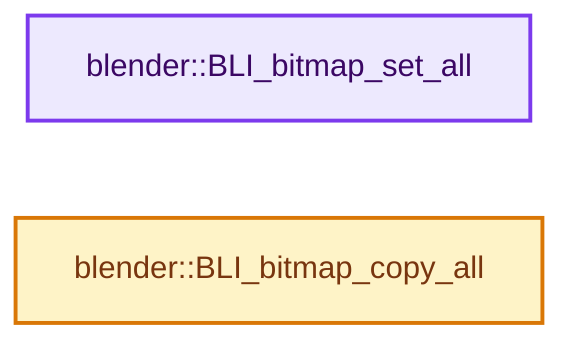
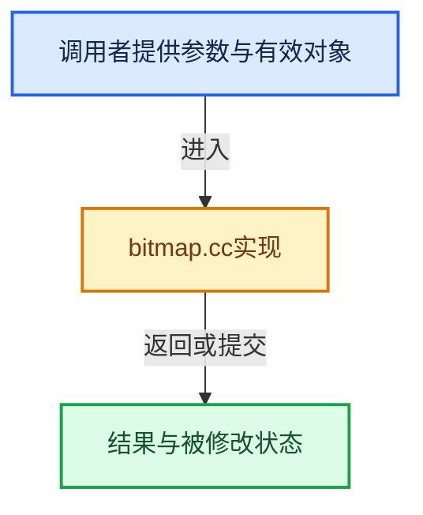

# 实现依赖专题：source/blender/blenlib/intern/bitmap.cc

[实现依赖导航](../../README.md) · [符号索引](../../../00-课程指南/02-源码与提交索引/符号依赖与实现索引.md)

本专题从正文实际调用进入，集中保存共享实现。函数有稳定锚点，可从调用处直接跳到对应完整函数；递归与互相调用通过回链组织。

## 本文件的实现关系






## 完整成员与函数实现

<a id="f-a60aac2bf556a851"></a>

### `blender::BLI_bitmap_set_all`

实现位置：[source/blender/blenlib/intern/bitmap.cc](../../../../../../../source/blender/blenlib/intern/bitmap.cc) · L19—L22。

接口参数：

- `BLI_bitmap *bitmap`
- `bool set`
- `size_t bits`

**教学注释版**

<!-- annotated:4e7d516e135c53 -->

```cpp
void BLI_bitmap_set_all(BLI_bitmap *bitmap, bool set, size_t bits)
{
  // [讲解] memset：填充字节，不调用T构造函数，也不保证任意类型的全零表示是合法或期望值。
  memset(bitmap, set ? UCHAR_MAX : 0, BLI_BITMAP_SIZE(bits));
}
```

<details>
<summary>核对原始源码：source/blender/blenlib/intern/bitmap.cc · L19—L22</summary>

<!-- original:4e7d516e135c53:source/blender/blenlib/intern/bitmap.cc:19:22 -->

```cpp
void BLI_bitmap_set_all(BLI_bitmap *bitmap, bool set, size_t bits)
{
  memset(bitmap, set ? UCHAR_MAX : 0, BLI_BITMAP_SIZE(bits));
}
```

</details>

**继续追踪实现**

- `memset` → [外部契约](https://eel.is/c++draft/cstring.syn)：填充字节，不调用T构造函数，也不保证任意类型的全零表示是合法或期望值。
- `BLI_BITMAP_SIZE` → [BLI_BITMAP_SIZE · L34](../BLI_bitmap.hh.md#m-6e3426a89e18)。宏定义由构建条件选择。

<a id="f-ab0de2d1dcafd000"></a>

### `blender::BLI_bitmap_copy_all`

实现位置：[source/blender/blenlib/intern/bitmap.cc](../../../../../../../source/blender/blenlib/intern/bitmap.cc) · L32—L35。

接口参数：

- `BLI_bitmap *dst`
- `const BLI_bitmap *src`
- `size_t bits`

**教学注释版**

<!-- annotated:ae02d6d157679f -->

```cpp
void BLI_bitmap_copy_all(BLI_bitmap *dst, const BLI_bitmap *src, size_t bits)
{
  // [讲解] memcpy：复制字节，源与目标不应重叠。类型生命周期、对齐和可复制表示须由调用者证明，不是任意对象的复制构造。
  memcpy(dst, src, BLI_BITMAP_SIZE(bits));
}
```

<details>
<summary>核对原始源码：source/blender/blenlib/intern/bitmap.cc · L32—L35</summary>

<!-- original:ae02d6d157679f:source/blender/blenlib/intern/bitmap.cc:32:35 -->

```cpp
void BLI_bitmap_copy_all(BLI_bitmap *dst, const BLI_bitmap *src, size_t bits)
{
  memcpy(dst, src, BLI_BITMAP_SIZE(bits));
}
```

</details>

**继续追踪实现**

- `memcpy` → [外部契约](https://eel.is/c++draft/cstring.syn)：复制字节，源与目标不应重叠。类型生命周期、对齐和可复制表示须由调用者证明，不是任意对象的复制构造。
- `BLI_BITMAP_SIZE` → [BLI_BITMAP_SIZE · L34](../BLI_bitmap.hh.md#m-6e3426a89e18)。宏定义由构建条件选择。
