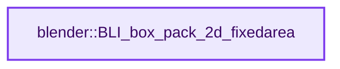
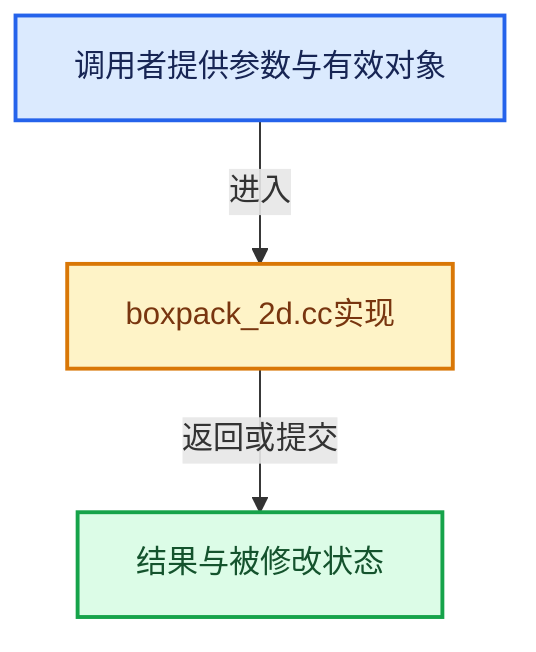

# 实现依赖专题：source/blender/blenlib/intern/boxpack_2d.cc

[实现依赖导航](../../README.md) · [符号索引](../../../00-课程指南/02-源码与提交索引/符号依赖与实现索引.md)

本专题从正文实际调用进入，集中保存共享实现。函数有稳定锚点，可从调用处直接跳到对应完整函数；递归与互相调用通过回链组织。

## 本文件的实现关系






## 完整成员与函数实现

<a id="f-dce99a1602447831"></a>

### `blender::BLI_box_pack_2d_fixedarea`

实现位置：[source/blender/blenlib/intern/boxpack_2d.cc](../../../../../../../source/blender/blenlib/intern/boxpack_2d.cc) · L651—L746。

接口参数：

- `ListBaseT<FixedSizeBoxPack> *boxes`
- `int width`
- `int height`
- `ListBaseT<FixedSizeBoxPack> *packed`

**教学注释版**

<!-- annotated:4a7fde5f252cb6 -->

```cpp
void BLI_box_pack_2d_fixedarea(ListBaseT<FixedSizeBoxPack> *boxes,
                               int width,
                               int height,
                               ListBaseT<FixedSizeBoxPack> *packed)
{
  ListBaseT<FixedSizeBoxPack> spaces = {nullptr};
  FixedSizeBoxPack *full_rect = MEM_new_zeroed<FixedSizeBoxPack>(__func__);
  full_rect->w = width;
  full_rect->h = height;

  BLI_addhead(&spaces, full_rect);

  /* The basic idea of the algorithm is to keep a list of free spaces in the packing area.
   * Then, for each box to be packed, we try to find a space that can contain it.
   * The found space is then split into the area that is occupied by the box and the
   * remaining area, which is reinserted into the free space list.
   * By inserting the smaller remaining spaces first, the algorithm tries to use these
   * smaller spaces first instead of "wasting" a large space. */
  for (FixedSizeBoxPack &box : boxes->items_mutable()) {
    for (FixedSizeBoxPack &space : spaces) {
      /* Skip this space if it's too small. */
      if (box.w > space.w || box.h > space.h) {
        continue;
      }

      /* Pack this box into this space. */
      box.x = space.x;
      box.y = space.y;
      BLI_remlink(boxes, &box);
      BLI_addtail(packed, &box);

      if (box.w == space.w && box.h == space.h) {
        /* Box exactly fills space, so just remove the space. */
        BLI_remlink(&spaces, &space);
        MEM_delete(&space);
      }
      else if (box.w == space.w) {
        /* Box fills the entire width, so we can just contract the box
         * to the upper part that remains. */
        space.y += box.h;
        space.h -= box.h;
      }
      else if (box.h == space.h) {
        /* Box fills the entire height, so we can just contract the box
         * to the right part that remains. */
        space.x += box.w;
        space.w -= box.w;
      }
      else {
        /* Split the remaining L-shaped space into two spaces.
         * There are two ways to do so, we pick the one that produces the biggest
         * remaining space:
         *
         *  Horizontal Split            Vertical Split
         * ###################        ###################
         * #                 #        #       -         #
         * #      Large      #        # Small -         #
         * #                 #        #       -         #
         * #********---------#        #********  Large  #
         * #  Box  *  Small  #        #  Box  *         #
         * #       *         #        #       *         #
         * ###################        ###################
         */
        int area_hsplit_large = space.w * (space.h - box.h);
        int area_vsplit_large = (space.w - box.w) * space.h;

        /* Perform split. This space becomes the larger space,
         * while the new smaller space is inserted _before_ it. */
        FixedSizeBoxPack *new_space = MEM_new_zeroed<FixedSizeBoxPack>(__func__);
        if (area_hsplit_large > area_vsplit_large) {
          new_space->x = space.x + box.w;
          new_space->y = space.y;
          new_space->w = space.w - box.w;
          new_space->h = box.h;

          space.y += box.h;
          space.h -= box.h;
        }
        else {
          new_space->x = space.x;
          new_space->y = space.y + box.h;
          new_space->w = box.w;
          new_space->h = space.h - box.h;

          space.x += box.w;
          space.w -= box.w;
        }
        BLI_addhead(&spaces, new_space);
      }

      break;
    }
  }

  spaces.free_no_destruct();
}
```

<details>
<summary>核对原始源码：source/blender/blenlib/intern/boxpack_2d.cc · L651—L746</summary>

<!-- original:4a7fde5f252cb6:source/blender/blenlib/intern/boxpack_2d.cc:651:746 -->

```cpp
void BLI_box_pack_2d_fixedarea(ListBaseT<FixedSizeBoxPack> *boxes,
                               int width,
                               int height,
                               ListBaseT<FixedSizeBoxPack> *packed)
{
  ListBaseT<FixedSizeBoxPack> spaces = {nullptr};
  FixedSizeBoxPack *full_rect = MEM_new_zeroed<FixedSizeBoxPack>(__func__);
  full_rect->w = width;
  full_rect->h = height;

  BLI_addhead(&spaces, full_rect);

  /* The basic idea of the algorithm is to keep a list of free spaces in the packing area.
   * Then, for each box to be packed, we try to find a space that can contain it.
   * The found space is then split into the area that is occupied by the box and the
   * remaining area, which is reinserted into the free space list.
   * By inserting the smaller remaining spaces first, the algorithm tries to use these
   * smaller spaces first instead of "wasting" a large space. */
  for (FixedSizeBoxPack &box : boxes->items_mutable()) {
    for (FixedSizeBoxPack &space : spaces) {
      /* Skip this space if it's too small. */
      if (box.w > space.w || box.h > space.h) {
        continue;
      }

      /* Pack this box into this space. */
      box.x = space.x;
      box.y = space.y;
      BLI_remlink(boxes, &box);
      BLI_addtail(packed, &box);

      if (box.w == space.w && box.h == space.h) {
        /* Box exactly fills space, so just remove the space. */
        BLI_remlink(&spaces, &space);
        MEM_delete(&space);
      }
      else if (box.w == space.w) {
        /* Box fills the entire width, so we can just contract the box
         * to the upper part that remains. */
        space.y += box.h;
        space.h -= box.h;
      }
      else if (box.h == space.h) {
        /* Box fills the entire height, so we can just contract the box
         * to the right part that remains. */
        space.x += box.w;
        space.w -= box.w;
      }
      else {
        /* Split the remaining L-shaped space into two spaces.
         * There are two ways to do so, we pick the one that produces the biggest
         * remaining space:
         *
         *  Horizontal Split            Vertical Split
         * ###################        ###################
         * #                 #        #       -         #
         * #      Large      #        # Small -         #
         * #                 #        #       -         #
         * #********---------#        #********  Large  #
         * #  Box  *  Small  #        #  Box  *         #
         * #       *         #        #       *         #
         * ###################        ###################
         */
        int area_hsplit_large = space.w * (space.h - box.h);
        int area_vsplit_large = (space.w - box.w) * space.h;

        /* Perform split. This space becomes the larger space,
         * while the new smaller space is inserted _before_ it. */
        FixedSizeBoxPack *new_space = MEM_new_zeroed<FixedSizeBoxPack>(__func__);
        if (area_hsplit_large > area_vsplit_large) {
          new_space->x = space.x + box.w;
          new_space->y = space.y;
          new_space->w = space.w - box.w;
          new_space->h = box.h;

          space.y += box.h;
          space.h -= box.h;
        }
        else {
          new_space->x = space.x;
          new_space->y = space.y + box.h;
          new_space->w = box.w;
          new_space->h = space.h - box.h;

          space.x += box.w;
          space.w -= box.w;
        }
        BLI_addhead(&spaces, new_space);
      }

      break;
    }
  }

  spaces.free_no_destruct();
}
```

</details>

**沿实际写入检查状态**

- `full_rect->w = width;`
- `full_rect->h = height;`
- `box.x = space.x;`
- `box.y = space.y;`
- `space.y += box.h;`
- `space.h -= box.h;`
- `space.x += box.w;`
- `space.w -= box.w;`
- `new_space->x = space.x + box.w;`
- `new_space->y = space.y;`
- `new_space->w = space.w - box.w;`
- `new_space->h = box.h;`
- `new_space->x = space.x;`
- `new_space->y = space.y + box.h;`
- `new_space->w = box.w;`
- `new_space->h = space.h - box.h;`

**继续追踪实现**

- `MEM_new_zeroed<FixedSizeBoxPack>` → [MEM_new_zeroed · L550](../../07-Intern运行时与平台/guardedalloc/MEM_guardedalloc.h.md#f-eeb1e2a7f57dd231)；[MEM_new_zeroed · L114](../../07-Intern运行时与平台/guardedalloc/intern/mallocn.cc.md#f-e04cf01c64c8b180)。同名重载需按实参类型选择。
- `BLI_addhead` → [blender::BLI_addhead · L98](listbase.cc.md#f-fed3ad483fcdfeb9)。
- `boxes->items_mutable` → [blender::ListBaseT::items_mutable · L163](../../08-其他Blender模块/makesdna/DNA_listBase.h.md#f-cc603252f543d4ad)。
- `BLI_remlink` → [blender::BLI_remlink · L138](listbase.cc.md#f-120d80f281ca4cb7)。
- `BLI_addtail` → [blender::BLI_addtail · L118](listbase.cc.md#f-4fb027713fa3115b)。
- `MEM_delete` → [MEM_delete · L400](../../07-Intern运行时与平台/guardedalloc/MEM_guardedalloc.h.md#f-9049ffdd1682887c)。
- `spaces.free_no_destruct` → [blender::ListBaseT::free_no_destruct · L78](../../08-其他Blender模块/makesdna/DNA_listBase.h.md#f-8656670edd0f6b7e)。
