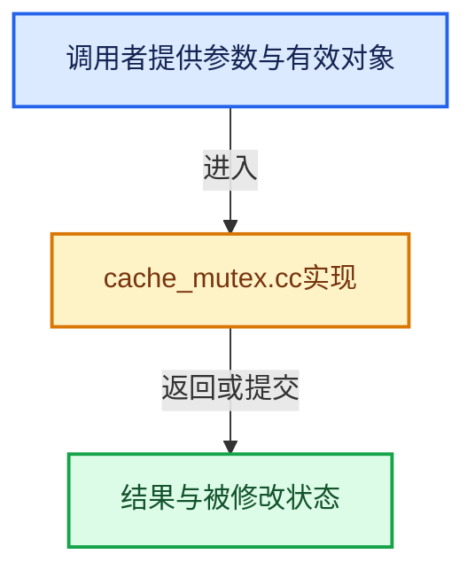

# 实现依赖专题：source/blender/blenlib/intern/cache_mutex.cc

[实现依赖导航](../../README.md) · [符号索引](../../../00-课程指南/02-源码与提交索引/符号依赖与实现索引.md)

本专题从正文实际调用进入，集中保存共享实现。函数有稳定锚点，可从调用处直接跳到对应完整函数；递归与互相调用通过回链组织。

## 本文件的实现关系





## 完整成员与函数实现

<a id="f-7eab37292dbb3e30"></a>

### `blender::CacheMutex::ensure_impl`

实现位置：[source/blender/blenlib/intern/cache_mutex.cc](../../../../../../../source/blender/blenlib/intern/cache_mutex.cc) · L14—L29。

接口参数：

- `const FunctionRef<void()> compute_cache`

**教学注释版**

<!-- annotated:cc0434c9122c41 -->

```cpp
void CacheMutex::ensure_impl(const FunctionRef<void()> compute_cache)
{
  if (cache_valid_.load(std::memory_order_acquire)) {
    return;
  }
  std::scoped_lock lock{mutex_};
  /* Double checked lock. */
  if (cache_valid_.load(std::memory_order_relaxed)) {
    return;
  }
  /* Use task isolation because a mutex is locked and the cache computation might use
   * multi-threading. */
  threading::isolate_task(compute_cache);

  cache_valid_.store(true, std::memory_order_release);
}
```

<details>
<summary>核对原始源码：source/blender/blenlib/intern/cache_mutex.cc · L14—L29</summary>

<!-- original:cc0434c9122c41:source/blender/blenlib/intern/cache_mutex.cc:14:29 -->

```cpp
void CacheMutex::ensure_impl(const FunctionRef<void()> compute_cache)
{
  if (cache_valid_.load(std::memory_order_acquire)) {
    return;
  }
  std::scoped_lock lock{mutex_};
  /* Double checked lock. */
  if (cache_valid_.load(std::memory_order_relaxed)) {
    return;
  }
  /* Use task isolation because a mutex is locked and the cache computation might use
   * multi-threading. */
  threading::isolate_task(compute_cache);

  cache_valid_.store(true, std::memory_order_release);
}
```

</details>

**继续追踪实现**

- `cache_valid_.load` → [调用协议](../../../00-课程指南/01-路线与规范/模板宏与动态分派协议.md)：接收对象类型依赖auto、返回值或模板实例；不按同名猜测目标。调用位置L16。
- `threading::isolate_task` → [blender::threading::isolate_task · L224](../../../11-Depsgraph与并行任务系统/07-任务池与TBB接入.md#f-c13dd3df595aa4f8)。
- `cache_valid_.store` → [调用协议](../../../00-课程指南/01-路线与规范/模板宏与动态分派协议.md)：接收对象类型依赖auto、返回值或模板实例；不按同名猜测目标。调用位置L28。
