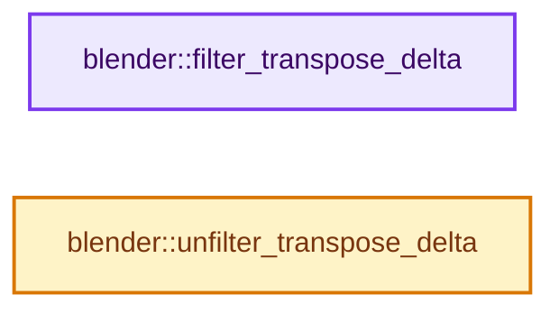
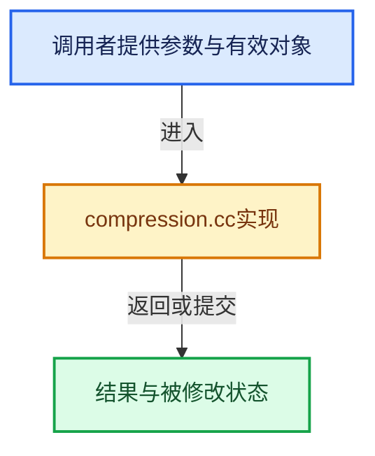

# 实现依赖专题：source/blender/blenlib/intern/compression.cc

[实现依赖导航](../../README.md) · [符号索引](../../../00-课程指南/02-源码与提交索引/符号依赖与实现索引.md)

本专题从正文实际调用进入，集中保存共享实现。函数有稳定锚点，可从调用处直接跳到对应完整函数；递归与互相调用通过回链组织。

## 本文件的实现关系






## 完整成员与函数实现

<a id="f-1aa8b2cbc2a46f40"></a>

### `blender::filter_transpose_delta`

实现位置：[source/blender/blenlib/intern/compression.cc](../../../../../../../source/blender/blenlib/intern/compression.cc) · L13—L27。

接口参数：

- `const uint8_t *src`
- `uint8_t *dst`
- `size_t items_num`
- `size_t item_size`

**教学注释版**

<!-- annotated:6d70e91b078c16 -->

```cpp
void filter_transpose_delta(const uint8_t *src, uint8_t *dst, size_t items_num, size_t item_size)
{
  for (size_t ib = 0; ib < item_size; ib++) {
    uint8_t prev = 0;
    const uint8_t *src_ptr = src + ib;
    size_t it = 0;
    for (; it < items_num; it++) {
      uint8_t v = *src_ptr;
      *dst = v - prev;
      prev = v;
      src_ptr += item_size;
      dst += 1;
    }
  }
}
```

<details>
<summary>核对原始源码：source/blender/blenlib/intern/compression.cc · L13—L27</summary>

<!-- original:6d70e91b078c16:source/blender/blenlib/intern/compression.cc:13:27 -->

```cpp
void filter_transpose_delta(const uint8_t *src, uint8_t *dst, size_t items_num, size_t item_size)
{
  for (size_t ib = 0; ib < item_size; ib++) {
    uint8_t prev = 0;
    const uint8_t *src_ptr = src + ib;
    size_t it = 0;
    for (; it < items_num; it++) {
      uint8_t v = *src_ptr;
      *dst = v - prev;
      prev = v;
      src_ptr += item_size;
      dst += 1;
    }
  }
}
```

</details>

**沿实际写入检查状态**

- `prev = v;`
- `src_ptr += item_size;`
- `dst += 1;`

**继续追踪实现**

本实现没有需要继续展开的显式调用；检查返回表达式、对象转换和调用者前置条件。

<a id="f-5f97f6e8b8225d7f"></a>

### `blender::unfilter_transpose_delta`

实现位置：[source/blender/blenlib/intern/compression.cc](../../../../../../../source/blender/blenlib/intern/compression.cc) · L29—L42。

接口参数：

- `const uint8_t *src`
- `uint8_t *dst`
- `size_t items_num`
- `size_t item_size`

**教学注释版**

<!-- annotated:a4a58ff26b446e -->

```cpp
void unfilter_transpose_delta(const uint8_t *src, uint8_t *dst, size_t items_num, size_t item_size)
{
  for (size_t ib = 0; ib < item_size; ib++) {
    uint8_t prev = 0;
    uint8_t *dst_ptr = dst + ib;
    for (size_t it = 0; it < items_num; it++) {
      uint8_t v = *src + prev;
      prev = v;
      *dst_ptr = v;
      src += 1;
      dst_ptr += item_size;
    }
  }
}
```

<details>
<summary>核对原始源码：source/blender/blenlib/intern/compression.cc · L29—L42</summary>

<!-- original:a4a58ff26b446e:source/blender/blenlib/intern/compression.cc:29:42 -->

```cpp
void unfilter_transpose_delta(const uint8_t *src, uint8_t *dst, size_t items_num, size_t item_size)
{
  for (size_t ib = 0; ib < item_size; ib++) {
    uint8_t prev = 0;
    uint8_t *dst_ptr = dst + ib;
    for (size_t it = 0; it < items_num; it++) {
      uint8_t v = *src + prev;
      prev = v;
      *dst_ptr = v;
      src += 1;
      dst_ptr += item_size;
    }
  }
}
```

</details>

**沿实际写入检查状态**

- `prev = v;`
- `src += 1;`
- `dst_ptr += item_size;`

**继续追踪实现**

本实现没有需要继续展开的显式调用；检查返回表达式、对象转换和调用者前置条件。
