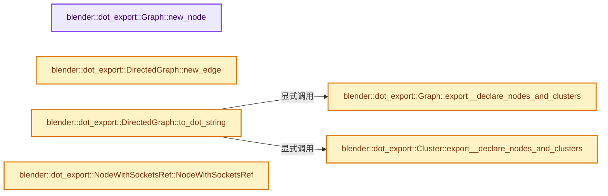
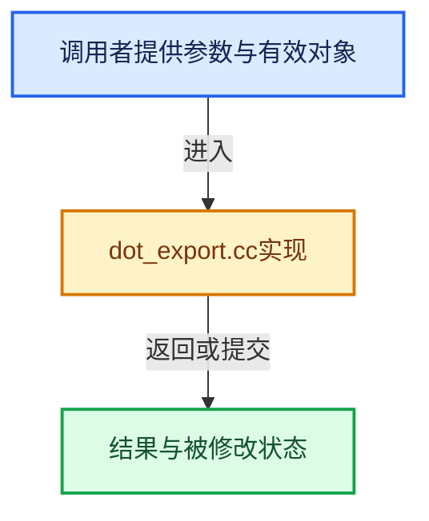

# 实现依赖专题：source/blender/blenlib/intern/dot_export.cc

[实现依赖导航](../../README.md) · [符号索引](../../../00-课程指南/02-源码与提交索引/符号依赖与实现索引.md)

本专题从正文实际调用进入，集中保存共享实现。函数有稳定锚点，可从调用处直接跳到对应完整函数；递归与互相调用通过回链组织。

## 本文件的实现关系






## 完整成员与函数实现

<a id="f-c18eecae7679bda3"></a>

### `blender::dot_export::Graph::new_node`

实现位置：[source/blender/blenlib/intern/dot_export.cc](../../../../../../../source/blender/blenlib/intern/dot_export.cc) · L21—L28。

接口参数：

- `StringRef label`

**教学注释版**

<!-- annotated:b8385565fa4688 -->

```cpp
Node &Graph::new_node(StringRef label)
{
  Node *node = new Node(*this);
  nodes_.append(std::unique_ptr<Node>(node));
  top_level_nodes_.add_new(node);
  node->attributes.set("label", label);
  return *node;
}
```

<details>
<summary>核对原始源码：source/blender/blenlib/intern/dot_export.cc · L21—L28</summary>

<!-- original:b8385565fa4688:source/blender/blenlib/intern/dot_export.cc:21:28 -->

```cpp
Node &Graph::new_node(StringRef label)
{
  Node *node = new Node(*this);
  nodes_.append(std::unique_ptr<Node>(node));
  top_level_nodes_.add_new(node);
  node->attributes.set("label", label);
  return *node;
}
```

</details>

**结果出口**

- `return *node;`

**继续追踪实现**

- `nodes_.append` → [调用协议](../../../00-课程指南/01-路线与规范/模板宏与动态分派协议.md)：接收对象类型依赖auto、返回值或模板实例；不按同名猜测目标。调用位置L24。
- `std::unique_ptr<Node>` → [外部契约](https://eel.is/c++draft/)：这个边界按实际表达式及所属类型核对参数、返回值、寿命与失败行为。这里提供接口入口，不声称已解释该第三方版本的内部实现。
- `top_level_nodes_.add_new` → [调用协议](../../../00-课程指南/01-路线与规范/模板宏与动态分派协议.md)：接收对象类型依赖auto、返回值或模板实例；不按同名猜测目标。调用位置L25。
- `node->attributes.set` → [调用协议](../../../00-课程指南/01-路线与规范/模板宏与动态分派协议.md)：接收对象类型依赖auto、返回值或模板实例；不按同名猜测目标。调用位置L26。

<a id="f-b81e911705f8c06e"></a>

### `blender::dot_export::DirectedGraph::new_edge`

实现位置：[source/blender/blenlib/intern/dot_export.cc](../../../../../../../source/blender/blenlib/intern/dot_export.cc) · L46—L51。

接口参数：

- `NodePort from`
- `NodePort to`

**教学注释版**

<!-- annotated:3aef3fc701e789 -->

```cpp
DirectedEdge &DirectedGraph::new_edge(NodePort from, NodePort to)
{
  DirectedEdge *edge = new DirectedEdge(from, to);
  edges_.append(std::unique_ptr<DirectedEdge>(edge));
  return *edge;
}
```

<details>
<summary>核对原始源码：source/blender/blenlib/intern/dot_export.cc · L46—L51</summary>

<!-- original:3aef3fc701e789:source/blender/blenlib/intern/dot_export.cc:46:51 -->

```cpp
DirectedEdge &DirectedGraph::new_edge(NodePort from, NodePort to)
{
  DirectedEdge *edge = new DirectedEdge(from, to);
  edges_.append(std::unique_ptr<DirectedEdge>(edge));
  return *edge;
}
```

</details>

**结果出口**

- `return *edge;`

**继续追踪实现**

- `edges_.append` → [调用协议](../../../00-课程指南/01-路线与规范/模板宏与动态分派协议.md)：接收对象类型依赖auto、返回值或模板实例；不按同名猜测目标。调用位置L49。
- `std::unique_ptr<DirectedEdge>` → [外部契约](https://eel.is/c++draft/)：这个边界按实际表达式及所属类型核对参数、返回值、寿命与失败行为。这里提供接口入口，不声称已解释该第三方版本的内部实现。

<a id="f-e1fb2394550cdd6f"></a>

### `blender::dot_export::DirectedGraph::to_dot_string`

实现位置：[source/blender/blenlib/intern/dot_export.cc](../../../../../../../source/blender/blenlib/intern/dot_export.cc) · L136—L150。

**教学注释版**

<!-- annotated:32d90a1c172e0d -->

```cpp
std::string DirectedGraph::to_dot_string() const
{
  std::stringstream ss;
  ss << "digraph {\n";
  this->export__declare_nodes_and_clusters(ss);
  ss << "\n";

  for (const std::unique_ptr<DirectedEdge> &edge : edges_) {
    edge->export__as_edge_statement(ss);
    ss << "\n";
  }

  ss << "}\n";
  return ss.str();
}
```

<details>
<summary>核对原始源码：source/blender/blenlib/intern/dot_export.cc · L136—L150</summary>

<!-- original:32d90a1c172e0d:source/blender/blenlib/intern/dot_export.cc:136:150 -->

```cpp
std::string DirectedGraph::to_dot_string() const
{
  std::stringstream ss;
  ss << "digraph {\n";
  this->export__declare_nodes_and_clusters(ss);
  ss << "\n";

  for (const std::unique_ptr<DirectedEdge> &edge : edges_) {
    edge->export__as_edge_statement(ss);
    ss << "\n";
  }

  ss << "}\n";
  return ss.str();
}
```

</details>

**结果出口**

- `return ss.str();`

**继续追踪实现**

- `this->export__declare_nodes_and_clusters` → [blender::dot_export::Graph::export__declare_nodes_and_clusters · L168](dot_export.cc.md#f-3e8820fce96ac943)；[blender::dot_export::Cluster::export__declare_nodes_and_clusters · L183](dot_export.cc.md#f-1bd29845f825bc84)。同名重载需按实参类型选择。
- `edge->export__as_edge_statement` → [调用协议](../../../00-课程指南/01-路线与规范/模板宏与动态分派协议.md)：接收对象类型依赖auto、返回值或模板实例；不按同名猜测目标。调用位置L144。
- `ss.str` → [外部契约](https://eel.is/c++draft/)：这个边界按实际表达式及所属类型核对参数、返回值、寿命与失败行为。这里提供接口入口，不声称已解释该第三方版本的内部实现。

<a id="f-3e8820fce96ac943"></a>

### `blender::dot_export::Graph::export__declare_nodes_and_clusters`

实现位置：[source/blender/blenlib/intern/dot_export.cc](../../../../../../../source/blender/blenlib/intern/dot_export.cc) · L168—L181。

接口参数：

- `std::stringstream &ss`

**教学注释版**

<!-- annotated:305975236e98c6 -->

```cpp
void Graph::export__declare_nodes_and_clusters(std::stringstream &ss) const
{
  ss << "graph ";
  attributes.export__as_bracket_list(ss);
  ss << "\n\n";

  for (Node *node : top_level_nodes_) {
    node->export__as_declaration(ss);
  }

  for (Cluster *cluster : top_level_clusters_) {
    cluster->export__declare_nodes_and_clusters(ss);
  }
}
```

<details>
<summary>核对原始源码：source/blender/blenlib/intern/dot_export.cc · L168—L181</summary>

<!-- original:305975236e98c6:source/blender/blenlib/intern/dot_export.cc:168:181 -->

```cpp
void Graph::export__declare_nodes_and_clusters(std::stringstream &ss) const
{
  ss << "graph ";
  attributes.export__as_bracket_list(ss);
  ss << "\n\n";

  for (Node *node : top_level_nodes_) {
    node->export__as_declaration(ss);
  }

  for (Cluster *cluster : top_level_clusters_) {
    cluster->export__declare_nodes_and_clusters(ss);
  }
}
```

</details>

**继续追踪实现**

- `attributes.export__as_bracket_list` → [调用协议](../../../00-课程指南/01-路线与规范/模板宏与动态分派协议.md)：接收对象类型依赖auto、返回值或模板实例；不按同名猜测目标。调用位置L171。
- `node->export__as_declaration` → [调用协议](../../../00-课程指南/01-路线与规范/模板宏与动态分派协议.md)：接收对象类型依赖auto、返回值或模板实例；不按同名猜测目标。调用位置L175。
- `cluster->export__declare_nodes_and_clusters` → [调用协议](../../../00-课程指南/01-路线与规范/模板宏与动态分派协议.md)：接收对象类型依赖auto、返回值或模板实例；不按同名猜测目标。调用位置L179。

<a id="f-1bd29845f825bc84"></a>

### `blender::dot_export::Cluster::export__declare_nodes_and_clusters`

实现位置：[source/blender/blenlib/intern/dot_export.cc](../../../../../../../source/blender/blenlib/intern/dot_export.cc) · L183—L200。

接口参数：

- `std::stringstream &ss`

**教学注释版**

<!-- annotated:9705d5a1df7826 -->

```cpp
void Cluster::export__declare_nodes_and_clusters(std::stringstream &ss) const
{
  ss << "subgraph " << this->name() << " {\n";

  ss << "graph ";
  attributes.export__as_bracket_list(ss);
  ss << "\n\n";

  for (Node *node : nodes_) {
    node->export__as_declaration(ss);
  }

  for (Cluster *cluster : children_) {
    cluster->export__declare_nodes_and_clusters(ss);
  }

  ss << "}\n";
}
```

<details>
<summary>核对原始源码：source/blender/blenlib/intern/dot_export.cc · L183—L200</summary>

<!-- original:9705d5a1df7826:source/blender/blenlib/intern/dot_export.cc:183:200 -->

```cpp
void Cluster::export__declare_nodes_and_clusters(std::stringstream &ss) const
{
  ss << "subgraph " << this->name() << " {\n";

  ss << "graph ";
  attributes.export__as_bracket_list(ss);
  ss << "\n\n";

  for (Node *node : nodes_) {
    node->export__as_declaration(ss);
  }

  for (Cluster *cluster : children_) {
    cluster->export__declare_nodes_and_clusters(ss);
  }

  ss << "}\n";
}
```

</details>

**继续追踪实现**

- `this->name` → [blender::dot_export::Cluster::name · L91](../BLI_dot_export.hh.md#f-e9049fa64f743eee)。
- `attributes.export__as_bracket_list` → [调用协议](../../../00-课程指南/01-路线与规范/模板宏与动态分派协议.md)：接收对象类型依赖auto、返回值或模板实例；不按同名猜测目标。调用位置L188。
- `node->export__as_declaration` → [调用协议](../../../00-课程指南/01-路线与规范/模板宏与动态分派协议.md)：接收对象类型依赖auto、返回值或模板实例；不按同名猜测目标。调用位置L192。
- `cluster->export__declare_nodes_and_clusters` → [调用协议](../../../00-课程指南/01-路线与规范/模板宏与动态分派协议.md)：接收对象类型依赖auto、返回值或模板实例；不按同名猜测目标。调用位置L196。

<a id="f-5746aba93e095c9b"></a>

### `blender::dot_export::NodeWithSocketsRef::NodeWithSocketsRef`

实现位置：[source/blender/blenlib/intern/dot_export.cc](../../../../../../../source/blender/blenlib/intern/dot_export.cc) · L274—L327。

接口参数：

- `Node &node`
- `const NodeWithSockets &data`

**教学注释版**

<!-- annotated:fa21e3e380f4e5 -->

```cpp
NodeWithSocketsRef::NodeWithSocketsRef(Node &node, const NodeWithSockets &data) : node_(&node)
{
  std::stringstream ss;

  ss << R"(<<table border="0" cellspacing="3">)";

  /* Header */
  ss << R"(<tr><td colspan="3" align="center"><b>)";
  ss << (data.node_name.empty() ? "No Name" : data.node_name);
  ss << "</b></td></tr>";

  /* Sockets */
  // [讲解] std::max：按比较关系选取较大值。本讲解中的增长公式同时满足最低请求和几何增长；若保存返回引用，还需注意实参寿命。
  int socket_max_amount = std::max(data.inputs.size(), data.outputs.size());
  for (int i = 0; i < socket_max_amount; i++) {
    ss << "<tr>";
    if (i < data.inputs.size()) {
      const NodeWithSockets::Input &input = data.inputs[i];
      ss << R"(<td align="left" port="in)" << i << "\">";
      if (input.fontcolor) {
        ss << R"(<font color=")" << *input.fontcolor << "\">";
      }
      ss << (input.name.empty() ? "No Name" : input.name);
      if (input.fontcolor) {
        ss << "</font>";
      }
      ss << "</td>";
    }
    else {
      ss << "<td></td>";
    }
    ss << "<td></td>";
    if (i < data.outputs.size()) {
      const NodeWithSockets::Output &output = data.outputs[i];
      ss << R"(<td align="right" port="out)" << i << "\">";
      if (output.fontcolor) {
        ss << R"(<font color=")" << *output.fontcolor << "\">";
      }
      ss << (output.name.empty() ? "No Name" : output.name);
      if (output.fontcolor) {
        ss << "</font>";
      }
      ss << "</td>";
    }
    else {
      ss << "<td></td>";
    }
    ss << "</tr>";
  }

  ss << "</table>>";

  node_->attributes.set("label", ss.str());
  node_->set_shape(Attr_shape::Rectangle);
}
```

<details>
<summary>核对原始源码：source/blender/blenlib/intern/dot_export.cc · L274—L327</summary>

<!-- original:fa21e3e380f4e5:source/blender/blenlib/intern/dot_export.cc:274:327 -->

```cpp
NodeWithSocketsRef::NodeWithSocketsRef(Node &node, const NodeWithSockets &data) : node_(&node)
{
  std::stringstream ss;

  ss << R"(<<table border="0" cellspacing="3">)";

  /* Header */
  ss << R"(<tr><td colspan="3" align="center"><b>)";
  ss << (data.node_name.empty() ? "No Name" : data.node_name);
  ss << "</b></td></tr>";

  /* Sockets */
  int socket_max_amount = std::max(data.inputs.size(), data.outputs.size());
  for (int i = 0; i < socket_max_amount; i++) {
    ss << "<tr>";
    if (i < data.inputs.size()) {
      const NodeWithSockets::Input &input = data.inputs[i];
      ss << R"(<td align="left" port="in)" << i << "\">";
      if (input.fontcolor) {
        ss << R"(<font color=")" << *input.fontcolor << "\">";
      }
      ss << (input.name.empty() ? "No Name" : input.name);
      if (input.fontcolor) {
        ss << "</font>";
      }
      ss << "</td>";
    }
    else {
      ss << "<td></td>";
    }
    ss << "<td></td>";
    if (i < data.outputs.size()) {
      const NodeWithSockets::Output &output = data.outputs[i];
      ss << R"(<td align="right" port="out)" << i << "\">";
      if (output.fontcolor) {
        ss << R"(<font color=")" << *output.fontcolor << "\">";
      }
      ss << (output.name.empty() ? "No Name" : output.name);
      if (output.fontcolor) {
        ss << "</font>";
      }
      ss << "</td>";
    }
    else {
      ss << "<td></td>";
    }
    ss << "</tr>";
  }

  ss << "</table>>";

  node_->attributes.set("label", ss.str());
  node_->set_shape(Attr_shape::Rectangle);
}
```

</details>

**继续追踪实现**

- `data.node_name.empty` → [调用协议](../../../00-课程指南/01-路线与规范/模板宏与动态分派协议.md)：接收对象类型依赖auto、返回值或模板实例；不按同名猜测目标。调用位置L282。
- `std::max` → [外部契约](https://eel.is/c++draft/alg.min.max)：按比较关系选取较大值。本讲解中的增长公式同时满足最低请求和几何增长；若保存返回引用，还需注意实参寿命。
- `data.inputs.size` → [调用协议](../../../00-课程指南/01-路线与规范/模板宏与动态分派协议.md)：接收对象类型依赖auto、返回值或模板实例；不按同名猜测目标。调用位置L286。
- `data.outputs.size` → [调用协议](../../../00-课程指南/01-路线与规范/模板宏与动态分派协议.md)：接收对象类型依赖auto、返回值或模板实例；不按同名猜测目标。调用位置L286。
- `input.name.empty` → [调用协议](../../../00-课程指南/01-路线与规范/模板宏与动态分派协议.md)：接收对象类型依赖auto、返回值或模板实例；不按同名猜测目标。调用位置L295。
- `output.name.empty` → [调用协议](../../../00-课程指南/01-路线与规范/模板宏与动态分派协议.md)：接收对象类型依赖auto、返回值或模板实例；不按同名猜测目标。调用位置L311。
- `node_->attributes.set` → [调用协议](../../../00-课程指南/01-路线与规范/模板宏与动态分派协议.md)：接收对象类型依赖auto、返回值或模板实例；不按同名猜测目标。调用位置L325。
- `ss.str` → [外部契约](https://eel.is/c++draft/)：这个边界按实际表达式及所属类型核对参数、返回值、寿命与失败行为。这里提供接口入口，不声称已解释该第三方版本的内部实现。
- `node_->set_shape` → [调用协议](../../../00-课程指南/01-路线与规范/模板宏与动态分派协议.md)：接收对象类型依赖auto、返回值或模板实例；不按同名猜测目标。调用位置L326。
