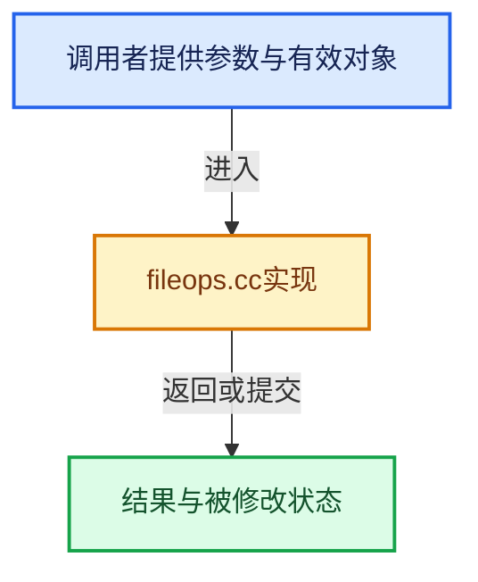

# 实现依赖专题：source/blender/blenlib/intern/fileops.cc

[实现依赖导航](../../README.md) · [符号索引](../../../00-课程指南/02-源码与提交索引/符号依赖与实现索引.md)

本专题从正文实际调用进入，集中保存共享实现。函数有稳定锚点，可从调用处直接跳到对应完整函数；递归与互相调用通过回链组织。

## 本文件的实现关系





## 完整成员与函数实现

<a id="f-e6919dfaec3f96e6"></a>

### `blender::fstream::open`

实现位置：[source/blender/blenlib/intern/fileops.cc](../../../../../../../source/blender/blenlib/intern/fileops.cc) · L27—L38。

接口参数：

- `StringRefNull filepath`
- `ios_base::openmode mode`

**教学注释版**

<!-- annotated:1420afa5a557ff -->

```cpp
void fstream::open(StringRefNull filepath, ios_base::openmode mode)
{
#ifdef WIN32
  const char *filepath_cstr = filepath.c_str();
  UTF16_ENCODE(filepath_cstr);
  std::wstring filepath_wstr(filepath_cstr_16);
  std::fstream::open(filepath_wstr.c_str(), mode);
  UTF16_UN_ENCODE(filepath_cstr);
#else
  std::fstream::open(filepath, mode);
#endif
}
```

<details>
<summary>核对原始源码：source/blender/blenlib/intern/fileops.cc · L27—L38</summary>

<!-- original:1420afa5a557ff:source/blender/blenlib/intern/fileops.cc:27:38 -->

```cpp
void fstream::open(StringRefNull filepath, ios_base::openmode mode)
{
#ifdef WIN32
  const char *filepath_cstr = filepath.c_str();
  UTF16_ENCODE(filepath_cstr);
  std::wstring filepath_wstr(filepath_cstr_16);
  std::fstream::open(filepath_wstr.c_str(), mode);
  UTF16_UN_ENCODE(filepath_cstr);
#else
  std::fstream::open(filepath, mode);
#endif
}
```

</details>

**继续追踪实现**

- `filepath.c_str` → [blender::StringRefNull::c_str · L544](../../../01-基础容器与现代CPP/15-StringRef字符串视图.md#f-4a8bbfe1e6d00757)。
- `UTF16_ENCODE` → [UTF16_ENCODE · L80](../../07-Intern运行时与平台/utfconv/utfconv.hh.md#m-525fa4c6da9a)。宏定义由构建条件选择。
- `std::fstream::open` → [外部契约](https://eel.is/c++draft/)：这个边界按实际表达式及所属类型核对参数、返回值、寿命与失败行为。这里提供接口入口，不声称已解释该第三方版本的内部实现。
- `filepath_wstr.c_str` → [外部契约](https://eel.is/c++draft/)：这个边界按实际表达式及所属类型核对参数、返回值、寿命与失败行为。这里提供接口入口，不声称已解释该第三方版本的内部实现。
- `UTF16_UN_ENCODE` → [UTF16_UN_ENCODE · L84](../../07-Intern运行时与平台/utfconv/utfconv.hh.md#m-0b666190cfed)。宏定义由构建条件选择。
