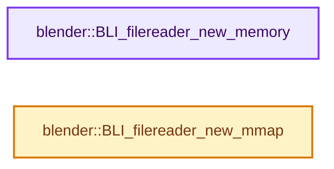

# 实现依赖专题：source/blender/blenlib/intern/filereader_memory.cc

[实现依赖导航](../../README.md) · [符号索引](../../../00-课程指南/02-源码与提交索引/符号依赖与实现索引.md)

本专题从正文实际调用进入，集中保存共享实现。函数有稳定锚点，可从调用处直接跳到对应完整函数；递归与互相调用通过回链组织。

## 本文件的实现关系




## 完整成员与函数实现

<a id="f-4b87a7fee9b758dd"></a>

### `blender::BLI_filereader_new_memory`

实现位置：[source/blender/blenlib/intern/filereader_memory.cc](../../../../../../../source/blender/blenlib/intern/filereader_memory.cc) · L73—L85。

接口参数：

- `const void *data`
- `size_t len`

**教学注释版**

<!-- annotated:1bf45c430a7ef1 -->

```cpp
FileReader *BLI_filereader_new_memory(const void *data, size_t len)
{
  MemoryReader *mem = MEM_new_zeroed<MemoryReader>(__func__);

  mem->data = static_cast<const char *>(data);
  mem->length = len;

  mem->reader.read = memory_read_raw;
  mem->reader.seek = memory_seek;
  mem->reader.close = memory_close_raw;

  return reinterpret_cast<FileReader *>(mem);
}
```

<details>
<summary>核对原始源码：source/blender/blenlib/intern/filereader_memory.cc · L73—L85</summary>

<!-- original:1bf45c430a7ef1:source/blender/blenlib/intern/filereader_memory.cc:73:85 -->

```cpp
FileReader *BLI_filereader_new_memory(const void *data, size_t len)
{
  MemoryReader *mem = MEM_new_zeroed<MemoryReader>(__func__);

  mem->data = static_cast<const char *>(data);
  mem->length = len;

  mem->reader.read = memory_read_raw;
  mem->reader.seek = memory_seek;
  mem->reader.close = memory_close_raw;

  return reinterpret_cast<FileReader *>(mem);
}
```

</details>

**沿实际写入检查状态**

- `mem->data = static_cast<const char *>(data);`
- `mem->length = len;`
- `mem->reader.read = memory_read_raw;`
- `mem->reader.seek = memory_seek;`
- `mem->reader.close = memory_close_raw;`

**结果出口**

- `return reinterpret_cast<FileReader *>(mem);`

**继续追踪实现**

- `MEM_new_zeroed<MemoryReader>` → [MEM_new_zeroed · L550](../../07-Intern运行时与平台/guardedalloc/MEM_guardedalloc.h.md#f-eeb1e2a7f57dd231)；[MEM_new_zeroed · L114](../../07-Intern运行时与平台/guardedalloc/intern/mallocn.cc.md#f-e04cf01c64c8b180)。同名重载需按实参类型选择。

<a id="f-8227ddabcb0cb27a"></a>

### `blender::BLI_filereader_new_mmap`

实现位置：[source/blender/blenlib/intern/filereader_memory.cc](../../../../../../../source/blender/blenlib/intern/filereader_memory.cc) · L116—L133。

接口参数：

- `int filedes`

**教学注释版**

<!-- annotated:3150d703b53acd -->

```cpp
FileReader *BLI_filereader_new_mmap(int filedes)
{
  BLI_mmap_file *mmap = BLI_mmap_open(filedes);
  if (mmap == nullptr) {
    return nullptr;
  }

  MemoryReader *mem = MEM_new_zeroed<MemoryReader>(__func__);

  mem->mmap = mmap;
  mem->length = BLI_mmap_get_length(mmap);

  mem->reader.read = memory_read_mmap;
  mem->reader.seek = memory_seek;
  mem->reader.close = memory_close_mmap;

  return reinterpret_cast<FileReader *>(mem);
}
```

<details>
<summary>核对原始源码：source/blender/blenlib/intern/filereader_memory.cc · L116—L133</summary>

<!-- original:3150d703b53acd:source/blender/blenlib/intern/filereader_memory.cc:116:133 -->

```cpp
FileReader *BLI_filereader_new_mmap(int filedes)
{
  BLI_mmap_file *mmap = BLI_mmap_open(filedes);
  if (mmap == nullptr) {
    return nullptr;
  }

  MemoryReader *mem = MEM_new_zeroed<MemoryReader>(__func__);

  mem->mmap = mmap;
  mem->length = BLI_mmap_get_length(mmap);

  mem->reader.read = memory_read_mmap;
  mem->reader.seek = memory_seek;
  mem->reader.close = memory_close_mmap;

  return reinterpret_cast<FileReader *>(mem);
}
```

</details>

**沿实际写入检查状态**

- `mem->mmap = mmap;`
- `mem->length = BLI_mmap_get_length(mmap);`
- `mem->reader.read = memory_read_mmap;`
- `mem->reader.seek = memory_seek;`
- `mem->reader.close = memory_close_mmap;`

**结果出口**

- `return nullptr;`
- `return reinterpret_cast<FileReader *>(mem);`

**继续追踪实现**

- `BLI_mmap_open` → [blender::BLI_mmap_open · L369](BLI_mmap.cc.md#f-a87ee2ea19b3fd5a)。
- `MEM_new_zeroed<MemoryReader>` → [MEM_new_zeroed · L550](../../07-Intern运行时与平台/guardedalloc/MEM_guardedalloc.h.md#f-eeb1e2a7f57dd231)；[MEM_new_zeroed · L114](../../07-Intern运行时与平台/guardedalloc/intern/mallocn.cc.md#f-e04cf01c64c8b180)。同名重载需按实参类型选择。
- `BLI_mmap_get_length` → [blender::BLI_mmap_get_length · L484](BLI_mmap.cc.md#f-8c3e5c335f2b2102)。
