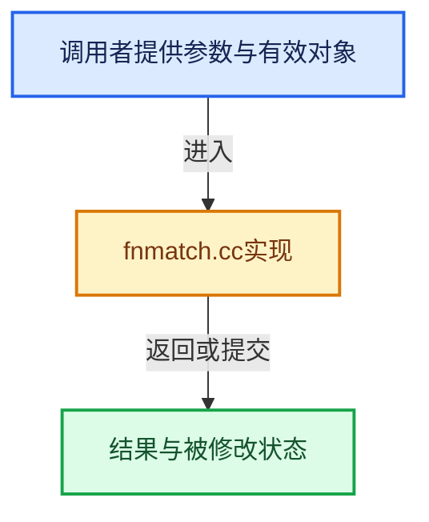

# 实现依赖专题：source/blender/blenlib/intern/fnmatch.cc

[实现依赖导航](../../README.md) · [符号索引](../../../00-课程指南/02-源码与提交索引/符号依赖与实现索引.md)

本专题从正文实际调用进入，集中保存共享实现。函数有稳定锚点，可从调用处直接跳到对应完整函数；递归与互相调用通过回链组织。

## 本文件的实现关系





## 完整成员与函数实现

<a id="f-89e772f67ae3dfaa"></a>

### `fnmatch`

实现位置：[source/blender/blenlib/intern/fnmatch.cc](../../../../../../../source/blender/blenlib/intern/fnmatch.cc) · L50—L227。

接口参数：

- `const char *pattern`
- `const char *string`
- `int flags`

**教学注释版**

<!-- annotated:b71a64a8ee4cae -->

```cpp
int
fnmatch (const char *pattern, const char *string, int flags)
{
  const char *p = pattern, *n = string;
  char c;

/* Note that this evaluates C many times.  */
# define FOLD(c) ((flags & FNM_CASEFOLD) && ISUPPER (c) ? tolower (c) : (c))

  while ((c = *p++) != '\0')
  {
    c = FOLD (c);

    switch (c)
  {
  case '?':
    if (*n == '\0')
    return FNM_NOMATCH;
    else if ((flags & FNM_FILE_NAME) && *n == '/')
    return FNM_NOMATCH;
    else if ((flags & FNM_PERIOD) && *n == '.' &&
       (n == string || ((flags & FNM_FILE_NAME) && n[-1] == '/')))
    return FNM_NOMATCH;
    break;

  case '\\':
    if (!(flags & FNM_NOESCAPE))
    {
      c = *p++;
      if (c == '\0')
    /* Trailing \ loses.  */
    return FNM_NOMATCH;
      c = FOLD (c);
    }
    if (FOLD (*n) != c)
    return FNM_NOMATCH;
    break;

  case '*':
    if ((flags & FNM_PERIOD) && *n == '.' &&
      (n == string || ((flags & FNM_FILE_NAME) && n[-1] == '/')))
    return FNM_NOMATCH;

    for (c = *p++; c == '?' || c == '*'; c = *p++)
    {
      if ((flags & FNM_FILE_NAME) && *n == '/')
    /* A slash does not match a wildcard under FNM_FILE_NAME.  */
    return FNM_NOMATCH;
      else if (c == '?')
    {
      /* A ? needs to match one character.  */
      if (*n == '\0')
      /* There isn't another character; no match.  */
      return FNM_NOMATCH;
      else
      /* One character of the string is consumed in matching
         this ? wildcard, so *??? won't match if there are
         less than three characters.  */
      ++n;
    }
    }

    if (c == '\0')
    return 0;

    {
    char c1 = (!(flags & FNM_NOESCAPE) && c == '\\') ? *p : c;
    c1 = FOLD (c1);
    for (--p; *n != '\0'; ++n)
      if ((c == '[' || FOLD (*n) == c1) &&
      fnmatch (p, n, flags & ~FNM_PERIOD) == 0)
    return 0;
    return FNM_NOMATCH;
    }

  case '[':
    {
    /* Nonzero if the sense of the character class is inverted.  */

    if (*n == '\0')
      return FNM_NOMATCH;

    if ((flags & FNM_PERIOD) && *n == '.' &&
    (n == string || ((flags & FNM_FILE_NAME) && n[-1] == '/')))
      return FNM_NOMATCH;

    bool is_not = (*p == '!' || *p == '^');
    if (is_not)
      ++p;

    c = *p++;
    for (;;)
      {
    char cstart = c, cend = c;

    if (!(flags & FNM_NOESCAPE) && c == '\\')
      {
      if (*p == '\0')
        return FNM_NOMATCH;
      cstart = cend = *p++;
      }

    cstart = cend = FOLD (cstart);

    if (c == '\0')
      /* [ (unterminated) loses.  */
      return FNM_NOMATCH;

    c = *p++;
    c = FOLD (c);

    if ((flags & FNM_FILE_NAME) && c == '/')
      /* [/] can never match.  */
      return FNM_NOMATCH;

    if (c == '-' && *p != ']')
      {
      cend = *p++;
      if (!(flags & FNM_NOESCAPE) && cend == '\\')
        cend = *p++;
      if (cend == '\0')
        return FNM_NOMATCH;
      cend = FOLD (cend);

      c = *p++;
      }

    if (FOLD (*n) >= cstart && FOLD (*n) <= cend)
      goto matched;

    if (c == ']')
      break;
      }
    if (!is_not)
      return FNM_NOMATCH;
    break;

    matched:;
    /* Skip the rest of the [...] that already matched.  */
    while (c != ']')
      {
    if (c == '\0')
      /* [... (unterminated) loses.  */
      return FNM_NOMATCH;

    c = *p++;
    if (!(flags & FNM_NOESCAPE) && c == '\\')
      {
      if (*p == '\0')
        return FNM_NOMATCH;
      /* XXX 1003.2d11 is unclear if this is right.  */
      ++p;
      }
      }
    if (is_not)
      return FNM_NOMATCH;
    }
    break;

  default:
    if (c != FOLD (*n))
    return FNM_NOMATCH;
  }

    ++n;
  }

  if (*n == '\0')
  return 0;

  if ((flags & FNM_LEADING_DIR) && *n == '/')
  /* The FNM_LEADING_DIR flag says that "foo*" matches "foobar/frobozz". */
  return 0;

  return FNM_NOMATCH;

# undef FOLD
}
```

<details>
<summary>核对原始源码：source/blender/blenlib/intern/fnmatch.cc · L50—L227</summary>

<!-- original:b71a64a8ee4cae:source/blender/blenlib/intern/fnmatch.cc:50:227 -->

```cpp
int
fnmatch (const char *pattern, const char *string, int flags)
{
  const char *p = pattern, *n = string;
  char c;

/* Note that this evaluates C many times.  */
# define FOLD(c) ((flags & FNM_CASEFOLD) && ISUPPER (c) ? tolower (c) : (c))

  while ((c = *p++) != '\0')
  {
    c = FOLD (c);

    switch (c)
  {
  case '?':
    if (*n == '\0')
    return FNM_NOMATCH;
    else if ((flags & FNM_FILE_NAME) && *n == '/')
    return FNM_NOMATCH;
    else if ((flags & FNM_PERIOD) && *n == '.' &&
       (n == string || ((flags & FNM_FILE_NAME) && n[-1] == '/')))
    return FNM_NOMATCH;
    break;

  case '\\':
    if (!(flags & FNM_NOESCAPE))
    {
      c = *p++;
      if (c == '\0')
    /* Trailing \ loses.  */
    return FNM_NOMATCH;
      c = FOLD (c);
    }
    if (FOLD (*n) != c)
    return FNM_NOMATCH;
    break;

  case '*':
    if ((flags & FNM_PERIOD) && *n == '.' &&
      (n == string || ((flags & FNM_FILE_NAME) && n[-1] == '/')))
    return FNM_NOMATCH;

    for (c = *p++; c == '?' || c == '*'; c = *p++)
    {
      if ((flags & FNM_FILE_NAME) && *n == '/')
    /* A slash does not match a wildcard under FNM_FILE_NAME.  */
    return FNM_NOMATCH;
      else if (c == '?')
    {
      /* A ? needs to match one character.  */
      if (*n == '\0')
      /* There isn't another character; no match.  */
      return FNM_NOMATCH;
      else
      /* One character of the string is consumed in matching
         this ? wildcard, so *??? won't match if there are
         less than three characters.  */
      ++n;
    }
    }

    if (c == '\0')
    return 0;

    {
    char c1 = (!(flags & FNM_NOESCAPE) && c == '\\') ? *p : c;
    c1 = FOLD (c1);
    for (--p; *n != '\0'; ++n)
      if ((c == '[' || FOLD (*n) == c1) &&
      fnmatch (p, n, flags & ~FNM_PERIOD) == 0)
    return 0;
    return FNM_NOMATCH;
    }

  case '[':
    {
    /* Nonzero if the sense of the character class is inverted.  */

    if (*n == '\0')
      return FNM_NOMATCH;

    if ((flags & FNM_PERIOD) && *n == '.' &&
    (n == string || ((flags & FNM_FILE_NAME) && n[-1] == '/')))
      return FNM_NOMATCH;

    bool is_not = (*p == '!' || *p == '^');
    if (is_not)
      ++p;

    c = *p++;
    for (;;)
      {
    char cstart = c, cend = c;

    if (!(flags & FNM_NOESCAPE) && c == '\\')
      {
      if (*p == '\0')
        return FNM_NOMATCH;
      cstart = cend = *p++;
      }

    cstart = cend = FOLD (cstart);

    if (c == '\0')
      /* [ (unterminated) loses.  */
      return FNM_NOMATCH;

    c = *p++;
    c = FOLD (c);

    if ((flags & FNM_FILE_NAME) && c == '/')
      /* [/] can never match.  */
      return FNM_NOMATCH;

    if (c == '-' && *p != ']')
      {
      cend = *p++;
      if (!(flags & FNM_NOESCAPE) && cend == '\\')
        cend = *p++;
      if (cend == '\0')
        return FNM_NOMATCH;
      cend = FOLD (cend);

      c = *p++;
      }

    if (FOLD (*n) >= cstart && FOLD (*n) <= cend)
      goto matched;

    if (c == ']')
      break;
      }
    if (!is_not)
      return FNM_NOMATCH;
    break;

    matched:;
    /* Skip the rest of the [...] that already matched.  */
    while (c != ']')
      {
    if (c == '\0')
      /* [... (unterminated) loses.  */
      return FNM_NOMATCH;

    c = *p++;
    if (!(flags & FNM_NOESCAPE) && c == '\\')
      {
      if (*p == '\0')
        return FNM_NOMATCH;
      /* XXX 1003.2d11 is unclear if this is right.  */
      ++p;
      }
      }
    if (is_not)
      return FNM_NOMATCH;
    }
    break;

  default:
    if (c != FOLD (*n))
    return FNM_NOMATCH;
  }

    ++n;
  }

  if (*n == '\0')
  return 0;

  if ((flags & FNM_LEADING_DIR) && *n == '/')
  /* The FNM_LEADING_DIR flag says that "foo*" matches "foobar/frobozz". */
  return 0;

  return FNM_NOMATCH;

# undef FOLD
}
```

</details>

**沿实际写入检查状态**

- `c = FOLD (c);`
- `c = *p++;`
- `c1 = FOLD (c1);`
- `cstart = cend = *p++;`
- `cstart = cend = FOLD (cstart);`
- `cend = *p++;`
- `cend = FOLD (cend);`

**结果出口**

- `return FNM_NOMATCH;`
- `return 0;`

**继续追踪实现**

- `FOLD` → [调用协议](../../../00-课程指南/01-路线与规范/模板宏与动态分派协议.md)：函数指针、局部可调用对象或未展开的宏；必须结合调用者环境。调用位置L61。
- `fnmatch` → [fnmatch · L50](fnmatch.cc.md#f-89e772f67ae3dfaa)。
