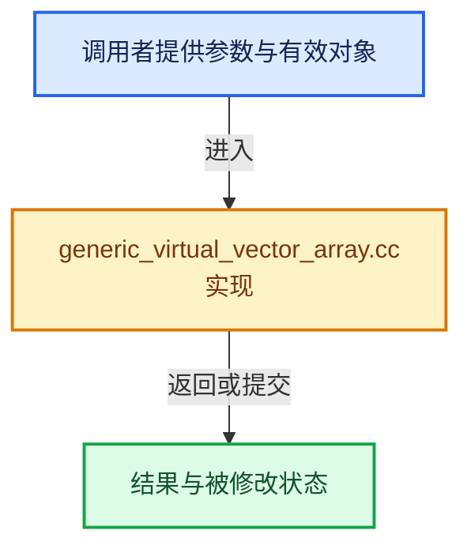

# 实现依赖专题：source/blender/blenlib/intern/generic_virtual_vector_array.cc

[实现依赖导航](../../README.md) · [符号索引](../../../00-课程指南/02-源码与提交索引/符号依赖与实现索引.md)

本专题从正文实际调用进入，集中保存共享实现。函数有稳定锚点，可从调用处直接跳到对应完整函数；递归与互相调用通过回链组织。

## 本文件的实现关系





## 完整成员与函数实现

<a id="f-ebe7bbbaf4a9e27a"></a>

### `blender::GVArray_For_GVVectorArrayIndex::get`

实现位置：[source/blender/blenlib/intern/generic_virtual_vector_array.cc](../../../../../../../source/blender/blenlib/intern/generic_virtual_vector_array.cc) · L13—L16。

接口参数：

- `const int64_t index_in_vector`
- `void *r_value`

**教学注释版**

<!-- annotated:dd333d86e34532 -->

```cpp
void GVArray_For_GVVectorArrayIndex::get(const int64_t index_in_vector, void *r_value) const
{
  vector_array_.get_vector_element(index_, index_in_vector, r_value);
}
```

<details>
<summary>核对原始源码：source/blender/blenlib/intern/generic_virtual_vector_array.cc · L13—L16</summary>

<!-- original:dd333d86e34532:source/blender/blenlib/intern/generic_virtual_vector_array.cc:13:16 -->

```cpp
void GVArray_For_GVVectorArrayIndex::get(const int64_t index_in_vector, void *r_value) const
{
  vector_array_.get_vector_element(index_, index_in_vector, r_value);
}
```

</details>

**继续追踪实现**

- `vector_array_.get_vector_element` → [调用协议](../../../00-课程指南/01-路线与规范/模板宏与动态分派协议.md)：接收对象类型依赖auto、返回值或模板实例；不按同名猜测目标。调用位置L15。
