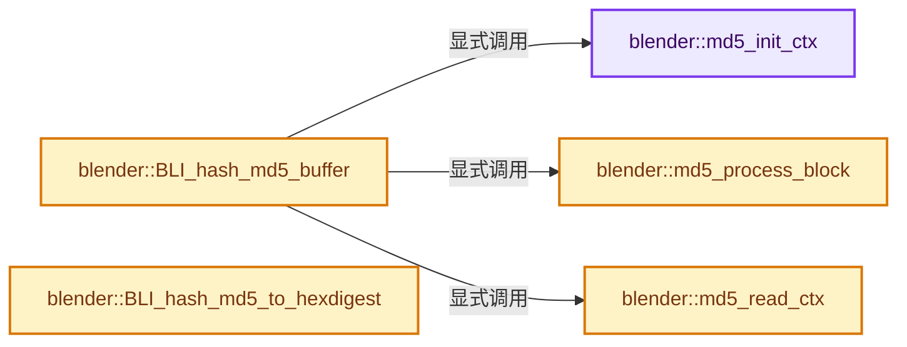
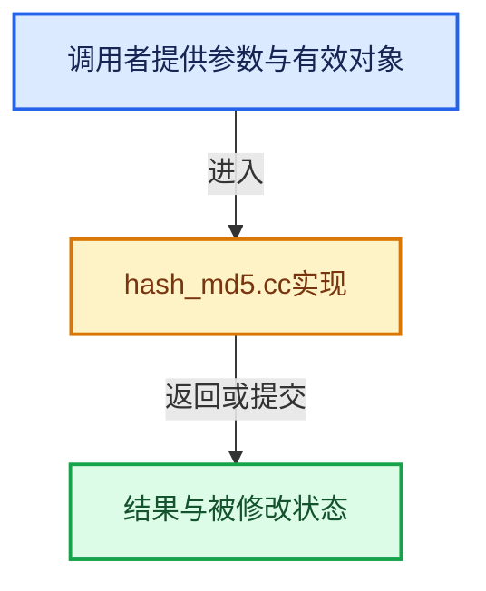

# 实现依赖专题：source/blender/blenlib/intern/hash_md5.cc

[实现依赖导航](../../README.md) · [符号索引](../../../00-课程指南/02-源码与提交索引/符号依赖与实现索引.md)

本专题从正文实际调用进入，集中保存共享实现。函数有稳定锚点，可从调用处直接跳到对应完整函数；递归与互相调用通过回链组织。

## 本文件的实现关系






<a id="m-563d890521e7"></a>

## 宏 `SWAP`

<!-- annotated:9af5dc2e6a65a8 -->

```cpp
#define SWAP(n) (n)

```

<details>
<summary>核对原始源码：source/blender/blenlib/intern/hash_md5.cc · L76—L77</summary>

<!-- original:9af5dc2e6a65a8:source/blender/blenlib/intern/hash_md5.cc:76:77 -->

```cpp
#define SWAP(n) (n)

```

</details>

宏在预处理阶段展开，参数替换、重复求值和条件编译应直接从该定义检查。与普通函数不同，宏不会自动提供参数类型检查；构建配置选择哪个定义需结合外围条件。

## 完整成员与函数实现

<a id="f-0b15a97b0403cb94"></a>

### `blender::md5_init_ctx`

实现位置：[source/blender/blenlib/intern/hash_md5.cc](../../../../../../../source/blender/blenlib/intern/hash_md5.cc) · L86—L92。

接口参数：

- `md5_ctx *ctx`

**教学注释版**

<!-- annotated:af52c39e454aa8 -->

```cpp
static void md5_init_ctx(md5_ctx *ctx)
{
  ctx->A = 0x67452301;
  ctx->B = 0xefcdab89;
  ctx->C = 0x98badcfe;
  ctx->D = 0x10325476;
}
```

<details>
<summary>核对原始源码：source/blender/blenlib/intern/hash_md5.cc · L86—L92</summary>

<!-- original:af52c39e454aa8:source/blender/blenlib/intern/hash_md5.cc:86:92 -->

```cpp
static void md5_init_ctx(md5_ctx *ctx)
{
  ctx->A = 0x67452301;
  ctx->B = 0xefcdab89;
  ctx->C = 0x98badcfe;
  ctx->D = 0x10325476;
}
```

</details>

**沿实际写入检查状态**

- `ctx->A = 0x67452301;`
- `ctx->B = 0xefcdab89;`
- `ctx->C = 0x98badcfe;`
- `ctx->D = 0x10325476;`

**继续追踪实现**

本实现没有需要继续展开的显式调用；检查返回表达式、对象转换和调用者前置条件。

<a id="f-7dded4579a4028cd"></a>

### `blender::md5_process_block`

实现位置：[source/blender/blenlib/intern/hash_md5.cc](../../../../../../../source/blender/blenlib/intern/hash_md5.cc) · L99—L252。

接口参数：

- `const void *buffer`
- `size_t len`
- `md5_ctx *ctx`

**教学注释版**

<!-- annotated:425ca02edf623b -->

```cpp
static void md5_process_block(const void *buffer, size_t len, md5_ctx *ctx)
{
/* These are the four functions used in the four steps of the MD5 algorithm and defined in the
 * RFC 1321. The first function is a little bit optimized
 * (as found in Colin Plumbs public domain implementation).
 */
// #define FF(b, c, d) ((b & c) | (~b & d))
#define FF(b, c, d) (d ^ (b & (c ^ d)))
#define FG(b, c, d) FF(d, b, c)
#define FH(b, c, d) (b ^ c ^ d)
#define FI(b, c, d) (c ^ (b | ~d))

/* It is unfortunate that C does not provide an operator for cyclic rotation.
 * Hope the C compiler is smart enough. */
#define CYCLIC(w, s) (w = (w << s) | (w >> (32 - s)))

  md5_uint32 correct_words[16];
  const md5_uint32 *words = static_cast<const md5_uint32 *>(buffer);
  size_t nwords = len / sizeof(md5_uint32);
  const md5_uint32 *endp = words + nwords;
  md5_uint32 A = ctx->A;
  md5_uint32 B = ctx->B;
  md5_uint32 C = ctx->C;
  md5_uint32 D = ctx->D;

  /* Process all bytes in the buffer with 64 bytes in each round of the loop. */
  while (words < endp) {
    md5_uint32 *cwp = correct_words;
    md5_uint32 A_save = A;
    md5_uint32 B_save = B;
    md5_uint32 C_save = C;
    md5_uint32 D_save = D;

    /* First round: using the given function, the context and a constant the next context is
     * computed. Because the algorithms processing unit is a 32-bit word and it is determined
     * to work on words in little endian byte order we perhaps have to change the byte order
     * before the computation. To reduce the work for the next steps we store the swapped words
     * in the array CORRECT_WORDS.
     */
#define OP(a, b, c, d, s, T) \
  a += FF(b, c, d) + (*cwp++ = SWAP(*words)) + T; \
  words++; \
  CYCLIC(a, s); \
  a += b; \
  (void)0

    /* Before we start, one word to the strange constants. They are defined in RFC 1321 as:
     *     `T[i] = (int) (4294967296.0 * fabs (sin (i))), i=1..64`
     */

    /* Round 1. */
    OP(A, B, C, D, 7, 0xd76aa478);
    OP(D, A, B, C, 12, 0xe8c7b756);
    OP(C, D, A, B, 17, 0x242070db);
    OP(B, C, D, A, 22, 0xc1bdceee);
    OP(A, B, C, D, 7, 0xf57c0faf);
    OP(D, A, B, C, 12, 0x4787c62a);
    OP(C, D, A, B, 17, 0xa8304613);
    OP(B, C, D, A, 22, 0xfd469501);
    OP(A, B, C, D, 7, 0x698098d8);
    OP(D, A, B, C, 12, 0x8b44f7af);
    OP(C, D, A, B, 17, 0xffff5bb1);
    OP(B, C, D, A, 22, 0x895cd7be);
    OP(A, B, C, D, 7, 0x6b901122);
    OP(D, A, B, C, 12, 0xfd987193);
    OP(C, D, A, B, 17, 0xa679438e);
    OP(B, C, D, A, 22, 0x49b40821);

#undef OP

    /* For the second to fourth round we have the possibly swapped words in CORRECT_WORDS.
     * Redefine the macro to take an additional first argument specifying the function to use.
     */
#define OP(f, a, b, c, d, k, s, T) \
  a += f(b, c, d) + correct_words[k] + T; \
  CYCLIC(a, s); \
  a += b; \
  (void)0

    /* Round 2. */
    OP(FG, A, B, C, D, 1, 5, 0xf61e2562);
    OP(FG, D, A, B, C, 6, 9, 0xc040b340);
    OP(FG, C, D, A, B, 11, 14, 0x265e5a51);
    OP(FG, B, C, D, A, 0, 20, 0xe9b6c7aa);
    OP(FG, A, B, C, D, 5, 5, 0xd62f105d);
    OP(FG, D, A, B, C, 10, 9, 0x02441453);
    OP(FG, C, D, A, B, 15, 14, 0xd8a1e681);
    OP(FG, B, C, D, A, 4, 20, 0xe7d3fbc8);
    OP(FG, A, B, C, D, 9, 5, 0x21e1cde6);
    OP(FG, D, A, B, C, 14, 9, 0xc33707d6);
    OP(FG, C, D, A, B, 3, 14, 0xf4d50d87);
    OP(FG, B, C, D, A, 8, 20, 0x455a14ed);
    OP(FG, A, B, C, D, 13, 5, 0xa9e3e905);
    OP(FG, D, A, B, C, 2, 9, 0xfcefa3f8);
    OP(FG, C, D, A, B, 7, 14, 0x676f02d9);
    OP(FG, B, C, D, A, 12, 20, 0x8d2a4c8a);

    /* Round 3. */
    OP(FH, A, B, C, D, 5, 4, 0xfffa3942);
    OP(FH, D, A, B, C, 8, 11, 0x8771f681);
    OP(FH, C, D, A, B, 11, 16, 0x6d9d6122);
    OP(FH, B, C, D, A, 14, 23, 0xfde5380c);
    OP(FH, A, B, C, D, 1, 4, 0xa4beea44);
    OP(FH, D, A, B, C, 4, 11, 0x4bdecfa9);
    OP(FH, C, D, A, B, 7, 16, 0xf6bb4b60);
    OP(FH, B, C, D, A, 10, 23, 0xbebfbc70);
    OP(FH, A, B, C, D, 13, 4, 0x289b7ec6);
    OP(FH, D, A, B, C, 0, 11, 0xeaa127fa);
    OP(FH, C, D, A, B, 3, 16, 0xd4ef3085);
    OP(FH, B, C, D, A, 6, 23, 0x04881d05);
    OP(FH, A, B, C, D, 9, 4, 0xd9d4d039);
    OP(FH, D, A, B, C, 12, 11, 0xe6db99e5);
    OP(FH, C, D, A, B, 15, 16, 0x1fa27cf8);
    OP(FH, B, C, D, A, 2, 23, 0xc4ac5665);

    /* Round 4. */
    OP(FI, A, B, C, D, 0, 6, 0xf4292244);
    OP(FI, D, A, B, C, 7, 10, 0x432aff97);
    OP(FI, C, D, A, B, 14, 15, 0xab9423a7);
    OP(FI, B, C, D, A, 5, 21, 0xfc93a039);
    OP(FI, A, B, C, D, 12, 6, 0x655b59c3);
    OP(FI, D, A, B, C, 3, 10, 0x8f0ccc92);
    OP(FI, C, D, A, B, 10, 15, 0xffeff47d);
    OP(FI, B, C, D, A, 1, 21, 0x85845dd1);
    OP(FI, A, B, C, D, 8, 6, 0x6fa87e4f);
    OP(FI, D, A, B, C, 15, 10, 0xfe2ce6e0);
    OP(FI, C, D, A, B, 6, 15, 0xa3014314);
    OP(FI, B, C, D, A, 13, 21, 0x4e0811a1);
    OP(FI, A, B, C, D, 4, 6, 0xf7537e82);
    OP(FI, D, A, B, C, 11, 10, 0xbd3af235);
    OP(FI, C, D, A, B, 2, 15, 0x2ad7d2bb);
    OP(FI, B, C, D, A, 9, 21, 0xeb86d391);

#undef OP

    /* Add the starting values of the context. */
    A += A_save;
    B += B_save;
    C += C_save;
    D += D_save;
  }

  /* Put checksum in context given as argument. */
  ctx->A = A;
  ctx->B = B;
  ctx->C = C;
  ctx->D = D;

#undef FF
#undef FG
#undef FH
#undef FI
#undef CYCLIC
}
```

<details>
<summary>核对原始源码：source/blender/blenlib/intern/hash_md5.cc · L99—L252</summary>

<!-- original:425ca02edf623b:source/blender/blenlib/intern/hash_md5.cc:99:252 -->

```cpp
static void md5_process_block(const void *buffer, size_t len, md5_ctx *ctx)
{
/* These are the four functions used in the four steps of the MD5 algorithm and defined in the
 * RFC 1321. The first function is a little bit optimized
 * (as found in Colin Plumbs public domain implementation).
 */
// #define FF(b, c, d) ((b & c) | (~b & d))
#define FF(b, c, d) (d ^ (b & (c ^ d)))
#define FG(b, c, d) FF(d, b, c)
#define FH(b, c, d) (b ^ c ^ d)
#define FI(b, c, d) (c ^ (b | ~d))

/* It is unfortunate that C does not provide an operator for cyclic rotation.
 * Hope the C compiler is smart enough. */
#define CYCLIC(w, s) (w = (w << s) | (w >> (32 - s)))

  md5_uint32 correct_words[16];
  const md5_uint32 *words = static_cast<const md5_uint32 *>(buffer);
  size_t nwords = len / sizeof(md5_uint32);
  const md5_uint32 *endp = words + nwords;
  md5_uint32 A = ctx->A;
  md5_uint32 B = ctx->B;
  md5_uint32 C = ctx->C;
  md5_uint32 D = ctx->D;

  /* Process all bytes in the buffer with 64 bytes in each round of the loop. */
  while (words < endp) {
    md5_uint32 *cwp = correct_words;
    md5_uint32 A_save = A;
    md5_uint32 B_save = B;
    md5_uint32 C_save = C;
    md5_uint32 D_save = D;

    /* First round: using the given function, the context and a constant the next context is
     * computed. Because the algorithms processing unit is a 32-bit word and it is determined
     * to work on words in little endian byte order we perhaps have to change the byte order
     * before the computation. To reduce the work for the next steps we store the swapped words
     * in the array CORRECT_WORDS.
     */
#define OP(a, b, c, d, s, T) \
  a += FF(b, c, d) + (*cwp++ = SWAP(*words)) + T; \
  words++; \
  CYCLIC(a, s); \
  a += b; \
  (void)0

    /* Before we start, one word to the strange constants. They are defined in RFC 1321 as:
     *     `T[i] = (int) (4294967296.0 * fabs (sin (i))), i=1..64`
     */

    /* Round 1. */
    OP(A, B, C, D, 7, 0xd76aa478);
    OP(D, A, B, C, 12, 0xe8c7b756);
    OP(C, D, A, B, 17, 0x242070db);
    OP(B, C, D, A, 22, 0xc1bdceee);
    OP(A, B, C, D, 7, 0xf57c0faf);
    OP(D, A, B, C, 12, 0x4787c62a);
    OP(C, D, A, B, 17, 0xa8304613);
    OP(B, C, D, A, 22, 0xfd469501);
    OP(A, B, C, D, 7, 0x698098d8);
    OP(D, A, B, C, 12, 0x8b44f7af);
    OP(C, D, A, B, 17, 0xffff5bb1);
    OP(B, C, D, A, 22, 0x895cd7be);
    OP(A, B, C, D, 7, 0x6b901122);
    OP(D, A, B, C, 12, 0xfd987193);
    OP(C, D, A, B, 17, 0xa679438e);
    OP(B, C, D, A, 22, 0x49b40821);

#undef OP

    /* For the second to fourth round we have the possibly swapped words in CORRECT_WORDS.
     * Redefine the macro to take an additional first argument specifying the function to use.
     */
#define OP(f, a, b, c, d, k, s, T) \
  a += f(b, c, d) + correct_words[k] + T; \
  CYCLIC(a, s); \
  a += b; \
  (void)0

    /* Round 2. */
    OP(FG, A, B, C, D, 1, 5, 0xf61e2562);
    OP(FG, D, A, B, C, 6, 9, 0xc040b340);
    OP(FG, C, D, A, B, 11, 14, 0x265e5a51);
    OP(FG, B, C, D, A, 0, 20, 0xe9b6c7aa);
    OP(FG, A, B, C, D, 5, 5, 0xd62f105d);
    OP(FG, D, A, B, C, 10, 9, 0x02441453);
    OP(FG, C, D, A, B, 15, 14, 0xd8a1e681);
    OP(FG, B, C, D, A, 4, 20, 0xe7d3fbc8);
    OP(FG, A, B, C, D, 9, 5, 0x21e1cde6);
    OP(FG, D, A, B, C, 14, 9, 0xc33707d6);
    OP(FG, C, D, A, B, 3, 14, 0xf4d50d87);
    OP(FG, B, C, D, A, 8, 20, 0x455a14ed);
    OP(FG, A, B, C, D, 13, 5, 0xa9e3e905);
    OP(FG, D, A, B, C, 2, 9, 0xfcefa3f8);
    OP(FG, C, D, A, B, 7, 14, 0x676f02d9);
    OP(FG, B, C, D, A, 12, 20, 0x8d2a4c8a);

    /* Round 3. */
    OP(FH, A, B, C, D, 5, 4, 0xfffa3942);
    OP(FH, D, A, B, C, 8, 11, 0x8771f681);
    OP(FH, C, D, A, B, 11, 16, 0x6d9d6122);
    OP(FH, B, C, D, A, 14, 23, 0xfde5380c);
    OP(FH, A, B, C, D, 1, 4, 0xa4beea44);
    OP(FH, D, A, B, C, 4, 11, 0x4bdecfa9);
    OP(FH, C, D, A, B, 7, 16, 0xf6bb4b60);
    OP(FH, B, C, D, A, 10, 23, 0xbebfbc70);
    OP(FH, A, B, C, D, 13, 4, 0x289b7ec6);
    OP(FH, D, A, B, C, 0, 11, 0xeaa127fa);
    OP(FH, C, D, A, B, 3, 16, 0xd4ef3085);
    OP(FH, B, C, D, A, 6, 23, 0x04881d05);
    OP(FH, A, B, C, D, 9, 4, 0xd9d4d039);
    OP(FH, D, A, B, C, 12, 11, 0xe6db99e5);
    OP(FH, C, D, A, B, 15, 16, 0x1fa27cf8);
    OP(FH, B, C, D, A, 2, 23, 0xc4ac5665);

    /* Round 4. */
    OP(FI, A, B, C, D, 0, 6, 0xf4292244);
    OP(FI, D, A, B, C, 7, 10, 0x432aff97);
    OP(FI, C, D, A, B, 14, 15, 0xab9423a7);
    OP(FI, B, C, D, A, 5, 21, 0xfc93a039);
    OP(FI, A, B, C, D, 12, 6, 0x655b59c3);
    OP(FI, D, A, B, C, 3, 10, 0x8f0ccc92);
    OP(FI, C, D, A, B, 10, 15, 0xffeff47d);
    OP(FI, B, C, D, A, 1, 21, 0x85845dd1);
    OP(FI, A, B, C, D, 8, 6, 0x6fa87e4f);
    OP(FI, D, A, B, C, 15, 10, 0xfe2ce6e0);
    OP(FI, C, D, A, B, 6, 15, 0xa3014314);
    OP(FI, B, C, D, A, 13, 21, 0x4e0811a1);
    OP(FI, A, B, C, D, 4, 6, 0xf7537e82);
    OP(FI, D, A, B, C, 11, 10, 0xbd3af235);
    OP(FI, C, D, A, B, 2, 15, 0x2ad7d2bb);
    OP(FI, B, C, D, A, 9, 21, 0xeb86d391);

#undef OP

    /* Add the starting values of the context. */
    A += A_save;
    B += B_save;
    C += C_save;
    D += D_save;
  }

  /* Put checksum in context given as argument. */
  ctx->A = A;
  ctx->B = B;
  ctx->C = C;
  ctx->D = D;

#undef FF
#undef FG
#undef FH
#undef FI
#undef CYCLIC
}
```

</details>

**沿实际写入检查状态**

- `a += FF(b, c, d) + (*cwp++ = SWAP(*words)) + T; \`
- `a += b; \`
- `a += f(b, c, d) + correct_words[k] + T; \`
- `A += A_save;`
- `B += B_save;`
- `C += C_save;`
- `D += D_save;`
- `ctx->A = A;`
- `ctx->B = B;`
- `ctx->C = C;`
- `ctx->D = D;`

**继续追踪实现**

- `OP` → [调用协议](../../../00-课程指南/01-路线与规范/模板宏与动态分派协议.md)：函数指针、局部可调用对象或未展开的宏；必须结合调用者环境。调用位置L150。

<a id="f-d9c73e66da65a6a4"></a>

### `blender::md5_read_ctx`

实现位置：[source/blender/blenlib/intern/hash_md5.cc](../../../../../../../source/blender/blenlib/intern/hash_md5.cc) · L259—L268。

接口参数：

- `const md5_ctx *ctx`
- `void *resbuf`

**教学注释版**

<!-- annotated:8baf80b8fb6e02 -->

```cpp
static void *md5_read_ctx(const md5_ctx *ctx, void *resbuf)
{
  md5_uint32 *digest = static_cast<md5_uint32 *>(resbuf);
  digest[0] = SWAP(ctx->A);
  digest[1] = SWAP(ctx->B);
  digest[2] = SWAP(ctx->C);
  digest[3] = SWAP(ctx->D);

  return resbuf;
}
```

<details>
<summary>核对原始源码：source/blender/blenlib/intern/hash_md5.cc · L259—L268</summary>

<!-- original:8baf80b8fb6e02:source/blender/blenlib/intern/hash_md5.cc:259:268 -->

```cpp
static void *md5_read_ctx(const md5_ctx *ctx, void *resbuf)
{
  md5_uint32 *digest = static_cast<md5_uint32 *>(resbuf);
  digest[0] = SWAP(ctx->A);
  digest[1] = SWAP(ctx->B);
  digest[2] = SWAP(ctx->C);
  digest[3] = SWAP(ctx->D);

  return resbuf;
}
```

</details>

**沿实际写入检查状态**

- `digest[0] = SWAP(ctx->A);`
- `digest[1] = SWAP(ctx->B);`
- `digest[2] = SWAP(ctx->C);`
- `digest[3] = SWAP(ctx->D);`

**结果出口**

- `return resbuf;`

**继续追踪实现**

- `SWAP` → [SWAP · L76](hash_md5.cc.md#m-563d890521e7)。宏定义由构建条件选择。

<a id="f-8d7841e60ae0e060"></a>

### `blender::BLI_hash_md5_buffer`

实现位置：[source/blender/blenlib/intern/hash_md5.cc](../../../../../../../source/blender/blenlib/intern/hash_md5.cc) · L345—L379。

接口参数：

- `const char *buffer`
- `size_t len`
- `void *resblock`

**教学注释版**

<!-- annotated:337265c13c120f -->

```cpp
void *BLI_hash_md5_buffer(const char *buffer, size_t len, void *resblock)
{
  md5_ctx ctx;
  char restbuf[64 + 72];
  size_t blocks = len & ~63;
  size_t pad, rest;

  /* Initialize the computation context. */
  md5_init_ctx(&ctx);

  /* Process whole buffer but last len % 64 bytes. */
  md5_process_block(buffer, blocks, &ctx);

  /* REST bytes are not processed yet. */
  rest = len - blocks;
  /* Copy to own buffer. */
  // [讲解] memcpy：复制字节，源与目标不应重叠。类型生命周期、对齐和可复制表示须由调用者证明，不是任意对象的复制构造。
  memcpy(restbuf, &buffer[blocks], rest);
  /* Append needed fill bytes at end of buffer.
   * We can copy 64 bytes because the buffer is always big enough. */
  memcpy(&restbuf[rest], fillbuf, 64);

  /* PAD bytes are used for padding to correct alignment.
   * Note that always at least one byte is padded. */
  pad = rest >= 56 ? 64 + 56 - rest : 56 - rest;

  /* Put length of buffer in *bits* in last eight bytes. */
  *reinterpret_cast<md5_uint32 *>(&restbuf[rest + pad]) = md5_uint32(SWAP(len << 3));
  *reinterpret_cast<md5_uint32 *>(&restbuf[rest + pad + 4]) = md5_uint32(SWAP(len >> 29));

  /* Process last bytes. */
  md5_process_block(restbuf, rest + pad + 8, &ctx);

  /* Put result in desired memory area. */
  return md5_read_ctx(&ctx, resblock);
}
```

<details>
<summary>核对原始源码：source/blender/blenlib/intern/hash_md5.cc · L345—L379</summary>

<!-- original:337265c13c120f:source/blender/blenlib/intern/hash_md5.cc:345:379 -->

```cpp
void *BLI_hash_md5_buffer(const char *buffer, size_t len, void *resblock)
{
  md5_ctx ctx;
  char restbuf[64 + 72];
  size_t blocks = len & ~63;
  size_t pad, rest;

  /* Initialize the computation context. */
  md5_init_ctx(&ctx);

  /* Process whole buffer but last len % 64 bytes. */
  md5_process_block(buffer, blocks, &ctx);

  /* REST bytes are not processed yet. */
  rest = len - blocks;
  /* Copy to own buffer. */
  memcpy(restbuf, &buffer[blocks], rest);
  /* Append needed fill bytes at end of buffer.
   * We can copy 64 bytes because the buffer is always big enough. */
  memcpy(&restbuf[rest], fillbuf, 64);

  /* PAD bytes are used for padding to correct alignment.
   * Note that always at least one byte is padded. */
  pad = rest >= 56 ? 64 + 56 - rest : 56 - rest;

  /* Put length of buffer in *bits* in last eight bytes. */
  *reinterpret_cast<md5_uint32 *>(&restbuf[rest + pad]) = md5_uint32(SWAP(len << 3));
  *reinterpret_cast<md5_uint32 *>(&restbuf[rest + pad + 4]) = md5_uint32(SWAP(len >> 29));

  /* Process last bytes. */
  md5_process_block(restbuf, rest + pad + 8, &ctx);

  /* Put result in desired memory area. */
  return md5_read_ctx(&ctx, resblock);
}
```

</details>

**沿实际写入检查状态**

- `rest = len - blocks;`
- `pad = rest >= 56 ? 64 + 56 - rest : 56 - rest;`

**结果出口**

- `return md5_read_ctx(&ctx, resblock);`

**继续追踪实现**

- `md5_init_ctx` → [blender::md5_init_ctx · L86](hash_md5.cc.md#f-0b15a97b0403cb94)。
- `md5_process_block` → [blender::md5_process_block · L99](hash_md5.cc.md#f-7dded4579a4028cd)。
- `memcpy` → [外部契约](https://eel.is/c++draft/cstring.syn)：复制字节，源与目标不应重叠。类型生命周期、对齐和可复制表示须由调用者证明，不是任意对象的复制构造。
- `md5_uint32` → [调用协议](../../../00-课程指南/01-路线与规范/模板宏与动态分派协议.md)：函数指针、局部可调用对象或未展开的宏；必须结合调用者环境。调用位置L371。
- `SWAP` → [SWAP · L76](hash_md5.cc.md#m-563d890521e7)。宏定义由构建条件选择。
- `md5_read_ctx` → [blender::md5_read_ctx · L259](hash_md5.cc.md#f-d9c73e66da65a6a4)。

<a id="f-f58bf9ed51cfe1c7"></a>

### `blender::BLI_hash_md5_to_hexdigest`

实现位置：[source/blender/blenlib/intern/hash_md5.cc](../../../../../../../source/blender/blenlib/intern/hash_md5.cc) · L381—L396。

接口参数：

- `const void *resblock`
- `char r_hex_digest[33]`

**教学注释版**

<!-- annotated:a3c51c73d4e1aa -->

```cpp
char *BLI_hash_md5_to_hexdigest(const void *resblock, char r_hex_digest[33])
{
  static const char hex_map[17] = "0123456789abcdef";
  const uchar *p;
  char *q;
  short len;

  for (q = r_hex_digest, p = static_cast<const uchar *>(resblock), len = 0; len < 16; p++, len++) {
    const uchar c = *p;
    *q++ = hex_map[c >> 4];
    *q++ = hex_map[c & 15];
  }
  *q = '\0';

  return r_hex_digest;
}
```

<details>
<summary>核对原始源码：source/blender/blenlib/intern/hash_md5.cc · L381—L396</summary>

<!-- original:a3c51c73d4e1aa:source/blender/blenlib/intern/hash_md5.cc:381:396 -->

```cpp
char *BLI_hash_md5_to_hexdigest(const void *resblock, char r_hex_digest[33])
{
  static const char hex_map[17] = "0123456789abcdef";
  const uchar *p;
  char *q;
  short len;

  for (q = r_hex_digest, p = static_cast<const uchar *>(resblock), len = 0; len < 16; p++, len++) {
    const uchar c = *p;
    *q++ = hex_map[c >> 4];
    *q++ = hex_map[c & 15];
  }
  *q = '\0';

  return r_hex_digest;
}
```

</details>

**结果出口**

- `return r_hex_digest;`

**继续追踪实现**

本实现没有需要继续展开的显式调用；检查返回表达式、对象转换和调用者前置条件。
