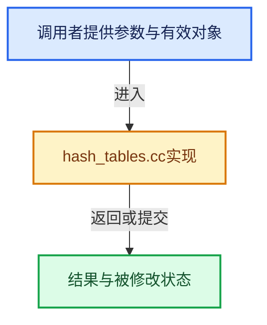

# 实现依赖专题：source/blender/blenlib/intern/hash_tables.cc

[实现依赖导航](../../README.md) · [符号索引](../../../00-课程指南/02-源码与提交索引/符号依赖与实现索引.md)

本专题从正文实际调用进入，集中保存共享实现。函数有稳定锚点，可从调用处直接跳到对应完整函数；递归与互相调用通过回链组织。

## 本文件的实现关系





## 完整成员与函数实现

<a id="f-be761e16ade883cd"></a>

### `blender::HashTableStats::print`

实现位置：[source/blender/blenlib/intern/hash_tables.cc](../../../../../../../source/blender/blenlib/intern/hash_tables.cc) · L16—L35。

接口参数：

- `const char *name`

**教学注释版**

<!-- annotated:aab1fee24bd211 -->

```cpp
void HashTableStats::print(const char *name) const
{
  std::cout << "Hash Table Stats: " << name << "\n";
  std::cout << "  Address: " << address_ << "\n";
  std::cout << "  Total Slots: " << capacity_ << "\n";
  std::cout << "  Occupied Slots:  " << size_ << " (" << load_factor_ * 100.0f << " %)\n";
  std::cout << "  Removed Slots: " << removed_amount_ << " (" << removed_load_factor_ * 100.0f
            << " %)\n";

  char memory_size_str[BLI_STR_FORMAT_INT64_BYTE_UNIT_SIZE];
  BLI_str_format_byte_unit(memory_size_str, size_in_bytes_, true);
  std::cout << "  Size: ~" << memory_size_str << "\n";
  std::cout << "  Size per Slot: " << size_per_element_ << " bytes\n";

  std::cout << "  Average Collisions: " << average_collisions_ << "\n";
  for (int64_t collision_count : keys_by_collision_count_.index_range()) {
    std::cout << "  " << collision_count
              << " Collisions: " << keys_by_collision_count_[collision_count] << "\n";
  }
}
```

<details>
<summary>核对原始源码：source/blender/blenlib/intern/hash_tables.cc · L16—L35</summary>

<!-- original:aab1fee24bd211:source/blender/blenlib/intern/hash_tables.cc:16:35 -->

```cpp
void HashTableStats::print(const char *name) const
{
  std::cout << "Hash Table Stats: " << name << "\n";
  std::cout << "  Address: " << address_ << "\n";
  std::cout << "  Total Slots: " << capacity_ << "\n";
  std::cout << "  Occupied Slots:  " << size_ << " (" << load_factor_ * 100.0f << " %)\n";
  std::cout << "  Removed Slots: " << removed_amount_ << " (" << removed_load_factor_ * 100.0f
            << " %)\n";

  char memory_size_str[BLI_STR_FORMAT_INT64_BYTE_UNIT_SIZE];
  BLI_str_format_byte_unit(memory_size_str, size_in_bytes_, true);
  std::cout << "  Size: ~" << memory_size_str << "\n";
  std::cout << "  Size per Slot: " << size_per_element_ << " bytes\n";

  std::cout << "  Average Collisions: " << average_collisions_ << "\n";
  for (int64_t collision_count : keys_by_collision_count_.index_range()) {
    std::cout << "  " << collision_count
              << " Collisions: " << keys_by_collision_count_[collision_count] << "\n";
  }
}
```

</details>

**继续追踪实现**

- `BLI_str_format_byte_unit` → [blender::BLI_str_format_byte_unit · L1214](string.cc.md#f-5e0d6af0be8549be)。
- `keys_by_collision_count_.index_range` → [调用协议](../../../00-课程指南/01-路线与规范/模板宏与动态分派协议.md)：接收对象类型依赖auto、返回值或模板实例；不按同名猜测目标。调用位置L31。
