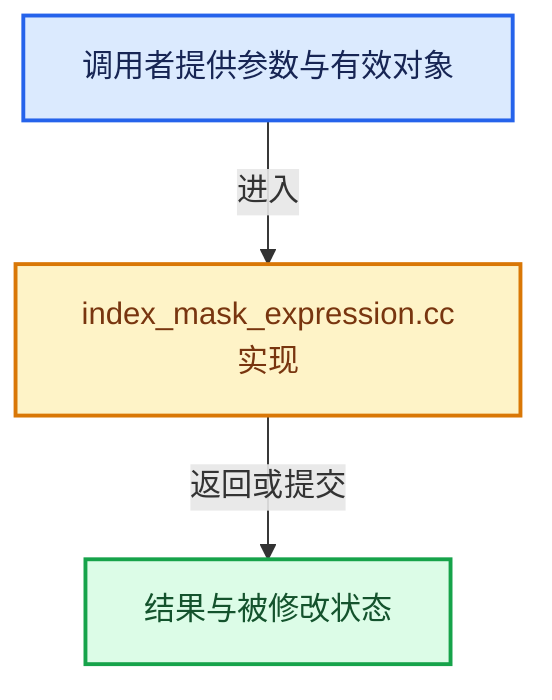

# 实现依赖专题：source/blender/blenlib/intern/index_mask_expression.cc

[实现依赖导航](../../README.md) · [符号索引](../../../00-课程指南/02-源码与提交索引/符号依赖与实现索引.md)

本专题从正文实际调用进入，集中保存共享实现。函数有稳定锚点，可从调用处直接跳到对应完整函数；递归与互相调用通过回链组织。

## 本文件的实现关系





## 相关类型布局与成员入口

<a id="t-428fd56d68ee"></a>

### `blender::index_mask::CoarseSegment::Type`

原始声明：[source/blender/blenlib/intern/index_mask_expression.cc](../../../../../../../source/blender/blenlib/intern/index_mask_expression.cc) · L39—L49。

以下保留类的数据声明与编译条件，成员函数实现通过后面的精确链接阅读。

<!-- annotated:d33e5dae17285c -->

```cpp
  enum class Type {
    /**
     * Coarse evaluation couldn't fully resolve this segment. The segment requires another
     * evaluation that is more detailed.
     */
    Unknown,
    /** All indices in the segment are part of the result. */
    Full,
    /** The evaluated result of this segment is just the copy of an input index mask. */
    Copy,
  };
```

<details>
<summary>核对原始源码：source/blender/blenlib/intern/index_mask_expression.cc · L39—L49</summary>

<!-- original:d33e5dae17285c:source/blender/blenlib/intern/index_mask_expression.cc:39:49 -->

```cpp
  enum class Type {
    /**
     * Coarse evaluation couldn't fully resolve this segment. The segment requires another
     * evaluation that is more detailed.
     */
    Unknown,
    /** All indices in the segment are part of the result. */
    Full,
    /** The evaluated result of this segment is just the copy of an input index mask. */
    Copy,
  };
```

</details>


<a id="t-054feedeb190"></a>

### `blender::index_mask::EvaluatedSegment::Type`

原始声明：[source/blender/blenlib/intern/index_mask_expression.cc](../../../../../../../source/blender/blenlib/intern/index_mask_expression.cc) · L85—L92。

以下保留类的数据声明与编译条件，成员函数实现通过后面的精确链接阅读。

<!-- annotated:edb0a3aa9e531d -->

```cpp
  enum class Type {
    /** All indices in this segment are part of the evaluated index mask. */
    Full,
    /** The result in this segment is the same as what is contained in the #copy_mask below. */
    Copy,
    /** The result comes from exact evaluation and is a new set of indices. */
    Indices,
  };
```

<details>
<summary>核对原始源码：source/blender/blenlib/intern/index_mask_expression.cc · L85—L92</summary>

<!-- original:edb0a3aa9e531d:source/blender/blenlib/intern/index_mask_expression.cc:85:92 -->

```cpp
  enum class Type {
    /** All indices in this segment are part of the evaluated index mask. */
    Full,
    /** The result in this segment is the same as what is contained in the #copy_mask below. */
    Copy,
    /** The result comes from exact evaluation and is a new set of indices. */
    Indices,
  };
```

</details>


## 完整成员与函数实现
