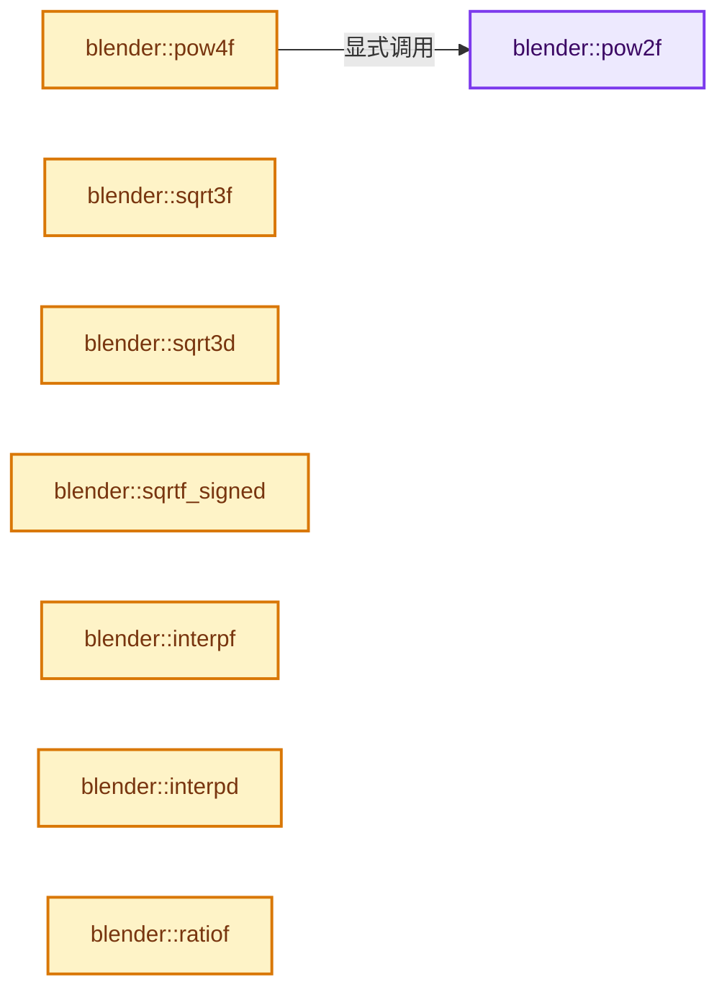

# 实现依赖专题：source/blender/blenlib/intern/math_base_inline.cc

[实现依赖导航](../../README.md) · [符号索引](../../../00-课程指南/02-源码与提交索引/符号依赖与实现索引.md)

本专题从正文实际调用进入，集中保存共享实现。函数有稳定锚点，可从调用处直接跳到对应完整函数；递归与互相调用通过回链组织。

## 本文件的实现关系




<a id="m-beab6e34c61e"></a>

## 宏 `UNLIKELY`

<!-- annotated:b2b8cf09882ad3 -->

```cpp
#  define UNLIKELY(x) __builtin_expect(!!(x), 0)
#else
```

<details>
<summary>核对原始源码：source/blender/blenlib/intern/math_base_inline.cc · L25—L26</summary>

<!-- original:b2b8cf09882ad3:source/blender/blenlib/intern/math_base_inline.cc:25:26 -->

```cpp
#  define UNLIKELY(x) __builtin_expect(!!(x), 0)
#else
```

</details>

宏在预处理阶段展开，参数替换、重复求值和条件编译应直接从该定义检查。与普通函数不同，宏不会自动提供参数类型检查；构建配置选择哪个定义需结合外围条件。

<a id="m-9b279ffdd95b"></a>

## 宏 `UNLIKELY`

<!-- annotated:7fe5c0f3d32c09 -->

```cpp
#  define UNLIKELY(x) (x)
#endif
```

<details>
<summary>核对原始源码：source/blender/blenlib/intern/math_base_inline.cc · L27—L28</summary>

<!-- original:7fe5c0f3d32c09:source/blender/blenlib/intern/math_base_inline.cc:27:28 -->

```cpp
#  define UNLIKELY(x) (x)
#endif
```

</details>

宏在预处理阶段展开，参数替换、重复求值和条件编译应直接从该定义检查。与普通函数不同，宏不会自动提供参数类型检查；构建配置选择哪个定义需结合外围条件。

<a id="m-6b722808e4c5"></a>

## 宏 `unit_float_to_uchar_clamp_v3`

<!-- annotated:efb63dac447604 -->

```cpp
#define unit_float_to_uchar_clamp_v3(v1, v2) \
  { \
    (v1)[0] = unit_float_to_uchar_clamp((v2[0])); \
    (v1)[1] = unit_float_to_uchar_clamp((v2[1])); \
    (v1)[2] = unit_float_to_uchar_clamp((v2[2])); \
  } \
  ((void)0)
#define unit_float_to_uchar_clamp_v4(v1, v2) \
```

<details>
<summary>核对原始源码：source/blender/blenlib/intern/math_base_inline.cc · L597—L604</summary>

<!-- original:efb63dac447604:source/blender/blenlib/intern/math_base_inline.cc:597:604 -->

```cpp
#define unit_float_to_uchar_clamp_v3(v1, v2) \
  { \
    (v1)[0] = unit_float_to_uchar_clamp((v2[0])); \
    (v1)[1] = unit_float_to_uchar_clamp((v2[1])); \
    (v1)[2] = unit_float_to_uchar_clamp((v2[2])); \
  } \
  ((void)0)
#define unit_float_to_uchar_clamp_v4(v1, v2) \
```

</details>

宏在预处理阶段展开，参数替换、重复求值和条件编译应直接从该定义检查。与普通函数不同，宏不会自动提供参数类型检查；构建配置选择哪个定义需结合外围条件。

<a id="m-544b775b5cdf"></a>

## 宏 `unit_float_to_uchar_clamp_v4`

<!-- annotated:5dad65744f96ab -->

```cpp
#define unit_float_to_uchar_clamp_v4(v1, v2) \
  { \
    (v1)[0] = unit_float_to_uchar_clamp((v2[0])); \
    (v1)[1] = unit_float_to_uchar_clamp((v2[1])); \
    (v1)[2] = unit_float_to_uchar_clamp((v2[2])); \
    (v1)[3] = unit_float_to_uchar_clamp((v2[3])); \
  } \
  ((void)0)

```

<details>
<summary>核对原始源码：source/blender/blenlib/intern/math_base_inline.cc · L604—L612</summary>

<!-- original:5dad65744f96ab:source/blender/blenlib/intern/math_base_inline.cc:604:612 -->

```cpp
#define unit_float_to_uchar_clamp_v4(v1, v2) \
  { \
    (v1)[0] = unit_float_to_uchar_clamp((v2[0])); \
    (v1)[1] = unit_float_to_uchar_clamp((v2[1])); \
    (v1)[2] = unit_float_to_uchar_clamp((v2[2])); \
    (v1)[3] = unit_float_to_uchar_clamp((v2[3])); \
  } \
  ((void)0)

```

</details>

宏在预处理阶段展开，参数替换、重复求值和条件编译应直接从该定义检查。与普通函数不同，宏不会自动提供参数类型检查；构建配置选择哪个定义需结合外围条件。

## 完整成员与函数实现

<a id="f-40637854dd919b48"></a>

### `blender::pow2f`

实现位置：[source/blender/blenlib/intern/math_base_inline.cc](../../../../../../../source/blender/blenlib/intern/math_base_inline.cc) · L30—L33。

接口参数：

- `float x`

**教学注释版**

<!-- annotated:99ac0efc59ff90 -->

```cpp
MINLINE float pow2f(float x)
{
  return x * x;
}
```

<details>
<summary>核对原始源码：source/blender/blenlib/intern/math_base_inline.cc · L30—L33</summary>

<!-- original:99ac0efc59ff90:source/blender/blenlib/intern/math_base_inline.cc:30:33 -->

```cpp
MINLINE float pow2f(float x)
{
  return x * x;
}
```

</details>

**结果出口**

- `return x * x;`

**继续追踪实现**

本实现没有需要继续展开的显式调用；检查返回表达式、对象转换和调用者前置条件。

<a id="f-cb70d56b08a5793b"></a>

### `blender::pow4f`

实现位置：[source/blender/blenlib/intern/math_base_inline.cc](../../../../../../../source/blender/blenlib/intern/math_base_inline.cc) · L38—L41。

接口参数：

- `float x`

**教学注释版**

<!-- annotated:59469548a40a44 -->

```cpp
MINLINE float pow4f(float x)
{
  return pow2f(pow2f(x));
}
```

<details>
<summary>核对原始源码：source/blender/blenlib/intern/math_base_inline.cc · L38—L41</summary>

<!-- original:59469548a40a44:source/blender/blenlib/intern/math_base_inline.cc:38:41 -->

```cpp
MINLINE float pow4f(float x)
{
  return pow2f(pow2f(x));
}
```

</details>

**结果出口**

- `return pow2f(pow2f(x));`

**继续追踪实现**

- `pow2f` → [blender::pow2f · L30](math_base_inline.cc.md#f-40637854dd919b48)。

<a id="f-8d52de4da4a67168"></a>

### `blender::sqrt3f`

实现位置：[source/blender/blenlib/intern/math_base_inline.cc](../../../../../../../source/blender/blenlib/intern/math_base_inline.cc) · L51—L60。

接口参数：

- `float f`

**教学注释版**

<!-- annotated:b1f5f6895bfae4 -->

```cpp
MINLINE float sqrt3f(float f)
{
  if (f == 0.0f) [[unlikely]] {
    return 0.0f;
  }
  if (f < 0.0f) [[unlikely]] {
    return -float(exp(log(-f) / 3.0));
  }
  return float(exp(log(f) / 3.0));
}
```

<details>
<summary>核对原始源码：source/blender/blenlib/intern/math_base_inline.cc · L51—L60</summary>

<!-- original:b1f5f6895bfae4:source/blender/blenlib/intern/math_base_inline.cc:51:60 -->

```cpp
MINLINE float sqrt3f(float f)
{
  if (f == 0.0f) [[unlikely]] {
    return 0.0f;
  }
  if (f < 0.0f) [[unlikely]] {
    return -float(exp(log(-f) / 3.0));
  }
  return float(exp(log(f) / 3.0));
}
```

</details>

**结果出口**

- `return 0.0f;`
- `return -float(exp(log(-f) / 3.0));`
- `return float(exp(log(f) / 3.0));`

**继续追踪实现**

- `exp` → [exp · L106](../../08-其他Blender模块/gpu/shaders/compat/gpu_shader_cxx_builtin.hh.md#m-dd7e1d600c32)。宏定义由构建条件选择。
- `log` → [log · L113](../../08-其他Blender模块/gpu/shaders/compat/gpu_shader_cxx_builtin.hh.md#m-b6b82c5e925e)。宏定义由构建条件选择。

<a id="f-0bea385d37402d45"></a>

### `blender::sqrt3d`

实现位置：[source/blender/blenlib/intern/math_base_inline.cc](../../../../../../../source/blender/blenlib/intern/math_base_inline.cc) · L62—L71。

接口参数：

- `double d`

**教学注释版**

<!-- annotated:cae453375448f7 -->

```cpp
MINLINE double sqrt3d(double d)
{
  if (d == 0.0) [[unlikely]] {
    return 0.0;
  }
  if (d < 0.0) [[unlikely]] {
    return -exp(log(-d) / 3.0);
  }
  return exp(log(d) / 3.0);
}
```

<details>
<summary>核对原始源码：source/blender/blenlib/intern/math_base_inline.cc · L62—L71</summary>

<!-- original:cae453375448f7:source/blender/blenlib/intern/math_base_inline.cc:62:71 -->

```cpp
MINLINE double sqrt3d(double d)
{
  if (d == 0.0) [[unlikely]] {
    return 0.0;
  }
  if (d < 0.0) [[unlikely]] {
    return -exp(log(-d) / 3.0);
  }
  return exp(log(d) / 3.0);
}
```

</details>

**结果出口**

- `return 0.0;`
- `return -exp(log(-d) / 3.0);`
- `return exp(log(d) / 3.0);`

**继续追踪实现**

- `exp` → [exp · L106](../../08-其他Blender模块/gpu/shaders/compat/gpu_shader_cxx_builtin.hh.md#m-dd7e1d600c32)。宏定义由构建条件选择。
- `log` → [log · L113](../../08-其他Blender模块/gpu/shaders/compat/gpu_shader_cxx_builtin.hh.md#m-b6b82c5e925e)。宏定义由构建条件选择。

<a id="f-5a25259b81b9306a"></a>

### `blender::sqrtf_signed`

实现位置：[source/blender/blenlib/intern/math_base_inline.cc](../../../../../../../source/blender/blenlib/intern/math_base_inline.cc) · L73—L76。

接口参数：

- `float f`

**教学注释版**

<!-- annotated:480631b438836a -->

```cpp
MINLINE float sqrtf_signed(float f)
{
  return (f >= 0.0f) ? sqrtf(f) : -sqrtf(-f);
}
```

<details>
<summary>核对原始源码：source/blender/blenlib/intern/math_base_inline.cc · L73—L76</summary>

<!-- original:480631b438836a:source/blender/blenlib/intern/math_base_inline.cc:73:76 -->

```cpp
MINLINE float sqrtf_signed(float f)
{
  return (f >= 0.0f) ? sqrtf(f) : -sqrtf(-f);
}
```

</details>

**结果出口**

- `return (f >= 0.0f) ? sqrtf(f) : -sqrtf(-f);`

**继续追踪实现**

- `sqrtf` → [外部契约](https://eel.is/c++draft/)：这个边界按实际表达式及所属类型核对参数、返回值、寿命与失败行为。这里提供接口入口，不声称已解释该第三方版本的内部实现。

<a id="f-b3f626d354a18194"></a>

### `blender::interpf`

实现位置：[source/blender/blenlib/intern/math_base_inline.cc](../../../../../../../source/blender/blenlib/intern/math_base_inline.cc) · L78—L81。

接口参数：

- `float target`
- `float origin`
- `float fac`

**教学注释版**

<!-- annotated:46de3847ba50d5 -->

```cpp
MINLINE float interpf(float target, float origin, float fac)
{
  return (fac * target) + (1.0f - fac) * origin;
}
```

<details>
<summary>核对原始源码：source/blender/blenlib/intern/math_base_inline.cc · L78—L81</summary>

<!-- original:46de3847ba50d5:source/blender/blenlib/intern/math_base_inline.cc:78:81 -->

```cpp
MINLINE float interpf(float target, float origin, float fac)
{
  return (fac * target) + (1.0f - fac) * origin;
}
```

</details>

**结果出口**

- `return (fac * target) + (1.0f - fac) * origin;`

**继续追踪实现**

本实现没有需要继续展开的显式调用；检查返回表达式、对象转换和调用者前置条件。

<a id="f-838cb2b6b77b0307"></a>

### `blender::interpd`

实现位置：[source/blender/blenlib/intern/math_base_inline.cc](../../../../../../../source/blender/blenlib/intern/math_base_inline.cc) · L83—L86。

接口参数：

- `double target`
- `double origin`
- `double fac`

**教学注释版**

<!-- annotated:a5b1e267f20ad1 -->

```cpp
MINLINE double interpd(double target, double origin, double fac)
{
  return (fac * target) + (1.0f - fac) * origin;
}
```

<details>
<summary>核对原始源码：source/blender/blenlib/intern/math_base_inline.cc · L83—L86</summary>

<!-- original:a5b1e267f20ad1:source/blender/blenlib/intern/math_base_inline.cc:83:86 -->

```cpp
MINLINE double interpd(double target, double origin, double fac)
{
  return (fac * target) + (1.0f - fac) * origin;
}
```

</details>

**结果出口**

- `return (fac * target) + (1.0f - fac) * origin;`

**继续追踪实现**

本实现没有需要继续展开的显式调用；检查返回表达式、对象转换和调用者前置条件。

<a id="f-65a0c1ef176726c5"></a>

### `blender::ratiof`

实现位置：[source/blender/blenlib/intern/math_base_inline.cc](../../../../../../../source/blender/blenlib/intern/math_base_inline.cc) · L88—L92。

接口参数：

- `float min`
- `float max`
- `float pos`

**教学注释版**

<!-- annotated:50a3483ae23eff -->

```cpp
MINLINE float ratiof(float min, float max, float pos)
{
  float range = max - min;
  return range == 0 ? 0 : ((pos - min) / range);
}
```

<details>
<summary>核对原始源码：source/blender/blenlib/intern/math_base_inline.cc · L88—L92</summary>

<!-- original:50a3483ae23eff:source/blender/blenlib/intern/math_base_inline.cc:88:92 -->

```cpp
MINLINE float ratiof(float min, float max, float pos)
{
  float range = max - min;
  return range == 0 ? 0 : ((pos - min) / range);
}
```

</details>

**结果出口**

- `return range == 0 ? 0 : ((pos - min) / range);`

**继续追踪实现**

本实现没有需要继续展开的显式调用；检查返回表达式、对象转换和调用者前置条件。

<a id="f-cf7f7576c0f9e176"></a>

### `blender::ratiod`

实现位置：[source/blender/blenlib/intern/math_base_inline.cc](../../../../../../../source/blender/blenlib/intern/math_base_inline.cc) · L94—L98。

接口参数：

- `double min`
- `double max`
- `double pos`

**教学注释版**

<!-- annotated:b017497a0cff01 -->

```cpp
MINLINE double ratiod(double min, double max, double pos)
{
  double range = max - min;
  return range == 0 ? 0 : ((pos - min) / range);
}
```

<details>
<summary>核对原始源码：source/blender/blenlib/intern/math_base_inline.cc · L94—L98</summary>

<!-- original:b017497a0cff01:source/blender/blenlib/intern/math_base_inline.cc:94:98 -->

```cpp
MINLINE double ratiod(double min, double max, double pos)
{
  double range = max - min;
  return range == 0 ? 0 : ((pos - min) / range);
}
```

</details>

**结果出口**

- `return range == 0 ? 0 : ((pos - min) / range);`

**继续追踪实现**

本实现没有需要继续展开的显式调用；检查返回表达式、对象转换和调用者前置条件。

<a id="f-122f291f1e7250f2"></a>

### `blender::is_power_of_2_i`

实现位置：[source/blender/blenlib/intern/math_base_inline.cc](../../../../../../../source/blender/blenlib/intern/math_base_inline.cc) · L105—L108。

接口参数：

- `int n`

**教学注释版**

<!-- annotated:7ff4e19fc14535 -->

```cpp
MINLINE int is_power_of_2_i(int n)
{
  return (n & (n - 1)) == 0;
}
```

<details>
<summary>核对原始源码：source/blender/blenlib/intern/math_base_inline.cc · L105—L108</summary>

<!-- original:7ff4e19fc14535:source/blender/blenlib/intern/math_base_inline.cc:105:108 -->

```cpp
MINLINE int is_power_of_2_i(int n)
{
  return (n & (n - 1)) == 0;
}
```

</details>

**结果出口**

- `return (n & (n - 1)) == 0;`

**继续追踪实现**

本实现没有需要继续展开的显式调用；检查返回表达式、对象转换和调用者前置条件。

<a id="f-78f899803f25f045"></a>

### `blender::power_of_2_max_i`

实现位置：[source/blender/blenlib/intern/math_base_inline.cc](../../../../../../../source/blender/blenlib/intern/math_base_inline.cc) · L110—L121。

接口参数：

- `int n`

**教学注释版**

<!-- annotated:0c817edd53e1f8 -->

```cpp
MINLINE int power_of_2_max_i(int n)
{
  if (is_power_of_2_i(n)) {
    return n;
  }

  do {
    n = n & (n - 1);
  } while (!is_power_of_2_i(n));

  return n * 2;
}
```

<details>
<summary>核对原始源码：source/blender/blenlib/intern/math_base_inline.cc · L110—L121</summary>

<!-- original:0c817edd53e1f8:source/blender/blenlib/intern/math_base_inline.cc:110:121 -->

```cpp
MINLINE int power_of_2_max_i(int n)
{
  if (is_power_of_2_i(n)) {
    return n;
  }

  do {
    n = n & (n - 1);
  } while (!is_power_of_2_i(n));

  return n * 2;
}
```

</details>

**沿实际写入检查状态**

- `n = n & (n - 1);`

**结果出口**

- `return n;`
- `return n * 2;`

**继续追踪实现**

- `is_power_of_2_i` → [blender::is_power_of_2_i · L105](math_base_inline.cc.md#f-122f291f1e7250f2)。

<a id="f-9bbfa512c2df99c4"></a>

### `blender::power_of_2_min_i`

实现位置：[source/blender/blenlib/intern/math_base_inline.cc](../../../../../../../source/blender/blenlib/intern/math_base_inline.cc) · L123—L130。

接口参数：

- `int n`

**教学注释版**

<!-- annotated:6e90ce2214bdd3 -->

```cpp
MINLINE int power_of_2_min_i(int n)
{
  while (!is_power_of_2_i(n)) {
    n = n & (n - 1);
  }

  return n;
}
```

<details>
<summary>核对原始源码：source/blender/blenlib/intern/math_base_inline.cc · L123—L130</summary>

<!-- original:6e90ce2214bdd3:source/blender/blenlib/intern/math_base_inline.cc:123:130 -->

```cpp
MINLINE int power_of_2_min_i(int n)
{
  while (!is_power_of_2_i(n)) {
    n = n & (n - 1);
  }

  return n;
}
```

</details>

**沿实际写入检查状态**

- `n = n & (n - 1);`

**结果出口**

- `return n;`

**继续追踪实现**

- `is_power_of_2_i` → [blender::is_power_of_2_i · L105](math_base_inline.cc.md#f-122f291f1e7250f2)。

<a id="f-7a7e360f222ff310"></a>

### `blender::power_of_2_max_u`

实现位置：[source/blender/blenlib/intern/math_base_inline.cc](../../../../../../../source/blender/blenlib/intern/math_base_inline.cc) · L132—L141。

接口参数：

- `unsigned int x`

**教学注释版**

<!-- annotated:8d516961a101ca -->

```cpp
MINLINE unsigned int power_of_2_max_u(unsigned int x)
{
  x -= 1;
  x |= (x >> 1);
  x |= (x >> 2);
  x |= (x >> 4);
  x |= (x >> 8);
  x |= (x >> 16);
  return x + 1;
}
```

<details>
<summary>核对原始源码：source/blender/blenlib/intern/math_base_inline.cc · L132—L141</summary>

<!-- original:8d516961a101ca:source/blender/blenlib/intern/math_base_inline.cc:132:141 -->

```cpp
MINLINE unsigned int power_of_2_max_u(unsigned int x)
{
  x -= 1;
  x |= (x >> 1);
  x |= (x >> 2);
  x |= (x >> 4);
  x |= (x >> 8);
  x |= (x >> 16);
  return x + 1;
}
```

</details>

**沿实际写入检查状态**

- `x -= 1;`
- `x |= (x >> 1);`
- `x |= (x >> 2);`
- `x |= (x >> 4);`
- `x |= (x >> 8);`
- `x |= (x >> 16);`

**结果出口**

- `return x + 1;`

**继续追踪实现**

本实现没有需要继续展开的显式调用；检查返回表达式、对象转换和调用者前置条件。

<a id="f-837f33a0a1bbcd07"></a>

### `blender::round_fl_to_uint`

实现位置：[source/blender/blenlib/intern/math_base_inline.cc](../../../../../../../source/blender/blenlib/intern/math_base_inline.cc) · L193—L194。

接口参数：

- `float a`

**教学注释版**

<!-- annotated:4801e54869d24d -->

```cpp
    int round_fl_to_int(float a){_round_fl_impl(a, int)} MINLINE
    unsigned int round_fl_to_uint(float a){_round_fl_impl(a, unsigned int)}
```

<details>
<summary>核对原始源码：source/blender/blenlib/intern/math_base_inline.cc · L193—L194</summary>

<!-- original:4801e54869d24d:source/blender/blenlib/intern/math_base_inline.cc:193:194 -->

```cpp
    int round_fl_to_int(float a){_round_fl_impl(a, int)} MINLINE
    unsigned int round_fl_to_uint(float a){_round_fl_impl(a, unsigned int)}
```

</details>

**继续追踪实现**

本实现没有需要继续展开的显式调用；检查返回表达式、对象转换和调用者前置条件。

<a id="f-ce88de51b67ea3e6"></a>

### `blender::round_fl_to_int`

实现位置：[source/blender/blenlib/intern/math_base_inline.cc](../../../../../../../source/blender/blenlib/intern/math_base_inline.cc) · L193—L193。

接口参数：

- `float a`

**教学注释版**

<!-- annotated:b5a2412e58778b -->

```cpp
    int round_fl_to_int(float a){_round_fl_impl(a, int)} MINLINE
```

<details>
<summary>核对原始源码：source/blender/blenlib/intern/math_base_inline.cc · L193—L193</summary>

<!-- original:b5a2412e58778b:source/blender/blenlib/intern/math_base_inline.cc:193:193 -->

```cpp
    int round_fl_to_int(float a){_round_fl_impl(a, int)} MINLINE
```

</details>

**继续追踪实现**

本实现没有需要继续展开的显式调用；检查返回表达式、对象转换和调用者前置条件。

<a id="f-2df4e45a2c4113b0"></a>

### `blender::round_fl_to_int_clamp`

实现位置：[source/blender/blenlib/intern/math_base_inline.cc](../../../../../../../source/blender/blenlib/intern/math_base_inline.cc) · L202—L203。

接口参数：

- `float a`

**教学注释版**

<!-- annotated:c88c49dca2189f -->

```cpp
    _round_clamp_fl_impl(a, unsigned char, 0, UCHAR_MAX)} MINLINE
    int round_fl_to_int_clamp(float a){_round_clamp_fl_impl(a, int, INT_MIN, INT_MAX)}
```

<details>
<summary>核对原始源码：source/blender/blenlib/intern/math_base_inline.cc · L202—L203</summary>

<!-- original:c88c49dca2189f:source/blender/blenlib/intern/math_base_inline.cc:202:203 -->

```cpp
    _round_clamp_fl_impl(a, unsigned char, 0, UCHAR_MAX)} MINLINE
    int round_fl_to_int_clamp(float a){_round_clamp_fl_impl(a, int, INT_MIN, INT_MAX)}
```

</details>

**继续追踪实现**

本实现没有需要继续展开的显式调用；检查返回表达式、对象转换和调用者前置条件。

<a id="f-783d78d7cac1d3f4"></a>

### `blender::round_db_to_uchar_clamp`

实现位置：[source/blender/blenlib/intern/math_base_inline.cc](../../../../../../../source/blender/blenlib/intern/math_base_inline.cc) · L205—L206。

接口参数：

- `double a`

**教学注释版**

<!-- annotated:4f31e1f4e05225 -->

```cpp
MINLINE unsigned char round_db_to_uchar_clamp(double a){
    _round_clamp_db_impl(a, unsigned char, 0, UCHAR_MAX)} MINLINE
```

<details>
<summary>核对原始源码：source/blender/blenlib/intern/math_base_inline.cc · L205—L206</summary>

<!-- original:4f31e1f4e05225:source/blender/blenlib/intern/math_base_inline.cc:205:206 -->

```cpp
MINLINE unsigned char round_db_to_uchar_clamp(double a){
    _round_clamp_db_impl(a, unsigned char, 0, UCHAR_MAX)} MINLINE
```

</details>

**继续追踪实现**

本实现没有需要继续展开的显式调用；检查返回表达式、对象转换和调用者前置条件。

<a id="f-7c17e5c51bacc08a"></a>

### `blender::round_db_to_int_clamp`

实现位置：[source/blender/blenlib/intern/math_base_inline.cc](../../../../../../../source/blender/blenlib/intern/math_base_inline.cc) · L208—L209。

接口参数：

- `double a`

**教学注释版**

<!-- annotated:4d800d72c829ec -->

```cpp
        _round_clamp_db_impl(a, short, SHRT_MIN, SHRT_MAX)} MINLINE
    int round_db_to_int_clamp(double a){_round_clamp_db_impl(a, int, INT_MIN, INT_MAX)}
```

<details>
<summary>核对原始源码：source/blender/blenlib/intern/math_base_inline.cc · L208—L209</summary>

<!-- original:4d800d72c829ec:source/blender/blenlib/intern/math_base_inline.cc:208:209 -->

```cpp
        _round_clamp_db_impl(a, short, SHRT_MIN, SHRT_MAX)} MINLINE
    int round_db_to_int_clamp(double a){_round_clamp_db_impl(a, int, INT_MIN, INT_MAX)}
```

</details>

**继续追踪实现**

本实现没有需要继续展开的显式调用；检查返回表达式、对象转换和调用者前置条件。

<a id="f-9bfe95d830410fdd"></a>

### `blender::divide_ceil_u`

实现位置：[source/blender/blenlib/intern/math_base_inline.cc](../../../../../../../source/blender/blenlib/intern/math_base_inline.cc) · L235—L238。

接口参数：

- `uint a`
- `uint b`

**教学注释版**

<!-- annotated:4351fda5c59539 -->

```cpp
MINLINE uint divide_ceil_u(uint a, uint b)
{
  return (a + b - 1) / b;
}
```

<details>
<summary>核对原始源码：source/blender/blenlib/intern/math_base_inline.cc · L235—L238</summary>

<!-- original:4351fda5c59539:source/blender/blenlib/intern/math_base_inline.cc:235:238 -->

```cpp
MINLINE uint divide_ceil_u(uint a, uint b)
{
  return (a + b - 1) / b;
}
```

</details>

**结果出口**

- `return (a + b - 1) / b;`

**继续追踪实现**

本实现没有需要继续展开的显式调用；检查返回表达式、对象转换和调用者前置条件。

<a id="f-0cb52ab4ea2cfdc5"></a>

### `blender::divide_ceil_ul`

实现位置：[source/blender/blenlib/intern/math_base_inline.cc](../../../../../../../source/blender/blenlib/intern/math_base_inline.cc) · L240—L243。

接口参数：

- `uint64_t a`
- `uint64_t b`

**教学注释版**

<!-- annotated:e325beeda9f45a -->

```cpp
MINLINE uint64_t divide_ceil_ul(uint64_t a, uint64_t b)
{
  return (a + b - 1) / b;
}
```

<details>
<summary>核对原始源码：source/blender/blenlib/intern/math_base_inline.cc · L240—L243</summary>

<!-- original:e325beeda9f45a:source/blender/blenlib/intern/math_base_inline.cc:240:243 -->

```cpp
MINLINE uint64_t divide_ceil_ul(uint64_t a, uint64_t b)
{
  return (a + b - 1) / b;
}
```

</details>

**结果出口**

- `return (a + b - 1) / b;`

**继续追踪实现**

本实现没有需要继续展开的显式调用；检查返回表达式、对象转换和调用者前置条件。

<a id="f-b6a8b97456313c88"></a>

### `blender::ceil_to_multiple_u`

实现位置：[source/blender/blenlib/intern/math_base_inline.cc](../../../../../../../source/blender/blenlib/intern/math_base_inline.cc) · L245—L248。

接口参数：

- `uint a`
- `uint b`

**教学注释版**

<!-- annotated:9262bf057b092e -->

```cpp
MINLINE uint ceil_to_multiple_u(uint a, uint b)
{
  return divide_ceil_u(a, b) * b;
}
```

<details>
<summary>核对原始源码：source/blender/blenlib/intern/math_base_inline.cc · L245—L248</summary>

<!-- original:9262bf057b092e:source/blender/blenlib/intern/math_base_inline.cc:245:248 -->

```cpp
MINLINE uint ceil_to_multiple_u(uint a, uint b)
{
  return divide_ceil_u(a, b) * b;
}
```

</details>

**结果出口**

- `return divide_ceil_u(a, b) * b;`

**继续追踪实现**

- `divide_ceil_u` → [blender::divide_ceil_u · L235](math_base_inline.cc.md#f-9bfe95d830410fdd)。

<a id="f-2d8b440555643252"></a>

### `blender::ceil_to_multiple_ul`

实现位置：[source/blender/blenlib/intern/math_base_inline.cc](../../../../../../../source/blender/blenlib/intern/math_base_inline.cc) · L250—L253。

接口参数：

- `uint64_t a`
- `uint64_t b`

**教学注释版**

<!-- annotated:1af969bad72921 -->

```cpp
MINLINE uint64_t ceil_to_multiple_ul(uint64_t a, uint64_t b)
{
  return divide_ceil_ul(a, b) * b;
}
```

<details>
<summary>核对原始源码：source/blender/blenlib/intern/math_base_inline.cc · L250—L253</summary>

<!-- original:1af969bad72921:source/blender/blenlib/intern/math_base_inline.cc:250:253 -->

```cpp
MINLINE uint64_t ceil_to_multiple_ul(uint64_t a, uint64_t b)
{
  return divide_ceil_ul(a, b) * b;
}
```

</details>

**结果出口**

- `return divide_ceil_ul(a, b) * b;`

**继续追踪实现**

- `divide_ceil_ul` → [blender::divide_ceil_ul · L240](math_base_inline.cc.md#f-0cb52ab4ea2cfdc5)。

<a id="f-9d5d600c81d57af1"></a>

### `blender::mod_i`

实现位置：[source/blender/blenlib/intern/math_base_inline.cc](../../../../../../../source/blender/blenlib/intern/math_base_inline.cc) · L255—L258。

接口参数：

- `int i`
- `int n`

**教学注释版**

<!-- annotated:32da158ef01a5c -->

```cpp
MINLINE int mod_i(int i, int n)
{
  return (i % n + n) % n;
}
```

<details>
<summary>核对原始源码：source/blender/blenlib/intern/math_base_inline.cc · L255—L258</summary>

<!-- original:32da158ef01a5c:source/blender/blenlib/intern/math_base_inline.cc:255:258 -->

```cpp
MINLINE int mod_i(int i, int n)
{
  return (i % n + n) % n;
}
```

</details>

**结果出口**

- `return (i % n + n) % n;`

**继续追踪实现**

本实现没有需要继续展开的显式调用；检查返回表达式、对象转换和调用者前置条件。

<a id="f-0442cd3af22fc915"></a>

### `blender::fractf`

实现位置：[source/blender/blenlib/intern/math_base_inline.cc](../../../../../../../source/blender/blenlib/intern/math_base_inline.cc) · L265—L268。

接口参数：

- `float a`

**教学注释版**

<!-- annotated:367754b92423c1 -->

```cpp
MINLINE float fractf(float a)
{
  return a - floorf(a);
}
```

<details>
<summary>核对原始源码：source/blender/blenlib/intern/math_base_inline.cc · L265—L268</summary>

<!-- original:367754b92423c1:source/blender/blenlib/intern/math_base_inline.cc:265:268 -->

```cpp
MINLINE float fractf(float a)
{
  return a - floorf(a);
}
```

</details>

**结果出口**

- `return a - floorf(a);`

**继续追踪实现**

- `floorf` → [floorf · L22](../../07-Intern运行时与平台/cycles/kernel/svm/radial_tiling_shared.h.md#m-fb64dda1b0f0)；[floorf · L44](../../07-Intern运行时与平台/cycles/kernel/svm/radial_tiling_shared.h.md#m-25e4a157b53d)；[floorf · L75](../../07-Intern运行时与平台/cycles/kernel/svm/radial_tiling_shared.h.md#m-e128f662cbe8)；[floorf · L26](radial_tiling_shared.hh.md#m-ebadf845d492)；[floorf · L48](radial_tiling_shared.hh.md#m-efe0b148573a)；[floorf · L79](radial_tiling_shared.hh.md#m-9df2f26758e8)；[floorf · L22](../../07-Intern运行时与平台/cycles/kernel/osl/shaders/node_radial_tiling_shared.h.md#m-6b2e29ad4b19)；[floorf · L44](../../07-Intern运行时与平台/cycles/kernel/osl/shaders/node_radial_tiling_shared.h.md#m-f90222d9b445)；[floorf · L75](../../07-Intern运行时与平台/cycles/kernel/osl/shaders/node_radial_tiling_shared.h.md#m-938380992bb5)；[floorf · L172](../../07-Intern运行时与平台/cycles/kernel/device/oneapi/compat.h.md#m-176475a253a6)；[floorf · L270](../../07-Intern运行时与平台/cycles/kernel/device/metal/compat.h.md#m-fb37dbc77698)；[floorf · L49](../../08-其他Blender模块/gpu/GPU_shader_shared_utils.hh.md#m-e7115fdd7560)；[floorf · L70](../../08-其他Blender模块/gpu/GPU_shader_shared_utils.hh.md#m-aee5f6a438e4)。宏定义由构建条件选择。

<a id="f-ef9d2eb2b611097e"></a>

### `blender::square_i`

实现位置：[source/blender/blenlib/intern/math_base_inline.cc](../../../../../../../source/blender/blenlib/intern/math_base_inline.cc) · L292—L295。

接口参数：

- `int a`

**教学注释版**

<!-- annotated:f5f33214c2f8d5 -->

```cpp
MINLINE int square_i(int a)
{
  return a * a;
}
```

<details>
<summary>核对原始源码：source/blender/blenlib/intern/math_base_inline.cc · L292—L295</summary>

<!-- original:f5f33214c2f8d5:source/blender/blenlib/intern/math_base_inline.cc:292:295 -->

```cpp
MINLINE int square_i(int a)
{
  return a * a;
}
```

</details>

**结果出口**

- `return a * a;`

**继续追踪实现**

本实现没有需要继续展开的显式调用；检查返回表达式、对象转换和调用者前置条件。

<a id="f-30f1dde493a37e0d"></a>

### `blender::square_f`

实现位置：[source/blender/blenlib/intern/math_base_inline.cc](../../../../../../../source/blender/blenlib/intern/math_base_inline.cc) · L302—L305。

接口参数：

- `float a`

**教学注释版**

<!-- annotated:781d1ff3ff9437 -->

```cpp
MINLINE float square_f(float a)
{
  return a * a;
}
```

<details>
<summary>核对原始源码：source/blender/blenlib/intern/math_base_inline.cc · L302—L305</summary>

<!-- original:781d1ff3ff9437:source/blender/blenlib/intern/math_base_inline.cc:302:305 -->

```cpp
MINLINE float square_f(float a)
{
  return a * a;
}
```

</details>

**结果出口**

- `return a * a;`

**继续追踪实现**

本实现没有需要继续展开的显式调用；检查返回表达式、对象转换和调用者前置条件。

<a id="f-2363a2fb6d920449"></a>

### `blender::cube_f`

实现位置：[source/blender/blenlib/intern/math_base_inline.cc](../../../../../../../source/blender/blenlib/intern/math_base_inline.cc) · L314—L317。

接口参数：

- `float a`

**教学注释版**

<!-- annotated:32604191a3b73f -->

```cpp
MINLINE float cube_f(float a)
{
  return a * a * a;
}
```

<details>
<summary>核对原始源码：source/blender/blenlib/intern/math_base_inline.cc · L314—L317</summary>

<!-- original:32604191a3b73f:source/blender/blenlib/intern/math_base_inline.cc:314:317 -->

```cpp
MINLINE float cube_f(float a)
{
  return a * a * a;
}
```

</details>

**结果出口**

- `return a * a * a;`

**继续追踪实现**

本实现没有需要继续展开的显式调用；检查返回表达式、对象转换和调用者前置条件。

<a id="f-5b8d83d6f191be1a"></a>

### `blender::min_ff`

实现位置：[source/blender/blenlib/intern/math_base_inline.cc](../../../../../../../source/blender/blenlib/intern/math_base_inline.cc) · L321—L324。

接口参数：

- `float a`
- `float b`

**教学注释版**

<!-- annotated:eb8acd564d457e -->

```cpp
MINLINE float min_ff(float a, float b)
{
  return (a < b) ? a : b;
}
```

<details>
<summary>核对原始源码：source/blender/blenlib/intern/math_base_inline.cc · L321—L324</summary>

<!-- original:eb8acd564d457e:source/blender/blenlib/intern/math_base_inline.cc:321:324 -->

```cpp
MINLINE float min_ff(float a, float b)
{
  return (a < b) ? a : b;
}
```

</details>

**结果出口**

- `return (a < b) ? a : b;`

**继续追踪实现**

本实现没有需要继续展开的显式调用；检查返回表达式、对象转换和调用者前置条件。

<a id="f-05a351a3afd7dc2a"></a>

### `blender::max_ff`

实现位置：[source/blender/blenlib/intern/math_base_inline.cc](../../../../../../../source/blender/blenlib/intern/math_base_inline.cc) · L325—L328。

接口参数：

- `float a`
- `float b`

**教学注释版**

<!-- annotated:5a8ca88e2c2887 -->

```cpp
MINLINE float max_ff(float a, float b)
{
  return (a > b) ? a : b;
}
```

<details>
<summary>核对原始源码：source/blender/blenlib/intern/math_base_inline.cc · L325—L328</summary>

<!-- original:5a8ca88e2c2887:source/blender/blenlib/intern/math_base_inline.cc:325:328 -->

```cpp
MINLINE float max_ff(float a, float b)
{
  return (a > b) ? a : b;
}
```

</details>

**结果出口**

- `return (a > b) ? a : b;`

**继续追踪实现**

本实现没有需要继续展开的显式调用；检查返回表达式、对象转换和调用者前置条件。

<a id="f-23f71deb3dd488a5"></a>

### `blender::max_dd`

实现位置：[source/blender/blenlib/intern/math_base_inline.cc](../../../../../../../source/blender/blenlib/intern/math_base_inline.cc) · L359—L362。

接口参数：

- `double a`
- `double b`

**教学注释版**

<!-- annotated:ef0b8dfb9319b4 -->

```cpp
MINLINE double max_dd(double a, double b)
{
  return (a > b) ? a : b;
}
```

<details>
<summary>核对原始源码：source/blender/blenlib/intern/math_base_inline.cc · L359—L362</summary>

<!-- original:ef0b8dfb9319b4:source/blender/blenlib/intern/math_base_inline.cc:359:362 -->

```cpp
MINLINE double max_dd(double a, double b)
{
  return (a > b) ? a : b;
}
```

</details>

**结果出口**

- `return (a > b) ? a : b;`

**继续追踪实现**

本实现没有需要继续展开的显式调用；检查返回表达式、对象转换和调用者前置条件。

<a id="f-30336db35b2810b8"></a>

### `blender::min_ii`

实现位置：[source/blender/blenlib/intern/math_base_inline.cc](../../../../../../../source/blender/blenlib/intern/math_base_inline.cc) · L364—L367。

接口参数：

- `int a`
- `int b`

**教学注释版**

<!-- annotated:8ca2fe99cf006c -->

```cpp
MINLINE int min_ii(int a, int b)
{
  return (a < b) ? a : b;
}
```

<details>
<summary>核对原始源码：source/blender/blenlib/intern/math_base_inline.cc · L364—L367</summary>

<!-- original:8ca2fe99cf006c:source/blender/blenlib/intern/math_base_inline.cc:364:367 -->

```cpp
MINLINE int min_ii(int a, int b)
{
  return (a < b) ? a : b;
}
```

</details>

**结果出口**

- `return (a < b) ? a : b;`

**继续追踪实现**

本实现没有需要继续展开的显式调用；检查返回表达式、对象转换和调用者前置条件。

<a id="f-c45aa7b373adb94c"></a>

### `blender::max_ii`

实现位置：[source/blender/blenlib/intern/math_base_inline.cc](../../../../../../../source/blender/blenlib/intern/math_base_inline.cc) · L368—L371。

接口参数：

- `int a`
- `int b`

**教学注释版**

<!-- annotated:68752e9135f691 -->

```cpp
MINLINE int max_ii(int a, int b)
{
  return (b < a) ? a : b;
}
```

<details>
<summary>核对原始源码：source/blender/blenlib/intern/math_base_inline.cc · L368—L371</summary>

<!-- original:68752e9135f691:source/blender/blenlib/intern/math_base_inline.cc:368:371 -->

```cpp
MINLINE int max_ii(int a, int b)
{
  return (b < a) ? a : b;
}
```

</details>

**结果出口**

- `return (b < a) ? a : b;`

**继续追踪实现**

本实现没有需要继续展开的显式调用；检查返回表达式、对象转换和调用者前置条件。

<a id="f-d359b366b411d4fe"></a>

### `blender::min_uu`

实现位置：[source/blender/blenlib/intern/math_base_inline.cc](../../../../../../../source/blender/blenlib/intern/math_base_inline.cc) · L373—L376。

接口参数：

- `uint a`
- `uint b`

**教学注释版**

<!-- annotated:f312d83bf688ae -->

```cpp
MINLINE uint min_uu(uint a, uint b)
{
  return (a < b) ? a : b;
}
```

<details>
<summary>核对原始源码：source/blender/blenlib/intern/math_base_inline.cc · L373—L376</summary>

<!-- original:f312d83bf688ae:source/blender/blenlib/intern/math_base_inline.cc:373:376 -->

```cpp
MINLINE uint min_uu(uint a, uint b)
{
  return (a < b) ? a : b;
}
```

</details>

**结果出口**

- `return (a < b) ? a : b;`

**继续追踪实现**

本实现没有需要继续展开的显式调用；检查返回表达式、对象转换和调用者前置条件。

<a id="f-923069c0e5dcada1"></a>

### `blender::max_ulul`

实现位置：[source/blender/blenlib/intern/math_base_inline.cc](../../../../../../../source/blender/blenlib/intern/math_base_inline.cc) · L386—L389。

接口参数：

- `unsigned long long a`
- `unsigned long long b`

**教学注释版**

<!-- annotated:6b136d90670e92 -->

```cpp
MINLINE unsigned long long max_ulul(unsigned long long a, unsigned long long b)
{
  return (b < a) ? a : b;
}
```

<details>
<summary>核对原始源码：source/blender/blenlib/intern/math_base_inline.cc · L386—L389</summary>

<!-- original:6b136d90670e92:source/blender/blenlib/intern/math_base_inline.cc:386:389 -->

```cpp
MINLINE unsigned long long max_ulul(unsigned long long a, unsigned long long b)
{
  return (b < a) ? a : b;
}
```

</details>

**结果出口**

- `return (b < a) ? a : b;`

**继续追踪实现**

本实现没有需要继续展开的显式调用；检查返回表达式、对象转换和调用者前置条件。

<a id="f-d7599c2d5b88a3e2"></a>

### `blender::min_zz`

实现位置：[source/blender/blenlib/intern/math_base_inline.cc](../../../../../../../source/blender/blenlib/intern/math_base_inline.cc) · L391—L394。

接口参数：

- `size_t a`
- `size_t b`

**教学注释版**

<!-- annotated:3c7adb1bdc7b5c -->

```cpp
MINLINE size_t min_zz(size_t a, size_t b)
{
  return (a < b) ? a : b;
}
```

<details>
<summary>核对原始源码：source/blender/blenlib/intern/math_base_inline.cc · L391—L394</summary>

<!-- original:3c7adb1bdc7b5c:source/blender/blenlib/intern/math_base_inline.cc:391:394 -->

```cpp
MINLINE size_t min_zz(size_t a, size_t b)
{
  return (a < b) ? a : b;
}
```

</details>

**结果出口**

- `return (a < b) ? a : b;`

**继续追踪实现**

本实现没有需要继续展开的显式调用；检查返回表达式、对象转换和调用者前置条件。

<a id="f-e9a0b16ec537d580"></a>

### `blender::clamp_i`

实现位置：[source/blender/blenlib/intern/math_base_inline.cc](../../../../../../../source/blender/blenlib/intern/math_base_inline.cc) · L400—L403。

接口参数：

- `int value`
- `int min`
- `int max`

**教学注释版**

<!-- annotated:2b752acb4e0ff0 -->

```cpp
MINLINE int clamp_i(int value, int min, int max)
{
  return min_ii(max_ii(value, min), max);
}
```

<details>
<summary>核对原始源码：source/blender/blenlib/intern/math_base_inline.cc · L400—L403</summary>

<!-- original:2b752acb4e0ff0:source/blender/blenlib/intern/math_base_inline.cc:400:403 -->

```cpp
MINLINE int clamp_i(int value, int min, int max)
{
  return min_ii(max_ii(value, min), max);
}
```

</details>

**结果出口**

- `return min_ii(max_ii(value, min), max);`

**继续追踪实现**

- `min_ii` → [blender::min_ii · L364](math_base_inline.cc.md#f-30336db35b2810b8)。
- `max_ii` → [blender::max_ii · L368](math_base_inline.cc.md#f-c45aa7b373adb94c)。

<a id="f-abaf19ee32d97de2"></a>

### `blender::clamp_f`

实现位置：[source/blender/blenlib/intern/math_base_inline.cc](../../../../../../../source/blender/blenlib/intern/math_base_inline.cc) · L405—L414。

接口参数：

- `float value`
- `float min`
- `float max`

**教学注释版**

<!-- annotated:d0cd797220aad3 -->

```cpp
MINLINE float clamp_f(float value, float min, float max)
{
  if (value > max) {
    return max;
  }
  if (value < min) {
    return min;
  }
  return value;
}
```

<details>
<summary>核对原始源码：source/blender/blenlib/intern/math_base_inline.cc · L405—L414</summary>

<!-- original:d0cd797220aad3:source/blender/blenlib/intern/math_base_inline.cc:405:414 -->

```cpp
MINLINE float clamp_f(float value, float min, float max)
{
  if (value > max) {
    return max;
  }
  if (value < min) {
    return min;
  }
  return value;
}
```

</details>

**结果出口**

- `return max;`
- `return min;`
- `return value;`

**继续追踪实现**

本实现没有需要继续展开的显式调用；检查返回表达式、对象转换和调用者前置条件。

<a id="f-05969a4cd4cc634f"></a>

### `blender::compare_ff`

实现位置：[source/blender/blenlib/intern/math_base_inline.cc](../../../../../../../source/blender/blenlib/intern/math_base_inline.cc) · L416—L419。

接口参数：

- `float a`
- `float b`
- `const float max_diff`

**教学注释版**

<!-- annotated:26ad309d89457d -->

```cpp
MINLINE int compare_ff(float a, float b, const float max_diff)
{
  return fabsf(a - b) <= max_diff;
}
```

<details>
<summary>核对原始源码：source/blender/blenlib/intern/math_base_inline.cc · L416—L419</summary>

<!-- original:26ad309d89457d:source/blender/blenlib/intern/math_base_inline.cc:416:419 -->

```cpp
MINLINE int compare_ff(float a, float b, const float max_diff)
{
  return fabsf(a - b) <= max_diff;
}
```

</details>

**结果出口**

- `return fabsf(a - b) <= max_diff;`

**继续追踪实现**

- `fabsf` → [fabsf · L21](../../07-Intern运行时与平台/cycles/kernel/svm/radial_tiling_shared.h.md#m-02cc4c69cfb3)；[fabsf · L43](../../07-Intern运行时与平台/cycles/kernel/svm/radial_tiling_shared.h.md#m-04effe61803b)；[fabsf · L74](../../07-Intern运行时与平台/cycles/kernel/svm/radial_tiling_shared.h.md#m-927dd4eba7dc)；[fabsf · L25](radial_tiling_shared.hh.md#m-8348d6b3d08f)；[fabsf · L47](radial_tiling_shared.hh.md#m-13b7e0b6d84f)；[fabsf · L78](radial_tiling_shared.hh.md#m-326c83464a0d)；[fabsf · L21](../../07-Intern运行时与平台/cycles/kernel/osl/shaders/node_radial_tiling_shared.h.md#m-7c3ee12fc119)；[fabsf · L43](../../07-Intern运行时与平台/cycles/kernel/osl/shaders/node_radial_tiling_shared.h.md#m-9112db0e2dd1)；[fabsf · L74](../../07-Intern运行时与平台/cycles/kernel/osl/shaders/node_radial_tiling_shared.h.md#m-ee4e61908a6f)；[fabsf · L167](../../07-Intern运行时与平台/cycles/kernel/device/oneapi/compat.h.md#m-b039ee6c1601)；[fabsf · L265](../../07-Intern运行时与平台/cycles/kernel/device/metal/compat.h.md#m-6b21869e9f3f)。宏定义由构建条件选择。

<a id="f-37b083c284f6c274"></a>

### `blender::ulp_diff_ff`

实现位置：[source/blender/blenlib/intern/math_base_inline.cc](../../../../../../../source/blender/blenlib/intern/math_base_inline.cc) · L421—L450。

接口参数：

- `float a`
- `float b`

**教学注释版**

<!-- annotated:ce2a09f393170d -->

```cpp
MINLINE uint ulp_diff_ff(float a, float b)
{
  BLI_assert(sizeof(float) == sizeof(uint));

  const uint sign_bit = 0x80000000;
  const uint infinity = 0x7f800000;

  union {
    float f;
    uint i;
  } ua, ub;
  ua.f = a;
  ub.f = b;

  const uint a_sign = ua.i & sign_bit;
  const uint b_sign = ub.i & sign_bit;
  const uint a_abs = ua.i & ~sign_bit;
  const uint b_abs = ub.i & ~sign_bit;

  if (a_abs > infinity || b_abs > infinity) {
    /* NaNs always return maximum ulps apart. */
    return 0xffffffff;
  }
  if (a_sign == b_sign) {
    const uint min_abs = a_abs < b_abs ? a_abs : b_abs;
    const uint max_abs = a_abs > b_abs ? a_abs : b_abs;
    return max_abs - min_abs;
  }
  return a_abs + b_abs;
}
```

<details>
<summary>核对原始源码：source/blender/blenlib/intern/math_base_inline.cc · L421—L450</summary>

<!-- original:ce2a09f393170d:source/blender/blenlib/intern/math_base_inline.cc:421:450 -->

```cpp
MINLINE uint ulp_diff_ff(float a, float b)
{
  BLI_assert(sizeof(float) == sizeof(uint));

  const uint sign_bit = 0x80000000;
  const uint infinity = 0x7f800000;

  union {
    float f;
    uint i;
  } ua, ub;
  ua.f = a;
  ub.f = b;

  const uint a_sign = ua.i & sign_bit;
  const uint b_sign = ub.i & sign_bit;
  const uint a_abs = ua.i & ~sign_bit;
  const uint b_abs = ub.i & ~sign_bit;

  if (a_abs > infinity || b_abs > infinity) {
    /* NaNs always return maximum ulps apart. */
    return 0xffffffff;
  }
  if (a_sign == b_sign) {
    const uint min_abs = a_abs < b_abs ? a_abs : b_abs;
    const uint max_abs = a_abs > b_abs ? a_abs : b_abs;
    return max_abs - min_abs;
  }
  return a_abs + b_abs;
}
```

</details>

**沿实际写入检查状态**

- `ua.f = a;`
- `ub.f = b;`

**结果出口**

- `return 0xffffffff;`
- `return max_abs - min_abs;`
- `return a_abs + b_abs;`

**继续追踪实现**

- `BLI_assert` → [BLI_assert · L48](../BLI_assert.hh.md#m-57a88495704d)；[BLI_assert · L63](../BLI_assert.hh.md#m-d07050020cb5)。宏定义由构建条件选择。

<a id="f-5b29e5b24e8dd45d"></a>

### `blender::compare_ff_relative`

实现位置：[source/blender/blenlib/intern/math_base_inline.cc](../../../../../../../source/blender/blenlib/intern/math_base_inline.cc) · L452—L461。

接口参数：

- `float a`
- `float b`
- `const float max_diff`
- `const int max_ulps`

**教学注释版**

<!-- annotated:0c745e0e1bd103 -->

```cpp
MINLINE int compare_ff_relative(float a, float b, const float max_diff, const int max_ulps)
{
  BLI_assert(max_ulps >= 0 && max_ulps < (1 << 22));

  if (fabsf(a - b) <= max_diff) {
    return 1;
  }

  return (ulp_diff_ff(a, b) <= uint(max_ulps)) ? 1 : 0;
}
```

<details>
<summary>核对原始源码：source/blender/blenlib/intern/math_base_inline.cc · L452—L461</summary>

<!-- original:0c745e0e1bd103:source/blender/blenlib/intern/math_base_inline.cc:452:461 -->

```cpp
MINLINE int compare_ff_relative(float a, float b, const float max_diff, const int max_ulps)
{
  BLI_assert(max_ulps >= 0 && max_ulps < (1 << 22));

  if (fabsf(a - b) <= max_diff) {
    return 1;
  }

  return (ulp_diff_ff(a, b) <= uint(max_ulps)) ? 1 : 0;
}
```

</details>

**结果出口**

- `return 1;`
- `return (ulp_diff_ff(a, b) <= uint(max_ulps)) ? 1 : 0;`

**继续追踪实现**

- `BLI_assert` → [BLI_assert · L48](../BLI_assert.hh.md#m-57a88495704d)；[BLI_assert · L63](../BLI_assert.hh.md#m-d07050020cb5)。宏定义由构建条件选择。
- `fabsf` → [fabsf · L21](../../07-Intern运行时与平台/cycles/kernel/svm/radial_tiling_shared.h.md#m-02cc4c69cfb3)；[fabsf · L43](../../07-Intern运行时与平台/cycles/kernel/svm/radial_tiling_shared.h.md#m-04effe61803b)；[fabsf · L74](../../07-Intern运行时与平台/cycles/kernel/svm/radial_tiling_shared.h.md#m-927dd4eba7dc)；[fabsf · L25](radial_tiling_shared.hh.md#m-8348d6b3d08f)；[fabsf · L47](radial_tiling_shared.hh.md#m-13b7e0b6d84f)；[fabsf · L78](radial_tiling_shared.hh.md#m-326c83464a0d)；[fabsf · L21](../../07-Intern运行时与平台/cycles/kernel/osl/shaders/node_radial_tiling_shared.h.md#m-7c3ee12fc119)；[fabsf · L43](../../07-Intern运行时与平台/cycles/kernel/osl/shaders/node_radial_tiling_shared.h.md#m-9112db0e2dd1)；[fabsf · L74](../../07-Intern运行时与平台/cycles/kernel/osl/shaders/node_radial_tiling_shared.h.md#m-ee4e61908a6f)；[fabsf · L167](../../07-Intern运行时与平台/cycles/kernel/device/oneapi/compat.h.md#m-b039ee6c1601)；[fabsf · L265](../../07-Intern运行时与平台/cycles/kernel/device/metal/compat.h.md#m-6b21869e9f3f)。宏定义由构建条件选择。
- `ulp_diff_ff` → [blender::ulp_diff_ff · L421](math_base_inline.cc.md#f-37b083c284f6c274)。

<a id="f-1ae72d15ef832f61"></a>

### `blender::increment_ulp`

实现位置：[source/blender/blenlib/intern/math_base_inline.cc](../../../../../../../source/blender/blenlib/intern/math_base_inline.cc) · L475—L498。

接口参数：

- `const float value`

**教学注释版**

<!-- annotated:880d5b60cfdd4d -->

```cpp
MINLINE float increment_ulp(const float value)
{
  if (!isfinite(value)) {
    return value;
  }

  union {
    float f;
    uint i;
  } v;
  v.f = value;

  if (v.f > 0.0f) {
    v.i += 1;
  }
  else if (v.f < -0.0f) {
    v.i -= 1;
  }
  else {
    v.i = 0x00000001;
  }

  return v.f;
}
```

<details>
<summary>核对原始源码：source/blender/blenlib/intern/math_base_inline.cc · L475—L498</summary>

<!-- original:880d5b60cfdd4d:source/blender/blenlib/intern/math_base_inline.cc:475:498 -->

```cpp
MINLINE float increment_ulp(const float value)
{
  if (!isfinite(value)) {
    return value;
  }

  union {
    float f;
    uint i;
  } v;
  v.f = value;

  if (v.f > 0.0f) {
    v.i += 1;
  }
  else if (v.f < -0.0f) {
    v.i -= 1;
  }
  else {
    v.i = 0x00000001;
  }

  return v.f;
}
```

</details>

**沿实际写入检查状态**

- `v.f = value;`
- `v.i += 1;`
- `v.i -= 1;`
- `v.i = 0x00000001;`

**结果出口**

- `return value;`
- `return v.f;`

**继续追踪实现**

- `isfinite` → [isfinite · L125](../../07-Intern运行时与平台/cycles/util/math_base.h.md#m-ec002db2e0ff)。宏定义由构建条件选择。

<a id="f-3beff0262a706955"></a>

### `blender::decrement_ulp`

实现位置：[source/blender/blenlib/intern/math_base_inline.cc](../../../../../../../source/blender/blenlib/intern/math_base_inline.cc) · L500—L523。

接口参数：

- `const float value`

**教学注释版**

<!-- annotated:a9dff275150e59 -->

```cpp
MINLINE float decrement_ulp(const float value)
{
  if (!isfinite(value)) {
    return value;
  }

  union {
    float f;
    uint i;
  } v;
  v.f = value;

  if (v.f > 0.0f) {
    v.i -= 1;
  }
  else if (v.f < -0.0f) {
    v.i += 1;
  }
  else {
    v.i = 0x80000001;
  }

  return v.f;
}
```

<details>
<summary>核对原始源码：source/blender/blenlib/intern/math_base_inline.cc · L500—L523</summary>

<!-- original:a9dff275150e59:source/blender/blenlib/intern/math_base_inline.cc:500:523 -->

```cpp
MINLINE float decrement_ulp(const float value)
{
  if (!isfinite(value)) {
    return value;
  }

  union {
    float f;
    uint i;
  } v;
  v.f = value;

  if (v.f > 0.0f) {
    v.i -= 1;
  }
  else if (v.f < -0.0f) {
    v.i += 1;
  }
  else {
    v.i = 0x80000001;
  }

  return v.f;
}
```

</details>

**沿实际写入检查状态**

- `v.f = value;`
- `v.i -= 1;`
- `v.i += 1;`
- `v.i = 0x80000001;`

**结果出口**

- `return value;`
- `return v.f;`

**继续追踪实现**

- `isfinite` → [isfinite · L125](../../07-Intern运行时与平台/cycles/util/math_base.h.md#m-ec002db2e0ff)。宏定义由构建条件选择。

<a id="f-c5d816cdde6544ea"></a>

### `blender::signf`

实现位置：[source/blender/blenlib/intern/math_base_inline.cc](../../../../../../../source/blender/blenlib/intern/math_base_inline.cc) · L525—L528。

接口参数：

- `float f`

**教学注释版**

<!-- annotated:481c81afbb8b45 -->

```cpp
MINLINE float signf(float f)
{
  return (f < 0.0f) ? -1.0f : 1.0f;
}
```

<details>
<summary>核对原始源码：source/blender/blenlib/intern/math_base_inline.cc · L525—L528</summary>

<!-- original:481c81afbb8b45:source/blender/blenlib/intern/math_base_inline.cc:525:528 -->

```cpp
MINLINE float signf(float f)
{
  return (f < 0.0f) ? -1.0f : 1.0f;
}
```

</details>

**结果出口**

- `return (f < 0.0f) ? -1.0f : 1.0f;`

**继续追踪实现**

本实现没有需要继续展开的显式调用；检查返回表达式、对象转换和调用者前置条件。

<a id="f-e7ba7f1755670349"></a>

### `blender::signum_i_ex`

实现位置：[source/blender/blenlib/intern/math_base_inline.cc](../../../../../../../source/blender/blenlib/intern/math_base_inline.cc) · L541—L550。

接口参数：

- `float a`
- `float eps`

**教学注释版**

<!-- annotated:2ae4908c108c9d -->

```cpp
MINLINE int signum_i_ex(float a, float eps)
{
  if (a > eps) {
    return 1;
  }
  if (a < -eps) {
    return -1;
  }
  return 0;
}
```

<details>
<summary>核对原始源码：source/blender/blenlib/intern/math_base_inline.cc · L541—L550</summary>

<!-- original:2ae4908c108c9d:source/blender/blenlib/intern/math_base_inline.cc:541:550 -->

```cpp
MINLINE int signum_i_ex(float a, float eps)
{
  if (a > eps) {
    return 1;
  }
  if (a < -eps) {
    return -1;
  }
  return 0;
}
```

</details>

**结果出口**

- `return 1;`
- `return -1;`
- `return 0;`

**继续追踪实现**

本实现没有需要继续展开的显式调用；检查返回表达式、对象转换和调用者前置条件。

<a id="f-558816aeb6234c99"></a>

### `blender::signum_i`

实现位置：[source/blender/blenlib/intern/math_base_inline.cc](../../../../../../../source/blender/blenlib/intern/math_base_inline.cc) · L552—L561。

接口参数：

- `float a`

**教学注释版**

<!-- annotated:282592f1132982 -->

```cpp
MINLINE int signum_i(float a)
{
  if (a > 0.0f) {
    return 1;
  }
  if (a < 0.0f) {
    return -1;
  }
  return 0;
}
```

<details>
<summary>核对原始源码：source/blender/blenlib/intern/math_base_inline.cc · L552—L561</summary>

<!-- original:282592f1132982:source/blender/blenlib/intern/math_base_inline.cc:552:561 -->

```cpp
MINLINE int signum_i(float a)
{
  if (a > 0.0f) {
    return 1;
  }
  if (a < 0.0f) {
    return -1;
  }
  return 0;
}
```

</details>

**结果出口**

- `return 1;`
- `return -1;`
- `return 0;`

**继续追踪实现**

本实现没有需要继续展开的显式调用；检查返回表达式、对象转换和调用者前置条件。

<a id="f-7db5b214f512c4ba"></a>

### `blender::integer_digits_f`

实现位置：[source/blender/blenlib/intern/math_base_inline.cc](../../../../../../../source/blender/blenlib/intern/math_base_inline.cc) · L563—L566。

接口参数：

- `const float f`

**教学注释版**

<!-- annotated:de1ee4ab981a52 -->

```cpp
MINLINE int integer_digits_f(const float f)
{
  return (f == 0.0f) ? 0 : int(floor(log10(fabs(f)))) + 1;
}
```

<details>
<summary>核对原始源码：source/blender/blenlib/intern/math_base_inline.cc · L563—L566</summary>

<!-- original:de1ee4ab981a52:source/blender/blenlib/intern/math_base_inline.cc:563:566 -->

```cpp
MINLINE int integer_digits_f(const float f)
{
  return (f == 0.0f) ? 0 : int(floor(log10(fabs(f)))) + 1;
}
```

</details>

**结果出口**

- `return (f == 0.0f) ? 0 : int(floor(log10(fabs(f)))) + 1;`

**继续追踪实现**

- `floor` → [外部契约](https://eel.is/c++draft/)：这个边界按实际表达式及所属类型核对参数、返回值、寿命与失败行为。这里提供接口入口，不声称已解释该第三方版本的内部实现。
- `log10` → [调用协议](../../../00-课程指南/01-路线与规范/模板宏与动态分派协议.md)：函数指针、局部可调用对象或未展开的宏；必须结合调用者环境。调用位置L565。
- `fabs` → [外部契约](https://eel.is/c++draft/)：这个边界按实际表达式及所属类型核对参数、返回值、寿命与失败行为。这里提供接口入口，不声称已解释该第三方版本的内部实现。

<a id="f-2aa49eca91217145"></a>

### `blender::integer_digits_d`

实现位置：[source/blender/blenlib/intern/math_base_inline.cc](../../../../../../../source/blender/blenlib/intern/math_base_inline.cc) · L568—L571。

接口参数：

- `const double d`

**教学注释版**

<!-- annotated:477e8922756de9 -->

```cpp
MINLINE int integer_digits_d(const double d)
{
  return (d == 0.0) ? 0 : int(floor(log10(fabs(d)))) + 1;
}
```

<details>
<summary>核对原始源码：source/blender/blenlib/intern/math_base_inline.cc · L568—L571</summary>

<!-- original:477e8922756de9:source/blender/blenlib/intern/math_base_inline.cc:568:571 -->

```cpp
MINLINE int integer_digits_d(const double d)
{
  return (d == 0.0) ? 0 : int(floor(log10(fabs(d)))) + 1;
}
```

</details>

**结果出口**

- `return (d == 0.0) ? 0 : int(floor(log10(fabs(d)))) + 1;`

**继续追踪实现**

- `floor` → [外部契约](https://eel.is/c++draft/)：这个边界按实际表达式及所属类型核对参数、返回值、寿命与失败行为。这里提供接口入口，不声称已解释该第三方版本的内部实现。
- `log10` → [调用协议](../../../00-课程指南/01-路线与规范/模板宏与动态分派协议.md)：函数指针、局部可调用对象或未展开的宏；必须结合调用者环境。调用位置L570。
- `fabs` → [外部契约](https://eel.is/c++draft/)：这个边界按实际表达式及所属类型核对参数、返回值、寿命与失败行为。这里提供接口入口，不声称已解释该第三方版本的内部实现。

<a id="f-a7d8671edfaf2e45"></a>

### `blender::integer_digits_i`

实现位置：[source/blender/blenlib/intern/math_base_inline.cc](../../../../../../../source/blender/blenlib/intern/math_base_inline.cc) · L573—L576。

接口参数：

- `const int i`

**教学注释版**

<!-- annotated:63e6c0228ff976 -->

```cpp
MINLINE int integer_digits_i(const int i)
{
  return int(log10(double(i))) + 1;
}
```

<details>
<summary>核对原始源码：source/blender/blenlib/intern/math_base_inline.cc · L573—L576</summary>

<!-- original:63e6c0228ff976:source/blender/blenlib/intern/math_base_inline.cc:573:576 -->

```cpp
MINLINE int integer_digits_i(const int i)
{
  return int(log10(double(i))) + 1;
}
```

</details>

**结果出口**

- `return int(log10(double(i))) + 1;`

**继续追踪实现**

- `log10` → [调用协议](../../../00-课程指南/01-路线与规范/模板宏与动态分派协议.md)：函数指针、局部可调用对象或未展开的宏；必须结合调用者环境。调用位置L575。

<a id="f-078b5581dbbfbc81"></a>

### `blender::unit_float_to_uchar_clamp`

实现位置：[source/blender/blenlib/intern/math_base_inline.cc](../../../../../../../source/blender/blenlib/intern/math_base_inline.cc) · L579—L583。

接口参数：

- `float val`

**教学注释版**

<!-- annotated:34259f4583b929 -->

```cpp
MINLINE unsigned char unit_float_to_uchar_clamp(float val)
{
  return static_cast<unsigned char>(
      ((val <= 0.0f) ? 0 : ((val > (1.0f - 0.5f / 255.0f)) ? 255 : ((255.0f * val) + 0.5f))));
}
```

<details>
<summary>核对原始源码：source/blender/blenlib/intern/math_base_inline.cc · L579—L583</summary>

<!-- original:34259f4583b929:source/blender/blenlib/intern/math_base_inline.cc:579:583 -->

```cpp
MINLINE unsigned char unit_float_to_uchar_clamp(float val)
{
  return static_cast<unsigned char>(
      ((val <= 0.0f) ? 0 : ((val > (1.0f - 0.5f / 255.0f)) ? 255 : ((255.0f * val) + 0.5f))));
}
```

</details>

**结果出口**

- `return static_cast<unsigned char>(`

**继续追踪实现**

本实现没有需要继续展开的显式调用；检查返回表达式、对象转换和调用者前置条件。

<a id="f-7234941563b134d8"></a>

### `blender::unit_float_to_ushort_clamp`

实现位置：[source/blender/blenlib/intern/math_base_inline.cc](../../../../../../../source/blender/blenlib/intern/math_base_inline.cc) · L585—L590。

接口参数：

- `float val`

**教学注释版**

<!-- annotated:162c4564178554 -->

```cpp
MINLINE unsigned short unit_float_to_ushort_clamp(float val)
{
  return static_cast<unsigned short>((val >= 1.0f - 0.5f / 65535) ? 65535 :
                                     (val <= 0.0f)                ? 0 :
                                                                    (val * 65535.0f + 0.5f));
}
```

<details>
<summary>核对原始源码：source/blender/blenlib/intern/math_base_inline.cc · L585—L590</summary>

<!-- original:162c4564178554:source/blender/blenlib/intern/math_base_inline.cc:585:590 -->

```cpp
MINLINE unsigned short unit_float_to_ushort_clamp(float val)
{
  return static_cast<unsigned short>((val >= 1.0f - 0.5f / 65535) ? 65535 :
                                     (val <= 0.0f)                ? 0 :
                                                                    (val * 65535.0f + 0.5f));
}
```

</details>

**结果出口**

- `return static_cast<unsigned short>((val >= 1.0f - 0.5f / 65535) ? 65535 :`

**继续追踪实现**

本实现没有需要继续展开的显式调用；检查返回表达式、对象转换和调用者前置条件。
