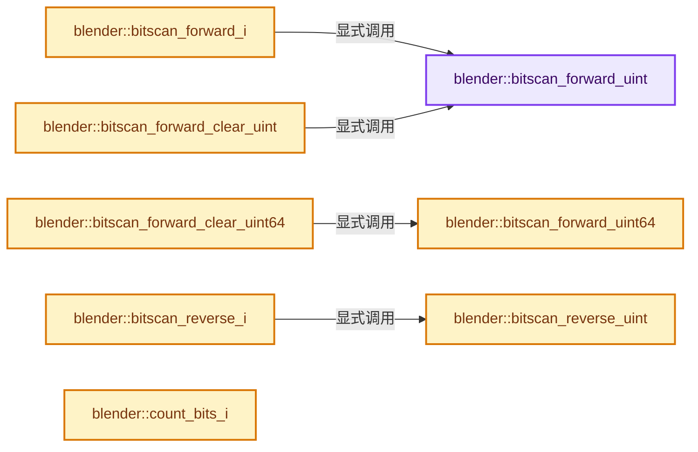

# 实现依赖专题：source/blender/blenlib/intern/math_bits_inline.cc

[实现依赖导航](../../README.md) · [符号索引](../../../00-课程指南/02-源码与提交索引/符号依赖与实现索引.md)

本专题从正文实际调用进入，集中保存共享实现。函数有稳定锚点，可从调用处直接跳到对应完整函数；递归与互相调用通过回链组织。

## 本文件的实现关系




## 完整成员与函数实现

<a id="f-7f1314f32cd96917"></a>

### `blender::bitscan_forward_uint`

实现位置：[source/blender/blenlib/intern/math_bits_inline.cc](../../../../../../../source/blender/blenlib/intern/math_bits_inline.cc) · L20—L30。

接口参数：

- `unsigned int a`

**教学注释版**

<!-- annotated:73570efa0cc0ab -->

```cpp
MINLINE unsigned int bitscan_forward_uint(unsigned int a)
{
  BLI_assert(a != 0);
#ifdef _MSC_VER
  unsigned long ctz;
  _BitScanForward(&ctz, a);
  return ctz;
#else
  return static_cast<unsigned int>(__builtin_ctz(a));
#endif
}
```

<details>
<summary>核对原始源码：source/blender/blenlib/intern/math_bits_inline.cc · L20—L30</summary>

<!-- original:73570efa0cc0ab:source/blender/blenlib/intern/math_bits_inline.cc:20:30 -->

```cpp
MINLINE unsigned int bitscan_forward_uint(unsigned int a)
{
  BLI_assert(a != 0);
#ifdef _MSC_VER
  unsigned long ctz;
  _BitScanForward(&ctz, a);
  return ctz;
#else
  return static_cast<unsigned int>(__builtin_ctz(a));
#endif
}
```

</details>

**结果出口**

- `return ctz;`
- `return static_cast<unsigned int>(__builtin_ctz(a));`

**继续追踪实现**

- `BLI_assert` → [BLI_assert · L48](../BLI_assert.hh.md#m-57a88495704d)；[BLI_assert · L63](../BLI_assert.hh.md#m-d07050020cb5)。宏定义由构建条件选择。
- `_BitScanForward` → [调用协议](../../../00-课程指南/01-路线与规范/模板宏与动态分派协议.md)：函数指针、局部可调用对象或未展开的宏；必须结合调用者环境。调用位置L25。
- `__builtin_ctz` → [调用协议](../../../00-课程指南/01-路线与规范/模板宏与动态分派协议.md)：函数指针、局部可调用对象或未展开的宏；必须结合调用者环境。调用位置L28。

<a id="f-81c6299b5b713570"></a>

### `blender::bitscan_forward_uint64`

实现位置：[source/blender/blenlib/intern/math_bits_inline.cc](../../../../../../../source/blender/blenlib/intern/math_bits_inline.cc) · L32—L42。

接口参数：

- `unsigned long long a`

**教学注释版**

<!-- annotated:71587634f960ef -->

```cpp
MINLINE unsigned int bitscan_forward_uint64(unsigned long long a)
{
  BLI_assert(a != 0);
#ifdef _MSC_VER
  unsigned long ctz;
  _BitScanForward64(&ctz, a);
  return ctz;
#else
  return static_cast<unsigned int>(__builtin_ctzll(a));
#endif
}
```

<details>
<summary>核对原始源码：source/blender/blenlib/intern/math_bits_inline.cc · L32—L42</summary>

<!-- original:71587634f960ef:source/blender/blenlib/intern/math_bits_inline.cc:32:42 -->

```cpp
MINLINE unsigned int bitscan_forward_uint64(unsigned long long a)
{
  BLI_assert(a != 0);
#ifdef _MSC_VER
  unsigned long ctz;
  _BitScanForward64(&ctz, a);
  return ctz;
#else
  return static_cast<unsigned int>(__builtin_ctzll(a));
#endif
}
```

</details>

**结果出口**

- `return ctz;`
- `return static_cast<unsigned int>(__builtin_ctzll(a));`

**继续追踪实现**

- `BLI_assert` → [BLI_assert · L48](../BLI_assert.hh.md#m-57a88495704d)；[BLI_assert · L63](../BLI_assert.hh.md#m-d07050020cb5)。宏定义由构建条件选择。
- `_BitScanForward64` → [调用协议](../../../00-课程指南/01-路线与规范/模板宏与动态分派协议.md)：函数指针、局部可调用对象或未展开的宏；必须结合调用者环境。调用位置L37。
- `__builtin_ctzll` → [调用协议](../../../00-课程指南/01-路线与规范/模板宏与动态分派协议.md)：函数指针、局部可调用对象或未展开的宏；必须结合调用者环境。调用位置L40。

<a id="f-37d030fe7de8bc33"></a>

### `blender::bitscan_forward_i`

实现位置：[source/blender/blenlib/intern/math_bits_inline.cc](../../../../../../../source/blender/blenlib/intern/math_bits_inline.cc) · L44—L47。

接口参数：

- `int a`

**教学注释版**

<!-- annotated:118d3228cb912d -->

```cpp
MINLINE int bitscan_forward_i(int a)
{
  return int(bitscan_forward_uint(static_cast<unsigned int>(a)));
}
```

<details>
<summary>核对原始源码：source/blender/blenlib/intern/math_bits_inline.cc · L44—L47</summary>

<!-- original:118d3228cb912d:source/blender/blenlib/intern/math_bits_inline.cc:44:47 -->

```cpp
MINLINE int bitscan_forward_i(int a)
{
  return int(bitscan_forward_uint(static_cast<unsigned int>(a)));
}
```

</details>

**结果出口**

- `return int(bitscan_forward_uint(static_cast<unsigned int>(a)));`

**继续追踪实现**

- `bitscan_forward_uint` → [blender::bitscan_forward_uint · L20](math_bits_inline.cc.md#f-7f1314f32cd96917)。

<a id="f-9efc4fc5d34159e0"></a>

### `blender::bitscan_forward_clear_uint`

实现位置：[source/blender/blenlib/intern/math_bits_inline.cc](../../../../../../../source/blender/blenlib/intern/math_bits_inline.cc) · L49—L54。

接口参数：

- `unsigned int *a`

**教学注释版**

<!-- annotated:b30fe5557810e0 -->

```cpp
MINLINE unsigned int bitscan_forward_clear_uint(unsigned int *a)
{
  unsigned int i = bitscan_forward_uint(*a);
  *a &= (*a) - 1;
  return i;
}
```

<details>
<summary>核对原始源码：source/blender/blenlib/intern/math_bits_inline.cc · L49—L54</summary>

<!-- original:b30fe5557810e0:source/blender/blenlib/intern/math_bits_inline.cc:49:54 -->

```cpp
MINLINE unsigned int bitscan_forward_clear_uint(unsigned int *a)
{
  unsigned int i = bitscan_forward_uint(*a);
  *a &= (*a) - 1;
  return i;
}
```

</details>

**结果出口**

- `return i;`

**继续追踪实现**

- `bitscan_forward_uint` → [blender::bitscan_forward_uint · L20](math_bits_inline.cc.md#f-7f1314f32cd96917)。

<a id="f-2a2b9af8175029c7"></a>

### `blender::bitscan_forward_clear_uint64`

实现位置：[source/blender/blenlib/intern/math_bits_inline.cc](../../../../../../../source/blender/blenlib/intern/math_bits_inline.cc) · L56—L61。

接口参数：

- `uint64_t *a`

**教学注释版**

<!-- annotated:0500b795b41d34 -->

```cpp
MINLINE unsigned int bitscan_forward_clear_uint64(uint64_t *a)
{
  unsigned int i = bitscan_forward_uint64(*a);
  *a &= (*a) - 1;
  return i;
}
```

<details>
<summary>核对原始源码：source/blender/blenlib/intern/math_bits_inline.cc · L56—L61</summary>

<!-- original:0500b795b41d34:source/blender/blenlib/intern/math_bits_inline.cc:56:61 -->

```cpp
MINLINE unsigned int bitscan_forward_clear_uint64(uint64_t *a)
{
  unsigned int i = bitscan_forward_uint64(*a);
  *a &= (*a) - 1;
  return i;
}
```

</details>

**结果出口**

- `return i;`

**继续追踪实现**

- `bitscan_forward_uint64` → [blender::bitscan_forward_uint64 · L32](math_bits_inline.cc.md#f-81c6299b5b713570)。

<a id="f-b9a4d1ac0701fab2"></a>

### `blender::bitscan_reverse_uint`

实现位置：[source/blender/blenlib/intern/math_bits_inline.cc](../../../../../../../source/blender/blenlib/intern/math_bits_inline.cc) · L68—L78。

接口参数：

- `unsigned int a`

**教学注释版**

<!-- annotated:933d3a8620523d -->

```cpp
MINLINE unsigned int bitscan_reverse_uint(unsigned int a)
{
  BLI_assert(a != 0);
#ifdef _MSC_VER
  unsigned long clz;
  _BitScanReverse(&clz, a);
  return 31 - clz;
#else
  return static_cast<unsigned int>(__builtin_clz(a));
#endif
}
```

<details>
<summary>核对原始源码：source/blender/blenlib/intern/math_bits_inline.cc · L68—L78</summary>

<!-- original:933d3a8620523d:source/blender/blenlib/intern/math_bits_inline.cc:68:78 -->

```cpp
MINLINE unsigned int bitscan_reverse_uint(unsigned int a)
{
  BLI_assert(a != 0);
#ifdef _MSC_VER
  unsigned long clz;
  _BitScanReverse(&clz, a);
  return 31 - clz;
#else
  return static_cast<unsigned int>(__builtin_clz(a));
#endif
}
```

</details>

**结果出口**

- `return 31 - clz;`
- `return static_cast<unsigned int>(__builtin_clz(a));`

**继续追踪实现**

- `BLI_assert` → [BLI_assert · L48](../BLI_assert.hh.md#m-57a88495704d)；[BLI_assert · L63](../BLI_assert.hh.md#m-d07050020cb5)。宏定义由构建条件选择。
- `_BitScanReverse` → [调用协议](../../../00-课程指南/01-路线与规范/模板宏与动态分派协议.md)：函数指针、局部可调用对象或未展开的宏；必须结合调用者环境。调用位置L73。
- `__builtin_clz` → [调用协议](../../../00-课程指南/01-路线与规范/模板宏与动态分派协议.md)：函数指针、局部可调用对象或未展开的宏；必须结合调用者环境。调用位置L76。

<a id="f-788184778f8bba1c"></a>

### `blender::bitscan_reverse_i`

实现位置：[source/blender/blenlib/intern/math_bits_inline.cc](../../../../../../../source/blender/blenlib/intern/math_bits_inline.cc) · L92—L95。

接口参数：

- `int a`

**教学注释版**

<!-- annotated:320ec2fc37b1dd -->

```cpp
MINLINE int bitscan_reverse_i(int a)
{
  return int(bitscan_reverse_uint(static_cast<unsigned int>(a)));
}
```

<details>
<summary>核对原始源码：source/blender/blenlib/intern/math_bits_inline.cc · L92—L95</summary>

<!-- original:320ec2fc37b1dd:source/blender/blenlib/intern/math_bits_inline.cc:92:95 -->

```cpp
MINLINE int bitscan_reverse_i(int a)
{
  return int(bitscan_reverse_uint(static_cast<unsigned int>(a)));
}
```

</details>

**结果出口**

- `return int(bitscan_reverse_uint(static_cast<unsigned int>(a)));`

**继续追踪实现**

- `bitscan_reverse_uint` → [blender::bitscan_reverse_uint · L68](math_bits_inline.cc.md#f-b9a4d1ac0701fab2)。

<a id="f-43d56d5da48d4eae"></a>

### `blender::count_bits_i`

实现位置：[source/blender/blenlib/intern/math_bits_inline.cc](../../../../../../../source/blender/blenlib/intern/math_bits_inline.cc) · L127—L133。

接口参数：

- `unsigned int i`

**教学注释版**

<!-- annotated:c0d7ab2f4262cb -->

```cpp
MINLINE int count_bits_i(unsigned int i)
{
  /* variable-precision SWAR algorithm. */
  i = i - ((i >> 1) & 0x55555555);
  i = (i & 0x33333333) + ((i >> 2) & 0x33333333);
  return (((i + (i >> 4)) & 0x0F0F0F0F) * 0x01010101) >> 24;
}
```

<details>
<summary>核对原始源码：source/blender/blenlib/intern/math_bits_inline.cc · L127—L133</summary>

<!-- original:c0d7ab2f4262cb:source/blender/blenlib/intern/math_bits_inline.cc:127:133 -->

```cpp
MINLINE int count_bits_i(unsigned int i)
{
  /* variable-precision SWAR algorithm. */
  i = i - ((i >> 1) & 0x55555555);
  i = (i & 0x33333333) + ((i >> 2) & 0x33333333);
  return (((i + (i >> 4)) & 0x0F0F0F0F) * 0x01010101) >> 24;
}
```

</details>

**沿实际写入检查状态**

- `i = i - ((i >> 1) & 0x55555555);`
- `i = (i & 0x33333333) + ((i >> 2) & 0x33333333);`

**结果出口**

- `return (((i + (i >> 4)) & 0x0F0F0F0F) * 0x01010101) >> 24;`

**继续追踪实现**

本实现没有需要继续展开的显式调用；检查返回表达式、对象转换和调用者前置条件。

<a id="f-8326c0b18ec54ff0"></a>

### `blender::float_as_int`

实现位置：[source/blender/blenlib/intern/math_bits_inline.cc](../../../../../../../source/blender/blenlib/intern/math_bits_inline.cc) · L140—L148。

接口参数：

- `float f`

**教学注释版**

<!-- annotated:f2f5f6eb952754 -->

```cpp
MINLINE int float_as_int(float f)
{
  union {
    int i;
    float f;
  } u;
  u.f = f;
  return u.i;
}
```

<details>
<summary>核对原始源码：source/blender/blenlib/intern/math_bits_inline.cc · L140—L148</summary>

<!-- original:f2f5f6eb952754:source/blender/blenlib/intern/math_bits_inline.cc:140:148 -->

```cpp
MINLINE int float_as_int(float f)
{
  union {
    int i;
    float f;
  } u;
  u.f = f;
  return u.i;
}
```

</details>

**沿实际写入检查状态**

- `u.f = f;`

**结果出口**

- `return u.i;`

**继续追踪实现**

本实现没有需要继续展开的显式调用；检查返回表达式、对象转换和调用者前置条件。

<a id="f-037f1b8e97bd8a20"></a>

### `blender::int_as_float`

实现位置：[source/blender/blenlib/intern/math_bits_inline.cc](../../../../../../../source/blender/blenlib/intern/math_bits_inline.cc) · L160—L168。

接口参数：

- `int i`

**教学注释版**

<!-- annotated:1dd037ab3eb8a7 -->

```cpp
MINLINE float int_as_float(int i)
{
  union {
    int i;
    float f;
  } u;
  u.i = i;
  return u.f;
}
```

<details>
<summary>核对原始源码：source/blender/blenlib/intern/math_bits_inline.cc · L160—L168</summary>

<!-- original:1dd037ab3eb8a7:source/blender/blenlib/intern/math_bits_inline.cc:160:168 -->

```cpp
MINLINE float int_as_float(int i)
{
  union {
    int i;
    float f;
  } u;
  u.i = i;
  return u.f;
}
```

</details>

**沿实际写入检查状态**

- `u.i = i;`

**结果出口**

- `return u.f;`

**继续追踪实现**

本实现没有需要继续展开的显式调用；检查返回表达式、对象转换和调用者前置条件。

<a id="f-c20b550e13d6b1e8"></a>

### `blender::xor_fl`

实现位置：[source/blender/blenlib/intern/math_bits_inline.cc](../../../../../../../source/blender/blenlib/intern/math_bits_inline.cc) · L180—L183。

接口参数：

- `float x`
- `int y`

**教学注释版**

<!-- annotated:b98d956821c8f6 -->

```cpp
MINLINE float xor_fl(float x, int y)
{
  return int_as_float(float_as_int(x) ^ y);
}
```

<details>
<summary>核对原始源码：source/blender/blenlib/intern/math_bits_inline.cc · L180—L183</summary>

<!-- original:b98d956821c8f6:source/blender/blenlib/intern/math_bits_inline.cc:180:183 -->

```cpp
MINLINE float xor_fl(float x, int y)
{
  return int_as_float(float_as_int(x) ^ y);
}
```

</details>

**结果出口**

- `return int_as_float(float_as_int(x) ^ y);`

**继续追踪实现**

- `int_as_float` → [blender::int_as_float · L160](math_bits_inline.cc.md#f-037f1b8e97bd8a20)。
- `float_as_int` → [blender::float_as_int · L140](math_bits_inline.cc.md#f-8326c0b18ec54ff0)。
