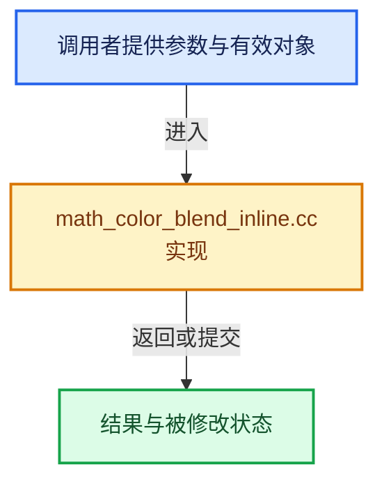

# 实现依赖专题：source/blender/blenlib/intern/math_color_blend_inline.cc

[实现依赖导航](../../README.md) · [符号索引](../../../00-课程指南/02-源码与提交索引/符号依赖与实现索引.md)

本专题从正文实际调用进入，集中保存共享实现。函数有稳定锚点，可从调用处直接跳到对应完整函数；递归与互相调用通过回链组织。

## 本文件的实现关系





## 完整成员与函数实现

<a id="f-6146c61e8b9f6052"></a>

### `blender::blend_color_mix_float`

实现位置：[source/blender/blenlib/intern/math_color_blend_inline.cc](../../../../../../../source/blender/blenlib/intern/math_color_blend_inline.cc) · L601—L617。

接口参数：

- `float dst[4]`
- `const float src1[4]`
- `const float src2[4]`

**教学注释版**

<!-- annotated:73070399de4fe7 -->

```cpp
MINLINE void blend_color_mix_float(float dst[4], const float src1[4], const float src2[4])
{
  if (src2[3] != 0.0f) {
    /* Pre-multiply over operation. */
    const float t = src2[3];
    const float mt = 1.0f - t;

    dst[0] = mt * src1[0] + src2[0];
    dst[1] = mt * src1[1] + src2[1];
    dst[2] = mt * src1[2] + src2[2];
    dst[3] = mt * src1[3] + t;
  }
  else {
    /* no op */
    copy_v4_v4(dst, src1);
  }
}
```

<details>
<summary>核对原始源码：source/blender/blenlib/intern/math_color_blend_inline.cc · L601—L617</summary>

<!-- original:73070399de4fe7:source/blender/blenlib/intern/math_color_blend_inline.cc:601:617 -->

```cpp
MINLINE void blend_color_mix_float(float dst[4], const float src1[4], const float src2[4])
{
  if (src2[3] != 0.0f) {
    /* Pre-multiply over operation. */
    const float t = src2[3];
    const float mt = 1.0f - t;

    dst[0] = mt * src1[0] + src2[0];
    dst[1] = mt * src1[1] + src2[1];
    dst[2] = mt * src1[2] + src2[2];
    dst[3] = mt * src1[3] + t;
  }
  else {
    /* no op */
    copy_v4_v4(dst, src1);
  }
}
```

</details>

**沿实际写入检查状态**

- `dst[0] = mt * src1[0] + src2[0];`
- `dst[1] = mt * src1[1] + src2[1];`
- `dst[2] = mt * src1[2] + src2[2];`
- `dst[3] = mt * src1[3] + t;`

**继续追踪实现**

- `copy_v4_v4` → [blender::copy_v4_v4 · L54](math_vector_inline.cc.md#f-0cf225fc326edf4a)。
