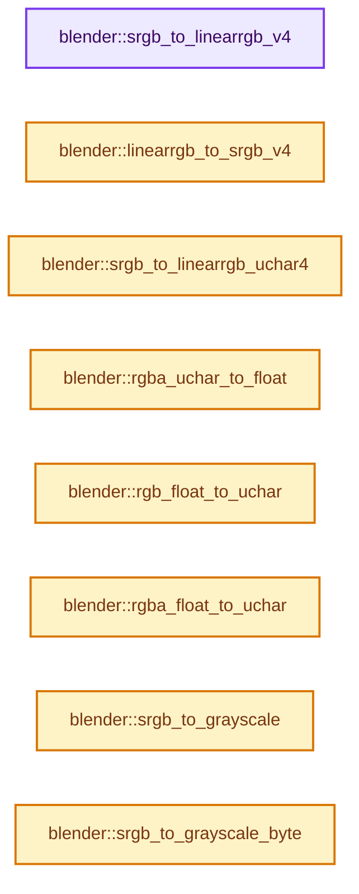
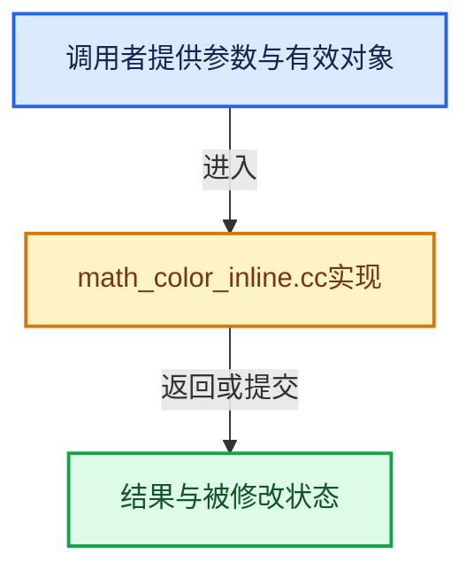

# 实现依赖专题：source/blender/blenlib/intern/math_color_inline.cc

[实现依赖导航](../../README.md) · [符号索引](../../../00-课程指南/02-源码与提交索引/符号依赖与实现索引.md)

本专题从正文实际调用进入，集中保存共享实现。函数有稳定锚点，可从调用处直接跳到对应完整函数；递归与互相调用通过回链组织。

## 本文件的实现关系






## 完整成员与函数实现

<a id="f-4bd7ba0484fc512b"></a>

### `blender::srgb_to_linearrgb_v4`

实现位置：[source/blender/blenlib/intern/math_color_inline.cc](../../../../../../../source/blender/blenlib/intern/math_color_inline.cc) · L22—L26。

接口参数：

- `float linear[4]`
- `const float srgb[4]`

**教学注释版**

<!-- annotated:3a26042f7a0909 -->

```cpp
MINLINE void srgb_to_linearrgb_v4(float linear[4], const float srgb[4])
{
  srgb_to_linearrgb_v3_v3(linear, srgb);
  linear[3] = srgb[3];
}
```

<details>
<summary>核对原始源码：source/blender/blenlib/intern/math_color_inline.cc · L22—L26</summary>

<!-- original:3a26042f7a0909:source/blender/blenlib/intern/math_color_inline.cc:22:26 -->

```cpp
MINLINE void srgb_to_linearrgb_v4(float linear[4], const float srgb[4])
{
  srgb_to_linearrgb_v3_v3(linear, srgb);
  linear[3] = srgb[3];
}
```

</details>

**沿实际写入检查状态**

- `linear[3] = srgb[3];`

**继续追踪实现**

- `srgb_to_linearrgb_v3_v3` → [blender::srgb_to_linearrgb_v3_v3 · L634](math_color.cc.md#f-726cc9f39ac13d69)；[blender::srgb_to_linearrgb_v3_v3 · L785](math_color.cc.md#f-6e6e32feab47a3b3)。同名重载需按实参类型选择。

<a id="f-d3ce6c4f88703091"></a>

### `blender::linearrgb_to_srgb_v4`

实现位置：[source/blender/blenlib/intern/math_color_inline.cc](../../../../../../../source/blender/blenlib/intern/math_color_inline.cc) · L28—L32。

接口参数：

- `float srgb[4]`
- `const float linear[4]`

**教学注释版**

<!-- annotated:11160e7d78cc3b -->

```cpp
MINLINE void linearrgb_to_srgb_v4(float srgb[4], const float linear[4])
{
  linearrgb_to_srgb_v3_v3(srgb, linear);
  srgb[3] = linear[3];
}
```

<details>
<summary>核对原始源码：source/blender/blenlib/intern/math_color_inline.cc · L28—L32</summary>

<!-- original:11160e7d78cc3b:source/blender/blenlib/intern/math_color_inline.cc:28:32 -->

```cpp
MINLINE void linearrgb_to_srgb_v4(float srgb[4], const float linear[4])
{
  linearrgb_to_srgb_v3_v3(srgb, linear);
  srgb[3] = linear[3];
}
```

</details>

**沿实际写入检查状态**

- `srgb[3] = linear[3];`

**继续追踪实现**

- `linearrgb_to_srgb_v3_v3` → [blender::linearrgb_to_srgb_v3_v3 · L644](math_color.cc.md#f-9d7c5f410b641e3a)；[blender::linearrgb_to_srgb_v3_v3 · L792](math_color.cc.md#f-b52b246673840133)。同名重载需按实参类型选择。

<a id="f-39048d10c45c927e"></a>

### `blender::srgb_to_linearrgb_uchar4`

实现位置：[source/blender/blenlib/intern/math_color_inline.cc](../../../../../../../source/blender/blenlib/intern/math_color_inline.cc) · L105—L111。

接口参数：

- `float linear[4]`
- `const unsigned char srgb[4]`

**教学注释版**

<!-- annotated:97b4086371bc08 -->

```cpp
MINLINE void srgb_to_linearrgb_uchar4(float linear[4], const unsigned char srgb[4])
{
  linear[0] = BLI_color_from_srgb_table[srgb[0]];
  linear[1] = BLI_color_from_srgb_table[srgb[1]];
  linear[2] = BLI_color_from_srgb_table[srgb[2]];
  linear[3] = srgb[3] * (1.0f / 255.0f);
}
```

<details>
<summary>核对原始源码：source/blender/blenlib/intern/math_color_inline.cc · L105—L111</summary>

<!-- original:97b4086371bc08:source/blender/blenlib/intern/math_color_inline.cc:105:111 -->

```cpp
MINLINE void srgb_to_linearrgb_uchar4(float linear[4], const unsigned char srgb[4])
{
  linear[0] = BLI_color_from_srgb_table[srgb[0]];
  linear[1] = BLI_color_from_srgb_table[srgb[1]];
  linear[2] = BLI_color_from_srgb_table[srgb[2]];
  linear[3] = srgb[3] * (1.0f / 255.0f);
}
```

</details>

**沿实际写入检查状态**

- `linear[0] = BLI_color_from_srgb_table[srgb[0]];`
- `linear[1] = BLI_color_from_srgb_table[srgb[1]];`
- `linear[2] = BLI_color_from_srgb_table[srgb[2]];`
- `linear[3] = srgb[3] * (1.0f / 255.0f);`

**继续追踪实现**

本实现没有需要继续展开的显式调用；检查返回表达式、对象转换和调用者前置条件。

<a id="f-889fc64cb125570e"></a>

### `blender::rgba_uchar_to_float`

实现位置：[source/blender/blenlib/intern/math_color_inline.cc](../../../../../../../source/blender/blenlib/intern/math_color_inline.cc) · L137—L143。

接口参数：

- `float r_col[4]`
- `const uchar col_ub[4]`

**教学注释版**

<!-- annotated:1d48ef1916f45a -->

```cpp
MINLINE void rgba_uchar_to_float(float r_col[4], const uchar col_ub[4])
{
  r_col[0] = float(col_ub[0]) * (1.0f / 255.0f);
  r_col[1] = float(col_ub[1]) * (1.0f / 255.0f);
  r_col[2] = float(col_ub[2]) * (1.0f / 255.0f);
  r_col[3] = float(col_ub[3]) * (1.0f / 255.0f);
}
```

<details>
<summary>核对原始源码：source/blender/blenlib/intern/math_color_inline.cc · L137—L143</summary>

<!-- original:1d48ef1916f45a:source/blender/blenlib/intern/math_color_inline.cc:137:143 -->

```cpp
MINLINE void rgba_uchar_to_float(float r_col[4], const uchar col_ub[4])
{
  r_col[0] = float(col_ub[0]) * (1.0f / 255.0f);
  r_col[1] = float(col_ub[1]) * (1.0f / 255.0f);
  r_col[2] = float(col_ub[2]) * (1.0f / 255.0f);
  r_col[3] = float(col_ub[3]) * (1.0f / 255.0f);
}
```

</details>

**沿实际写入检查状态**

- `r_col[0] = float(col_ub[0]) * (1.0f / 255.0f);`
- `r_col[1] = float(col_ub[1]) * (1.0f / 255.0f);`
- `r_col[2] = float(col_ub[2]) * (1.0f / 255.0f);`
- `r_col[3] = float(col_ub[3]) * (1.0f / 255.0f);`

**继续追踪实现**

本实现没有需要继续展开的显式调用；检查返回表达式、对象转换和调用者前置条件。

<a id="f-2bd4b3b3f1e8f6b7"></a>

### `blender::rgb_float_to_uchar`

实现位置：[source/blender/blenlib/intern/math_color_inline.cc](../../../../../../../source/blender/blenlib/intern/math_color_inline.cc) · L145—L148。

接口参数：

- `uchar r_col[3]`
- `const float col_f[3]`

**教学注释版**

<!-- annotated:4205c97dd02204 -->

```cpp
MINLINE void rgb_float_to_uchar(uchar r_col[3], const float col_f[3])
{
  unit_float_to_uchar_clamp_v3(r_col, col_f);
}
```

<details>
<summary>核对原始源码：source/blender/blenlib/intern/math_color_inline.cc · L145—L148</summary>

<!-- original:4205c97dd02204:source/blender/blenlib/intern/math_color_inline.cc:145:148 -->

```cpp
MINLINE void rgb_float_to_uchar(uchar r_col[3], const float col_f[3])
{
  unit_float_to_uchar_clamp_v3(r_col, col_f);
}
```

</details>

**继续追踪实现**

- `unit_float_to_uchar_clamp_v3` → [unit_float_to_uchar_clamp_v3 · L597](math_base_inline.cc.md#m-6b722808e4c5)。宏定义由构建条件选择。

<a id="f-00fd745fcb2e3dd8"></a>

### `blender::rgba_float_to_uchar`

实现位置：[source/blender/blenlib/intern/math_color_inline.cc](../../../../../../../source/blender/blenlib/intern/math_color_inline.cc) · L150—L153。

接口参数：

- `uchar r_col[4]`
- `const float col_f[4]`

**教学注释版**

<!-- annotated:0867d3b4432f1d -->

```cpp
MINLINE void rgba_float_to_uchar(uchar r_col[4], const float col_f[4])
{
  unit_float_to_uchar_clamp_v4(r_col, col_f);
}
```

<details>
<summary>核对原始源码：source/blender/blenlib/intern/math_color_inline.cc · L150—L153</summary>

<!-- original:0867d3b4432f1d:source/blender/blenlib/intern/math_color_inline.cc:150:153 -->

```cpp
MINLINE void rgba_float_to_uchar(uchar r_col[4], const float col_f[4])
{
  unit_float_to_uchar_clamp_v4(r_col, col_f);
}
```

</details>

**继续追踪实现**

- `unit_float_to_uchar_clamp_v4` → [unit_float_to_uchar_clamp_v4 · L604](math_base_inline.cc.md#m-544b775b5cdf)。宏定义由构建条件选择。

<a id="f-fd5e3aa570e85d4b"></a>

### `blender::srgb_to_grayscale`

实现位置：[source/blender/blenlib/intern/math_color_inline.cc](../../../../../../../source/blender/blenlib/intern/math_color_inline.cc) · L202—L211。

接口参数：

- `const float rgb[3]`

**教学注释版**

<!-- annotated:b3744b1e341109 -->

```cpp
MINLINE float srgb_to_grayscale(const float rgb[3])
{
  /* Real values are:
   * `Y = 0.2126390059(R) + 0.7151686788(G) + 0.0721923154(B)`
   * according to: "Derivation of Basic Television Color Equations", RP 177-1993
   *
   * As this sums slightly above 1.0, the document recommends to use:
   * `0.2126(R) + 0.7152(G) + 0.0722(B)`, as used here. */
  return (0.2126f * rgb[0]) + (0.7152f * rgb[1]) + (0.0722f * rgb[2]);
}
```

<details>
<summary>核对原始源码：source/blender/blenlib/intern/math_color_inline.cc · L202—L211</summary>

<!-- original:b3744b1e341109:source/blender/blenlib/intern/math_color_inline.cc:202:211 -->

```cpp
MINLINE float srgb_to_grayscale(const float rgb[3])
{
  /* Real values are:
   * `Y = 0.2126390059(R) + 0.7151686788(G) + 0.0721923154(B)`
   * according to: "Derivation of Basic Television Color Equations", RP 177-1993
   *
   * As this sums slightly above 1.0, the document recommends to use:
   * `0.2126(R) + 0.7152(G) + 0.0722(B)`, as used here. */
  return (0.2126f * rgb[0]) + (0.7152f * rgb[1]) + (0.0722f * rgb[2]);
}
```

</details>

**结果出口**

- `return (0.2126f * rgb[0]) + (0.7152f * rgb[1]) + (0.0722f * rgb[2]);`

**继续追踪实现**

本实现没有需要继续展开的显式调用；检查返回表达式、对象转换和调用者前置条件。

<a id="f-781afdc66545d557"></a>

### `blender::srgb_to_grayscale_byte`

实现位置：[source/blender/blenlib/intern/math_color_inline.cc](../../../../../../../source/blender/blenlib/intern/math_color_inline.cc) · L213—L221。

接口参数：

- `const unsigned char rgb[3]`

**教学注释版**

<!-- annotated:da356b6c8961de -->

```cpp
MINLINE unsigned char srgb_to_grayscale_byte(const unsigned char rgb[3])
{
  /* The high precision values are used to calculate the rounded byte weights so they add up to
   * 255: `54(R) + 182(G) + 19(B)` */
  return static_cast<unsigned char>(((54 * static_cast<unsigned short>(rgb[0])) +
                                     (182 * static_cast<unsigned short>(rgb[1])) +
                                     (19 * static_cast<unsigned short>(rgb[2]))) /
                                    255);
}
```

<details>
<summary>核对原始源码：source/blender/blenlib/intern/math_color_inline.cc · L213—L221</summary>

<!-- original:da356b6c8961de:source/blender/blenlib/intern/math_color_inline.cc:213:221 -->

```cpp
MINLINE unsigned char srgb_to_grayscale_byte(const unsigned char rgb[3])
{
  /* The high precision values are used to calculate the rounded byte weights so they add up to
   * 255: `54(R) + 182(G) + 19(B)` */
  return static_cast<unsigned char>(((54 * static_cast<unsigned short>(rgb[0])) +
                                     (182 * static_cast<unsigned short>(rgb[1])) +
                                     (19 * static_cast<unsigned short>(rgb[2]))) /
                                    255);
}
```

</details>

**结果出口**

- `return static_cast<unsigned char>(((54 * static_cast<unsigned short>(rgb[0])) +`

**继续追踪实现**

本实现没有需要继续展开的显式调用；检查返回表达式、对象转换和调用者前置条件。

<a id="f-7c4f2b7964f98f0a"></a>

### `blender::hash_iqint3_f`

实现位置：[source/blender/blenlib/intern/math_color_inline.cc](../../../../../../../source/blender/blenlib/intern/math_color_inline.cc) · L249—L255。

接口参数：

- `const uint32_t x`
- `const uint32_t y`

**教学注释版**

<!-- annotated:81d79d3d544970 -->

```cpp
MINLINE float hash_iqint3_f(const uint32_t x, const uint32_t y)
{
  const uint32_t qx = 1103515245u * ((x >> 1u) ^ (y));
  const uint32_t qy = 1103515245u * ((y >> 1u) ^ (x));
  const uint32_t n = 1103515245u * ((qx) ^ (qy >> 3u));
  return float(n) * (1.0f / float(0xffffffffu));
}
```

<details>
<summary>核对原始源码：source/blender/blenlib/intern/math_color_inline.cc · L249—L255</summary>

<!-- original:81d79d3d544970:source/blender/blenlib/intern/math_color_inline.cc:249:255 -->

```cpp
MINLINE float hash_iqint3_f(const uint32_t x, const uint32_t y)
{
  const uint32_t qx = 1103515245u * ((x >> 1u) ^ (y));
  const uint32_t qy = 1103515245u * ((y >> 1u) ^ (x));
  const uint32_t n = 1103515245u * ((qx) ^ (qy >> 3u));
  return float(n) * (1.0f / float(0xffffffffu));
}
```

</details>

**结果出口**

- `return float(n) * (1.0f / float(0xffffffffu));`

**继续追踪实现**

本实现没有需要继续展开的显式调用；检查返回表达式、对象转换和调用者前置条件。

<a id="f-57f9fc154cd6140e"></a>

### `blender::dither_random_value`

实现位置：[source/blender/blenlib/intern/math_color_inline.cc](../../../../../../../source/blender/blenlib/intern/math_color_inline.cc) · L257—L265。

接口参数：

- `int x`
- `int y`

**教学注释版**

<!-- annotated:598b6213af8748 -->

```cpp
MINLINE float dither_random_value(int x, int y)
{
  float v = hash_iqint3_f(x, y);
  /* Convert uniform distribution into triangle-shaped distribution. Based on
   * "remap_pdf_tri_unity" from https://www.shadertoy.com/view/WldSRf */
  v = v * 2.0f - 1.0f;
  v = signf(v) * (1.0f - sqrtf(1.0f - fabsf(v)));
  return v;
}
```

<details>
<summary>核对原始源码：source/blender/blenlib/intern/math_color_inline.cc · L257—L265</summary>

<!-- original:598b6213af8748:source/blender/blenlib/intern/math_color_inline.cc:257:265 -->

```cpp
MINLINE float dither_random_value(int x, int y)
{
  float v = hash_iqint3_f(x, y);
  /* Convert uniform distribution into triangle-shaped distribution. Based on
   * "remap_pdf_tri_unity" from https://www.shadertoy.com/view/WldSRf */
  v = v * 2.0f - 1.0f;
  v = signf(v) * (1.0f - sqrtf(1.0f - fabsf(v)));
  return v;
}
```

</details>

**沿实际写入检查状态**

- `v = v * 2.0f - 1.0f;`
- `v = signf(v) * (1.0f - sqrtf(1.0f - fabsf(v)));`

**结果出口**

- `return v;`

**继续追踪实现**

- `hash_iqint3_f` → [blender::hash_iqint3_f · L249](math_color_inline.cc.md#f-7c4f2b7964f98f0a)。
- `signf` → [blender::signf · L525](math_base_inline.cc.md#f-c5d816cdde6544ea)。
- `sqrtf` → [外部契约](https://eel.is/c++draft/)：这个边界按实际表达式及所属类型核对参数、返回值、寿命与失败行为。这里提供接口入口，不声称已解释该第三方版本的内部实现。
- `fabsf` → [fabsf · L21](../../07-Intern运行时与平台/cycles/kernel/svm/radial_tiling_shared.h.md#m-02cc4c69cfb3)；[fabsf · L43](../../07-Intern运行时与平台/cycles/kernel/svm/radial_tiling_shared.h.md#m-04effe61803b)；[fabsf · L74](../../07-Intern运行时与平台/cycles/kernel/svm/radial_tiling_shared.h.md#m-927dd4eba7dc)；[fabsf · L25](radial_tiling_shared.hh.md#m-8348d6b3d08f)；[fabsf · L47](radial_tiling_shared.hh.md#m-13b7e0b6d84f)；[fabsf · L78](radial_tiling_shared.hh.md#m-326c83464a0d)；[fabsf · L21](../../07-Intern运行时与平台/cycles/kernel/osl/shaders/node_radial_tiling_shared.h.md#m-7c3ee12fc119)；[fabsf · L43](../../07-Intern运行时与平台/cycles/kernel/osl/shaders/node_radial_tiling_shared.h.md#m-9112db0e2dd1)；[fabsf · L74](../../07-Intern运行时与平台/cycles/kernel/osl/shaders/node_radial_tiling_shared.h.md#m-ee4e61908a6f)；[fabsf · L167](../../07-Intern运行时与平台/cycles/kernel/device/oneapi/compat.h.md#m-b039ee6c1601)；[fabsf · L265](../../07-Intern运行时与平台/cycles/kernel/device/metal/compat.h.md#m-6b21869e9f3f)。宏定义由构建条件选择。

<a id="f-04964d02dcc5cfa0"></a>

### `blender::premul_to_straight_v4_v4`

实现位置：[source/blender/blenlib/intern/math_color_inline.cc](../../../../../../../source/blender/blenlib/intern/math_color_inline.cc) · L283—L298。

接口参数：

- `float straight[4]`
- `const float premul[4]`

**教学注释版**

<!-- annotated:b7cf205b662d8f -->

```cpp
MINLINE void premul_to_straight_v4_v4(float straight[4], const float premul[4])
{
  if (premul[3] == 0.0f || premul[3] == 1.0f) {
    straight[0] = premul[0];
    straight[1] = premul[1];
    straight[2] = premul[2];
    straight[3] = premul[3];
  }
  else {
    const float alpha_inv = 1.0f / premul[3];
    straight[0] = premul[0] * alpha_inv;
    straight[1] = premul[1] * alpha_inv;
    straight[2] = premul[2] * alpha_inv;
    straight[3] = premul[3];
  }
}
```

<details>
<summary>核对原始源码：source/blender/blenlib/intern/math_color_inline.cc · L283—L298</summary>

<!-- original:b7cf205b662d8f:source/blender/blenlib/intern/math_color_inline.cc:283:298 -->

```cpp
MINLINE void premul_to_straight_v4_v4(float straight[4], const float premul[4])
{
  if (premul[3] == 0.0f || premul[3] == 1.0f) {
    straight[0] = premul[0];
    straight[1] = premul[1];
    straight[2] = premul[2];
    straight[3] = premul[3];
  }
  else {
    const float alpha_inv = 1.0f / premul[3];
    straight[0] = premul[0] * alpha_inv;
    straight[1] = premul[1] * alpha_inv;
    straight[2] = premul[2] * alpha_inv;
    straight[3] = premul[3];
  }
}
```

</details>

**沿实际写入检查状态**

- `straight[0] = premul[0];`
- `straight[1] = premul[1];`
- `straight[2] = premul[2];`
- `straight[3] = premul[3];`
- `straight[0] = premul[0] * alpha_inv;`
- `straight[1] = premul[1] * alpha_inv;`
- `straight[2] = premul[2] * alpha_inv;`

**继续追踪实现**

本实现没有需要继续展开的显式调用；检查返回表达式、对象转换和调用者前置条件。

<a id="f-7144705bbd89683c"></a>

### `blender::straight_to_premul_v4_v4`

实现位置：[source/blender/blenlib/intern/math_color_inline.cc](../../../../../../../source/blender/blenlib/intern/math_color_inline.cc) · L305—L312。

接口参数：

- `float premul[4]`
- `const float straight[4]`

**教学注释版**

<!-- annotated:c32afae559207b -->

```cpp
MINLINE void straight_to_premul_v4_v4(float premul[4], const float straight[4])
{
  const float alpha = straight[3];
  premul[0] = straight[0] * alpha;
  premul[1] = straight[1] * alpha;
  premul[2] = straight[2] * alpha;
  premul[3] = straight[3];
}
```

<details>
<summary>核对原始源码：source/blender/blenlib/intern/math_color_inline.cc · L305—L312</summary>

<!-- original:c32afae559207b:source/blender/blenlib/intern/math_color_inline.cc:305:312 -->

```cpp
MINLINE void straight_to_premul_v4_v4(float premul[4], const float straight[4])
{
  const float alpha = straight[3];
  premul[0] = straight[0] * alpha;
  premul[1] = straight[1] * alpha;
  premul[2] = straight[2] * alpha;
  premul[3] = straight[3];
}
```

</details>

**沿实际写入检查状态**

- `premul[0] = straight[0] * alpha;`
- `premul[1] = straight[1] * alpha;`
- `premul[2] = straight[2] * alpha;`
- `premul[3] = straight[3];`

**继续追踪实现**

本实现没有需要继续展开的显式调用；检查返回表达式、对象转换和调用者前置条件。

<a id="f-74827b7b9c18fa85"></a>

### `blender::premul_float_to_straight_uchar`

实现位置：[source/blender/blenlib/intern/math_color_inline.cc](../../../../../../../source/blender/blenlib/intern/math_color_inline.cc) · L330—L347。

接口参数：

- `unsigned char *result`
- `const float color[4]`

**教学注释版**

<!-- annotated:80b308f393c8e1 -->

```cpp
MINLINE void premul_float_to_straight_uchar(unsigned char *result, const float color[4])
{
  if (color[3] == 0.0f || color[3] == 1.0f) {
    result[0] = unit_float_to_uchar_clamp(color[0]);
    result[1] = unit_float_to_uchar_clamp(color[1]);
    result[2] = unit_float_to_uchar_clamp(color[2]);
    result[3] = unit_float_to_uchar_clamp(color[3]);
  }
  else {
    const float alpha_inv = 1.0f / color[3];

    /* hopefully this would be optimized */
    result[0] = unit_float_to_uchar_clamp(color[0] * alpha_inv);
    result[1] = unit_float_to_uchar_clamp(color[1] * alpha_inv);
    result[2] = unit_float_to_uchar_clamp(color[2] * alpha_inv);
    result[3] = unit_float_to_uchar_clamp(color[3]);
  }
}
```

<details>
<summary>核对原始源码：source/blender/blenlib/intern/math_color_inline.cc · L330—L347</summary>

<!-- original:80b308f393c8e1:source/blender/blenlib/intern/math_color_inline.cc:330:347 -->

```cpp
MINLINE void premul_float_to_straight_uchar(unsigned char *result, const float color[4])
{
  if (color[3] == 0.0f || color[3] == 1.0f) {
    result[0] = unit_float_to_uchar_clamp(color[0]);
    result[1] = unit_float_to_uchar_clamp(color[1]);
    result[2] = unit_float_to_uchar_clamp(color[2]);
    result[3] = unit_float_to_uchar_clamp(color[3]);
  }
  else {
    const float alpha_inv = 1.0f / color[3];

    /* hopefully this would be optimized */
    result[0] = unit_float_to_uchar_clamp(color[0] * alpha_inv);
    result[1] = unit_float_to_uchar_clamp(color[1] * alpha_inv);
    result[2] = unit_float_to_uchar_clamp(color[2] * alpha_inv);
    result[3] = unit_float_to_uchar_clamp(color[3]);
  }
}
```

</details>

**沿实际写入检查状态**

- `result[0] = unit_float_to_uchar_clamp(color[0]);`
- `result[1] = unit_float_to_uchar_clamp(color[1]);`
- `result[2] = unit_float_to_uchar_clamp(color[2]);`
- `result[3] = unit_float_to_uchar_clamp(color[3]);`
- `result[0] = unit_float_to_uchar_clamp(color[0] * alpha_inv);`
- `result[1] = unit_float_to_uchar_clamp(color[1] * alpha_inv);`
- `result[2] = unit_float_to_uchar_clamp(color[2] * alpha_inv);`

**继续追踪实现**

- `unit_float_to_uchar_clamp` → [blender::unit_float_to_uchar_clamp · L579](math_base_inline.cc.md#f-078b5581dbbfbc81)。
