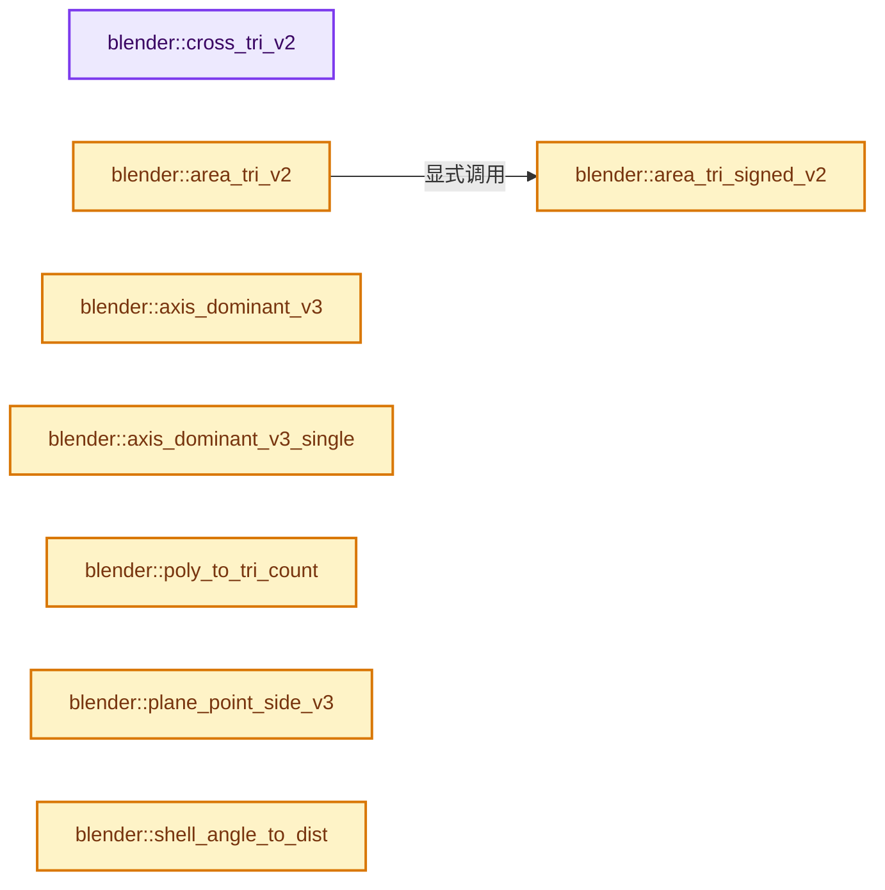

# 实现依赖专题：source/blender/blenlib/intern/math_geom_inline.cc

[实现依赖导航](../../README.md) · [符号索引](../../../00-课程指南/02-源码与提交索引/符号依赖与实现索引.md)

本专题从正文实际调用进入，集中保存共享实现。函数有稳定锚点，可从调用处直接跳到对应完整函数；递归与互相调用通过回链组织。

## 本文件的实现关系




## 完整成员与函数实现

<a id="f-fcd2bb2eeabb870e"></a>

### `blender::cross_tri_v2`

实现位置：[source/blender/blenlib/intern/math_geom_inline.cc](../../../../../../../source/blender/blenlib/intern/math_geom_inline.cc) · L24—L27。

接口参数：

- `const float v1[2]`
- `const float v2[2]`
- `const float v3[2]`

**教学注释版**

<!-- annotated:70f3dfbc1960c4 -->

```cpp
MINLINE float cross_tri_v2(const float v1[2], const float v2[2], const float v3[2])
{
  return (v1[0] - v2[0]) * (v2[1] - v3[1]) + (v1[1] - v2[1]) * (v3[0] - v2[0]);
}
```

<details>
<summary>核对原始源码：source/blender/blenlib/intern/math_geom_inline.cc · L24—L27</summary>

<!-- original:70f3dfbc1960c4:source/blender/blenlib/intern/math_geom_inline.cc:24:27 -->

```cpp
MINLINE float cross_tri_v2(const float v1[2], const float v2[2], const float v3[2])
{
  return (v1[0] - v2[0]) * (v2[1] - v3[1]) + (v1[1] - v2[1]) * (v3[0] - v2[0]);
}
```

</details>

**结果出口**

- `return (v1[0] - v2[0]) * (v2[1] - v3[1]) + (v1[1] - v2[1]) * (v3[0] - v2[0]);`

**继续追踪实现**

本实现没有需要继续展开的显式调用；检查返回表达式、对象转换和调用者前置条件。

<a id="f-a8b2ba8ab69c081a"></a>

### `blender::area_tri_signed_v2`

实现位置：[source/blender/blenlib/intern/math_geom_inline.cc](../../../../../../../source/blender/blenlib/intern/math_geom_inline.cc) · L29—L32。

接口参数：

- `const float v1[2]`
- `const float v2[2]`
- `const float v3[2]`

**教学注释版**

<!-- annotated:8d34ef042cb13c -->

```cpp
MINLINE float area_tri_signed_v2(const float v1[2], const float v2[2], const float v3[2])
{
  return 0.5f * ((v1[0] - v2[0]) * (v2[1] - v3[1]) + (v1[1] - v2[1]) * (v3[0] - v2[0]));
}
```

<details>
<summary>核对原始源码：source/blender/blenlib/intern/math_geom_inline.cc · L29—L32</summary>

<!-- original:8d34ef042cb13c:source/blender/blenlib/intern/math_geom_inline.cc:29:32 -->

```cpp
MINLINE float area_tri_signed_v2(const float v1[2], const float v2[2], const float v3[2])
{
  return 0.5f * ((v1[0] - v2[0]) * (v2[1] - v3[1]) + (v1[1] - v2[1]) * (v3[0] - v2[0]));
}
```

</details>

**结果出口**

- `return 0.5f * ((v1[0] - v2[0]) * (v2[1] - v3[1]) + (v1[1] - v2[1]) * (v3[0] - v2[0]));`

**继续追踪实现**

本实现没有需要继续展开的显式调用；检查返回表达式、对象转换和调用者前置条件。

<a id="f-00e5e57a37aed2d1"></a>

### `blender::area_tri_v2`

实现位置：[source/blender/blenlib/intern/math_geom_inline.cc](../../../../../../../source/blender/blenlib/intern/math_geom_inline.cc) · L34—L37。

接口参数：

- `const float v1[2]`
- `const float v2[2]`
- `const float v3[2]`

**教学注释版**

<!-- annotated:358f723add3bb7 -->

```cpp
MINLINE float area_tri_v2(const float v1[2], const float v2[2], const float v3[2])
{
  return fabsf(area_tri_signed_v2(v1, v2, v3));
}
```

<details>
<summary>核对原始源码：source/blender/blenlib/intern/math_geom_inline.cc · L34—L37</summary>

<!-- original:358f723add3bb7:source/blender/blenlib/intern/math_geom_inline.cc:34:37 -->

```cpp
MINLINE float area_tri_v2(const float v1[2], const float v2[2], const float v3[2])
{
  return fabsf(area_tri_signed_v2(v1, v2, v3));
}
```

</details>

**结果出口**

- `return fabsf(area_tri_signed_v2(v1, v2, v3));`

**继续追踪实现**

- `fabsf` → [fabsf · L21](../../07-Intern运行时与平台/cycles/kernel/svm/radial_tiling_shared.h.md#m-02cc4c69cfb3)；[fabsf · L43](../../07-Intern运行时与平台/cycles/kernel/svm/radial_tiling_shared.h.md#m-04effe61803b)；[fabsf · L74](../../07-Intern运行时与平台/cycles/kernel/svm/radial_tiling_shared.h.md#m-927dd4eba7dc)；[fabsf · L25](radial_tiling_shared.hh.md#m-8348d6b3d08f)；[fabsf · L47](radial_tiling_shared.hh.md#m-13b7e0b6d84f)；[fabsf · L78](radial_tiling_shared.hh.md#m-326c83464a0d)；[fabsf · L21](../../07-Intern运行时与平台/cycles/kernel/osl/shaders/node_radial_tiling_shared.h.md#m-7c3ee12fc119)；[fabsf · L43](../../07-Intern运行时与平台/cycles/kernel/osl/shaders/node_radial_tiling_shared.h.md#m-9112db0e2dd1)；[fabsf · L74](../../07-Intern运行时与平台/cycles/kernel/osl/shaders/node_radial_tiling_shared.h.md#m-ee4e61908a6f)；[fabsf · L167](../../07-Intern运行时与平台/cycles/kernel/device/oneapi/compat.h.md#m-b039ee6c1601)；[fabsf · L265](../../07-Intern运行时与平台/cycles/kernel/device/metal/compat.h.md#m-6b21869e9f3f)。宏定义由构建条件选择。
- `area_tri_signed_v2` → [blender::area_tri_signed_v2 · L29](math_geom_inline.cc.md#f-a8b2ba8ab69c081a)。

<a id="f-e70e8ebc167fbd8f"></a>

### `blender::axis_dominant_v3`

实现位置：[source/blender/blenlib/intern/math_geom_inline.cc](../../../../../../../source/blender/blenlib/intern/math_geom_inline.cc) · L45—L63。

接口参数：

- `int *r_axis_a`
- `int *r_axis_b`
- `const float axis[3]`

**教学注释版**

<!-- annotated:c9980a4917cbbf -->

```cpp
MINLINE void axis_dominant_v3(int *r_axis_a, int *r_axis_b, const float axis[3])
{
  const float xn = fabsf(axis[0]);
  const float yn = fabsf(axis[1]);
  const float zn = fabsf(axis[2]);

  if (zn >= xn && zn >= yn) {
    *r_axis_a = 0;
    *r_axis_b = 1;
  }
  else if (yn >= xn && yn >= zn) {
    *r_axis_a = 0;
    *r_axis_b = 2;
  }
  else {
    *r_axis_a = 1;
    *r_axis_b = 2;
  }
}
```

<details>
<summary>核对原始源码：source/blender/blenlib/intern/math_geom_inline.cc · L45—L63</summary>

<!-- original:c9980a4917cbbf:source/blender/blenlib/intern/math_geom_inline.cc:45:63 -->

```cpp
MINLINE void axis_dominant_v3(int *r_axis_a, int *r_axis_b, const float axis[3])
{
  const float xn = fabsf(axis[0]);
  const float yn = fabsf(axis[1]);
  const float zn = fabsf(axis[2]);

  if (zn >= xn && zn >= yn) {
    *r_axis_a = 0;
    *r_axis_b = 1;
  }
  else if (yn >= xn && yn >= zn) {
    *r_axis_a = 0;
    *r_axis_b = 2;
  }
  else {
    *r_axis_a = 1;
    *r_axis_b = 2;
  }
}
```

</details>

**继续追踪实现**

- `fabsf` → [fabsf · L21](../../07-Intern运行时与平台/cycles/kernel/svm/radial_tiling_shared.h.md#m-02cc4c69cfb3)；[fabsf · L43](../../07-Intern运行时与平台/cycles/kernel/svm/radial_tiling_shared.h.md#m-04effe61803b)；[fabsf · L74](../../07-Intern运行时与平台/cycles/kernel/svm/radial_tiling_shared.h.md#m-927dd4eba7dc)；[fabsf · L25](radial_tiling_shared.hh.md#m-8348d6b3d08f)；[fabsf · L47](radial_tiling_shared.hh.md#m-13b7e0b6d84f)；[fabsf · L78](radial_tiling_shared.hh.md#m-326c83464a0d)；[fabsf · L21](../../07-Intern运行时与平台/cycles/kernel/osl/shaders/node_radial_tiling_shared.h.md#m-7c3ee12fc119)；[fabsf · L43](../../07-Intern运行时与平台/cycles/kernel/osl/shaders/node_radial_tiling_shared.h.md#m-9112db0e2dd1)；[fabsf · L74](../../07-Intern运行时与平台/cycles/kernel/osl/shaders/node_radial_tiling_shared.h.md#m-ee4e61908a6f)；[fabsf · L167](../../07-Intern运行时与平台/cycles/kernel/device/oneapi/compat.h.md#m-b039ee6c1601)；[fabsf · L265](../../07-Intern运行时与平台/cycles/kernel/device/metal/compat.h.md#m-6b21869e9f3f)。宏定义由构建条件选择。

<a id="f-6ecba28ecc9522c4"></a>

### `blender::axis_dominant_v3_single`

实现位置：[source/blender/blenlib/intern/math_geom_inline.cc](../../../../../../../source/blender/blenlib/intern/math_geom_inline.cc) · L86—L92。

接口参数：

- `const float vec[3]`

**教学注释版**

<!-- annotated:a7a0aea8c1d0e7 -->

```cpp
MINLINE int axis_dominant_v3_single(const float vec[3])
{
  const float x = fabsf(vec[0]);
  const float y = fabsf(vec[1]);
  const float z = fabsf(vec[2]);
  return ((x > y) ? ((x > z) ? 0 : 2) : ((y > z) ? 1 : 2));
}
```

<details>
<summary>核对原始源码：source/blender/blenlib/intern/math_geom_inline.cc · L86—L92</summary>

<!-- original:a7a0aea8c1d0e7:source/blender/blenlib/intern/math_geom_inline.cc:86:92 -->

```cpp
MINLINE int axis_dominant_v3_single(const float vec[3])
{
  const float x = fabsf(vec[0]);
  const float y = fabsf(vec[1]);
  const float z = fabsf(vec[2]);
  return ((x > y) ? ((x > z) ? 0 : 2) : ((y > z) ? 1 : 2));
}
```

</details>

**结果出口**

- `return ((x > y) ? ((x > z) ? 0 : 2) : ((y > z) ? 1 : 2));`

**继续追踪实现**

- `fabsf` → [fabsf · L21](../../07-Intern运行时与平台/cycles/kernel/svm/radial_tiling_shared.h.md#m-02cc4c69cfb3)；[fabsf · L43](../../07-Intern运行时与平台/cycles/kernel/svm/radial_tiling_shared.h.md#m-04effe61803b)；[fabsf · L74](../../07-Intern运行时与平台/cycles/kernel/svm/radial_tiling_shared.h.md#m-927dd4eba7dc)；[fabsf · L25](radial_tiling_shared.hh.md#m-8348d6b3d08f)；[fabsf · L47](radial_tiling_shared.hh.md#m-13b7e0b6d84f)；[fabsf · L78](radial_tiling_shared.hh.md#m-326c83464a0d)；[fabsf · L21](../../07-Intern运行时与平台/cycles/kernel/osl/shaders/node_radial_tiling_shared.h.md#m-7c3ee12fc119)；[fabsf · L43](../../07-Intern运行时与平台/cycles/kernel/osl/shaders/node_radial_tiling_shared.h.md#m-9112db0e2dd1)；[fabsf · L74](../../07-Intern运行时与平台/cycles/kernel/osl/shaders/node_radial_tiling_shared.h.md#m-ee4e61908a6f)；[fabsf · L167](../../07-Intern运行时与平台/cycles/kernel/device/oneapi/compat.h.md#m-b039ee6c1601)；[fabsf · L265](../../07-Intern运行时与平台/cycles/kernel/device/metal/compat.h.md#m-6b21869e9f3f)。宏定义由构建条件选择。

<a id="f-fd5a0e76d62e3b0b"></a>

### `blender::poly_to_tri_count`

实现位置：[source/blender/blenlib/intern/math_geom_inline.cc](../../../../../../../source/blender/blenlib/intern/math_geom_inline.cc) · L118—L122。

接口参数：

- `const int poly_count`
- `const int corner_count`

**教学注释版**

<!-- annotated:e90de3aa1018a4 -->

```cpp
MINLINE int poly_to_tri_count(const int poly_count, const int corner_count)
{
  BLI_assert(!poly_count || corner_count > poly_count * 2);
  return corner_count - (poly_count * 2);
}
```

<details>
<summary>核对原始源码：source/blender/blenlib/intern/math_geom_inline.cc · L118—L122</summary>

<!-- original:e90de3aa1018a4:source/blender/blenlib/intern/math_geom_inline.cc:118:122 -->

```cpp
MINLINE int poly_to_tri_count(const int poly_count, const int corner_count)
{
  BLI_assert(!poly_count || corner_count > poly_count * 2);
  return corner_count - (poly_count * 2);
}
```

</details>

**结果出口**

- `return corner_count - (poly_count * 2);`

**继续追踪实现**

- `BLI_assert` → [BLI_assert · L48](../BLI_assert.hh.md#m-57a88495704d)；[BLI_assert · L63](../BLI_assert.hh.md#m-d07050020cb5)。宏定义由构建条件选择。

<a id="f-172f6a5bd676a757"></a>

### `blender::plane_point_side_v3`

实现位置：[source/blender/blenlib/intern/math_geom_inline.cc](../../../../../../../source/blender/blenlib/intern/math_geom_inline.cc) · L124—L127。

接口参数：

- `const float plane[4]`
- `const float co[3]`

**教学注释版**

<!-- annotated:28fd7835d46384 -->

```cpp
MINLINE float plane_point_side_v3(const float plane[4], const float co[3])
{
  return dot_v3v3(co, plane) + plane[3];
}
```

<details>
<summary>核对原始源码：source/blender/blenlib/intern/math_geom_inline.cc · L124—L127</summary>

<!-- original:28fd7835d46384:source/blender/blenlib/intern/math_geom_inline.cc:124:127 -->

```cpp
MINLINE float plane_point_side_v3(const float plane[4], const float co[3])
{
  return dot_v3v3(co, plane) + plane[3];
}
```

</details>

**结果出口**

- `return dot_v3v3(co, plane) + plane[3];`

**继续追踪实现**

- `dot_v3v3` → [blender::dot_v3v3 · L646](math_vector_inline.cc.md#f-c88befa67d07591a)。

<a id="f-923663f98378365e"></a>

### `blender::shell_angle_to_dist`

实现位置：[source/blender/blenlib/intern/math_geom_inline.cc](../../../../../../../source/blender/blenlib/intern/math_geom_inline.cc) · L129—L132。

接口参数：

- `const float angle`

**教学注释版**

<!-- annotated:21a07a8922f092 -->

```cpp
MINLINE float shell_angle_to_dist(const float angle)
{
  return (UNLIKELY(angle < SMALL_NUMBER)) ? 1.0f : fabsf(1.0f / cosf(angle));
}
```

<details>
<summary>核对原始源码：source/blender/blenlib/intern/math_geom_inline.cc · L129—L132</summary>

<!-- original:21a07a8922f092:source/blender/blenlib/intern/math_geom_inline.cc:129:132 -->

```cpp
MINLINE float shell_angle_to_dist(const float angle)
{
  return (UNLIKELY(angle < SMALL_NUMBER)) ? 1.0f : fabsf(1.0f / cosf(angle));
}
```

</details>

**结果出口**

- `return (UNLIKELY(angle < SMALL_NUMBER)) ? 1.0f : fabsf(1.0f / cosf(angle));`

**继续追踪实现**

- `UNLIKELY` → [UNLIKELY · L52](../../07-Intern运行时与平台/guardedalloc/intern/mallocn_intern.hh.md#m-b66d81651173)；[UNLIKELY · L55](../../07-Intern运行时与平台/guardedalloc/intern/mallocn_intern.hh.md#m-43069123e9fe)；[UNLIKELY · L108](../../07-Intern运行时与平台/cycles/util/defines.h.md#m-c50729f638e8)；[UNLIKELY · L111](../../07-Intern运行时与平台/cycles/util/defines.h.md#m-08e633831622)；[UNLIKELY · L25](math_base_inline.cc.md#m-beab6e34c61e)；[UNLIKELY · L27](math_base_inline.cc.md#m-9b279ffdd95b)；[UNLIKELY · L544](../BLI_utildefines.hh.md#m-74644b8209a0)；[UNLIKELY · L547](../BLI_utildefines.hh.md#m-3a47ebab6298)。宏定义由构建条件选择。
- `fabsf` → [fabsf · L21](../../07-Intern运行时与平台/cycles/kernel/svm/radial_tiling_shared.h.md#m-02cc4c69cfb3)；[fabsf · L43](../../07-Intern运行时与平台/cycles/kernel/svm/radial_tiling_shared.h.md#m-04effe61803b)；[fabsf · L74](../../07-Intern运行时与平台/cycles/kernel/svm/radial_tiling_shared.h.md#m-927dd4eba7dc)；[fabsf · L25](radial_tiling_shared.hh.md#m-8348d6b3d08f)；[fabsf · L47](radial_tiling_shared.hh.md#m-13b7e0b6d84f)；[fabsf · L78](radial_tiling_shared.hh.md#m-326c83464a0d)；[fabsf · L21](../../07-Intern运行时与平台/cycles/kernel/osl/shaders/node_radial_tiling_shared.h.md#m-7c3ee12fc119)；[fabsf · L43](../../07-Intern运行时与平台/cycles/kernel/osl/shaders/node_radial_tiling_shared.h.md#m-9112db0e2dd1)；[fabsf · L74](../../07-Intern运行时与平台/cycles/kernel/osl/shaders/node_radial_tiling_shared.h.md#m-ee4e61908a6f)；[fabsf · L167](../../07-Intern运行时与平台/cycles/kernel/device/oneapi/compat.h.md#m-b039ee6c1601)；[fabsf · L265](../../07-Intern运行时与平台/cycles/kernel/device/metal/compat.h.md#m-6b21869e9f3f)。宏定义由构建条件选择。
- `cosf` → [cosf · L20](../../07-Intern运行时与平台/cycles/kernel/svm/radial_tiling_shared.h.md#m-cee9ebf67d86)；[cosf · L42](../../07-Intern运行时与平台/cycles/kernel/svm/radial_tiling_shared.h.md#m-346533627567)；[cosf · L73](../../07-Intern运行时与平台/cycles/kernel/svm/radial_tiling_shared.h.md#m-e01b94a43b72)；[cosf · L24](radial_tiling_shared.hh.md#m-c317cb08dec6)；[cosf · L46](radial_tiling_shared.hh.md#m-93325b515297)；[cosf · L77](radial_tiling_shared.hh.md#m-d3058af0b490)；[cosf · L20](../../07-Intern运行时与平台/cycles/kernel/osl/shaders/node_radial_tiling_shared.h.md#m-4c6aea22a560)；[cosf · L42](../../07-Intern运行时与平台/cycles/kernel/osl/shaders/node_radial_tiling_shared.h.md#m-1fd6a5414477)；[cosf · L73](../../07-Intern运行时与平台/cycles/kernel/osl/shaders/node_radial_tiling_shared.h.md#m-de2402f85270)；[cosf · L186](../../07-Intern运行时与平台/cycles/kernel/device/oneapi/compat.h.md#m-7fdbd99009e0)；[cosf · L288](../../07-Intern运行时与平台/cycles/kernel/device/metal/compat.h.md#m-68fe984e8b68)；[cosf · L93](../../07-Intern运行时与平台/cycles/kernel/device/hip/compat.h.md#m-21bb557a23f1)；[cosf · L91](../../07-Intern运行时与平台/cycles/kernel/device/cuda/compat.h.md#m-7721be419a49)；[cosf · L43](../../08-其他Blender模块/gpu/GPU_shader_shared_utils.hh.md#m-25d02fd11b3b)；[cosf · L64](../../08-其他Blender模块/gpu/GPU_shader_shared_utils.hh.md#m-698fc51ccda3)。宏定义由构建条件选择。

<a id="f-0ff1bb6c474aef57"></a>

### `blender::shell_v3v3_normalized_to_dist`

实现位置：[source/blender/blenlib/intern/math_geom_inline.cc](../../../../../../../source/blender/blenlib/intern/math_geom_inline.cc) · L133—L139。

接口参数：

- `const float a[3]`
- `const float b[3]`

**教学注释版**

<!-- annotated:3df84eed074682 -->

```cpp
MINLINE float shell_v3v3_normalized_to_dist(const float a[3], const float b[3])
{
  BLI_ASSERT_UNIT_V3(a);
  BLI_ASSERT_UNIT_V3(b);
  const float angle_cos = fabsf(dot_v3v3(a, b));
  return (UNLIKELY(angle_cos < SMALL_NUMBER)) ? 1.0f : (1.0f / angle_cos);
}
```

<details>
<summary>核对原始源码：source/blender/blenlib/intern/math_geom_inline.cc · L133—L139</summary>

<!-- original:3df84eed074682:source/blender/blenlib/intern/math_geom_inline.cc:133:139 -->

```cpp
MINLINE float shell_v3v3_normalized_to_dist(const float a[3], const float b[3])
{
  BLI_ASSERT_UNIT_V3(a);
  BLI_ASSERT_UNIT_V3(b);
  const float angle_cos = fabsf(dot_v3v3(a, b));
  return (UNLIKELY(angle_cos < SMALL_NUMBER)) ? 1.0f : (1.0f / angle_cos);
}
```

</details>

**结果出口**

- `return (UNLIKELY(angle_cos < SMALL_NUMBER)) ? 1.0f : (1.0f / angle_cos);`

**继续追踪实现**

- `BLI_ASSERT_UNIT_V3` → [BLI_ASSERT_UNIT_V3 · L315](../BLI_math_base_c.hh.md#m-7f347402189a)；[BLI_ASSERT_UNIT_V3 · L359](../BLI_math_base_c.hh.md#m-fe91af053d50)。宏定义由构建条件选择。
- `fabsf` → [fabsf · L21](../../07-Intern运行时与平台/cycles/kernel/svm/radial_tiling_shared.h.md#m-02cc4c69cfb3)；[fabsf · L43](../../07-Intern运行时与平台/cycles/kernel/svm/radial_tiling_shared.h.md#m-04effe61803b)；[fabsf · L74](../../07-Intern运行时与平台/cycles/kernel/svm/radial_tiling_shared.h.md#m-927dd4eba7dc)；[fabsf · L25](radial_tiling_shared.hh.md#m-8348d6b3d08f)；[fabsf · L47](radial_tiling_shared.hh.md#m-13b7e0b6d84f)；[fabsf · L78](radial_tiling_shared.hh.md#m-326c83464a0d)；[fabsf · L21](../../07-Intern运行时与平台/cycles/kernel/osl/shaders/node_radial_tiling_shared.h.md#m-7c3ee12fc119)；[fabsf · L43](../../07-Intern运行时与平台/cycles/kernel/osl/shaders/node_radial_tiling_shared.h.md#m-9112db0e2dd1)；[fabsf · L74](../../07-Intern运行时与平台/cycles/kernel/osl/shaders/node_radial_tiling_shared.h.md#m-ee4e61908a6f)；[fabsf · L167](../../07-Intern运行时与平台/cycles/kernel/device/oneapi/compat.h.md#m-b039ee6c1601)；[fabsf · L265](../../07-Intern运行时与平台/cycles/kernel/device/metal/compat.h.md#m-6b21869e9f3f)。宏定义由构建条件选择。
- `dot_v3v3` → [blender::dot_v3v3 · L646](math_vector_inline.cc.md#f-c88befa67d07591a)。
- `UNLIKELY` → [UNLIKELY · L52](../../07-Intern运行时与平台/guardedalloc/intern/mallocn_intern.hh.md#m-b66d81651173)；[UNLIKELY · L55](../../07-Intern运行时与平台/guardedalloc/intern/mallocn_intern.hh.md#m-43069123e9fe)；[UNLIKELY · L108](../../07-Intern运行时与平台/cycles/util/defines.h.md#m-c50729f638e8)；[UNLIKELY · L111](../../07-Intern运行时与平台/cycles/util/defines.h.md#m-08e633831622)；[UNLIKELY · L25](math_base_inline.cc.md#m-beab6e34c61e)；[UNLIKELY · L27](math_base_inline.cc.md#m-9b279ffdd95b)；[UNLIKELY · L544](../BLI_utildefines.hh.md#m-74644b8209a0)；[UNLIKELY · L547](../BLI_utildefines.hh.md#m-3a47ebab6298)。宏定义由构建条件选择。
