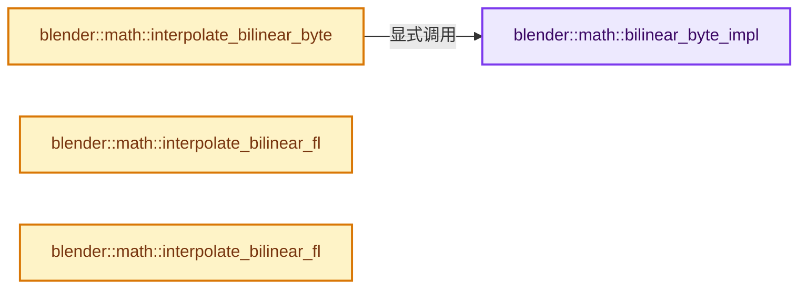
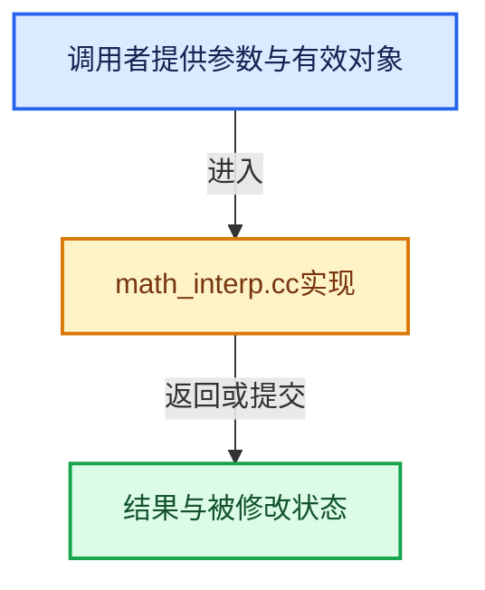

# 实现依赖专题：source/blender/blenlib/intern/math_interp.cc

[实现依赖导航](../../README.md) · [符号索引](../../../00-课程指南/02-源码与提交索引/符号依赖与实现索引.md)

本专题从正文实际调用进入，集中保存共享实现。函数有稳定锚点，可从调用处直接跳到对应完整函数；递归与互相调用通过回链组织。

## 本文件的实现关系






## 完整成员与函数实现

<a id="f-ab131211ca0f008c"></a>

### `blender::math::bilinear_byte_impl`

实现位置：[source/blender/blenlib/intern/math_interp.cc](../../../../../../../source/blender/blenlib/intern/math_interp.cc) · L224—L366。

接口参数：

- `const uchar *buffer`
- `int width`
- `int height`
- `float u`
- `float v`

**教学注释版**

<!-- annotated:50d2a0db2e51ff -->

```cpp
template<bool border>
BLI_INLINE uchar4 bilinear_byte_impl(const uchar *buffer, int width, int height, float u, float v)
{
  BLI_assert(buffer);
  uchar4 res;

#if BLI_HAVE_SSE4
  __m128 uvuv = _mm_set_ps(v, u, v, u);
  __m128 uvuv_floor = _mm_floor_ps(uvuv);

  /* x1, y1, x2, y2 */
  __m128i xy12 = _mm_add_epi32(_mm_cvttps_epi32(uvuv_floor), _mm_set_epi32(1, 1, 0, 0));
  /* Check whether any of the coordinates are outside of the image. */
  __m128i size_minus_1 = _mm_sub_epi32(_mm_set_epi32(height, width, height, width),
                                       _mm_set1_epi32(1));

  /* Samples 1,2,3,4 will be in this order: x1y1, x1y2, x2y1, x2y2. */
  __m128i x1234, y1234, invalid_1234;

  if constexpr (border) {
    /* Blend black colors for samples right outside the image: figure out
     * which of the 4 samples were outside, set their coordinates to zero
     * and later on put black color into their place. */
    __m128i too_lo_xy12 = _mm_cmplt_epi32(xy12, _mm_setzero_si128());
    __m128i too_hi_xy12 = _mm_cmplt_epi32(size_minus_1, xy12);
    __m128i invalid_xy12 = _mm_or_si128(too_lo_xy12, too_hi_xy12);

    /* Samples 1,2,3,4 are in this order: x1y1, x1y2, x2y1, x2y2 */
    x1234 = _mm_shuffle_epi32(xy12, _MM_SHUFFLE(2, 2, 0, 0));
    y1234 = _mm_shuffle_epi32(xy12, _MM_SHUFFLE(3, 1, 3, 1));
    invalid_1234 = _mm_or_si128(_mm_shuffle_epi32(invalid_xy12, _MM_SHUFFLE(2, 2, 0, 0)),
                                _mm_shuffle_epi32(invalid_xy12, _MM_SHUFFLE(3, 1, 3, 1)));
    /* Set x & y to zero for invalid samples. */
    x1234 = _mm_andnot_si128(invalid_1234, x1234);
    y1234 = _mm_andnot_si128(invalid_1234, y1234);
  }
  else {
    /* Clamp samples to image edges. */
    __m128i xy12_clamped = _mm_max_epi32(xy12, _mm_setzero_si128());
    xy12_clamped = _mm_min_epi32(xy12_clamped, size_minus_1);
    x1234 = _mm_shuffle_epi32(xy12_clamped, _MM_SHUFFLE(2, 2, 0, 0));
    y1234 = _mm_shuffle_epi32(xy12_clamped, _MM_SHUFFLE(3, 1, 3, 1));
  }

  /* Read the four sample values. Do address calculations in C, since SSE
   * before 4.1 makes it very cumbersome to do full integer multiplies. */
  int xcoord[4];
  int ycoord[4];
  _mm_storeu_ps(reinterpret_cast<float *>(xcoord), _mm_castsi128_ps(x1234));
  _mm_storeu_ps(reinterpret_cast<float *>(ycoord), _mm_castsi128_ps(y1234));
  int sample1 = (reinterpret_cast<const int *>(buffer))[ycoord[0] * int64_t(width) + xcoord[0]];
  int sample2 = (reinterpret_cast<const int *>(buffer))[ycoord[1] * int64_t(width) + xcoord[1]];
  int sample3 = (reinterpret_cast<const int *>(buffer))[ycoord[2] * int64_t(width) + xcoord[2]];
  int sample4 = (reinterpret_cast<const int *>(buffer))[ycoord[3] * int64_t(width) + xcoord[3]];
  __m128i samples1234 = _mm_set_epi32(sample4, sample3, sample2, sample1);
  if constexpr (border) {
    /* Set samples to black for the ones that were actually invalid. */
    samples1234 = _mm_andnot_si128(invalid_1234, samples1234);
  }

  /* Expand samples from packed 8-bit RGBA to full floats:
   * spread to 16 bit values. */
  __m128i rgba16_12 = _mm_unpacklo_epi8(samples1234, _mm_setzero_si128());
  __m128i rgba16_34 = _mm_unpackhi_epi8(samples1234, _mm_setzero_si128());
  /* Spread to 32 bit values and convert to float. */
  __m128 rgba1 = _mm_cvtepi32_ps(_mm_unpacklo_epi16(rgba16_12, _mm_setzero_si128()));
  __m128 rgba2 = _mm_cvtepi32_ps(_mm_unpackhi_epi16(rgba16_12, _mm_setzero_si128()));
  __m128 rgba3 = _mm_cvtepi32_ps(_mm_unpacklo_epi16(rgba16_34, _mm_setzero_si128()));
  __m128 rgba4 = _mm_cvtepi32_ps(_mm_unpackhi_epi16(rgba16_34, _mm_setzero_si128()));

  /* Calculate interpolation factors: (1-a)*(1-b), (1-a)*b, a*(1-b), a*b */
  __m128 abab = _mm_sub_ps(uvuv, uvuv_floor);
  __m128 m_abab = _mm_sub_ps(_mm_set1_ps(1.0f), abab);
  __m128 ab_mab = _mm_shuffle_ps(abab, m_abab, _MM_SHUFFLE(3, 2, 1, 0));
  __m128 factors = _mm_mul_ps(_mm_shuffle_ps(ab_mab, ab_mab, _MM_SHUFFLE(0, 0, 2, 2)),
                              _mm_shuffle_ps(ab_mab, ab_mab, _MM_SHUFFLE(1, 3, 1, 3)));

  /* Blend the samples. */
  rgba1 = _mm_mul_ps(_mm_shuffle_ps(factors, factors, _MM_SHUFFLE(0, 0, 0, 0)), rgba1);
  rgba2 = _mm_mul_ps(_mm_shuffle_ps(factors, factors, _MM_SHUFFLE(1, 1, 1, 1)), rgba2);
  rgba3 = _mm_mul_ps(_mm_shuffle_ps(factors, factors, _MM_SHUFFLE(2, 2, 2, 2)), rgba3);
  rgba4 = _mm_mul_ps(_mm_shuffle_ps(factors, factors, _MM_SHUFFLE(3, 3, 3, 3)), rgba4);
  __m128 rgba13 = _mm_add_ps(rgba1, rgba3);
  __m128 rgba24 = _mm_add_ps(rgba2, rgba4);
  __m128 rgba = _mm_add_ps(rgba13, rgba24);
  rgba = _mm_add_ps(rgba, _mm_set1_ps(0.5f));
  /* Pack and write to destination: pack to 16 bit signed, then to 8 bit
   * unsigned, then write resulting 32-bit value. */
  __m128i rgba32 = _mm_cvttps_epi32(rgba);
  __m128i rgba16 = _mm_packs_epi32(rgba32, _mm_setzero_si128());
  __m128i rgba8 = _mm_packus_epi16(rgba16, _mm_setzero_si128());
  _mm_store_ss(reinterpret_cast<float *>(&res), _mm_castsi128_ps(rgba8));

#else

  float uf = floorf(u);
  float vf = floorf(v);

  int x1 = int(uf);
  int x2 = x1 + 1;
  int y1 = int(vf);
  int y2 = y1 + 1;

  /* Completely outside of the image in bordered mode? */
  if (border && (x2 < 0 || x1 >= width || y2 < 0 || y1 >= height)) {
    return uchar4(0);
  }

  /* Sample locations. */
  const uchar *row1, *row2, *row3, *row4;
  uchar empty[4] = {0, 0, 0, 0};
  if constexpr (border) {
    row1 = (x1 < 0 || y1 < 0) ? empty : buffer + (int64_t(width) * y1 + x1) * 4;
    row2 = (x1 < 0 || y2 > height - 1) ? empty : buffer + (int64_t(width) * y2 + x1) * 4;
    row3 = (x2 > width - 1 || y1 < 0) ? empty : buffer + (int64_t(width) * y1 + x2) * 4;
    row4 = (x2 > width - 1 || y2 > height - 1) ? empty : buffer + (int64_t(width) * y2 + x2) * 4;
  }
  else {
    x1 = clamp(x1, 0, width - 1);
    x2 = clamp(x2, 0, width - 1);
    y1 = clamp(y1, 0, height - 1);
    y2 = clamp(y2, 0, height - 1);
    row1 = buffer + (int64_t(width) * y1 + x1) * 4;
    row2 = buffer + (int64_t(width) * y2 + x1) * 4;
    row3 = buffer + (int64_t(width) * y1 + x2) * 4;
    row4 = buffer + (int64_t(width) * y2 + x2) * 4;
  }

  float a = u - uf;
  float b = v - vf;
  float a_b = a * b;
  float ma_b = (1.0f - a) * b;
  float a_mb = a * (1.0f - b);
  float ma_mb = (1.0f - a) * (1.0f - b);

  res.x = uchar(ma_mb * row1[0] + a_mb * row3[0] + ma_b * row2[0] + a_b * row4[0] + 0.5f);
  res.y = uchar(ma_mb * row1[1] + a_mb * row3[1] + ma_b * row2[1] + a_b * row4[1] + 0.5f);
  res.z = uchar(ma_mb * row1[2] + a_mb * row3[2] + ma_b * row2[2] + a_b * row4[2] + 0.5f);
  res.w = uchar(ma_mb * row1[3] + a_mb * row3[3] + ma_b * row2[3] + a_b * row4[3] + 0.5f);
#endif

  return res;
}
```

<details>
<summary>核对原始源码：source/blender/blenlib/intern/math_interp.cc · L224—L366</summary>

<!-- original:50d2a0db2e51ff:source/blender/blenlib/intern/math_interp.cc:224:366 -->

```cpp
template<bool border>
BLI_INLINE uchar4 bilinear_byte_impl(const uchar *buffer, int width, int height, float u, float v)
{
  BLI_assert(buffer);
  uchar4 res;

#if BLI_HAVE_SSE4
  __m128 uvuv = _mm_set_ps(v, u, v, u);
  __m128 uvuv_floor = _mm_floor_ps(uvuv);

  /* x1, y1, x2, y2 */
  __m128i xy12 = _mm_add_epi32(_mm_cvttps_epi32(uvuv_floor), _mm_set_epi32(1, 1, 0, 0));
  /* Check whether any of the coordinates are outside of the image. */
  __m128i size_minus_1 = _mm_sub_epi32(_mm_set_epi32(height, width, height, width),
                                       _mm_set1_epi32(1));

  /* Samples 1,2,3,4 will be in this order: x1y1, x1y2, x2y1, x2y2. */
  __m128i x1234, y1234, invalid_1234;

  if constexpr (border) {
    /* Blend black colors for samples right outside the image: figure out
     * which of the 4 samples were outside, set their coordinates to zero
     * and later on put black color into their place. */
    __m128i too_lo_xy12 = _mm_cmplt_epi32(xy12, _mm_setzero_si128());
    __m128i too_hi_xy12 = _mm_cmplt_epi32(size_minus_1, xy12);
    __m128i invalid_xy12 = _mm_or_si128(too_lo_xy12, too_hi_xy12);

    /* Samples 1,2,3,4 are in this order: x1y1, x1y2, x2y1, x2y2 */
    x1234 = _mm_shuffle_epi32(xy12, _MM_SHUFFLE(2, 2, 0, 0));
    y1234 = _mm_shuffle_epi32(xy12, _MM_SHUFFLE(3, 1, 3, 1));
    invalid_1234 = _mm_or_si128(_mm_shuffle_epi32(invalid_xy12, _MM_SHUFFLE(2, 2, 0, 0)),
                                _mm_shuffle_epi32(invalid_xy12, _MM_SHUFFLE(3, 1, 3, 1)));
    /* Set x & y to zero for invalid samples. */
    x1234 = _mm_andnot_si128(invalid_1234, x1234);
    y1234 = _mm_andnot_si128(invalid_1234, y1234);
  }
  else {
    /* Clamp samples to image edges. */
    __m128i xy12_clamped = _mm_max_epi32(xy12, _mm_setzero_si128());
    xy12_clamped = _mm_min_epi32(xy12_clamped, size_minus_1);
    x1234 = _mm_shuffle_epi32(xy12_clamped, _MM_SHUFFLE(2, 2, 0, 0));
    y1234 = _mm_shuffle_epi32(xy12_clamped, _MM_SHUFFLE(3, 1, 3, 1));
  }

  /* Read the four sample values. Do address calculations in C, since SSE
   * before 4.1 makes it very cumbersome to do full integer multiplies. */
  int xcoord[4];
  int ycoord[4];
  _mm_storeu_ps(reinterpret_cast<float *>(xcoord), _mm_castsi128_ps(x1234));
  _mm_storeu_ps(reinterpret_cast<float *>(ycoord), _mm_castsi128_ps(y1234));
  int sample1 = (reinterpret_cast<const int *>(buffer))[ycoord[0] * int64_t(width) + xcoord[0]];
  int sample2 = (reinterpret_cast<const int *>(buffer))[ycoord[1] * int64_t(width) + xcoord[1]];
  int sample3 = (reinterpret_cast<const int *>(buffer))[ycoord[2] * int64_t(width) + xcoord[2]];
  int sample4 = (reinterpret_cast<const int *>(buffer))[ycoord[3] * int64_t(width) + xcoord[3]];
  __m128i samples1234 = _mm_set_epi32(sample4, sample3, sample2, sample1);
  if constexpr (border) {
    /* Set samples to black for the ones that were actually invalid. */
    samples1234 = _mm_andnot_si128(invalid_1234, samples1234);
  }

  /* Expand samples from packed 8-bit RGBA to full floats:
   * spread to 16 bit values. */
  __m128i rgba16_12 = _mm_unpacklo_epi8(samples1234, _mm_setzero_si128());
  __m128i rgba16_34 = _mm_unpackhi_epi8(samples1234, _mm_setzero_si128());
  /* Spread to 32 bit values and convert to float. */
  __m128 rgba1 = _mm_cvtepi32_ps(_mm_unpacklo_epi16(rgba16_12, _mm_setzero_si128()));
  __m128 rgba2 = _mm_cvtepi32_ps(_mm_unpackhi_epi16(rgba16_12, _mm_setzero_si128()));
  __m128 rgba3 = _mm_cvtepi32_ps(_mm_unpacklo_epi16(rgba16_34, _mm_setzero_si128()));
  __m128 rgba4 = _mm_cvtepi32_ps(_mm_unpackhi_epi16(rgba16_34, _mm_setzero_si128()));

  /* Calculate interpolation factors: (1-a)*(1-b), (1-a)*b, a*(1-b), a*b */
  __m128 abab = _mm_sub_ps(uvuv, uvuv_floor);
  __m128 m_abab = _mm_sub_ps(_mm_set1_ps(1.0f), abab);
  __m128 ab_mab = _mm_shuffle_ps(abab, m_abab, _MM_SHUFFLE(3, 2, 1, 0));
  __m128 factors = _mm_mul_ps(_mm_shuffle_ps(ab_mab, ab_mab, _MM_SHUFFLE(0, 0, 2, 2)),
                              _mm_shuffle_ps(ab_mab, ab_mab, _MM_SHUFFLE(1, 3, 1, 3)));

  /* Blend the samples. */
  rgba1 = _mm_mul_ps(_mm_shuffle_ps(factors, factors, _MM_SHUFFLE(0, 0, 0, 0)), rgba1);
  rgba2 = _mm_mul_ps(_mm_shuffle_ps(factors, factors, _MM_SHUFFLE(1, 1, 1, 1)), rgba2);
  rgba3 = _mm_mul_ps(_mm_shuffle_ps(factors, factors, _MM_SHUFFLE(2, 2, 2, 2)), rgba3);
  rgba4 = _mm_mul_ps(_mm_shuffle_ps(factors, factors, _MM_SHUFFLE(3, 3, 3, 3)), rgba4);
  __m128 rgba13 = _mm_add_ps(rgba1, rgba3);
  __m128 rgba24 = _mm_add_ps(rgba2, rgba4);
  __m128 rgba = _mm_add_ps(rgba13, rgba24);
  rgba = _mm_add_ps(rgba, _mm_set1_ps(0.5f));
  /* Pack and write to destination: pack to 16 bit signed, then to 8 bit
   * unsigned, then write resulting 32-bit value. */
  __m128i rgba32 = _mm_cvttps_epi32(rgba);
  __m128i rgba16 = _mm_packs_epi32(rgba32, _mm_setzero_si128());
  __m128i rgba8 = _mm_packus_epi16(rgba16, _mm_setzero_si128());
  _mm_store_ss(reinterpret_cast<float *>(&res), _mm_castsi128_ps(rgba8));

#else

  float uf = floorf(u);
  float vf = floorf(v);

  int x1 = int(uf);
  int x2 = x1 + 1;
  int y1 = int(vf);
  int y2 = y1 + 1;

  /* Completely outside of the image in bordered mode? */
  if (border && (x2 < 0 || x1 >= width || y2 < 0 || y1 >= height)) {
    return uchar4(0);
  }

  /* Sample locations. */
  const uchar *row1, *row2, *row3, *row4;
  uchar empty[4] = {0, 0, 0, 0};
  if constexpr (border) {
    row1 = (x1 < 0 || y1 < 0) ? empty : buffer + (int64_t(width) * y1 + x1) * 4;
    row2 = (x1 < 0 || y2 > height - 1) ? empty : buffer + (int64_t(width) * y2 + x1) * 4;
    row3 = (x2 > width - 1 || y1 < 0) ? empty : buffer + (int64_t(width) * y1 + x2) * 4;
    row4 = (x2 > width - 1 || y2 > height - 1) ? empty : buffer + (int64_t(width) * y2 + x2) * 4;
  }
  else {
    x1 = clamp(x1, 0, width - 1);
    x2 = clamp(x2, 0, width - 1);
    y1 = clamp(y1, 0, height - 1);
    y2 = clamp(y2, 0, height - 1);
    row1 = buffer + (int64_t(width) * y1 + x1) * 4;
    row2 = buffer + (int64_t(width) * y2 + x1) * 4;
    row3 = buffer + (int64_t(width) * y1 + x2) * 4;
    row4 = buffer + (int64_t(width) * y2 + x2) * 4;
  }

  float a = u - uf;
  float b = v - vf;
  float a_b = a * b;
  float ma_b = (1.0f - a) * b;
  float a_mb = a * (1.0f - b);
  float ma_mb = (1.0f - a) * (1.0f - b);

  res.x = uchar(ma_mb * row1[0] + a_mb * row3[0] + ma_b * row2[0] + a_b * row4[0] + 0.5f);
  res.y = uchar(ma_mb * row1[1] + a_mb * row3[1] + ma_b * row2[1] + a_b * row4[1] + 0.5f);
  res.z = uchar(ma_mb * row1[2] + a_mb * row3[2] + ma_b * row2[2] + a_b * row4[2] + 0.5f);
  res.w = uchar(ma_mb * row1[3] + a_mb * row3[3] + ma_b * row2[3] + a_b * row4[3] + 0.5f);
#endif

  return res;
}
```

</details>

**沿实际写入检查状态**

- `x1234 = _mm_shuffle_epi32(xy12, _MM_SHUFFLE(2, 2, 0, 0));`
- `y1234 = _mm_shuffle_epi32(xy12, _MM_SHUFFLE(3, 1, 3, 1));`
- `invalid_1234 = _mm_or_si128(_mm_shuffle_epi32(invalid_xy12, _MM_SHUFFLE(2, 2, 0, 0)),`
- `x1234 = _mm_andnot_si128(invalid_1234, x1234);`
- `y1234 = _mm_andnot_si128(invalid_1234, y1234);`
- `xy12_clamped = _mm_min_epi32(xy12_clamped, size_minus_1);`
- `x1234 = _mm_shuffle_epi32(xy12_clamped, _MM_SHUFFLE(2, 2, 0, 0));`
- `y1234 = _mm_shuffle_epi32(xy12_clamped, _MM_SHUFFLE(3, 1, 3, 1));`
- `samples1234 = _mm_andnot_si128(invalid_1234, samples1234);`
- `rgba1 = _mm_mul_ps(_mm_shuffle_ps(factors, factors, _MM_SHUFFLE(0, 0, 0, 0)), rgba1);`
- `rgba2 = _mm_mul_ps(_mm_shuffle_ps(factors, factors, _MM_SHUFFLE(1, 1, 1, 1)), rgba2);`
- `rgba3 = _mm_mul_ps(_mm_shuffle_ps(factors, factors, _MM_SHUFFLE(2, 2, 2, 2)), rgba3);`
- `rgba4 = _mm_mul_ps(_mm_shuffle_ps(factors, factors, _MM_SHUFFLE(3, 3, 3, 3)), rgba4);`
- `rgba = _mm_add_ps(rgba, _mm_set1_ps(0.5f));`
- `row1 = (x1 < 0 || y1 < 0) ? empty : buffer + (int64_t(width) * y1 + x1) * 4;`
- `row2 = (x1 < 0 || y2 > height - 1) ? empty : buffer + (int64_t(width) * y2 + x1) * 4;`
- `row3 = (x2 > width - 1 || y1 < 0) ? empty : buffer + (int64_t(width) * y1 + x2) * 4;`
- `row4 = (x2 > width - 1 || y2 > height - 1) ? empty : buffer + (int64_t(width) * y2 + x2) * 4;`
- `x1 = clamp(x1, 0, width - 1);`
- `x2 = clamp(x2, 0, width - 1);`
- `y1 = clamp(y1, 0, height - 1);`
- `y2 = clamp(y2, 0, height - 1);`
- `row1 = buffer + (int64_t(width) * y1 + x1) * 4;`
- `row2 = buffer + (int64_t(width) * y2 + x1) * 4;`
- `row3 = buffer + (int64_t(width) * y1 + x2) * 4;`
- `row4 = buffer + (int64_t(width) * y2 + x2) * 4;`
- `res.x = uchar(ma_mb * row1[0] + a_mb * row3[0] + ma_b * row2[0] + a_b * row4[0] + 0.5f);`
- `res.y = uchar(ma_mb * row1[1] + a_mb * row3[1] + ma_b * row2[1] + a_b * row4[1] + 0.5f);`
- `res.z = uchar(ma_mb * row1[2] + a_mb * row3[2] + ma_b * row2[2] + a_b * row4[2] + 0.5f);`
- `res.w = uchar(ma_mb * row1[3] + a_mb * row3[3] + ma_b * row2[3] + a_b * row4[3] + 0.5f);`

**结果出口**

- `return uchar4(0);`
- `return res;`

**继续追踪实现**

- `BLI_assert` → [BLI_assert · L48](../BLI_assert.hh.md#m-57a88495704d)；[BLI_assert · L63](../BLI_assert.hh.md#m-d07050020cb5)。宏定义由构建条件选择。
- `_mm_set_ps` → [调用协议](../../../00-课程指南/01-路线与规范/模板宏与动态分派协议.md)：函数指针、局部可调用对象或未展开的宏；必须结合调用者环境。调用位置L231。
- `_mm_floor_ps` → [调用协议](../../../00-课程指南/01-路线与规范/模板宏与动态分派协议.md)：函数指针、局部可调用对象或未展开的宏；必须结合调用者环境。调用位置L232。
- `_mm_add_epi32` → [调用协议](../../../00-课程指南/01-路线与规范/模板宏与动态分派协议.md)：函数指针、局部可调用对象或未展开的宏；必须结合调用者环境。调用位置L235。
- `_mm_cvttps_epi32` → [调用协议](../../../00-课程指南/01-路线与规范/模板宏与动态分派协议.md)：函数指针、局部可调用对象或未展开的宏；必须结合调用者环境。调用位置L235。
- `_mm_set_epi32` → [调用协议](../../../00-课程指南/01-路线与规范/模板宏与动态分派协议.md)：函数指针、局部可调用对象或未展开的宏；必须结合调用者环境。调用位置L235。
- `_mm_sub_epi32` → [调用协议](../../../00-课程指南/01-路线与规范/模板宏与动态分派协议.md)：函数指针、局部可调用对象或未展开的宏；必须结合调用者环境。调用位置L237。
- `_mm_set1_epi32` → [调用协议](../../../00-课程指南/01-路线与规范/模板宏与动态分派协议.md)：函数指针、局部可调用对象或未展开的宏；必须结合调用者环境。调用位置L238。
- `_mm_cmplt_epi32` → [调用协议](../../../00-课程指南/01-路线与规范/模板宏与动态分派协议.md)：函数指针、局部可调用对象或未展开的宏；必须结合调用者环境。调用位置L247。
- `_mm_setzero_si128` → [调用协议](../../../00-课程指南/01-路线与规范/模板宏与动态分派协议.md)：函数指针、局部可调用对象或未展开的宏；必须结合调用者环境。调用位置L247。
- `_mm_or_si128` → [调用协议](../../../00-课程指南/01-路线与规范/模板宏与动态分派协议.md)：函数指针、局部可调用对象或未展开的宏；必须结合调用者环境。调用位置L249。
- `_mm_shuffle_epi32` → [调用协议](../../../00-课程指南/01-路线与规范/模板宏与动态分派协议.md)：函数指针、局部可调用对象或未展开的宏；必须结合调用者环境。调用位置L252。
- `_MM_SHUFFLE` → [调用协议](../../../00-课程指南/01-路线与规范/模板宏与动态分派协议.md)：函数指针、局部可调用对象或未展开的宏；必须结合调用者环境。调用位置L252。
- `_mm_andnot_si128` → [调用协议](../../../00-课程指南/01-路线与规范/模板宏与动态分派协议.md)：函数指针、局部可调用对象或未展开的宏；必须结合调用者环境。调用位置L257。
- `_mm_max_epi32` → [调用协议](../../../00-课程指南/01-路线与规范/模板宏与动态分派协议.md)：函数指针、局部可调用对象或未展开的宏；必须结合调用者环境。调用位置L262。
- `_mm_min_epi32` → [调用协议](../../../00-课程指南/01-路线与规范/模板宏与动态分派协议.md)：函数指针、局部可调用对象或未展开的宏；必须结合调用者环境。调用位置L263。
- `_mm_storeu_ps` → [调用协议](../../../00-课程指南/01-路线与规范/模板宏与动态分派协议.md)：函数指针、局部可调用对象或未展开的宏；必须结合调用者环境。调用位置L272。
- `_mm_castsi128_ps` → [调用协议](../../../00-课程指南/01-路线与规范/模板宏与动态分派协议.md)：函数指针、局部可调用对象或未展开的宏；必须结合调用者环境。调用位置L272。
- `_mm_unpacklo_epi8` → [调用协议](../../../00-课程指南/01-路线与规范/模板宏与动态分派协议.md)：函数指针、局部可调用对象或未展开的宏；必须结合调用者环境。调用位置L286。
- `_mm_unpackhi_epi8` → [调用协议](../../../00-课程指南/01-路线与规范/模板宏与动态分派协议.md)：函数指针、局部可调用对象或未展开的宏；必须结合调用者环境。调用位置L287。
- `_mm_cvtepi32_ps` → [调用协议](../../../00-课程指南/01-路线与规范/模板宏与动态分派协议.md)：函数指针、局部可调用对象或未展开的宏；必须结合调用者环境。调用位置L289。
- `_mm_unpacklo_epi16` → [调用协议](../../../00-课程指南/01-路线与规范/模板宏与动态分派协议.md)：函数指针、局部可调用对象或未展开的宏；必须结合调用者环境。调用位置L289。
- `_mm_unpackhi_epi16` → [调用协议](../../../00-课程指南/01-路线与规范/模板宏与动态分派协议.md)：函数指针、局部可调用对象或未展开的宏；必须结合调用者环境。调用位置L290。
- `_mm_sub_ps` → [调用协议](../../../00-课程指南/01-路线与规范/模板宏与动态分派协议.md)：函数指针、局部可调用对象或未展开的宏；必须结合调用者环境。调用位置L295。
- `_mm_set1_ps` → [调用协议](../../../00-课程指南/01-路线与规范/模板宏与动态分派协议.md)：函数指针、局部可调用对象或未展开的宏；必须结合调用者环境。调用位置L296。
- `_mm_shuffle_ps` → [调用协议](../../../00-课程指南/01-路线与规范/模板宏与动态分派协议.md)：函数指针、局部可调用对象或未展开的宏；必须结合调用者环境。调用位置L297。
- `_mm_mul_ps` → [调用协议](../../../00-课程指南/01-路线与规范/模板宏与动态分派协议.md)：函数指针、局部可调用对象或未展开的宏；必须结合调用者环境。调用位置L298。
- `_mm_add_ps` → [调用协议](../../../00-课程指南/01-路线与规范/模板宏与动态分派协议.md)：函数指针、局部可调用对象或未展开的宏；必须结合调用者环境。调用位置L306。
- `_mm_packs_epi32` → [调用协议](../../../00-课程指南/01-路线与规范/模板宏与动态分派协议.md)：函数指针、局部可调用对象或未展开的宏；必须结合调用者环境。调用位置L313。
- `_mm_packus_epi16` → [调用协议](../../../00-课程指南/01-路线与规范/模板宏与动态分派协议.md)：函数指针、局部可调用对象或未展开的宏；必须结合调用者环境。调用位置L314。
- `_mm_store_ss` → [调用协议](../../../00-课程指南/01-路线与规范/模板宏与动态分派协议.md)：函数指针、局部可调用对象或未展开的宏；必须结合调用者环境。调用位置L315。
- `floorf` → [floorf · L22](../../07-Intern运行时与平台/cycles/kernel/svm/radial_tiling_shared.h.md#m-fb64dda1b0f0)；[floorf · L44](../../07-Intern运行时与平台/cycles/kernel/svm/radial_tiling_shared.h.md#m-25e4a157b53d)；[floorf · L75](../../07-Intern运行时与平台/cycles/kernel/svm/radial_tiling_shared.h.md#m-e128f662cbe8)；[floorf · L26](radial_tiling_shared.hh.md#m-ebadf845d492)；[floorf · L48](radial_tiling_shared.hh.md#m-efe0b148573a)；[floorf · L79](radial_tiling_shared.hh.md#m-9df2f26758e8)；[floorf · L22](../../07-Intern运行时与平台/cycles/kernel/osl/shaders/node_radial_tiling_shared.h.md#m-6b2e29ad4b19)；[floorf · L44](../../07-Intern运行时与平台/cycles/kernel/osl/shaders/node_radial_tiling_shared.h.md#m-f90222d9b445)；[floorf · L75](../../07-Intern运行时与平台/cycles/kernel/osl/shaders/node_radial_tiling_shared.h.md#m-938380992bb5)；[floorf · L172](../../07-Intern运行时与平台/cycles/kernel/device/oneapi/compat.h.md#m-176475a253a6)；[floorf · L270](../../07-Intern运行时与平台/cycles/kernel/device/metal/compat.h.md#m-fb37dbc77698)；[floorf · L49](../../08-其他Blender模块/gpu/GPU_shader_shared_utils.hh.md#m-e7115fdd7560)；[floorf · L70](../../08-其他Blender模块/gpu/GPU_shader_shared_utils.hh.md#m-aee5f6a438e4)。宏定义由构建条件选择。
- `uchar4` → [uchar4](../../07-Intern运行时与平台/cycles/util/types_uchar4.h.md#t-635bfd0715ec)。
- `clamp` → [blender::math::clamp · L118](../BLI_math_vector.hh.md#f-65702e97e59fc41e)；[blender::math::clamp · L130](../BLI_math_vector.hh.md#f-0365873940e23a11)；[blender::math::clamp · L69](../BLI_math_base.hh.md#f-9282cf5d06fa3723)。同名重载需按实参类型选择。
- `uchar` → [调用协议](../../../00-课程指南/01-路线与规范/模板宏与动态分派协议.md)：函数指针、局部可调用对象或未展开的宏；必须结合调用者环境。调用位置L359。

<a id="f-76f09b7a4b7f58a6"></a>

### `blender::math::interpolate_bilinear_byte`

实现位置：[source/blender/blenlib/intern/math_interp.cc](../../../../../../../source/blender/blenlib/intern/math_interp.cc) · L374—L377。

接口参数：

- `const uchar *buffer`
- `int width`
- `int height`
- `float u`
- `float v`

**教学注释版**

<!-- annotated:4eebcecb460e84 -->

```cpp
uchar4 interpolate_bilinear_byte(const uchar *buffer, int width, int height, float u, float v)
{
  return bilinear_byte_impl<false>(buffer, width, height, u, v);
}
```

<details>
<summary>核对原始源码：source/blender/blenlib/intern/math_interp.cc · L374—L377</summary>

<!-- original:4eebcecb460e84:source/blender/blenlib/intern/math_interp.cc:374:377 -->

```cpp
uchar4 interpolate_bilinear_byte(const uchar *buffer, int width, int height, float u, float v)
{
  return bilinear_byte_impl<false>(buffer, width, height, u, v);
}
```

</details>

**结果出口**

- `return bilinear_byte_impl<false>(buffer, width, height, u, v);`

**继续追踪实现**

- `bilinear_byte_impl<false>` → [blender::math::bilinear_byte_impl · L224](math_interp.cc.md#f-ab131211ca0f008c)。

<a id="f-6482cd72e78509a2"></a>

### `blender::math::interpolate_bilinear_fl`

实现位置：[source/blender/blenlib/intern/math_interp.cc](../../../../../../../source/blender/blenlib/intern/math_interp.cc) · L401—L407。

接口参数：

- `const float *buffer`
- `int width`
- `int height`
- `float u`
- `float v`

**教学注释版**

<!-- annotated:55f7d089430082 -->

```cpp
float4 interpolate_bilinear_fl(const float *buffer, int width, int height, float u, float v)
{
  float4 res;
  interpolate_bilinear_wrapmode_fl(
      buffer, res, width, height, 4, u, v, InterpWrapMode::Extend, InterpWrapMode::Extend);
  return res;
}
```

<details>
<summary>核对原始源码：source/blender/blenlib/intern/math_interp.cc · L401—L407</summary>

<!-- original:55f7d089430082:source/blender/blenlib/intern/math_interp.cc:401:407 -->

```cpp
float4 interpolate_bilinear_fl(const float *buffer, int width, int height, float u, float v)
{
  float4 res;
  interpolate_bilinear_wrapmode_fl(
      buffer, res, width, height, 4, u, v, InterpWrapMode::Extend, InterpWrapMode::Extend);
  return res;
}
```

</details>

**结果出口**

- `return res;`

**继续追踪实现**

- `interpolate_bilinear_wrapmode_fl` → [blender::math::interpolate_bilinear_wrapmode_fl · L290](../BLI_math_interp.hh.md#f-198dd9afe05eedc9)。

<a id="f-636dd9c663e927b2"></a>

### `blender::math::interpolate_bilinear_fl`

实现位置：[source/blender/blenlib/intern/math_interp.cc](../../../../../../../source/blender/blenlib/intern/math_interp.cc) · L409—L421。

接口参数：

- `const float *buffer`
- `float *output`
- `int width`
- `int height`
- `int components`
- `float u`
- `float v`

**教学注释版**

<!-- annotated:f88f43ea2d6033 -->

```cpp
void interpolate_bilinear_fl(
    const float *buffer, float *output, int width, int height, int components, float u, float v)
{
  interpolate_bilinear_wrapmode_fl(buffer,
                                   output,
                                   width,
                                   height,
                                   components,
                                   u,
                                   v,
                                   InterpWrapMode::Extend,
                                   InterpWrapMode::Extend);
}
```

<details>
<summary>核对原始源码：source/blender/blenlib/intern/math_interp.cc · L409—L421</summary>

<!-- original:f88f43ea2d6033:source/blender/blenlib/intern/math_interp.cc:409:421 -->

```cpp
void interpolate_bilinear_fl(
    const float *buffer, float *output, int width, int height, int components, float u, float v)
{
  interpolate_bilinear_wrapmode_fl(buffer,
                                   output,
                                   width,
                                   height,
                                   components,
                                   u,
                                   v,
                                   InterpWrapMode::Extend,
                                   InterpWrapMode::Extend);
}
```

</details>

**继续追踪实现**

- `interpolate_bilinear_wrapmode_fl` → [blender::math::interpolate_bilinear_wrapmode_fl · L290](../BLI_math_interp.hh.md#f-198dd9afe05eedc9)。
