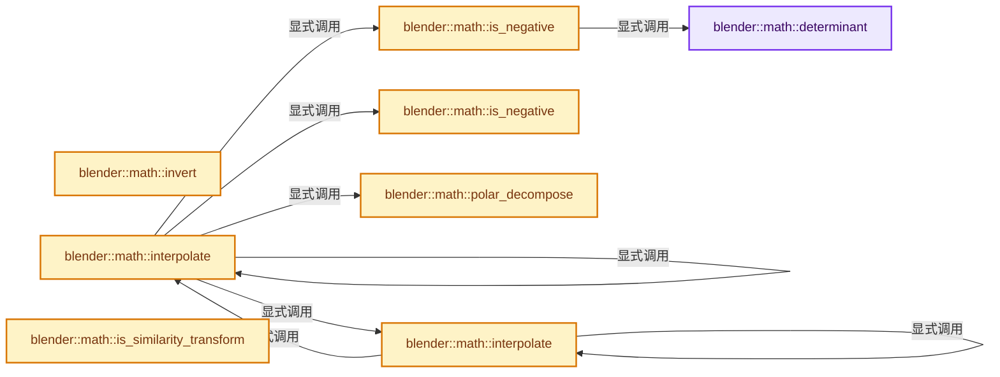
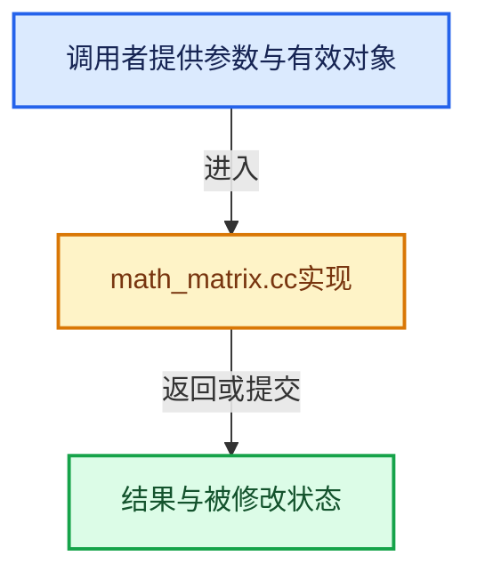

# 实现依赖专题：source/blender/blenlib/intern/math_matrix.cc

[实现依赖导航](../../README.md) · [符号索引](../../../00-课程指南/02-源码与提交索引/符号依赖与实现索引.md)

本专题从正文实际调用进入，集中保存共享实现。函数有稳定锚点，可从调用处直接跳到对应完整函数；递归与互相调用通过回链组织。

## 本文件的实现关系






## 完整成员与函数实现

<a id="f-f8bee3c591c62f5f"></a>

### `blender::math::determinant`

实现位置：[source/blender/blenlib/intern/math_matrix.cc](../../../../../../../source/blender/blenlib/intern/math_matrix.cc) · L131—L134。

接口参数：

- `const MatBase<T, Size, Size> &mat`

**教学注释版**

<!-- annotated:f34b9a59685fb5 -->

```cpp
template<typename T, int Size> T determinant(const MatBase<T, Size, Size> &mat)
{
  return Eigen::Map<const Eigen::Matrix<T, Size, Size>>(mat.base_ptr()).determinant();
}
```

<details>
<summary>核对原始源码：source/blender/blenlib/intern/math_matrix.cc · L131—L134</summary>

<!-- original:f34b9a59685fb5:source/blender/blenlib/intern/math_matrix.cc:131:134 -->

```cpp
template<typename T, int Size> T determinant(const MatBase<T, Size, Size> &mat)
{
  return Eigen::Map<const Eigen::Matrix<T, Size, Size>>(mat.base_ptr()).determinant();
}
```

</details>

**结果出口**

- `return Eigen::Map<const Eigen::Matrix<T, Size, Size>>(mat.base_ptr()).determinant();`

**继续追踪实现**

- `Eigen::Map<const Eigen::Matrix<T, Size, Size>>(mat.base_ptr()).determinant` → [外部契约](https://eel.is/c++draft/)：这个边界按实际表达式及所属类型核对参数、返回值、寿命与失败行为。这里提供接口入口，不声称已解释该第三方版本的内部实现。
- `Eigen::Map<const Eigen::Matrix<T, Size, Size>>` → [外部契约](https://eel.is/c++draft/)：这个边界按实际表达式及所属类型核对参数、返回值、寿命与失败行为。这里提供接口入口，不声称已解释该第三方版本的内部实现。
- `mat.base_ptr` → [blender::MatBase::base_ptr · L183](../BLI_math_matrix_types.hh.md#f-dca1aa125ef9c16b)；[blender::MatBase::base_ptr · L189](../BLI_math_matrix_types.hh.md#f-b75e432c486339a7)。同名重载需按实参类型选择。

<a id="f-e64cbbc72a405f83"></a>

### `blender::math::is_negative`

实现位置：[source/blender/blenlib/intern/math_matrix.cc](../../../../../../../source/blender/blenlib/intern/math_matrix.cc) · L143—L146。

接口参数：

- `const MatBase<T, 3, 3> &mat`

**教学注释版**

<!-- annotated:2e09fdf9b32a1c -->

```cpp
template<typename T> bool is_negative(const MatBase<T, 3, 3> &mat)
{
  return determinant(mat) < T(0);
}
```

<details>
<summary>核对原始源码：source/blender/blenlib/intern/math_matrix.cc · L143—L146</summary>

<!-- original:2e09fdf9b32a1c:source/blender/blenlib/intern/math_matrix.cc:143:146 -->

```cpp
template<typename T> bool is_negative(const MatBase<T, 3, 3> &mat)
{
  return determinant(mat) < T(0);
}
```

</details>

**结果出口**

- `return determinant(mat) < T(0);`

**继续追踪实现**

- `determinant` → [blender::math::determinant · L131](math_matrix.cc.md#f-f8bee3c591c62f5f)。
- `T` → [DiagSplit::T · L96](../../07-Intern运行时与平台/cycles/subd/split.cpp.md#f-d5d0885c790cc4e4)。

<a id="f-45e6f0a41831fd92"></a>

### `blender::math::is_negative`

实现位置：[source/blender/blenlib/intern/math_matrix.cc](../../../../../../../source/blender/blenlib/intern/math_matrix.cc) · L148—L152。

接口参数：

- `const MatBase<T, 4, 4> &mat`

**教学注释版**

<!-- annotated:3d3c8102c42e78 -->

```cpp
template<typename T> bool is_negative(const MatBase<T, 4, 4> &mat)
{
  return Eigen::Map<const Eigen::Matrix<T, 3, 3>, 0, Eigen::Stride<4, 1>>(mat.base_ptr())
             .determinant() < T(0);
}
```

<details>
<summary>核对原始源码：source/blender/blenlib/intern/math_matrix.cc · L148—L152</summary>

<!-- original:3d3c8102c42e78:source/blender/blenlib/intern/math_matrix.cc:148:152 -->

```cpp
template<typename T> bool is_negative(const MatBase<T, 4, 4> &mat)
{
  return Eigen::Map<const Eigen::Matrix<T, 3, 3>, 0, Eigen::Stride<4, 1>>(mat.base_ptr())
             .determinant() < T(0);
}
```

</details>

**结果出口**

- `return Eigen::Map<const Eigen::Matrix<T, 3, 3>, 0, Eigen::Stride<4, 1>>(mat.base_ptr())`

**继续追踪实现**

- `Eigen::Map<const Eigen::Matrix<T, 3, 3>, 0, Eigen::Stride<4, 1>>(mat.base_ptr()) .determinant` → [外部契约](https://eel.is/c++draft/)：这个边界按实际表达式及所属类型核对参数、返回值、寿命与失败行为。这里提供接口入口，不声称已解释该第三方版本的内部实现。
- `Eigen::Map<const Eigen::Matrix<T, 3, 3>, 0, Eigen::Stride<4, 1>>` → [外部契约](https://eel.is/c++draft/)：这个边界按实际表达式及所属类型核对参数、返回值、寿命与失败行为。这里提供接口入口，不声称已解释该第三方版本的内部实现。
- `mat.base_ptr` → [blender::MatBase::base_ptr · L183](../BLI_math_matrix_types.hh.md#f-dca1aa125ef9c16b)；[blender::MatBase::base_ptr · L189](../BLI_math_matrix_types.hh.md#f-b75e432c486339a7)。同名重载需按实参类型选择。
- `T` → [DiagSplit::T · L96](../../07-Intern运行时与平台/cycles/subd/split.cpp.md#f-d5d0885c790cc4e4)。

<a id="f-222be9a4cab433f5"></a>

### `blender::math::invert`

实现位置：[source/blender/blenlib/intern/math_matrix.cc](../../../../../../../source/blender/blenlib/intern/math_matrix.cc) · L202—L213。

接口参数：

- `const MatBase<T, Size, Size> &mat`
- `bool &r_success`

**教学注释版**

<!-- annotated:03b2ecfd17e4ae -->

```cpp
template<typename T, int Size>
MatBase<T, Size, Size> invert(const MatBase<T, Size, Size> &mat, bool &r_success)
{
  MatBase<T, Size, Size> result;
  Eigen::Map<const Eigen::Matrix<T, Size, Size>> M(mat.base_ptr());
  Eigen::Map<Eigen::Matrix<T, Size, Size>> R(result.base_ptr());
  M.computeInverseWithCheck(R, r_success, 0.0f);
  if (!r_success) {
    R = R.Zero();
  }
  return result;
}
```

<details>
<summary>核对原始源码：source/blender/blenlib/intern/math_matrix.cc · L202—L213</summary>

<!-- original:03b2ecfd17e4ae:source/blender/blenlib/intern/math_matrix.cc:202:213 -->

```cpp
template<typename T, int Size>
MatBase<T, Size, Size> invert(const MatBase<T, Size, Size> &mat, bool &r_success)
{
  MatBase<T, Size, Size> result;
  Eigen::Map<const Eigen::Matrix<T, Size, Size>> M(mat.base_ptr());
  Eigen::Map<Eigen::Matrix<T, Size, Size>> R(result.base_ptr());
  M.computeInverseWithCheck(R, r_success, 0.0f);
  if (!r_success) {
    R = R.Zero();
  }
  return result;
}
```

</details>

**沿实际写入检查状态**

- `R = R.Zero();`

**结果出口**

- `return result;`

**继续追踪实现**

- `mat.base_ptr` → [blender::MatBase::base_ptr · L183](../BLI_math_matrix_types.hh.md#f-dca1aa125ef9c16b)；[blender::MatBase::base_ptr · L189](../BLI_math_matrix_types.hh.md#f-b75e432c486339a7)。同名重载需按实参类型选择。
- `result.base_ptr` → [blender::MatBase::base_ptr · L183](../BLI_math_matrix_types.hh.md#f-dca1aa125ef9c16b)；[blender::MatBase::base_ptr · L189](../BLI_math_matrix_types.hh.md#f-b75e432c486339a7)。同名重载需按实参类型选择。
- `M.computeInverseWithCheck` → [调用协议](../../../00-课程指南/01-路线与规范/模板宏与动态分派协议.md)：由接收对象具体类型或运行时策略提供实现。调用位置L208。
- `R.Zero` → [调用协议](../../../00-课程指南/01-路线与规范/模板宏与动态分派协议.md)：由接收对象具体类型或运行时策略提供实现。调用位置L210。

<a id="f-35340acf9d1d99e1"></a>

### `blender::math::polar_decompose`

实现位置：[source/blender/blenlib/intern/math_matrix.cc](../../../../../../../source/blender/blenlib/intern/math_matrix.cc) · L291—L327。

接口参数：

- `const MatBase<T, 3, 3> &mat3`
- `MatBase<T, 3, 3> &r_U`
- `MatBase<T, 3, 3> &r_P`

**教学注释版**

<!-- annotated:b857592a4ade6d -->

```cpp
template<typename T>
static void polar_decompose(const MatBase<T, 3, 3> &mat3,
                            MatBase<T, 3, 3> &r_U,
                            MatBase<T, 3, 3> &r_P)
{
  /* From svd decomposition (M = WSV*), we have:
   *     U = WV*
   *     P = VSV*
   */
  MatBase<T, 3, 3> W, V;
  VecBase<T, 3> S_val;

  {
    using namespace Eigen;
    using MatrixT = Eigen::Matrix<T, 3, 3>;
    using VectorT = Eigen::Matrix<T, 3, 1>;
    /* Blender and Eigen matrices are both column-major by default.
     * Since our matrix is squared, we can use thinU/V. */
    /**
     * WORKAROUND: (ComputeThinU | ComputeThinV) must be set as runtime parameters in
     * Eigen < 3.4.0. But this requires the matrix type to be dynamic to avoid an assert.
     */
    using MatrixDynamicT = Eigen::Matrix<T, Dynamic, Dynamic>;
    JacobiSVD<MatrixDynamicT, NoQRPreconditioner> svd(
        Eigen::Map<const MatrixDynamicT>(mat3.base_ptr(), 3, 3), ComputeThinU | ComputeThinV);

    Eigen::Map<MatrixT>(W.base_ptr()) = svd.matrixU();
    (Eigen::Map<VectorT>(S_val)) = svd.singularValues();
    Eigen::Map<MatrixT>(V.base_ptr()) = svd.matrixV();
  }

  MatBase<T, 3, 3> S = from_scale<MatBase<T, 3, 3>>(S_val);
  MatBase<T, 3, 3> Vt = transpose(V);

  r_U = W * Vt;
  r_P = (V * S) * Vt;
}
```

<details>
<summary>核对原始源码：source/blender/blenlib/intern/math_matrix.cc · L291—L327</summary>

<!-- original:b857592a4ade6d:source/blender/blenlib/intern/math_matrix.cc:291:327 -->

```cpp
template<typename T>
static void polar_decompose(const MatBase<T, 3, 3> &mat3,
                            MatBase<T, 3, 3> &r_U,
                            MatBase<T, 3, 3> &r_P)
{
  /* From svd decomposition (M = WSV*), we have:
   *     U = WV*
   *     P = VSV*
   */
  MatBase<T, 3, 3> W, V;
  VecBase<T, 3> S_val;

  {
    using namespace Eigen;
    using MatrixT = Eigen::Matrix<T, 3, 3>;
    using VectorT = Eigen::Matrix<T, 3, 1>;
    /* Blender and Eigen matrices are both column-major by default.
     * Since our matrix is squared, we can use thinU/V. */
    /**
     * WORKAROUND: (ComputeThinU | ComputeThinV) must be set as runtime parameters in
     * Eigen < 3.4.0. But this requires the matrix type to be dynamic to avoid an assert.
     */
    using MatrixDynamicT = Eigen::Matrix<T, Dynamic, Dynamic>;
    JacobiSVD<MatrixDynamicT, NoQRPreconditioner> svd(
        Eigen::Map<const MatrixDynamicT>(mat3.base_ptr(), 3, 3), ComputeThinU | ComputeThinV);

    Eigen::Map<MatrixT>(W.base_ptr()) = svd.matrixU();
    (Eigen::Map<VectorT>(S_val)) = svd.singularValues();
    Eigen::Map<MatrixT>(V.base_ptr()) = svd.matrixV();
  }

  MatBase<T, 3, 3> S = from_scale<MatBase<T, 3, 3>>(S_val);
  MatBase<T, 3, 3> Vt = transpose(V);

  r_U = W * Vt;
  r_P = (V * S) * Vt;
}
```

</details>

**沿实际写入检查状态**

- `r_U = W * Vt;`
- `r_P = (V * S) * Vt;`

**继续追踪实现**

- `Eigen::Map<const MatrixDynamicT>` → [外部契约](https://eel.is/c++draft/)：这个边界按实际表达式及所属类型核对参数、返回值、寿命与失败行为。这里提供接口入口，不声称已解释该第三方版本的内部实现。
- `mat3.base_ptr` → [blender::MatBase::base_ptr · L183](../BLI_math_matrix_types.hh.md#f-dca1aa125ef9c16b)；[blender::MatBase::base_ptr · L189](../BLI_math_matrix_types.hh.md#f-b75e432c486339a7)。同名重载需按实参类型选择。
- `Eigen::Map<MatrixT>` → [外部契约](https://eel.is/c++draft/)：这个边界按实际表达式及所属类型核对参数、返回值、寿命与失败行为。这里提供接口入口，不声称已解释该第三方版本的内部实现。
- `W.base_ptr` → [blender::MatBase::base_ptr · L183](../BLI_math_matrix_types.hh.md#f-dca1aa125ef9c16b)；[blender::MatBase::base_ptr · L189](../BLI_math_matrix_types.hh.md#f-b75e432c486339a7)。同名重载需按实参类型选择。
- `svd.matrixU` → [调用协议](../../../00-课程指南/01-路线与规范/模板宏与动态分派协议.md)：由接收对象具体类型或运行时策略提供实现。调用位置L317。
- `Eigen::Map<VectorT>` → [外部契约](https://eel.is/c++draft/)：这个边界按实际表达式及所属类型核对参数、返回值、寿命与失败行为。这里提供接口入口，不声称已解释该第三方版本的内部实现。
- `svd.singularValues` → [调用协议](../../../00-课程指南/01-路线与规范/模板宏与动态分派协议.md)：由接收对象具体类型或运行时策略提供实现。调用位置L318。
- `V.base_ptr` → [调用协议](../../../00-课程指南/01-路线与规范/模板宏与动态分派协议.md)：接收对象类型依赖auto、返回值或模板实例；不按同名猜测目标。调用位置L319。
- `svd.matrixV` → [调用协议](../../../00-课程指南/01-路线与规范/模板宏与动态分派协议.md)：由接收对象具体类型或运行时策略提供实现。调用位置L319。
- `from_scale<MatBase<T, 3, 3>>` → [调用协议](../../../00-课程指南/01-路线与规范/模板宏与动态分派协议.md)：函数指针、局部可调用对象或未展开的宏；必须结合调用者环境。调用位置L322。
- `transpose` → [blender::math::transpose · L656](../BLI_math_matrix.hh.md#f-3e15c82dc61a01f4)。

<a id="f-91e7f517ebd72fb5"></a>

### `blender::math::interpolate`

实现位置：[source/blender/blenlib/intern/math_matrix.cc](../../../../../../../source/blender/blenlib/intern/math_matrix.cc) · L335—L374。

接口参数：

- `const MatBase<T, 3, 3> &A`
- `const MatBase<T, 3, 3> &B`
- `T t`

**教学注释版**

<!-- annotated:58beb9fe42a44f -->

```cpp
template<typename T>
MatBase<T, 3, 3> interpolate(const MatBase<T, 3, 3> &A, const MatBase<T, 3, 3> &B, T t)
{
  using Mat3T = MatBase<T, 3, 3>;
  /* 'Rotation' component ('U' part of polar decomposition,
   * the closest orthogonal matrix to M3 rot/scale
   * transformation matrix), spherically interpolated. */
  Mat3T U_A, U_B;
  /* 'Scaling' component ('P' part of polar decomposition, i.e. scaling in U-defined space),
   * linearly interpolated. */
  Mat3T P_A, P_B;

  polar_decompose(A, U_A, P_A);
  polar_decompose(B, U_B, P_B);

  /* Quaternions cannot represent an axis flip. If such a singularity is detected, choose a
   * different decomposition of the matrix that still satisfies A = U_A * P_A but which has a
   * positive determinant and thus no axis flips. This resolves #77154.
   *
   * Note that a flip of two axes is just a rotation of 180 degrees around the third axis, and
   * three flipped axes are just an 180 degree rotation + a single axis flip. It is thus sufficient
   * to solve this problem for single axis flips. */
  if (is_negative(U_A)) {
    U_A = -U_A;
    P_A = -P_A;
  }
  if (is_negative(U_B)) {
    U_B = -U_B;
    P_B = -P_B;
  }

  QuaternionBase<T> quat_A = math::to_quaternion(normalize(U_A));
  QuaternionBase<T> quat_B = math::to_quaternion(normalize(U_B));
  QuaternionBase<T> quat = math::interpolate(quat_A, quat_B, t);
  Mat3T U = from_rotation<Mat3T>(quat);

  Mat3T P = interpolate_linear(P_A, P_B, t);
  /* And we reconstruct rot/scale matrix from interpolated polar components */
  return U * P;
}
```

<details>
<summary>核对原始源码：source/blender/blenlib/intern/math_matrix.cc · L335—L374</summary>

<!-- original:58beb9fe42a44f:source/blender/blenlib/intern/math_matrix.cc:335:374 -->

```cpp
template<typename T>
MatBase<T, 3, 3> interpolate(const MatBase<T, 3, 3> &A, const MatBase<T, 3, 3> &B, T t)
{
  using Mat3T = MatBase<T, 3, 3>;
  /* 'Rotation' component ('U' part of polar decomposition,
   * the closest orthogonal matrix to M3 rot/scale
   * transformation matrix), spherically interpolated. */
  Mat3T U_A, U_B;
  /* 'Scaling' component ('P' part of polar decomposition, i.e. scaling in U-defined space),
   * linearly interpolated. */
  Mat3T P_A, P_B;

  polar_decompose(A, U_A, P_A);
  polar_decompose(B, U_B, P_B);

  /* Quaternions cannot represent an axis flip. If such a singularity is detected, choose a
   * different decomposition of the matrix that still satisfies A = U_A * P_A but which has a
   * positive determinant and thus no axis flips. This resolves #77154.
   *
   * Note that a flip of two axes is just a rotation of 180 degrees around the third axis, and
   * three flipped axes are just an 180 degree rotation + a single axis flip. It is thus sufficient
   * to solve this problem for single axis flips. */
  if (is_negative(U_A)) {
    U_A = -U_A;
    P_A = -P_A;
  }
  if (is_negative(U_B)) {
    U_B = -U_B;
    P_B = -P_B;
  }

  QuaternionBase<T> quat_A = math::to_quaternion(normalize(U_A));
  QuaternionBase<T> quat_B = math::to_quaternion(normalize(U_B));
  QuaternionBase<T> quat = math::interpolate(quat_A, quat_B, t);
  Mat3T U = from_rotation<Mat3T>(quat);

  Mat3T P = interpolate_linear(P_A, P_B, t);
  /* And we reconstruct rot/scale matrix from interpolated polar components */
  return U * P;
}
```

</details>

**沿实际写入检查状态**

- `U_A = -U_A;`
- `P_A = -P_A;`
- `U_B = -U_B;`
- `P_B = -P_B;`

**结果出口**

- `return U * P;`

**继续追踪实现**

- `polar_decompose` → [blender::math::polar_decompose · L291](math_matrix.cc.md#f-35340acf9d1d99e1)。
- `is_negative` → [blender::math::is_negative · L143](math_matrix.cc.md#f-e64cbbc72a405f83)；[blender::math::is_negative · L148](math_matrix.cc.md#f-45e6f0a41831fd92)。同名重载需按实参类型选择。
- `math::to_quaternion` → [blender::math::to_quaternion · L400](../BLI_math_rotation.hh.md#f-8368957aa016c3c4)；[blender::math::to_quaternion · L50](../BLI_math_euler.hh.md#f-dfb9029b915ba7ec)；[blender::math::to_quaternion · L75](../BLI_math_euler.hh.md#f-e3803542ea9383ea)；[blender::math::to_quaternion · L70](../BLI_math_axis_angle.hh.md#f-a87213edc1fe438e)。同名重载需按实参类型选择。
- `normalize` → [blender::math::normalize · L542](../BLI_math_vector.hh.md#f-5bea914457e11f7f)；[blender::math::normalize · L258](../BLI_math_quaternion.hh.md#f-5bf6b351333e4054)；[blender::math::normalize · L450](../BLI_math_quaternion.hh.md#f-b852cee8f0cc9b6a)；[blender::math::normalize · L745](../BLI_math_matrix.hh.md#f-2235cb6f5ec7ff18)；[blender::math::normalize · L783](../BLI_math_matrix.hh.md#f-0386bc4ee9ac7425)。同名重载需按实参类型选择。
- `math::interpolate` → [blender::math::interpolate · L335](math_matrix.cc.md#f-91e7f517ebd72fb5)；[blender::math::interpolate · L379](math_matrix.cc.md#f-a1be14e86ce595c2)。同名重载需按实参类型选择。
- `from_rotation<Mat3T>` → [调用协议](../../../00-课程指南/01-路线与规范/模板宏与动态分派协议.md)：函数指针、局部可调用对象或未展开的宏；必须结合调用者环境。调用位置L369。
- `interpolate_linear` → [blender::math::interpolate_linear · L735](../BLI_math_matrix.hh.md#f-5247488ab3d13df8)。

<a id="f-a1be14e86ce595c2"></a>

### `blender::math::interpolate`

实现位置：[source/blender/blenlib/intern/math_matrix.cc](../../../../../../../source/blender/blenlib/intern/math_matrix.cc) · L379—L391。

接口参数：

- `const MatBase<T, 4, 4> &A`
- `const MatBase<T, 4, 4> &B`
- `T t`

**教学注释版**

<!-- annotated:fc35416c8b8d5e -->

```cpp
template<typename T>
MatBase<T, 4, 4> interpolate(const MatBase<T, 4, 4> &A, const MatBase<T, 4, 4> &B, T t)
{
  MatBase<T, 4, 4> result = MatBase<T, 4, 4>(
      interpolate(MatBase<T, 3, 3>(A), MatBase<T, 3, 3>(B), t));

  /* Location component, linearly interpolated. */
  const auto &loc_a = static_cast<const MatBase<T, 4, 4> &>(A).location();
  const auto &loc_b = static_cast<const MatBase<T, 4, 4> &>(B).location();
  result.location() = interpolate(loc_a, loc_b, t);

  return result;
}
```

<details>
<summary>核对原始源码：source/blender/blenlib/intern/math_matrix.cc · L379—L391</summary>

<!-- original:fc35416c8b8d5e:source/blender/blenlib/intern/math_matrix.cc:379:391 -->

```cpp
template<typename T>
MatBase<T, 4, 4> interpolate(const MatBase<T, 4, 4> &A, const MatBase<T, 4, 4> &B, T t)
{
  MatBase<T, 4, 4> result = MatBase<T, 4, 4>(
      interpolate(MatBase<T, 3, 3>(A), MatBase<T, 3, 3>(B), t));

  /* Location component, linearly interpolated. */
  const auto &loc_a = static_cast<const MatBase<T, 4, 4> &>(A).location();
  const auto &loc_b = static_cast<const MatBase<T, 4, 4> &>(B).location();
  result.location() = interpolate(loc_a, loc_b, t);

  return result;
}
```

</details>

**结果出口**

- `return result;`

**继续追踪实现**

- `MatBase<T, 4, 4>` → [blender::MatBase](../BLI_math_matrix_types.hh.md#t-db449c66b820)；[MatBase](../../08-其他Blender模块/gpu/shaders/compat/gpu_shader_cxx_matrix.hh.md#t-0f893bc818e9)。
- `interpolate` → [blender::math::interpolate · L335](math_matrix.cc.md#f-91e7f517ebd72fb5)；[blender::math::interpolate · L379](math_matrix.cc.md#f-a1be14e86ce595c2)。同名重载需按实参类型选择。
- `MatBase<T, 3, 3>` → [blender::MatBase](../BLI_math_matrix_types.hh.md#t-db449c66b820)；[MatBase](../../08-其他Blender模块/gpu/shaders/compat/gpu_shader_cxx_matrix.hh.md#t-0f893bc818e9)。
- `static_cast<const MatBase<T, 4, 4> &>(A).location` → [调用协议](../../../00-课程指南/01-路线与规范/模板宏与动态分派协议.md)：接收对象类型依赖auto、返回值或模板实例；不按同名猜测目标。调用位置L386。
- `static_cast<const MatBase<T, 4, 4> &>(B).location` → [调用协议](../../../00-课程指南/01-路线与规范/模板宏与动态分派协议.md)：接收对象类型依赖auto、返回值或模板实例；不按同名猜测目标。调用位置L387。
- `result.location` → [blender::MatBase::location · L263](../BLI_math_matrix_types.hh.md#f-41affe8232e34068)；[blender::MatBase::location · L291](../BLI_math_matrix_types.hh.md#f-73aca610b7db6123)。同名重载需按实参类型选择。

<a id="f-3e1c0d3904857c10"></a>

### `blender::math::is_similarity_transform`

实现位置：[source/blender/blenlib/intern/math_matrix.cc](../../../../../../../source/blender/blenlib/intern/math_matrix.cc) · L527—L552。

接口参数：

- `const MatBase<T, 3, 3> &matrix`
- `const T &epsilon = 1e-6`

**教学注释版**

<!-- annotated:7c64a5982cdba9 -->

```cpp
template<typename T>
bool is_similarity_transform(const MatBase<T, 3, 3> &matrix, const T &epsilon = 1e-6)
{
  if (math::abs(math::dot(matrix[0], matrix[1])) > epsilon) {
    return false;
  }
  if (math::abs(math::dot(matrix[0], matrix[2])) > epsilon) {
    return false;
  }
  if (math::abs(math::dot(matrix[1], matrix[2])) > epsilon) {
    return false;
  }
  const float length_0 = math::length_squared(matrix[0]);
  const float length_1 = math::length_squared(matrix[1]);
  const float length_2 = math::length_squared(matrix[2]);
  if (math::abs(length_0 - length_1) > epsilon) {
    return false;
  }
  if (math::abs(length_0 - length_2) > epsilon) {
    return false;
  }
  if (math::abs(length_1 - length_2) > epsilon) {
    return false;
  }
  return true;
}
```

<details>
<summary>核对原始源码：source/blender/blenlib/intern/math_matrix.cc · L527—L552</summary>

<!-- original:7c64a5982cdba9:source/blender/blenlib/intern/math_matrix.cc:527:552 -->

```cpp
template<typename T>
bool is_similarity_transform(const MatBase<T, 3, 3> &matrix, const T &epsilon = 1e-6)
{
  if (math::abs(math::dot(matrix[0], matrix[1])) > epsilon) {
    return false;
  }
  if (math::abs(math::dot(matrix[0], matrix[2])) > epsilon) {
    return false;
  }
  if (math::abs(math::dot(matrix[1], matrix[2])) > epsilon) {
    return false;
  }
  const float length_0 = math::length_squared(matrix[0]);
  const float length_1 = math::length_squared(matrix[1]);
  const float length_2 = math::length_squared(matrix[2]);
  if (math::abs(length_0 - length_1) > epsilon) {
    return false;
  }
  if (math::abs(length_0 - length_2) > epsilon) {
    return false;
  }
  if (math::abs(length_1 - length_2) > epsilon) {
    return false;
  }
  return true;
}
```

</details>

**结果出口**

- `return false;`
- `return true;`

**继续追踪实现**

- `math::abs` → [blender::math::abs · L38](../BLI_math_vector.hh.md#f-e755530125bc2198)；[blender::math::abs · L201](../BLI_math_basis_types.hh.md#f-a137ffce39989ffc)；[blender::math::abs · L33](../BLI_math_base.hh.md#f-a2c9c981f4e8420c)。同名重载需按实参类型选择。
- `math::dot` → [blender::math::dot · L430](../BLI_math_vector.hh.md#f-6f0c6a081b107428)；[blender::math::dot · L198](../BLI_math_quaternion.hh.md#f-5b1ef457981dbc76)。同名重载需按实参类型选择。
- `math::length_squared` → [blender::math::length_squared · L452](../BLI_math_vector.hh.md#f-b1e1749f57230265)。

<a id="f-ee5edb8d55f9151b"></a>

### `blender::math::transform_normals`

实现位置：[source/blender/blenlib/intern/math_matrix.cc](../../../../../../../source/blender/blenlib/intern/math_matrix.cc) · L554—L576。

接口参数：

- `const float3x3 &transform`
- `MutableSpan<float3> normals`

**教学注释版**

<!-- annotated:a564da5b71ad51 -->

```cpp
void transform_normals(const float3x3 &transform, MutableSpan<float3> normals)
{
  if (math::is_equal(transform, float3x3::identity(), 1e-6f)) {
    return;
  }
  PRF_scope(ProfileCategory::Default);
  const float3x3 normal_transform = math::transpose(math::invert(transform));
  if (is_similarity_transform(normal_transform)) {
    const float3x3 normalized_transform = math::normalize(normal_transform);
    // [讲解] normals.index_range：查询视图长度或生成对应有效索引区间。
    threading::parallel_for(normals.index_range(), 1024, [&](const IndexRange range) {
      // [讲解] normals.slice：建立原连续范围的子视图。
      for (float3 &normal : normals.slice(range)) {
        normal = normalized_transform * normal;
      }
    });
  }
  else {
    threading::parallel_for(normals.index_range(), 1024, [&](const IndexRange range) {
      for (float3 &normal : normals.slice(range)) {
        normal = math::normalize(normal_transform * normal);
      }
    });
  }
}
```

<details>
<summary>核对原始源码：source/blender/blenlib/intern/math_matrix.cc · L554—L576</summary>

<!-- original:a564da5b71ad51:source/blender/blenlib/intern/math_matrix.cc:554:576 -->

```cpp
void transform_normals(const float3x3 &transform, MutableSpan<float3> normals)
{
  if (math::is_equal(transform, float3x3::identity(), 1e-6f)) {
    return;
  }
  PRF_scope(ProfileCategory::Default);
  const float3x3 normal_transform = math::transpose(math::invert(transform));
  if (is_similarity_transform(normal_transform)) {
    const float3x3 normalized_transform = math::normalize(normal_transform);
    threading::parallel_for(normals.index_range(), 1024, [&](const IndexRange range) {
      for (float3 &normal : normals.slice(range)) {
        normal = normalized_transform * normal;
      }
    });
  }
  else {
    threading::parallel_for(normals.index_range(), 1024, [&](const IndexRange range) {
      for (float3 &normal : normals.slice(range)) {
        normal = math::normalize(normal_transform * normal);
      }
    });
  }
}
```

</details>

**沿实际写入检查状态**

- `normal = normalized_transform * normal;`
- `normal = math::normalize(normal_transform * normal);`

**继续追踪实现**

- `math::is_equal` → [blender::math::is_equal · L765](../BLI_math_vector.hh.md#f-96ff5caf5461146e)；[blender::math::is_equal · L116](../BLI_math_quaternion.hh.md#f-97008e57597d3ffd)；[blender::math::is_equal · L509](../BLI_math_matrix.hh.md#f-86b4ef8483834e4e)。同名重载需按实参类型选择。
- `float3x3::identity` → [调用协议](../../../00-课程指南/01-路线与规范/模板宏与动态分派协议.md)：函数指针、局部可调用对象或未展开的宏；必须结合调用者环境。调用位置L556。
- `PRF_scope` → [PRF_scope · L51](../../07-Intern运行时与平台/profile/PRF_profile.hh.md#m-9f5e4ea0487b)；[PRF_scope · L90](../../07-Intern运行时与平台/profile/PRF_profile.hh.md#m-8fc74ae4419e)。宏定义由构建条件选择。
- `math::transpose` → [blender::math::transpose · L656](../BLI_math_matrix.hh.md#f-3e15c82dc61a01f4)。
- `math::invert` → [blender::math::invert · L202](math_matrix.cc.md#f-222be9a4cab433f5)。
- `is_similarity_transform` → [blender::math::is_similarity_transform · L527](math_matrix.cc.md#f-3e1c0d3904857c10)。
- `math::normalize` → [blender::math::normalize · L542](../BLI_math_vector.hh.md#f-5bea914457e11f7f)；[blender::math::normalize · L258](../BLI_math_quaternion.hh.md#f-5bf6b351333e4054)；[blender::math::normalize · L450](../BLI_math_quaternion.hh.md#f-b852cee8f0cc9b6a)；[blender::math::normalize · L745](../BLI_math_matrix.hh.md#f-2235cb6f5ec7ff18)；[blender::math::normalize · L783](../BLI_math_matrix.hh.md#f-0386bc4ee9ac7425)。同名重载需按实参类型选择。
- `threading::parallel_for` → [blender::threading::parallel_for · L68](../../../11-Depsgraph与并行任务系统/07-任务池与TBB接入.md#f-838294754c24426c)。
- `normals.index_range` → [blender::MutableSpan::index_range · L676](../../../01-基础容器与现代CPP/06-MutableSpan可写视图.md#f-f9a9d59a69ca64b5)。
- `normals.slice` → [blender::MutableSpan::slice · L579](../../../01-基础容器与现代CPP/06-MutableSpan可写视图.md#f-6808b4aefbf58808)；[blender::MutableSpan::slice · L587](../../../01-基础容器与现代CPP/06-MutableSpan可写视图.md#f-c05b010821861e4f)。同名重载需按实参类型选择。

<a id="f-375eef5f3ac1af82"></a>

### `blender::math::transform_normals`

实现位置：[source/blender/blenlib/intern/math_matrix.cc](../../../../../../../source/blender/blenlib/intern/math_matrix.cc) · L578—L601。

接口参数：

- `Span<float3> src`
- `const float3x3 &transform`
- `MutableSpan<float3> dst`

**教学注释版**

<!-- annotated:7521331631fb2e -->

```cpp
void transform_normals(Span<float3> src, const float3x3 &transform, MutableSpan<float3> dst)
{
  if (math::is_equal(transform, float3x3::identity(), 1e-6f)) {
    // [讲解] dst.copy_from：修改已有目标元素，不改变底层容器长度。
    dst.copy_from(src);
    return;
  }
  PRF_scope(ProfileCategory::Default);
  const float3x3 normal_transform = math::transpose(math::invert(transform));
  if (is_similarity_transform(normal_transform)) {
    const float3x3 normalized_transform = math::normalize(normal_transform);
    // [讲解] src.index_range：查询视图长度或生成对应有效索引区间。
    threading::parallel_for(src.index_range(), 1024, [&](const IndexRange range) {
      for (const int i : range) {
        dst[i] = normalized_transform * src[i];
      }
    });
  }
  else {
    threading::parallel_for(src.index_range(), 1024, [&](const IndexRange range) {
      for (const int i : range) {
        dst[i] = math::normalize(normal_transform * src[i]);
      }
    });
  }
}
```

<details>
<summary>核对原始源码：source/blender/blenlib/intern/math_matrix.cc · L578—L601</summary>

<!-- original:7521331631fb2e:source/blender/blenlib/intern/math_matrix.cc:578:601 -->

```cpp
void transform_normals(Span<float3> src, const float3x3 &transform, MutableSpan<float3> dst)
{
  if (math::is_equal(transform, float3x3::identity(), 1e-6f)) {
    dst.copy_from(src);
    return;
  }
  PRF_scope(ProfileCategory::Default);
  const float3x3 normal_transform = math::transpose(math::invert(transform));
  if (is_similarity_transform(normal_transform)) {
    const float3x3 normalized_transform = math::normalize(normal_transform);
    threading::parallel_for(src.index_range(), 1024, [&](const IndexRange range) {
      for (const int i : range) {
        dst[i] = normalized_transform * src[i];
      }
    });
  }
  else {
    threading::parallel_for(src.index_range(), 1024, [&](const IndexRange range) {
      for (const int i : range) {
        dst[i] = math::normalize(normal_transform * src[i]);
      }
    });
  }
}
```

</details>

**沿实际写入检查状态**

- `dst[i] = normalized_transform * src[i];`
- `dst[i] = math::normalize(normal_transform * src[i]);`

**继续追踪实现**

- `math::is_equal` → [blender::math::is_equal · L765](../BLI_math_vector.hh.md#f-96ff5caf5461146e)；[blender::math::is_equal · L116](../BLI_math_quaternion.hh.md#f-97008e57597d3ffd)；[blender::math::is_equal · L509](../BLI_math_matrix.hh.md#f-86b4ef8483834e4e)。同名重载需按实参类型选择。
- `float3x3::identity` → [调用协议](../../../00-课程指南/01-路线与规范/模板宏与动态分派协议.md)：函数指针、局部可调用对象或未展开的宏；必须结合调用者环境。调用位置L580。
- `dst.copy_from` → [blender::MutableSpan::copy_from · L745](../../../01-基础容器与现代CPP/06-MutableSpan可写视图.md#f-e4f099b1497adddb)。
- `PRF_scope` → [PRF_scope · L51](../../07-Intern运行时与平台/profile/PRF_profile.hh.md#m-9f5e4ea0487b)；[PRF_scope · L90](../../07-Intern运行时与平台/profile/PRF_profile.hh.md#m-8fc74ae4419e)。宏定义由构建条件选择。
- `math::transpose` → [blender::math::transpose · L656](../BLI_math_matrix.hh.md#f-3e15c82dc61a01f4)。
- `math::invert` → [blender::math::invert · L202](math_matrix.cc.md#f-222be9a4cab433f5)。
- `is_similarity_transform` → [blender::math::is_similarity_transform · L527](math_matrix.cc.md#f-3e1c0d3904857c10)。
- `math::normalize` → [blender::math::normalize · L542](../BLI_math_vector.hh.md#f-5bea914457e11f7f)；[blender::math::normalize · L258](../BLI_math_quaternion.hh.md#f-5bf6b351333e4054)；[blender::math::normalize · L450](../BLI_math_quaternion.hh.md#f-b852cee8f0cc9b6a)；[blender::math::normalize · L745](../BLI_math_matrix.hh.md#f-2235cb6f5ec7ff18)；[blender::math::normalize · L783](../BLI_math_matrix.hh.md#f-0386bc4ee9ac7425)。同名重载需按实参类型选择。
- `threading::parallel_for` → [blender::threading::parallel_for · L68](../../../11-Depsgraph与并行任务系统/07-任务池与TBB接入.md#f-838294754c24426c)。
- `src.index_range` → [blender::Span::index_range · L405](../../../01-基础容器与现代CPP/05-Span只读连续视图.md#f-caaa9b06e13e53e0)。

<a id="f-3c064da3d8658608"></a>

### `blender::math::skip_transform`

实现位置：[source/blender/blenlib/intern/math_matrix.cc](../../../../../../../source/blender/blenlib/intern/math_matrix.cc) · L603—L606。

接口参数：

- `const float4x4 &transform`

**教学注释版**

<!-- annotated:fae7f85a2429fa -->

```cpp
static bool skip_transform(const float4x4 &transform)
{
  return math::is_equal(transform, float4x4::identity(), 1e-6f);
}
```

<details>
<summary>核对原始源码：source/blender/blenlib/intern/math_matrix.cc · L603—L606</summary>

<!-- original:fae7f85a2429fa:source/blender/blenlib/intern/math_matrix.cc:603:606 -->

```cpp
static bool skip_transform(const float4x4 &transform)
{
  return math::is_equal(transform, float4x4::identity(), 1e-6f);
}
```

</details>

**结果出口**

- `return math::is_equal(transform, float4x4::identity(), 1e-6f);`

**继续追踪实现**

- `math::is_equal` → [blender::math::is_equal · L765](../BLI_math_vector.hh.md#f-96ff5caf5461146e)；[blender::math::is_equal · L116](../BLI_math_quaternion.hh.md#f-97008e57597d3ffd)；[blender::math::is_equal · L509](../BLI_math_matrix.hh.md#f-86b4ef8483834e4e)。同名重载需按实参类型选择。
- `float4x4::identity` → [调用协议](../../../00-课程指南/01-路线与规范/模板宏与动态分派协议.md)：函数指针、局部可调用对象或未展开的宏；必须结合调用者环境。调用位置L605。

<a id="f-2423035c9b16b02c"></a>

### `blender::math::transform_points_no_threading`

实现位置：[source/blender/blenlib/intern/math_matrix.cc](../../../../../../../source/blender/blenlib/intern/math_matrix.cc) · L608—L616。

接口参数：

- `const Span<float3> src`
- `const float4x4 &transform`
- `MutableSpan<float3> dst`

**教学注释版**

<!-- annotated:89aa8366c78b52 -->

```cpp
static void transform_points_no_threading(const Span<float3> src,
                                          const float4x4 &transform,
                                          MutableSpan<float3> dst)
{
  PRF_scope(ProfileCategory::Default);
  // [讲解] src.index_range：查询视图长度或生成对应有效索引区间。
  for (const int64_t i : src.index_range()) {
    dst[i] = math::transform_point(transform, src[i]);
  }
}
```

<details>
<summary>核对原始源码：source/blender/blenlib/intern/math_matrix.cc · L608—L616</summary>

<!-- original:89aa8366c78b52:source/blender/blenlib/intern/math_matrix.cc:608:616 -->

```cpp
static void transform_points_no_threading(const Span<float3> src,
                                          const float4x4 &transform,
                                          MutableSpan<float3> dst)
{
  PRF_scope(ProfileCategory::Default);
  for (const int64_t i : src.index_range()) {
    dst[i] = math::transform_point(transform, src[i]);
  }
}
```

</details>

**沿实际写入检查状态**

- `dst[i] = math::transform_point(transform, src[i]);`

**继续追踪实现**

- `PRF_scope` → [PRF_scope · L51](../../07-Intern运行时与平台/profile/PRF_profile.hh.md#m-9f5e4ea0487b)；[PRF_scope · L90](../../07-Intern运行时与平台/profile/PRF_profile.hh.md#m-8fc74ae4419e)。宏定义由构建条件选择。
- `src.index_range` → [blender::Span::index_range · L405](../../../01-基础容器与现代CPP/05-Span只读连续视图.md#f-caaa9b06e13e53e0)。
- `math::transform_point` → [blender::math::transform_point · L318](../BLI_math_quaternion.hh.md#f-e52a2e8c12e32657)；[blender::math::transform_point · L491](../BLI_math_quaternion.hh.md#f-6c9f8362c60efe6c)；[blender::math::transform_point · L445](../BLI_math_basis_types.hh.md#f-a151fd44ae743502)。同名重载需按实参类型选择。

<a id="f-fea7092a41505676"></a>

### `blender::math::transform_points`

实现位置：[source/blender/blenlib/intern/math_matrix.cc](../../../../../../../source/blender/blenlib/intern/math_matrix.cc) · L618—L636。

接口参数：

- `const Span<float3> src`
- `const float4x4 &transform`
- `MutableSpan<float3> dst`
- `const bool use_threading`

**教学注释版**

<!-- annotated:98dddf49d6c9a3 -->

```cpp
void transform_points(const Span<float3> src,
                      const float4x4 &transform,
                      MutableSpan<float3> dst,
                      const bool use_threading)
{
  if (skip_transform(transform)) {
    // [讲解] dst.copy_from：修改已有目标元素，不改变底层容器长度。
    dst.copy_from(src);
  }
  else {
    if (use_threading) {
      // [讲解] src.index_range：查询视图长度或生成对应有效索引区间。
      threading::parallel_for(src.index_range(), 1024, [&](const IndexRange range) {
        // [讲解] src.slice：建立原连续范围的子视图。
        transform_points_no_threading(src.slice(range), transform, dst.slice(range));
      });
    }
    else {
      transform_points_no_threading(src, transform, dst);
    }
  }
}
```

<details>
<summary>核对原始源码：source/blender/blenlib/intern/math_matrix.cc · L618—L636</summary>

<!-- original:98dddf49d6c9a3:source/blender/blenlib/intern/math_matrix.cc:618:636 -->

```cpp
void transform_points(const Span<float3> src,
                      const float4x4 &transform,
                      MutableSpan<float3> dst,
                      const bool use_threading)
{
  if (skip_transform(transform)) {
    dst.copy_from(src);
  }
  else {
    if (use_threading) {
      threading::parallel_for(src.index_range(), 1024, [&](const IndexRange range) {
        transform_points_no_threading(src.slice(range), transform, dst.slice(range));
      });
    }
    else {
      transform_points_no_threading(src, transform, dst);
    }
  }
}
```

</details>

**继续追踪实现**

- `skip_transform` → [blender::math::skip_transform · L603](math_matrix.cc.md#f-3c064da3d8658608)。
- `dst.copy_from` → [blender::MutableSpan::copy_from · L745](../../../01-基础容器与现代CPP/06-MutableSpan可写视图.md#f-e4f099b1497adddb)。
- `threading::parallel_for` → [blender::threading::parallel_for · L68](../../../11-Depsgraph与并行任务系统/07-任务池与TBB接入.md#f-838294754c24426c)。
- `src.index_range` → [blender::Span::index_range · L405](../../../01-基础容器与现代CPP/05-Span只读连续视图.md#f-caaa9b06e13e53e0)。
- `transform_points_no_threading` → [blender::math::transform_points_no_threading · L608](math_matrix.cc.md#f-2423035c9b16b02c)；[blender::math::transform_points_no_threading · L638](math_matrix.cc.md#f-e9e68270c7622d57)。同名重载需按实参类型选择。
- `src.slice` → [blender::Span::slice · L141](../../../01-基础容器与现代CPP/05-Span只读连续视图.md#f-380a0e8fdcbd53cc)；[blender::Span::slice · L149](../../../01-基础容器与现代CPP/05-Span只读连续视图.md#f-9b9c15e78dd54eec)。同名重载需按实参类型选择。
- `dst.slice` → [blender::MutableSpan::slice · L579](../../../01-基础容器与现代CPP/06-MutableSpan可写视图.md#f-6808b4aefbf58808)；[blender::MutableSpan::slice · L587](../../../01-基础容器与现代CPP/06-MutableSpan可写视图.md#f-c05b010821861e4f)。同名重载需按实参类型选择。

<a id="f-e9e68270c7622d57"></a>

### `blender::math::transform_points_no_threading`

实现位置：[source/blender/blenlib/intern/math_matrix.cc](../../../../../../../source/blender/blenlib/intern/math_matrix.cc) · L638—L644。

接口参数：

- `const float4x4 &transform`
- `MutableSpan<float3> points`

**教学注释版**

<!-- annotated:6e977ab6e43dff -->

```cpp
static void transform_points_no_threading(const float4x4 &transform, MutableSpan<float3> points)
{
  PRF_scope(ProfileCategory::Default);
  for (float3 &position : points) {
    position = math::transform_point(transform, position);
  }
}
```

<details>
<summary>核对原始源码：source/blender/blenlib/intern/math_matrix.cc · L638—L644</summary>

<!-- original:6e977ab6e43dff:source/blender/blenlib/intern/math_matrix.cc:638:644 -->

```cpp
static void transform_points_no_threading(const float4x4 &transform, MutableSpan<float3> points)
{
  PRF_scope(ProfileCategory::Default);
  for (float3 &position : points) {
    position = math::transform_point(transform, position);
  }
}
```

</details>

**沿实际写入检查状态**

- `position = math::transform_point(transform, position);`

**继续追踪实现**

- `PRF_scope` → [PRF_scope · L51](../../07-Intern运行时与平台/profile/PRF_profile.hh.md#m-9f5e4ea0487b)；[PRF_scope · L90](../../07-Intern运行时与平台/profile/PRF_profile.hh.md#m-8fc74ae4419e)。宏定义由构建条件选择。
- `math::transform_point` → [blender::math::transform_point · L318](../BLI_math_quaternion.hh.md#f-e52a2e8c12e32657)；[blender::math::transform_point · L491](../BLI_math_quaternion.hh.md#f-6c9f8362c60efe6c)；[blender::math::transform_point · L445](../BLI_math_basis_types.hh.md#f-a151fd44ae743502)。同名重载需按实参类型选择。

<a id="f-f77b7d3852a0cac9"></a>

### `blender::math::transform_points`

实现位置：[source/blender/blenlib/intern/math_matrix.cc](../../../../../../../source/blender/blenlib/intern/math_matrix.cc) · L646—L661。

接口参数：

- `const float4x4 &transform`
- `MutableSpan<float3> points`
- `const bool use_threading`

**教学注释版**

<!-- annotated:91a7b3e8f94da1 -->

```cpp
void transform_points(const float4x4 &transform,
                      MutableSpan<float3> points,
                      const bool use_threading)
{
  if (skip_transform(transform)) {
    return;
  }
  if (use_threading) {
    // [讲解] points.index_range：查询视图长度或生成对应有效索引区间。
    threading::parallel_for(points.index_range(), 1024, [&](const IndexRange range) {
      // [讲解] points.slice：建立原连续范围的子视图。
      transform_points_no_threading(transform, points.slice(range));
    });
  }
  else {
    transform_points_no_threading(transform, points);
  }
}
```

<details>
<summary>核对原始源码：source/blender/blenlib/intern/math_matrix.cc · L646—L661</summary>

<!-- original:91a7b3e8f94da1:source/blender/blenlib/intern/math_matrix.cc:646:661 -->

```cpp
void transform_points(const float4x4 &transform,
                      MutableSpan<float3> points,
                      const bool use_threading)
{
  if (skip_transform(transform)) {
    return;
  }
  if (use_threading) {
    threading::parallel_for(points.index_range(), 1024, [&](const IndexRange range) {
      transform_points_no_threading(transform, points.slice(range));
    });
  }
  else {
    transform_points_no_threading(transform, points);
  }
}
```

</details>

**继续追踪实现**

- `skip_transform` → [blender::math::skip_transform · L603](math_matrix.cc.md#f-3c064da3d8658608)。
- `threading::parallel_for` → [blender::threading::parallel_for · L68](../../../11-Depsgraph与并行任务系统/07-任务池与TBB接入.md#f-838294754c24426c)。
- `points.index_range` → [blender::MutableSpan::index_range · L676](../../../01-基础容器与现代CPP/06-MutableSpan可写视图.md#f-f9a9d59a69ca64b5)。
- `transform_points_no_threading` → [blender::math::transform_points_no_threading · L608](math_matrix.cc.md#f-2423035c9b16b02c)；[blender::math::transform_points_no_threading · L638](math_matrix.cc.md#f-e9e68270c7622d57)。同名重载需按实参类型选择。
- `points.slice` → [blender::MutableSpan::slice · L579](../../../01-基础容器与现代CPP/06-MutableSpan可写视图.md#f-6808b4aefbf58808)；[blender::MutableSpan::slice · L587](../../../01-基础容器与现代CPP/06-MutableSpan可写视图.md#f-c05b010821861e4f)。同名重载需按实参类型选择。
