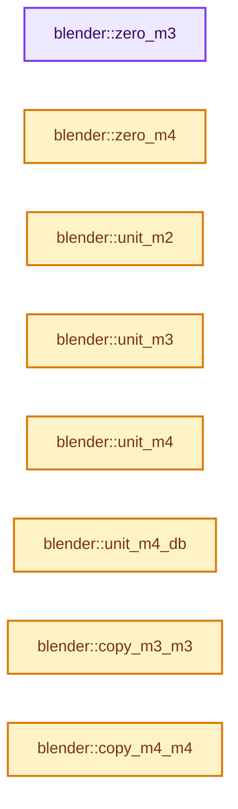

# 实现依赖专题：source/blender/blenlib/intern/math_matrix_c.cc

[实现依赖导航](../../README.md) · [符号索引](../../../00-课程指南/02-源码与提交索引/符号依赖与实现索引.md)

本专题从正文实际调用进入，集中保存共享实现。函数有稳定锚点，可从调用处直接跳到对应完整函数；递归与互相调用通过回链组织。

## 本文件的实现关系




## 完整成员与函数实现

<a id="f-f222ef9659a09668"></a>

### `blender::zero_m3`

实现位置：[source/blender/blenlib/intern/math_matrix_c.cc](../../../../../../../source/blender/blenlib/intern/math_matrix_c.cc) · L30—L33。

接口参数：

- `float m[3][3]`

**教学注释版**

<!-- annotated:f490f9a64d75cb -->

```cpp
void zero_m3(float m[3][3])
{
  // [讲解] memset：填充字节，不调用T构造函数，也不保证任意类型的全零表示是合法或期望值。
  memset(m, 0, sizeof(float[3][3]));
}
```

<details>
<summary>核对原始源码：source/blender/blenlib/intern/math_matrix_c.cc · L30—L33</summary>

<!-- original:f490f9a64d75cb:source/blender/blenlib/intern/math_matrix_c.cc:30:33 -->

```cpp
void zero_m3(float m[3][3])
{
  memset(m, 0, sizeof(float[3][3]));
}
```

</details>

**继续追踪实现**

- `memset` → [外部契约](https://eel.is/c++draft/cstring.syn)：填充字节，不调用T构造函数，也不保证任意类型的全零表示是合法或期望值。

<a id="f-2797e7c2db22f01d"></a>

### `blender::zero_m4`

实现位置：[source/blender/blenlib/intern/math_matrix_c.cc](../../../../../../../source/blender/blenlib/intern/math_matrix_c.cc) · L35—L38。

接口参数：

- `float m[4][4]`

**教学注释版**

<!-- annotated:5ad8116f682b53 -->

```cpp
void zero_m4(float m[4][4])
{
  // [讲解] memset：填充字节，不调用T构造函数，也不保证任意类型的全零表示是合法或期望值。
  memset(m, 0, sizeof(float[4][4]));
}
```

<details>
<summary>核对原始源码：source/blender/blenlib/intern/math_matrix_c.cc · L35—L38</summary>

<!-- original:5ad8116f682b53:source/blender/blenlib/intern/math_matrix_c.cc:35:38 -->

```cpp
void zero_m4(float m[4][4])
{
  memset(m, 0, sizeof(float[4][4]));
}
```

</details>

**继续追踪实现**

- `memset` → [外部契约](https://eel.is/c++draft/cstring.syn)：填充字节，不调用T构造函数，也不保证任意类型的全零表示是合法或期望值。

<a id="f-bfe83504111fa231"></a>

### `blender::unit_m2`

实现位置：[source/blender/blenlib/intern/math_matrix_c.cc](../../../../../../../source/blender/blenlib/intern/math_matrix_c.cc) · L40—L45。

接口参数：

- `float m[2][2]`

**教学注释版**

<!-- annotated:ab2f012cb9ca3b -->

```cpp
void unit_m2(float m[2][2])
{
  m[0][0] = m[1][1] = 1.0f;
  m[0][1] = 0.0f;
  m[1][0] = 0.0f;
}
```

<details>
<summary>核对原始源码：source/blender/blenlib/intern/math_matrix_c.cc · L40—L45</summary>

<!-- original:ab2f012cb9ca3b:source/blender/blenlib/intern/math_matrix_c.cc:40:45 -->

```cpp
void unit_m2(float m[2][2])
{
  m[0][0] = m[1][1] = 1.0f;
  m[0][1] = 0.0f;
  m[1][0] = 0.0f;
}
```

</details>

**沿实际写入检查状态**

- `m[0][0] = m[1][1] = 1.0f;`
- `m[0][1] = 0.0f;`
- `m[1][0] = 0.0f;`

**继续追踪实现**

本实现没有需要继续展开的显式调用；检查返回表达式、对象转换和调用者前置条件。

<a id="f-85e0073adca4ccff"></a>

### `blender::unit_m3`

实现位置：[source/blender/blenlib/intern/math_matrix_c.cc](../../../../../../../source/blender/blenlib/intern/math_matrix_c.cc) · L47—L53。

接口参数：

- `float m[3][3]`

**教学注释版**

<!-- annotated:0b4d1bb28870f6 -->

```cpp
void unit_m3(float m[3][3])
{
  m[0][0] = m[1][1] = m[2][2] = 1.0f;
  m[0][1] = m[0][2] = 0.0f;
  m[1][0] = m[1][2] = 0.0f;
  m[2][0] = m[2][1] = 0.0f;
}
```

<details>
<summary>核对原始源码：source/blender/blenlib/intern/math_matrix_c.cc · L47—L53</summary>

<!-- original:0b4d1bb28870f6:source/blender/blenlib/intern/math_matrix_c.cc:47:53 -->

```cpp
void unit_m3(float m[3][3])
{
  m[0][0] = m[1][1] = m[2][2] = 1.0f;
  m[0][1] = m[0][2] = 0.0f;
  m[1][0] = m[1][2] = 0.0f;
  m[2][0] = m[2][1] = 0.0f;
}
```

</details>

**沿实际写入检查状态**

- `m[0][0] = m[1][1] = m[2][2] = 1.0f;`
- `m[0][1] = m[0][2] = 0.0f;`
- `m[1][0] = m[1][2] = 0.0f;`
- `m[2][0] = m[2][1] = 0.0f;`

**继续追踪实现**

本实现没有需要继续展开的显式调用；检查返回表达式、对象转换和调用者前置条件。

<a id="f-e6cd812aae119176"></a>

### `blender::unit_m4`

实现位置：[source/blender/blenlib/intern/math_matrix_c.cc](../../../../../../../source/blender/blenlib/intern/math_matrix_c.cc) · L55—L62。

接口参数：

- `float m[4][4]`

**教学注释版**

<!-- annotated:532b4f429fcc3d -->

```cpp
void unit_m4(float m[4][4])
{
  m[0][0] = m[1][1] = m[2][2] = m[3][3] = 1.0f;
  m[0][1] = m[0][2] = m[0][3] = 0.0f;
  m[1][0] = m[1][2] = m[1][3] = 0.0f;
  m[2][0] = m[2][1] = m[2][3] = 0.0f;
  m[3][0] = m[3][1] = m[3][2] = 0.0f;
}
```

<details>
<summary>核对原始源码：source/blender/blenlib/intern/math_matrix_c.cc · L55—L62</summary>

<!-- original:532b4f429fcc3d:source/blender/blenlib/intern/math_matrix_c.cc:55:62 -->

```cpp
void unit_m4(float m[4][4])
{
  m[0][0] = m[1][1] = m[2][2] = m[3][3] = 1.0f;
  m[0][1] = m[0][2] = m[0][3] = 0.0f;
  m[1][0] = m[1][2] = m[1][3] = 0.0f;
  m[2][0] = m[2][1] = m[2][3] = 0.0f;
  m[3][0] = m[3][1] = m[3][2] = 0.0f;
}
```

</details>

**沿实际写入检查状态**

- `m[0][0] = m[1][1] = m[2][2] = m[3][3] = 1.0f;`
- `m[0][1] = m[0][2] = m[0][3] = 0.0f;`
- `m[1][0] = m[1][2] = m[1][3] = 0.0f;`
- `m[2][0] = m[2][1] = m[2][3] = 0.0f;`
- `m[3][0] = m[3][1] = m[3][2] = 0.0f;`

**继续追踪实现**

本实现没有需要继续展开的显式调用；检查返回表达式、对象转换和调用者前置条件。

<a id="f-4a05767c1f44c217"></a>

### `blender::unit_m4_db`

实现位置：[source/blender/blenlib/intern/math_matrix_c.cc](../../../../../../../source/blender/blenlib/intern/math_matrix_c.cc) · L64—L71。

接口参数：

- `double m[4][4]`

**教学注释版**

<!-- annotated:aa686f53b4da45 -->

```cpp
void unit_m4_db(double m[4][4])
{
  m[0][0] = m[1][1] = m[2][2] = m[3][3] = 1.0f;
  m[0][1] = m[0][2] = m[0][3] = 0.0f;
  m[1][0] = m[1][2] = m[1][3] = 0.0f;
  m[2][0] = m[2][1] = m[2][3] = 0.0f;
  m[3][0] = m[3][1] = m[3][2] = 0.0f;
}
```

<details>
<summary>核对原始源码：source/blender/blenlib/intern/math_matrix_c.cc · L64—L71</summary>

<!-- original:aa686f53b4da45:source/blender/blenlib/intern/math_matrix_c.cc:64:71 -->

```cpp
void unit_m4_db(double m[4][4])
{
  m[0][0] = m[1][1] = m[2][2] = m[3][3] = 1.0f;
  m[0][1] = m[0][2] = m[0][3] = 0.0f;
  m[1][0] = m[1][2] = m[1][3] = 0.0f;
  m[2][0] = m[2][1] = m[2][3] = 0.0f;
  m[3][0] = m[3][1] = m[3][2] = 0.0f;
}
```

</details>

**沿实际写入检查状态**

- `m[0][0] = m[1][1] = m[2][2] = m[3][3] = 1.0f;`
- `m[0][1] = m[0][2] = m[0][3] = 0.0f;`
- `m[1][0] = m[1][2] = m[1][3] = 0.0f;`
- `m[2][0] = m[2][1] = m[2][3] = 0.0f;`
- `m[3][0] = m[3][1] = m[3][2] = 0.0f;`

**继续追踪实现**

本实现没有需要继续展开的显式调用；检查返回表达式、对象转换和调用者前置条件。

<a id="f-c73aa9bdf12f5c76"></a>

### `blender::copy_m3_m3`

实现位置：[source/blender/blenlib/intern/math_matrix_c.cc](../../../../../../../source/blender/blenlib/intern/math_matrix_c.cc) · L78—L82。

接口参数：

- `float m1[3][3]`
- `const float m2[3][3]`

**教学注释版**

<!-- annotated:f28113a44f02cf -->

```cpp
void copy_m3_m3(float m1[3][3], const float m2[3][3])
{
  /* destination comes first: */
  // [讲解] memcpy：复制字节，源与目标不应重叠。类型生命周期、对齐和可复制表示须由调用者证明，不是任意对象的复制构造。
  memcpy(m1, m2, sizeof(float[3][3]));
}
```

<details>
<summary>核对原始源码：source/blender/blenlib/intern/math_matrix_c.cc · L78—L82</summary>

<!-- original:f28113a44f02cf:source/blender/blenlib/intern/math_matrix_c.cc:78:82 -->

```cpp
void copy_m3_m3(float m1[3][3], const float m2[3][3])
{
  /* destination comes first: */
  memcpy(m1, m2, sizeof(float[3][3]));
}
```

</details>

**继续追踪实现**

- `memcpy` → [外部契约](https://eel.is/c++draft/cstring.syn)：复制字节，源与目标不应重叠。类型生命周期、对齐和可复制表示须由调用者证明，不是任意对象的复制构造。

<a id="f-b4390cf8c94710f5"></a>

### `blender::copy_m4_m4`

实现位置：[source/blender/blenlib/intern/math_matrix_c.cc](../../../../../../../source/blender/blenlib/intern/math_matrix_c.cc) · L84—L87。

接口参数：

- `float m1[4][4]`
- `const float m2[4][4]`

**教学注释版**

<!-- annotated:13a06d9d6f5609 -->

```cpp
void copy_m4_m4(float m1[4][4], const float m2[4][4])
{
  // [讲解] memcpy：复制字节，源与目标不应重叠。类型生命周期、对齐和可复制表示须由调用者证明，不是任意对象的复制构造。
  memcpy(m1, m2, sizeof(float[4][4]));
}
```

<details>
<summary>核对原始源码：source/blender/blenlib/intern/math_matrix_c.cc · L84—L87</summary>

<!-- original:13a06d9d6f5609:source/blender/blenlib/intern/math_matrix_c.cc:84:87 -->

```cpp
void copy_m4_m4(float m1[4][4], const float m2[4][4])
{
  memcpy(m1, m2, sizeof(float[4][4]));
}
```

</details>

**继续追踪实现**

- `memcpy` → [外部契约](https://eel.is/c++draft/cstring.syn)：复制字节，源与目标不应重叠。类型生命周期、对齐和可复制表示须由调用者证明，不是任意对象的复制构造。

<a id="f-fdc12f92cdd72c13"></a>

### `blender::copy_m4_m4_db`

实现位置：[source/blender/blenlib/intern/math_matrix_c.cc](../../../../../../../source/blender/blenlib/intern/math_matrix_c.cc) · L89—L92。

接口参数：

- `double m1[4][4]`
- `const double m2[4][4]`

**教学注释版**

<!-- annotated:1ac6f767733b7a -->

```cpp
void copy_m4_m4_db(double m1[4][4], const double m2[4][4])
{
  // [讲解] memcpy：复制字节，源与目标不应重叠。类型生命周期、对齐和可复制表示须由调用者证明，不是任意对象的复制构造。
  memcpy(m1, m2, sizeof(double[4][4]));
}
```

<details>
<summary>核对原始源码：source/blender/blenlib/intern/math_matrix_c.cc · L89—L92</summary>

<!-- original:1ac6f767733b7a:source/blender/blenlib/intern/math_matrix_c.cc:89:92 -->

```cpp
void copy_m4_m4_db(double m1[4][4], const double m2[4][4])
{
  memcpy(m1, m2, sizeof(double[4][4]));
}
```

</details>

**继续追踪实现**

- `memcpy` → [外部契约](https://eel.is/c++draft/cstring.syn)：复制字节，源与目标不应重叠。类型生命周期、对齐和可复制表示须由调用者证明，不是任意对象的复制构造。

<a id="f-1141cb3624c754b0"></a>

### `blender::copy_m3_m4`

实现位置：[source/blender/blenlib/intern/math_matrix_c.cc](../../../../../../../source/blender/blenlib/intern/math_matrix_c.cc) · L94—L107。

接口参数：

- `float m1[3][3]`
- `const float m2[4][4]`

**教学注释版**

<!-- annotated:c56a307c492d6f -->

```cpp
void copy_m3_m4(float m1[3][3], const float m2[4][4])
{
  m1[0][0] = m2[0][0];
  m1[0][1] = m2[0][1];
  m1[0][2] = m2[0][2];

  m1[1][0] = m2[1][0];
  m1[1][1] = m2[1][1];
  m1[1][2] = m2[1][2];

  m1[2][0] = m2[2][0];
  m1[2][1] = m2[2][1];
  m1[2][2] = m2[2][2];
}
```

<details>
<summary>核对原始源码：source/blender/blenlib/intern/math_matrix_c.cc · L94—L107</summary>

<!-- original:c56a307c492d6f:source/blender/blenlib/intern/math_matrix_c.cc:94:107 -->

```cpp
void copy_m3_m4(float m1[3][3], const float m2[4][4])
{
  m1[0][0] = m2[0][0];
  m1[0][1] = m2[0][1];
  m1[0][2] = m2[0][2];

  m1[1][0] = m2[1][0];
  m1[1][1] = m2[1][1];
  m1[1][2] = m2[1][2];

  m1[2][0] = m2[2][0];
  m1[2][1] = m2[2][1];
  m1[2][2] = m2[2][2];
}
```

</details>

**沿实际写入检查状态**

- `m1[0][0] = m2[0][0];`
- `m1[0][1] = m2[0][1];`
- `m1[0][2] = m2[0][2];`
- `m1[1][0] = m2[1][0];`
- `m1[1][1] = m2[1][1];`
- `m1[1][2] = m2[1][2];`
- `m1[2][0] = m2[2][0];`
- `m1[2][1] = m2[2][1];`
- `m1[2][2] = m2[2][2];`

**继续追踪实现**

本实现没有需要继续展开的显式调用；检查返回表达式、对象转换和调用者前置条件。

<a id="f-6915e4040afabeb8"></a>

### `blender::copy_m4_m3`

实现位置：[source/blender/blenlib/intern/math_matrix_c.cc](../../../../../../../source/blender/blenlib/intern/math_matrix_c.cc) · L109—L131。

接口参数：

- `float m1[4][4]`
- `const float m2[3][3]`

**教学注释版**

<!-- annotated:4e9b1478450637 -->

```cpp
void copy_m4_m3(float m1[4][4], const float m2[3][3]) /* no clear */
{
  m1[0][0] = m2[0][0];
  m1[0][1] = m2[0][1];
  m1[0][2] = m2[0][2];

  m1[1][0] = m2[1][0];
  m1[1][1] = m2[1][1];
  m1[1][2] = m2[1][2];

  m1[2][0] = m2[2][0];
  m1[2][1] = m2[2][1];
  m1[2][2] = m2[2][2];

  m1[0][3] = 0.0f;
  m1[1][3] = 0.0f;
  m1[2][3] = 0.0f;

  m1[3][0] = 0.0f;
  m1[3][1] = 0.0f;
  m1[3][2] = 0.0f;
  m1[3][3] = 1.0f;
}
```

<details>
<summary>核对原始源码：source/blender/blenlib/intern/math_matrix_c.cc · L109—L131</summary>

<!-- original:4e9b1478450637:source/blender/blenlib/intern/math_matrix_c.cc:109:131 -->

```cpp
void copy_m4_m3(float m1[4][4], const float m2[3][3]) /* no clear */
{
  m1[0][0] = m2[0][0];
  m1[0][1] = m2[0][1];
  m1[0][2] = m2[0][2];

  m1[1][0] = m2[1][0];
  m1[1][1] = m2[1][1];
  m1[1][2] = m2[1][2];

  m1[2][0] = m2[2][0];
  m1[2][1] = m2[2][1];
  m1[2][2] = m2[2][2];

  m1[0][3] = 0.0f;
  m1[1][3] = 0.0f;
  m1[2][3] = 0.0f;

  m1[3][0] = 0.0f;
  m1[3][1] = 0.0f;
  m1[3][2] = 0.0f;
  m1[3][3] = 1.0f;
}
```

</details>

**沿实际写入检查状态**

- `m1[0][0] = m2[0][0];`
- `m1[0][1] = m2[0][1];`
- `m1[0][2] = m2[0][2];`
- `m1[1][0] = m2[1][0];`
- `m1[1][1] = m2[1][1];`
- `m1[1][2] = m2[1][2];`
- `m1[2][0] = m2[2][0];`
- `m1[2][1] = m2[2][1];`
- `m1[2][2] = m2[2][2];`
- `m1[0][3] = 0.0f;`
- `m1[1][3] = 0.0f;`
- `m1[2][3] = 0.0f;`
- `m1[3][0] = 0.0f;`
- `m1[3][1] = 0.0f;`
- `m1[3][2] = 0.0f;`
- `m1[3][3] = 1.0f;`

**继续追踪实现**

本实现没有需要继续展开的显式调用；检查返回表达式、对象转换和调用者前置条件。

<a id="f-de2187295b935f7b"></a>

### `blender::copy_m4d_m4`

实现位置：[source/blender/blenlib/intern/math_matrix_c.cc](../../../../../../../source/blender/blenlib/intern/math_matrix_c.cc) · L148—L169。

接口参数：

- `double m1[4][4]`
- `const float m2[4][4]`

**教学注释版**

<!-- annotated:52af760c29d2be -->

```cpp
void copy_m4d_m4(double m1[4][4], const float m2[4][4])
{
  m1[0][0] = m2[0][0];
  m1[0][1] = m2[0][1];
  m1[0][2] = m2[0][2];
  m1[0][3] = m2[0][3];

  m1[1][0] = m2[1][0];
  m1[1][1] = m2[1][1];
  m1[1][2] = m2[1][2];
  m1[1][3] = m2[1][3];

  m1[2][0] = m2[2][0];
  m1[2][1] = m2[2][1];
  m1[2][2] = m2[2][2];
  m1[2][3] = m2[2][3];

  m1[3][0] = m2[3][0];
  m1[3][1] = m2[3][1];
  m1[3][2] = m2[3][2];
  m1[3][3] = m2[3][3];
}
```

<details>
<summary>核对原始源码：source/blender/blenlib/intern/math_matrix_c.cc · L148—L169</summary>

<!-- original:52af760c29d2be:source/blender/blenlib/intern/math_matrix_c.cc:148:169 -->

```cpp
void copy_m4d_m4(double m1[4][4], const float m2[4][4])
{
  m1[0][0] = m2[0][0];
  m1[0][1] = m2[0][1];
  m1[0][2] = m2[0][2];
  m1[0][3] = m2[0][3];

  m1[1][0] = m2[1][0];
  m1[1][1] = m2[1][1];
  m1[1][2] = m2[1][2];
  m1[1][3] = m2[1][3];

  m1[2][0] = m2[2][0];
  m1[2][1] = m2[2][1];
  m1[2][2] = m2[2][2];
  m1[2][3] = m2[2][3];

  m1[3][0] = m2[3][0];
  m1[3][1] = m2[3][1];
  m1[3][2] = m2[3][2];
  m1[3][3] = m2[3][3];
}
```

</details>

**沿实际写入检查状态**

- `m1[0][0] = m2[0][0];`
- `m1[0][1] = m2[0][1];`
- `m1[0][2] = m2[0][2];`
- `m1[0][3] = m2[0][3];`
- `m1[1][0] = m2[1][0];`
- `m1[1][1] = m2[1][1];`
- `m1[1][2] = m2[1][2];`
- `m1[1][3] = m2[1][3];`
- `m1[2][0] = m2[2][0];`
- `m1[2][1] = m2[2][1];`
- `m1[2][2] = m2[2][2];`
- `m1[2][3] = m2[2][3];`
- `m1[3][0] = m2[3][0];`
- `m1[3][1] = m2[3][1];`
- `m1[3][2] = m2[3][2];`
- `m1[3][3] = m2[3][3];`

**继续追踪实现**

本实现没有需要继续展开的显式调用；检查返回表达式、对象转换和调用者前置条件。

<a id="f-0ec534cfbc8f5dee"></a>

### `blender::copy_m3_m3d`

实现位置：[source/blender/blenlib/intern/math_matrix_c.cc](../../../../../../../source/blender/blenlib/intern/math_matrix_c.cc) · L171—L185。

接口参数：

- `float m1[3][3]`
- `const double m2[3][3]`

**教学注释版**

<!-- annotated:ead83d1e6989ba -->

```cpp
void copy_m3_m3d(float m1[3][3], const double m2[3][3])
{
  /* Keep it stupid simple for better data flow in CPU. */
  m1[0][0] = float(m2[0][0]);
  m1[0][1] = float(m2[0][1]);
  m1[0][2] = float(m2[0][2]);

  m1[1][0] = float(m2[1][0]);
  m1[1][1] = float(m2[1][1]);
  m1[1][2] = float(m2[1][2]);

  m1[2][0] = float(m2[2][0]);
  m1[2][1] = float(m2[2][1]);
  m1[2][2] = float(m2[2][2]);
}
```

<details>
<summary>核对原始源码：source/blender/blenlib/intern/math_matrix_c.cc · L171—L185</summary>

<!-- original:ead83d1e6989ba:source/blender/blenlib/intern/math_matrix_c.cc:171:185 -->

```cpp
void copy_m3_m3d(float m1[3][3], const double m2[3][3])
{
  /* Keep it stupid simple for better data flow in CPU. */
  m1[0][0] = float(m2[0][0]);
  m1[0][1] = float(m2[0][1]);
  m1[0][2] = float(m2[0][2]);

  m1[1][0] = float(m2[1][0]);
  m1[1][1] = float(m2[1][1]);
  m1[1][2] = float(m2[1][2]);

  m1[2][0] = float(m2[2][0]);
  m1[2][1] = float(m2[2][1]);
  m1[2][2] = float(m2[2][2]);
}
```

</details>

**沿实际写入检查状态**

- `m1[0][0] = float(m2[0][0]);`
- `m1[0][1] = float(m2[0][1]);`
- `m1[0][2] = float(m2[0][2]);`
- `m1[1][0] = float(m2[1][0]);`
- `m1[1][1] = float(m2[1][1]);`
- `m1[1][2] = float(m2[1][2]);`
- `m1[2][0] = float(m2[2][0]);`
- `m1[2][1] = float(m2[2][1]);`
- `m1[2][2] = float(m2[2][2]);`

**继续追踪实现**

本实现没有需要继续展开的显式调用；检查返回表达式、对象转换和调用者前置条件。

<a id="f-5eb7f5d435838158"></a>

### `blender::shuffle_m4`

实现位置：[source/blender/blenlib/intern/math_matrix_c.cc](../../../../../../../source/blender/blenlib/intern/math_matrix_c.cc) · L201—L209。

接口参数：

- `float R[4][4]`
- `const int index[4]`

**教学注释版**

<!-- annotated:ee5ba7d98a9ac3 -->

```cpp
void shuffle_m4(float R[4][4], const int index[4])
{
  zero_m4(R);
  for (int k = 0; k < 4; k++) {
    if (index[k] >= 0) {
      R[index[k]][k] = 1.0f;
    }
  }
}
```

<details>
<summary>核对原始源码：source/blender/blenlib/intern/math_matrix_c.cc · L201—L209</summary>

<!-- original:ee5ba7d98a9ac3:source/blender/blenlib/intern/math_matrix_c.cc:201:209 -->

```cpp
void shuffle_m4(float R[4][4], const int index[4])
{
  zero_m4(R);
  for (int k = 0; k < 4; k++) {
    if (index[k] >= 0) {
      R[index[k]][k] = 1.0f;
    }
  }
}
```

</details>

**沿实际写入检查状态**

- `R[index[k]][k] = 1.0f;`

**继续追踪实现**

- `zero_m4` → [blender::zero_m4 · L35](math_matrix_c.cc.md#f-2797e7c2db22f01d)。

<a id="f-b5272136b543b73b"></a>

### `blender::mul_m4_m4m4`

实现位置：[source/blender/blenlib/intern/math_matrix_c.cc](../../../../../../../source/blender/blenlib/intern/math_matrix_c.cc) · L217—L265。

接口参数：

- `float R[4][4]`
- `const float A[4][4]`
- `const float B[4][4]`

**教学注释版**

<!-- annotated:841ef71fb1b9eb -->

```cpp
void mul_m4_m4m4(float R[4][4], const float A[4][4], const float B[4][4])
{
  if (ELEM(R, A, B)) {
    float T[4][4];
    mul_m4_m4m4(T, A, B);
    copy_m4_m4(R, T);
    return;
  }

  /* Matrix product: `R[j][k] = B[j][i] . A[i][k]`. */
#if BLI_HAVE_SSE2
  __m128 A0 = _mm_loadu_ps(A[0]);
  __m128 A1 = _mm_loadu_ps(A[1]);
  __m128 A2 = _mm_loadu_ps(A[2]);
  __m128 A3 = _mm_loadu_ps(A[3]);

  for (int i = 0; i < 4; i++) {
    __m128 B0 = _mm_set1_ps(B[i][0]);
    __m128 B1 = _mm_set1_ps(B[i][1]);
    __m128 B2 = _mm_set1_ps(B[i][2]);
    __m128 B3 = _mm_set1_ps(B[i][3]);

    __m128 sum = _mm_add_ps(_mm_add_ps(_mm_mul_ps(B0, A0), _mm_mul_ps(B1, A1)),
                            _mm_add_ps(_mm_mul_ps(B2, A2), _mm_mul_ps(B3, A3)));

    _mm_storeu_ps(R[i], sum);
  }
#else
  R[0][0] = B[0][0] * A[0][0] + B[0][1] * A[1][0] + B[0][2] * A[2][0] + B[0][3] * A[3][0];
  R[0][1] = B[0][0] * A[0][1] + B[0][1] * A[1][1] + B[0][2] * A[2][1] + B[0][3] * A[3][1];
  R[0][2] = B[0][0] * A[0][2] + B[0][1] * A[1][2] + B[0][2] * A[2][2] + B[0][3] * A[3][2];
  R[0][3] = B[0][0] * A[0][3] + B[0][1] * A[1][3] + B[0][2] * A[2][3] + B[0][3] * A[3][3];

  R[1][0] = B[1][0] * A[0][0] + B[1][1] * A[1][0] + B[1][2] * A[2][0] + B[1][3] * A[3][0];
  R[1][1] = B[1][0] * A[0][1] + B[1][1] * A[1][1] + B[1][2] * A[2][1] + B[1][3] * A[3][1];
  R[1][2] = B[1][0] * A[0][2] + B[1][1] * A[1][2] + B[1][2] * A[2][2] + B[1][3] * A[3][2];
  R[1][3] = B[1][0] * A[0][3] + B[1][1] * A[1][3] + B[1][2] * A[2][3] + B[1][3] * A[3][3];

  R[2][0] = B[2][0] * A[0][0] + B[2][1] * A[1][0] + B[2][2] * A[2][0] + B[2][3] * A[3][0];
  R[2][1] = B[2][0] * A[0][1] + B[2][1] * A[1][1] + B[2][2] * A[2][1] + B[2][3] * A[3][1];
  R[2][2] = B[2][0] * A[0][2] + B[2][1] * A[1][2] + B[2][2] * A[2][2] + B[2][3] * A[3][2];
  R[2][3] = B[2][0] * A[0][3] + B[2][1] * A[1][3] + B[2][2] * A[2][3] + B[2][3] * A[3][3];

  R[3][0] = B[3][0] * A[0][0] + B[3][1] * A[1][0] + B[3][2] * A[2][0] + B[3][3] * A[3][0];
  R[3][1] = B[3][0] * A[0][1] + B[3][1] * A[1][1] + B[3][2] * A[2][1] + B[3][3] * A[3][1];
  R[3][2] = B[3][0] * A[0][2] + B[3][1] * A[1][2] + B[3][2] * A[2][2] + B[3][3] * A[3][2];
  R[3][3] = B[3][0] * A[0][3] + B[3][1] * A[1][3] + B[3][2] * A[2][3] + B[3][3] * A[3][3];
#endif
}
```

<details>
<summary>核对原始源码：source/blender/blenlib/intern/math_matrix_c.cc · L217—L265</summary>

<!-- original:841ef71fb1b9eb:source/blender/blenlib/intern/math_matrix_c.cc:217:265 -->

```cpp
void mul_m4_m4m4(float R[4][4], const float A[4][4], const float B[4][4])
{
  if (ELEM(R, A, B)) {
    float T[4][4];
    mul_m4_m4m4(T, A, B);
    copy_m4_m4(R, T);
    return;
  }

  /* Matrix product: `R[j][k] = B[j][i] . A[i][k]`. */
#if BLI_HAVE_SSE2
  __m128 A0 = _mm_loadu_ps(A[0]);
  __m128 A1 = _mm_loadu_ps(A[1]);
  __m128 A2 = _mm_loadu_ps(A[2]);
  __m128 A3 = _mm_loadu_ps(A[3]);

  for (int i = 0; i < 4; i++) {
    __m128 B0 = _mm_set1_ps(B[i][0]);
    __m128 B1 = _mm_set1_ps(B[i][1]);
    __m128 B2 = _mm_set1_ps(B[i][2]);
    __m128 B3 = _mm_set1_ps(B[i][3]);

    __m128 sum = _mm_add_ps(_mm_add_ps(_mm_mul_ps(B0, A0), _mm_mul_ps(B1, A1)),
                            _mm_add_ps(_mm_mul_ps(B2, A2), _mm_mul_ps(B3, A3)));

    _mm_storeu_ps(R[i], sum);
  }
#else
  R[0][0] = B[0][0] * A[0][0] + B[0][1] * A[1][0] + B[0][2] * A[2][0] + B[0][3] * A[3][0];
  R[0][1] = B[0][0] * A[0][1] + B[0][1] * A[1][1] + B[0][2] * A[2][1] + B[0][3] * A[3][1];
  R[0][2] = B[0][0] * A[0][2] + B[0][1] * A[1][2] + B[0][2] * A[2][2] + B[0][3] * A[3][2];
  R[0][3] = B[0][0] * A[0][3] + B[0][1] * A[1][3] + B[0][2] * A[2][3] + B[0][3] * A[3][3];

  R[1][0] = B[1][0] * A[0][0] + B[1][1] * A[1][0] + B[1][2] * A[2][0] + B[1][3] * A[3][0];
  R[1][1] = B[1][0] * A[0][1] + B[1][1] * A[1][1] + B[1][2] * A[2][1] + B[1][3] * A[3][1];
  R[1][2] = B[1][0] * A[0][2] + B[1][1] * A[1][2] + B[1][2] * A[2][2] + B[1][3] * A[3][2];
  R[1][3] = B[1][0] * A[0][3] + B[1][1] * A[1][3] + B[1][2] * A[2][3] + B[1][3] * A[3][3];

  R[2][0] = B[2][0] * A[0][0] + B[2][1] * A[1][0] + B[2][2] * A[2][0] + B[2][3] * A[3][0];
  R[2][1] = B[2][0] * A[0][1] + B[2][1] * A[1][1] + B[2][2] * A[2][1] + B[2][3] * A[3][1];
  R[2][2] = B[2][0] * A[0][2] + B[2][1] * A[1][2] + B[2][2] * A[2][2] + B[2][3] * A[3][2];
  R[2][3] = B[2][0] * A[0][3] + B[2][1] * A[1][3] + B[2][2] * A[2][3] + B[2][3] * A[3][3];

  R[3][0] = B[3][0] * A[0][0] + B[3][1] * A[1][0] + B[3][2] * A[2][0] + B[3][3] * A[3][0];
  R[3][1] = B[3][0] * A[0][1] + B[3][1] * A[1][1] + B[3][2] * A[2][1] + B[3][3] * A[3][1];
  R[3][2] = B[3][0] * A[0][2] + B[3][1] * A[1][2] + B[3][2] * A[2][2] + B[3][3] * A[3][2];
  R[3][3] = B[3][0] * A[0][3] + B[3][1] * A[1][3] + B[3][2] * A[2][3] + B[3][3] * A[3][3];
#endif
}
```

</details>

**沿实际写入检查状态**

- `R[0][0] = B[0][0] * A[0][0] + B[0][1] * A[1][0] + B[0][2] * A[2][0] + B[0][3] * A[3][0];`
- `R[0][1] = B[0][0] * A[0][1] + B[0][1] * A[1][1] + B[0][2] * A[2][1] + B[0][3] * A[3][1];`
- `R[0][2] = B[0][0] * A[0][2] + B[0][1] * A[1][2] + B[0][2] * A[2][2] + B[0][3] * A[3][2];`
- `R[0][3] = B[0][0] * A[0][3] + B[0][1] * A[1][3] + B[0][2] * A[2][3] + B[0][3] * A[3][3];`
- `R[1][0] = B[1][0] * A[0][0] + B[1][1] * A[1][0] + B[1][2] * A[2][0] + B[1][3] * A[3][0];`
- `R[1][1] = B[1][0] * A[0][1] + B[1][1] * A[1][1] + B[1][2] * A[2][1] + B[1][3] * A[3][1];`
- `R[1][2] = B[1][0] * A[0][2] + B[1][1] * A[1][2] + B[1][2] * A[2][2] + B[1][3] * A[3][2];`
- `R[1][3] = B[1][0] * A[0][3] + B[1][1] * A[1][3] + B[1][2] * A[2][3] + B[1][3] * A[3][3];`
- `R[2][0] = B[2][0] * A[0][0] + B[2][1] * A[1][0] + B[2][2] * A[2][0] + B[2][3] * A[3][0];`
- `R[2][1] = B[2][0] * A[0][1] + B[2][1] * A[1][1] + B[2][2] * A[2][1] + B[2][3] * A[3][1];`
- `R[2][2] = B[2][0] * A[0][2] + B[2][1] * A[1][2] + B[2][2] * A[2][2] + B[2][3] * A[3][2];`
- `R[2][3] = B[2][0] * A[0][3] + B[2][1] * A[1][3] + B[2][2] * A[2][3] + B[2][3] * A[3][3];`
- `R[3][0] = B[3][0] * A[0][0] + B[3][1] * A[1][0] + B[3][2] * A[2][0] + B[3][3] * A[3][0];`
- `R[3][1] = B[3][0] * A[0][1] + B[3][1] * A[1][1] + B[3][2] * A[2][1] + B[3][3] * A[3][1];`
- `R[3][2] = B[3][0] * A[0][2] + B[3][1] * A[1][2] + B[3][2] * A[2][2] + B[3][3] * A[3][2];`
- `R[3][3] = B[3][0] * A[0][3] + B[3][1] * A[1][3] + B[3][2] * A[2][3] + B[3][3] * A[3][3];`

**继续追踪实现**

- `ELEM` → [ELEM · L88](../../07-Intern运行时与平台/ghost/intern/GHOST_utildefines.hh.md#m-d28724a15928)；[ELEM · L135](../BLI_utildefines.hh.md#m-d6572de7cae0)。宏定义由构建条件选择。
- `mul_m4_m4m4` → [blender::mul_m4_m4m4 · L217](math_matrix_c.cc.md#f-b5272136b543b73b)。
- `copy_m4_m4` → [blender::copy_m4_m4 · L84](math_matrix_c.cc.md#f-b4390cf8c94710f5)。
- `_mm_loadu_ps` → [调用协议](../../../00-课程指南/01-路线与规范/模板宏与动态分派协议.md)：函数指针、局部可调用对象或未展开的宏；必须结合调用者环境。调用位置L228。
- `_mm_set1_ps` → [调用协议](../../../00-课程指南/01-路线与规范/模板宏与动态分派协议.md)：函数指针、局部可调用对象或未展开的宏；必须结合调用者环境。调用位置L234。
- `_mm_add_ps` → [调用协议](../../../00-课程指南/01-路线与规范/模板宏与动态分派协议.md)：函数指针、局部可调用对象或未展开的宏；必须结合调用者环境。调用位置L239。
- `_mm_mul_ps` → [调用协议](../../../00-课程指南/01-路线与规范/模板宏与动态分派协议.md)：函数指针、局部可调用对象或未展开的宏；必须结合调用者环境。调用位置L239。
- `_mm_storeu_ps` → [调用协议](../../../00-课程指南/01-路线与规范/模板宏与动态分派协议.md)：函数指针、局部可调用对象或未展开的宏；必须结合调用者环境。调用位置L242。

<a id="f-f912988c0767beac"></a>

### `blender::mul_m4db_m4db_m4fl`

实现位置：[source/blender/blenlib/intern/math_matrix_c.cc](../../../../../../../source/blender/blenlib/intern/math_matrix_c.cc) · L267—L297。

接口参数：

- `double R[4][4]`
- `const double A[4][4]`
- `const float B[4][4]`

**教学注释版**

<!-- annotated:27ece48c50154e -->

```cpp
void mul_m4db_m4db_m4fl(double R[4][4], const double A[4][4], const float B[4][4])
{
  if (R == A) {
    double T[4][4];
    mul_m4db_m4db_m4fl(T, A, B);
    copy_m4_m4_db(R, T);
    return;
  }

  /* Matrix product: `R[j][k] = B[j][i] . A[i][k]`. */

  R[0][0] = B[0][0] * A[0][0] + B[0][1] * A[1][0] + B[0][2] * A[2][0] + B[0][3] * A[3][0];
  R[0][1] = B[0][0] * A[0][1] + B[0][1] * A[1][1] + B[0][2] * A[2][1] + B[0][3] * A[3][1];
  R[0][2] = B[0][0] * A[0][2] + B[0][1] * A[1][2] + B[0][2] * A[2][2] + B[0][3] * A[3][2];
  R[0][3] = B[0][0] * A[0][3] + B[0][1] * A[1][3] + B[0][2] * A[2][3] + B[0][3] * A[3][3];

  R[1][0] = B[1][0] * A[0][0] + B[1][1] * A[1][0] + B[1][2] * A[2][0] + B[1][3] * A[3][0];
  R[1][1] = B[1][0] * A[0][1] + B[1][1] * A[1][1] + B[1][2] * A[2][1] + B[1][3] * A[3][1];
  R[1][2] = B[1][0] * A[0][2] + B[1][1] * A[1][2] + B[1][2] * A[2][2] + B[1][3] * A[3][2];
  R[1][3] = B[1][0] * A[0][3] + B[1][1] * A[1][3] + B[1][2] * A[2][3] + B[1][3] * A[3][3];

  R[2][0] = B[2][0] * A[0][0] + B[2][1] * A[1][0] + B[2][2] * A[2][0] + B[2][3] * A[3][0];
  R[2][1] = B[2][0] * A[0][1] + B[2][1] * A[1][1] + B[2][2] * A[2][1] + B[2][3] * A[3][1];
  R[2][2] = B[2][0] * A[0][2] + B[2][1] * A[1][2] + B[2][2] * A[2][2] + B[2][3] * A[3][2];
  R[2][3] = B[2][0] * A[0][3] + B[2][1] * A[1][3] + B[2][2] * A[2][3] + B[2][3] * A[3][3];

  R[3][0] = B[3][0] * A[0][0] + B[3][1] * A[1][0] + B[3][2] * A[2][0] + B[3][3] * A[3][0];
  R[3][1] = B[3][0] * A[0][1] + B[3][1] * A[1][1] + B[3][2] * A[2][1] + B[3][3] * A[3][1];
  R[3][2] = B[3][0] * A[0][2] + B[3][1] * A[1][2] + B[3][2] * A[2][2] + B[3][3] * A[3][2];
  R[3][3] = B[3][0] * A[0][3] + B[3][1] * A[1][3] + B[3][2] * A[2][3] + B[3][3] * A[3][3];
}
```

<details>
<summary>核对原始源码：source/blender/blenlib/intern/math_matrix_c.cc · L267—L297</summary>

<!-- original:27ece48c50154e:source/blender/blenlib/intern/math_matrix_c.cc:267:297 -->

```cpp
void mul_m4db_m4db_m4fl(double R[4][4], const double A[4][4], const float B[4][4])
{
  if (R == A) {
    double T[4][4];
    mul_m4db_m4db_m4fl(T, A, B);
    copy_m4_m4_db(R, T);
    return;
  }

  /* Matrix product: `R[j][k] = B[j][i] . A[i][k]`. */

  R[0][0] = B[0][0] * A[0][0] + B[0][1] * A[1][0] + B[0][2] * A[2][0] + B[0][3] * A[3][0];
  R[0][1] = B[0][0] * A[0][1] + B[0][1] * A[1][1] + B[0][2] * A[2][1] + B[0][3] * A[3][1];
  R[0][2] = B[0][0] * A[0][2] + B[0][1] * A[1][2] + B[0][2] * A[2][2] + B[0][3] * A[3][2];
  R[0][3] = B[0][0] * A[0][3] + B[0][1] * A[1][3] + B[0][2] * A[2][3] + B[0][3] * A[3][3];

  R[1][0] = B[1][0] * A[0][0] + B[1][1] * A[1][0] + B[1][2] * A[2][0] + B[1][3] * A[3][0];
  R[1][1] = B[1][0] * A[0][1] + B[1][1] * A[1][1] + B[1][2] * A[2][1] + B[1][3] * A[3][1];
  R[1][2] = B[1][0] * A[0][2] + B[1][1] * A[1][2] + B[1][2] * A[2][2] + B[1][3] * A[3][2];
  R[1][3] = B[1][0] * A[0][3] + B[1][1] * A[1][3] + B[1][2] * A[2][3] + B[1][3] * A[3][3];

  R[2][0] = B[2][0] * A[0][0] + B[2][1] * A[1][0] + B[2][2] * A[2][0] + B[2][3] * A[3][0];
  R[2][1] = B[2][0] * A[0][1] + B[2][1] * A[1][1] + B[2][2] * A[2][1] + B[2][3] * A[3][1];
  R[2][2] = B[2][0] * A[0][2] + B[2][1] * A[1][2] + B[2][2] * A[2][2] + B[2][3] * A[3][2];
  R[2][3] = B[2][0] * A[0][3] + B[2][1] * A[1][3] + B[2][2] * A[2][3] + B[2][3] * A[3][3];

  R[3][0] = B[3][0] * A[0][0] + B[3][1] * A[1][0] + B[3][2] * A[2][0] + B[3][3] * A[3][0];
  R[3][1] = B[3][0] * A[0][1] + B[3][1] * A[1][1] + B[3][2] * A[2][1] + B[3][3] * A[3][1];
  R[3][2] = B[3][0] * A[0][2] + B[3][1] * A[1][2] + B[3][2] * A[2][2] + B[3][3] * A[3][2];
  R[3][3] = B[3][0] * A[0][3] + B[3][1] * A[1][3] + B[3][2] * A[2][3] + B[3][3] * A[3][3];
}
```

</details>

**沿实际写入检查状态**

- `R[0][0] = B[0][0] * A[0][0] + B[0][1] * A[1][0] + B[0][2] * A[2][0] + B[0][3] * A[3][0];`
- `R[0][1] = B[0][0] * A[0][1] + B[0][1] * A[1][1] + B[0][2] * A[2][1] + B[0][3] * A[3][1];`
- `R[0][2] = B[0][0] * A[0][2] + B[0][1] * A[1][2] + B[0][2] * A[2][2] + B[0][3] * A[3][2];`
- `R[0][3] = B[0][0] * A[0][3] + B[0][1] * A[1][3] + B[0][2] * A[2][3] + B[0][3] * A[3][3];`
- `R[1][0] = B[1][0] * A[0][0] + B[1][1] * A[1][0] + B[1][2] * A[2][0] + B[1][3] * A[3][0];`
- `R[1][1] = B[1][0] * A[0][1] + B[1][1] * A[1][1] + B[1][2] * A[2][1] + B[1][3] * A[3][1];`
- `R[1][2] = B[1][0] * A[0][2] + B[1][1] * A[1][2] + B[1][2] * A[2][2] + B[1][3] * A[3][2];`
- `R[1][3] = B[1][0] * A[0][3] + B[1][1] * A[1][3] + B[1][2] * A[2][3] + B[1][3] * A[3][3];`
- `R[2][0] = B[2][0] * A[0][0] + B[2][1] * A[1][0] + B[2][2] * A[2][0] + B[2][3] * A[3][0];`
- `R[2][1] = B[2][0] * A[0][1] + B[2][1] * A[1][1] + B[2][2] * A[2][1] + B[2][3] * A[3][1];`
- `R[2][2] = B[2][0] * A[0][2] + B[2][1] * A[1][2] + B[2][2] * A[2][2] + B[2][3] * A[3][2];`
- `R[2][3] = B[2][0] * A[0][3] + B[2][1] * A[1][3] + B[2][2] * A[2][3] + B[2][3] * A[3][3];`
- `R[3][0] = B[3][0] * A[0][0] + B[3][1] * A[1][0] + B[3][2] * A[2][0] + B[3][3] * A[3][0];`
- `R[3][1] = B[3][0] * A[0][1] + B[3][1] * A[1][1] + B[3][2] * A[2][1] + B[3][3] * A[3][1];`
- `R[3][2] = B[3][0] * A[0][2] + B[3][1] * A[1][2] + B[3][2] * A[2][2] + B[3][3] * A[3][2];`
- `R[3][3] = B[3][0] * A[0][3] + B[3][1] * A[1][3] + B[3][2] * A[2][3] + B[3][3] * A[3][3];`

**继续追踪实现**

- `mul_m4db_m4db_m4fl` → [blender::mul_m4db_m4db_m4fl · L267](math_matrix_c.cc.md#f-f912988c0767beac)。
- `copy_m4_m4_db` → [blender::copy_m4_m4_db · L89](math_matrix_c.cc.md#f-fdc12f92cdd72c13)。

<a id="f-7298bc3b4ad99baa"></a>

### `blender::mul_m4_m4_post`

实现位置：[source/blender/blenlib/intern/math_matrix_c.cc](../../../../../../../source/blender/blenlib/intern/math_matrix_c.cc) · L304—L307。

接口参数：

- `float R[4][4]`
- `const float B[4][4]`

**教学注释版**

<!-- annotated:39e2e6d1ad4a3b -->

```cpp
void mul_m4_m4_post(float R[4][4], const float B[4][4])
{
  mul_m4_m4m4(R, R, B);
}
```

<details>
<summary>核对原始源码：source/blender/blenlib/intern/math_matrix_c.cc · L304—L307</summary>

<!-- original:39e2e6d1ad4a3b:source/blender/blenlib/intern/math_matrix_c.cc:304:307 -->

```cpp
void mul_m4_m4_post(float R[4][4], const float B[4][4])
{
  mul_m4_m4m4(R, R, B);
}
```

</details>

**继续追踪实现**

- `mul_m4_m4m4` → [blender::mul_m4_m4m4 · L217](math_matrix_c.cc.md#f-b5272136b543b73b)。

<a id="f-057ac1345412514b"></a>

### `blender::mul_m3_m3_post`

实现位置：[source/blender/blenlib/intern/math_matrix_c.cc](../../../../../../../source/blender/blenlib/intern/math_matrix_c.cc) · L314—L317。

接口参数：

- `float R[3][3]`
- `const float B[3][3]`

**教学注释版**

<!-- annotated:eea25394586c5b -->

```cpp
void mul_m3_m3_post(float R[3][3], const float B[3][3])
{
  mul_m3_m3m3(R, R, B);
}
```

<details>
<summary>核对原始源码：source/blender/blenlib/intern/math_matrix_c.cc · L314—L317</summary>

<!-- original:eea25394586c5b:source/blender/blenlib/intern/math_matrix_c.cc:314:317 -->

```cpp
void mul_m3_m3_post(float R[3][3], const float B[3][3])
{
  mul_m3_m3m3(R, R, B);
}
```

</details>

**继续追踪实现**

- `mul_m3_m3m3` → [blender::mul_m3_m3m3 · L319](math_matrix_c.cc.md#f-a94832ebc0ebc84d)。

<a id="f-a94832ebc0ebc84d"></a>

### `blender::mul_m3_m3m3`

实现位置：[source/blender/blenlib/intern/math_matrix_c.cc](../../../../../../../source/blender/blenlib/intern/math_matrix_c.cc) · L319—L338。

接口参数：

- `float R[3][3]`
- `const float A[3][3]`
- `const float B[3][3]`

**教学注释版**

<!-- annotated:adf88cad0bb5a2 -->

```cpp
void mul_m3_m3m3(float R[3][3], const float A[3][3], const float B[3][3])
{
  if (ELEM(R, A, B)) {
    float T[3][3];
    mul_m3_m3m3(T, A, B);
    copy_m3_m3(R, T);
    return;
  }
  R[0][0] = B[0][0] * A[0][0] + B[0][1] * A[1][0] + B[0][2] * A[2][0];
  R[0][1] = B[0][0] * A[0][1] + B[0][1] * A[1][1] + B[0][2] * A[2][1];
  R[0][2] = B[0][0] * A[0][2] + B[0][1] * A[1][2] + B[0][2] * A[2][2];

  R[1][0] = B[1][0] * A[0][0] + B[1][1] * A[1][0] + B[1][2] * A[2][0];
  R[1][1] = B[1][0] * A[0][1] + B[1][1] * A[1][1] + B[1][2] * A[2][1];
  R[1][2] = B[1][0] * A[0][2] + B[1][1] * A[1][2] + B[1][2] * A[2][2];

  R[2][0] = B[2][0] * A[0][0] + B[2][1] * A[1][0] + B[2][2] * A[2][0];
  R[2][1] = B[2][0] * A[0][1] + B[2][1] * A[1][1] + B[2][2] * A[2][1];
  R[2][2] = B[2][0] * A[0][2] + B[2][1] * A[1][2] + B[2][2] * A[2][2];
}
```

<details>
<summary>核对原始源码：source/blender/blenlib/intern/math_matrix_c.cc · L319—L338</summary>

<!-- original:adf88cad0bb5a2:source/blender/blenlib/intern/math_matrix_c.cc:319:338 -->

```cpp
void mul_m3_m3m3(float R[3][3], const float A[3][3], const float B[3][3])
{
  if (ELEM(R, A, B)) {
    float T[3][3];
    mul_m3_m3m3(T, A, B);
    copy_m3_m3(R, T);
    return;
  }
  R[0][0] = B[0][0] * A[0][0] + B[0][1] * A[1][0] + B[0][2] * A[2][0];
  R[0][1] = B[0][0] * A[0][1] + B[0][1] * A[1][1] + B[0][2] * A[2][1];
  R[0][2] = B[0][0] * A[0][2] + B[0][1] * A[1][2] + B[0][2] * A[2][2];

  R[1][0] = B[1][0] * A[0][0] + B[1][1] * A[1][0] + B[1][2] * A[2][0];
  R[1][1] = B[1][0] * A[0][1] + B[1][1] * A[1][1] + B[1][2] * A[2][1];
  R[1][2] = B[1][0] * A[0][2] + B[1][1] * A[1][2] + B[1][2] * A[2][2];

  R[2][0] = B[2][0] * A[0][0] + B[2][1] * A[1][0] + B[2][2] * A[2][0];
  R[2][1] = B[2][0] * A[0][1] + B[2][1] * A[1][1] + B[2][2] * A[2][1];
  R[2][2] = B[2][0] * A[0][2] + B[2][1] * A[1][2] + B[2][2] * A[2][2];
}
```

</details>

**沿实际写入检查状态**

- `R[0][0] = B[0][0] * A[0][0] + B[0][1] * A[1][0] + B[0][2] * A[2][0];`
- `R[0][1] = B[0][0] * A[0][1] + B[0][1] * A[1][1] + B[0][2] * A[2][1];`
- `R[0][2] = B[0][0] * A[0][2] + B[0][1] * A[1][2] + B[0][2] * A[2][2];`
- `R[1][0] = B[1][0] * A[0][0] + B[1][1] * A[1][0] + B[1][2] * A[2][0];`
- `R[1][1] = B[1][0] * A[0][1] + B[1][1] * A[1][1] + B[1][2] * A[2][1];`
- `R[1][2] = B[1][0] * A[0][2] + B[1][1] * A[1][2] + B[1][2] * A[2][2];`
- `R[2][0] = B[2][0] * A[0][0] + B[2][1] * A[1][0] + B[2][2] * A[2][0];`
- `R[2][1] = B[2][0] * A[0][1] + B[2][1] * A[1][1] + B[2][2] * A[2][1];`
- `R[2][2] = B[2][0] * A[0][2] + B[2][1] * A[1][2] + B[2][2] * A[2][2];`

**继续追踪实现**

- `ELEM` → [ELEM · L88](../../07-Intern运行时与平台/ghost/intern/GHOST_utildefines.hh.md#m-d28724a15928)；[ELEM · L135](../BLI_utildefines.hh.md#m-d6572de7cae0)。宏定义由构建条件选择。
- `mul_m3_m3m3` → [blender::mul_m3_m3m3 · L319](math_matrix_c.cc.md#f-a94832ebc0ebc84d)。
- `copy_m3_m3` → [blender::copy_m3_m3 · L78](math_matrix_c.cc.md#f-c73aa9bdf12f5c76)。

<a id="f-32ff65cac828e7a7"></a>

### `blender::mul_m4_m3m4`

实现位置：[source/blender/blenlib/intern/math_matrix_c.cc](../../../../../../../source/blender/blenlib/intern/math_matrix_c.cc) · L414—L438。

接口参数：

- `float R[4][4]`
- `const float A[3][3]`
- `const float B[4][4]`

**教学注释版**

<!-- annotated:72999518edd4f0 -->

```cpp
void mul_m4_m3m4(float R[4][4], const float A[3][3], const float B[4][4])
{
  if (R == B) {
    float T[4][4];
    /* The mul_m4_m4m3 only writes to the upper-left 3x3 block, so make it so the rest of the
     * matrix is copied from the input to the output.
     *
     * TODO(sergey): It does sound a bit redundant from the number of copy operations, so there is
     * a potential for optimization. */
    copy_m4_m4(T, B);
    mul_m4_m3m4(T, A, B);
    copy_m4_m4(R, T);
    return;
  }

  R[0][0] = B[0][0] * A[0][0] + B[0][1] * A[1][0] + B[0][2] * A[2][0];
  R[0][1] = B[0][0] * A[0][1] + B[0][1] * A[1][1] + B[0][2] * A[2][1];
  R[0][2] = B[0][0] * A[0][2] + B[0][1] * A[1][2] + B[0][2] * A[2][2];
  R[1][0] = B[1][0] * A[0][0] + B[1][1] * A[1][0] + B[1][2] * A[2][0];
  R[1][1] = B[1][0] * A[0][1] + B[1][1] * A[1][1] + B[1][2] * A[2][1];
  R[1][2] = B[1][0] * A[0][2] + B[1][1] * A[1][2] + B[1][2] * A[2][2];
  R[2][0] = B[2][0] * A[0][0] + B[2][1] * A[1][0] + B[2][2] * A[2][0];
  R[2][1] = B[2][0] * A[0][1] + B[2][1] * A[1][1] + B[2][2] * A[2][1];
  R[2][2] = B[2][0] * A[0][2] + B[2][1] * A[1][2] + B[2][2] * A[2][2];
}
```

<details>
<summary>核对原始源码：source/blender/blenlib/intern/math_matrix_c.cc · L414—L438</summary>

<!-- original:72999518edd4f0:source/blender/blenlib/intern/math_matrix_c.cc:414:438 -->

```cpp
void mul_m4_m3m4(float R[4][4], const float A[3][3], const float B[4][4])
{
  if (R == B) {
    float T[4][4];
    /* The mul_m4_m4m3 only writes to the upper-left 3x3 block, so make it so the rest of the
     * matrix is copied from the input to the output.
     *
     * TODO(sergey): It does sound a bit redundant from the number of copy operations, so there is
     * a potential for optimization. */
    copy_m4_m4(T, B);
    mul_m4_m3m4(T, A, B);
    copy_m4_m4(R, T);
    return;
  }

  R[0][0] = B[0][0] * A[0][0] + B[0][1] * A[1][0] + B[0][2] * A[2][0];
  R[0][1] = B[0][0] * A[0][1] + B[0][1] * A[1][1] + B[0][2] * A[2][1];
  R[0][2] = B[0][0] * A[0][2] + B[0][1] * A[1][2] + B[0][2] * A[2][2];
  R[1][0] = B[1][0] * A[0][0] + B[1][1] * A[1][0] + B[1][2] * A[2][0];
  R[1][1] = B[1][0] * A[0][1] + B[1][1] * A[1][1] + B[1][2] * A[2][1];
  R[1][2] = B[1][0] * A[0][2] + B[1][1] * A[1][2] + B[1][2] * A[2][2];
  R[2][0] = B[2][0] * A[0][0] + B[2][1] * A[1][0] + B[2][2] * A[2][0];
  R[2][1] = B[2][0] * A[0][1] + B[2][1] * A[1][1] + B[2][2] * A[2][1];
  R[2][2] = B[2][0] * A[0][2] + B[2][1] * A[1][2] + B[2][2] * A[2][2];
}
```

</details>

**沿实际写入检查状态**

- `R[0][0] = B[0][0] * A[0][0] + B[0][1] * A[1][0] + B[0][2] * A[2][0];`
- `R[0][1] = B[0][0] * A[0][1] + B[0][1] * A[1][1] + B[0][2] * A[2][1];`
- `R[0][2] = B[0][0] * A[0][2] + B[0][1] * A[1][2] + B[0][2] * A[2][2];`
- `R[1][0] = B[1][0] * A[0][0] + B[1][1] * A[1][0] + B[1][2] * A[2][0];`
- `R[1][1] = B[1][0] * A[0][1] + B[1][1] * A[1][1] + B[1][2] * A[2][1];`
- `R[1][2] = B[1][0] * A[0][2] + B[1][1] * A[1][2] + B[1][2] * A[2][2];`
- `R[2][0] = B[2][0] * A[0][0] + B[2][1] * A[1][0] + B[2][2] * A[2][0];`
- `R[2][1] = B[2][0] * A[0][1] + B[2][1] * A[1][1] + B[2][2] * A[2][1];`
- `R[2][2] = B[2][0] * A[0][2] + B[2][1] * A[1][2] + B[2][2] * A[2][2];`

**继续追踪实现**

- `copy_m4_m4` → [blender::copy_m4_m4 · L84](math_matrix_c.cc.md#f-b4390cf8c94710f5)。
- `mul_m4_m3m4` → [blender::mul_m4_m3m4 · L414](math_matrix_c.cc.md#f-32ff65cac828e7a7)。

<a id="f-b83f98878bed58a2"></a>

### `blender::mul_m3_m4m4`

实现位置：[source/blender/blenlib/intern/math_matrix_c.cc](../../../../../../../source/blender/blenlib/intern/math_matrix_c.cc) · L440—L451。

接口参数：

- `float R[3][3]`
- `const float A[4][4]`
- `const float B[4][4]`

**教学注释版**

<!-- annotated:368d1bc65e9910 -->

```cpp
void mul_m3_m4m4(float R[3][3], const float A[4][4], const float B[4][4])
{
  R[0][0] = B[0][0] * A[0][0] + B[0][1] * A[1][0] + B[0][2] * A[2][0];
  R[0][1] = B[0][0] * A[0][1] + B[0][1] * A[1][1] + B[0][2] * A[2][1];
  R[0][2] = B[0][0] * A[0][2] + B[0][1] * A[1][2] + B[0][2] * A[2][2];
  R[1][0] = B[1][0] * A[0][0] + B[1][1] * A[1][0] + B[1][2] * A[2][0];
  R[1][1] = B[1][0] * A[0][1] + B[1][1] * A[1][1] + B[1][2] * A[2][1];
  R[1][2] = B[1][0] * A[0][2] + B[1][1] * A[1][2] + B[1][2] * A[2][2];
  R[2][0] = B[2][0] * A[0][0] + B[2][1] * A[1][0] + B[2][2] * A[2][0];
  R[2][1] = B[2][0] * A[0][1] + B[2][1] * A[1][1] + B[2][2] * A[2][1];
  R[2][2] = B[2][0] * A[0][2] + B[2][1] * A[1][2] + B[2][2] * A[2][2];
}
```

<details>
<summary>核对原始源码：source/blender/blenlib/intern/math_matrix_c.cc · L440—L451</summary>

<!-- original:368d1bc65e9910:source/blender/blenlib/intern/math_matrix_c.cc:440:451 -->

```cpp
void mul_m3_m4m4(float R[3][3], const float A[4][4], const float B[4][4])
{
  R[0][0] = B[0][0] * A[0][0] + B[0][1] * A[1][0] + B[0][2] * A[2][0];
  R[0][1] = B[0][0] * A[0][1] + B[0][1] * A[1][1] + B[0][2] * A[2][1];
  R[0][2] = B[0][0] * A[0][2] + B[0][1] * A[1][2] + B[0][2] * A[2][2];
  R[1][0] = B[1][0] * A[0][0] + B[1][1] * A[1][0] + B[1][2] * A[2][0];
  R[1][1] = B[1][0] * A[0][1] + B[1][1] * A[1][1] + B[1][2] * A[2][1];
  R[1][2] = B[1][0] * A[0][2] + B[1][1] * A[1][2] + B[1][2] * A[2][2];
  R[2][0] = B[2][0] * A[0][0] + B[2][1] * A[1][0] + B[2][2] * A[2][0];
  R[2][1] = B[2][0] * A[0][1] + B[2][1] * A[1][1] + B[2][2] * A[2][1];
  R[2][2] = B[2][0] * A[0][2] + B[2][1] * A[1][2] + B[2][2] * A[2][2];
}
```

</details>

**沿实际写入检查状态**

- `R[0][0] = B[0][0] * A[0][0] + B[0][1] * A[1][0] + B[0][2] * A[2][0];`
- `R[0][1] = B[0][0] * A[0][1] + B[0][1] * A[1][1] + B[0][2] * A[2][1];`
- `R[0][2] = B[0][0] * A[0][2] + B[0][1] * A[1][2] + B[0][2] * A[2][2];`
- `R[1][0] = B[1][0] * A[0][0] + B[1][1] * A[1][0] + B[1][2] * A[2][0];`
- `R[1][1] = B[1][0] * A[0][1] + B[1][1] * A[1][1] + B[1][2] * A[2][1];`
- `R[1][2] = B[1][0] * A[0][2] + B[1][1] * A[1][2] + B[1][2] * A[2][2];`
- `R[2][0] = B[2][0] * A[0][0] + B[2][1] * A[1][0] + B[2][2] * A[2][0];`
- `R[2][1] = B[2][0] * A[0][1] + B[2][1] * A[1][1] + B[2][2] * A[2][1];`
- `R[2][2] = B[2][0] * A[0][2] + B[2][1] * A[1][2] + B[2][2] * A[2][2];`

**继续追踪实现**

本实现没有需要继续展开的显式调用；检查返回表达式、对象转换和调用者前置条件。

<a id="f-6aa84f578d18864f"></a>

### `blender::mul_v2_m3v2`

实现位置：[source/blender/blenlib/intern/math_matrix_c.cc](../../../../../../../source/blender/blenlib/intern/math_matrix_c.cc) · L659—L670。

接口参数：

- `float r[2]`
- `const float m[3][3]`
- `const float v[2]`

**教学注释版**

<!-- annotated:096828414c560c -->

```cpp
void mul_v2_m3v2(float r[2], const float m[3][3], const float v[2])
{
  float temp[3], warped[3];

  copy_v2_v2(temp, v);
  temp[2] = 1.0f;

  mul_v3_m3v3(warped, m, temp);

  r[0] = warped[0] / warped[2];
  r[1] = warped[1] / warped[2];
}
```

<details>
<summary>核对原始源码：source/blender/blenlib/intern/math_matrix_c.cc · L659—L670</summary>

<!-- original:096828414c560c:source/blender/blenlib/intern/math_matrix_c.cc:659:670 -->

```cpp
void mul_v2_m3v2(float r[2], const float m[3][3], const float v[2])
{
  float temp[3], warped[3];

  copy_v2_v2(temp, v);
  temp[2] = 1.0f;

  mul_v3_m3v3(warped, m, temp);

  r[0] = warped[0] / warped[2];
  r[1] = warped[1] / warped[2];
}
```

</details>

**沿实际写入检查状态**

- `temp[2] = 1.0f;`
- `r[0] = warped[0] / warped[2];`
- `r[1] = warped[1] / warped[2];`

**继续追踪实现**

- `copy_v2_v2` → [blender::copy_v2_v2 · L41](math_vector_inline.cc.md#f-e736ee2dd71cd821)。
- `mul_v3_m3v3` → [blender::mul_v3_m3v3 · L824](math_matrix_c.cc.md#f-4cc9cde9f14287de)。

<a id="f-5cdffb90189e0b6f"></a>

### `blender::mul_m3_v2`

实现位置：[source/blender/blenlib/intern/math_matrix_c.cc](../../../../../../../source/blender/blenlib/intern/math_matrix_c.cc) · L672—L675。

接口参数：

- `const float m[3][3]`
- `float r[2]`

**教学注释版**

<!-- annotated:ec098dcb16f215 -->

```cpp
void mul_m3_v2(const float m[3][3], float r[2])
{
  mul_v2_m3v2(r, m, r);
}
```

<details>
<summary>核对原始源码：source/blender/blenlib/intern/math_matrix_c.cc · L672—L675</summary>

<!-- original:ec098dcb16f215:source/blender/blenlib/intern/math_matrix_c.cc:672:675 -->

```cpp
void mul_m3_v2(const float m[3][3], float r[2])
{
  mul_v2_m3v2(r, m, r);
}
```

</details>

**继续追踪实现**

- `mul_v2_m3v2` → [blender::mul_v2_m3v2 · L659](math_matrix_c.cc.md#f-6aa84f578d18864f)。

<a id="f-14a8c267710d47a3"></a>

### `blender::mul_m4_v3`

实现位置：[source/blender/blenlib/intern/math_matrix_c.cc](../../../../../../../source/blender/blenlib/intern/math_matrix_c.cc) · L677—L685。

接口参数：

- `const float M[4][4]`
- `float r[3]`

**教学注释版**

<!-- annotated:e09b27f6b01aef -->

```cpp
void mul_m4_v3(const float M[4][4], float r[3])
{
  const float x = r[0];
  const float y = r[1];

  r[0] = x * M[0][0] + y * M[1][0] + M[2][0] * r[2] + M[3][0];
  r[1] = x * M[0][1] + y * M[1][1] + M[2][1] * r[2] + M[3][1];
  r[2] = x * M[0][2] + y * M[1][2] + M[2][2] * r[2] + M[3][2];
}
```

<details>
<summary>核对原始源码：source/blender/blenlib/intern/math_matrix_c.cc · L677—L685</summary>

<!-- original:e09b27f6b01aef:source/blender/blenlib/intern/math_matrix_c.cc:677:685 -->

```cpp
void mul_m4_v3(const float M[4][4], float r[3])
{
  const float x = r[0];
  const float y = r[1];

  r[0] = x * M[0][0] + y * M[1][0] + M[2][0] * r[2] + M[3][0];
  r[1] = x * M[0][1] + y * M[1][1] + M[2][1] * r[2] + M[3][1];
  r[2] = x * M[0][2] + y * M[1][2] + M[2][2] * r[2] + M[3][2];
}
```

</details>

**沿实际写入检查状态**

- `r[0] = x * M[0][0] + y * M[1][0] + M[2][0] * r[2] + M[3][0];`
- `r[1] = x * M[0][1] + y * M[1][1] + M[2][1] * r[2] + M[3][1];`
- `r[2] = x * M[0][2] + y * M[1][2] + M[2][2] * r[2] + M[3][2];`

**继续追踪实现**

本实现没有需要继续展开的显式调用；检查返回表达式、对象转换和调用者前置条件。

<a id="f-31076c71c40783a8"></a>

### `blender::mul_v3_m4v3`

实现位置：[source/blender/blenlib/intern/math_matrix_c.cc](../../../../../../../source/blender/blenlib/intern/math_matrix_c.cc) · L687—L695。

接口参数：

- `float r[3]`
- `const float mat[4][4]`
- `const float vec[3]`

**教学注释版**

<!-- annotated:d208dcec6888a9 -->

```cpp
void mul_v3_m4v3(float r[3], const float mat[4][4], const float vec[3])
{
  const float x = vec[0];
  const float y = vec[1];

  r[0] = x * mat[0][0] + y * mat[1][0] + mat[2][0] * vec[2] + mat[3][0];
  r[1] = x * mat[0][1] + y * mat[1][1] + mat[2][1] * vec[2] + mat[3][1];
  r[2] = x * mat[0][2] + y * mat[1][2] + mat[2][2] * vec[2] + mat[3][2];
}
```

<details>
<summary>核对原始源码：source/blender/blenlib/intern/math_matrix_c.cc · L687—L695</summary>

<!-- original:d208dcec6888a9:source/blender/blenlib/intern/math_matrix_c.cc:687:695 -->

```cpp
void mul_v3_m4v3(float r[3], const float mat[4][4], const float vec[3])
{
  const float x = vec[0];
  const float y = vec[1];

  r[0] = x * mat[0][0] + y * mat[1][0] + mat[2][0] * vec[2] + mat[3][0];
  r[1] = x * mat[0][1] + y * mat[1][1] + mat[2][1] * vec[2] + mat[3][1];
  r[2] = x * mat[0][2] + y * mat[1][2] + mat[2][2] * vec[2] + mat[3][2];
}
```

</details>

**沿实际写入检查状态**

- `r[0] = x * mat[0][0] + y * mat[1][0] + mat[2][0] * vec[2] + mat[3][0];`
- `r[1] = x * mat[0][1] + y * mat[1][1] + mat[2][1] * vec[2] + mat[3][1];`
- `r[2] = x * mat[0][2] + y * mat[1][2] + mat[2][2] * vec[2] + mat[3][2];`

**继续追踪实现**

本实现没有需要继续展开的显式调用；检查返回表达式、对象转换和调用者前置条件。

<a id="f-f87a07ca46c476dc"></a>

### `blender::mul_v4_m4v3_db`

实现位置：[source/blender/blenlib/intern/math_matrix_c.cc](../../../../../../../source/blender/blenlib/intern/math_matrix_c.cc) · L706—L715。

接口参数：

- `double r[4]`
- `const double mat[4][4]`
- `const double vec[3]`

**教学注释版**

<!-- annotated:6148753261f4e9 -->

```cpp
void mul_v4_m4v3_db(double r[4], const double mat[4][4], const double vec[3])
{
  const double x = vec[0];
  const double y = vec[1];

  r[0] = x * mat[0][0] + y * mat[1][0] + mat[2][0] * vec[2] + mat[3][0];
  r[1] = x * mat[0][1] + y * mat[1][1] + mat[2][1] * vec[2] + mat[3][1];
  r[2] = x * mat[0][2] + y * mat[1][2] + mat[2][2] * vec[2] + mat[3][2];
  r[3] = x * mat[0][3] + y * mat[1][3] + mat[2][3] * vec[2] + mat[3][3];
}
```

<details>
<summary>核对原始源码：source/blender/blenlib/intern/math_matrix_c.cc · L706—L715</summary>

<!-- original:6148753261f4e9:source/blender/blenlib/intern/math_matrix_c.cc:706:715 -->

```cpp
void mul_v4_m4v3_db(double r[4], const double mat[4][4], const double vec[3])
{
  const double x = vec[0];
  const double y = vec[1];

  r[0] = x * mat[0][0] + y * mat[1][0] + mat[2][0] * vec[2] + mat[3][0];
  r[1] = x * mat[0][1] + y * mat[1][1] + mat[2][1] * vec[2] + mat[3][1];
  r[2] = x * mat[0][2] + y * mat[1][2] + mat[2][2] * vec[2] + mat[3][2];
  r[3] = x * mat[0][3] + y * mat[1][3] + mat[2][3] * vec[2] + mat[3][3];
}
```

</details>

**沿实际写入检查状态**

- `r[0] = x * mat[0][0] + y * mat[1][0] + mat[2][0] * vec[2] + mat[3][0];`
- `r[1] = x * mat[0][1] + y * mat[1][1] + mat[2][1] * vec[2] + mat[3][1];`
- `r[2] = x * mat[0][2] + y * mat[1][2] + mat[2][2] * vec[2] + mat[3][2];`
- `r[3] = x * mat[0][3] + y * mat[1][3] + mat[2][3] * vec[2] + mat[3][3];`

**继续追踪实现**

本实现没有需要继续展开的显式调用；检查返回表达式、对象转换和调用者前置条件。

<a id="f-cd153cedc1eaf1f4"></a>

### `blender::mul_v2_m4v3`

实现位置：[source/blender/blenlib/intern/math_matrix_c.cc](../../../../../../../source/blender/blenlib/intern/math_matrix_c.cc) · L717—L723。

接口参数：

- `float r[2]`
- `const float mat[4][4]`
- `const float vec[3]`

**教学注释版**

<!-- annotated:1c684719d15e26 -->

```cpp
void mul_v2_m4v3(float r[2], const float mat[4][4], const float vec[3])
{
  const float x = vec[0];

  r[0] = x * mat[0][0] + vec[1] * mat[1][0] + mat[2][0] * vec[2] + mat[3][0];
  r[1] = x * mat[0][1] + vec[1] * mat[1][1] + mat[2][1] * vec[2] + mat[3][1];
}
```

<details>
<summary>核对原始源码：source/blender/blenlib/intern/math_matrix_c.cc · L717—L723</summary>

<!-- original:1c684719d15e26:source/blender/blenlib/intern/math_matrix_c.cc:717:723 -->

```cpp
void mul_v2_m4v3(float r[2], const float mat[4][4], const float vec[3])
{
  const float x = vec[0];

  r[0] = x * mat[0][0] + vec[1] * mat[1][0] + mat[2][0] * vec[2] + mat[3][0];
  r[1] = x * mat[0][1] + vec[1] * mat[1][1] + mat[2][1] * vec[2] + mat[3][1];
}
```

</details>

**沿实际写入检查状态**

- `r[0] = x * mat[0][0] + vec[1] * mat[1][0] + mat[2][0] * vec[2] + mat[3][0];`
- `r[1] = x * mat[0][1] + vec[1] * mat[1][1] + mat[2][1] * vec[2] + mat[3][1];`

**继续追踪实现**

本实现没有需要继续展开的显式调用；检查返回表达式、对象转换和调用者前置条件。

<a id="f-85a92f87ede557ca"></a>

### `blender::mul_mat3_m4_v3`

实现位置：[source/blender/blenlib/intern/math_matrix_c.cc](../../../../../../../source/blender/blenlib/intern/math_matrix_c.cc) · L738—L746。

接口参数：

- `const float mat[4][4]`
- `float r[3]`

**教学注释版**

<!-- annotated:64b3e2e17df14a -->

```cpp
void mul_mat3_m4_v3(const float mat[4][4], float r[3])
{
  const float x = r[0];
  const float y = r[1];

  r[0] = x * mat[0][0] + y * mat[1][0] + mat[2][0] * r[2];
  r[1] = x * mat[0][1] + y * mat[1][1] + mat[2][1] * r[2];
  r[2] = x * mat[0][2] + y * mat[1][2] + mat[2][2] * r[2];
}
```

<details>
<summary>核对原始源码：source/blender/blenlib/intern/math_matrix_c.cc · L738—L746</summary>

<!-- original:64b3e2e17df14a:source/blender/blenlib/intern/math_matrix_c.cc:738:746 -->

```cpp
void mul_mat3_m4_v3(const float mat[4][4], float r[3])
{
  const float x = r[0];
  const float y = r[1];

  r[0] = x * mat[0][0] + y * mat[1][0] + mat[2][0] * r[2];
  r[1] = x * mat[0][1] + y * mat[1][1] + mat[2][1] * r[2];
  r[2] = x * mat[0][2] + y * mat[1][2] + mat[2][2] * r[2];
}
```

</details>

**沿实际写入检查状态**

- `r[0] = x * mat[0][0] + y * mat[1][0] + mat[2][0] * r[2];`
- `r[1] = x * mat[0][1] + y * mat[1][1] + mat[2][1] * r[2];`
- `r[2] = x * mat[0][2] + y * mat[1][2] + mat[2][2] * r[2];`

**继续追踪实现**

本实现没有需要继续展开的显式调用；检查返回表达式、对象转换和调用者前置条件。

<a id="f-cffd3b331d2122f7"></a>

### `blender::mul_v3_mat3_m4v3`

实现位置：[source/blender/blenlib/intern/math_matrix_c.cc](../../../../../../../source/blender/blenlib/intern/math_matrix_c.cc) · L748—L756。

接口参数：

- `float r[3]`
- `const float mat[4][4]`
- `const float vec[3]`

**教学注释版**

<!-- annotated:4c2cd1e2bcdabb -->

```cpp
void mul_v3_mat3_m4v3(float r[3], const float mat[4][4], const float vec[3])
{
  const float x = vec[0];
  const float y = vec[1];

  r[0] = x * mat[0][0] + y * mat[1][0] + mat[2][0] * vec[2];
  r[1] = x * mat[0][1] + y * mat[1][1] + mat[2][1] * vec[2];
  r[2] = x * mat[0][2] + y * mat[1][2] + mat[2][2] * vec[2];
}
```

<details>
<summary>核对原始源码：source/blender/blenlib/intern/math_matrix_c.cc · L748—L756</summary>

<!-- original:4c2cd1e2bcdabb:source/blender/blenlib/intern/math_matrix_c.cc:748:756 -->

```cpp
void mul_v3_mat3_m4v3(float r[3], const float mat[4][4], const float vec[3])
{
  const float x = vec[0];
  const float y = vec[1];

  r[0] = x * mat[0][0] + y * mat[1][0] + mat[2][0] * vec[2];
  r[1] = x * mat[0][1] + y * mat[1][1] + mat[2][1] * vec[2];
  r[2] = x * mat[0][2] + y * mat[1][2] + mat[2][2] * vec[2];
}
```

</details>

**沿实际写入检查状态**

- `r[0] = x * mat[0][0] + y * mat[1][0] + mat[2][0] * vec[2];`
- `r[1] = x * mat[0][1] + y * mat[1][1] + mat[2][1] * vec[2];`
- `r[2] = x * mat[0][2] + y * mat[1][2] + mat[2][2] * vec[2];`

**继续追踪实现**

本实现没有需要继续展开的显式调用；检查返回表达式、对象转换和调用者前置条件。

<a id="f-6c5495b92b2424d9"></a>

### `blender::mul_project_m4_v3`

实现位置：[source/blender/blenlib/intern/math_matrix_c.cc](../../../../../../../source/blender/blenlib/intern/math_matrix_c.cc) · L768—L777。

接口参数：

- `const float mat[4][4]`
- `float vec[3]`

**教学注释版**

<!-- annotated:b211fd536383b5 -->

```cpp
void mul_project_m4_v3(const float mat[4][4], float vec[3])
{
  /* absolute value to not flip the frustum upside down behind the camera */
  const float w = fabsf(mul_project_m4_v3_zfac(mat, vec));
  mul_m4_v3(mat, vec);

  vec[0] /= w;
  vec[1] /= w;
  vec[2] /= w;
}
```

<details>
<summary>核对原始源码：source/blender/blenlib/intern/math_matrix_c.cc · L768—L777</summary>

<!-- original:b211fd536383b5:source/blender/blenlib/intern/math_matrix_c.cc:768:777 -->

```cpp
void mul_project_m4_v3(const float mat[4][4], float vec[3])
{
  /* absolute value to not flip the frustum upside down behind the camera */
  const float w = fabsf(mul_project_m4_v3_zfac(mat, vec));
  mul_m4_v3(mat, vec);

  vec[0] /= w;
  vec[1] /= w;
  vec[2] /= w;
}
```

</details>

**继续追踪实现**

- `fabsf` → [fabsf · L21](../../07-Intern运行时与平台/cycles/kernel/svm/radial_tiling_shared.h.md#m-02cc4c69cfb3)；[fabsf · L43](../../07-Intern运行时与平台/cycles/kernel/svm/radial_tiling_shared.h.md#m-04effe61803b)；[fabsf · L74](../../07-Intern运行时与平台/cycles/kernel/svm/radial_tiling_shared.h.md#m-927dd4eba7dc)；[fabsf · L25](radial_tiling_shared.hh.md#m-8348d6b3d08f)；[fabsf · L47](radial_tiling_shared.hh.md#m-13b7e0b6d84f)；[fabsf · L78](radial_tiling_shared.hh.md#m-326c83464a0d)；[fabsf · L21](../../07-Intern运行时与平台/cycles/kernel/osl/shaders/node_radial_tiling_shared.h.md#m-7c3ee12fc119)；[fabsf · L43](../../07-Intern运行时与平台/cycles/kernel/osl/shaders/node_radial_tiling_shared.h.md#m-9112db0e2dd1)；[fabsf · L74](../../07-Intern运行时与平台/cycles/kernel/osl/shaders/node_radial_tiling_shared.h.md#m-ee4e61908a6f)；[fabsf · L167](../../07-Intern运行时与平台/cycles/kernel/device/oneapi/compat.h.md#m-b039ee6c1601)；[fabsf · L265](../../07-Intern运行时与平台/cycles/kernel/device/metal/compat.h.md#m-6b21869e9f3f)。宏定义由构建条件选择。
- `mul_project_m4_v3_zfac` → [blender::mul_project_m4_v3_zfac · L464](math_vector_inline.cc.md#f-feb0217278781607)。
- `mul_m4_v3` → [blender::mul_m4_v3 · L677](math_matrix_c.cc.md#f-14a8c267710d47a3)。

<a id="f-b930b6fd62bfac17"></a>

### `blender::mul_v2_project_m4_v3`

实现位置：[source/blender/blenlib/intern/math_matrix_c.cc](../../../../../../../source/blender/blenlib/intern/math_matrix_c.cc) · L789—L796。

接口参数：

- `float r[2]`
- `const float mat[4][4]`
- `const float vec[3]`

**教学注释版**

<!-- annotated:6f8e9861ad8324 -->

```cpp
void mul_v2_project_m4_v3(float r[2], const float mat[4][4], const float vec[3])
{
  const float w = fabsf(mul_project_m4_v3_zfac(mat, vec));
  mul_v2_m4v3(r, mat, vec);

  r[0] /= w;
  r[1] /= w;
}
```

<details>
<summary>核对原始源码：source/blender/blenlib/intern/math_matrix_c.cc · L789—L796</summary>

<!-- original:6f8e9861ad8324:source/blender/blenlib/intern/math_matrix_c.cc:789:796 -->

```cpp
void mul_v2_project_m4_v3(float r[2], const float mat[4][4], const float vec[3])
{
  const float w = fabsf(mul_project_m4_v3_zfac(mat, vec));
  mul_v2_m4v3(r, mat, vec);

  r[0] /= w;
  r[1] /= w;
}
```

</details>

**继续追踪实现**

- `fabsf` → [fabsf · L21](../../07-Intern运行时与平台/cycles/kernel/svm/radial_tiling_shared.h.md#m-02cc4c69cfb3)；[fabsf · L43](../../07-Intern运行时与平台/cycles/kernel/svm/radial_tiling_shared.h.md#m-04effe61803b)；[fabsf · L74](../../07-Intern运行时与平台/cycles/kernel/svm/radial_tiling_shared.h.md#m-927dd4eba7dc)；[fabsf · L25](radial_tiling_shared.hh.md#m-8348d6b3d08f)；[fabsf · L47](radial_tiling_shared.hh.md#m-13b7e0b6d84f)；[fabsf · L78](radial_tiling_shared.hh.md#m-326c83464a0d)；[fabsf · L21](../../07-Intern运行时与平台/cycles/kernel/osl/shaders/node_radial_tiling_shared.h.md#m-7c3ee12fc119)；[fabsf · L43](../../07-Intern运行时与平台/cycles/kernel/osl/shaders/node_radial_tiling_shared.h.md#m-9112db0e2dd1)；[fabsf · L74](../../07-Intern运行时与平台/cycles/kernel/osl/shaders/node_radial_tiling_shared.h.md#m-ee4e61908a6f)；[fabsf · L167](../../07-Intern运行时与平台/cycles/kernel/device/oneapi/compat.h.md#m-b039ee6c1601)；[fabsf · L265](../../07-Intern运行时与平台/cycles/kernel/device/metal/compat.h.md#m-6b21869e9f3f)。宏定义由构建条件选择。
- `mul_project_m4_v3_zfac` → [blender::mul_project_m4_v3_zfac · L464](math_vector_inline.cc.md#f-feb0217278781607)。
- `mul_v2_m4v3` → [blender::mul_v2_m4v3 · L717](math_matrix_c.cc.md#f-cd153cedc1eaf1f4)。

<a id="f-6d6465ad4e59605d"></a>

### `blender::mul_v4_m4v4`

实现位置：[source/blender/blenlib/intern/math_matrix_c.cc](../../../../../../../source/blender/blenlib/intern/math_matrix_c.cc) · L798—L808。

接口参数：

- `float r[4]`
- `const float mat[4][4]`
- `const float v[4]`

**教学注释版**

<!-- annotated:46168bdf956c54 -->

```cpp
void mul_v4_m4v4(float r[4], const float mat[4][4], const float v[4])
{
  const float x = v[0];
  const float y = v[1];
  const float z = v[2];

  r[0] = x * mat[0][0] + y * mat[1][0] + z * mat[2][0] + mat[3][0] * v[3];
  r[1] = x * mat[0][1] + y * mat[1][1] + z * mat[2][1] + mat[3][1] * v[3];
  r[2] = x * mat[0][2] + y * mat[1][2] + z * mat[2][2] + mat[3][2] * v[3];
  r[3] = x * mat[0][3] + y * mat[1][3] + z * mat[2][3] + mat[3][3] * v[3];
}
```

<details>
<summary>核对原始源码：source/blender/blenlib/intern/math_matrix_c.cc · L798—L808</summary>

<!-- original:46168bdf956c54:source/blender/blenlib/intern/math_matrix_c.cc:798:808 -->

```cpp
void mul_v4_m4v4(float r[4], const float mat[4][4], const float v[4])
{
  const float x = v[0];
  const float y = v[1];
  const float z = v[2];

  r[0] = x * mat[0][0] + y * mat[1][0] + z * mat[2][0] + mat[3][0] * v[3];
  r[1] = x * mat[0][1] + y * mat[1][1] + z * mat[2][1] + mat[3][1] * v[3];
  r[2] = x * mat[0][2] + y * mat[1][2] + z * mat[2][2] + mat[3][2] * v[3];
  r[3] = x * mat[0][3] + y * mat[1][3] + z * mat[2][3] + mat[3][3] * v[3];
}
```

</details>

**沿实际写入检查状态**

- `r[0] = x * mat[0][0] + y * mat[1][0] + z * mat[2][0] + mat[3][0] * v[3];`
- `r[1] = x * mat[0][1] + y * mat[1][1] + z * mat[2][1] + mat[3][1] * v[3];`
- `r[2] = x * mat[0][2] + y * mat[1][2] + z * mat[2][2] + mat[3][2] * v[3];`
- `r[3] = x * mat[0][3] + y * mat[1][3] + z * mat[2][3] + mat[3][3] * v[3];`

**继续追踪实现**

本实现没有需要继续展开的显式调用；检查返回表达式、对象转换和调用者前置条件。

<a id="f-aaa7c69c4ac12b2b"></a>

### `blender::mul_m4_v4`

实现位置：[source/blender/blenlib/intern/math_matrix_c.cc](../../../../../../../source/blender/blenlib/intern/math_matrix_c.cc) · L810—L813。

接口参数：

- `const float mat[4][4]`
- `float r[4]`

**教学注释版**

<!-- annotated:5ccf4e6a7803b8 -->

```cpp
void mul_m4_v4(const float mat[4][4], float r[4])
{
  mul_v4_m4v4(r, mat, r);
}
```

<details>
<summary>核对原始源码：source/blender/blenlib/intern/math_matrix_c.cc · L810—L813</summary>

<!-- original:5ccf4e6a7803b8:source/blender/blenlib/intern/math_matrix_c.cc:810:813 -->

```cpp
void mul_m4_v4(const float mat[4][4], float r[4])
{
  mul_v4_m4v4(r, mat, r);
}
```

</details>

**继续追踪实现**

- `mul_v4_m4v4` → [blender::mul_v4_m4v4 · L798](math_matrix_c.cc.md#f-6d6465ad4e59605d)。

<a id="f-4cc9cde9f14287de"></a>

### `blender::mul_v3_m3v3`

实现位置：[source/blender/blenlib/intern/math_matrix_c.cc](../../../../../../../source/blender/blenlib/intern/math_matrix_c.cc) · L824—L832。

接口参数：

- `float r[3]`
- `const float M[3][3]`
- `const float a[3]`

**教学注释版**

<!-- annotated:7275317e783155 -->

```cpp
void mul_v3_m3v3(float r[3], const float M[3][3], const float a[3])
{
  float t[3];
  copy_v3_v3(t, a);

  r[0] = M[0][0] * t[0] + M[1][0] * t[1] + M[2][0] * t[2];
  r[1] = M[0][1] * t[0] + M[1][1] * t[1] + M[2][1] * t[2];
  r[2] = M[0][2] * t[0] + M[1][2] * t[1] + M[2][2] * t[2];
}
```

<details>
<summary>核对原始源码：source/blender/blenlib/intern/math_matrix_c.cc · L824—L832</summary>

<!-- original:7275317e783155:source/blender/blenlib/intern/math_matrix_c.cc:824:832 -->

```cpp
void mul_v3_m3v3(float r[3], const float M[3][3], const float a[3])
{
  float t[3];
  copy_v3_v3(t, a);

  r[0] = M[0][0] * t[0] + M[1][0] * t[1] + M[2][0] * t[2];
  r[1] = M[0][1] * t[0] + M[1][1] * t[1] + M[2][1] * t[2];
  r[2] = M[0][2] * t[0] + M[1][2] * t[1] + M[2][2] * t[2];
}
```

</details>

**沿实际写入检查状态**

- `r[0] = M[0][0] * t[0] + M[1][0] * t[1] + M[2][0] * t[2];`
- `r[1] = M[0][1] * t[0] + M[1][1] * t[1] + M[2][1] * t[2];`
- `r[2] = M[0][2] * t[0] + M[1][2] * t[1] + M[2][2] * t[2];`

**继续追踪实现**

- `copy_v3_v3` → [blender::copy_v3_v3 · L47](math_vector_inline.cc.md#f-037a0d5fa5060bd6)。

<a id="f-aa771d16d29824b9"></a>

### `blender::mul_v3_m3v3_db`

实现位置：[source/blender/blenlib/intern/math_matrix_c.cc](../../../../../../../source/blender/blenlib/intern/math_matrix_c.cc) · L834—L842。

接口参数：

- `double r[3]`
- `const double M[3][3]`
- `const double a[3]`

**教学注释版**

<!-- annotated:da8b103cc762ae -->

```cpp
void mul_v3_m3v3_db(double r[3], const double M[3][3], const double a[3])
{
  double t[3];
  copy_v3_v3_db(t, a);

  r[0] = M[0][0] * t[0] + M[1][0] * t[1] + M[2][0] * t[2];
  r[1] = M[0][1] * t[0] + M[1][1] * t[1] + M[2][1] * t[2];
  r[2] = M[0][2] * t[0] + M[1][2] * t[1] + M[2][2] * t[2];
}
```

<details>
<summary>核对原始源码：source/blender/blenlib/intern/math_matrix_c.cc · L834—L842</summary>

<!-- original:da8b103cc762ae:source/blender/blenlib/intern/math_matrix_c.cc:834:842 -->

```cpp
void mul_v3_m3v3_db(double r[3], const double M[3][3], const double a[3])
{
  double t[3];
  copy_v3_v3_db(t, a);

  r[0] = M[0][0] * t[0] + M[1][0] * t[1] + M[2][0] * t[2];
  r[1] = M[0][1] * t[0] + M[1][1] * t[1] + M[2][1] * t[2];
  r[2] = M[0][2] * t[0] + M[1][2] * t[1] + M[2][2] * t[2];
}
```

</details>

**沿实际写入检查状态**

- `r[0] = M[0][0] * t[0] + M[1][0] * t[1] + M[2][0] * t[2];`
- `r[1] = M[0][1] * t[0] + M[1][1] * t[1] + M[2][1] * t[2];`
- `r[2] = M[0][2] * t[0] + M[1][2] * t[1] + M[2][2] * t[2];`

**继续追踪实现**

- `copy_v3_v3_db` → [blender::copy_v3_v3_db · L158](math_vector_inline.cc.md#f-c589d75accd3ea79)。

<a id="f-2550a487d003ca6b"></a>

### `blender::mul_v2_m3v3`

实现位置：[source/blender/blenlib/intern/math_matrix_c.cc](../../../../../../../source/blender/blenlib/intern/math_matrix_c.cc) · L844—L851。

接口参数：

- `float r[2]`
- `const float M[3][3]`
- `const float a[3]`

**教学注释版**

<!-- annotated:b929a0c0cd57f7 -->

```cpp
void mul_v2_m3v3(float r[2], const float M[3][3], const float a[3])
{
  float t[3];
  copy_v3_v3(t, a);

  r[0] = M[0][0] * t[0] + M[1][0] * t[1] + M[2][0] * t[2];
  r[1] = M[0][1] * t[0] + M[1][1] * t[1] + M[2][1] * t[2];
}
```

<details>
<summary>核对原始源码：source/blender/blenlib/intern/math_matrix_c.cc · L844—L851</summary>

<!-- original:b929a0c0cd57f7:source/blender/blenlib/intern/math_matrix_c.cc:844:851 -->

```cpp
void mul_v2_m3v3(float r[2], const float M[3][3], const float a[3])
{
  float t[3];
  copy_v3_v3(t, a);

  r[0] = M[0][0] * t[0] + M[1][0] * t[1] + M[2][0] * t[2];
  r[1] = M[0][1] * t[0] + M[1][1] * t[1] + M[2][1] * t[2];
}
```

</details>

**沿实际写入检查状态**

- `r[0] = M[0][0] * t[0] + M[1][0] * t[1] + M[2][0] * t[2];`
- `r[1] = M[0][1] * t[0] + M[1][1] * t[1] + M[2][1] * t[2];`

**继续追踪实现**

- `copy_v3_v3` → [blender::copy_v3_v3 · L47](math_vector_inline.cc.md#f-037a0d5fa5060bd6)。

<a id="f-8dbb02b9a9a2d195"></a>

### `blender::mul_m3_v3`

实现位置：[source/blender/blenlib/intern/math_matrix_c.cc](../../../../../../../source/blender/blenlib/intern/math_matrix_c.cc) · L853—L856。

接口参数：

- `const float M[3][3]`
- `float r[3]`

**教学注释版**

<!-- annotated:143119ad9c5b2b -->

```cpp
void mul_m3_v3(const float M[3][3], float r[3])
{
  mul_v3_m3v3(r, M, r);
}
```

<details>
<summary>核对原始源码：source/blender/blenlib/intern/math_matrix_c.cc · L853—L856</summary>

<!-- original:143119ad9c5b2b:source/blender/blenlib/intern/math_matrix_c.cc:853:856 -->

```cpp
void mul_m3_v3(const float M[3][3], float r[3])
{
  mul_v3_m3v3(r, M, r);
}
```

</details>

**继续追踪实现**

- `mul_v3_m3v3` → [blender::mul_v3_m3v3 · L824](math_matrix_c.cc.md#f-4cc9cde9f14287de)。

<a id="f-43fdea44d1fe3ffd"></a>

### `blender::mul_m3_v3_db`

实现位置：[source/blender/blenlib/intern/math_matrix_c.cc](../../../../../../../source/blender/blenlib/intern/math_matrix_c.cc) · L858—L861。

接口参数：

- `const double M[3][3]`
- `double r[3]`

**教学注释版**

<!-- annotated:d347c9d2383933 -->

```cpp
void mul_m3_v3_db(const double M[3][3], double r[3])
{
  mul_v3_m3v3_db(r, M, r);
}
```

<details>
<summary>核对原始源码：source/blender/blenlib/intern/math_matrix_c.cc · L858—L861</summary>

<!-- original:d347c9d2383933:source/blender/blenlib/intern/math_matrix_c.cc:858:861 -->

```cpp
void mul_m3_v3_db(const double M[3][3], double r[3])
{
  mul_v3_m3v3_db(r, M, r);
}
```

</details>

**继续追踪实现**

- `mul_v3_m3v3_db` → [blender::mul_v3_m3v3_db · L834](math_matrix_c.cc.md#f-aa771d16d29824b9)。

<a id="f-269b1e75c64cf91a"></a>

### `blender::mul_transposed_m3_v3`

实现位置：[source/blender/blenlib/intern/math_matrix_c.cc](../../../../../../../source/blender/blenlib/intern/math_matrix_c.cc) · L863—L871。

接口参数：

- `const float M[3][3]`
- `float r[3]`

**教学注释版**

<!-- annotated:fadae83054c7d6 -->

```cpp
void mul_transposed_m3_v3(const float M[3][3], float r[3])
{
  const float x = r[0];
  const float y = r[1];

  r[0] = x * M[0][0] + y * M[0][1] + M[0][2] * r[2];
  r[1] = x * M[1][0] + y * M[1][1] + M[1][2] * r[2];
  r[2] = x * M[2][0] + y * M[2][1] + M[2][2] * r[2];
}
```

<details>
<summary>核对原始源码：source/blender/blenlib/intern/math_matrix_c.cc · L863—L871</summary>

<!-- original:fadae83054c7d6:source/blender/blenlib/intern/math_matrix_c.cc:863:871 -->

```cpp
void mul_transposed_m3_v3(const float M[3][3], float r[3])
{
  const float x = r[0];
  const float y = r[1];

  r[0] = x * M[0][0] + y * M[0][1] + M[0][2] * r[2];
  r[1] = x * M[1][0] + y * M[1][1] + M[1][2] * r[2];
  r[2] = x * M[2][0] + y * M[2][1] + M[2][2] * r[2];
}
```

</details>

**沿实际写入检查状态**

- `r[0] = x * M[0][0] + y * M[0][1] + M[0][2] * r[2];`
- `r[1] = x * M[1][0] + y * M[1][1] + M[1][2] * r[2];`
- `r[2] = x * M[2][0] + y * M[2][1] + M[2][2] * r[2];`

**继续追踪实现**

本实现没有需要继续展开的显式调用；检查返回表达式、对象转换和调用者前置条件。

<a id="f-5d6030bbd8805405"></a>

### `blender::mul_transposed_mat3_m4_v3`

实现位置：[source/blender/blenlib/intern/math_matrix_c.cc](../../../../../../../source/blender/blenlib/intern/math_matrix_c.cc) · L873—L881。

接口参数：

- `const float M[4][4]`
- `float r[3]`

**教学注释版**

<!-- annotated:db96e49f54e915 -->

```cpp
void mul_transposed_mat3_m4_v3(const float M[4][4], float r[3])
{
  const float x = r[0];
  const float y = r[1];

  r[0] = x * M[0][0] + y * M[0][1] + M[0][2] * r[2];
  r[1] = x * M[1][0] + y * M[1][1] + M[1][2] * r[2];
  r[2] = x * M[2][0] + y * M[2][1] + M[2][2] * r[2];
}
```

<details>
<summary>核对原始源码：source/blender/blenlib/intern/math_matrix_c.cc · L873—L881</summary>

<!-- original:db96e49f54e915:source/blender/blenlib/intern/math_matrix_c.cc:873:881 -->

```cpp
void mul_transposed_mat3_m4_v3(const float M[4][4], float r[3])
{
  const float x = r[0];
  const float y = r[1];

  r[0] = x * M[0][0] + y * M[0][1] + M[0][2] * r[2];
  r[1] = x * M[1][0] + y * M[1][1] + M[1][2] * r[2];
  r[2] = x * M[2][0] + y * M[2][1] + M[2][2] * r[2];
}
```

</details>

**沿实际写入检查状态**

- `r[0] = x * M[0][0] + y * M[0][1] + M[0][2] * r[2];`
- `r[1] = x * M[1][0] + y * M[1][1] + M[1][2] * r[2];`
- `r[2] = x * M[2][0] + y * M[2][1] + M[2][2] * r[2];`

**继续追踪实现**

本实现没有需要继续展开的显式调用；检查返回表达式、对象转换和调用者前置条件。

<a id="f-1b8e2359a1158ff7"></a>

### `blender::mul_m3_fl`

实现位置：[source/blender/blenlib/intern/math_matrix_c.cc](../../../../../../../source/blender/blenlib/intern/math_matrix_c.cc) · L883—L892。

接口参数：

- `float R[3][3]`
- `float f`

**教学注释版**

<!-- annotated:960608b67af395 -->

```cpp
void mul_m3_fl(float R[3][3], float f)
{
  int i, j;

  for (i = 0; i < 3; i++) {
    for (j = 0; j < 3; j++) {
      R[i][j] *= f;
    }
  }
}
```

<details>
<summary>核对原始源码：source/blender/blenlib/intern/math_matrix_c.cc · L883—L892</summary>

<!-- original:960608b67af395:source/blender/blenlib/intern/math_matrix_c.cc:883:892 -->

```cpp
void mul_m3_fl(float R[3][3], float f)
{
  int i, j;

  for (i = 0; i < 3; i++) {
    for (j = 0; j < 3; j++) {
      R[i][j] *= f;
    }
  }
}
```

</details>

**沿实际写入检查状态**

- `R[i][j] *= f;`

**继续追踪实现**

本实现没有需要继续展开的显式调用；检查返回表达式、对象转换和调用者前置条件。

<a id="f-f23534f1ad70fe27"></a>

### `blender::mul_m4_fl`

实现位置：[source/blender/blenlib/intern/math_matrix_c.cc](../../../../../../../source/blender/blenlib/intern/math_matrix_c.cc) · L894—L903。

接口参数：

- `float R[4][4]`
- `float f`

**教学注释版**

<!-- annotated:de0cc7d64e80b8 -->

```cpp
void mul_m4_fl(float R[4][4], float f)
{
  int i, j;

  for (i = 0; i < 4; i++) {
    for (j = 0; j < 4; j++) {
      R[i][j] *= f;
    }
  }
}
```

<details>
<summary>核对原始源码：source/blender/blenlib/intern/math_matrix_c.cc · L894—L903</summary>

<!-- original:de0cc7d64e80b8:source/blender/blenlib/intern/math_matrix_c.cc:894:903 -->

```cpp
void mul_m4_fl(float R[4][4], float f)
{
  int i, j;

  for (i = 0; i < 4; i++) {
    for (j = 0; j < 4; j++) {
      R[i][j] *= f;
    }
  }
}
```

</details>

**沿实际写入检查状态**

- `R[i][j] *= f;`

**继续追踪实现**

本实现没有需要继续展开的显式调用；检查返回表达式、对象转换和调用者前置条件。

<a id="f-48f7c61bbb98e791"></a>

### `blender::mul_mat3_m4_fl`

实现位置：[source/blender/blenlib/intern/math_matrix_c.cc](../../../../../../../source/blender/blenlib/intern/math_matrix_c.cc) · L905—L914。

接口参数：

- `float R[4][4]`
- `float f`

**教学注释版**

<!-- annotated:5af290a97a568d -->

```cpp
void mul_mat3_m4_fl(float R[4][4], float f)
{
  int i, j;

  for (i = 0; i < 3; i++) {
    for (j = 0; j < 3; j++) {
      R[i][j] *= f;
    }
  }
}
```

<details>
<summary>核对原始源码：source/blender/blenlib/intern/math_matrix_c.cc · L905—L914</summary>

<!-- original:5af290a97a568d:source/blender/blenlib/intern/math_matrix_c.cc:905:914 -->

```cpp
void mul_mat3_m4_fl(float R[4][4], float f)
{
  int i, j;

  for (i = 0; i < 3; i++) {
    for (j = 0; j < 3; j++) {
      R[i][j] *= f;
    }
  }
}
```

</details>

**沿实际写入检查状态**

- `R[i][j] *= f;`

**继续追踪实现**

本实现没有需要继续展开的显式调用；检查返回表达式、对象转换和调用者前置条件。

<a id="f-f0fba3192107fad0"></a>

### `blender::negate_m3`

实现位置：[source/blender/blenlib/intern/math_matrix_c.cc](../../../../../../../source/blender/blenlib/intern/math_matrix_c.cc) · L916—L925。

接口参数：

- `float R[3][3]`

**教学注释版**

<!-- annotated:7fb9f3aadf34ec -->

```cpp
void negate_m3(float R[3][3])
{
  int i, j;

  for (i = 0; i < 3; i++) {
    for (j = 0; j < 3; j++) {
      R[i][j] *= -1.0f;
    }
  }
}
```

<details>
<summary>核对原始源码：source/blender/blenlib/intern/math_matrix_c.cc · L916—L925</summary>

<!-- original:7fb9f3aadf34ec:source/blender/blenlib/intern/math_matrix_c.cc:916:925 -->

```cpp
void negate_m3(float R[3][3])
{
  int i, j;

  for (i = 0; i < 3; i++) {
    for (j = 0; j < 3; j++) {
      R[i][j] *= -1.0f;
    }
  }
}
```

</details>

**沿实际写入检查状态**

- `R[i][j] *= -1.0f;`

**继续追踪实现**

本实现没有需要继续展开的显式调用；检查返回表达式、对象转换和调用者前置条件。

<a id="f-ce4609e26a1266f1"></a>

### `blender::add_m3_m3m3`

实现位置：[source/blender/blenlib/intern/math_matrix_c.cc](../../../../../../../source/blender/blenlib/intern/math_matrix_c.cc) · L949—L958。

接口参数：

- `float R[3][3]`
- `const float A[3][3]`
- `const float B[3][3]`

**教学注释版**

<!-- annotated:9d968170afa775 -->

```cpp
void add_m3_m3m3(float R[3][3], const float A[3][3], const float B[3][3])
{
  int i, j;

  for (i = 0; i < 3; i++) {
    for (j = 0; j < 3; j++) {
      R[i][j] = A[i][j] + B[i][j];
    }
  }
}
```

<details>
<summary>核对原始源码：source/blender/blenlib/intern/math_matrix_c.cc · L949—L958</summary>

<!-- original:9d968170afa775:source/blender/blenlib/intern/math_matrix_c.cc:949:958 -->

```cpp
void add_m3_m3m3(float R[3][3], const float A[3][3], const float B[3][3])
{
  int i, j;

  for (i = 0; i < 3; i++) {
    for (j = 0; j < 3; j++) {
      R[i][j] = A[i][j] + B[i][j];
    }
  }
}
```

</details>

**沿实际写入检查状态**

- `R[i][j] = A[i][j] + B[i][j];`

**继续追踪实现**

本实现没有需要继续展开的显式调用；检查返回表达式、对象转换和调用者前置条件。

<a id="f-beb1f2cde95d02fe"></a>

### `blender::add_m4_m4m4`

实现位置：[source/blender/blenlib/intern/math_matrix_c.cc](../../../../../../../source/blender/blenlib/intern/math_matrix_c.cc) · L960—L969。

接口参数：

- `float R[4][4]`
- `const float A[4][4]`
- `const float B[4][4]`

**教学注释版**

<!-- annotated:09d3d13d6b4a2e -->

```cpp
void add_m4_m4m4(float R[4][4], const float A[4][4], const float B[4][4])
{
  int i, j;

  for (i = 0; i < 4; i++) {
    for (j = 0; j < 4; j++) {
      R[i][j] = A[i][j] + B[i][j];
    }
  }
}
```

<details>
<summary>核对原始源码：source/blender/blenlib/intern/math_matrix_c.cc · L960—L969</summary>

<!-- original:09d3d13d6b4a2e:source/blender/blenlib/intern/math_matrix_c.cc:960:969 -->

```cpp
void add_m4_m4m4(float R[4][4], const float A[4][4], const float B[4][4])
{
  int i, j;

  for (i = 0; i < 4; i++) {
    for (j = 0; j < 4; j++) {
      R[i][j] = A[i][j] + B[i][j];
    }
  }
}
```

</details>

**沿实际写入检查状态**

- `R[i][j] = A[i][j] + B[i][j];`

**继续追踪实现**

本实现没有需要继续展开的显式调用；检查返回表达式、对象转换和调用者前置条件。

<a id="f-53299fff64818ef5"></a>

### `blender::madd_m3_m3m3fl`

实现位置：[source/blender/blenlib/intern/math_matrix_c.cc](../../../../../../../source/blender/blenlib/intern/math_matrix_c.cc) · L971—L980。

接口参数：

- `float R[3][3]`
- `const float A[3][3]`
- `const float B[3][3]`
- `const float f`

**教学注释版**

<!-- annotated:b772597ccbd671 -->

```cpp
void madd_m3_m3m3fl(float R[3][3], const float A[3][3], const float B[3][3], const float f)
{
  int i, j;

  for (i = 0; i < 3; i++) {
    for (j = 0; j < 3; j++) {
      R[i][j] = A[i][j] + B[i][j] * f;
    }
  }
}
```

<details>
<summary>核对原始源码：source/blender/blenlib/intern/math_matrix_c.cc · L971—L980</summary>

<!-- original:b772597ccbd671:source/blender/blenlib/intern/math_matrix_c.cc:971:980 -->

```cpp
void madd_m3_m3m3fl(float R[3][3], const float A[3][3], const float B[3][3], const float f)
{
  int i, j;

  for (i = 0; i < 3; i++) {
    for (j = 0; j < 3; j++) {
      R[i][j] = A[i][j] + B[i][j] * f;
    }
  }
}
```

</details>

**沿实际写入检查状态**

- `R[i][j] = A[i][j] + B[i][j] * f;`

**继续追踪实现**

本实现没有需要继续展开的显式调用；检查返回表达式、对象转换和调用者前置条件。

<a id="f-52c1f0de2ec3c0ec"></a>

### `blender::sub_m3_m3m3`

实现位置：[source/blender/blenlib/intern/math_matrix_c.cc](../../../../../../../source/blender/blenlib/intern/math_matrix_c.cc) · L993—L1002。

接口参数：

- `float R[3][3]`
- `const float A[3][3]`
- `const float B[3][3]`

**教学注释版**

<!-- annotated:710a5f4a1ac8c4 -->

```cpp
void sub_m3_m3m3(float R[3][3], const float A[3][3], const float B[3][3])
{
  int i, j;

  for (i = 0; i < 3; i++) {
    for (j = 0; j < 3; j++) {
      R[i][j] = A[i][j] - B[i][j];
    }
  }
}
```

<details>
<summary>核对原始源码：source/blender/blenlib/intern/math_matrix_c.cc · L993—L1002</summary>

<!-- original:710a5f4a1ac8c4:source/blender/blenlib/intern/math_matrix_c.cc:993:1002 -->

```cpp
void sub_m3_m3m3(float R[3][3], const float A[3][3], const float B[3][3])
{
  int i, j;

  for (i = 0; i < 3; i++) {
    for (j = 0; j < 3; j++) {
      R[i][j] = A[i][j] - B[i][j];
    }
  }
}
```

</details>

**沿实际写入检查状态**

- `R[i][j] = A[i][j] - B[i][j];`

**继续追踪实现**

本实现没有需要继续展开的显式调用；检查返回表达式、对象转换和调用者前置条件。

<a id="f-83bebb835699846e"></a>

### `blender::determinant_m3_array`

实现位置：[source/blender/blenlib/intern/math_matrix_c.cc](../../../../../../../source/blender/blenlib/intern/math_matrix_c.cc) · L1004—L1009。

接口参数：

- `const float m[3][3]`

**教学注释版**

<!-- annotated:6f898f01e7d55e -->

```cpp
float determinant_m3_array(const float m[3][3])
{
  return (m[0][0] * (m[1][1] * m[2][2] - m[1][2] * m[2][1]) -
          m[1][0] * (m[0][1] * m[2][2] - m[0][2] * m[2][1]) +
          m[2][0] * (m[0][1] * m[1][2] - m[0][2] * m[1][1]));
}
```

<details>
<summary>核对原始源码：source/blender/blenlib/intern/math_matrix_c.cc · L1004—L1009</summary>

<!-- original:6f898f01e7d55e:source/blender/blenlib/intern/math_matrix_c.cc:1004:1009 -->

```cpp
float determinant_m3_array(const float m[3][3])
{
  return (m[0][0] * (m[1][1] * m[2][2] - m[1][2] * m[2][1]) -
          m[1][0] * (m[0][1] * m[2][2] - m[0][2] * m[2][1]) +
          m[2][0] * (m[0][1] * m[1][2] - m[0][2] * m[1][1]));
}
```

</details>

**结果出口**

- `return (m[0][0] * (m[1][1] * m[2][2] - m[1][2] * m[2][1]) -`

**继续追踪实现**

本实现没有需要继续展开的显式调用；检查返回表达式、对象转换和调用者前置条件。

<a id="f-95e41e1aeea377f2"></a>

### `blender::determinant_m4_mat3_array`

实现位置：[source/blender/blenlib/intern/math_matrix_c.cc](../../../../../../../source/blender/blenlib/intern/math_matrix_c.cc) · L1011—L1016。

接口参数：

- `const float m[4][4]`

**教学注释版**

<!-- annotated:a4914e5cbb2c9e -->

```cpp
float determinant_m4_mat3_array(const float m[4][4])
{
  return (m[0][0] * (m[1][1] * m[2][2] - m[1][2] * m[2][1]) -
          m[1][0] * (m[0][1] * m[2][2] - m[0][2] * m[2][1]) +
          m[2][0] * (m[0][1] * m[1][2] - m[0][2] * m[1][1]));
}
```

<details>
<summary>核对原始源码：source/blender/blenlib/intern/math_matrix_c.cc · L1011—L1016</summary>

<!-- original:a4914e5cbb2c9e:source/blender/blenlib/intern/math_matrix_c.cc:1011:1016 -->

```cpp
float determinant_m4_mat3_array(const float m[4][4])
{
  return (m[0][0] * (m[1][1] * m[2][2] - m[1][2] * m[2][1]) -
          m[1][0] * (m[0][1] * m[2][2] - m[0][2] * m[2][1]) +
          m[2][0] * (m[0][1] * m[1][2] - m[0][2] * m[1][1]));
}
```

</details>

**结果出口**

- `return (m[0][0] * (m[1][1] * m[2][2] - m[1][2] * m[2][1]) -`

**继续追踪实现**

本实现没有需要继续展开的显式调用；检查返回表达式、对象转换和调用者前置条件。

<a id="f-0d44d9713a300227"></a>

### `blender::invert_m3`

实现位置：[source/blender/blenlib/intern/math_matrix_c.cc](../../../../../../../source/blender/blenlib/intern/math_matrix_c.cc) · L1034—L1041。

接口参数：

- `float mat[3][3]`

**教学注释版**

<!-- annotated:d33d67826308c4 -->

```cpp
bool invert_m3(float mat[3][3])
{
  float mat_tmp[3][3];
  const bool success = invert_m3_m3(mat_tmp, mat);

  copy_m3_m3(mat, mat_tmp);
  return success;
}
```

<details>
<summary>核对原始源码：source/blender/blenlib/intern/math_matrix_c.cc · L1034—L1041</summary>

<!-- original:d33d67826308c4:source/blender/blenlib/intern/math_matrix_c.cc:1034:1041 -->

```cpp
bool invert_m3(float mat[3][3])
{
  float mat_tmp[3][3];
  const bool success = invert_m3_m3(mat_tmp, mat);

  copy_m3_m3(mat, mat_tmp);
  return success;
}
```

</details>

**结果出口**

- `return success;`

**继续追踪实现**

- `invert_m3_m3` → [blender::invert_m3_m3 · L1043](math_matrix_c.cc.md#f-3807bacd2e4afbad)。
- `copy_m3_m3` → [blender::copy_m3_m3 · L78](math_matrix_c.cc.md#f-c73aa9bdf12f5c76)。

<a id="f-3807bacd2e4afbad"></a>

### `blender::invert_m3_m3`

实现位置：[source/blender/blenlib/intern/math_matrix_c.cc](../../../../../../../source/blender/blenlib/intern/math_matrix_c.cc) · L1043—L1067。

接口参数：

- `float inverse[3][3]`
- `const float mat[3][3]`

**教学注释版**

<!-- annotated:7deff2cc7ab250 -->

```cpp
bool invert_m3_m3(float inverse[3][3], const float mat[3][3])
{
  float det;
  int a, b;
  bool success;

  /* calc adjoint */
  adjoint_m3_m3(inverse, mat);

  /* then determinant old matrix! */
  det = determinant_m3_array(mat);

  success = (det != 0.0f);

  if (det != 0.0f) [[likely]] {
    det = 1.0f / det;
    for (a = 0; a < 3; a++) {
      for (b = 0; b < 3; b++) {
        inverse[a][b] *= det;
      }
    }
  }

  return success;
}
```

<details>
<summary>核对原始源码：source/blender/blenlib/intern/math_matrix_c.cc · L1043—L1067</summary>

<!-- original:7deff2cc7ab250:source/blender/blenlib/intern/math_matrix_c.cc:1043:1067 -->

```cpp
bool invert_m3_m3(float inverse[3][3], const float mat[3][3])
{
  float det;
  int a, b;
  bool success;

  /* calc adjoint */
  adjoint_m3_m3(inverse, mat);

  /* then determinant old matrix! */
  det = determinant_m3_array(mat);

  success = (det != 0.0f);

  if (det != 0.0f) [[likely]] {
    det = 1.0f / det;
    for (a = 0; a < 3; a++) {
      for (b = 0; b < 3; b++) {
        inverse[a][b] *= det;
      }
    }
  }

  return success;
}
```

</details>

**沿实际写入检查状态**

- `det = determinant_m3_array(mat);`
- `success = (det != 0.0f);`
- `det = 1.0f / det;`
- `inverse[a][b] *= det;`

**结果出口**

- `return success;`

**继续追踪实现**

- `adjoint_m3_m3` → [blender::adjoint_m3_m3 · L1813](math_matrix_c.cc.md#f-618c8eb47e515a33)。
- `determinant_m3_array` → [blender::determinant_m3_array · L1004](math_matrix_c.cc.md#f-83bebb835699846e)。

<a id="f-db172dd1e3ce5867"></a>

### `blender::invert_m4`

实现位置：[source/blender/blenlib/intern/math_matrix_c.cc](../../../../../../../source/blender/blenlib/intern/math_matrix_c.cc) · L1069—L1076。

接口参数：

- `float mat[4][4]`

**教学注释版**

<!-- annotated:018f9911aaeac2 -->

```cpp
bool invert_m4(float mat[4][4])
{
  float mat_tmp[4][4];
  const bool success = invert_m4_m4(mat_tmp, mat);

  copy_m4_m4(mat, mat_tmp);
  return success;
}
```

<details>
<summary>核对原始源码：source/blender/blenlib/intern/math_matrix_c.cc · L1069—L1076</summary>

<!-- original:018f9911aaeac2:source/blender/blenlib/intern/math_matrix_c.cc:1069:1076 -->

```cpp
bool invert_m4(float mat[4][4])
{
  float mat_tmp[4][4];
  const bool success = invert_m4_m4(mat_tmp, mat);

  copy_m4_m4(mat, mat_tmp);
  return success;
}
```

</details>

**结果出口**

- `return success;`

**继续追踪实现**

- `invert_m4_m4` → [blender::invert_m4_m4 · L1150](math_matrix_c.cc.md#f-c75789f10cdd5b92)。
- `copy_m4_m4` → [blender::copy_m4_m4 · L84](math_matrix_c.cc.md#f-b4390cf8c94710f5)。

<a id="f-5d5b2f7ea2ef4ced"></a>

### `blender::invert_m4_m4_fallback`

实现位置：[source/blender/blenlib/intern/math_matrix_c.cc](../../../../../../../source/blender/blenlib/intern/math_matrix_c.cc) · L1078—L1148。

接口参数：

- `float inverse[4][4]`
- `const float mat[4][4]`

**教学注释版**

<!-- annotated:d5dfc7baac2f99 -->

```cpp
bool invert_m4_m4_fallback(float inverse[4][4], const float mat[4][4])
{
#ifndef MATH_STANDALONE
  if (EIG_invert_m4_m4(inverse, mat)) {
    return true;
  }
#endif

  int i, j, k;
  double temp;
  float tempmat[4][4];
  float max;
  int maxj;

  BLI_assert(inverse != mat);

  /* Set inverse to identity */
  for (i = 0; i < 4; i++) {
    for (j = 0; j < 4; j++) {
      inverse[i][j] = 0;
    }
  }
  for (i = 0; i < 4; i++) {
    inverse[i][i] = 1;
  }

  /* Copy original matrix so we don't mess it up */
  for (i = 0; i < 4; i++) {
    for (j = 0; j < 4; j++) {
      tempmat[i][j] = mat[i][j];
    }
  }

  for (i = 0; i < 4; i++) {
    /* Look for row with max pivot */
    max = fabsf(tempmat[i][i]);
    maxj = i;
    for (j = i + 1; j < 4; j++) {
      if (fabsf(tempmat[j][i]) > max) {
        max = fabsf(tempmat[j][i]);
        maxj = j;
      }
    }
    /* Swap rows if necessary */
    if (maxj != i) {
      for (k = 0; k < 4; k++) {
        SWAP(float, tempmat[i][k], tempmat[maxj][k]);
        SWAP(float, inverse[i][k], inverse[maxj][k]);
      }
    }

    if (tempmat[i][i] == 0.0f) [[unlikely]] {
      return false; /* No non-zero pivot */
    }
    temp = double(tempmat[i][i]);
    for (k = 0; k < 4; k++) {
      tempmat[i][k] = float(double(tempmat[i][k]) / temp);
      inverse[i][k] = float(double(inverse[i][k]) / temp);
    }
    for (j = 0; j < 4; j++) {
      if (j != i) {
        temp = tempmat[j][i];
        for (k = 0; k < 4; k++) {
          tempmat[j][k] -= float(double(tempmat[i][k]) * temp);
          inverse[j][k] -= float(double(inverse[i][k]) * temp);
        }
      }
    }
  }
  return true;
}
```

<details>
<summary>核对原始源码：source/blender/blenlib/intern/math_matrix_c.cc · L1078—L1148</summary>

<!-- original:d5dfc7baac2f99:source/blender/blenlib/intern/math_matrix_c.cc:1078:1148 -->

```cpp
bool invert_m4_m4_fallback(float inverse[4][4], const float mat[4][4])
{
#ifndef MATH_STANDALONE
  if (EIG_invert_m4_m4(inverse, mat)) {
    return true;
  }
#endif

  int i, j, k;
  double temp;
  float tempmat[4][4];
  float max;
  int maxj;

  BLI_assert(inverse != mat);

  /* Set inverse to identity */
  for (i = 0; i < 4; i++) {
    for (j = 0; j < 4; j++) {
      inverse[i][j] = 0;
    }
  }
  for (i = 0; i < 4; i++) {
    inverse[i][i] = 1;
  }

  /* Copy original matrix so we don't mess it up */
  for (i = 0; i < 4; i++) {
    for (j = 0; j < 4; j++) {
      tempmat[i][j] = mat[i][j];
    }
  }

  for (i = 0; i < 4; i++) {
    /* Look for row with max pivot */
    max = fabsf(tempmat[i][i]);
    maxj = i;
    for (j = i + 1; j < 4; j++) {
      if (fabsf(tempmat[j][i]) > max) {
        max = fabsf(tempmat[j][i]);
        maxj = j;
      }
    }
    /* Swap rows if necessary */
    if (maxj != i) {
      for (k = 0; k < 4; k++) {
        SWAP(float, tempmat[i][k], tempmat[maxj][k]);
        SWAP(float, inverse[i][k], inverse[maxj][k]);
      }
    }

    if (tempmat[i][i] == 0.0f) [[unlikely]] {
      return false; /* No non-zero pivot */
    }
    temp = double(tempmat[i][i]);
    for (k = 0; k < 4; k++) {
      tempmat[i][k] = float(double(tempmat[i][k]) / temp);
      inverse[i][k] = float(double(inverse[i][k]) / temp);
    }
    for (j = 0; j < 4; j++) {
      if (j != i) {
        temp = tempmat[j][i];
        for (k = 0; k < 4; k++) {
          tempmat[j][k] -= float(double(tempmat[i][k]) * temp);
          inverse[j][k] -= float(double(inverse[i][k]) * temp);
        }
      }
    }
  }
  return true;
}
```

</details>

**沿实际写入检查状态**

- `inverse[i][j] = 0;`
- `inverse[i][i] = 1;`
- `tempmat[i][j] = mat[i][j];`
- `max = fabsf(tempmat[i][i]);`
- `maxj = i;`
- `max = fabsf(tempmat[j][i]);`
- `maxj = j;`
- `temp = double(tempmat[i][i]);`
- `tempmat[i][k] = float(double(tempmat[i][k]) / temp);`
- `inverse[i][k] = float(double(inverse[i][k]) / temp);`
- `temp = tempmat[j][i];`
- `tempmat[j][k] -= float(double(tempmat[i][k]) * temp);`
- `inverse[j][k] -= float(double(inverse[i][k]) * temp);`

**结果出口**

- `return true;`
- `return false; /* No non-zero pivot */`

**继续追踪实现**

- `EIG_invert_m4_m4` → [EIG_invert_m4_m4 · L29](../../07-Intern运行时与平台/eigen/intern/matrix.cc.md#f-eeef8315daaccba2)。
- `BLI_assert` → [BLI_assert · L48](../BLI_assert.hh.md#m-57a88495704d)；[BLI_assert · L63](../BLI_assert.hh.md#m-d07050020cb5)。宏定义由构建条件选择。
- `fabsf` → [fabsf · L21](../../07-Intern运行时与平台/cycles/kernel/svm/radial_tiling_shared.h.md#m-02cc4c69cfb3)；[fabsf · L43](../../07-Intern运行时与平台/cycles/kernel/svm/radial_tiling_shared.h.md#m-04effe61803b)；[fabsf · L74](../../07-Intern运行时与平台/cycles/kernel/svm/radial_tiling_shared.h.md#m-927dd4eba7dc)；[fabsf · L25](radial_tiling_shared.hh.md#m-8348d6b3d08f)；[fabsf · L47](radial_tiling_shared.hh.md#m-13b7e0b6d84f)；[fabsf · L78](radial_tiling_shared.hh.md#m-326c83464a0d)；[fabsf · L21](../../07-Intern运行时与平台/cycles/kernel/osl/shaders/node_radial_tiling_shared.h.md#m-7c3ee12fc119)；[fabsf · L43](../../07-Intern运行时与平台/cycles/kernel/osl/shaders/node_radial_tiling_shared.h.md#m-9112db0e2dd1)；[fabsf · L74](../../07-Intern运行时与平台/cycles/kernel/osl/shaders/node_radial_tiling_shared.h.md#m-ee4e61908a6f)；[fabsf · L167](../../07-Intern运行时与平台/cycles/kernel/device/oneapi/compat.h.md#m-b039ee6c1601)；[fabsf · L265](../../07-Intern运行时与平台/cycles/kernel/device/metal/compat.h.md#m-6b21869e9f3f)。宏定义由构建条件选择。

<a id="f-c75789f10cdd5b92"></a>

### `blender::invert_m4_m4`

实现位置：[source/blender/blenlib/intern/math_matrix_c.cc](../../../../../../../source/blender/blenlib/intern/math_matrix_c.cc) · L1150—L1159。

接口参数：

- `float inverse[4][4]`
- `const float mat[4][4]`

**教学注释版**

<!-- annotated:97aaef1370097c -->

```cpp
bool invert_m4_m4(float inverse[4][4], const float mat[4][4])
{
#ifndef MATH_STANDALONE
  /* Use optimized matrix inverse from Eigen, since performance
   * impact of this function is significant in complex rigs. */
  return EIG_invert_m4_m4(inverse, mat);
#else
  return invert_m4_m4_fallback(inverse, mat);
#endif
}
```

<details>
<summary>核对原始源码：source/blender/blenlib/intern/math_matrix_c.cc · L1150—L1159</summary>

<!-- original:97aaef1370097c:source/blender/blenlib/intern/math_matrix_c.cc:1150:1159 -->

```cpp
bool invert_m4_m4(float inverse[4][4], const float mat[4][4])
{
#ifndef MATH_STANDALONE
  /* Use optimized matrix inverse from Eigen, since performance
   * impact of this function is significant in complex rigs. */
  return EIG_invert_m4_m4(inverse, mat);
#else
  return invert_m4_m4_fallback(inverse, mat);
#endif
}
```

</details>

**结果出口**

- `return EIG_invert_m4_m4(inverse, mat);`
- `return invert_m4_m4_fallback(inverse, mat);`

**继续追踪实现**

- `EIG_invert_m4_m4` → [EIG_invert_m4_m4 · L29](../../07-Intern运行时与平台/eigen/intern/matrix.cc.md#f-eeef8315daaccba2)。
- `invert_m4_m4_fallback` → [blender::invert_m4_m4_fallback · L1078](math_matrix_c.cc.md#f-5d5b2f7ea2ef4ced)。

<a id="f-ba1c715782a096a2"></a>

### `blender::transpose_m3`

实现位置：[source/blender/blenlib/intern/math_matrix_c.cc](../../../../../../../source/blender/blenlib/intern/math_matrix_c.cc) · L1199—L1212。

接口参数：

- `float R[3][3]`

**教学注释版**

<!-- annotated:72994473519efb -->

```cpp
void transpose_m3(float R[3][3])
{
  float t;

  t = R[0][1];
  R[0][1] = R[1][0];
  R[1][0] = t;
  t = R[0][2];
  R[0][2] = R[2][0];
  R[2][0] = t;
  t = R[1][2];
  R[1][2] = R[2][1];
  R[2][1] = t;
}
```

<details>
<summary>核对原始源码：source/blender/blenlib/intern/math_matrix_c.cc · L1199—L1212</summary>

<!-- original:72994473519efb:source/blender/blenlib/intern/math_matrix_c.cc:1199:1212 -->

```cpp
void transpose_m3(float R[3][3])
{
  float t;

  t = R[0][1];
  R[0][1] = R[1][0];
  R[1][0] = t;
  t = R[0][2];
  R[0][2] = R[2][0];
  R[2][0] = t;
  t = R[1][2];
  R[1][2] = R[2][1];
  R[2][1] = t;
}
```

</details>

**沿实际写入检查状态**

- `t = R[0][1];`
- `R[0][1] = R[1][0];`
- `R[1][0] = t;`
- `t = R[0][2];`
- `R[0][2] = R[2][0];`
- `R[2][0] = t;`
- `t = R[1][2];`
- `R[1][2] = R[2][1];`
- `R[2][1] = t;`

**继续追踪实现**

本实现没有需要继续展开的显式调用；检查返回表达式、对象转换和调用者前置条件。

<a id="f-0a641cc000391e70"></a>

### `blender::transpose_m3_m3`

实现位置：[source/blender/blenlib/intern/math_matrix_c.cc](../../../../../../../source/blender/blenlib/intern/math_matrix_c.cc) · L1214—L1227。

接口参数：

- `float R[3][3]`
- `const float M[3][3]`

**教学注释版**

<!-- annotated:bf7804ff425554 -->

```cpp
void transpose_m3_m3(float R[3][3], const float M[3][3])
{
  BLI_assert(R != M);

  R[0][0] = M[0][0];
  R[0][1] = M[1][0];
  R[0][2] = M[2][0];
  R[1][0] = M[0][1];
  R[1][1] = M[1][1];
  R[1][2] = M[2][1];
  R[2][0] = M[0][2];
  R[2][1] = M[1][2];
  R[2][2] = M[2][2];
}
```

<details>
<summary>核对原始源码：source/blender/blenlib/intern/math_matrix_c.cc · L1214—L1227</summary>

<!-- original:bf7804ff425554:source/blender/blenlib/intern/math_matrix_c.cc:1214:1227 -->

```cpp
void transpose_m3_m3(float R[3][3], const float M[3][3])
{
  BLI_assert(R != M);

  R[0][0] = M[0][0];
  R[0][1] = M[1][0];
  R[0][2] = M[2][0];
  R[1][0] = M[0][1];
  R[1][1] = M[1][1];
  R[1][2] = M[2][1];
  R[2][0] = M[0][2];
  R[2][1] = M[1][2];
  R[2][2] = M[2][2];
}
```

</details>

**沿实际写入检查状态**

- `R[0][0] = M[0][0];`
- `R[0][1] = M[1][0];`
- `R[0][2] = M[2][0];`
- `R[1][0] = M[0][1];`
- `R[1][1] = M[1][1];`
- `R[1][2] = M[2][1];`
- `R[2][0] = M[0][2];`
- `R[2][1] = M[1][2];`
- `R[2][2] = M[2][2];`

**继续追踪实现**

- `BLI_assert` → [BLI_assert · L48](../BLI_assert.hh.md#m-57a88495704d)；[BLI_assert · L63](../BLI_assert.hh.md#m-d07050020cb5)。宏定义由构建条件选择。

<a id="f-21ae38279292b2d6"></a>

### `blender::transpose_m4`

实现位置：[source/blender/blenlib/intern/math_matrix_c.cc](../../../../../../../source/blender/blenlib/intern/math_matrix_c.cc) · L1244—L1268。

接口参数：

- `float R[4][4]`

**教学注释版**

<!-- annotated:81f795160a5e43 -->

```cpp
void transpose_m4(float R[4][4])
{
  float t;

  t = R[0][1];
  R[0][1] = R[1][0];
  R[1][0] = t;
  t = R[0][2];
  R[0][2] = R[2][0];
  R[2][0] = t;
  t = R[0][3];
  R[0][3] = R[3][0];
  R[3][0] = t;

  t = R[1][2];
  R[1][2] = R[2][1];
  R[2][1] = t;
  t = R[1][3];
  R[1][3] = R[3][1];
  R[3][1] = t;

  t = R[2][3];
  R[2][3] = R[3][2];
  R[3][2] = t;
}
```

<details>
<summary>核对原始源码：source/blender/blenlib/intern/math_matrix_c.cc · L1244—L1268</summary>

<!-- original:81f795160a5e43:source/blender/blenlib/intern/math_matrix_c.cc:1244:1268 -->

```cpp
void transpose_m4(float R[4][4])
{
  float t;

  t = R[0][1];
  R[0][1] = R[1][0];
  R[1][0] = t;
  t = R[0][2];
  R[0][2] = R[2][0];
  R[2][0] = t;
  t = R[0][3];
  R[0][3] = R[3][0];
  R[3][0] = t;

  t = R[1][2];
  R[1][2] = R[2][1];
  R[2][1] = t;
  t = R[1][3];
  R[1][3] = R[3][1];
  R[3][1] = t;

  t = R[2][3];
  R[2][3] = R[3][2];
  R[3][2] = t;
}
```

</details>

**沿实际写入检查状态**

- `t = R[0][1];`
- `R[0][1] = R[1][0];`
- `R[1][0] = t;`
- `t = R[0][2];`
- `R[0][2] = R[2][0];`
- `R[2][0] = t;`
- `t = R[0][3];`
- `R[0][3] = R[3][0];`
- `R[3][0] = t;`
- `t = R[1][2];`
- `R[1][2] = R[2][1];`
- `R[2][1] = t;`
- `t = R[1][3];`
- `R[1][3] = R[3][1];`
- `R[3][1] = t;`
- `t = R[2][3];`
- `R[2][3] = R[3][2];`
- `R[3][2] = t;`

**继续追踪实现**

本实现没有需要继续展开的显式调用；检查返回表达式、对象转换和调用者前置条件。

<a id="f-05726d44b8626949"></a>

### `blender::orthogonalize_m4`

实现位置：[source/blender/blenlib/intern/math_matrix_c.cc](../../../../../../../source/blender/blenlib/intern/math_matrix_c.cc) · L1390—L1472。

接口参数：

- `float R[4][4]`
- `int axis`

**教学注释版**

<!-- annotated:1485dd93ea0565 -->

```cpp
void orthogonalize_m4(float R[4][4], int axis)
{
  float size[3];
  mat4_to_size(size, R);
  normalize_v3(R[axis]);
  switch (axis) {
    case 0:
      if (dot_v3v3(R[0], R[1]) < 1) {
        cross_v3_v3v3(R[2], R[0], R[1]);
        normalize_v3(R[2]);
        cross_v3_v3v3(R[1], R[2], R[0]);
      }
      else if (dot_v3v3(R[0], R[2]) < 1) {
        cross_v3_v3v3(R[1], R[2], R[0]);
        normalize_v3(R[1]);
        cross_v3_v3v3(R[2], R[0], R[1]);
      }
      else {
        float vec[3];

        vec[0] = R[0][1];
        vec[1] = R[0][2];
        vec[2] = R[0][0];

        cross_v3_v3v3(R[2], R[0], vec);
        normalize_v3(R[2]);
        cross_v3_v3v3(R[1], R[2], R[0]);
      }
      break;
    case 1:
      if (dot_v3v3(R[1], R[0]) < 1) {
        cross_v3_v3v3(R[2], R[0], R[1]);
        normalize_v3(R[2]);
        cross_v3_v3v3(R[0], R[1], R[2]);
      }
      else if (dot_v3v3(R[0], R[2]) < 1) {
        cross_v3_v3v3(R[0], R[1], R[2]);
        normalize_v3(R[0]);
        cross_v3_v3v3(R[2], R[0], R[1]);
      }
      else {
        float vec[3];

        vec[0] = R[1][1];
        vec[1] = R[1][2];
        vec[2] = R[1][0];

        cross_v3_v3v3(R[0], R[1], vec);
        normalize_v3(R[0]);
        cross_v3_v3v3(R[2], R[0], R[1]);
      }
      break;
    case 2:
      if (dot_v3v3(R[2], R[0]) < 1) {
        cross_v3_v3v3(R[1], R[2], R[0]);
        normalize_v3(R[1]);
        cross_v3_v3v3(R[0], R[1], R[2]);
      }
      else if (dot_v3v3(R[2], R[1]) < 1) {
        cross_v3_v3v3(R[0], R[1], R[2]);
        normalize_v3(R[0]);
        cross_v3_v3v3(R[1], R[2], R[0]);
      }
      else {
        float vec[3];

        vec[0] = R[2][1];
        vec[1] = R[2][2];
        vec[2] = R[2][0];

        cross_v3_v3v3(R[0], vec, R[2]);
        normalize_v3(R[0]);
        cross_v3_v3v3(R[1], R[2], R[0]);
      }
      break;
    default:
      BLI_assert_unreachable();
      break;
  }
  mul_v3_fl(R[0], size[0]);
  mul_v3_fl(R[1], size[1]);
  mul_v3_fl(R[2], size[2]);
}
```

<details>
<summary>核对原始源码：source/blender/blenlib/intern/math_matrix_c.cc · L1390—L1472</summary>

<!-- original:1485dd93ea0565:source/blender/blenlib/intern/math_matrix_c.cc:1390:1472 -->

```cpp
void orthogonalize_m4(float R[4][4], int axis)
{
  float size[3];
  mat4_to_size(size, R);
  normalize_v3(R[axis]);
  switch (axis) {
    case 0:
      if (dot_v3v3(R[0], R[1]) < 1) {
        cross_v3_v3v3(R[2], R[0], R[1]);
        normalize_v3(R[2]);
        cross_v3_v3v3(R[1], R[2], R[0]);
      }
      else if (dot_v3v3(R[0], R[2]) < 1) {
        cross_v3_v3v3(R[1], R[2], R[0]);
        normalize_v3(R[1]);
        cross_v3_v3v3(R[2], R[0], R[1]);
      }
      else {
        float vec[3];

        vec[0] = R[0][1];
        vec[1] = R[0][2];
        vec[2] = R[0][0];

        cross_v3_v3v3(R[2], R[0], vec);
        normalize_v3(R[2]);
        cross_v3_v3v3(R[1], R[2], R[0]);
      }
      break;
    case 1:
      if (dot_v3v3(R[1], R[0]) < 1) {
        cross_v3_v3v3(R[2], R[0], R[1]);
        normalize_v3(R[2]);
        cross_v3_v3v3(R[0], R[1], R[2]);
      }
      else if (dot_v3v3(R[0], R[2]) < 1) {
        cross_v3_v3v3(R[0], R[1], R[2]);
        normalize_v3(R[0]);
        cross_v3_v3v3(R[2], R[0], R[1]);
      }
      else {
        float vec[3];

        vec[0] = R[1][1];
        vec[1] = R[1][2];
        vec[2] = R[1][0];

        cross_v3_v3v3(R[0], R[1], vec);
        normalize_v3(R[0]);
        cross_v3_v3v3(R[2], R[0], R[1]);
      }
      break;
    case 2:
      if (dot_v3v3(R[2], R[0]) < 1) {
        cross_v3_v3v3(R[1], R[2], R[0]);
        normalize_v3(R[1]);
        cross_v3_v3v3(R[0], R[1], R[2]);
      }
      else if (dot_v3v3(R[2], R[1]) < 1) {
        cross_v3_v3v3(R[0], R[1], R[2]);
        normalize_v3(R[0]);
        cross_v3_v3v3(R[1], R[2], R[0]);
      }
      else {
        float vec[3];

        vec[0] = R[2][1];
        vec[1] = R[2][2];
        vec[2] = R[2][0];

        cross_v3_v3v3(R[0], vec, R[2]);
        normalize_v3(R[0]);
        cross_v3_v3v3(R[1], R[2], R[0]);
      }
      break;
    default:
      BLI_assert_unreachable();
      break;
  }
  mul_v3_fl(R[0], size[0]);
  mul_v3_fl(R[1], size[1]);
  mul_v3_fl(R[2], size[2]);
}
```

</details>

**沿实际写入检查状态**

- `vec[0] = R[0][1];`
- `vec[1] = R[0][2];`
- `vec[2] = R[0][0];`
- `vec[0] = R[1][1];`
- `vec[1] = R[1][2];`
- `vec[2] = R[1][0];`
- `vec[0] = R[2][1];`
- `vec[1] = R[2][2];`
- `vec[2] = R[2][0];`

**继续追踪实现**

- `mat4_to_size` → [blender::mat4_to_size · L1973](math_matrix_c.cc.md#f-1a66af933c403533)。
- `normalize_v3` → [blender::normalize_v3 · L933](math_vector_inline.cc.md#f-5f3257e657ef732c)。
- `dot_v3v3` → [blender::dot_v3v3 · L646](math_vector_inline.cc.md#f-c88befa67d07591a)。
- `cross_v3_v3v3` → [blender::cross_v3_v3v3 · L690](math_vector_inline.cc.md#f-ac8d04405fb5dad4)。
- `BLI_assert_unreachable` → [BLI_assert_unreachable · L77](../BLI_assert.hh.md#m-7a2d91a67d8e)。宏定义由构建条件选择。
- `mul_v3_fl` → [blender::mul_v3_fl · L414](math_vector_inline.cc.md#f-00165156a06d1224)。

<a id="f-03a6251d7e53d71a"></a>

### `blender::orthogonalize_stable`

实现位置：[source/blender/blenlib/intern/math_matrix_c.cc](../../../../../../../source/blender/blenlib/intern/math_matrix_c.cc) · L1475—L1525。

接口参数：

- `float v1[3]`
- `float v2[3]`
- `float v3[3]`
- `bool normalize`

**教学注释版**

<!-- annotated:e75be6de62ae45 -->

```cpp
static void orthogonalize_stable(float v1[3], float v2[3], float v3[3], bool normalize)
{
  /* Make secondary axis vectors orthogonal to the primary via
   * plane projection, which preserves the determinant. */
  float len_sq_v1 = len_squared_v3(v1);

  if (len_sq_v1 > 0.0f) {
    madd_v3_v3fl(v2, v1, -dot_v3v3(v2, v1) / len_sq_v1);
    madd_v3_v3fl(v3, v1, -dot_v3v3(v3, v1) / len_sq_v1);

    if (normalize) {
      mul_v3_fl(v1, 1.0f / sqrtf(len_sq_v1));
    }
  }

  /* Make secondary axis vectors orthogonal relative to each other. */
  float norm_v2[3], norm_v3[3], tmp[3];
  float length_v2 = normalize_v3_v3(norm_v2, v2);
  float length_v3 = normalize_v3_v3(norm_v3, v3);
  float cos_angle = dot_v3v3(norm_v2, norm_v3);
  float abs_cos_angle = fabsf(cos_angle);

  /* Apply correction if the shear angle is significant, and not degenerate. */
  if (abs_cos_angle > 1e-4f && abs_cos_angle < 1.0f - FLT_EPSILON) {
    /* Adjust v2 by half of the necessary angle correction.
     * Thus the angle change is the same for both axis directions. */
    float angle = acosf(cos_angle);
    float target_angle = angle + (float(M_PI_2) - angle) / 2;

    madd_v3_v3fl(norm_v2, norm_v3, -cos_angle);
    mul_v3_fl(norm_v2, sinf(target_angle) / len_v3(norm_v2));
    madd_v3_v3fl(norm_v2, norm_v3, cosf(target_angle));

    /* Make v3 orthogonal. */
    cross_v3_v3v3(tmp, norm_v2, norm_v3);
    cross_v3_v3v3(norm_v3, tmp, norm_v2);
    normalize_v3(norm_v3);

    /* Re-apply scale, preserving area and proportion. */
    if (!normalize) {
      float scale_fac = sqrtf(sinf(angle));
      mul_v3_v3fl(v2, norm_v2, length_v2 * scale_fac);
      mul_v3_v3fl(v3, norm_v3, length_v3 * scale_fac);
    }
  }

  if (normalize) {
    copy_v3_v3(v2, norm_v2);
    copy_v3_v3(v3, norm_v3);
  }
}
```

<details>
<summary>核对原始源码：source/blender/blenlib/intern/math_matrix_c.cc · L1475—L1525</summary>

<!-- original:e75be6de62ae45:source/blender/blenlib/intern/math_matrix_c.cc:1475:1525 -->

```cpp
static void orthogonalize_stable(float v1[3], float v2[3], float v3[3], bool normalize)
{
  /* Make secondary axis vectors orthogonal to the primary via
   * plane projection, which preserves the determinant. */
  float len_sq_v1 = len_squared_v3(v1);

  if (len_sq_v1 > 0.0f) {
    madd_v3_v3fl(v2, v1, -dot_v3v3(v2, v1) / len_sq_v1);
    madd_v3_v3fl(v3, v1, -dot_v3v3(v3, v1) / len_sq_v1);

    if (normalize) {
      mul_v3_fl(v1, 1.0f / sqrtf(len_sq_v1));
    }
  }

  /* Make secondary axis vectors orthogonal relative to each other. */
  float norm_v2[3], norm_v3[3], tmp[3];
  float length_v2 = normalize_v3_v3(norm_v2, v2);
  float length_v3 = normalize_v3_v3(norm_v3, v3);
  float cos_angle = dot_v3v3(norm_v2, norm_v3);
  float abs_cos_angle = fabsf(cos_angle);

  /* Apply correction if the shear angle is significant, and not degenerate. */
  if (abs_cos_angle > 1e-4f && abs_cos_angle < 1.0f - FLT_EPSILON) {
    /* Adjust v2 by half of the necessary angle correction.
     * Thus the angle change is the same for both axis directions. */
    float angle = acosf(cos_angle);
    float target_angle = angle + (float(M_PI_2) - angle) / 2;

    madd_v3_v3fl(norm_v2, norm_v3, -cos_angle);
    mul_v3_fl(norm_v2, sinf(target_angle) / len_v3(norm_v2));
    madd_v3_v3fl(norm_v2, norm_v3, cosf(target_angle));

    /* Make v3 orthogonal. */
    cross_v3_v3v3(tmp, norm_v2, norm_v3);
    cross_v3_v3v3(norm_v3, tmp, norm_v2);
    normalize_v3(norm_v3);

    /* Re-apply scale, preserving area and proportion. */
    if (!normalize) {
      float scale_fac = sqrtf(sinf(angle));
      mul_v3_v3fl(v2, norm_v2, length_v2 * scale_fac);
      mul_v3_v3fl(v3, norm_v3, length_v3 * scale_fac);
    }
  }

  if (normalize) {
    copy_v3_v3(v2, norm_v2);
    copy_v3_v3(v3, norm_v3);
  }
}
```

</details>

**继续追踪实现**

- `len_squared_v3` → [blender::len_squared_v3 · L724](math_vector_inline.cc.md#f-089409f6f09f82ef)。
- `madd_v3_v3fl` → [blender::madd_v3_v3fl · L501](math_vector_inline.cc.md#f-4f81667c5d595c80)。
- `dot_v3v3` → [blender::dot_v3v3 · L646](math_vector_inline.cc.md#f-c88befa67d07591a)。
- `mul_v3_fl` → [blender::mul_v3_fl · L414](math_vector_inline.cc.md#f-00165156a06d1224)。
- `sqrtf` → [外部契约](https://eel.is/c++draft/)：这个边界按实际表达式及所属类型核对参数、返回值、寿命与失败行为。这里提供接口入口，不声称已解释该第三方版本的内部实现。
- `normalize_v3_v3` → [blender::normalize_v3_v3 · L895](math_vector_inline.cc.md#f-ebb89b456f034ce2)。
- `fabsf` → [fabsf · L21](../../07-Intern运行时与平台/cycles/kernel/svm/radial_tiling_shared.h.md#m-02cc4c69cfb3)；[fabsf · L43](../../07-Intern运行时与平台/cycles/kernel/svm/radial_tiling_shared.h.md#m-04effe61803b)；[fabsf · L74](../../07-Intern运行时与平台/cycles/kernel/svm/radial_tiling_shared.h.md#m-927dd4eba7dc)；[fabsf · L25](radial_tiling_shared.hh.md#m-8348d6b3d08f)；[fabsf · L47](radial_tiling_shared.hh.md#m-13b7e0b6d84f)；[fabsf · L78](radial_tiling_shared.hh.md#m-326c83464a0d)；[fabsf · L21](../../07-Intern运行时与平台/cycles/kernel/osl/shaders/node_radial_tiling_shared.h.md#m-7c3ee12fc119)；[fabsf · L43](../../07-Intern运行时与平台/cycles/kernel/osl/shaders/node_radial_tiling_shared.h.md#m-9112db0e2dd1)；[fabsf · L74](../../07-Intern运行时与平台/cycles/kernel/osl/shaders/node_radial_tiling_shared.h.md#m-ee4e61908a6f)；[fabsf · L167](../../07-Intern运行时与平台/cycles/kernel/device/oneapi/compat.h.md#m-b039ee6c1601)；[fabsf · L265](../../07-Intern运行时与平台/cycles/kernel/device/metal/compat.h.md#m-6b21869e9f3f)。宏定义由构建条件选择。
- `acosf` → [acosf · L170](../../07-Intern运行时与平台/cycles/kernel/device/oneapi/compat.h.md#m-68452ab01424)；[acosf · L268](../../07-Intern运行时与平台/cycles/kernel/device/metal/compat.h.md#m-a0383e8919c5)；[acosf · L46](../../08-其他Blender模块/gpu/GPU_shader_shared_utils.hh.md#m-68745dafe7bd)；[acosf · L67](../../08-其他Blender模块/gpu/GPU_shader_shared_utils.hh.md#m-a19449c3be49)。宏定义由构建条件选择。
- `sinf` → [sinf · L27](../../07-Intern运行时与平台/cycles/kernel/svm/radial_tiling_shared.h.md#m-40547e913688)；[sinf · L49](../../07-Intern运行时与平台/cycles/kernel/svm/radial_tiling_shared.h.md#m-8908e5f49833)；[sinf · L80](../../07-Intern运行时与平台/cycles/kernel/svm/radial_tiling_shared.h.md#m-71130f6adcc4)；[sinf · L31](radial_tiling_shared.hh.md#m-a51a6c88deca)；[sinf · L53](radial_tiling_shared.hh.md#m-9a4db95358ff)；[sinf · L84](radial_tiling_shared.hh.md#m-d26cdafe5b93)；[sinf · L27](../../07-Intern运行时与平台/cycles/kernel/osl/shaders/node_radial_tiling_shared.h.md#m-9f80b4d363af)；[sinf · L49](../../07-Intern运行时与平台/cycles/kernel/osl/shaders/node_radial_tiling_shared.h.md#m-f52c29b37ed1)；[sinf · L80](../../07-Intern运行时与平台/cycles/kernel/osl/shaders/node_radial_tiling_shared.h.md#m-7f1f234ef9ec)；[sinf · L187](../../07-Intern运行时与平台/cycles/kernel/device/oneapi/compat.h.md#m-aab07e522dda)；[sinf · L287](../../07-Intern运行时与平台/cycles/kernel/device/metal/compat.h.md#m-7009b99c07ca)；[sinf · L94](../../07-Intern运行时与平台/cycles/kernel/device/hip/compat.h.md#m-4a1f5d760325)；[sinf · L92](../../07-Intern运行时与平台/cycles/kernel/device/cuda/compat.h.md#m-e63872738f13)；[sinf · L44](../../08-其他Blender模块/gpu/GPU_shader_shared_utils.hh.md#m-a916f31e38c4)；[sinf · L65](../../08-其他Blender模块/gpu/GPU_shader_shared_utils.hh.md#m-268edbf6d41e)。宏定义由构建条件选择。
- `len_v3` → [blender::len_v3 · L781](math_vector_inline.cc.md#f-4ad88eb0aa8d70ab)。
- `cosf` → [cosf · L20](../../07-Intern运行时与平台/cycles/kernel/svm/radial_tiling_shared.h.md#m-cee9ebf67d86)；[cosf · L42](../../07-Intern运行时与平台/cycles/kernel/svm/radial_tiling_shared.h.md#m-346533627567)；[cosf · L73](../../07-Intern运行时与平台/cycles/kernel/svm/radial_tiling_shared.h.md#m-e01b94a43b72)；[cosf · L24](radial_tiling_shared.hh.md#m-c317cb08dec6)；[cosf · L46](radial_tiling_shared.hh.md#m-93325b515297)；[cosf · L77](radial_tiling_shared.hh.md#m-d3058af0b490)；[cosf · L20](../../07-Intern运行时与平台/cycles/kernel/osl/shaders/node_radial_tiling_shared.h.md#m-4c6aea22a560)；[cosf · L42](../../07-Intern运行时与平台/cycles/kernel/osl/shaders/node_radial_tiling_shared.h.md#m-1fd6a5414477)；[cosf · L73](../../07-Intern运行时与平台/cycles/kernel/osl/shaders/node_radial_tiling_shared.h.md#m-de2402f85270)；[cosf · L186](../../07-Intern运行时与平台/cycles/kernel/device/oneapi/compat.h.md#m-7fdbd99009e0)；[cosf · L288](../../07-Intern运行时与平台/cycles/kernel/device/metal/compat.h.md#m-68fe984e8b68)；[cosf · L93](../../07-Intern运行时与平台/cycles/kernel/device/hip/compat.h.md#m-21bb557a23f1)；[cosf · L91](../../07-Intern运行时与平台/cycles/kernel/device/cuda/compat.h.md#m-7721be419a49)；[cosf · L43](../../08-其他Blender模块/gpu/GPU_shader_shared_utils.hh.md#m-25d02fd11b3b)；[cosf · L64](../../08-其他Blender模块/gpu/GPU_shader_shared_utils.hh.md#m-698fc51ccda3)。宏定义由构建条件选择。
- `cross_v3_v3v3` → [blender::cross_v3_v3v3 · L690](math_vector_inline.cc.md#f-ac8d04405fb5dad4)。
- `normalize_v3` → [blender::normalize_v3 · L933](math_vector_inline.cc.md#f-5f3257e657ef732c)。
- `mul_v3_v3fl` → [blender::mul_v3_v3fl · L428](math_vector_inline.cc.md#f-c3cb822497b967a8)。
- `copy_v3_v3` → [blender::copy_v3_v3 · L47](math_vector_inline.cc.md#f-037a0d5fa5060bd6)。

<a id="f-f6a495d89682dd6e"></a>

### `blender::orthogonalize_m4_stable`

实现位置：[source/blender/blenlib/intern/math_matrix_c.cc](../../../../../../../source/blender/blenlib/intern/math_matrix_c.cc) · L1527—L1543。

接口参数：

- `float R[4][4]`
- `int axis`
- `bool normalize`

**教学注释版**

<!-- annotated:f7b883f3e45dbe -->

```cpp
void orthogonalize_m4_stable(float R[4][4], int axis, bool normalize)
{
  switch (axis) {
    case 0:
      orthogonalize_stable(R[0], R[1], R[2], normalize);
      break;
    case 1:
      orthogonalize_stable(R[1], R[0], R[2], normalize);
      break;
    case 2:
      orthogonalize_stable(R[2], R[0], R[1], normalize);
      break;
    default:
      BLI_assert_unreachable();
      break;
  }
}
```

<details>
<summary>核对原始源码：source/blender/blenlib/intern/math_matrix_c.cc · L1527—L1543</summary>

<!-- original:f7b883f3e45dbe:source/blender/blenlib/intern/math_matrix_c.cc:1527:1543 -->

```cpp
void orthogonalize_m4_stable(float R[4][4], int axis, bool normalize)
{
  switch (axis) {
    case 0:
      orthogonalize_stable(R[0], R[1], R[2], normalize);
      break;
    case 1:
      orthogonalize_stable(R[1], R[0], R[2], normalize);
      break;
    case 2:
      orthogonalize_stable(R[2], R[0], R[1], normalize);
      break;
    default:
      BLI_assert_unreachable();
      break;
  }
}
```

</details>

**继续追踪实现**

- `orthogonalize_stable` → [blender::orthogonalize_stable · L1475](math_matrix_c.cc.md#f-03a6251d7e53d71a)。
- `BLI_assert_unreachable` → [BLI_assert_unreachable · L77](../BLI_assert.hh.md#m-7a2d91a67d8e)。宏定义由构建条件选择。

<a id="f-f6633aa3fed80b25"></a>

### `blender::is_orthogonal_m3`

实现位置：[source/blender/blenlib/intern/math_matrix_c.cc](../../../../../../../source/blender/blenlib/intern/math_matrix_c.cc) · L1636—L1649。

接口参数：

- `const float m[3][3]`

**教学注释版**

<!-- annotated:8425efb3cb789a -->

```cpp
bool is_orthogonal_m3(const float m[3][3])
{
  int i, j;

  for (i = 0; i < 3; i++) {
    for (j = 0; j < i; j++) {
      if (fabsf(dot_v3v3(m[i], m[j])) > 1e-5f) {
        return false;
      }
    }
  }

  return true;
}
```

<details>
<summary>核对原始源码：source/blender/blenlib/intern/math_matrix_c.cc · L1636—L1649</summary>

<!-- original:8425efb3cb789a:source/blender/blenlib/intern/math_matrix_c.cc:1636:1649 -->

```cpp
bool is_orthogonal_m3(const float m[3][3])
{
  int i, j;

  for (i = 0; i < 3; i++) {
    for (j = 0; j < i; j++) {
      if (fabsf(dot_v3v3(m[i], m[j])) > 1e-5f) {
        return false;
      }
    }
  }

  return true;
}
```

</details>

**结果出口**

- `return false;`
- `return true;`

**继续追踪实现**

- `fabsf` → [fabsf · L21](../../07-Intern运行时与平台/cycles/kernel/svm/radial_tiling_shared.h.md#m-02cc4c69cfb3)；[fabsf · L43](../../07-Intern运行时与平台/cycles/kernel/svm/radial_tiling_shared.h.md#m-04effe61803b)；[fabsf · L74](../../07-Intern运行时与平台/cycles/kernel/svm/radial_tiling_shared.h.md#m-927dd4eba7dc)；[fabsf · L25](radial_tiling_shared.hh.md#m-8348d6b3d08f)；[fabsf · L47](radial_tiling_shared.hh.md#m-13b7e0b6d84f)；[fabsf · L78](radial_tiling_shared.hh.md#m-326c83464a0d)；[fabsf · L21](../../07-Intern运行时与平台/cycles/kernel/osl/shaders/node_radial_tiling_shared.h.md#m-7c3ee12fc119)；[fabsf · L43](../../07-Intern运行时与平台/cycles/kernel/osl/shaders/node_radial_tiling_shared.h.md#m-9112db0e2dd1)；[fabsf · L74](../../07-Intern运行时与平台/cycles/kernel/osl/shaders/node_radial_tiling_shared.h.md#m-ee4e61908a6f)；[fabsf · L167](../../07-Intern运行时与平台/cycles/kernel/device/oneapi/compat.h.md#m-b039ee6c1601)；[fabsf · L265](../../07-Intern运行时与平台/cycles/kernel/device/metal/compat.h.md#m-6b21869e9f3f)。宏定义由构建条件选择。
- `dot_v3v3` → [blender::dot_v3v3 · L646](math_vector_inline.cc.md#f-c88befa67d07591a)。

<a id="f-bc0ca1533c4ac121"></a>

### `blender::is_orthonormal_m3`

实现位置：[source/blender/blenlib/intern/math_matrix_c.cc](../../../../../../../source/blender/blenlib/intern/math_matrix_c.cc) · L1666—L1681。

接口参数：

- `const float m[3][3]`

**教学注释版**

<!-- annotated:4b513ff41102a4 -->

```cpp
bool is_orthonormal_m3(const float m[3][3])
{
  if (is_orthogonal_m3(m)) {
    int i;

    for (i = 0; i < 3; i++) {
      if (fabsf(dot_v3v3(m[i], m[i]) - 1) > 1e-5f) {
        return false;
      }
    }

    return true;
  }

  return false;
}
```

<details>
<summary>核对原始源码：source/blender/blenlib/intern/math_matrix_c.cc · L1666—L1681</summary>

<!-- original:4b513ff41102a4:source/blender/blenlib/intern/math_matrix_c.cc:1666:1681 -->

```cpp
bool is_orthonormal_m3(const float m[3][3])
{
  if (is_orthogonal_m3(m)) {
    int i;

    for (i = 0; i < 3; i++) {
      if (fabsf(dot_v3v3(m[i], m[i]) - 1) > 1e-5f) {
        return false;
      }
    }

    return true;
  }

  return false;
}
```

</details>

**结果出口**

- `return false;`
- `return true;`

**继续追踪实现**

- `is_orthogonal_m3` → [blender::is_orthogonal_m3 · L1636](math_matrix_c.cc.md#f-f6633aa3fed80b25)。
- `fabsf` → [fabsf · L21](../../07-Intern运行时与平台/cycles/kernel/svm/radial_tiling_shared.h.md#m-02cc4c69cfb3)；[fabsf · L43](../../07-Intern运行时与平台/cycles/kernel/svm/radial_tiling_shared.h.md#m-04effe61803b)；[fabsf · L74](../../07-Intern运行时与平台/cycles/kernel/svm/radial_tiling_shared.h.md#m-927dd4eba7dc)；[fabsf · L25](radial_tiling_shared.hh.md#m-8348d6b3d08f)；[fabsf · L47](radial_tiling_shared.hh.md#m-13b7e0b6d84f)；[fabsf · L78](radial_tiling_shared.hh.md#m-326c83464a0d)；[fabsf · L21](../../07-Intern运行时与平台/cycles/kernel/osl/shaders/node_radial_tiling_shared.h.md#m-7c3ee12fc119)；[fabsf · L43](../../07-Intern运行时与平台/cycles/kernel/osl/shaders/node_radial_tiling_shared.h.md#m-9112db0e2dd1)；[fabsf · L74](../../07-Intern运行时与平台/cycles/kernel/osl/shaders/node_radial_tiling_shared.h.md#m-ee4e61908a6f)；[fabsf · L167](../../07-Intern运行时与平台/cycles/kernel/device/oneapi/compat.h.md#m-b039ee6c1601)；[fabsf · L265](../../07-Intern运行时与平台/cycles/kernel/device/metal/compat.h.md#m-6b21869e9f3f)。宏定义由构建条件选择。
- `dot_v3v3` → [blender::dot_v3v3 · L646](math_vector_inline.cc.md#f-c88befa67d07591a)。

<a id="f-4e593667eb71952f"></a>

### `blender::normalize_m3`

实现位置：[source/blender/blenlib/intern/math_matrix_c.cc](../../../../../../../source/blender/blenlib/intern/math_matrix_c.cc) · L1753—L1759。

接口参数：

- `float R[3][3]`

**教学注释版**

<!-- annotated:b5d0c495ba9b3b -->

```cpp
void normalize_m3(float R[3][3])
{
  int i;
  for (i = 0; i < 3; i++) {
    normalize_v3(R[i]);
  }
}
```

<details>
<summary>核对原始源码：source/blender/blenlib/intern/math_matrix_c.cc · L1753—L1759</summary>

<!-- original:b5d0c495ba9b3b:source/blender/blenlib/intern/math_matrix_c.cc:1753:1759 -->

```cpp
void normalize_m3(float R[3][3])
{
  int i;
  for (i = 0; i < 3; i++) {
    normalize_v3(R[i]);
  }
}
```

</details>

**继续追踪实现**

- `normalize_v3` → [blender::normalize_v3 · L933](math_vector_inline.cc.md#f-5f3257e657ef732c)。

<a id="f-88fc8cd1125a898a"></a>

### `blender::normalize_m3_m3`

实现位置：[source/blender/blenlib/intern/math_matrix_c.cc](../../../../../../../source/blender/blenlib/intern/math_matrix_c.cc) · L1761—L1767。

接口参数：

- `float R[3][3]`
- `const float M[3][3]`

**教学注释版**

<!-- annotated:8e30b20217871b -->

```cpp
void normalize_m3_m3(float R[3][3], const float M[3][3])
{
  int i;
  for (i = 0; i < 3; i++) {
    normalize_v3_v3(R[i], M[i]);
  }
}
```

<details>
<summary>核对原始源码：source/blender/blenlib/intern/math_matrix_c.cc · L1761—L1767</summary>

<!-- original:8e30b20217871b:source/blender/blenlib/intern/math_matrix_c.cc:1761:1767 -->

```cpp
void normalize_m3_m3(float R[3][3], const float M[3][3])
{
  int i;
  for (i = 0; i < 3; i++) {
    normalize_v3_v3(R[i], M[i]);
  }
}
```

</details>

**继续追踪实现**

- `normalize_v3_v3` → [blender::normalize_v3_v3 · L895](math_vector_inline.cc.md#f-ebb89b456f034ce2)。

<a id="f-0d816b6f464ab754"></a>

### `blender::normalize_m4_ex`

实现位置：[source/blender/blenlib/intern/math_matrix_c.cc](../../../../../../../source/blender/blenlib/intern/math_matrix_c.cc) · L1769—L1778。

接口参数：

- `float R[4][4]`
- `float r_scale[3]`

**教学注释版**

<!-- annotated:b7cfd8b6dc8117 -->

```cpp
void normalize_m4_ex(float R[4][4], float r_scale[3])
{
  int i;
  for (i = 0; i < 3; i++) {
    r_scale[i] = normalize_v3(R[i]);
    if (r_scale[i] != 0.0f) {
      R[i][3] /= r_scale[i];
    }
  }
}
```

<details>
<summary>核对原始源码：source/blender/blenlib/intern/math_matrix_c.cc · L1769—L1778</summary>

<!-- original:b7cfd8b6dc8117:source/blender/blenlib/intern/math_matrix_c.cc:1769:1778 -->

```cpp
void normalize_m4_ex(float R[4][4], float r_scale[3])
{
  int i;
  for (i = 0; i < 3; i++) {
    r_scale[i] = normalize_v3(R[i]);
    if (r_scale[i] != 0.0f) {
      R[i][3] /= r_scale[i];
    }
  }
}
```

</details>

**沿实际写入检查状态**

- `r_scale[i] = normalize_v3(R[i]);`

**继续追踪实现**

- `normalize_v3` → [blender::normalize_v3 · L933](math_vector_inline.cc.md#f-5f3257e657ef732c)。

<a id="f-55c35f5c5d7d4719"></a>

### `blender::normalize_m4`

实现位置：[source/blender/blenlib/intern/math_matrix_c.cc](../../../../../../../source/blender/blenlib/intern/math_matrix_c.cc) · L1779—L1788。

接口参数：

- `float R[4][4]`

**教学注释版**

<!-- annotated:c40b81485290ce -->

```cpp
void normalize_m4(float R[4][4])
{
  int i;
  for (i = 0; i < 3; i++) {
    float len = normalize_v3(R[i]);
    if (len != 0.0f) {
      R[i][3] /= len;
    }
  }
}
```

<details>
<summary>核对原始源码：source/blender/blenlib/intern/math_matrix_c.cc · L1779—L1788</summary>

<!-- original:c40b81485290ce:source/blender/blenlib/intern/math_matrix_c.cc:1779:1788 -->

```cpp
void normalize_m4(float R[4][4])
{
  int i;
  for (i = 0; i < 3; i++) {
    float len = normalize_v3(R[i]);
    if (len != 0.0f) {
      R[i][3] /= len;
    }
  }
}
```

</details>

**继续追踪实现**

- `normalize_v3` → [blender::normalize_v3 · L933](math_vector_inline.cc.md#f-5f3257e657ef732c)。

<a id="f-e2367d2fa1b43ad2"></a>

### `blender::normalize_m4_m4`

实现位置：[source/blender/blenlib/intern/math_matrix_c.cc](../../../../../../../source/blender/blenlib/intern/math_matrix_c.cc) · L1790—L1798。

接口参数：

- `float rmat[4][4]`
- `const float mat[4][4]`

**教学注释版**

<!-- annotated:48c75a6ca679ab -->

```cpp
void normalize_m4_m4(float rmat[4][4], const float mat[4][4])
{
  int i;
  for (i = 0; i < 3; i++) {
    float len = normalize_v3_v3(rmat[i], mat[i]);
    rmat[i][3] = (len != 0.0f) ? (mat[i][3] / len) : mat[i][3];
  }
  copy_v4_v4(rmat[3], mat[3]);
}
```

<details>
<summary>核对原始源码：source/blender/blenlib/intern/math_matrix_c.cc · L1790—L1798</summary>

<!-- original:48c75a6ca679ab:source/blender/blenlib/intern/math_matrix_c.cc:1790:1798 -->

```cpp
void normalize_m4_m4(float rmat[4][4], const float mat[4][4])
{
  int i;
  for (i = 0; i < 3; i++) {
    float len = normalize_v3_v3(rmat[i], mat[i]);
    rmat[i][3] = (len != 0.0f) ? (mat[i][3] / len) : mat[i][3];
  }
  copy_v4_v4(rmat[3], mat[3]);
}
```

</details>

**沿实际写入检查状态**

- `rmat[i][3] = (len != 0.0f) ? (mat[i][3] / len) : mat[i][3];`

**继续追踪实现**

- `normalize_v3_v3` → [blender::normalize_v3_v3 · L895](math_vector_inline.cc.md#f-ebb89b456f034ce2)。
- `copy_v4_v4` → [blender::copy_v4_v4 · L54](math_vector_inline.cc.md#f-0cf225fc326edf4a)。

<a id="f-618c8eb47e515a33"></a>

### `blender::adjoint_m3_m3`

实现位置：[source/blender/blenlib/intern/math_matrix_c.cc](../../../../../../../source/blender/blenlib/intern/math_matrix_c.cc) · L1813—L1830。

接口参数：

- `float R[3][3]`
- `const float M[3][3]`

**教学注释版**

<!-- annotated:11f4a17e002fe6 -->

```cpp
void adjoint_m3_m3(float R[3][3], const float M[3][3])
{
  const float m00 = M[0][0], m01 = M[0][1], m02 = M[0][2];
  const float m10 = M[1][0], m11 = M[1][1], m12 = M[1][2];
  const float m20 = M[2][0], m21 = M[2][1], m22 = M[2][2];

  R[0][0] = m11 * m22 - m12 * m21;
  R[0][1] = -m01 * m22 + m02 * m21;
  R[0][2] = m01 * m12 - m02 * m11;

  R[1][0] = -m10 * m22 + m12 * m20;
  R[1][1] = m00 * m22 - m02 * m20;
  R[1][2] = -m00 * m12 + m02 * m10;

  R[2][0] = m10 * m21 - m11 * m20;
  R[2][1] = -m00 * m21 + m01 * m20;
  R[2][2] = m00 * m11 - m01 * m10;
}
```

<details>
<summary>核对原始源码：source/blender/blenlib/intern/math_matrix_c.cc · L1813—L1830</summary>

<!-- original:11f4a17e002fe6:source/blender/blenlib/intern/math_matrix_c.cc:1813:1830 -->

```cpp
void adjoint_m3_m3(float R[3][3], const float M[3][3])
{
  const float m00 = M[0][0], m01 = M[0][1], m02 = M[0][2];
  const float m10 = M[1][0], m11 = M[1][1], m12 = M[1][2];
  const float m20 = M[2][0], m21 = M[2][1], m22 = M[2][2];

  R[0][0] = m11 * m22 - m12 * m21;
  R[0][1] = -m01 * m22 + m02 * m21;
  R[0][2] = m01 * m12 - m02 * m11;

  R[1][0] = -m10 * m22 + m12 * m20;
  R[1][1] = m00 * m22 - m02 * m20;
  R[1][2] = -m00 * m12 + m02 * m10;

  R[2][0] = m10 * m21 - m11 * m20;
  R[2][1] = -m00 * m21 + m01 * m20;
  R[2][2] = m00 * m11 - m01 * m10;
}
```

</details>

**沿实际写入检查状态**

- `R[0][0] = m11 * m22 - m12 * m21;`
- `R[0][1] = -m01 * m22 + m02 * m21;`
- `R[0][2] = m01 * m12 - m02 * m11;`
- `R[1][0] = -m10 * m22 + m12 * m20;`
- `R[1][1] = m00 * m22 - m02 * m20;`
- `R[1][2] = -m00 * m12 + m02 * m10;`
- `R[2][0] = m10 * m21 - m11 * m20;`
- `R[2][1] = -m00 * m21 + m01 * m20;`
- `R[2][2] = m00 * m11 - m01 * m10;`

**继续追踪实现**

本实现没有需要继续展开的显式调用；检查返回表达式、对象转换和调用者前置条件。

<a id="f-e374aca34fa87bbe"></a>

### `blender::determinant_m2`

实现位置：[source/blender/blenlib/intern/math_matrix_c.cc](../../../../../../../source/blender/blenlib/intern/math_matrix_c.cc) · L1878—L1881。

接口参数：

- `const float a`
- `const float b`
- `const float c`
- `const float d`

**教学注释版**

<!-- annotated:83dfab51464aba -->

```cpp
float determinant_m2(const float a, const float b, const float c, const float d)
{
  return a * d - b * c;
}
```

<details>
<summary>核对原始源码：source/blender/blenlib/intern/math_matrix_c.cc · L1878—L1881</summary>

<!-- original:83dfab51464aba:source/blender/blenlib/intern/math_matrix_c.cc:1878:1881 -->

```cpp
float determinant_m2(const float a, const float b, const float c, const float d)
{
  return a * d - b * c;
}
```

</details>

**结果出口**

- `return a * d - b * c;`

**继续追踪实现**

本实现没有需要继续展开的显式调用；检查返回表达式、对象转换和调用者前置条件。

<a id="f-8da4637ec4237f75"></a>

### `blender::determinant_m3`

实现位置：[source/blender/blenlib/intern/math_matrix_c.cc](../../../../../../../source/blender/blenlib/intern/math_matrix_c.cc) · L1883—L1892。

接口参数：

- `float a1`
- `float a2`
- `float a3`
- `float b1`
- `float b2`
- `float b3`
- `float c1`
- `float c2`
- `float c3`

**教学注释版**

<!-- annotated:11ce64b57530b5 -->

```cpp
float determinant_m3(
    float a1, float a2, float a3, float b1, float b2, float b3, float c1, float c2, float c3)
{
  float ans;

  ans = (a1 * determinant_m2(b2, b3, c2, c3) - b1 * determinant_m2(a2, a3, c2, c3) +
         c1 * determinant_m2(a2, a3, b2, b3));

  return ans;
}
```

<details>
<summary>核对原始源码：source/blender/blenlib/intern/math_matrix_c.cc · L1883—L1892</summary>

<!-- original:11ce64b57530b5:source/blender/blenlib/intern/math_matrix_c.cc:1883:1892 -->

```cpp
float determinant_m3(
    float a1, float a2, float a3, float b1, float b2, float b3, float c1, float c2, float c3)
{
  float ans;

  ans = (a1 * determinant_m2(b2, b3, c2, c3) - b1 * determinant_m2(a2, a3, c2, c3) +
         c1 * determinant_m2(a2, a3, b2, b3));

  return ans;
}
```

</details>

**沿实际写入检查状态**

- `ans = (a1 * determinant_m2(b2, b3, c2, c3) - b1 * determinant_m2(a2, a3, c2, c3) +`

**结果出口**

- `return ans;`

**继续追踪实现**

- `determinant_m2` → [blender::determinant_m2 · L1878](math_matrix_c.cc.md#f-e374aca34fa87bbe)。

<a id="f-6180e00728e5d061"></a>

### `blender::determinant_m4`

实现位置：[source/blender/blenlib/intern/math_matrix_c.cc](../../../../../../../source/blender/blenlib/intern/math_matrix_c.cc) · L1894—L1925。

接口参数：

- `const float m[4][4]`

**教学注释版**

<!-- annotated:7705eeaccf0cb1 -->

```cpp
float determinant_m4(const float m[4][4])
{
  float ans;
  float a1, a2, a3, a4, b1, b2, b3, b4, c1, c2, c3, c4, d1, d2, d3, d4;

  a1 = m[0][0];
  b1 = m[0][1];
  c1 = m[0][2];
  d1 = m[0][3];

  a2 = m[1][0];
  b2 = m[1][1];
  c2 = m[1][2];
  d2 = m[1][3];

  a3 = m[2][0];
  b3 = m[2][1];
  c3 = m[2][2];
  d3 = m[2][3];

  a4 = m[3][0];
  b4 = m[3][1];
  c4 = m[3][2];
  d4 = m[3][3];

  ans = (a1 * determinant_m3(b2, b3, b4, c2, c3, c4, d2, d3, d4) -
         b1 * determinant_m3(a2, a3, a4, c2, c3, c4, d2, d3, d4) +
         c1 * determinant_m3(a2, a3, a4, b2, b3, b4, d2, d3, d4) -
         d1 * determinant_m3(a2, a3, a4, b2, b3, b4, c2, c3, c4));

  return ans;
}
```

<details>
<summary>核对原始源码：source/blender/blenlib/intern/math_matrix_c.cc · L1894—L1925</summary>

<!-- original:7705eeaccf0cb1:source/blender/blenlib/intern/math_matrix_c.cc:1894:1925 -->

```cpp
float determinant_m4(const float m[4][4])
{
  float ans;
  float a1, a2, a3, a4, b1, b2, b3, b4, c1, c2, c3, c4, d1, d2, d3, d4;

  a1 = m[0][0];
  b1 = m[0][1];
  c1 = m[0][2];
  d1 = m[0][3];

  a2 = m[1][0];
  b2 = m[1][1];
  c2 = m[1][2];
  d2 = m[1][3];

  a3 = m[2][0];
  b3 = m[2][1];
  c3 = m[2][2];
  d3 = m[2][3];

  a4 = m[3][0];
  b4 = m[3][1];
  c4 = m[3][2];
  d4 = m[3][3];

  ans = (a1 * determinant_m3(b2, b3, b4, c2, c3, c4, d2, d3, d4) -
         b1 * determinant_m3(a2, a3, a4, c2, c3, c4, d2, d3, d4) +
         c1 * determinant_m3(a2, a3, a4, b2, b3, b4, d2, d3, d4) -
         d1 * determinant_m3(a2, a3, a4, b2, b3, b4, c2, c3, c4));

  return ans;
}
```

</details>

**沿实际写入检查状态**

- `a1 = m[0][0];`
- `b1 = m[0][1];`
- `c1 = m[0][2];`
- `d1 = m[0][3];`
- `a2 = m[1][0];`
- `b2 = m[1][1];`
- `c2 = m[1][2];`
- `d2 = m[1][3];`
- `a3 = m[2][0];`
- `b3 = m[2][1];`
- `c3 = m[2][2];`
- `d3 = m[2][3];`
- `a4 = m[3][0];`
- `b4 = m[3][1];`
- `c4 = m[3][2];`
- `d4 = m[3][3];`
- `ans = (a1 * determinant_m3(b2, b3, b4, c2, c3, c4, d2, d3, d4) -`

**结果出口**

- `return ans;`

**继续追踪实现**

- `determinant_m3` → [blender::determinant_m3 · L1883](math_matrix_c.cc.md#f-8da4637ec4237f75)。

<a id="f-9b7724535b2651be"></a>

### `blender::size_to_mat3`

实现位置：[source/blender/blenlib/intern/math_matrix_c.cc](../../../../../../../source/blender/blenlib/intern/math_matrix_c.cc) · L1933—L1944。

接口参数：

- `float R[3][3]`
- `const float size[3]`

**教学注释版**

<!-- annotated:342b7cdb0d3b38 -->

```cpp
void size_to_mat3(float R[3][3], const float size[3])
{
  R[0][0] = size[0];
  R[0][1] = 0.0f;
  R[0][2] = 0.0f;
  R[1][1] = size[1];
  R[1][0] = 0.0f;
  R[1][2] = 0.0f;
  R[2][2] = size[2];
  R[2][1] = 0.0f;
  R[2][0] = 0.0f;
}
```

<details>
<summary>核对原始源码：source/blender/blenlib/intern/math_matrix_c.cc · L1933—L1944</summary>

<!-- original:342b7cdb0d3b38:source/blender/blenlib/intern/math_matrix_c.cc:1933:1944 -->

```cpp
void size_to_mat3(float R[3][3], const float size[3])
{
  R[0][0] = size[0];
  R[0][1] = 0.0f;
  R[0][2] = 0.0f;
  R[1][1] = size[1];
  R[1][0] = 0.0f;
  R[1][2] = 0.0f;
  R[2][2] = size[2];
  R[2][1] = 0.0f;
  R[2][0] = 0.0f;
}
```

</details>

**沿实际写入检查状态**

- `R[0][0] = size[0];`
- `R[0][1] = 0.0f;`
- `R[0][2] = 0.0f;`
- `R[1][1] = size[1];`
- `R[1][0] = 0.0f;`
- `R[1][2] = 0.0f;`
- `R[2][2] = size[2];`
- `R[2][1] = 0.0f;`
- `R[2][0] = 0.0f;`

**继续追踪实现**

本实现没有需要继续展开的显式调用；检查返回表达式、对象转换和调用者前置条件。

<a id="f-1a37b62a40d1fae2"></a>

### `blender::size_to_mat4`

实现位置：[source/blender/blenlib/intern/math_matrix_c.cc](../../../../../../../source/blender/blenlib/intern/math_matrix_c.cc) · L1946—L1964。

接口参数：

- `float R[4][4]`
- `const float size[3]`

**教学注释版**

<!-- annotated:9b70a6757d8e86 -->

```cpp
void size_to_mat4(float R[4][4], const float size[3])
{
  R[0][0] = size[0];
  R[0][1] = 0.0f;
  R[0][2] = 0.0f;
  R[0][3] = 0.0f;
  R[1][0] = 0.0f;
  R[1][1] = size[1];
  R[1][2] = 0.0f;
  R[1][3] = 0.0f;
  R[2][0] = 0.0f;
  R[2][1] = 0.0f;
  R[2][2] = size[2];
  R[2][3] = 0.0f;
  R[3][0] = 0.0f;
  R[3][1] = 0.0f;
  R[3][2] = 0.0f;
  R[3][3] = 1.0f;
}
```

<details>
<summary>核对原始源码：source/blender/blenlib/intern/math_matrix_c.cc · L1946—L1964</summary>

<!-- original:9b70a6757d8e86:source/blender/blenlib/intern/math_matrix_c.cc:1946:1964 -->

```cpp
void size_to_mat4(float R[4][4], const float size[3])
{
  R[0][0] = size[0];
  R[0][1] = 0.0f;
  R[0][2] = 0.0f;
  R[0][3] = 0.0f;
  R[1][0] = 0.0f;
  R[1][1] = size[1];
  R[1][2] = 0.0f;
  R[1][3] = 0.0f;
  R[2][0] = 0.0f;
  R[2][1] = 0.0f;
  R[2][2] = size[2];
  R[2][3] = 0.0f;
  R[3][0] = 0.0f;
  R[3][1] = 0.0f;
  R[3][2] = 0.0f;
  R[3][3] = 1.0f;
}
```

</details>

**沿实际写入检查状态**

- `R[0][0] = size[0];`
- `R[0][1] = 0.0f;`
- `R[0][2] = 0.0f;`
- `R[0][3] = 0.0f;`
- `R[1][0] = 0.0f;`
- `R[1][1] = size[1];`
- `R[1][2] = 0.0f;`
- `R[1][3] = 0.0f;`
- `R[2][0] = 0.0f;`
- `R[2][1] = 0.0f;`
- `R[2][2] = size[2];`
- `R[2][3] = 0.0f;`
- `R[3][0] = 0.0f;`
- `R[3][1] = 0.0f;`
- `R[3][2] = 0.0f;`
- `R[3][3] = 1.0f;`

**继续追踪实现**

本实现没有需要继续展开的显式调用；检查返回表达式、对象转换和调用者前置条件。

<a id="f-1a66af933c403533"></a>

### `blender::mat4_to_size`

实现位置：[source/blender/blenlib/intern/math_matrix_c.cc](../../../../../../../source/blender/blenlib/intern/math_matrix_c.cc) · L1973—L1978。

接口参数：

- `float size[3]`
- `const float M[4][4]`

**教学注释版**

<!-- annotated:990622c01c12f7 -->

```cpp
void mat4_to_size(float size[3], const float M[4][4])
{
  size[0] = len_v3(M[0]);
  size[1] = len_v3(M[1]);
  size[2] = len_v3(M[2]);
}
```

<details>
<summary>核对原始源码：source/blender/blenlib/intern/math_matrix_c.cc · L1973—L1978</summary>

<!-- original:990622c01c12f7:source/blender/blenlib/intern/math_matrix_c.cc:1973:1978 -->

```cpp
void mat4_to_size(float size[3], const float M[4][4])
{
  size[0] = len_v3(M[0]);
  size[1] = len_v3(M[1]);
  size[2] = len_v3(M[2]);
}
```

</details>

**沿实际写入检查状态**

- `size[0] = len_v3(M[0]);`
- `size[1] = len_v3(M[1]);`
- `size[2] = len_v3(M[2]);`

**继续追踪实现**

- `len_v3` → [blender::len_v3 · L781](math_vector_inline.cc.md#f-4ad88eb0aa8d70ab)。

<a id="f-56ca1cc44cbb2a0e"></a>

### `blender::mat4_to_size_fix_shear`

实现位置：[source/blender/blenlib/intern/math_matrix_c.cc](../../../../../../../source/blender/blenlib/intern/math_matrix_c.cc) · L1985—L1994。

接口参数：

- `float size[3]`
- `const float M[4][4]`

**教学注释版**

<!-- annotated:c911cbac0c92a0 -->

```cpp
void mat4_to_size_fix_shear(float size[3], const float M[4][4])
{
  mat4_to_size(size, M);

  float volume = size[0] * size[1] * size[2];

  if (volume != 0.0f) {
    mul_v3_fl(size, cbrtf(fabsf(mat4_to_volume_scale(M) / volume)));
  }
}
```

<details>
<summary>核对原始源码：source/blender/blenlib/intern/math_matrix_c.cc · L1985—L1994</summary>

<!-- original:c911cbac0c92a0:source/blender/blenlib/intern/math_matrix_c.cc:1985:1994 -->

```cpp
void mat4_to_size_fix_shear(float size[3], const float M[4][4])
{
  mat4_to_size(size, M);

  float volume = size[0] * size[1] * size[2];

  if (volume != 0.0f) {
    mul_v3_fl(size, cbrtf(fabsf(mat4_to_volume_scale(M) / volume)));
  }
}
```

</details>

**继续追踪实现**

- `mat4_to_size` → [blender::mat4_to_size · L1973](math_matrix_c.cc.md#f-1a66af933c403533)。
- `mul_v3_fl` → [blender::mul_v3_fl · L414](math_vector_inline.cc.md#f-00165156a06d1224)。
- `cbrtf` → [调用协议](../../../00-课程指南/01-路线与规范/模板宏与动态分派协议.md)：函数指针、局部可调用对象或未展开的宏；必须结合调用者环境。调用位置L1992。
- `fabsf` → [fabsf · L21](../../07-Intern运行时与平台/cycles/kernel/svm/radial_tiling_shared.h.md#m-02cc4c69cfb3)；[fabsf · L43](../../07-Intern运行时与平台/cycles/kernel/svm/radial_tiling_shared.h.md#m-04effe61803b)；[fabsf · L74](../../07-Intern运行时与平台/cycles/kernel/svm/radial_tiling_shared.h.md#m-927dd4eba7dc)；[fabsf · L25](radial_tiling_shared.hh.md#m-8348d6b3d08f)；[fabsf · L47](radial_tiling_shared.hh.md#m-13b7e0b6d84f)；[fabsf · L78](radial_tiling_shared.hh.md#m-326c83464a0d)；[fabsf · L21](../../07-Intern运行时与平台/cycles/kernel/osl/shaders/node_radial_tiling_shared.h.md#m-7c3ee12fc119)；[fabsf · L43](../../07-Intern运行时与平台/cycles/kernel/osl/shaders/node_radial_tiling_shared.h.md#m-9112db0e2dd1)；[fabsf · L74](../../07-Intern运行时与平台/cycles/kernel/osl/shaders/node_radial_tiling_shared.h.md#m-ee4e61908a6f)；[fabsf · L167](../../07-Intern运行时与平台/cycles/kernel/device/oneapi/compat.h.md#m-b039ee6c1601)；[fabsf · L265](../../07-Intern运行时与平台/cycles/kernel/device/metal/compat.h.md#m-6b21869e9f3f)。宏定义由构建条件选择。
- `mat4_to_volume_scale` → [blender::mat4_to_volume_scale · L1996](math_matrix_c.cc.md#f-f52c6d715461799d)。

<a id="f-f52c6d715461799d"></a>

### `blender::mat4_to_volume_scale`

实现位置：[source/blender/blenlib/intern/math_matrix_c.cc](../../../../../../../source/blender/blenlib/intern/math_matrix_c.cc) · L1996—L1999。

接口参数：

- `const float mat[4][4]`

**教学注释版**

<!-- annotated:89bee19814fa0d -->

```cpp
float mat4_to_volume_scale(const float mat[4][4])
{
  return determinant_m4_mat3_array(mat);
}
```

<details>
<summary>核对原始源码：source/blender/blenlib/intern/math_matrix_c.cc · L1996—L1999</summary>

<!-- original:89bee19814fa0d:source/blender/blenlib/intern/math_matrix_c.cc:1996:1999 -->

```cpp
float mat4_to_volume_scale(const float mat[4][4])
{
  return determinant_m4_mat3_array(mat);
}
```

</details>

**结果出口**

- `return determinant_m4_mat3_array(mat);`

**继续追踪实现**

- `determinant_m4_mat3_array` → [blender::determinant_m4_mat3_array · L1011](math_matrix_c.cc.md#f-95e41e1aeea377f2)。

<a id="f-f3b0ab6283aee20c"></a>

### `blender::mat4_to_scale`

实现位置：[source/blender/blenlib/intern/math_matrix_c.cc](../../../../../../../source/blender/blenlib/intern/math_matrix_c.cc) · L2010—L2017。

接口参数：

- `const float mat[4][4]`

**教学注释版**

<!-- annotated:aed1b4458134e6 -->

```cpp
float mat4_to_scale(const float mat[4][4])
{
  /* unit length vector */
  float unit_vec[3];
  copy_v3_fl(unit_vec, float(M_SQRT1_3));
  mul_mat3_m4_v3(mat, unit_vec);
  return len_v3(unit_vec);
}
```

<details>
<summary>核对原始源码：source/blender/blenlib/intern/math_matrix_c.cc · L2010—L2017</summary>

<!-- original:aed1b4458134e6:source/blender/blenlib/intern/math_matrix_c.cc:2010:2017 -->

```cpp
float mat4_to_scale(const float mat[4][4])
{
  /* unit length vector */
  float unit_vec[3];
  copy_v3_fl(unit_vec, float(M_SQRT1_3));
  mul_mat3_m4_v3(mat, unit_vec);
  return len_v3(unit_vec);
}
```

</details>

**结果出口**

- `return len_v3(unit_vec);`

**继续追踪实现**

- `copy_v3_fl` → [blender::copy_v3_fl · L68](math_vector_inline.cc.md#f-18676f3d43803485)。
- `mul_mat3_m4_v3` → [blender::mul_mat3_m4_v3 · L738](math_matrix_c.cc.md#f-85a92f87ede557ca)。
- `len_v3` → [blender::len_v3 · L781](math_vector_inline.cc.md#f-4ad88eb0aa8d70ab)。

<a id="f-fa22af7c9f35cb42"></a>

### `blender::mat3_to_rot_size`

实现位置：[source/blender/blenlib/intern/math_matrix_c.cc](../../../../../../../source/blender/blenlib/intern/math_matrix_c.cc) · L2019—L2029。

接口参数：

- `float rot[3][3]`
- `float size[3]`
- `const float mat3[3][3]`

**教学注释版**

<!-- annotated:d27f34685fcc51 -->

```cpp
void mat3_to_rot_size(float rot[3][3], float size[3], const float mat3[3][3])
{
  /* keep rot as a 3x3 matrix, the caller can convert into a quat or euler */
  size[0] = normalize_v3_v3(rot[0], mat3[0]);
  size[1] = normalize_v3_v3(rot[1], mat3[1]);
  size[2] = normalize_v3_v3(rot[2], mat3[2]);
  if (is_negative_m3(rot)) [[unlikely]] {
    negate_m3(rot);
    negate_v3(size);
  }
}
```

<details>
<summary>核对原始源码：source/blender/blenlib/intern/math_matrix_c.cc · L2019—L2029</summary>

<!-- original:d27f34685fcc51:source/blender/blenlib/intern/math_matrix_c.cc:2019:2029 -->

```cpp
void mat3_to_rot_size(float rot[3][3], float size[3], const float mat3[3][3])
{
  /* keep rot as a 3x3 matrix, the caller can convert into a quat or euler */
  size[0] = normalize_v3_v3(rot[0], mat3[0]);
  size[1] = normalize_v3_v3(rot[1], mat3[1]);
  size[2] = normalize_v3_v3(rot[2], mat3[2]);
  if (is_negative_m3(rot)) [[unlikely]] {
    negate_m3(rot);
    negate_v3(size);
  }
}
```

</details>

**沿实际写入检查状态**

- `size[0] = normalize_v3_v3(rot[0], mat3[0]);`
- `size[1] = normalize_v3_v3(rot[1], mat3[1]);`
- `size[2] = normalize_v3_v3(rot[2], mat3[2]);`

**继续追踪实现**

- `normalize_v3_v3` → [blender::normalize_v3_v3 · L895](math_vector_inline.cc.md#f-ebb89b456f034ce2)。
- `is_negative_m3` → [blender::is_negative_m3 · L2292](math_matrix_c.cc.md#f-1e69555345fc4790)。
- `negate_m3` → [blender::negate_m3 · L916](math_matrix_c.cc.md#f-f0fba3192107fad0)。
- `negate_v3` → [blender::negate_v3 · L571](math_vector_inline.cc.md#f-10baf09f690bcba8)。

<a id="f-81e9ab2b0a191e9d"></a>

### `blender::mat4_to_loc_rot_size`

实现位置：[source/blender/blenlib/intern/math_matrix_c.cc](../../../../../../../source/blender/blenlib/intern/math_matrix_c.cc) · L2031—L2040。

接口参数：

- `float loc[3]`
- `float rot[3][3]`
- `float size[3]`
- `const float wmat[4][4]`

**教学注释版**

<!-- annotated:16b40eb75a51c2 -->

```cpp
void mat4_to_loc_rot_size(float loc[3], float rot[3][3], float size[3], const float wmat[4][4])
{
  float mat3[3][3]; /* wmat -> 3x3 */

  copy_m3_m4(mat3, wmat);
  mat3_to_rot_size(rot, size, mat3);

  /* location */
  copy_v3_v3(loc, wmat[3]);
}
```

<details>
<summary>核对原始源码：source/blender/blenlib/intern/math_matrix_c.cc · L2031—L2040</summary>

<!-- original:16b40eb75a51c2:source/blender/blenlib/intern/math_matrix_c.cc:2031:2040 -->

```cpp
void mat4_to_loc_rot_size(float loc[3], float rot[3][3], float size[3], const float wmat[4][4])
{
  float mat3[3][3]; /* wmat -> 3x3 */

  copy_m3_m4(mat3, wmat);
  mat3_to_rot_size(rot, size, mat3);

  /* location */
  copy_v3_v3(loc, wmat[3]);
}
```

</details>

**继续追踪实现**

- `copy_m3_m4` → [blender::copy_m3_m4 · L94](math_matrix_c.cc.md#f-1141cb3624c754b0)。
- `mat3_to_rot_size` → [blender::mat3_to_rot_size · L2019](math_matrix_c.cc.md#f-fa22af7c9f35cb42)。
- `copy_v3_v3` → [blender::copy_v3_v3 · L47](math_vector_inline.cc.md#f-037a0d5fa5060bd6)。

<a id="f-5255d0decc61eaee"></a>

### `blender::mat4_to_loc_quat`

实现位置：[source/blender/blenlib/intern/math_matrix_c.cc](../../../../../../../source/blender/blenlib/intern/math_matrix_c.cc) · L2042—L2052。

接口参数：

- `float loc[3]`
- `float quat[4]`
- `const float wmat[4][4]`

**教学注释版**

<!-- annotated:95f8dacb24e642 -->

```cpp
void mat4_to_loc_quat(float loc[3], float quat[4], const float wmat[4][4])
{
  float mat3[3][3];
  float mat3_n[3][3]; /* normalized mat3 */

  copy_m3_m4(mat3, wmat);
  normalize_m3_m3(mat3_n, mat3);

  mat3_normalized_to_quat(quat, mat3_n);
  copy_v3_v3(loc, wmat[3]);
}
```

<details>
<summary>核对原始源码：source/blender/blenlib/intern/math_matrix_c.cc · L2042—L2052</summary>

<!-- original:95f8dacb24e642:source/blender/blenlib/intern/math_matrix_c.cc:2042:2052 -->

```cpp
void mat4_to_loc_quat(float loc[3], float quat[4], const float wmat[4][4])
{
  float mat3[3][3];
  float mat3_n[3][3]; /* normalized mat3 */

  copy_m3_m4(mat3, wmat);
  normalize_m3_m3(mat3_n, mat3);

  mat3_normalized_to_quat(quat, mat3_n);
  copy_v3_v3(loc, wmat[3]);
}
```

</details>

**继续追踪实现**

- `copy_m3_m4` → [blender::copy_m3_m4 · L94](math_matrix_c.cc.md#f-1141cb3624c754b0)。
- `normalize_m3_m3` → [blender::normalize_m3_m3 · L1761](math_matrix_c.cc.md#f-88fc8cd1125a898a)。
- `mat3_normalized_to_quat` → [blender::mat3_normalized_to_quat · L396](math_rotation_c.cc.md#f-002a59d928a2dc6c)。
- `copy_v3_v3` → [blender::copy_v3_v3 · L47](math_vector_inline.cc.md#f-037a0d5fa5060bd6)。

<a id="f-865a406736f0bb0e"></a>

### `blender::mat4_decompose`

实现位置：[source/blender/blenlib/intern/math_matrix_c.cc](../../../../../../../source/blender/blenlib/intern/math_matrix_c.cc) · L2054—L2059。

接口参数：

- `float loc[3]`
- `float quat[4]`
- `float size[3]`
- `const float wmat[4][4]`

**教学注释版**

<!-- annotated:cc61c0e4a17b23 -->

```cpp
void mat4_decompose(float loc[3], float quat[4], float size[3], const float wmat[4][4])
{
  float rot[3][3];
  mat4_to_loc_rot_size(loc, rot, size, wmat);
  mat3_normalized_to_quat_fast(quat, rot);
}
```

<details>
<summary>核对原始源码：source/blender/blenlib/intern/math_matrix_c.cc · L2054—L2059</summary>

<!-- original:cc61c0e4a17b23:source/blender/blenlib/intern/math_matrix_c.cc:2054:2059 -->

```cpp
void mat4_decompose(float loc[3], float quat[4], float size[3], const float wmat[4][4])
{
  float rot[3][3];
  mat4_to_loc_rot_size(loc, rot, size, wmat);
  mat3_normalized_to_quat_fast(quat, rot);
}
```

</details>

**继续追踪实现**

- `mat4_to_loc_rot_size` → [blender::mat4_to_loc_rot_size · L2031](math_matrix_c.cc.md#f-81e9ab2b0a191e9d)。
- `mat3_normalized_to_quat_fast` → [blender::mat3_normalized_to_quat_fast · L290](math_rotation_c.cc.md#f-e3ca5087bb0f2bca)。

<a id="f-9ca8cb50a39bf98e"></a>

### `blender::mat3_polar_decompose`

实现位置：[source/blender/blenlib/intern/math_matrix_c.cc](../../../../../../../source/blender/blenlib/intern/math_matrix_c.cc) · L2071—L2087。

接口参数：

- `const float mat3[3][3]`
- `float r_U[3][3]`
- `float r_P[3][3]`

**教学注释版**

<!-- annotated:a46928705027f7 -->

```cpp
void mat3_polar_decompose(const float mat3[3][3], float r_U[3][3], float r_P[3][3])
{
  /* From svd decomposition (M = WSV*), we have:
   *     U = WV*
   *     P = VSV*
   */
  float W[3][3], S[3][3], V[3][3], Vt[3][3];
  float sval[3];

  BLI_svd_m3(mat3, W, sval, V);

  size_to_mat3(S, sval);

  transpose_m3_m3(Vt, V);
  mul_m3_m3m3(r_U, W, Vt);
  mul_m3_series(r_P, V, S, Vt);
}
```

<details>
<summary>核对原始源码：source/blender/blenlib/intern/math_matrix_c.cc · L2071—L2087</summary>

<!-- original:a46928705027f7:source/blender/blenlib/intern/math_matrix_c.cc:2071:2087 -->

```cpp
void mat3_polar_decompose(const float mat3[3][3], float r_U[3][3], float r_P[3][3])
{
  /* From svd decomposition (M = WSV*), we have:
   *     U = WV*
   *     P = VSV*
   */
  float W[3][3], S[3][3], V[3][3], Vt[3][3];
  float sval[3];

  BLI_svd_m3(mat3, W, sval, V);

  size_to_mat3(S, sval);

  transpose_m3_m3(Vt, V);
  mul_m3_m3m3(r_U, W, Vt);
  mul_m3_series(r_P, V, S, Vt);
}
```

</details>

**继续追踪实现**

- `BLI_svd_m3` → [blender::BLI_svd_m3 · L46](math_solvers.cc.md#f-da457afa6f789535)。
- `size_to_mat3` → [blender::size_to_mat3 · L1933](math_matrix_c.cc.md#f-9b7724535b2651be)。
- `transpose_m3_m3` → [blender::transpose_m3_m3 · L1214](math_matrix_c.cc.md#f-0a641cc000391e70)。
- `mul_m3_m3m3` → [blender::mul_m3_m3m3 · L319](math_matrix_c.cc.md#f-a94832ebc0ebc84d)。
- `mul_m3_series` → [mul_m3_series · L174](../BLI_math_matrix_c.hh.md#m-9478433580df)。宏定义由构建条件选择。

<a id="f-765dcf3106554985"></a>

### `blender::scale_m3_fl`

实现位置：[source/blender/blenlib/intern/math_matrix_c.cc](../../../../../../../source/blender/blenlib/intern/math_matrix_c.cc) · L2090—L2096。

接口参数：

- `float R[3][3]`
- `float scale`

**教学注释版**

<!-- annotated:956d2e78c27190 -->

```cpp
void scale_m3_fl(float R[3][3], float scale)
{
  R[0][0] = R[1][1] = R[2][2] = scale;
  R[0][1] = R[0][2] = 0.0;
  R[1][0] = R[1][2] = 0.0;
  R[2][0] = R[2][1] = 0.0;
}
```

<details>
<summary>核对原始源码：source/blender/blenlib/intern/math_matrix_c.cc · L2090—L2096</summary>

<!-- original:956d2e78c27190:source/blender/blenlib/intern/math_matrix_c.cc:2090:2096 -->

```cpp
void scale_m3_fl(float R[3][3], float scale)
{
  R[0][0] = R[1][1] = R[2][2] = scale;
  R[0][1] = R[0][2] = 0.0;
  R[1][0] = R[1][2] = 0.0;
  R[2][0] = R[2][1] = 0.0;
}
```

</details>

**沿实际写入检查状态**

- `R[0][0] = R[1][1] = R[2][2] = scale;`
- `R[0][1] = R[0][2] = 0.0;`
- `R[1][0] = R[1][2] = 0.0;`
- `R[2][0] = R[2][1] = 0.0;`

**继续追踪实现**

本实现没有需要继续展开的显式调用；检查返回表达式、对象转换和调用者前置条件。

<a id="f-6f20973660a9a83e"></a>

### `blender::scale_m4_fl`

实现位置：[source/blender/blenlib/intern/math_matrix_c.cc](../../../../../../../source/blender/blenlib/intern/math_matrix_c.cc) · L2098—L2106。

接口参数：

- `float R[4][4]`
- `float scale`

**教学注释版**

<!-- annotated:0a2905cc83c48a -->

```cpp
void scale_m4_fl(float R[4][4], float scale)
{
  R[0][0] = R[1][1] = R[2][2] = scale;
  R[3][3] = 1.0;
  R[0][1] = R[0][2] = R[0][3] = 0.0;
  R[1][0] = R[1][2] = R[1][3] = 0.0;
  R[2][0] = R[2][1] = R[2][3] = 0.0;
  R[3][0] = R[3][1] = R[3][2] = 0.0;
}
```

<details>
<summary>核对原始源码：source/blender/blenlib/intern/math_matrix_c.cc · L2098—L2106</summary>

<!-- original:0a2905cc83c48a:source/blender/blenlib/intern/math_matrix_c.cc:2098:2106 -->

```cpp
void scale_m4_fl(float R[4][4], float scale)
{
  R[0][0] = R[1][1] = R[2][2] = scale;
  R[3][3] = 1.0;
  R[0][1] = R[0][2] = R[0][3] = 0.0;
  R[1][0] = R[1][2] = R[1][3] = 0.0;
  R[2][0] = R[2][1] = R[2][3] = 0.0;
  R[3][0] = R[3][1] = R[3][2] = 0.0;
}
```

</details>

**沿实际写入检查状态**

- `R[0][0] = R[1][1] = R[2][2] = scale;`
- `R[3][3] = 1.0;`
- `R[0][1] = R[0][2] = R[0][3] = 0.0;`
- `R[1][0] = R[1][2] = R[1][3] = 0.0;`
- `R[2][0] = R[2][1] = R[2][3] = 0.0;`
- `R[3][0] = R[3][1] = R[3][2] = 0.0;`

**继续追踪实现**

本实现没有需要继续展开的显式调用；检查返回表达式、对象转换和调用者前置条件。

<a id="f-e05a7854c4f638e6"></a>

### `blender::translate_m4`

实现位置：[source/blender/blenlib/intern/math_matrix_c.cc](../../../../../../../source/blender/blenlib/intern/math_matrix_c.cc) · L2108—L2113。

接口参数：

- `float mat[4][4]`
- `float Tx`
- `float Ty`
- `float Tz`

**教学注释版**

<!-- annotated:ec23b471aa43bf -->

```cpp
void translate_m4(float mat[4][4], float Tx, float Ty, float Tz)
{
  mat[3][0] += (Tx * mat[0][0] + Ty * mat[1][0] + Tz * mat[2][0]);
  mat[3][1] += (Tx * mat[0][1] + Ty * mat[1][1] + Tz * mat[2][1]);
  mat[3][2] += (Tx * mat[0][2] + Ty * mat[1][2] + Tz * mat[2][2]);
}
```

<details>
<summary>核对原始源码：source/blender/blenlib/intern/math_matrix_c.cc · L2108—L2113</summary>

<!-- original:ec23b471aa43bf:source/blender/blenlib/intern/math_matrix_c.cc:2108:2113 -->

```cpp
void translate_m4(float mat[4][4], float Tx, float Ty, float Tz)
{
  mat[3][0] += (Tx * mat[0][0] + Ty * mat[1][0] + Tz * mat[2][0]);
  mat[3][1] += (Tx * mat[0][1] + Ty * mat[1][1] + Tz * mat[2][1]);
  mat[3][2] += (Tx * mat[0][2] + Ty * mat[1][2] + Tz * mat[2][2]);
}
```

</details>

**沿实际写入检查状态**

- `mat[3][0] += (Tx * mat[0][0] + Ty * mat[1][0] + Tz * mat[2][0]);`
- `mat[3][1] += (Tx * mat[0][1] + Ty * mat[1][1] + Tz * mat[2][1]);`
- `mat[3][2] += (Tx * mat[0][2] + Ty * mat[1][2] + Tz * mat[2][2]);`

**继续追踪实现**

本实现没有需要继续展开的显式调用；检查返回表达式、对象转换和调用者前置条件。

<a id="f-c255c473f69e9d03"></a>

### `blender::rotate_m4`

实现位置：[source/blender/blenlib/intern/math_matrix_c.cc](../../../../../../../source/blender/blenlib/intern/math_matrix_c.cc) · L2115—L2150。

接口参数：

- `float mat[4][4]`
- `const char axis`
- `const float angle`

**教学注释版**

<!-- annotated:2d0f46263c03bb -->

```cpp
void rotate_m4(float mat[4][4], const char axis, const float angle)
{
  const float angle_cos = cosf(angle);
  const float angle_sin = sinf(angle);

  BLI_assert(axis >= 'X' && axis <= 'Z');

  switch (axis) {
    case 'X':
      for (int col = 0; col < 4; col++) {
        float temp = angle_cos * mat[1][col] + angle_sin * mat[2][col];
        mat[2][col] = -angle_sin * mat[1][col] + angle_cos * mat[2][col];
        mat[1][col] = temp;
      }
      break;

    case 'Y':
      for (int col = 0; col < 4; col++) {
        float temp = angle_cos * mat[0][col] - angle_sin * mat[2][col];
        mat[2][col] = angle_sin * mat[0][col] + angle_cos * mat[2][col];
        mat[0][col] = temp;
      }
      break;

    case 'Z':
      for (int col = 0; col < 4; col++) {
        float temp = angle_cos * mat[0][col] + angle_sin * mat[1][col];
        mat[1][col] = -angle_sin * mat[0][col] + angle_cos * mat[1][col];
        mat[0][col] = temp;
      }
      break;
    default:
      BLI_assert_unreachable();
      break;
  }
}
```

<details>
<summary>核对原始源码：source/blender/blenlib/intern/math_matrix_c.cc · L2115—L2150</summary>

<!-- original:2d0f46263c03bb:source/blender/blenlib/intern/math_matrix_c.cc:2115:2150 -->

```cpp
void rotate_m4(float mat[4][4], const char axis, const float angle)
{
  const float angle_cos = cosf(angle);
  const float angle_sin = sinf(angle);

  BLI_assert(axis >= 'X' && axis <= 'Z');

  switch (axis) {
    case 'X':
      for (int col = 0; col < 4; col++) {
        float temp = angle_cos * mat[1][col] + angle_sin * mat[2][col];
        mat[2][col] = -angle_sin * mat[1][col] + angle_cos * mat[2][col];
        mat[1][col] = temp;
      }
      break;

    case 'Y':
      for (int col = 0; col < 4; col++) {
        float temp = angle_cos * mat[0][col] - angle_sin * mat[2][col];
        mat[2][col] = angle_sin * mat[0][col] + angle_cos * mat[2][col];
        mat[0][col] = temp;
      }
      break;

    case 'Z':
      for (int col = 0; col < 4; col++) {
        float temp = angle_cos * mat[0][col] + angle_sin * mat[1][col];
        mat[1][col] = -angle_sin * mat[0][col] + angle_cos * mat[1][col];
        mat[0][col] = temp;
      }
      break;
    default:
      BLI_assert_unreachable();
      break;
  }
}
```

</details>

**沿实际写入检查状态**

- `mat[2][col] = -angle_sin * mat[1][col] + angle_cos * mat[2][col];`
- `mat[1][col] = temp;`
- `mat[2][col] = angle_sin * mat[0][col] + angle_cos * mat[2][col];`
- `mat[0][col] = temp;`
- `mat[1][col] = -angle_sin * mat[0][col] + angle_cos * mat[1][col];`

**继续追踪实现**

- `cosf` → [cosf · L20](../../07-Intern运行时与平台/cycles/kernel/svm/radial_tiling_shared.h.md#m-cee9ebf67d86)；[cosf · L42](../../07-Intern运行时与平台/cycles/kernel/svm/radial_tiling_shared.h.md#m-346533627567)；[cosf · L73](../../07-Intern运行时与平台/cycles/kernel/svm/radial_tiling_shared.h.md#m-e01b94a43b72)；[cosf · L24](radial_tiling_shared.hh.md#m-c317cb08dec6)；[cosf · L46](radial_tiling_shared.hh.md#m-93325b515297)；[cosf · L77](radial_tiling_shared.hh.md#m-d3058af0b490)；[cosf · L20](../../07-Intern运行时与平台/cycles/kernel/osl/shaders/node_radial_tiling_shared.h.md#m-4c6aea22a560)；[cosf · L42](../../07-Intern运行时与平台/cycles/kernel/osl/shaders/node_radial_tiling_shared.h.md#m-1fd6a5414477)；[cosf · L73](../../07-Intern运行时与平台/cycles/kernel/osl/shaders/node_radial_tiling_shared.h.md#m-de2402f85270)；[cosf · L186](../../07-Intern运行时与平台/cycles/kernel/device/oneapi/compat.h.md#m-7fdbd99009e0)；[cosf · L288](../../07-Intern运行时与平台/cycles/kernel/device/metal/compat.h.md#m-68fe984e8b68)；[cosf · L93](../../07-Intern运行时与平台/cycles/kernel/device/hip/compat.h.md#m-21bb557a23f1)；[cosf · L91](../../07-Intern运行时与平台/cycles/kernel/device/cuda/compat.h.md#m-7721be419a49)；[cosf · L43](../../08-其他Blender模块/gpu/GPU_shader_shared_utils.hh.md#m-25d02fd11b3b)；[cosf · L64](../../08-其他Blender模块/gpu/GPU_shader_shared_utils.hh.md#m-698fc51ccda3)。宏定义由构建条件选择。
- `sinf` → [sinf · L27](../../07-Intern运行时与平台/cycles/kernel/svm/radial_tiling_shared.h.md#m-40547e913688)；[sinf · L49](../../07-Intern运行时与平台/cycles/kernel/svm/radial_tiling_shared.h.md#m-8908e5f49833)；[sinf · L80](../../07-Intern运行时与平台/cycles/kernel/svm/radial_tiling_shared.h.md#m-71130f6adcc4)；[sinf · L31](radial_tiling_shared.hh.md#m-a51a6c88deca)；[sinf · L53](radial_tiling_shared.hh.md#m-9a4db95358ff)；[sinf · L84](radial_tiling_shared.hh.md#m-d26cdafe5b93)；[sinf · L27](../../07-Intern运行时与平台/cycles/kernel/osl/shaders/node_radial_tiling_shared.h.md#m-9f80b4d363af)；[sinf · L49](../../07-Intern运行时与平台/cycles/kernel/osl/shaders/node_radial_tiling_shared.h.md#m-f52c29b37ed1)；[sinf · L80](../../07-Intern运行时与平台/cycles/kernel/osl/shaders/node_radial_tiling_shared.h.md#m-7f1f234ef9ec)；[sinf · L187](../../07-Intern运行时与平台/cycles/kernel/device/oneapi/compat.h.md#m-aab07e522dda)；[sinf · L287](../../07-Intern运行时与平台/cycles/kernel/device/metal/compat.h.md#m-7009b99c07ca)；[sinf · L94](../../07-Intern运行时与平台/cycles/kernel/device/hip/compat.h.md#m-4a1f5d760325)；[sinf · L92](../../07-Intern运行时与平台/cycles/kernel/device/cuda/compat.h.md#m-e63872738f13)；[sinf · L44](../../08-其他Blender模块/gpu/GPU_shader_shared_utils.hh.md#m-a916f31e38c4)；[sinf · L65](../../08-其他Blender模块/gpu/GPU_shader_shared_utils.hh.md#m-268edbf6d41e)。宏定义由构建条件选择。
- `BLI_assert` → [BLI_assert · L48](../BLI_assert.hh.md#m-57a88495704d)；[BLI_assert · L63](../BLI_assert.hh.md#m-d07050020cb5)。宏定义由构建条件选择。
- `BLI_assert_unreachable` → [BLI_assert_unreachable · L77](../BLI_assert.hh.md#m-7a2d91a67d8e)。宏定义由构建条件选择。

<a id="f-9e3942c439579fa1"></a>

### `blender::rescale_m4`

实现位置：[source/blender/blenlib/intern/math_matrix_c.cc](../../../../../../../source/blender/blenlib/intern/math_matrix_c.cc) · L2152—L2157。

接口参数：

- `float mat[4][4]`
- `const float scale[3]`

**教学注释版**

<!-- annotated:f9e91d3776ee23 -->

```cpp
void rescale_m4(float mat[4][4], const float scale[3])
{
  mul_v3_fl(mat[0], scale[0]);
  mul_v3_fl(mat[1], scale[1]);
  mul_v3_fl(mat[2], scale[2]);
}
```

<details>
<summary>核对原始源码：source/blender/blenlib/intern/math_matrix_c.cc · L2152—L2157</summary>

<!-- original:f9e91d3776ee23:source/blender/blenlib/intern/math_matrix_c.cc:2152:2157 -->

```cpp
void rescale_m4(float mat[4][4], const float scale[3])
{
  mul_v3_fl(mat[0], scale[0]);
  mul_v3_fl(mat[1], scale[1]);
  mul_v3_fl(mat[2], scale[2]);
}
```

</details>

**继续追踪实现**

- `mul_v3_fl` → [blender::mul_v3_fl · L414](math_vector_inline.cc.md#f-00165156a06d1224)。

<a id="f-48063e6b66ef92d4"></a>

### `blender::blend_m4_m4m4`

实现位置：[source/blender/blenlib/intern/math_matrix_c.cc](../../../../../../../source/blender/blenlib/intern/math_matrix_c.cc) · L2199—L2222。

接口参数：

- `float out[4][4]`
- `const float dst[4][4]`
- `const float src[4][4]`
- `const float srcweight`

**教学注释版**

<!-- annotated:1c7a6a675763c1 -->

```cpp
void blend_m4_m4m4(float out[4][4],
                   const float dst[4][4],
                   const float src[4][4],
                   const float srcweight)
{
  float sloc[3], dloc[3], floc[3];
  float srot[3][3], drot[3][3];
  float squat[4], dquat[4], fquat[4];
  float sscale[3], dscale[3], fsize[3];

  mat4_to_loc_rot_size(dloc, drot, dscale, dst);
  mat4_to_loc_rot_size(sloc, srot, sscale, src);

  mat3_normalized_to_quat_fast(dquat, drot);
  mat3_normalized_to_quat_fast(squat, srot);

  /* do blending */
  interp_v3_v3v3(floc, dloc, sloc, srcweight);
  interp_qt_qtqt(fquat, dquat, squat, srcweight);
  interp_v3_v3v3(fsize, dscale, sscale, srcweight);

  /* compose new matrix */
  loc_quat_size_to_mat4(out, floc, fquat, fsize);
}
```

<details>
<summary>核对原始源码：source/blender/blenlib/intern/math_matrix_c.cc · L2199—L2222</summary>

<!-- original:1c7a6a675763c1:source/blender/blenlib/intern/math_matrix_c.cc:2199:2222 -->

```cpp
void blend_m4_m4m4(float out[4][4],
                   const float dst[4][4],
                   const float src[4][4],
                   const float srcweight)
{
  float sloc[3], dloc[3], floc[3];
  float srot[3][3], drot[3][3];
  float squat[4], dquat[4], fquat[4];
  float sscale[3], dscale[3], fsize[3];

  mat4_to_loc_rot_size(dloc, drot, dscale, dst);
  mat4_to_loc_rot_size(sloc, srot, sscale, src);

  mat3_normalized_to_quat_fast(dquat, drot);
  mat3_normalized_to_quat_fast(squat, srot);

  /* do blending */
  interp_v3_v3v3(floc, dloc, sloc, srcweight);
  interp_qt_qtqt(fquat, dquat, squat, srcweight);
  interp_v3_v3v3(fsize, dscale, sscale, srcweight);

  /* compose new matrix */
  loc_quat_size_to_mat4(out, floc, fquat, fsize);
}
```

</details>

**继续追踪实现**

- `mat4_to_loc_rot_size` → [blender::mat4_to_loc_rot_size · L2031](math_matrix_c.cc.md#f-81e9ab2b0a191e9d)。
- `mat3_normalized_to_quat_fast` → [blender::mat3_normalized_to_quat_fast · L290](math_rotation_c.cc.md#f-e3ca5087bb0f2bca)。
- `interp_v3_v3v3` → [blender::interp_v3_v3v3 · L41](math_vector.cc.md#f-18251c70c00824d7)。
- `interp_qt_qtqt` → [blender::interp_qt_qtqt · L900](math_rotation_c.cc.md#f-f74c2afc010cc3f9)。
- `loc_quat_size_to_mat4` → [blender::loc_quat_size_to_mat4 · L2377](math_matrix_c.cc.md#f-bdf674579392999e)。

<a id="f-93c04f7c1c84e531"></a>

### `blender::interp_m3_m3m3`

实现位置：[source/blender/blenlib/intern/math_matrix_c.cc](../../../../../../../source/blender/blenlib/intern/math_matrix_c.cc) · L2226—L2269。

接口参数：

- `float R[3][3]`
- `const float A[3][3]`
- `const float B[3][3]`
- `const float t`

**教学注释版**

<!-- annotated:eaa3574d57c5cb -->

```cpp
void interp_m3_m3m3(float R[3][3], const float A[3][3], const float B[3][3], const float t)
{
  /* 'Rotation' component ('U' part of polar decomposition,
   * the closest orthogonal matrix to M3 rot/scale
   * transformation matrix), spherically interpolated. */
  float U_A[3][3], U_B[3][3], U[3][3];
  float quat_A[4], quat_B[4], quat[4];
  /* 'Scaling' component ('P' part of polar decomposition, i.e. scaling in U-defined space),
   * linearly interpolated. */
  float P_A[3][3], P_B[3][3], P[3][3];

  int i;

  mat3_polar_decompose(A, U_A, P_A);
  mat3_polar_decompose(B, U_B, P_B);

  /* Quaternions cannot represent an axis flip. If such a singularity is detected, choose a
   * different decomposition of the matrix that still satisfies A = U_A * P_A but which has a
   * positive determinant and thus no axis flips. This resolves #77154.
   *
   * Note that a flip of two axes is just a rotation of 180 degrees around the third axis, and
   * three flipped axes are just an 180 degree rotation + a single axis flip. It is thus sufficient
   * to solve this problem for single axis flips. */
  if (is_negative_m3(U_A)) {
    mul_m3_fl(U_A, -1.0f);
    mul_m3_fl(P_A, -1.0f);
  }
  if (is_negative_m3(U_B)) {
    mul_m3_fl(U_B, -1.0f);
    mul_m3_fl(P_B, -1.0f);
  }

  mat3_to_quat(quat_A, U_A);
  mat3_to_quat(quat_B, U_B);
  interp_qt_qtqt(quat, quat_A, quat_B, t);
  quat_to_mat3(U, quat);

  for (i = 0; i < 3; i++) {
    interp_v3_v3v3(P[i], P_A[i], P_B[i], t);
  }

  /* And we reconstruct rot/scale matrix from interpolated polar components */
  mul_m3_m3m3(R, U, P);
}
```

<details>
<summary>核对原始源码：source/blender/blenlib/intern/math_matrix_c.cc · L2226—L2269</summary>

<!-- original:eaa3574d57c5cb:source/blender/blenlib/intern/math_matrix_c.cc:2226:2269 -->

```cpp
void interp_m3_m3m3(float R[3][3], const float A[3][3], const float B[3][3], const float t)
{
  /* 'Rotation' component ('U' part of polar decomposition,
   * the closest orthogonal matrix to M3 rot/scale
   * transformation matrix), spherically interpolated. */
  float U_A[3][3], U_B[3][3], U[3][3];
  float quat_A[4], quat_B[4], quat[4];
  /* 'Scaling' component ('P' part of polar decomposition, i.e. scaling in U-defined space),
   * linearly interpolated. */
  float P_A[3][3], P_B[3][3], P[3][3];

  int i;

  mat3_polar_decompose(A, U_A, P_A);
  mat3_polar_decompose(B, U_B, P_B);

  /* Quaternions cannot represent an axis flip. If such a singularity is detected, choose a
   * different decomposition of the matrix that still satisfies A = U_A * P_A but which has a
   * positive determinant and thus no axis flips. This resolves #77154.
   *
   * Note that a flip of two axes is just a rotation of 180 degrees around the third axis, and
   * three flipped axes are just an 180 degree rotation + a single axis flip. It is thus sufficient
   * to solve this problem for single axis flips. */
  if (is_negative_m3(U_A)) {
    mul_m3_fl(U_A, -1.0f);
    mul_m3_fl(P_A, -1.0f);
  }
  if (is_negative_m3(U_B)) {
    mul_m3_fl(U_B, -1.0f);
    mul_m3_fl(P_B, -1.0f);
  }

  mat3_to_quat(quat_A, U_A);
  mat3_to_quat(quat_B, U_B);
  interp_qt_qtqt(quat, quat_A, quat_B, t);
  quat_to_mat3(U, quat);

  for (i = 0; i < 3; i++) {
    interp_v3_v3v3(P[i], P_A[i], P_B[i], t);
  }

  /* And we reconstruct rot/scale matrix from interpolated polar components */
  mul_m3_m3m3(R, U, P);
}
```

</details>

**继续追踪实现**

- `mat3_polar_decompose` → [blender::mat3_polar_decompose · L2071](math_matrix_c.cc.md#f-9ca8cb50a39bf98e)。
- `is_negative_m3` → [blender::is_negative_m3 · L2292](math_matrix_c.cc.md#f-1e69555345fc4790)。
- `mul_m3_fl` → [blender::mul_m3_fl · L883](math_matrix_c.cc.md#f-1b8e2359a1158ff7)。
- `mat3_to_quat` → [blender::mat3_to_quat · L403](math_rotation_c.cc.md#f-2ec601d2a48b83c5)。
- `interp_qt_qtqt` → [blender::interp_qt_qtqt · L900](math_rotation_c.cc.md#f-f74c2afc010cc3f9)。
- `quat_to_mat3` → [blender::quat_to_mat3 · L230](math_rotation_c.cc.md#f-0bd397cf0e2222a3)。
- `interp_v3_v3v3` → [blender::interp_v3_v3v3 · L41](math_vector.cc.md#f-18251c70c00824d7)。
- `mul_m3_m3m3` → [blender::mul_m3_m3m3 · L319](math_matrix_c.cc.md#f-a94832ebc0ebc84d)。

<a id="f-c35e4625242114b0"></a>

### `blender::interp_m4_m4m4`

实现位置：[source/blender/blenlib/intern/math_matrix_c.cc](../../../../../../../source/blender/blenlib/intern/math_matrix_c.cc) · L2271—L2289。

接口参数：

- `float R[4][4]`
- `const float A[4][4]`
- `const float B[4][4]`
- `const float t`

**教学注释版**

<!-- annotated:afd3faf006c0e8 -->

```cpp
void interp_m4_m4m4(float R[4][4], const float A[4][4], const float B[4][4], const float t)
{
  float A3[3][3], B3[3][3], R3[3][3];

  /* Location component, linearly interpolated. */
  float loc_A[3], loc_B[3], loc[3];

  copy_v3_v3(loc_A, A[3]);
  copy_v3_v3(loc_B, B[3]);
  interp_v3_v3v3(loc, loc_A, loc_B, t);

  copy_m3_m4(A3, A);
  copy_m3_m4(B3, B);

  interp_m3_m3m3(R3, A3, B3, t);

  copy_m4_m3(R, R3);
  copy_v3_v3(R[3], loc);
}
```

<details>
<summary>核对原始源码：source/blender/blenlib/intern/math_matrix_c.cc · L2271—L2289</summary>

<!-- original:afd3faf006c0e8:source/blender/blenlib/intern/math_matrix_c.cc:2271:2289 -->

```cpp
void interp_m4_m4m4(float R[4][4], const float A[4][4], const float B[4][4], const float t)
{
  float A3[3][3], B3[3][3], R3[3][3];

  /* Location component, linearly interpolated. */
  float loc_A[3], loc_B[3], loc[3];

  copy_v3_v3(loc_A, A[3]);
  copy_v3_v3(loc_B, B[3]);
  interp_v3_v3v3(loc, loc_A, loc_B, t);

  copy_m3_m4(A3, A);
  copy_m3_m4(B3, B);

  interp_m3_m3m3(R3, A3, B3, t);

  copy_m4_m3(R, R3);
  copy_v3_v3(R[3], loc);
}
```

</details>

**继续追踪实现**

- `copy_v3_v3` → [blender::copy_v3_v3 · L47](math_vector_inline.cc.md#f-037a0d5fa5060bd6)。
- `interp_v3_v3v3` → [blender::interp_v3_v3v3 · L41](math_vector.cc.md#f-18251c70c00824d7)。
- `copy_m3_m4` → [blender::copy_m3_m4 · L94](math_matrix_c.cc.md#f-1141cb3624c754b0)。
- `interp_m3_m3m3` → [blender::interp_m3_m3m3 · L2226](math_matrix_c.cc.md#f-93c04f7c1c84e531)。
- `copy_m4_m3` → [blender::copy_m4_m3 · L109](math_matrix_c.cc.md#f-6915e4040afabeb8)。

<a id="f-1e69555345fc4790"></a>

### `blender::is_negative_m3`

实现位置：[source/blender/blenlib/intern/math_matrix_c.cc](../../../../../../../source/blender/blenlib/intern/math_matrix_c.cc) · L2292—L2295。

接口参数：

- `const float mat[3][3]`

**教学注释版**

<!-- annotated:33fad62a740c5e -->

```cpp
bool is_negative_m3(const float mat[3][3])
{
  return determinant_m3_array(mat) < 0.0f;
}
```

<details>
<summary>核对原始源码：source/blender/blenlib/intern/math_matrix_c.cc · L2292—L2295</summary>

<!-- original:33fad62a740c5e:source/blender/blenlib/intern/math_matrix_c.cc:2292:2295 -->

```cpp
bool is_negative_m3(const float mat[3][3])
{
  return determinant_m3_array(mat) < 0.0f;
}
```

</details>

**结果出口**

- `return determinant_m3_array(mat) < 0.0f;`

**继续追踪实现**

- `determinant_m3_array` → [blender::determinant_m3_array · L1004](math_matrix_c.cc.md#f-83bebb835699846e)。

<a id="f-96d7f70cc2200141"></a>

### `blender::is_negative_m4`

实现位置：[source/blender/blenlib/intern/math_matrix_c.cc](../../../../../../../source/blender/blenlib/intern/math_matrix_c.cc) · L2297—L2302。

接口参数：

- `const float mat[4][4]`

**教学注释版**

<!-- annotated:bf0d159e5b47ff -->

```cpp
bool is_negative_m4(const float mat[4][4])
{
  /* Don't use #determinant_m4 as only the 3x3 components are needed
   * when the matrix is used as a transformation to represent location/scale/rotation. */
  return determinant_m4_mat3_array(mat) < 0.0f;
}
```

<details>
<summary>核对原始源码：source/blender/blenlib/intern/math_matrix_c.cc · L2297—L2302</summary>

<!-- original:bf0d159e5b47ff:source/blender/blenlib/intern/math_matrix_c.cc:2297:2302 -->

```cpp
bool is_negative_m4(const float mat[4][4])
{
  /* Don't use #determinant_m4 as only the 3x3 components are needed
   * when the matrix is used as a transformation to represent location/scale/rotation. */
  return determinant_m4_mat3_array(mat) < 0.0f;
}
```

</details>

**结果出口**

- `return determinant_m4_mat3_array(mat) < 0.0f;`

**继续追踪实现**

- `determinant_m4_mat3_array` → [blender::determinant_m4_mat3_array · L1011](math_matrix_c.cc.md#f-95e41e1aeea377f2)。

<a id="f-5e2c69f820c10292"></a>

### `blender::equals_m4m4`

实现位置：[source/blender/blenlib/intern/math_matrix_c.cc](../../../../../../../source/blender/blenlib/intern/math_matrix_c.cc) · L2315—L2319。

接口参数：

- `const float mat1[4][4]`
- `const float mat2[4][4]`

**教学注释版**

<!-- annotated:c0ccde215c8ef7 -->

```cpp
bool equals_m4m4(const float mat1[4][4], const float mat2[4][4])
{
  return (equals_v4v4(mat1[0], mat2[0]) && equals_v4v4(mat1[1], mat2[1]) &&
          equals_v4v4(mat1[2], mat2[2]) && equals_v4v4(mat1[3], mat2[3]));
}
```

<details>
<summary>核对原始源码：source/blender/blenlib/intern/math_matrix_c.cc · L2315—L2319</summary>

<!-- original:c0ccde215c8ef7:source/blender/blenlib/intern/math_matrix_c.cc:2315:2319 -->

```cpp
bool equals_m4m4(const float mat1[4][4], const float mat2[4][4])
{
  return (equals_v4v4(mat1[0], mat2[0]) && equals_v4v4(mat1[1], mat2[1]) &&
          equals_v4v4(mat1[2], mat2[2]) && equals_v4v4(mat1[3], mat2[3]));
}
```

</details>

**结果出口**

- `return (equals_v4v4(mat1[0], mat2[0]) && equals_v4v4(mat1[1], mat2[1]) &&`

**继续追踪实现**

- `equals_v4v4` → [blender::equals_v4v4 · L1011](math_vector_inline.cc.md#f-8541980a212a141f)。

<a id="f-844ed3d3d90a7d42"></a>

### `blender::loc_eul_size_to_mat4`

实现位置：[source/blender/blenlib/intern/math_matrix_c.cc](../../../../../../../source/blender/blenlib/intern/math_matrix_c.cc) · L2331—L2353。

接口参数：

- `float R[4][4]`
- `const float loc[3]`
- `const float eul[3]`
- `const float size[3]`

**教学注释版**

<!-- annotated:63c0fc94f3b481 -->

```cpp
void loc_eul_size_to_mat4(float R[4][4],
                          const float loc[3],
                          const float eul[3],
                          const float size[3])
{
  float rmat[3][3], smat[3][3], tmat[3][3];

  /* initialize new matrix */
  unit_m4(R);

  /* make rotation + scaling part */
  eul_to_mat3(rmat, eul);
  size_to_mat3(smat, size);
  mul_m3_m3m3(tmat, rmat, smat);

  /* Copy rot/scale part to output matrix. */
  copy_m4_m3(R, tmat);

  /* copy location to matrix */
  R[3][0] = loc[0];
  R[3][1] = loc[1];
  R[3][2] = loc[2];
}
```

<details>
<summary>核对原始源码：source/blender/blenlib/intern/math_matrix_c.cc · L2331—L2353</summary>

<!-- original:63c0fc94f3b481:source/blender/blenlib/intern/math_matrix_c.cc:2331:2353 -->

```cpp
void loc_eul_size_to_mat4(float R[4][4],
                          const float loc[3],
                          const float eul[3],
                          const float size[3])
{
  float rmat[3][3], smat[3][3], tmat[3][3];

  /* initialize new matrix */
  unit_m4(R);

  /* make rotation + scaling part */
  eul_to_mat3(rmat, eul);
  size_to_mat3(smat, size);
  mul_m3_m3m3(tmat, rmat, smat);

  /* Copy rot/scale part to output matrix. */
  copy_m4_m3(R, tmat);

  /* copy location to matrix */
  R[3][0] = loc[0];
  R[3][1] = loc[1];
  R[3][2] = loc[2];
}
```

</details>

**沿实际写入检查状态**

- `R[3][0] = loc[0];`
- `R[3][1] = loc[1];`
- `R[3][2] = loc[2];`

**继续追踪实现**

- `unit_m4` → [blender::unit_m4 · L55](math_matrix_c.cc.md#f-e6cd812aae119176)。
- `eul_to_mat3` → [blender::eul_to_mat3 · L1362](math_rotation_c.cc.md#f-8dbc2c5865ab8a03)。
- `size_to_mat3` → [blender::size_to_mat3 · L1933](math_matrix_c.cc.md#f-9b7724535b2651be)。
- `mul_m3_m3m3` → [blender::mul_m3_m3m3 · L319](math_matrix_c.cc.md#f-a94832ebc0ebc84d)。
- `copy_m4_m3` → [blender::copy_m4_m3 · L109](math_matrix_c.cc.md#f-6915e4040afabeb8)。

<a id="f-bdf674579392999e"></a>

### `blender::loc_quat_size_to_mat4`

实现位置：[source/blender/blenlib/intern/math_matrix_c.cc](../../../../../../../source/blender/blenlib/intern/math_matrix_c.cc) · L2377—L2399。

接口参数：

- `float R[4][4]`
- `const float loc[3]`
- `const float quat[4]`
- `const float size[3]`

**教学注释版**

<!-- annotated:8dc820ee826aff -->

```cpp
void loc_quat_size_to_mat4(float R[4][4],
                           const float loc[3],
                           const float quat[4],
                           const float size[3])
{
  float rmat[3][3], smat[3][3], tmat[3][3];

  /* initialize new matrix */
  unit_m4(R);

  /* make rotation + scaling part */
  quat_to_mat3(rmat, quat);
  size_to_mat3(smat, size);
  mul_m3_m3m3(tmat, rmat, smat);

  /* Copy rot/scale part to output matrix. */
  copy_m4_m3(R, tmat);

  /* copy location to matrix */
  R[3][0] = loc[0];
  R[3][1] = loc[1];
  R[3][2] = loc[2];
}
```

<details>
<summary>核对原始源码：source/blender/blenlib/intern/math_matrix_c.cc · L2377—L2399</summary>

<!-- original:8dc820ee826aff:source/blender/blenlib/intern/math_matrix_c.cc:2377:2399 -->

```cpp
void loc_quat_size_to_mat4(float R[4][4],
                           const float loc[3],
                           const float quat[4],
                           const float size[3])
{
  float rmat[3][3], smat[3][3], tmat[3][3];

  /* initialize new matrix */
  unit_m4(R);

  /* make rotation + scaling part */
  quat_to_mat3(rmat, quat);
  size_to_mat3(smat, size);
  mul_m3_m3m3(tmat, rmat, smat);

  /* Copy rot/scale part to output matrix. */
  copy_m4_m3(R, tmat);

  /* copy location to matrix */
  R[3][0] = loc[0];
  R[3][1] = loc[1];
  R[3][2] = loc[2];
}
```

</details>

**沿实际写入检查状态**

- `R[3][0] = loc[0];`
- `R[3][1] = loc[1];`
- `R[3][2] = loc[2];`

**继续追踪实现**

- `unit_m4` → [blender::unit_m4 · L55](math_matrix_c.cc.md#f-e6cd812aae119176)。
- `quat_to_mat3` → [blender::quat_to_mat3 · L230](math_rotation_c.cc.md#f-0bd397cf0e2222a3)。
- `size_to_mat3` → [blender::size_to_mat3 · L1933](math_matrix_c.cc.md#f-9b7724535b2651be)。
- `mul_m3_m3m3` → [blender::mul_m3_m3m3 · L319](math_matrix_c.cc.md#f-a94832ebc0ebc84d)。
- `copy_m4_m3` → [blender::copy_m4_m3 · L109](math_matrix_c.cc.md#f-6915e4040afabeb8)。

<a id="f-179bc8eb13c20f1a"></a>

### `blender::has_zero_axis_m4`

实现位置：[source/blender/blenlib/intern/math_matrix_c.cc](../../../../../../../source/blender/blenlib/intern/math_matrix_c.cc) · L2896—L2900。

接口参数：

- `const float matrix[4][4]`

**教学注释版**

<!-- annotated:3a7d740181b8c8 -->

```cpp
bool has_zero_axis_m4(const float matrix[4][4])
{
  return len_squared_v3(matrix[0]) < FLT_EPSILON || len_squared_v3(matrix[1]) < FLT_EPSILON ||
         len_squared_v3(matrix[2]) < FLT_EPSILON;
}
```

<details>
<summary>核对原始源码：source/blender/blenlib/intern/math_matrix_c.cc · L2896—L2900</summary>

<!-- original:3a7d740181b8c8:source/blender/blenlib/intern/math_matrix_c.cc:2896:2900 -->

```cpp
bool has_zero_axis_m4(const float matrix[4][4])
{
  return len_squared_v3(matrix[0]) < FLT_EPSILON || len_squared_v3(matrix[1]) < FLT_EPSILON ||
         len_squared_v3(matrix[2]) < FLT_EPSILON;
}
```

</details>

**结果出口**

- `return len_squared_v3(matrix[0]) < FLT_EPSILON || len_squared_v3(matrix[1]) < FLT_EPSILON ||`

**继续追踪实现**

- `len_squared_v3` → [blender::len_squared_v3 · L724](math_vector_inline.cc.md#f-089409f6f09f82ef)。

<a id="f-13b459563f5a5e8f"></a>

### `blender::invert_m4_m4_safe`

实现位置：[source/blender/blenlib/intern/math_matrix_c.cc](../../../../../../../source/blender/blenlib/intern/math_matrix_c.cc) · L2902—L2920。

接口参数：

- `float inverse[4][4]`
- `const float mat[4][4]`

**教学注释版**

<!-- annotated:a0f59fe3a5b147 -->

```cpp
void invert_m4_m4_safe(float inverse[4][4], const float mat[4][4])
{
  if (!invert_m4_m4(inverse, mat)) {
    float mat_tmp[4][4];

    copy_m4_m4(mat_tmp, mat);

    /* Matrix is degenerate (e.g. 0 scale on some axis), ideally we should
     * never be in this situation, but try to invert it anyway with tweak.
     */
    mat_tmp[0][0] += 1e-8f;
    mat_tmp[1][1] += 1e-8f;
    mat_tmp[2][2] += 1e-8f;

    if (!invert_m4_m4(inverse, mat_tmp)) {
      unit_m4(inverse);
    }
  }
}
```

<details>
<summary>核对原始源码：source/blender/blenlib/intern/math_matrix_c.cc · L2902—L2920</summary>

<!-- original:a0f59fe3a5b147:source/blender/blenlib/intern/math_matrix_c.cc:2902:2920 -->

```cpp
void invert_m4_m4_safe(float inverse[4][4], const float mat[4][4])
{
  if (!invert_m4_m4(inverse, mat)) {
    float mat_tmp[4][4];

    copy_m4_m4(mat_tmp, mat);

    /* Matrix is degenerate (e.g. 0 scale on some axis), ideally we should
     * never be in this situation, but try to invert it anyway with tweak.
     */
    mat_tmp[0][0] += 1e-8f;
    mat_tmp[1][1] += 1e-8f;
    mat_tmp[2][2] += 1e-8f;

    if (!invert_m4_m4(inverse, mat_tmp)) {
      unit_m4(inverse);
    }
  }
}
```

</details>

**沿实际写入检查状态**

- `mat_tmp[0][0] += 1e-8f;`
- `mat_tmp[1][1] += 1e-8f;`
- `mat_tmp[2][2] += 1e-8f;`

**继续追踪实现**

- `invert_m4_m4` → [blender::invert_m4_m4 · L1150](math_matrix_c.cc.md#f-c75789f10cdd5b92)。
- `copy_m4_m4` → [blender::copy_m4_m4 · L84](math_matrix_c.cc.md#f-b4390cf8c94710f5)。
- `unit_m4` → [blender::unit_m4 · L55](math_matrix_c.cc.md#f-e6cd812aae119176)。

<a id="f-361089e419f620f8"></a>

### `blender::BLI_space_transform_global_from_matrices`

实现位置：[source/blender/blenlib/intern/math_matrix_c.cc](../../../../../../../source/blender/blenlib/intern/math_matrix_c.cc) · L2981—L2989。

接口参数：

- `SpaceTransform *data`
- `const float local[4][4]`
- `const float target[4][4]`

**教学注释版**

<!-- annotated:d2fb1796490e00 -->

```cpp
void BLI_space_transform_global_from_matrices(SpaceTransform *data,
                                              const float local[4][4],
                                              const float target[4][4])
{
  float ilocal[4][4];
  invert_m4_m4(ilocal, local);
  mul_m4_m4m4(data->local2target, target, ilocal);
  invert_m4_m4(data->target2local, data->local2target);
}
```

<details>
<summary>核对原始源码：source/blender/blenlib/intern/math_matrix_c.cc · L2981—L2989</summary>

<!-- original:d2fb1796490e00:source/blender/blenlib/intern/math_matrix_c.cc:2981:2989 -->

```cpp
void BLI_space_transform_global_from_matrices(SpaceTransform *data,
                                              const float local[4][4],
                                              const float target[4][4])
{
  float ilocal[4][4];
  invert_m4_m4(ilocal, local);
  mul_m4_m4m4(data->local2target, target, ilocal);
  invert_m4_m4(data->target2local, data->local2target);
}
```

</details>

**继续追踪实现**

- `invert_m4_m4` → [blender::invert_m4_m4 · L1150](math_matrix_c.cc.md#f-c75789f10cdd5b92)。
- `mul_m4_m4m4` → [blender::mul_m4_m4m4 · L217](math_matrix_c.cc.md#f-b5272136b543b73b)。

<a id="f-1fc98857c1302945"></a>

### `blender::BLI_space_transform_apply`

实现位置：[source/blender/blenlib/intern/math_matrix_c.cc](../../../../../../../source/blender/blenlib/intern/math_matrix_c.cc) · L2991—L2994。

接口参数：

- `const SpaceTransform *data`
- `float co[3]`

**教学注释版**

<!-- annotated:d046c9a528d95d -->

```cpp
void BLI_space_transform_apply(const SpaceTransform *data, float co[3])
{
  mul_v3_m4v3(co, (const_cast<SpaceTransform *>(data))->local2target, co);
}
```

<details>
<summary>核对原始源码：source/blender/blenlib/intern/math_matrix_c.cc · L2991—L2994</summary>

<!-- original:d046c9a528d95d:source/blender/blenlib/intern/math_matrix_c.cc:2991:2994 -->

```cpp
void BLI_space_transform_apply(const SpaceTransform *data, float co[3])
{
  mul_v3_m4v3(co, (const_cast<SpaceTransform *>(data))->local2target, co);
}
```

</details>

**继续追踪实现**

- `mul_v3_m4v3` → [blender::mul_v3_m4v3 · L687](math_matrix_c.cc.md#f-31076c71c40783a8)。

<a id="f-0d9c3621049f667e"></a>

### `blender::BLI_space_transform_invert`

实现位置：[source/blender/blenlib/intern/math_matrix_c.cc](../../../../../../../source/blender/blenlib/intern/math_matrix_c.cc) · L2996—L2999。

接口参数：

- `const SpaceTransform *data`
- `float co[3]`

**教学注释版**

<!-- annotated:dcf681af674cae -->

```cpp
void BLI_space_transform_invert(const SpaceTransform *data, float co[3])
{
  mul_v3_m4v3(co, (const_cast<SpaceTransform *>(data))->target2local, co);
}
```

<details>
<summary>核对原始源码：source/blender/blenlib/intern/math_matrix_c.cc · L2996—L2999</summary>

<!-- original:dcf681af674cae:source/blender/blenlib/intern/math_matrix_c.cc:2996:2999 -->

```cpp
void BLI_space_transform_invert(const SpaceTransform *data, float co[3])
{
  mul_v3_m4v3(co, (const_cast<SpaceTransform *>(data))->target2local, co);
}
```

</details>

**继续追踪实现**

- `mul_v3_m4v3` → [blender::mul_v3_m4v3 · L687](math_matrix_c.cc.md#f-31076c71c40783a8)。

<a id="f-c751636d12aa32cd"></a>

### `blender::BLI_space_transform_apply_normal`

实现位置：[source/blender/blenlib/intern/math_matrix_c.cc](../../../../../../../source/blender/blenlib/intern/math_matrix_c.cc) · L3001—L3005。

接口参数：

- `const SpaceTransform *data`
- `float no[3]`

**教学注释版**

<!-- annotated:dd30b79e4d2619 -->

```cpp
void BLI_space_transform_apply_normal(const SpaceTransform *data, float no[3])
{
  mul_mat3_m4_v3((const_cast<SpaceTransform *>(data))->local2target, no);
  normalize_v3(no);
}
```

<details>
<summary>核对原始源码：source/blender/blenlib/intern/math_matrix_c.cc · L3001—L3005</summary>

<!-- original:dd30b79e4d2619:source/blender/blenlib/intern/math_matrix_c.cc:3001:3005 -->

```cpp
void BLI_space_transform_apply_normal(const SpaceTransform *data, float no[3])
{
  mul_mat3_m4_v3((const_cast<SpaceTransform *>(data))->local2target, no);
  normalize_v3(no);
}
```

</details>

**继续追踪实现**

- `mul_mat3_m4_v3` → [blender::mul_mat3_m4_v3 · L738](math_matrix_c.cc.md#f-85a92f87ede557ca)。
- `normalize_v3` → [blender::normalize_v3 · L933](math_vector_inline.cc.md#f-5f3257e657ef732c)。

<a id="f-4708b4149014d277"></a>

### `blender::BLI_space_transform_invert_normal`

实现位置：[source/blender/blenlib/intern/math_matrix_c.cc](../../../../../../../source/blender/blenlib/intern/math_matrix_c.cc) · L3007—L3011。

接口参数：

- `const SpaceTransform *data`
- `float no[3]`

**教学注释版**

<!-- annotated:f053042cd4f875 -->

```cpp
void BLI_space_transform_invert_normal(const SpaceTransform *data, float no[3])
{
  mul_transposed_mat3_m4_v3(data->local2target, no);
  normalize_v3(no);
}
```

<details>
<summary>核对原始源码：source/blender/blenlib/intern/math_matrix_c.cc · L3007—L3011</summary>

<!-- original:f053042cd4f875:source/blender/blenlib/intern/math_matrix_c.cc:3007:3011 -->

```cpp
void BLI_space_transform_invert_normal(const SpaceTransform *data, float no[3])
{
  mul_transposed_mat3_m4_v3(data->local2target, no);
  normalize_v3(no);
}
```

</details>

**继续追踪实现**

- `mul_transposed_mat3_m4_v3` → [blender::mul_transposed_mat3_m4_v3 · L873](math_matrix_c.cc.md#f-5d6030bbd8805405)。
- `normalize_v3` → [blender::normalize_v3 · L933](math_vector_inline.cc.md#f-5f3257e657ef732c)。
