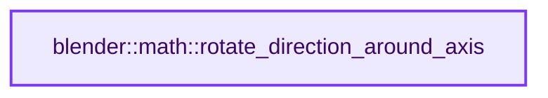
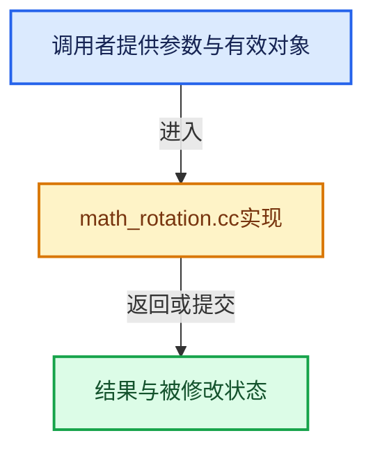

# 实现依赖专题：source/blender/blenlib/intern/math_rotation.cc

[实现依赖导航](../../README.md) · [符号索引](../../../00-课程指南/02-源码与提交索引/符号依赖与实现索引.md)

本专题从正文实际调用进入，集中保存共享实现。函数有稳定锚点，可从调用处直接跳到对应完整函数；递归与互相调用通过回链组织。

## 本文件的实现关系






## 完整成员与函数实现

<a id="f-02597d22527d8aae"></a>

### `blender::math::rotate_direction_around_axis`

实现位置：[source/blender/blenlib/intern/math_rotation.cc](../../../../../../../source/blender/blenlib/intern/math_rotation.cc) · L112—L129。

接口参数：

- `const float3 &direction`
- `const float3 &axis`
- `const float angle`

**教学注释版**

<!-- annotated:9e0002b419a9fb -->

```cpp
float3 rotate_direction_around_axis(const float3 &direction, const float3 &axis, const float angle)
{
  BLI_assert(math::is_unit(axis));

  if (angle == 0.0f || math::is_zero(direction, std::numeric_limits<float>::epsilon()))
      [[unlikely]]
  {
    return direction;
  }

  BLI_assert(math::is_unit(direction));

  const float3 axis_scaled = axis * math::dot(direction, axis);
  const float3 diff = direction - axis_scaled;
  const float3 cross = math::cross(axis, diff);

  return axis_scaled + diff * std::cos(angle) + cross * std::sin(angle);
}
```

<details>
<summary>核对原始源码：source/blender/blenlib/intern/math_rotation.cc · L112—L129</summary>

<!-- original:9e0002b419a9fb:source/blender/blenlib/intern/math_rotation.cc:112:129 -->

```cpp
float3 rotate_direction_around_axis(const float3 &direction, const float3 &axis, const float angle)
{
  BLI_assert(math::is_unit(axis));

  if (angle == 0.0f || math::is_zero(direction, std::numeric_limits<float>::epsilon()))
      [[unlikely]]
  {
    return direction;
  }

  BLI_assert(math::is_unit(direction));

  const float3 axis_scaled = axis * math::dot(direction, axis);
  const float3 diff = direction - axis_scaled;
  const float3 cross = math::cross(axis, diff);

  return axis_scaled + diff * std::cos(angle) + cross * std::sin(angle);
}
```

</details>

**结果出口**

- `return direction;`
- `return axis_scaled + diff * std::cos(angle) + cross * std::sin(angle);`

**继续追踪实现**

- `BLI_assert` → [BLI_assert · L48](../BLI_assert.hh.md#m-57a88495704d)；[BLI_assert · L63](../BLI_assert.hh.md#m-d07050020cb5)。宏定义由构建条件选择。
- `math::is_unit` → [blender::math::is_unit · L812](../BLI_math_vector.hh.md#f-e625d8325f871a0e)。
- `math::is_zero` → [blender::math::is_zero · L784](../BLI_math_vector.hh.md#f-b05b3db842a9f17e)；[blender::math::is_zero · L108](../BLI_math_quaternion.hh.md#f-b97bee3fbc328c0d)；[blender::math::is_zero · L593](../BLI_math_matrix.hh.md#f-b879ac524126b464)；[blender::math::is_zero · L23](../BLI_math_base.hh.md#f-6fdcc74ca7338838)。同名重载需按实参类型选择。
- `std::numeric_limits<float>::epsilon` → [外部契约](https://eel.is/c++draft/)：这个边界按实际表达式及所属类型核对参数、返回值、寿命与失败行为。这里提供接口入口，不声称已解释该第三方版本的内部实现。
- `math::dot` → [blender::math::dot · L430](../BLI_math_vector.hh.md#f-6f0c6a081b107428)；[blender::math::dot · L198](../BLI_math_quaternion.hh.md#f-5b1ef457981dbc76)。同名重载需按实参类型选择。
- `math::cross` → [调用协议](../../../00-课程指南/01-路线与规范/模板宏与动态分派协议.md)：局部可调用对象，须结合其初始化与捕获环境。调用位置L126。
- `std::cos` → [外部契约](https://eel.is/c++draft/)：这个边界按实际表达式及所属类型核对参数、返回值、寿命与失败行为。这里提供接口入口，不声称已解释该第三方版本的内部实现。
- `std::sin` → [外部契约](https://eel.is/c++draft/)：这个边界按实际表达式及所属类型核对参数、返回值、寿命与失败行为。这里提供接口入口，不声称已解释该第三方版本的内部实现。
