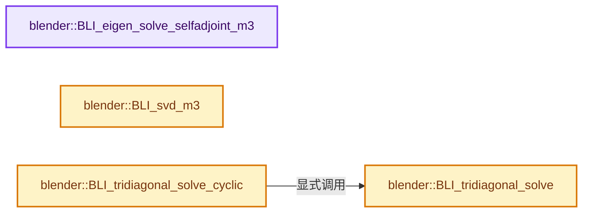
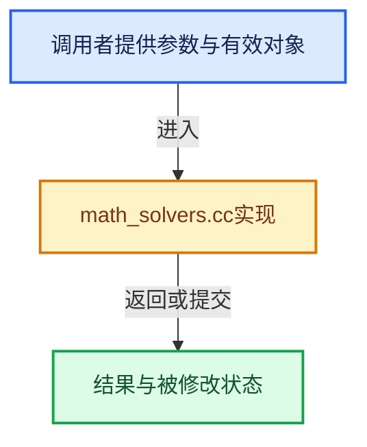

# 实现依赖专题：source/blender/blenlib/intern/math_solvers.cc

[实现依赖导航](../../README.md) · [符号索引](../../../00-课程指南/02-源码与提交索引/符号依赖与实现索引.md)

本专题从正文实际调用进入，集中保存共享实现。函数有稳定锚点，可从调用处直接跳到对应完整函数；递归与互相调用通过回链组织。

## 本文件的实现关系






## 完整成员与函数实现

<a id="f-8ddf24177323925c"></a>

### `blender::BLI_eigen_solve_selfadjoint_m3`

实现位置：[source/blender/blenlib/intern/math_solvers.cc](../../../../../../../source/blender/blenlib/intern/math_solvers.cc) · L29—L44。

接口参数：

- `const float m3[3][3]`
- `float r_eigen_values[3]`
- `float r_eigen_vectors[3][3]`

**教学注释版**

<!-- annotated:88241ad8e58412 -->

```cpp
bool BLI_eigen_solve_selfadjoint_m3(const float m3[3][3],
                                    float r_eigen_values[3],
                                    float r_eigen_vectors[3][3])
{
#ifndef NDEBUG
  /* We must assert given matrix is self-adjoint (i.e. symmetric) */
  if ((m3[0][1] != m3[1][0]) || (m3[0][2] != m3[2][0]) || (m3[1][2] != m3[2][1])) {
    BLI_assert(0);
  }
#endif

  return EIG_self_adjoint_eigen_solve(3,
                                      reinterpret_cast<const float *>(m3),
                                      r_eigen_values,
                                      reinterpret_cast<float *>(r_eigen_vectors));
}
```

<details>
<summary>核对原始源码：source/blender/blenlib/intern/math_solvers.cc · L29—L44</summary>

<!-- original:88241ad8e58412:source/blender/blenlib/intern/math_solvers.cc:29:44 -->

```cpp
bool BLI_eigen_solve_selfadjoint_m3(const float m3[3][3],
                                    float r_eigen_values[3],
                                    float r_eigen_vectors[3][3])
{
#ifndef NDEBUG
  /* We must assert given matrix is self-adjoint (i.e. symmetric) */
  if ((m3[0][1] != m3[1][0]) || (m3[0][2] != m3[2][0]) || (m3[1][2] != m3[2][1])) {
    BLI_assert(0);
  }
#endif

  return EIG_self_adjoint_eigen_solve(3,
                                      reinterpret_cast<const float *>(m3),
                                      r_eigen_values,
                                      reinterpret_cast<float *>(r_eigen_vectors));
}
```

</details>

**结果出口**

- `return EIG_self_adjoint_eigen_solve(3,`

**继续追踪实现**

- `BLI_assert` → [BLI_assert · L48](../BLI_assert.hh.md#m-57a88495704d)；[BLI_assert · L63](../BLI_assert.hh.md#m-d07050020cb5)。宏定义由构建条件选择。
- `EIG_self_adjoint_eigen_solve` → [EIG_self_adjoint_eigen_solve · L26](../../07-Intern运行时与平台/eigen/intern/eigenvalues.cc.md#f-fbaec1be1a205236)。

<a id="f-da457afa6f789535"></a>

### `blender::BLI_svd_m3`

实现位置：[source/blender/blenlib/intern/math_solvers.cc](../../../../../../../source/blender/blenlib/intern/math_solvers.cc) · L46—L53。

接口参数：

- `const float m3[3][3]`
- `float r_U[3][3]`
- `float r_S[3]`
- `float r_V[3][3]`

**教学注释版**

<!-- annotated:ce41cd7abb467f -->

```cpp
void BLI_svd_m3(const float m3[3][3], float r_U[3][3], float r_S[3], float r_V[3][3])
{
  EIG_svd_square_matrix(3,
                        reinterpret_cast<const float *>(m3),
                        reinterpret_cast<float *>(r_U),
                        r_S,
                        reinterpret_cast<float *>(r_V));
}
```

<details>
<summary>核对原始源码：source/blender/blenlib/intern/math_solvers.cc · L46—L53</summary>

<!-- original:ce41cd7abb467f:source/blender/blenlib/intern/math_solvers.cc:46:53 -->

```cpp
void BLI_svd_m3(const float m3[3][3], float r_U[3][3], float r_S[3], float r_V[3][3])
{
  EIG_svd_square_matrix(3,
                        reinterpret_cast<const float *>(m3),
                        reinterpret_cast<float *>(r_U),
                        r_S,
                        reinterpret_cast<float *>(r_V));
}
```

</details>

**继续追踪实现**

- `EIG_svd_square_matrix` → [EIG_svd_square_matrix · L40](../../07-Intern运行时与平台/eigen/intern/svd.cc.md#f-37211379a59aaf7f)。

<a id="f-b992c8cb41dc7aef"></a>

### `blender::BLI_tridiagonal_solve`

实现位置：[source/blender/blenlib/intern/math_solvers.cc](../../../../../../../source/blender/blenlib/intern/math_solvers.cc) · L61—L102。

接口参数：

- `const float *a`
- `const float *b`
- `const float *c`
- `const float *d`
- `float *r_x`
- `const int count`

**教学注释版**

<!-- annotated:f36451528b9756 -->

```cpp
bool BLI_tridiagonal_solve(
    const float *a, const float *b, const float *c, const float *d, float *r_x, const int count)
{
  if (count < 1) {
    return false;
  }

  double *c1 = MEM_new_array_uninitialized<double>(size_t(count) * 2, "tridiagonal_c1d1");
  if (!c1) {
    return false;
  }
  double *d1 = c1 + count;

  int i;
  double c_prev, d_prev, x_prev;

  /* forward pass */

  c1[0] = c_prev = double(c[0]) / b[0];
  d1[0] = d_prev = double(d[0]) / b[0];

  for (i = 1; i < count; i++) {
    double denum = b[i] - a[i] * c_prev;

    c1[i] = c_prev = c[i] / denum;
    d1[i] = d_prev = (d[i] - a[i] * d_prev) / denum;
  }

  /* back pass */

  x_prev = d_prev;
  r_x[--i] = float(x_prev);

  while (--i >= 0) {
    x_prev = d1[i] - c1[i] * x_prev;
    r_x[i] = float(x_prev);
  }

  MEM_delete(c1);

  return isfinite(x_prev);
}
```

<details>
<summary>核对原始源码：source/blender/blenlib/intern/math_solvers.cc · L61—L102</summary>

<!-- original:f36451528b9756:source/blender/blenlib/intern/math_solvers.cc:61:102 -->

```cpp
bool BLI_tridiagonal_solve(
    const float *a, const float *b, const float *c, const float *d, float *r_x, const int count)
{
  if (count < 1) {
    return false;
  }

  double *c1 = MEM_new_array_uninitialized<double>(size_t(count) * 2, "tridiagonal_c1d1");
  if (!c1) {
    return false;
  }
  double *d1 = c1 + count;

  int i;
  double c_prev, d_prev, x_prev;

  /* forward pass */

  c1[0] = c_prev = double(c[0]) / b[0];
  d1[0] = d_prev = double(d[0]) / b[0];

  for (i = 1; i < count; i++) {
    double denum = b[i] - a[i] * c_prev;

    c1[i] = c_prev = c[i] / denum;
    d1[i] = d_prev = (d[i] - a[i] * d_prev) / denum;
  }

  /* back pass */

  x_prev = d_prev;
  r_x[--i] = float(x_prev);

  while (--i >= 0) {
    x_prev = d1[i] - c1[i] * x_prev;
    r_x[i] = float(x_prev);
  }

  MEM_delete(c1);

  return isfinite(x_prev);
}
```

</details>

**沿实际写入检查状态**

- `c1[0] = c_prev = double(c[0]) / b[0];`
- `d1[0] = d_prev = double(d[0]) / b[0];`
- `c1[i] = c_prev = c[i] / denum;`
- `d1[i] = d_prev = (d[i] - a[i] * d_prev) / denum;`
- `x_prev = d_prev;`
- `r_x[--i] = float(x_prev);`
- `x_prev = d1[i] - c1[i] * x_prev;`
- `r_x[i] = float(x_prev);`

**结果出口**

- `return false;`
- `return isfinite(x_prev);`

**继续追踪实现**

- `MEM_new_array_uninitialized<double>` → [MEM_new_array_uninitialized · L608](../../07-Intern运行时与平台/guardedalloc/MEM_guardedalloc.h.md#f-b7103eae8eb57b05)；[MEM_new_array_uninitialized · L129](../../07-Intern运行时与平台/guardedalloc/intern/mallocn.cc.md#f-bf6ef4ddcfb6e5df)。同名重载需按实参类型选择。
- `MEM_delete` → [MEM_delete · L400](../../07-Intern运行时与平台/guardedalloc/MEM_guardedalloc.h.md#f-9049ffdd1682887c)。
- `isfinite` → [isfinite · L125](../../07-Intern运行时与平台/cycles/util/math_base.h.md#m-ec002db2e0ff)。宏定义由构建条件选择。

<a id="f-6a13c9776c16b347"></a>

### `blender::BLI_tridiagonal_solve_cyclic`

实现位置：[source/blender/blenlib/intern/math_solvers.cc](../../../../../../../source/blender/blenlib/intern/math_solvers.cc) · L104—L165。

接口参数：

- `const float *a`
- `const float *b`
- `const float *c`
- `const float *d`
- `float *r_x`
- `const int count`

**教学注释版**

<!-- annotated:c1bf0587988179 -->

```cpp
bool BLI_tridiagonal_solve_cyclic(
    const float *a, const float *b, const float *c, const float *d, float *r_x, const int count)
{
  if (count < 1) {
    return false;
  }

  /* Degenerate case not handled correctly by the generic formula. */
  if (count == 1) {
    r_x[0] = d[0] / (a[0] + b[0] + c[0]);

    return isfinite(r_x[0]);
  }

  /* Degenerate case that works but can be simplified. */
  if (count == 2) {
    const float a2[2] = {0, a[1] + c[1]};
    const float c2[2] = {a[0] + c[0], 0};

    return BLI_tridiagonal_solve(a2, b, c2, d, r_x, count);
  }

  /* If not really cyclic, fall back to the simple solver. */
  float a0 = a[0], cN = c[count - 1];

  if (a0 == 0.0f && cN == 0.0f) {
    return BLI_tridiagonal_solve(a, b, c, d, r_x, count);
  }

  size_t bytes = sizeof(float) * uint(count);
  float *tmp = MEM_new_array_uninitialized<float>(size_t(count) * 2, "tridiagonal_ex");
  if (!tmp) {
    return false;
  }
  float *b2 = tmp + count;

  /* Prepare the non-cyclic system; relies on tridiagonal_solve ignoring values. */
  // [讲解] memcpy：复制字节，源与目标不应重叠。类型生命周期、对齐和可复制表示须由调用者证明，不是任意对象的复制构造。
  memcpy(b2, b, bytes);
  b2[0] -= a0;
  b2[count - 1] -= cN;

  // [讲解] memset：填充字节，不调用T构造函数，也不保证任意类型的全零表示是合法或期望值。
  memset(tmp, 0, bytes);
  tmp[0] = a0;
  tmp[count - 1] = cN;

  /* solve for partial solution and adjustment vector */
  bool success = BLI_tridiagonal_solve(a, b2, c, tmp, tmp, count) &&
                 BLI_tridiagonal_solve(a, b2, c, d, r_x, count);

  /* apply adjustment */
  if (success) {
    float coeff = (r_x[0] + r_x[count - 1]) / (1.0f + tmp[0] + tmp[count - 1]);

    for (int i = 0; i < count; i++) {
      r_x[i] -= coeff * tmp[i];
    }
  }

  MEM_delete(tmp);

  return success;
}
```

<details>
<summary>核对原始源码：source/blender/blenlib/intern/math_solvers.cc · L104—L165</summary>

<!-- original:c1bf0587988179:source/blender/blenlib/intern/math_solvers.cc:104:165 -->

```cpp
bool BLI_tridiagonal_solve_cyclic(
    const float *a, const float *b, const float *c, const float *d, float *r_x, const int count)
{
  if (count < 1) {
    return false;
  }

  /* Degenerate case not handled correctly by the generic formula. */
  if (count == 1) {
    r_x[0] = d[0] / (a[0] + b[0] + c[0]);

    return isfinite(r_x[0]);
  }

  /* Degenerate case that works but can be simplified. */
  if (count == 2) {
    const float a2[2] = {0, a[1] + c[1]};
    const float c2[2] = {a[0] + c[0], 0};

    return BLI_tridiagonal_solve(a2, b, c2, d, r_x, count);
  }

  /* If not really cyclic, fall back to the simple solver. */
  float a0 = a[0], cN = c[count - 1];

  if (a0 == 0.0f && cN == 0.0f) {
    return BLI_tridiagonal_solve(a, b, c, d, r_x, count);
  }

  size_t bytes = sizeof(float) * uint(count);
  float *tmp = MEM_new_array_uninitialized<float>(size_t(count) * 2, "tridiagonal_ex");
  if (!tmp) {
    return false;
  }
  float *b2 = tmp + count;

  /* Prepare the non-cyclic system; relies on tridiagonal_solve ignoring values. */
  memcpy(b2, b, bytes);
  b2[0] -= a0;
  b2[count - 1] -= cN;

  memset(tmp, 0, bytes);
  tmp[0] = a0;
  tmp[count - 1] = cN;

  /* solve for partial solution and adjustment vector */
  bool success = BLI_tridiagonal_solve(a, b2, c, tmp, tmp, count) &&
                 BLI_tridiagonal_solve(a, b2, c, d, r_x, count);

  /* apply adjustment */
  if (success) {
    float coeff = (r_x[0] + r_x[count - 1]) / (1.0f + tmp[0] + tmp[count - 1]);

    for (int i = 0; i < count; i++) {
      r_x[i] -= coeff * tmp[i];
    }
  }

  MEM_delete(tmp);

  return success;
}
```

</details>

**沿实际写入检查状态**

- `r_x[0] = d[0] / (a[0] + b[0] + c[0]);`
- `b2[0] -= a0;`
- `tmp[0] = a0;`
- `r_x[i] -= coeff * tmp[i];`

**结果出口**

- `return false;`
- `return isfinite(r_x[0]);`
- `return BLI_tridiagonal_solve(a2, b, c2, d, r_x, count);`
- `return BLI_tridiagonal_solve(a, b, c, d, r_x, count);`
- `return success;`

**继续追踪实现**

- `isfinite` → [isfinite · L125](../../07-Intern运行时与平台/cycles/util/math_base.h.md#m-ec002db2e0ff)。宏定义由构建条件选择。
- `BLI_tridiagonal_solve` → [blender::BLI_tridiagonal_solve · L61](math_solvers.cc.md#f-b992c8cb41dc7aef)。
- `MEM_new_array_uninitialized<float>` → [MEM_new_array_uninitialized · L608](../../07-Intern运行时与平台/guardedalloc/MEM_guardedalloc.h.md#f-b7103eae8eb57b05)；[MEM_new_array_uninitialized · L129](../../07-Intern运行时与平台/guardedalloc/intern/mallocn.cc.md#f-bf6ef4ddcfb6e5df)。同名重载需按实参类型选择。
- `memcpy` → [外部契约](https://eel.is/c++draft/cstring.syn)：复制字节，源与目标不应重叠。类型生命周期、对齐和可复制表示须由调用者证明，不是任意对象的复制构造。
- `memset` → [外部契约](https://eel.is/c++draft/cstring.syn)：填充字节，不调用T构造函数，也不保证任意类型的全零表示是合法或期望值。
- `MEM_delete` → [MEM_delete · L400](../../07-Intern运行时与平台/guardedalloc/MEM_guardedalloc.h.md#f-9049ffdd1682887c)。
