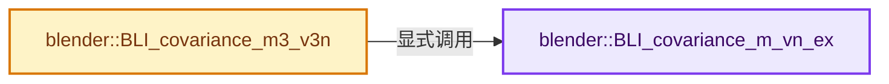

# 实现依赖专题：source/blender/blenlib/intern/math_statistics.cc

[实现依赖导航](../../README.md) · [符号索引](../../../00-课程指南/02-源码与提交索引/符号依赖与实现索引.md)

本专题从正文实际调用进入，集中保存共享实现。函数有稳定锚点，可从调用处直接跳到对应完整函数；递归与互相调用通过回链组织。

## 本文件的实现关系




## 完整成员与函数实现

<a id="f-abccffcb970d59f7"></a>

### `blender::BLI_covariance_m_vn_ex`

实现位置：[source/blender/blenlib/intern/math_statistics.cc](../../../../../../../source/blender/blenlib/intern/math_statistics.cc) · L79—L105。

接口参数：

- `const int n`
- `const float *cos_vn`
- `const int cos_vn_num`
- `const float *center`
- `const bool use_sample_correction`
- `float *r_covmat`

**教学注释版**

<!-- annotated:2748aaf9307b22 -->

```cpp
void BLI_covariance_m_vn_ex(const int n,
                            const float *cos_vn,
                            const int cos_vn_num,
                            const float *center,
                            const bool use_sample_correction,
                            float *r_covmat)
{
  /* Note about that division: see https://en.wikipedia.org/wiki/Bessel%27s_correction.
   * In a nutshell, it must be 1 / (n - 1) for 'sample data', and 1 / n for 'population data'...
   */
  const float covfac = 1.0f / float(use_sample_correction ? cos_vn_num - 1 : cos_vn_num);

  // [讲解] memset：填充字节，不调用T构造函数，也不保证任意类型的全零表示是合法或期望值。
  memset(r_covmat, 0, sizeof(*r_covmat) * size_t(n * n));

  CovarianceData data{};
  data.cos_vn = cos_vn;
  data.center = center;
  data.r_covmat = r_covmat;
  data.covfac = covfac;
  data.n = n;
  data.cos_vn_num = cos_vn_num;

  TaskParallelSettings settings;
  BLI_parallel_range_settings_defaults(&settings);
  settings.use_threading = ((cos_vn_num * n * n) >= 10000);
  BLI_task_parallel_range(0, n * n, &data, covariance_m_vn_ex_task_cb, &settings);
}
```

<details>
<summary>核对原始源码：source/blender/blenlib/intern/math_statistics.cc · L79—L105</summary>

<!-- original:2748aaf9307b22:source/blender/blenlib/intern/math_statistics.cc:79:105 -->

```cpp
void BLI_covariance_m_vn_ex(const int n,
                            const float *cos_vn,
                            const int cos_vn_num,
                            const float *center,
                            const bool use_sample_correction,
                            float *r_covmat)
{
  /* Note about that division: see https://en.wikipedia.org/wiki/Bessel%27s_correction.
   * In a nutshell, it must be 1 / (n - 1) for 'sample data', and 1 / n for 'population data'...
   */
  const float covfac = 1.0f / float(use_sample_correction ? cos_vn_num - 1 : cos_vn_num);

  memset(r_covmat, 0, sizeof(*r_covmat) * size_t(n * n));

  CovarianceData data{};
  data.cos_vn = cos_vn;
  data.center = center;
  data.r_covmat = r_covmat;
  data.covfac = covfac;
  data.n = n;
  data.cos_vn_num = cos_vn_num;

  TaskParallelSettings settings;
  BLI_parallel_range_settings_defaults(&settings);
  settings.use_threading = ((cos_vn_num * n * n) >= 10000);
  BLI_task_parallel_range(0, n * n, &data, covariance_m_vn_ex_task_cb, &settings);
}
```

</details>

**沿实际写入检查状态**

- `data.cos_vn = cos_vn;`
- `data.center = center;`
- `data.r_covmat = r_covmat;`
- `data.covfac = covfac;`
- `data.n = n;`
- `data.cos_vn_num = cos_vn_num;`
- `settings.use_threading = ((cos_vn_num * n * n) >= 10000);`

**继续追踪实现**

- `memset` → [外部契约](https://eel.is/c++draft/cstring.syn)：填充字节，不调用T构造函数，也不保证任意类型的全零表示是合法或期望值。
- `BLI_parallel_range_settings_defaults` → [blender::BLI_parallel_range_settings_defaults · L218](../BLI_task_c.hh.md#f-3858ad801a98e123)。
- `BLI_task_parallel_range` → [blender::BLI_task_parallel_range · L101](../../../11-Depsgraph与并行任务系统/08-任务隔离死锁与实战.md#f-9d237d7e4e78d7e2)。

<a id="f-de80a92b365e8484"></a>

### `blender::BLI_covariance_m3_v3n`

实现位置：[source/blender/blenlib/intern/math_statistics.cc](../../../../../../../source/blender/blenlib/intern/math_statistics.cc) · L107—L133。

接口参数：

- `const float (*cos_v3)[3]`
- `const int cos_v3_num`
- `const bool use_sample_correction`
- `float r_covmat[3][3]`
- `float r_center[3]`

**教学注释版**

<!-- annotated:38a51012ea258a -->

```cpp
void BLI_covariance_m3_v3n(const float (*cos_v3)[3],
                           const int cos_v3_num,
                           const bool use_sample_correction,
                           float r_covmat[3][3],
                           float r_center[3])
{
  float center[3];
  const float mean_fac = 1.0f / float(cos_v3_num);
  int i;

  zero_v3(center);
  for (i = 0; i < cos_v3_num; i++) {
    /* Applying mean_fac here rather than once at the end reduce compute errors... */
    madd_v3_v3fl(center, cos_v3[i], mean_fac);
  }

  if (r_center) {
    copy_v3_v3(r_center, center);
  }

  BLI_covariance_m_vn_ex(3,
                         reinterpret_cast<const float *>(cos_v3),
                         cos_v3_num,
                         center,
                         use_sample_correction,
                         reinterpret_cast<float *>(r_covmat));
}
```

<details>
<summary>核对原始源码：source/blender/blenlib/intern/math_statistics.cc · L107—L133</summary>

<!-- original:38a51012ea258a:source/blender/blenlib/intern/math_statistics.cc:107:133 -->

```cpp
void BLI_covariance_m3_v3n(const float (*cos_v3)[3],
                           const int cos_v3_num,
                           const bool use_sample_correction,
                           float r_covmat[3][3],
                           float r_center[3])
{
  float center[3];
  const float mean_fac = 1.0f / float(cos_v3_num);
  int i;

  zero_v3(center);
  for (i = 0; i < cos_v3_num; i++) {
    /* Applying mean_fac here rather than once at the end reduce compute errors... */
    madd_v3_v3fl(center, cos_v3[i], mean_fac);
  }

  if (r_center) {
    copy_v3_v3(r_center, center);
  }

  BLI_covariance_m_vn_ex(3,
                         reinterpret_cast<const float *>(cos_v3),
                         cos_v3_num,
                         center,
                         use_sample_correction,
                         reinterpret_cast<float *>(r_covmat));
}
```

</details>

**继续追踪实现**

- `zero_v3` → [blender::zero_v3 · L26](math_vector_inline.cc.md#f-13235b08fdecb098)。
- `madd_v3_v3fl` → [blender::madd_v3_v3fl · L501](math_vector_inline.cc.md#f-4f81667c5d595c80)。
- `copy_v3_v3` → [blender::copy_v3_v3 · L47](math_vector_inline.cc.md#f-037a0d5fa5060bd6)。
- `BLI_covariance_m_vn_ex` → [blender::BLI_covariance_m_vn_ex · L79](math_statistics.cc.md#f-abccffcb970d59f7)。
