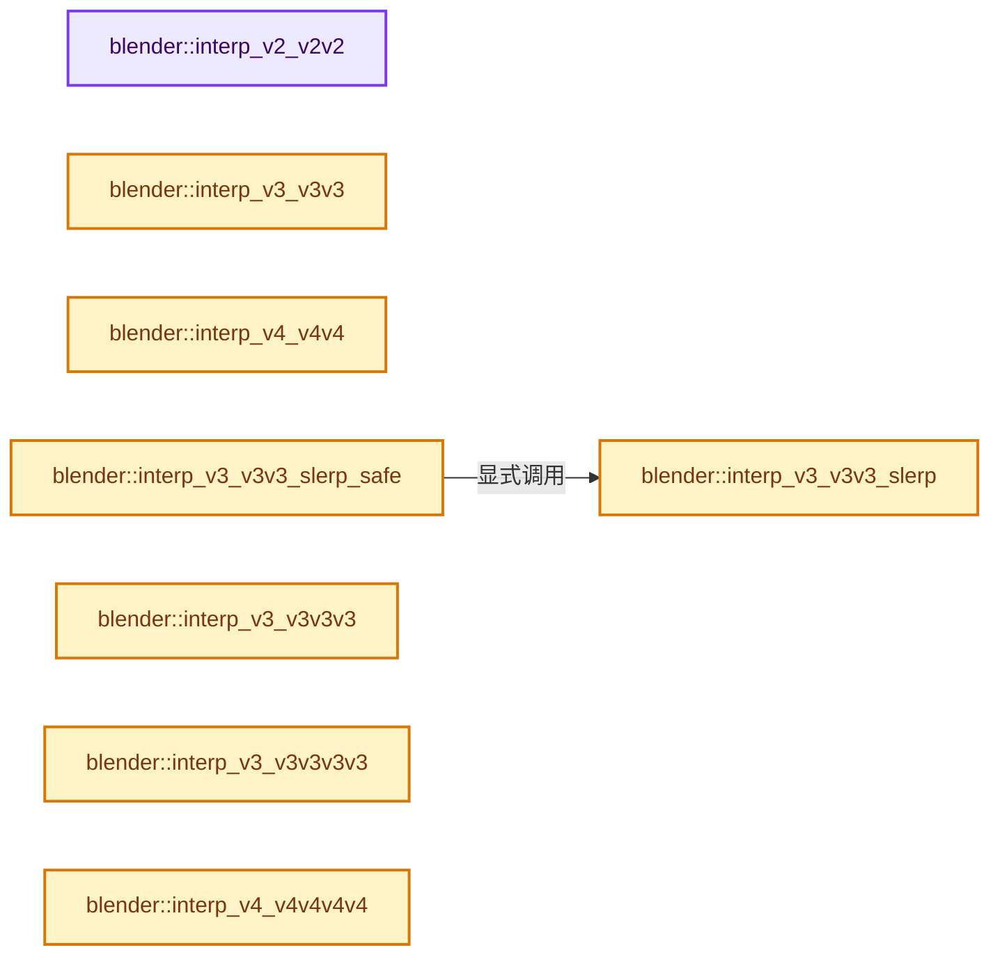
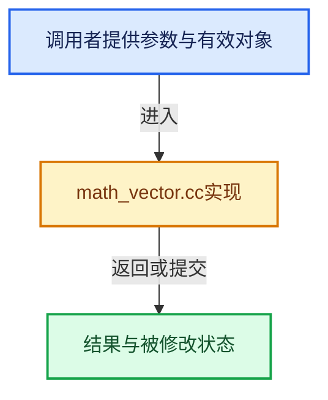

# 实现依赖专题：source/blender/blenlib/intern/math_vector.cc

[实现依赖导航](../../README.md) · [符号索引](../../../00-课程指南/02-源码与提交索引/符号依赖与实现索引.md)

本专题从正文实际调用进入，集中保存共享实现。函数有稳定锚点，可从调用处直接跳到对应完整函数；递归与互相调用通过回链组织。

## 本文件的实现关系






## 完整成员与函数实现

<a id="f-20d77926433c82d6"></a>

### `blender::interp_v2_v2v2`

实现位置：[source/blender/blenlib/intern/math_vector.cc](../../../../../../../source/blender/blenlib/intern/math_vector.cc) · L26—L32。

接口参数：

- `float r[2]`
- `const float a[2]`
- `const float b[2]`
- `const float t`

**教学注释版**

<!-- annotated:efb9454401ea43 -->

```cpp
void interp_v2_v2v2(float r[2], const float a[2], const float b[2], const float t)
{
  const float s = 1.0f - t;

  r[0] = s * a[0] + t * b[0];
  r[1] = s * a[1] + t * b[1];
}
```

<details>
<summary>核对原始源码：source/blender/blenlib/intern/math_vector.cc · L26—L32</summary>

<!-- original:efb9454401ea43:source/blender/blenlib/intern/math_vector.cc:26:32 -->

```cpp
void interp_v2_v2v2(float r[2], const float a[2], const float b[2], const float t)
{
  const float s = 1.0f - t;

  r[0] = s * a[0] + t * b[0];
  r[1] = s * a[1] + t * b[1];
}
```

</details>

**沿实际写入检查状态**

- `r[0] = s * a[0] + t * b[0];`
- `r[1] = s * a[1] + t * b[1];`

**继续追踪实现**

本实现没有需要继续展开的显式调用；检查返回表达式、对象转换和调用者前置条件。

<a id="f-18251c70c00824d7"></a>

### `blender::interp_v3_v3v3`

实现位置：[source/blender/blenlib/intern/math_vector.cc](../../../../../../../source/blender/blenlib/intern/math_vector.cc) · L41—L48。

接口参数：

- `float r[3]`
- `const float a[3]`
- `const float b[3]`
- `const float t`

**教学注释版**

<!-- annotated:aa909cecb00264 -->

```cpp
void interp_v3_v3v3(float r[3], const float a[3], const float b[3], const float t)
{
  const float s = 1.0f - t;

  r[0] = s * a[0] + t * b[0];
  r[1] = s * a[1] + t * b[1];
  r[2] = s * a[2] + t * b[2];
}
```

<details>
<summary>核对原始源码：source/blender/blenlib/intern/math_vector.cc · L41—L48</summary>

<!-- original:aa909cecb00264:source/blender/blenlib/intern/math_vector.cc:41:48 -->

```cpp
void interp_v3_v3v3(float r[3], const float a[3], const float b[3], const float t)
{
  const float s = 1.0f - t;

  r[0] = s * a[0] + t * b[0];
  r[1] = s * a[1] + t * b[1];
  r[2] = s * a[2] + t * b[2];
}
```

</details>

**沿实际写入检查状态**

- `r[0] = s * a[0] + t * b[0];`
- `r[1] = s * a[1] + t * b[1];`
- `r[2] = s * a[2] + t * b[2];`

**继续追踪实现**

本实现没有需要继续展开的显式调用；检查返回表达式、对象转换和调用者前置条件。

<a id="f-922b4ce22bd7c0c7"></a>

### `blender::interp_v4_v4v4`

实现位置：[source/blender/blenlib/intern/math_vector.cc](../../../../../../../source/blender/blenlib/intern/math_vector.cc) · L50—L58。

接口参数：

- `float r[4]`
- `const float a[4]`
- `const float b[4]`
- `const float t`

**教学注释版**

<!-- annotated:6301cd248879e0 -->

```cpp
void interp_v4_v4v4(float r[4], const float a[4], const float b[4], const float t)
{
  const float s = 1.0f - t;

  r[0] = s * a[0] + t * b[0];
  r[1] = s * a[1] + t * b[1];
  r[2] = s * a[2] + t * b[2];
  r[3] = s * a[3] + t * b[3];
}
```

<details>
<summary>核对原始源码：source/blender/blenlib/intern/math_vector.cc · L50—L58</summary>

<!-- original:6301cd248879e0:source/blender/blenlib/intern/math_vector.cc:50:58 -->

```cpp
void interp_v4_v4v4(float r[4], const float a[4], const float b[4], const float t)
{
  const float s = 1.0f - t;

  r[0] = s * a[0] + t * b[0];
  r[1] = s * a[1] + t * b[1];
  r[2] = s * a[2] + t * b[2];
  r[3] = s * a[3] + t * b[3];
}
```

</details>

**沿实际写入检查状态**

- `r[0] = s * a[0] + t * b[0];`
- `r[1] = s * a[1] + t * b[1];`
- `r[2] = s * a[2] + t * b[2];`
- `r[3] = s * a[3] + t * b[3];`

**继续追踪实现**

本实现没有需要继续展开的显式调用；检查返回表达式、对象转换和调用者前置条件。

<a id="f-95c438346b25ea33"></a>

### `blender::interp_v3_v3v3_slerp`

实现位置：[source/blender/blenlib/intern/math_vector.cc](../../../../../../../source/blender/blenlib/intern/math_vector.cc) · L60—L81。

接口参数：

- `float target[3]`
- `const float a[3]`
- `const float b[3]`
- `const float t`

**教学注释版**

<!-- annotated:c32be04125dab4 -->

```cpp
bool interp_v3_v3v3_slerp(float target[3], const float a[3], const float b[3], const float t)
{
  float cosom, w[2];

  BLI_ASSERT_UNIT_V3(a);
  BLI_ASSERT_UNIT_V3(b);

  cosom = dot_v3v3(a, b);

  /* direct opposites */
  if (cosom < (-1.0f + FLT_EPSILON)) [[unlikely]] {
    return false;
  }

  interp_dot_slerp(t, cosom, w);

  target[0] = w[0] * a[0] + w[1] * b[0];
  target[1] = w[0] * a[1] + w[1] * b[1];
  target[2] = w[0] * a[2] + w[1] * b[2];

  return true;
}
```

<details>
<summary>核对原始源码：source/blender/blenlib/intern/math_vector.cc · L60—L81</summary>

<!-- original:c32be04125dab4:source/blender/blenlib/intern/math_vector.cc:60:81 -->

```cpp
bool interp_v3_v3v3_slerp(float target[3], const float a[3], const float b[3], const float t)
{
  float cosom, w[2];

  BLI_ASSERT_UNIT_V3(a);
  BLI_ASSERT_UNIT_V3(b);

  cosom = dot_v3v3(a, b);

  /* direct opposites */
  if (cosom < (-1.0f + FLT_EPSILON)) [[unlikely]] {
    return false;
  }

  interp_dot_slerp(t, cosom, w);

  target[0] = w[0] * a[0] + w[1] * b[0];
  target[1] = w[0] * a[1] + w[1] * b[1];
  target[2] = w[0] * a[2] + w[1] * b[2];

  return true;
}
```

</details>

**沿实际写入检查状态**

- `cosom = dot_v3v3(a, b);`
- `target[0] = w[0] * a[0] + w[1] * b[0];`
- `target[1] = w[0] * a[1] + w[1] * b[1];`
- `target[2] = w[0] * a[2] + w[1] * b[2];`

**结果出口**

- `return false;`
- `return true;`

**继续追踪实现**

- `BLI_ASSERT_UNIT_V3` → [BLI_ASSERT_UNIT_V3 · L315](../BLI_math_base_c.hh.md#m-7f347402189a)；[BLI_ASSERT_UNIT_V3 · L359](../BLI_math_base_c.hh.md#m-fe91af053d50)。宏定义由构建条件选择。
- `dot_v3v3` → [blender::dot_v3v3 · L646](math_vector_inline.cc.md#f-c88befa67d07591a)。
- `interp_dot_slerp` → [blender::interp_dot_slerp · L878](math_rotation_c.cc.md#f-77f9f143c4f3bac9)。

<a id="f-34fc9501dccd76ff"></a>

### `blender::interp_v3_v3v3_slerp_safe`

实现位置：[source/blender/blenlib/intern/math_vector.cc](../../../../../../../source/blender/blenlib/intern/math_vector.cc) · L83—L103。

接口参数：

- `float target[3]`
- `const float a[3]`
- `const float b[3]`
- `const float t`

**教学注释版**

<!-- annotated:9ac8482f556245 -->

```cpp
void interp_v3_v3v3_slerp_safe(float target[3], const float a[3], const float b[3], const float t)
{
  if (!interp_v3_v3v3_slerp(target, a, b, t)) [[unlikely]] {
    /* Axis are aligned so any orthogonal vector is acceptable. */
    float ab_ortho[3];
    ortho_v3_v3(ab_ortho, a);
    normalize_v3(ab_ortho);
    if (t < 0.5f) {
      if (!interp_v3_v3v3_slerp(target, a, ab_ortho, t * 2.0f)) [[unlikely]] {
        BLI_assert(0);
        copy_v3_v3(target, a);
      }
    }
    else {
      if (!interp_v3_v3v3_slerp(target, ab_ortho, b, (t - 0.5f) * 2.0f)) [[unlikely]] {
        BLI_assert(0);
        copy_v3_v3(target, b);
      }
    }
  }
}
```

<details>
<summary>核对原始源码：source/blender/blenlib/intern/math_vector.cc · L83—L103</summary>

<!-- original:9ac8482f556245:source/blender/blenlib/intern/math_vector.cc:83:103 -->

```cpp
void interp_v3_v3v3_slerp_safe(float target[3], const float a[3], const float b[3], const float t)
{
  if (!interp_v3_v3v3_slerp(target, a, b, t)) [[unlikely]] {
    /* Axis are aligned so any orthogonal vector is acceptable. */
    float ab_ortho[3];
    ortho_v3_v3(ab_ortho, a);
    normalize_v3(ab_ortho);
    if (t < 0.5f) {
      if (!interp_v3_v3v3_slerp(target, a, ab_ortho, t * 2.0f)) [[unlikely]] {
        BLI_assert(0);
        copy_v3_v3(target, a);
      }
    }
    else {
      if (!interp_v3_v3v3_slerp(target, ab_ortho, b, (t - 0.5f) * 2.0f)) [[unlikely]] {
        BLI_assert(0);
        copy_v3_v3(target, b);
      }
    }
  }
}
```

</details>

**继续追踪实现**

- `interp_v3_v3v3_slerp` → [blender::interp_v3_v3v3_slerp · L60](math_vector.cc.md#f-95c438346b25ea33)。
- `ortho_v3_v3` → [blender::ortho_v3_v3 · L593](math_vector.cc.md#f-9d97c1f8835dda73)。
- `normalize_v3` → [blender::normalize_v3 · L933](math_vector_inline.cc.md#f-5f3257e657ef732c)。
- `BLI_assert` → [BLI_assert · L48](../BLI_assert.hh.md#m-57a88495704d)；[BLI_assert · L63](../BLI_assert.hh.md#m-d07050020cb5)。宏定义由构建条件选择。
- `copy_v3_v3` → [blender::copy_v3_v3 · L47](math_vector_inline.cc.md#f-037a0d5fa5060bd6)。

<a id="f-0fb20179582c2218"></a>

### `blender::interp_v3_v3v3v3`

实现位置：[source/blender/blenlib/intern/math_vector.cc](../../../../../../../source/blender/blenlib/intern/math_vector.cc) · L124—L130。

接口参数：

- `float p[3]`
- `const float v1[3]`
- `const float v2[3]`
- `const float v3[3]`
- `const float w[3]`

**教学注释版**

<!-- annotated:cfbbeb7e31faa3 -->

```cpp
void interp_v3_v3v3v3(
    float p[3], const float v1[3], const float v2[3], const float v3[3], const float w[3])
{
  p[0] = v1[0] * w[0] + v2[0] * w[1] + v3[0] * w[2];
  p[1] = v1[1] * w[0] + v2[1] * w[1] + v3[1] * w[2];
  p[2] = v1[2] * w[0] + v2[2] * w[1] + v3[2] * w[2];
}
```

<details>
<summary>核对原始源码：source/blender/blenlib/intern/math_vector.cc · L124—L130</summary>

<!-- original:cfbbeb7e31faa3:source/blender/blenlib/intern/math_vector.cc:124:130 -->

```cpp
void interp_v3_v3v3v3(
    float p[3], const float v1[3], const float v2[3], const float v3[3], const float w[3])
{
  p[0] = v1[0] * w[0] + v2[0] * w[1] + v3[0] * w[2];
  p[1] = v1[1] * w[0] + v2[1] * w[1] + v3[1] * w[2];
  p[2] = v1[2] * w[0] + v2[2] * w[1] + v3[2] * w[2];
}
```

</details>

**沿实际写入检查状态**

- `p[0] = v1[0] * w[0] + v2[0] * w[1] + v3[0] * w[2];`
- `p[1] = v1[1] * w[0] + v2[1] * w[1] + v3[1] * w[2];`
- `p[2] = v1[2] * w[0] + v2[2] * w[1] + v3[2] * w[2];`

**继续追踪实现**

本实现没有需要继续展开的显式调用；检查返回表达式、对象转换和调用者前置条件。

<a id="f-44d0171aa9d69326"></a>

### `blender::interp_v3_v3v3v3v3`

实现位置：[source/blender/blenlib/intern/math_vector.cc](../../../../../../../source/blender/blenlib/intern/math_vector.cc) · L132—L142。

接口参数：

- `float p[3]`
- `const float v1[3]`
- `const float v2[3]`
- `const float v3[3]`
- `const float v4[3]`
- `const float w[4]`

**教学注释版**

<!-- annotated:8a78d3f05dbd36 -->

```cpp
void interp_v3_v3v3v3v3(float p[3],
                        const float v1[3],
                        const float v2[3],
                        const float v3[3],
                        const float v4[3],
                        const float w[4])
{
  p[0] = v1[0] * w[0] + v2[0] * w[1] + v3[0] * w[2] + v4[0] * w[3];
  p[1] = v1[1] * w[0] + v2[1] * w[1] + v3[1] * w[2] + v4[1] * w[3];
  p[2] = v1[2] * w[0] + v2[2] * w[1] + v3[2] * w[2] + v4[2] * w[3];
}
```

<details>
<summary>核对原始源码：source/blender/blenlib/intern/math_vector.cc · L132—L142</summary>

<!-- original:8a78d3f05dbd36:source/blender/blenlib/intern/math_vector.cc:132:142 -->

```cpp
void interp_v3_v3v3v3v3(float p[3],
                        const float v1[3],
                        const float v2[3],
                        const float v3[3],
                        const float v4[3],
                        const float w[4])
{
  p[0] = v1[0] * w[0] + v2[0] * w[1] + v3[0] * w[2] + v4[0] * w[3];
  p[1] = v1[1] * w[0] + v2[1] * w[1] + v3[1] * w[2] + v4[1] * w[3];
  p[2] = v1[2] * w[0] + v2[2] * w[1] + v3[2] * w[2] + v4[2] * w[3];
}
```

</details>

**沿实际写入检查状态**

- `p[0] = v1[0] * w[0] + v2[0] * w[1] + v3[0] * w[2] + v4[0] * w[3];`
- `p[1] = v1[1] * w[0] + v2[1] * w[1] + v3[1] * w[2] + v4[1] * w[3];`
- `p[2] = v1[2] * w[0] + v2[2] * w[1] + v3[2] * w[2] + v4[2] * w[3];`

**继续追踪实现**

本实现没有需要继续展开的显式调用；检查返回表达式、对象转换和调用者前置条件。

<a id="f-c54e9b55e588ef02"></a>

### `blender::interp_v4_v4v4v4v4`

实现位置：[source/blender/blenlib/intern/math_vector.cc](../../../../../../../source/blender/blenlib/intern/math_vector.cc) · L153—L164。

接口参数：

- `float p[4]`
- `const float v1[4]`
- `const float v2[4]`
- `const float v3[4]`
- `const float v4[4]`
- `const float w[4]`

**教学注释版**

<!-- annotated:f93af92443e1f3 -->

```cpp
void interp_v4_v4v4v4v4(float p[4],
                        const float v1[4],
                        const float v2[4],
                        const float v3[4],
                        const float v4[4],
                        const float w[4])
{
  p[0] = v1[0] * w[0] + v2[0] * w[1] + v3[0] * w[2] + v4[0] * w[3];
  p[1] = v1[1] * w[0] + v2[1] * w[1] + v3[1] * w[2] + v4[1] * w[3];
  p[2] = v1[2] * w[0] + v2[2] * w[1] + v3[2] * w[2] + v4[2] * w[3];
  p[3] = v1[3] * w[0] + v2[3] * w[1] + v3[3] * w[2] + v4[3] * w[3];
}
```

<details>
<summary>核对原始源码：source/blender/blenlib/intern/math_vector.cc · L153—L164</summary>

<!-- original:f93af92443e1f3:source/blender/blenlib/intern/math_vector.cc:153:164 -->

```cpp
void interp_v4_v4v4v4v4(float p[4],
                        const float v1[4],
                        const float v2[4],
                        const float v3[4],
                        const float v4[4],
                        const float w[4])
{
  p[0] = v1[0] * w[0] + v2[0] * w[1] + v3[0] * w[2] + v4[0] * w[3];
  p[1] = v1[1] * w[0] + v2[1] * w[1] + v3[1] * w[2] + v4[1] * w[3];
  p[2] = v1[2] * w[0] + v2[2] * w[1] + v3[2] * w[2] + v4[2] * w[3];
  p[3] = v1[3] * w[0] + v2[3] * w[1] + v3[3] * w[2] + v4[3] * w[3];
}
```

</details>

**沿实际写入检查状态**

- `p[0] = v1[0] * w[0] + v2[0] * w[1] + v3[0] * w[2] + v4[0] * w[3];`
- `p[1] = v1[1] * w[0] + v2[1] * w[1] + v3[1] * w[2] + v4[1] * w[3];`
- `p[2] = v1[2] * w[0] + v2[2] * w[1] + v3[2] * w[2] + v4[2] * w[3];`
- `p[3] = v1[3] * w[0] + v2[3] * w[1] + v3[3] * w[2] + v4[3] * w[3];`

**继续追踪实现**

本实现没有需要继续展开的显式调用；检查返回表达式、对象转换和调用者前置条件。

<a id="f-722a988a221ad545"></a>

### `blender::interp_v3_v3v3v3_uv`

实现位置：[source/blender/blenlib/intern/math_vector.cc](../../../../../../../source/blender/blenlib/intern/math_vector.cc) · L166—L172。

接口参数：

- `float p[3]`
- `const float v1[3]`
- `const float v2[3]`
- `const float v3[3]`
- `const float uv[2]`

**教学注释版**

<!-- annotated:fc582ca4c735dd -->

```cpp
void interp_v3_v3v3v3_uv(
    float p[3], const float v1[3], const float v2[3], const float v3[3], const float uv[2])
{
  p[0] = v1[0] + ((v2[0] - v1[0]) * uv[0]) + ((v3[0] - v1[0]) * uv[1]);
  p[1] = v1[1] + ((v2[1] - v1[1]) * uv[0]) + ((v3[1] - v1[1]) * uv[1]);
  p[2] = v1[2] + ((v2[2] - v1[2]) * uv[0]) + ((v3[2] - v1[2]) * uv[1]);
}
```

<details>
<summary>核对原始源码：source/blender/blenlib/intern/math_vector.cc · L166—L172</summary>

<!-- original:fc582ca4c735dd:source/blender/blenlib/intern/math_vector.cc:166:172 -->

```cpp
void interp_v3_v3v3v3_uv(
    float p[3], const float v1[3], const float v2[3], const float v3[3], const float uv[2])
{
  p[0] = v1[0] + ((v2[0] - v1[0]) * uv[0]) + ((v3[0] - v1[0]) * uv[1]);
  p[1] = v1[1] + ((v2[1] - v1[1]) * uv[0]) + ((v3[1] - v1[1]) * uv[1]);
  p[2] = v1[2] + ((v2[2] - v1[2]) * uv[0]) + ((v3[2] - v1[2]) * uv[1]);
}
```

</details>

**沿实际写入检查状态**

- `p[0] = v1[0] + ((v2[0] - v1[0]) * uv[0]) + ((v3[0] - v1[0]) * uv[1]);`
- `p[1] = v1[1] + ((v2[1] - v1[1]) * uv[0]) + ((v3[1] - v1[1]) * uv[1]);`
- `p[2] = v1[2] + ((v2[2] - v1[2]) * uv[0]) + ((v3[2] - v1[2]) * uv[1]);`

**继续追踪实现**

本实现没有需要继续展开的显式调用；检查返回表达式、对象转换和调用者前置条件。

<a id="f-b748c1b0b472ad9b"></a>

### `blender::mid_v3_v3v3`

实现位置：[source/blender/blenlib/intern/math_vector.cc](../../../../../../../source/blender/blenlib/intern/math_vector.cc) · L183—L188。

接口参数：

- `float r[3]`
- `const float a[3]`
- `const float b[3]`

**教学注释版**

<!-- annotated:42f9393f579116 -->

```cpp
void mid_v3_v3v3(float r[3], const float a[3], const float b[3])
{
  r[0] = 0.5f * (a[0] + b[0]);
  r[1] = 0.5f * (a[1] + b[1]);
  r[2] = 0.5f * (a[2] + b[2]);
}
```

<details>
<summary>核对原始源码：source/blender/blenlib/intern/math_vector.cc · L183—L188</summary>

<!-- original:42f9393f579116:source/blender/blenlib/intern/math_vector.cc:183:188 -->

```cpp
void mid_v3_v3v3(float r[3], const float a[3], const float b[3])
{
  r[0] = 0.5f * (a[0] + b[0]);
  r[1] = 0.5f * (a[1] + b[1]);
  r[2] = 0.5f * (a[2] + b[2]);
}
```

</details>

**沿实际写入检查状态**

- `r[0] = 0.5f * (a[0] + b[0]);`
- `r[1] = 0.5f * (a[1] + b[1]);`
- `r[2] = 0.5f * (a[2] + b[2]);`

**继续追踪实现**

本实现没有需要继续展开的显式调用；检查返回表达式、对象转换和调用者前置条件。

<a id="f-f156931a76864a2b"></a>

### `blender::mid_v3_v3v3v3`

实现位置：[source/blender/blenlib/intern/math_vector.cc](../../../../../../../source/blender/blenlib/intern/math_vector.cc) · L202—L207。

接口参数：

- `float v[3]`
- `const float v1[3]`
- `const float v2[3]`
- `const float v3[3]`

**教学注释版**

<!-- annotated:f5e3ccba33fa5c -->

```cpp
void mid_v3_v3v3v3(float v[3], const float v1[3], const float v2[3], const float v3[3])
{
  v[0] = (v1[0] + v2[0] + v3[0]) / 3.0f;
  v[1] = (v1[1] + v2[1] + v3[1]) / 3.0f;
  v[2] = (v1[2] + v2[2] + v3[2]) / 3.0f;
}
```

<details>
<summary>核对原始源码：source/blender/blenlib/intern/math_vector.cc · L202—L207</summary>

<!-- original:f5e3ccba33fa5c:source/blender/blenlib/intern/math_vector.cc:202:207 -->

```cpp
void mid_v3_v3v3v3(float v[3], const float v1[3], const float v2[3], const float v3[3])
{
  v[0] = (v1[0] + v2[0] + v3[0]) / 3.0f;
  v[1] = (v1[1] + v2[1] + v3[1]) / 3.0f;
  v[2] = (v1[2] + v2[2] + v3[2]) / 3.0f;
}
```

</details>

**沿实际写入检查状态**

- `v[0] = (v1[0] + v2[0] + v3[0]) / 3.0f;`
- `v[1] = (v1[1] + v2[1] + v3[1]) / 3.0f;`
- `v[2] = (v1[2] + v2[2] + v3[2]) / 3.0f;`

**继续追踪实现**

本实现没有需要继续展开的显式调用；检查返回表达式、对象转换和调用者前置条件。

<a id="f-3edaf1436af48ba5"></a>

### `blender::mid_v3_v3v3v3v3`

实现位置：[source/blender/blenlib/intern/math_vector.cc](../../../../../../../source/blender/blenlib/intern/math_vector.cc) · L209—L215。

接口参数：

- `float v[3]`
- `const float v1[3]`
- `const float v2[3]`
- `const float v3[3]`
- `const float v4[3]`

**教学注释版**

<!-- annotated:a8dbfcbc2f3e21 -->

```cpp
void mid_v3_v3v3v3v3(
    float v[3], const float v1[3], const float v2[3], const float v3[3], const float v4[3])
{
  v[0] = (v1[0] + v2[0] + v3[0] + v4[0]) / 4.0f;
  v[1] = (v1[1] + v2[1] + v3[1] + v4[1]) / 4.0f;
  v[2] = (v1[2] + v2[2] + v3[2] + v4[2]) / 4.0f;
}
```

<details>
<summary>核对原始源码：source/blender/blenlib/intern/math_vector.cc · L209—L215</summary>

<!-- original:a8dbfcbc2f3e21:source/blender/blenlib/intern/math_vector.cc:209:215 -->

```cpp
void mid_v3_v3v3v3v3(
    float v[3], const float v1[3], const float v2[3], const float v3[3], const float v4[3])
{
  v[0] = (v1[0] + v2[0] + v3[0] + v4[0]) / 4.0f;
  v[1] = (v1[1] + v2[1] + v3[1] + v4[1]) / 4.0f;
  v[2] = (v1[2] + v2[2] + v3[2] + v4[2]) / 4.0f;
}
```

</details>

**沿实际写入检查状态**

- `v[0] = (v1[0] + v2[0] + v3[0] + v4[0]) / 4.0f;`
- `v[1] = (v1[1] + v2[1] + v3[1] + v4[1]) / 4.0f;`
- `v[2] = (v1[2] + v2[2] + v3[2] + v4[2]) / 4.0f;`

**继续追踪实现**

本实现没有需要继续展开的显式调用；检查返回表达式、对象转换和调用者前置条件。

<a id="f-9b1414134f67d658"></a>

### `blender::mid_v3_v3v3_angle_weighted`

实现位置：[source/blender/blenlib/intern/math_vector.cc](../../../../../../../source/blender/blenlib/intern/math_vector.cc) · L227—L244。

接口参数：

- `float r[3]`
- `const float a[3]`
- `const float b[3]`

**教学注释版**

<!-- annotated:c3cd0dcddf8299 -->

```cpp
void mid_v3_v3v3_angle_weighted(float r[3], const float a[3], const float b[3])
{
  /* trick, we want the middle of 2 normals as well as the angle between them
   * avoid multiple calculations by */
  float angle;

  /* double check they are normalized */
  BLI_ASSERT_UNIT_V3(a);
  BLI_ASSERT_UNIT_V3(b);

  add_v3_v3v3(r, a, b);
  angle = (float(M_2_PI) *
           /* normally we would only multiply by 2,
            * but instead of an angle make this 0-1 factor */
           2.0f) *
          acosf(normalize_v3(r) / 2.0f);
  mul_v3_fl(r, angle);
}
```

<details>
<summary>核对原始源码：source/blender/blenlib/intern/math_vector.cc · L227—L244</summary>

<!-- original:c3cd0dcddf8299:source/blender/blenlib/intern/math_vector.cc:227:244 -->

```cpp
void mid_v3_v3v3_angle_weighted(float r[3], const float a[3], const float b[3])
{
  /* trick, we want the middle of 2 normals as well as the angle between them
   * avoid multiple calculations by */
  float angle;

  /* double check they are normalized */
  BLI_ASSERT_UNIT_V3(a);
  BLI_ASSERT_UNIT_V3(b);

  add_v3_v3v3(r, a, b);
  angle = (float(M_2_PI) *
           /* normally we would only multiply by 2,
            * but instead of an angle make this 0-1 factor */
           2.0f) *
          acosf(normalize_v3(r) / 2.0f);
  mul_v3_fl(r, angle);
}
```

</details>

**沿实际写入检查状态**

- `angle = (float(M_2_PI) *`

**继续追踪实现**

- `BLI_ASSERT_UNIT_V3` → [BLI_ASSERT_UNIT_V3 · L315](../BLI_math_base_c.hh.md#m-7f347402189a)；[BLI_ASSERT_UNIT_V3 · L359](../BLI_math_base_c.hh.md#m-fe91af053d50)。宏定义由构建条件选择。
- `add_v3_v3v3` → [blender::add_v3_v3v3 · L300](math_vector_inline.cc.md#f-7343b459d0d3db69)。
- `acosf` → [acosf · L170](../../07-Intern运行时与平台/cycles/kernel/device/oneapi/compat.h.md#m-68452ab01424)；[acosf · L268](../../07-Intern运行时与平台/cycles/kernel/device/metal/compat.h.md#m-a0383e8919c5)；[acosf · L46](../../08-其他Blender模块/gpu/GPU_shader_shared_utils.hh.md#m-68745dafe7bd)；[acosf · L67](../../08-其他Blender模块/gpu/GPU_shader_shared_utils.hh.md#m-a19449c3be49)。宏定义由构建条件选择。
- `normalize_v3` → [blender::normalize_v3 · L933](math_vector_inline.cc.md#f-5f3257e657ef732c)。
- `mul_v3_fl` → [blender::mul_v3_fl · L414](math_vector_inline.cc.md#f-00165156a06d1224)。

<a id="f-db413d8eb44e7a53"></a>

### `blender::angle_v3v3v3`

实现位置：[source/blender/blenlib/intern/math_vector.cc](../../../../../../../source/blender/blenlib/intern/math_vector.cc) · L252—L262。

接口参数：

- `const float a[3]`
- `const float b[3]`
- `const float c[3]`

**教学注释版**

<!-- annotated:410b1501bc579f -->

```cpp
float angle_v3v3v3(const float a[3], const float b[3], const float c[3])
{
  float vec1[3], vec2[3];

  sub_v3_v3v3(vec1, b, a);
  sub_v3_v3v3(vec2, b, c);
  normalize_v3(vec1);
  normalize_v3(vec2);

  return angle_normalized_v3v3(vec1, vec2);
}
```

<details>
<summary>核对原始源码：source/blender/blenlib/intern/math_vector.cc · L252—L262</summary>

<!-- original:410b1501bc579f:source/blender/blenlib/intern/math_vector.cc:252:262 -->

```cpp
float angle_v3v3v3(const float a[3], const float b[3], const float c[3])
{
  float vec1[3], vec2[3];

  sub_v3_v3v3(vec1, b, a);
  sub_v3_v3v3(vec2, b, c);
  normalize_v3(vec1);
  normalize_v3(vec2);

  return angle_normalized_v3v3(vec1, vec2);
}
```

</details>

**结果出口**

- `return angle_normalized_v3v3(vec1, vec2);`

**继续追踪实现**

- `sub_v3_v3v3` → [blender::sub_v3_v3v3 · L360](math_vector_inline.cc.md#f-23781c252db8b30c)。
- `normalize_v3` → [blender::normalize_v3 · L933](math_vector_inline.cc.md#f-5f3257e657ef732c)。
- `angle_normalized_v3v3` → [blender::angle_normalized_v3v3 · L336](math_vector.cc.md#f-46a4c8a9d1ed895e)。

<a id="f-1c0745d8bc333af3"></a>

### `blender::cos_v3v3v3`

实现位置：[source/blender/blenlib/intern/math_vector.cc](../../../../../../../source/blender/blenlib/intern/math_vector.cc) · L264—L274。

接口参数：

- `const float p1[3]`
- `const float p2[3]`
- `const float p3[3]`

**教学注释版**

<!-- annotated:c7e3c258a6123d -->

```cpp
float cos_v3v3v3(const float p1[3], const float p2[3], const float p3[3])
{
  float vec1[3], vec2[3];

  sub_v3_v3v3(vec1, p2, p1);
  sub_v3_v3v3(vec2, p2, p3);
  normalize_v3(vec1);
  normalize_v3(vec2);

  return dot_v3v3(vec1, vec2);
}
```

<details>
<summary>核对原始源码：source/blender/blenlib/intern/math_vector.cc · L264—L274</summary>

<!-- original:c7e3c258a6123d:source/blender/blenlib/intern/math_vector.cc:264:274 -->

```cpp
float cos_v3v3v3(const float p1[3], const float p2[3], const float p3[3])
{
  float vec1[3], vec2[3];

  sub_v3_v3v3(vec1, p2, p1);
  sub_v3_v3v3(vec2, p2, p3);
  normalize_v3(vec1);
  normalize_v3(vec2);

  return dot_v3v3(vec1, vec2);
}
```

</details>

**结果出口**

- `return dot_v3v3(vec1, vec2);`

**继续追踪实现**

- `sub_v3_v3v3` → [blender::sub_v3_v3v3 · L360](math_vector_inline.cc.md#f-23781c252db8b30c)。
- `normalize_v3` → [blender::normalize_v3 · L933](math_vector_inline.cc.md#f-5f3257e657ef732c)。
- `dot_v3v3` → [blender::dot_v3v3 · L646](math_vector_inline.cc.md#f-c88befa67d07591a)。

<a id="f-19f04f581481dab6"></a>

### `blender::angle_v3v3`

实现位置：[source/blender/blenlib/intern/math_vector.cc](../../../../../../../source/blender/blenlib/intern/math_vector.cc) · L276—L284。

接口参数：

- `const float a[3]`
- `const float b[3]`

**教学注释版**

<!-- annotated:83f79073fb078f -->

```cpp
float angle_v3v3(const float a[3], const float b[3])
{
  float vec1[3], vec2[3];

  normalize_v3_v3(vec1, a);
  normalize_v3_v3(vec2, b);

  return angle_normalized_v3v3(vec1, vec2);
}
```

<details>
<summary>核对原始源码：source/blender/blenlib/intern/math_vector.cc · L276—L284</summary>

<!-- original:83f79073fb078f:source/blender/blenlib/intern/math_vector.cc:276:284 -->

```cpp
float angle_v3v3(const float a[3], const float b[3])
{
  float vec1[3], vec2[3];

  normalize_v3_v3(vec1, a);
  normalize_v3_v3(vec2, b);

  return angle_normalized_v3v3(vec1, vec2);
}
```

</details>

**结果出口**

- `return angle_normalized_v3v3(vec1, vec2);`

**继续追踪实现**

- `normalize_v3_v3` → [blender::normalize_v3_v3 · L895](math_vector_inline.cc.md#f-ebb89b456f034ce2)。
- `angle_normalized_v3v3` → [blender::angle_normalized_v3v3 · L336](math_vector.cc.md#f-46a4c8a9d1ed895e)。

<a id="f-9c975b4b3026ee88"></a>

### `blender::angle_v2v2v2`

实现位置：[source/blender/blenlib/intern/math_vector.cc](../../../../../../../source/blender/blenlib/intern/math_vector.cc) · L286—L300。

接口参数：

- `const float a[2]`
- `const float b[2]`
- `const float c[2]`

**教学注释版**

<!-- annotated:0642a2a969fd4b -->

```cpp
float angle_v2v2v2(const float a[2], const float b[2], const float c[2])
{
  float vec1[2], vec2[2];

  vec1[0] = b[0] - a[0];
  vec1[1] = b[1] - a[1];

  vec2[0] = b[0] - c[0];
  vec2[1] = b[1] - c[1];

  normalize_v2(vec1);
  normalize_v2(vec2);

  return angle_normalized_v2v2(vec1, vec2);
}
```

<details>
<summary>核对原始源码：source/blender/blenlib/intern/math_vector.cc · L286—L300</summary>

<!-- original:0642a2a969fd4b:source/blender/blenlib/intern/math_vector.cc:286:300 -->

```cpp
float angle_v2v2v2(const float a[2], const float b[2], const float c[2])
{
  float vec1[2], vec2[2];

  vec1[0] = b[0] - a[0];
  vec1[1] = b[1] - a[1];

  vec2[0] = b[0] - c[0];
  vec2[1] = b[1] - c[1];

  normalize_v2(vec1);
  normalize_v2(vec2);

  return angle_normalized_v2v2(vec1, vec2);
}
```

</details>

**沿实际写入检查状态**

- `vec1[0] = b[0] - a[0];`
- `vec1[1] = b[1] - a[1];`
- `vec2[0] = b[0] - c[0];`
- `vec2[1] = b[1] - c[1];`

**结果出口**

- `return angle_normalized_v2v2(vec1, vec2);`

**继续追踪实现**

- `normalize_v2` → [blender::normalize_v2 · L868](math_vector_inline.cc.md#f-fe336b5a5c42cb6e)。
- `angle_normalized_v2v2` → [blender::angle_normalized_v2v2 · L352](math_vector.cc.md#f-0a487719b6ff69d2)。

<a id="f-57afca3d17eec1d1"></a>

### `blender::cos_v2v2v2`

实现位置：[source/blender/blenlib/intern/math_vector.cc](../../../../../../../source/blender/blenlib/intern/math_vector.cc) · L302—L312。

接口参数：

- `const float p1[2]`
- `const float p2[2]`
- `const float p3[2]`

**教学注释版**

<!-- annotated:bc714cbdc55138 -->

```cpp
float cos_v2v2v2(const float p1[2], const float p2[2], const float p3[2])
{
  float vec1[2], vec2[2];

  sub_v2_v2v2(vec1, p2, p1);
  sub_v2_v2v2(vec2, p2, p3);
  normalize_v2(vec1);
  normalize_v2(vec2);

  return dot_v2v2(vec1, vec2);
}
```

<details>
<summary>核对原始源码：source/blender/blenlib/intern/math_vector.cc · L302—L312</summary>

<!-- original:bc714cbdc55138:source/blender/blenlib/intern/math_vector.cc:302:312 -->

```cpp
float cos_v2v2v2(const float p1[2], const float p2[2], const float p3[2])
{
  float vec1[2], vec2[2];

  sub_v2_v2v2(vec1, p2, p1);
  sub_v2_v2v2(vec2, p2, p3);
  normalize_v2(vec1);
  normalize_v2(vec2);

  return dot_v2v2(vec1, vec2);
}
```

</details>

**结果出口**

- `return dot_v2v2(vec1, vec2);`

**继续追踪实现**

- `sub_v2_v2v2` → [blender::sub_v2_v2v2 · L335](math_vector_inline.cc.md#f-f37d18ab53de26ca)。
- `normalize_v2` → [blender::normalize_v2 · L868](math_vector_inline.cc.md#f-fe336b5a5c42cb6e)。
- `dot_v2v2` → [blender::dot_v2v2 · L636](math_vector_inline.cc.md#f-48540c18a12b0f43)。

<a id="f-67a507239c5d9544"></a>

### `blender::angle_v2v2`

实现位置：[source/blender/blenlib/intern/math_vector.cc](../../../../../../../source/blender/blenlib/intern/math_vector.cc) · L314—L328。

接口参数：

- `const float a[2]`
- `const float b[2]`

**教学注释版**

<!-- annotated:4655505f5b5d7d -->

```cpp
float angle_v2v2(const float a[2], const float b[2])
{
  float vec1[2], vec2[2];

  vec1[0] = a[0];
  vec1[1] = a[1];

  vec2[0] = b[0];
  vec2[1] = b[1];

  normalize_v2(vec1);
  normalize_v2(vec2);

  return angle_normalized_v2v2(vec1, vec2);
}
```

<details>
<summary>核对原始源码：source/blender/blenlib/intern/math_vector.cc · L314—L328</summary>

<!-- original:4655505f5b5d7d:source/blender/blenlib/intern/math_vector.cc:314:328 -->

```cpp
float angle_v2v2(const float a[2], const float b[2])
{
  float vec1[2], vec2[2];

  vec1[0] = a[0];
  vec1[1] = a[1];

  vec2[0] = b[0];
  vec2[1] = b[1];

  normalize_v2(vec1);
  normalize_v2(vec2);

  return angle_normalized_v2v2(vec1, vec2);
}
```

</details>

**沿实际写入检查状态**

- `vec1[0] = a[0];`
- `vec1[1] = a[1];`
- `vec2[0] = b[0];`
- `vec2[1] = b[1];`

**结果出口**

- `return angle_normalized_v2v2(vec1, vec2);`

**继续追踪实现**

- `normalize_v2` → [blender::normalize_v2 · L868](math_vector_inline.cc.md#f-fe336b5a5c42cb6e)。
- `angle_normalized_v2v2` → [blender::angle_normalized_v2v2 · L352](math_vector.cc.md#f-0a487719b6ff69d2)。

<a id="f-d5f777f74eb07000"></a>

### `blender::angle_signed_v2v2`

实现位置：[source/blender/blenlib/intern/math_vector.cc](../../../../../../../source/blender/blenlib/intern/math_vector.cc) · L330—L334。

接口参数：

- `const float v1[2]`
- `const float v2[2]`

**教学注释版**

<!-- annotated:63859c68c056d7 -->

```cpp
float angle_signed_v2v2(const float v1[2], const float v2[2])
{
  const float perp_dot = (v1[1] * v2[0]) - (v1[0] * v2[1]);
  return atan2f(perp_dot, dot_v2v2(v1, v2));
}
```

<details>
<summary>核对原始源码：source/blender/blenlib/intern/math_vector.cc · L330—L334</summary>

<!-- original:63859c68c056d7:source/blender/blenlib/intern/math_vector.cc:330:334 -->

```cpp
float angle_signed_v2v2(const float v1[2], const float v2[2])
{
  const float perp_dot = (v1[1] * v2[0]) - (v1[0] * v2[1]);
  return atan2f(perp_dot, dot_v2v2(v1, v2));
}
```

</details>

**结果出口**

- `return atan2f(perp_dot, dot_v2v2(v1, v2));`

**继续追踪实现**

- `atan2f` → [atan2f · L18](../../07-Intern运行时与平台/cycles/kernel/svm/radial_tiling_shared.h.md#m-a77af3382db2)；[atan2f · L40](../../07-Intern运行时与平台/cycles/kernel/svm/radial_tiling_shared.h.md#m-cec47b2ce998)；[atan2f · L71](../../07-Intern运行时与平台/cycles/kernel/svm/radial_tiling_shared.h.md#m-bd31b1779092)；[atan2f · L22](radial_tiling_shared.hh.md#m-9b9c2a707484)；[atan2f · L44](radial_tiling_shared.hh.md#m-63f49b7d81dc)；[atan2f · L75](radial_tiling_shared.hh.md#m-4201e8b4c423)；[atan2f · L18](../../07-Intern运行时与平台/cycles/kernel/osl/shaders/node_radial_tiling_shared.h.md#m-ec4f8238af32)；[atan2f · L40](../../07-Intern运行时与平台/cycles/kernel/osl/shaders/node_radial_tiling_shared.h.md#m-980162d675e3)；[atan2f · L71](../../07-Intern运行时与平台/cycles/kernel/osl/shaders/node_radial_tiling_shared.h.md#m-bcd4c102a83d)；[atan2f · L179](../../07-Intern运行时与平台/cycles/kernel/device/oneapi/compat.h.md#m-5be26d38bfa7)；[atan2f · L274](../../07-Intern运行时与平台/cycles/kernel/device/metal/compat.h.md#m-1b9636d3b02f)。宏定义由构建条件选择。
- `dot_v2v2` → [blender::dot_v2v2 · L636](math_vector_inline.cc.md#f-48540c18a12b0f43)。

<a id="f-46a4c8a9d1ed895e"></a>

### `blender::angle_normalized_v3v3`

实现位置：[source/blender/blenlib/intern/math_vector.cc](../../../../../../../source/blender/blenlib/intern/math_vector.cc) · L336—L350。

接口参数：

- `const float v1[3]`
- `const float v2[3]`

**教学注释版**

<!-- annotated:10289ab3c770e3 -->

```cpp
float angle_normalized_v3v3(const float v1[3], const float v2[3])
{
  /* double check they are normalized */
  BLI_ASSERT_UNIT_V3(v1);
  BLI_ASSERT_UNIT_V3(v2);

  /* this is the same as acos(dot_v3v3(v1, v2)), but more accurate */
  if (dot_v3v3(v1, v2) >= 0.0f) {
    return 2.0f * safe_asinf(len_v3v3(v1, v2) / 2.0f);
  }

  float v2_n[3];
  negate_v3_v3(v2_n, v2);
  return float(M_PI) - 2.0f * safe_asinf(len_v3v3(v1, v2_n) / 2.0f);
}
```

<details>
<summary>核对原始源码：source/blender/blenlib/intern/math_vector.cc · L336—L350</summary>

<!-- original:10289ab3c770e3:source/blender/blenlib/intern/math_vector.cc:336:350 -->

```cpp
float angle_normalized_v3v3(const float v1[3], const float v2[3])
{
  /* double check they are normalized */
  BLI_ASSERT_UNIT_V3(v1);
  BLI_ASSERT_UNIT_V3(v2);

  /* this is the same as acos(dot_v3v3(v1, v2)), but more accurate */
  if (dot_v3v3(v1, v2) >= 0.0f) {
    return 2.0f * safe_asinf(len_v3v3(v1, v2) / 2.0f);
  }

  float v2_n[3];
  negate_v3_v3(v2_n, v2);
  return float(M_PI) - 2.0f * safe_asinf(len_v3v3(v1, v2_n) / 2.0f);
}
```

</details>

**结果出口**

- `return 2.0f * safe_asinf(len_v3v3(v1, v2) / 2.0f);`
- `return float(M_PI) - 2.0f * safe_asinf(len_v3v3(v1, v2_n) / 2.0f);`

**继续追踪实现**

- `BLI_ASSERT_UNIT_V3` → [BLI_ASSERT_UNIT_V3 · L315](../BLI_math_base_c.hh.md#m-7f347402189a)；[BLI_ASSERT_UNIT_V3 · L359](../BLI_math_base_c.hh.md#m-fe91af053d50)。宏定义由构建条件选择。
- `dot_v3v3` → [blender::dot_v3v3 · L646](math_vector_inline.cc.md#f-c88befa67d07591a)。
- `safe_asinf` → [blender::safe_asinf · L49](math_base_safe_inline.cc.md#f-b91859fefac05ec3)。
- `len_v3v3` → [blender::len_v3v3 · L826](math_vector_inline.cc.md#f-c873370566848169)。
- `negate_v3_v3` → [blender::negate_v3_v3 · L578](math_vector_inline.cc.md#f-b680e10c32373391)。

<a id="f-0a487719b6ff69d2"></a>

### `blender::angle_normalized_v2v2`

实现位置：[source/blender/blenlib/intern/math_vector.cc](../../../../../../../source/blender/blenlib/intern/math_vector.cc) · L352—L366。

接口参数：

- `const float a[2]`
- `const float b[2]`

**教学注释版**

<!-- annotated:096624b807db4b -->

```cpp
float angle_normalized_v2v2(const float a[2], const float b[2])
{
  /* double check they are normalized */
  BLI_ASSERT_UNIT_V2(a);
  BLI_ASSERT_UNIT_V2(b);

  /* this is the same as acos(dot_v3v3(v1, v2)), but more accurate */
  if (dot_v2v2(a, b) >= 0.0f) {
    return 2.0f * safe_asinf(len_v2v2(a, b) / 2.0f);
  }

  float v2_n[2];
  negate_v2_v2(v2_n, b);
  return float(M_PI) - 2.0f * safe_asinf(len_v2v2(a, v2_n) / 2.0f);
}
```

<details>
<summary>核对原始源码：source/blender/blenlib/intern/math_vector.cc · L352—L366</summary>

<!-- original:096624b807db4b:source/blender/blenlib/intern/math_vector.cc:352:366 -->

```cpp
float angle_normalized_v2v2(const float a[2], const float b[2])
{
  /* double check they are normalized */
  BLI_ASSERT_UNIT_V2(a);
  BLI_ASSERT_UNIT_V2(b);

  /* this is the same as acos(dot_v3v3(v1, v2)), but more accurate */
  if (dot_v2v2(a, b) >= 0.0f) {
    return 2.0f * safe_asinf(len_v2v2(a, b) / 2.0f);
  }

  float v2_n[2];
  negate_v2_v2(v2_n, b);
  return float(M_PI) - 2.0f * safe_asinf(len_v2v2(a, v2_n) / 2.0f);
}
```

</details>

**结果出口**

- `return 2.0f * safe_asinf(len_v2v2(a, b) / 2.0f);`
- `return float(M_PI) - 2.0f * safe_asinf(len_v2v2(a, v2_n) / 2.0f);`

**继续追踪实现**

- `BLI_ASSERT_UNIT_V2` → [BLI_ASSERT_UNIT_V2 · L323](../BLI_math_base_c.hh.md#m-36229ddcf0e5)；[BLI_ASSERT_UNIT_V2 · L358](../BLI_math_base_c.hh.md#m-288232d9d182)。宏定义由构建条件选择。
- `dot_v2v2` → [blender::dot_v2v2 · L636](math_vector_inline.cc.md#f-48540c18a12b0f43)。
- `safe_asinf` → [blender::safe_asinf · L49](math_base_safe_inline.cc.md#f-b91859fefac05ec3)。
- `len_v2v2` → [blender::len_v2v2 · L754](math_vector_inline.cc.md#f-e133b1d4b907e65b)。
- `negate_v2_v2` → [blender::negate_v2_v2 · L565](math_vector_inline.cc.md#f-d2c54768ff956292)。

<a id="f-6eae2bbdfb1eb2ce"></a>

### `blender::angle_on_axis_v3v3_v3`

实现位置：[source/blender/blenlib/intern/math_vector.cc](../../../../../../../source/blender/blenlib/intern/math_vector.cc) · L368—L377。

接口参数：

- `const float v1[3]`
- `const float v2[3]`
- `const float axis[3]`

**教学注释版**

<!-- annotated:6aee236ba442fd -->

```cpp
float angle_on_axis_v3v3_v3(const float v1[3], const float v2[3], const float axis[3])
{
  float v1_proj[3], v2_proj[3];

  /* project the vectors onto the axis */
  project_plane_normalized_v3_v3v3(v1_proj, v1, axis);
  project_plane_normalized_v3_v3v3(v2_proj, v2, axis);

  return angle_v3v3(v1_proj, v2_proj);
}
```

<details>
<summary>核对原始源码：source/blender/blenlib/intern/math_vector.cc · L368—L377</summary>

<!-- original:6aee236ba442fd:source/blender/blenlib/intern/math_vector.cc:368:377 -->

```cpp
float angle_on_axis_v3v3_v3(const float v1[3], const float v2[3], const float axis[3])
{
  float v1_proj[3], v2_proj[3];

  /* project the vectors onto the axis */
  project_plane_normalized_v3_v3v3(v1_proj, v1, axis);
  project_plane_normalized_v3_v3v3(v2_proj, v2, axis);

  return angle_v3v3(v1_proj, v2_proj);
}
```

</details>

**结果出口**

- `return angle_v3v3(v1_proj, v2_proj);`

**继续追踪实现**

- `project_plane_normalized_v3_v3v3` → [blender::project_plane_normalized_v3_v3v3 · L529](math_vector.cc.md#f-20852dab8147e43c)。
- `angle_v3v3` → [blender::angle_v3v3 · L276](math_vector.cc.md#f-19f04f581481dab6)。

<a id="f-a044ce2e11486e16"></a>

### `blender::angle_signed_on_axis_v3v3_v3`

实现位置：[source/blender/blenlib/intern/math_vector.cc](../../../../../../../source/blender/blenlib/intern/math_vector.cc) · L379—L397。

接口参数：

- `const float v1[3]`
- `const float v2[3]`
- `const float axis[3]`

**教学注释版**

<!-- annotated:ac9cbdd440cd01 -->

```cpp
float angle_signed_on_axis_v3v3_v3(const float v1[3], const float v2[3], const float axis[3])
{
  float v1_proj[3], v2_proj[3], tproj[3];
  float angle;

  /* project the vectors onto the axis */
  project_plane_normalized_v3_v3v3(v1_proj, v1, axis);
  project_plane_normalized_v3_v3v3(v2_proj, v2, axis);

  angle = angle_v3v3(v1_proj, v2_proj);

  /* calculate the sign (reuse 'tproj') */
  cross_v3_v3v3(tproj, v2_proj, v1_proj);
  if (dot_v3v3(tproj, axis) < 0.0f) {
    angle = float(M_PI * 2.0) - angle;
  }

  return angle;
}
```

<details>
<summary>核对原始源码：source/blender/blenlib/intern/math_vector.cc · L379—L397</summary>

<!-- original:ac9cbdd440cd01:source/blender/blenlib/intern/math_vector.cc:379:397 -->

```cpp
float angle_signed_on_axis_v3v3_v3(const float v1[3], const float v2[3], const float axis[3])
{
  float v1_proj[3], v2_proj[3], tproj[3];
  float angle;

  /* project the vectors onto the axis */
  project_plane_normalized_v3_v3v3(v1_proj, v1, axis);
  project_plane_normalized_v3_v3v3(v2_proj, v2, axis);

  angle = angle_v3v3(v1_proj, v2_proj);

  /* calculate the sign (reuse 'tproj') */
  cross_v3_v3v3(tproj, v2_proj, v1_proj);
  if (dot_v3v3(tproj, axis) < 0.0f) {
    angle = float(M_PI * 2.0) - angle;
  }

  return angle;
}
```

</details>

**沿实际写入检查状态**

- `angle = angle_v3v3(v1_proj, v2_proj);`
- `angle = float(M_PI * 2.0) - angle;`

**结果出口**

- `return angle;`

**继续追踪实现**

- `project_plane_normalized_v3_v3v3` → [blender::project_plane_normalized_v3_v3v3 · L529](math_vector.cc.md#f-20852dab8147e43c)。
- `angle_v3v3` → [blender::angle_v3v3 · L276](math_vector.cc.md#f-19f04f581481dab6)。
- `cross_v3_v3v3` → [blender::cross_v3_v3v3 · L690](math_vector_inline.cc.md#f-ac8d04405fb5dad4)。
- `dot_v3v3` → [blender::dot_v3v3 · L646](math_vector_inline.cc.md#f-c88befa67d07591a)。

<a id="f-18fe8f03d5a5dd9e"></a>

### `blender::angle_on_axis_v3v3v3_v3`

实现位置：[source/blender/blenlib/intern/math_vector.cc](../../../../../../../source/blender/blenlib/intern/math_vector.cc) · L399—L410。

接口参数：

- `const float v1[3]`
- `const float v2[3]`
- `const float v3[3]`
- `const float axis[3]`

**教学注释版**

<!-- annotated:5ea01f096f2d99 -->

```cpp
float angle_on_axis_v3v3v3_v3(const float v1[3],
                              const float v2[3],
                              const float v3[3],
                              const float axis[3])
{
  float vec1[3], vec2[3];

  sub_v3_v3v3(vec1, v1, v2);
  sub_v3_v3v3(vec2, v3, v2);

  return angle_on_axis_v3v3_v3(vec1, vec2, axis);
}
```

<details>
<summary>核对原始源码：source/blender/blenlib/intern/math_vector.cc · L399—L410</summary>

<!-- original:5ea01f096f2d99:source/blender/blenlib/intern/math_vector.cc:399:410 -->

```cpp
float angle_on_axis_v3v3v3_v3(const float v1[3],
                              const float v2[3],
                              const float v3[3],
                              const float axis[3])
{
  float vec1[3], vec2[3];

  sub_v3_v3v3(vec1, v1, v2);
  sub_v3_v3v3(vec2, v3, v2);

  return angle_on_axis_v3v3_v3(vec1, vec2, axis);
}
```

</details>

**结果出口**

- `return angle_on_axis_v3v3_v3(vec1, vec2, axis);`

**继续追踪实现**

- `sub_v3_v3v3` → [blender::sub_v3_v3v3 · L360](math_vector_inline.cc.md#f-23781c252db8b30c)。
- `angle_on_axis_v3v3_v3` → [blender::angle_on_axis_v3v3_v3 · L368](math_vector.cc.md#f-6eae2bbdfb1eb2ce)。

<a id="f-ed46f12bd1b8e462"></a>

### `blender::angle_signed_on_axis_v3v3v3_v3`

实现位置：[source/blender/blenlib/intern/math_vector.cc](../../../../../../../source/blender/blenlib/intern/math_vector.cc) · L412—L423。

接口参数：

- `const float v1[3]`
- `const float v2[3]`
- `const float v3[3]`
- `const float axis[3]`

**教学注释版**

<!-- annotated:5af34ad1f6a462 -->

```cpp
float angle_signed_on_axis_v3v3v3_v3(const float v1[3],
                                     const float v2[3],
                                     const float v3[3],
                                     const float axis[3])
{
  float vec1[3], vec2[3];

  sub_v3_v3v3(vec1, v1, v2);
  sub_v3_v3v3(vec2, v3, v2);

  return angle_signed_on_axis_v3v3_v3(vec1, vec2, axis);
}
```

<details>
<summary>核对原始源码：source/blender/blenlib/intern/math_vector.cc · L412—L423</summary>

<!-- original:5af34ad1f6a462:source/blender/blenlib/intern/math_vector.cc:412:423 -->

```cpp
float angle_signed_on_axis_v3v3v3_v3(const float v1[3],
                                     const float v2[3],
                                     const float v3[3],
                                     const float axis[3])
{
  float vec1[3], vec2[3];

  sub_v3_v3v3(vec1, v1, v2);
  sub_v3_v3v3(vec2, v3, v2);

  return angle_signed_on_axis_v3v3_v3(vec1, vec2, axis);
}
```

</details>

**结果出口**

- `return angle_signed_on_axis_v3v3_v3(vec1, vec2, axis);`

**继续追踪实现**

- `sub_v3_v3v3` → [blender::sub_v3_v3v3 · L360](math_vector_inline.cc.md#f-23781c252db8b30c)。
- `angle_signed_on_axis_v3v3_v3` → [blender::angle_signed_on_axis_v3v3_v3 · L379](math_vector.cc.md#f-a044ce2e11486e16)。

<a id="f-650605f97ccd5047"></a>

### `blender::project_v3_v3v3`

实现位置：[source/blender/blenlib/intern/math_vector.cc](../../../../../../../source/blender/blenlib/intern/math_vector.cc) · L495—L504。

接口参数：

- `float out[3]`
- `const float p[3]`
- `const float v_proj[3]`

**教学注释版**

<!-- annotated:423a3b46f9d145 -->

```cpp
void project_v3_v3v3(float out[3], const float p[3], const float v_proj[3])
{
  if (is_zero_v3(v_proj)) [[unlikely]] {
    zero_v3(out);
    return;
  }

  const float mul = dot_v3v3(p, v_proj) / dot_v3v3(v_proj, v_proj);
  mul_v3_v3fl(out, v_proj, mul);
}
```

<details>
<summary>核对原始源码：source/blender/blenlib/intern/math_vector.cc · L495—L504</summary>

<!-- original:423a3b46f9d145:source/blender/blenlib/intern/math_vector.cc:495:504 -->

```cpp
void project_v3_v3v3(float out[3], const float p[3], const float v_proj[3])
{
  if (is_zero_v3(v_proj)) [[unlikely]] {
    zero_v3(out);
    return;
  }

  const float mul = dot_v3v3(p, v_proj) / dot_v3v3(v_proj, v_proj);
  mul_v3_v3fl(out, v_proj, mul);
}
```

</details>

**继续追踪实现**

- `is_zero_v3` → [blender::is_zero_v3 · L963](math_vector_inline.cc.md#f-80d0c8ecffdfad5b)。
- `zero_v3` → [blender::zero_v3 · L26](math_vector_inline.cc.md#f-13235b08fdecb098)。
- `dot_v3v3` → [blender::dot_v3v3 · L646](math_vector_inline.cc.md#f-c88befa67d07591a)。
- `mul_v3_v3fl` → [blender::mul_v3_v3fl · L428](math_vector_inline.cc.md#f-c3cb822497b967a8)。

<a id="f-a5e567e5f07970ff"></a>

### `blender::project_v3_v3v3_normalized`

实现位置：[source/blender/blenlib/intern/math_vector.cc](../../../../../../../source/blender/blenlib/intern/math_vector.cc) · L514—L520。

接口参数：

- `float out[3]`
- `const float p[3]`
- `const float v_proj[3]`

**教学注释版**

<!-- annotated:3da2087a0c0120 -->

```cpp
void project_v3_v3v3_normalized(float out[3], const float p[3], const float v_proj[3])
{
  BLI_ASSERT_UNIT_V3(v_proj);

  const float mul = dot_v3v3(p, v_proj);
  mul_v3_v3fl(out, v_proj, mul);
}
```

<details>
<summary>核对原始源码：source/blender/blenlib/intern/math_vector.cc · L514—L520</summary>

<!-- original:3da2087a0c0120:source/blender/blenlib/intern/math_vector.cc:514:520 -->

```cpp
void project_v3_v3v3_normalized(float out[3], const float p[3], const float v_proj[3])
{
  BLI_ASSERT_UNIT_V3(v_proj);

  const float mul = dot_v3v3(p, v_proj);
  mul_v3_v3fl(out, v_proj, mul);
}
```

</details>

**继续追踪实现**

- `BLI_ASSERT_UNIT_V3` → [BLI_ASSERT_UNIT_V3 · L315](../BLI_math_base_c.hh.md#m-7f347402189a)；[BLI_ASSERT_UNIT_V3 · L359](../BLI_math_base_c.hh.md#m-fe91af053d50)。宏定义由构建条件选择。
- `dot_v3v3` → [blender::dot_v3v3 · L646](math_vector_inline.cc.md#f-c88befa67d07591a)。
- `mul_v3_v3fl` → [blender::mul_v3_v3fl · L428](math_vector_inline.cc.md#f-c3cb822497b967a8)。

<a id="f-80441a1dbae13026"></a>

### `blender::project_plane_v3_v3v3`

实现位置：[source/blender/blenlib/intern/math_vector.cc](../../../../../../../source/blender/blenlib/intern/math_vector.cc) · L522—L527。

接口参数：

- `float out[3]`
- `const float p[3]`
- `const float v_plane[3]`

**教学注释版**

<!-- annotated:568c65d1bb963e -->

```cpp
void project_plane_v3_v3v3(float out[3], const float p[3], const float v_plane[3])
{
  const float mul = dot_v3v3(p, v_plane) / dot_v3v3(v_plane, v_plane);
  /* out[x] = p[x] - (mul * v_plane[x]) */
  madd_v3_v3v3fl(out, p, v_plane, -mul);
}
```

<details>
<summary>核对原始源码：source/blender/blenlib/intern/math_vector.cc · L522—L527</summary>

<!-- original:568c65d1bb963e:source/blender/blenlib/intern/math_vector.cc:522:527 -->

```cpp
void project_plane_v3_v3v3(float out[3], const float p[3], const float v_plane[3])
{
  const float mul = dot_v3v3(p, v_plane) / dot_v3v3(v_plane, v_plane);
  /* out[x] = p[x] - (mul * v_plane[x]) */
  madd_v3_v3v3fl(out, p, v_plane, -mul);
}
```

</details>

**继续追踪实现**

- `dot_v3v3` → [blender::dot_v3v3 · L646](math_vector_inline.cc.md#f-c88befa67d07591a)。
- `madd_v3_v3v3fl` → [blender::madd_v3_v3v3fl · L514](math_vector_inline.cc.md#f-862faf7c108f3bb8)。

<a id="f-20852dab8147e43c"></a>

### `blender::project_plane_normalized_v3_v3v3`

实现位置：[source/blender/blenlib/intern/math_vector.cc](../../../../../../../source/blender/blenlib/intern/math_vector.cc) · L529—L535。

接口参数：

- `float out[3]`
- `const float p[3]`
- `const float v_plane[3]`

**教学注释版**

<!-- annotated:f800266910f770 -->

```cpp
void project_plane_normalized_v3_v3v3(float out[3], const float p[3], const float v_plane[3])
{
  BLI_ASSERT_UNIT_V3(v_plane);
  const float mul = dot_v3v3(p, v_plane);
  /* out[x] = p[x] - (mul * v_plane[x]) */
  madd_v3_v3v3fl(out, p, v_plane, -mul);
}
```

<details>
<summary>核对原始源码：source/blender/blenlib/intern/math_vector.cc · L529—L535</summary>

<!-- original:f800266910f770:source/blender/blenlib/intern/math_vector.cc:529:535 -->

```cpp
void project_plane_normalized_v3_v3v3(float out[3], const float p[3], const float v_plane[3])
{
  BLI_ASSERT_UNIT_V3(v_plane);
  const float mul = dot_v3v3(p, v_plane);
  /* out[x] = p[x] - (mul * v_plane[x]) */
  madd_v3_v3v3fl(out, p, v_plane, -mul);
}
```

</details>

**继续追踪实现**

- `BLI_ASSERT_UNIT_V3` → [BLI_ASSERT_UNIT_V3 · L315](../BLI_math_base_c.hh.md#m-7f347402189a)；[BLI_ASSERT_UNIT_V3 · L359](../BLI_math_base_c.hh.md#m-fe91af053d50)。宏定义由构建条件选择。
- `dot_v3v3` → [blender::dot_v3v3 · L646](math_vector_inline.cc.md#f-c88befa67d07591a)。
- `madd_v3_v3v3fl` → [blender::madd_v3_v3v3fl · L514](math_vector_inline.cc.md#f-862faf7c108f3bb8)。

<a id="f-57cd944acc37c834"></a>

### `blender::bisect_v3_v3v3v3`

实现位置：[source/blender/blenlib/intern/math_vector.cc](../../../../../../../source/blender/blenlib/intern/math_vector.cc) · L549—L558。

接口参数：

- `float r[3]`
- `const float a[3]`
- `const float b[3]`
- `const float c[3]`

**教学注释版**

<!-- annotated:8d227180993621 -->

```cpp
void bisect_v3_v3v3v3(float r[3], const float a[3], const float b[3], const float c[3])
{
  float d_12[3], d_23[3];
  sub_v3_v3v3(d_12, b, a);
  sub_v3_v3v3(d_23, c, b);
  normalize_v3(d_12);
  normalize_v3(d_23);
  add_v3_v3v3(r, d_12, d_23);
  normalize_v3(r);
}
```

<details>
<summary>核对原始源码：source/blender/blenlib/intern/math_vector.cc · L549—L558</summary>

<!-- original:8d227180993621:source/blender/blenlib/intern/math_vector.cc:549:558 -->

```cpp
void bisect_v3_v3v3v3(float r[3], const float a[3], const float b[3], const float c[3])
{
  float d_12[3], d_23[3];
  sub_v3_v3v3(d_12, b, a);
  sub_v3_v3v3(d_23, c, b);
  normalize_v3(d_12);
  normalize_v3(d_23);
  add_v3_v3v3(r, d_12, d_23);
  normalize_v3(r);
}
```

</details>

**继续追踪实现**

- `sub_v3_v3v3` → [blender::sub_v3_v3v3 · L360](math_vector_inline.cc.md#f-23781c252db8b30c)。
- `normalize_v3` → [blender::normalize_v3 · L933](math_vector_inline.cc.md#f-5f3257e657ef732c)。
- `add_v3_v3v3` → [blender::add_v3_v3v3 · L300](math_vector_inline.cc.md#f-7343b459d0d3db69)。

<a id="f-1e18958d69394164"></a>

### `blender::ortho_basis_v3v3_v3`

实现位置：[source/blender/blenlib/intern/math_vector.cc](../../../../../../../source/blender/blenlib/intern/math_vector.cc) · L568—L591。

接口参数：

- `float r_n1[3]`
- `float r_n2[3]`
- `const float n[3]`

**教学注释版**

<!-- annotated:87ca7424b77ca6 -->

```cpp
void ortho_basis_v3v3_v3(float r_n1[3], float r_n2[3], const float n[3])
{
  const float eps = FLT_EPSILON;
  const float f = len_squared_v2(n);

  if (f > eps) {
    const float d = 1.0f / sqrtf(f);

    BLI_assert(isfinite(d));

    r_n1[0] = n[1] * d;
    r_n1[1] = -n[0] * d;
    r_n1[2] = 0.0f;
    r_n2[0] = -n[2] * r_n1[1];
    r_n2[1] = n[2] * r_n1[0];
    r_n2[2] = n[0] * r_n1[1] - n[1] * r_n1[0];
  }
  else {
    /* degenerate case */
    r_n1[0] = (n[2] < 0.0f) ? -1.0f : 1.0f;
    r_n1[1] = r_n1[2] = r_n2[0] = r_n2[2] = 0.0f;
    r_n2[1] = 1.0f;
  }
}
```

<details>
<summary>核对原始源码：source/blender/blenlib/intern/math_vector.cc · L568—L591</summary>

<!-- original:87ca7424b77ca6:source/blender/blenlib/intern/math_vector.cc:568:591 -->

```cpp
void ortho_basis_v3v3_v3(float r_n1[3], float r_n2[3], const float n[3])
{
  const float eps = FLT_EPSILON;
  const float f = len_squared_v2(n);

  if (f > eps) {
    const float d = 1.0f / sqrtf(f);

    BLI_assert(isfinite(d));

    r_n1[0] = n[1] * d;
    r_n1[1] = -n[0] * d;
    r_n1[2] = 0.0f;
    r_n2[0] = -n[2] * r_n1[1];
    r_n2[1] = n[2] * r_n1[0];
    r_n2[2] = n[0] * r_n1[1] - n[1] * r_n1[0];
  }
  else {
    /* degenerate case */
    r_n1[0] = (n[2] < 0.0f) ? -1.0f : 1.0f;
    r_n1[1] = r_n1[2] = r_n2[0] = r_n2[2] = 0.0f;
    r_n2[1] = 1.0f;
  }
}
```

</details>

**沿实际写入检查状态**

- `r_n1[0] = n[1] * d;`
- `r_n1[1] = -n[0] * d;`
- `r_n1[2] = 0.0f;`
- `r_n2[0] = -n[2] * r_n1[1];`
- `r_n2[1] = n[2] * r_n1[0];`
- `r_n2[2] = n[0] * r_n1[1] - n[1] * r_n1[0];`
- `r_n1[0] = (n[2] < 0.0f) ? -1.0f : 1.0f;`
- `r_n1[1] = r_n1[2] = r_n2[0] = r_n2[2] = 0.0f;`
- `r_n2[1] = 1.0f;`

**继续追踪实现**

- `len_squared_v2` → [blender::len_squared_v2 · L719](math_vector_inline.cc.md#f-e3d6c1f38ab4a6f6)。
- `sqrtf` → [外部契约](https://eel.is/c++draft/)：这个边界按实际表达式及所属类型核对参数、返回值、寿命与失败行为。这里提供接口入口，不声称已解释该第三方版本的内部实现。
- `BLI_assert` → [BLI_assert · L48](../BLI_assert.hh.md#m-57a88495704d)；[BLI_assert · L63](../BLI_assert.hh.md#m-d07050020cb5)。宏定义由构建条件选择。
- `isfinite` → [isfinite · L125](../../07-Intern运行时与平台/cycles/util/math_base.h.md#m-ec002db2e0ff)。宏定义由构建条件选择。

<a id="f-9d97c1f8835dda73"></a>

### `blender::ortho_v3_v3`

实现位置：[source/blender/blenlib/intern/math_vector.cc](../../../../../../../source/blender/blenlib/intern/math_vector.cc) · L593—L616。

接口参数：

- `float out[3]`
- `const float v[3]`

**教学注释版**

<!-- annotated:f256dcc4d66b37 -->

```cpp
void ortho_v3_v3(float out[3], const float v[3])
{
  const int axis = axis_dominant_v3_single(v);

  BLI_assert(out != v);

  switch (axis) {
    case 0:
      out[0] = -v[1] - v[2];
      out[1] = v[0];
      out[2] = v[0];
      break;
    case 1:
      out[0] = v[1];
      out[1] = -v[0] - v[2];
      out[2] = v[1];
      break;
    case 2:
      out[0] = v[2];
      out[1] = v[2];
      out[2] = -v[0] - v[1];
      break;
  }
}
```

<details>
<summary>核对原始源码：source/blender/blenlib/intern/math_vector.cc · L593—L616</summary>

<!-- original:f256dcc4d66b37:source/blender/blenlib/intern/math_vector.cc:593:616 -->

```cpp
void ortho_v3_v3(float out[3], const float v[3])
{
  const int axis = axis_dominant_v3_single(v);

  BLI_assert(out != v);

  switch (axis) {
    case 0:
      out[0] = -v[1] - v[2];
      out[1] = v[0];
      out[2] = v[0];
      break;
    case 1:
      out[0] = v[1];
      out[1] = -v[0] - v[2];
      out[2] = v[1];
      break;
    case 2:
      out[0] = v[2];
      out[1] = v[2];
      out[2] = -v[0] - v[1];
      break;
  }
}
```

</details>

**沿实际写入检查状态**

- `out[0] = -v[1] - v[2];`
- `out[1] = v[0];`
- `out[2] = v[0];`
- `out[0] = v[1];`
- `out[1] = -v[0] - v[2];`
- `out[2] = v[1];`
- `out[0] = v[2];`
- `out[1] = v[2];`
- `out[2] = -v[0] - v[1];`

**继续追踪实现**

- `axis_dominant_v3_single` → [blender::axis_dominant_v3_single · L86](math_geom_inline.cc.md#f-6ecba28ecc9522c4)。
- `BLI_assert` → [BLI_assert · L48](../BLI_assert.hh.md#m-57a88495704d)；[BLI_assert · L63](../BLI_assert.hh.md#m-d07050020cb5)。宏定义由构建条件选择。

<a id="f-bd8a2ec4854d5f40"></a>

### `blender::rotate_v2_v2fl`

实现位置：[source/blender/blenlib/intern/math_vector.cc](../../../../../../../source/blender/blenlib/intern/math_vector.cc) · L626—L635。

接口参数：

- `float r[2]`
- `const float p[2]`
- `const float angle`

**教学注释版**

<!-- annotated:0ca3c7f0ffb6a4 -->

```cpp
void rotate_v2_v2fl(float r[2], const float p[2], const float angle)
{
  const float co = cosf(angle);
  const float si = sinf(angle);

  BLI_assert(r != p);

  r[0] = co * p[0] - si * p[1];
  r[1] = si * p[0] + co * p[1];
}
```

<details>
<summary>核对原始源码：source/blender/blenlib/intern/math_vector.cc · L626—L635</summary>

<!-- original:0ca3c7f0ffb6a4:source/blender/blenlib/intern/math_vector.cc:626:635 -->

```cpp
void rotate_v2_v2fl(float r[2], const float p[2], const float angle)
{
  const float co = cosf(angle);
  const float si = sinf(angle);

  BLI_assert(r != p);

  r[0] = co * p[0] - si * p[1];
  r[1] = si * p[0] + co * p[1];
}
```

</details>

**沿实际写入检查状态**

- `r[0] = co * p[0] - si * p[1];`
- `r[1] = si * p[0] + co * p[1];`

**继续追踪实现**

- `cosf` → [cosf · L20](../../07-Intern运行时与平台/cycles/kernel/svm/radial_tiling_shared.h.md#m-cee9ebf67d86)；[cosf · L42](../../07-Intern运行时与平台/cycles/kernel/svm/radial_tiling_shared.h.md#m-346533627567)；[cosf · L73](../../07-Intern运行时与平台/cycles/kernel/svm/radial_tiling_shared.h.md#m-e01b94a43b72)；[cosf · L24](radial_tiling_shared.hh.md#m-c317cb08dec6)；[cosf · L46](radial_tiling_shared.hh.md#m-93325b515297)；[cosf · L77](radial_tiling_shared.hh.md#m-d3058af0b490)；[cosf · L20](../../07-Intern运行时与平台/cycles/kernel/osl/shaders/node_radial_tiling_shared.h.md#m-4c6aea22a560)；[cosf · L42](../../07-Intern运行时与平台/cycles/kernel/osl/shaders/node_radial_tiling_shared.h.md#m-1fd6a5414477)；[cosf · L73](../../07-Intern运行时与平台/cycles/kernel/osl/shaders/node_radial_tiling_shared.h.md#m-de2402f85270)；[cosf · L186](../../07-Intern运行时与平台/cycles/kernel/device/oneapi/compat.h.md#m-7fdbd99009e0)；[cosf · L288](../../07-Intern运行时与平台/cycles/kernel/device/metal/compat.h.md#m-68fe984e8b68)；[cosf · L93](../../07-Intern运行时与平台/cycles/kernel/device/hip/compat.h.md#m-21bb557a23f1)；[cosf · L91](../../07-Intern运行时与平台/cycles/kernel/device/cuda/compat.h.md#m-7721be419a49)；[cosf · L43](../../08-其他Blender模块/gpu/GPU_shader_shared_utils.hh.md#m-25d02fd11b3b)；[cosf · L64](../../08-其他Blender模块/gpu/GPU_shader_shared_utils.hh.md#m-698fc51ccda3)。宏定义由构建条件选择。
- `sinf` → [sinf · L27](../../07-Intern运行时与平台/cycles/kernel/svm/radial_tiling_shared.h.md#m-40547e913688)；[sinf · L49](../../07-Intern运行时与平台/cycles/kernel/svm/radial_tiling_shared.h.md#m-8908e5f49833)；[sinf · L80](../../07-Intern运行时与平台/cycles/kernel/svm/radial_tiling_shared.h.md#m-71130f6adcc4)；[sinf · L31](radial_tiling_shared.hh.md#m-a51a6c88deca)；[sinf · L53](radial_tiling_shared.hh.md#m-9a4db95358ff)；[sinf · L84](radial_tiling_shared.hh.md#m-d26cdafe5b93)；[sinf · L27](../../07-Intern运行时与平台/cycles/kernel/osl/shaders/node_radial_tiling_shared.h.md#m-9f80b4d363af)；[sinf · L49](../../07-Intern运行时与平台/cycles/kernel/osl/shaders/node_radial_tiling_shared.h.md#m-f52c29b37ed1)；[sinf · L80](../../07-Intern运行时与平台/cycles/kernel/osl/shaders/node_radial_tiling_shared.h.md#m-7f1f234ef9ec)；[sinf · L187](../../07-Intern运行时与平台/cycles/kernel/device/oneapi/compat.h.md#m-aab07e522dda)；[sinf · L287](../../07-Intern运行时与平台/cycles/kernel/device/metal/compat.h.md#m-7009b99c07ca)；[sinf · L94](../../07-Intern运行时与平台/cycles/kernel/device/hip/compat.h.md#m-4a1f5d760325)；[sinf · L92](../../07-Intern运行时与平台/cycles/kernel/device/cuda/compat.h.md#m-e63872738f13)；[sinf · L44](../../08-其他Blender模块/gpu/GPU_shader_shared_utils.hh.md#m-a916f31e38c4)；[sinf · L65](../../08-其他Blender模块/gpu/GPU_shader_shared_utils.hh.md#m-268edbf6d41e)。宏定义由构建条件选择。
- `BLI_assert` → [BLI_assert · L48](../BLI_assert.hh.md#m-57a88495704d)；[BLI_assert · L63](../BLI_assert.hh.md#m-d07050020cb5)。宏定义由构建条件选择。

<a id="f-e21ab1b864a023a8"></a>

### `blender::rotate_normalized_v3_v3v3fl`

实现位置：[source/blender/blenlib/intern/math_vector.cc](../../../../../../../source/blender/blenlib/intern/math_vector.cc) · L637—L659。

接口参数：

- `float out[3]`
- `const float p[3]`
- `const float axis[3]`
- `const float angle`

**教学注释版**

<!-- annotated:0f7f7e5f6f08c9 -->

```cpp
void rotate_normalized_v3_v3v3fl(float out[3],
                                 const float p[3],
                                 const float axis[3],
                                 const float angle)
{
  const float costheta = cosf(angle);
  const float sintheta = sinf(angle);

  /* double check they are normalized */
  BLI_ASSERT_UNIT_V3(axis);

  out[0] = ((costheta + (1 - costheta) * axis[0] * axis[0]) * p[0]) +
           (((1 - costheta) * axis[0] * axis[1] - axis[2] * sintheta) * p[1]) +
           (((1 - costheta) * axis[0] * axis[2] + axis[1] * sintheta) * p[2]);

  out[1] = (((1 - costheta) * axis[0] * axis[1] + axis[2] * sintheta) * p[0]) +
           ((costheta + (1 - costheta) * axis[1] * axis[1]) * p[1]) +
           (((1 - costheta) * axis[1] * axis[2] - axis[0] * sintheta) * p[2]);

  out[2] = (((1 - costheta) * axis[0] * axis[2] - axis[1] * sintheta) * p[0]) +
           (((1 - costheta) * axis[1] * axis[2] + axis[0] * sintheta) * p[1]) +
           ((costheta + (1 - costheta) * axis[2] * axis[2]) * p[2]);
}
```

<details>
<summary>核对原始源码：source/blender/blenlib/intern/math_vector.cc · L637—L659</summary>

<!-- original:0f7f7e5f6f08c9:source/blender/blenlib/intern/math_vector.cc:637:659 -->

```cpp
void rotate_normalized_v3_v3v3fl(float out[3],
                                 const float p[3],
                                 const float axis[3],
                                 const float angle)
{
  const float costheta = cosf(angle);
  const float sintheta = sinf(angle);

  /* double check they are normalized */
  BLI_ASSERT_UNIT_V3(axis);

  out[0] = ((costheta + (1 - costheta) * axis[0] * axis[0]) * p[0]) +
           (((1 - costheta) * axis[0] * axis[1] - axis[2] * sintheta) * p[1]) +
           (((1 - costheta) * axis[0] * axis[2] + axis[1] * sintheta) * p[2]);

  out[1] = (((1 - costheta) * axis[0] * axis[1] + axis[2] * sintheta) * p[0]) +
           ((costheta + (1 - costheta) * axis[1] * axis[1]) * p[1]) +
           (((1 - costheta) * axis[1] * axis[2] - axis[0] * sintheta) * p[2]);

  out[2] = (((1 - costheta) * axis[0] * axis[2] - axis[1] * sintheta) * p[0]) +
           (((1 - costheta) * axis[1] * axis[2] + axis[0] * sintheta) * p[1]) +
           ((costheta + (1 - costheta) * axis[2] * axis[2]) * p[2]);
}
```

</details>

**沿实际写入检查状态**

- `out[0] = ((costheta + (1 - costheta) * axis[0] * axis[0]) * p[0]) +`
- `out[1] = (((1 - costheta) * axis[0] * axis[1] + axis[2] * sintheta) * p[0]) +`
- `out[2] = (((1 - costheta) * axis[0] * axis[2] - axis[1] * sintheta) * p[0]) +`

**继续追踪实现**

- `cosf` → [cosf · L20](../../07-Intern运行时与平台/cycles/kernel/svm/radial_tiling_shared.h.md#m-cee9ebf67d86)；[cosf · L42](../../07-Intern运行时与平台/cycles/kernel/svm/radial_tiling_shared.h.md#m-346533627567)；[cosf · L73](../../07-Intern运行时与平台/cycles/kernel/svm/radial_tiling_shared.h.md#m-e01b94a43b72)；[cosf · L24](radial_tiling_shared.hh.md#m-c317cb08dec6)；[cosf · L46](radial_tiling_shared.hh.md#m-93325b515297)；[cosf · L77](radial_tiling_shared.hh.md#m-d3058af0b490)；[cosf · L20](../../07-Intern运行时与平台/cycles/kernel/osl/shaders/node_radial_tiling_shared.h.md#m-4c6aea22a560)；[cosf · L42](../../07-Intern运行时与平台/cycles/kernel/osl/shaders/node_radial_tiling_shared.h.md#m-1fd6a5414477)；[cosf · L73](../../07-Intern运行时与平台/cycles/kernel/osl/shaders/node_radial_tiling_shared.h.md#m-de2402f85270)；[cosf · L186](../../07-Intern运行时与平台/cycles/kernel/device/oneapi/compat.h.md#m-7fdbd99009e0)；[cosf · L288](../../07-Intern运行时与平台/cycles/kernel/device/metal/compat.h.md#m-68fe984e8b68)；[cosf · L93](../../07-Intern运行时与平台/cycles/kernel/device/hip/compat.h.md#m-21bb557a23f1)；[cosf · L91](../../07-Intern运行时与平台/cycles/kernel/device/cuda/compat.h.md#m-7721be419a49)；[cosf · L43](../../08-其他Blender模块/gpu/GPU_shader_shared_utils.hh.md#m-25d02fd11b3b)；[cosf · L64](../../08-其他Blender模块/gpu/GPU_shader_shared_utils.hh.md#m-698fc51ccda3)。宏定义由构建条件选择。
- `sinf` → [sinf · L27](../../07-Intern运行时与平台/cycles/kernel/svm/radial_tiling_shared.h.md#m-40547e913688)；[sinf · L49](../../07-Intern运行时与平台/cycles/kernel/svm/radial_tiling_shared.h.md#m-8908e5f49833)；[sinf · L80](../../07-Intern运行时与平台/cycles/kernel/svm/radial_tiling_shared.h.md#m-71130f6adcc4)；[sinf · L31](radial_tiling_shared.hh.md#m-a51a6c88deca)；[sinf · L53](radial_tiling_shared.hh.md#m-9a4db95358ff)；[sinf · L84](radial_tiling_shared.hh.md#m-d26cdafe5b93)；[sinf · L27](../../07-Intern运行时与平台/cycles/kernel/osl/shaders/node_radial_tiling_shared.h.md#m-9f80b4d363af)；[sinf · L49](../../07-Intern运行时与平台/cycles/kernel/osl/shaders/node_radial_tiling_shared.h.md#m-f52c29b37ed1)；[sinf · L80](../../07-Intern运行时与平台/cycles/kernel/osl/shaders/node_radial_tiling_shared.h.md#m-7f1f234ef9ec)；[sinf · L187](../../07-Intern运行时与平台/cycles/kernel/device/oneapi/compat.h.md#m-aab07e522dda)；[sinf · L287](../../07-Intern运行时与平台/cycles/kernel/device/metal/compat.h.md#m-7009b99c07ca)；[sinf · L94](../../07-Intern运行时与平台/cycles/kernel/device/hip/compat.h.md#m-4a1f5d760325)；[sinf · L92](../../07-Intern运行时与平台/cycles/kernel/device/cuda/compat.h.md#m-e63872738f13)；[sinf · L44](../../08-其他Blender模块/gpu/GPU_shader_shared_utils.hh.md#m-a916f31e38c4)；[sinf · L65](../../08-其他Blender模块/gpu/GPU_shader_shared_utils.hh.md#m-268edbf6d41e)。宏定义由构建条件选择。
- `BLI_ASSERT_UNIT_V3` → [BLI_ASSERT_UNIT_V3 · L315](../BLI_math_base_c.hh.md#m-7f347402189a)；[BLI_ASSERT_UNIT_V3 · L359](../BLI_math_base_c.hh.md#m-fe91af053d50)。宏定义由构建条件选择。

<a id="f-9501f9b11cf0e2c2"></a>

### `blender::rotate_v3_v3v3fl`

实现位置：[source/blender/blenlib/intern/math_vector.cc](../../../../../../../source/blender/blenlib/intern/math_vector.cc) · L661—L670。

接口参数：

- `float r[3]`
- `const float p[3]`
- `const float axis[3]`
- `const float angle`

**教学注释版**

<!-- annotated:3358880b0d34ea -->

```cpp
void rotate_v3_v3v3fl(float r[3], const float p[3], const float axis[3], const float angle)
{
  BLI_assert(r != p);

  float axis_n[3];

  normalize_v3_v3(axis_n, axis);

  rotate_normalized_v3_v3v3fl(r, p, axis_n, angle);
}
```

<details>
<summary>核对原始源码：source/blender/blenlib/intern/math_vector.cc · L661—L670</summary>

<!-- original:3358880b0d34ea:source/blender/blenlib/intern/math_vector.cc:661:670 -->

```cpp
void rotate_v3_v3v3fl(float r[3], const float p[3], const float axis[3], const float angle)
{
  BLI_assert(r != p);

  float axis_n[3];

  normalize_v3_v3(axis_n, axis);

  rotate_normalized_v3_v3v3fl(r, p, axis_n, angle);
}
```

</details>

**继续追踪实现**

- `BLI_assert` → [BLI_assert · L48](../BLI_assert.hh.md#m-57a88495704d)；[BLI_assert · L63](../BLI_assert.hh.md#m-d07050020cb5)。宏定义由构建条件选择。
- `normalize_v3_v3` → [blender::normalize_v3_v3 · L895](math_vector_inline.cc.md#f-ebb89b456f034ce2)。
- `rotate_normalized_v3_v3v3fl` → [blender::rotate_normalized_v3_v3v3fl · L637](math_vector.cc.md#f-e21ab1b864a023a8)。

<a id="f-9d9c3397f2360838"></a>

### `blender::minmax_v3v3_v3`

实现位置：[source/blender/blenlib/intern/math_vector.cc](../../../../../../../source/blender/blenlib/intern/math_vector.cc) · L716—L725。

接口参数：

- `float min[3]`
- `float max[3]`
- `const float vec[3]`

**教学注释版**

<!-- annotated:b66dc9c0fd68c1 -->

```cpp
void minmax_v3v3_v3(float min[3], float max[3], const float vec[3])
{
  // [讲解] std::min：按比较关系选取较小值；截断范围时还需先满足非负和可表示范围，min本身不会证明边界安全。
  min[0] = std::min(min[0], vec[0]);
  min[1] = std::min(min[1], vec[1]);
  min[2] = std::min(min[2], vec[2]);

  // [讲解] std::max：按比较关系选取较大值。本讲解中的增长公式同时满足最低请求和几何增长；若保存返回引用，还需注意实参寿命。
  max[0] = std::max(max[0], vec[0]);
  max[1] = std::max(max[1], vec[1]);
  max[2] = std::max(max[2], vec[2]);
}
```

<details>
<summary>核对原始源码：source/blender/blenlib/intern/math_vector.cc · L716—L725</summary>

<!-- original:b66dc9c0fd68c1:source/blender/blenlib/intern/math_vector.cc:716:725 -->

```cpp
void minmax_v3v3_v3(float min[3], float max[3], const float vec[3])
{
  min[0] = std::min(min[0], vec[0]);
  min[1] = std::min(min[1], vec[1]);
  min[2] = std::min(min[2], vec[2]);

  max[0] = std::max(max[0], vec[0]);
  max[1] = std::max(max[1], vec[1]);
  max[2] = std::max(max[2], vec[2]);
}
```

</details>

**沿实际写入检查状态**

- `min[0] = std::min(min[0], vec[0]);`
- `min[1] = std::min(min[1], vec[1]);`
- `min[2] = std::min(min[2], vec[2]);`
- `max[0] = std::max(max[0], vec[0]);`
- `max[1] = std::max(max[1], vec[1]);`
- `max[2] = std::max(max[2], vec[2]);`

**继续追踪实现**

- `std::min` → [外部契约](https://eel.is/c++draft/alg.min.max)：按比较关系选取较小值；截断范围时还需先满足非负和可表示范围，min本身不会证明边界安全。
- `std::max` → [外部契约](https://eel.is/c++draft/alg.min.max)：按比较关系选取较大值。本讲解中的增长公式同时满足最低请求和几何增长；若保存返回引用，还需注意实参寿命。

<a id="f-425b379ea6c0cd63"></a>

### `blender::minmax_v2v2_v2`

实现位置：[source/blender/blenlib/intern/math_vector.cc](../../../../../../../source/blender/blenlib/intern/math_vector.cc) · L727—L734。

接口参数：

- `float min[2]`
- `float max[2]`
- `const float vec[2]`

**教学注释版**

<!-- annotated:368d0b4b2700d3 -->

```cpp
void minmax_v2v2_v2(float min[2], float max[2], const float vec[2])
{
  // [讲解] std::min：按比较关系选取较小值；截断范围时还需先满足非负和可表示范围，min本身不会证明边界安全。
  min[0] = std::min(min[0], vec[0]);
  min[1] = std::min(min[1], vec[1]);

  // [讲解] std::max：按比较关系选取较大值。本讲解中的增长公式同时满足最低请求和几何增长；若保存返回引用，还需注意实参寿命。
  max[0] = std::max(max[0], vec[0]);
  max[1] = std::max(max[1], vec[1]);
}
```

<details>
<summary>核对原始源码：source/blender/blenlib/intern/math_vector.cc · L727—L734</summary>

<!-- original:368d0b4b2700d3:source/blender/blenlib/intern/math_vector.cc:727:734 -->

```cpp
void minmax_v2v2_v2(float min[2], float max[2], const float vec[2])
{
  min[0] = std::min(min[0], vec[0]);
  min[1] = std::min(min[1], vec[1]);

  max[0] = std::max(max[0], vec[0]);
  max[1] = std::max(max[1], vec[1]);
}
```

</details>

**沿实际写入检查状态**

- `min[0] = std::min(min[0], vec[0]);`
- `min[1] = std::min(min[1], vec[1]);`
- `max[0] = std::max(max[0], vec[0]);`
- `max[1] = std::max(max[1], vec[1]);`

**继续追踪实现**

- `std::min` → [外部契约](https://eel.is/c++draft/alg.min.max)：按比较关系选取较小值；截断范围时还需先满足非负和可表示范围，min本身不会证明边界安全。
- `std::max` → [外部契约](https://eel.is/c++draft/alg.min.max)：按比较关系选取较大值。本讲解中的增长公式同时满足最低请求和几何增长；若保存返回引用，还需注意实参寿命。

<a id="f-b562a894bd6723e3"></a>

### `blender::dist_ensure_v2_v2fl`

实现位置：[source/blender/blenlib/intern/math_vector.cc](../../../../../../../source/blender/blenlib/intern/math_vector.cc) · L747—L756。

接口参数：

- `float v1[2]`
- `const float v2[2]`
- `const float dist`

**教学注释版**

<!-- annotated:7f5c0a724ece56 -->

```cpp
void dist_ensure_v2_v2fl(float v1[2], const float v2[2], const float dist)
{
  if (!equals_v2v2(v2, v1)) {
    float nor[2];

    sub_v2_v2v2(nor, v1, v2);
    normalize_v2(nor);
    madd_v2_v2v2fl(v1, v2, nor, dist);
  }
}
```

<details>
<summary>核对原始源码：source/blender/blenlib/intern/math_vector.cc · L747—L756</summary>

<!-- original:7f5c0a724ece56:source/blender/blenlib/intern/math_vector.cc:747:756 -->

```cpp
void dist_ensure_v2_v2fl(float v1[2], const float v2[2], const float dist)
{
  if (!equals_v2v2(v2, v1)) {
    float nor[2];

    sub_v2_v2v2(nor, v1, v2);
    normalize_v2(nor);
    madd_v2_v2v2fl(v1, v2, nor, dist);
  }
}
```

</details>

**继续追踪实现**

- `equals_v2v2` → [blender::equals_v2v2 · L1001](math_vector_inline.cc.md#f-5cb3944ff2c53ef9)。
- `sub_v2_v2v2` → [blender::sub_v2_v2v2 · L335](math_vector_inline.cc.md#f-f37d18ab53de26ca)。
- `normalize_v2` → [blender::normalize_v2 · L868](math_vector_inline.cc.md#f-fe336b5a5c42cb6e)。
- `madd_v2_v2v2fl` → [blender::madd_v2_v2v2fl · L508](math_vector_inline.cc.md#f-b14866659666729f)。

<a id="f-8a362c52804222be"></a>

### `blender::axis_sort_v3`

实现位置：[source/blender/blenlib/intern/math_vector.cc](../../../../../../../source/blender/blenlib/intern/math_vector.cc) · L758—L788。

接口参数：

- `const float axis_values[3]`
- `int r_axis_order[3]`

**教学注释版**

<!-- annotated:13a222c0d1c24d -->

```cpp
void axis_sort_v3(const float axis_values[3], int r_axis_order[3])
{
  float v[3];
  copy_v3_v3(v, axis_values);

#define SWAP_AXIS(a, b) \
  { \
    SWAP(float, v[a], v[b]); \
    SWAP(int, r_axis_order[a], r_axis_order[b]); \
  } \
  (void)0

  if (v[0] < v[1]) {
    if (v[2] < v[0]) {
      SWAP_AXIS(0, 2);
    }
  }
  else {
    if (v[1] < v[2]) {
      SWAP_AXIS(0, 1);
    }
    else {
      SWAP_AXIS(0, 2);
    }
  }
  if (v[2] < v[1]) {
    SWAP_AXIS(1, 2);
  }

#undef SWAP_AXIS
}
```

<details>
<summary>核对原始源码：source/blender/blenlib/intern/math_vector.cc · L758—L788</summary>

<!-- original:13a222c0d1c24d:source/blender/blenlib/intern/math_vector.cc:758:788 -->

```cpp
void axis_sort_v3(const float axis_values[3], int r_axis_order[3])
{
  float v[3];
  copy_v3_v3(v, axis_values);

#define SWAP_AXIS(a, b) \
  { \
    SWAP(float, v[a], v[b]); \
    SWAP(int, r_axis_order[a], r_axis_order[b]); \
  } \
  (void)0

  if (v[0] < v[1]) {
    if (v[2] < v[0]) {
      SWAP_AXIS(0, 2);
    }
  }
  else {
    if (v[1] < v[2]) {
      SWAP_AXIS(0, 1);
    }
    else {
      SWAP_AXIS(0, 2);
    }
  }
  if (v[2] < v[1]) {
    SWAP_AXIS(1, 2);
  }

#undef SWAP_AXIS
}
```

</details>

**继续追踪实现**

- `copy_v3_v3` → [blender::copy_v3_v3 · L47](math_vector_inline.cc.md#f-037a0d5fa5060bd6)。
- `SWAP_AXIS` → [调用协议](../../../00-课程指南/01-路线与规范/模板宏与动态分派协议.md)：函数指针、局部可调用对象或未展开的宏；必须结合调用者环境。调用位置L772。

<a id="f-7226efdc8be343a6"></a>

### `blender::interp_vn_vn`

实现位置：[source/blender/blenlib/intern/math_vector.cc](../../../../../../../source/blender/blenlib/intern/math_vector.cc) · L963—L974。

接口参数：

- `float *array_tar`
- `const float *array_src`
- `const float t`
- `const int size`

**教学注释版**

<!-- annotated:b4d2e5371f01cf -->

```cpp
void interp_vn_vn(float *array_tar, const float *array_src, const float t, const int size)
{
  const float s = 1.0f - t;
  float *tar = array_tar + (size - 1);
  const float *src = array_src + (size - 1);
  int i = size;
  while (i--) {
    *(tar) = (s * *(tar)) + (t * *(src));
    tar--;
    src--;
  }
}
```

<details>
<summary>核对原始源码：source/blender/blenlib/intern/math_vector.cc · L963—L974</summary>

<!-- original:b4d2e5371f01cf:source/blender/blenlib/intern/math_vector.cc:963:974 -->

```cpp
void interp_vn_vn(float *array_tar, const float *array_src, const float t, const int size)
{
  const float s = 1.0f - t;
  float *tar = array_tar + (size - 1);
  const float *src = array_src + (size - 1);
  int i = size;
  while (i--) {
    *(tar) = (s * *(tar)) + (t * *(src));
    tar--;
    src--;
  }
}
```

</details>

**继续追踪实现**

本实现没有需要继续展开的显式调用；检查返回表达式、对象转换和调用者前置条件。

<a id="f-042dd1d6e77cca11"></a>

### `blender::add_vn_vn_d`

实现位置：[source/blender/blenlib/intern/math_vector.cc](../../../../../../../source/blender/blenlib/intern/math_vector.cc) · L982—L990。

接口参数：

- `double *array_tar`
- `const double *array_src`
- `const int size`

**教学注释版**

<!-- annotated:747c35d78ea1cd -->

```cpp
void add_vn_vn_d(double *array_tar, const double *array_src, const int size)
{
  double *tar = array_tar + (size - 1);
  const double *src = array_src + (size - 1);
  int i = size;
  while (i--) {
    *(tar--) += *(src--);
  }
}
```

<details>
<summary>核对原始源码：source/blender/blenlib/intern/math_vector.cc · L982—L990</summary>

<!-- original:747c35d78ea1cd:source/blender/blenlib/intern/math_vector.cc:982:990 -->

```cpp
void add_vn_vn_d(double *array_tar, const double *array_src, const int size)
{
  double *tar = array_tar + (size - 1);
  const double *src = array_src + (size - 1);
  int i = size;
  while (i--) {
    *(tar--) += *(src--);
  }
}
```

</details>

**继续追踪实现**

本实现没有需要继续展开的显式调用；检查返回表达式、对象转换和调用者前置条件。

<a id="f-7f12c1832ccd59dc"></a>

### `blender::add_vn_vnvn_d`

实现位置：[source/blender/blenlib/intern/math_vector.cc](../../../../../../../source/blender/blenlib/intern/math_vector.cc) · L992—L1004。

接口参数：

- `double *array_tar`
- `const double *array_src_a`
- `const double *array_src_b`
- `const int size`

**教学注释版**

<!-- annotated:af0c08b009f2fd -->

```cpp
void add_vn_vnvn_d(double *array_tar,
                   const double *array_src_a,
                   const double *array_src_b,
                   const int size)
{
  double *tar = array_tar + (size - 1);
  const double *src_a = array_src_a + (size - 1);
  const double *src_b = array_src_b + (size - 1);
  int i = size;
  while (i--) {
    *(tar--) = *(src_a--) + *(src_b--);
  }
}
```

<details>
<summary>核对原始源码：source/blender/blenlib/intern/math_vector.cc · L992—L1004</summary>

<!-- original:af0c08b009f2fd:source/blender/blenlib/intern/math_vector.cc:992:1004 -->

```cpp
void add_vn_vnvn_d(double *array_tar,
                   const double *array_src_a,
                   const double *array_src_b,
                   const int size)
{
  double *tar = array_tar + (size - 1);
  const double *src_a = array_src_a + (size - 1);
  const double *src_b = array_src_b + (size - 1);
  int i = size;
  while (i--) {
    *(tar--) = *(src_a--) + *(src_b--);
  }
}
```

</details>

**继续追踪实现**

本实现没有需要继续展开的显式调用；检查返回表达式、对象转换和调用者前置条件。

<a id="f-0ea0b91896242562"></a>

### `blender::mul_vn_db`

实现位置：[source/blender/blenlib/intern/math_vector.cc](../../../../../../../source/blender/blenlib/intern/math_vector.cc) · L1006—L1013。

接口参数：

- `double *array_tar`
- `const int size`
- `const double f`

**教学注释版**

<!-- annotated:7f269c445e6610 -->

```cpp
void mul_vn_db(double *array_tar, const int size, const double f)
{
  double *array_pt = array_tar + (size - 1);
  int i = size;
  while (i--) {
    *(array_pt--) *= f;
  }
}
```

<details>
<summary>核对原始源码：source/blender/blenlib/intern/math_vector.cc · L1006—L1013</summary>

<!-- original:7f269c445e6610:source/blender/blenlib/intern/math_vector.cc:1006:1013 -->

```cpp
void mul_vn_db(double *array_tar, const int size, const double f)
{
  double *array_pt = array_tar + (size - 1);
  int i = size;
  while (i--) {
    *(array_pt--) *= f;
  }
}
```

</details>

**继续追踪实现**

本实现没有需要继续展开的显式调用；检查返回表达式、对象转换和调用者前置条件。

<a id="f-2693be97ae2f9ee5"></a>

### `blender::interp_v3_v3v3_db`

实现位置：[source/blender/blenlib/intern/math_vector.cc](../../../../../../../source/blender/blenlib/intern/math_vector.cc) · L1015—L1022。

接口参数：

- `double target[3]`
- `const double a[3]`
- `const double b[3]`
- `const double t`

**教学注释版**

<!-- annotated:21cdd03df11f09 -->

```cpp
void interp_v3_v3v3_db(double target[3], const double a[3], const double b[3], const double t)
{
  const double s = 1.0f - t;

  target[0] = s * a[0] + t * b[0];
  target[1] = s * a[1] + t * b[1];
  target[2] = s * a[2] + t * b[2];
}
```

<details>
<summary>核对原始源码：source/blender/blenlib/intern/math_vector.cc · L1015—L1022</summary>

<!-- original:21cdd03df11f09:source/blender/blenlib/intern/math_vector.cc:1015:1022 -->

```cpp
void interp_v3_v3v3_db(double target[3], const double a[3], const double b[3], const double t)
{
  const double s = 1.0f - t;

  target[0] = s * a[0] + t * b[0];
  target[1] = s * a[1] + t * b[1];
  target[2] = s * a[2] + t * b[2];
}
```

</details>

**沿实际写入检查状态**

- `target[0] = s * a[0] + t * b[0];`
- `target[1] = s * a[1] + t * b[1];`
- `target[2] = s * a[2] + t * b[2];`

**继续追踪实现**

本实现没有需要继续展开的显式调用；检查返回表达式、对象转换和调用者前置条件。
