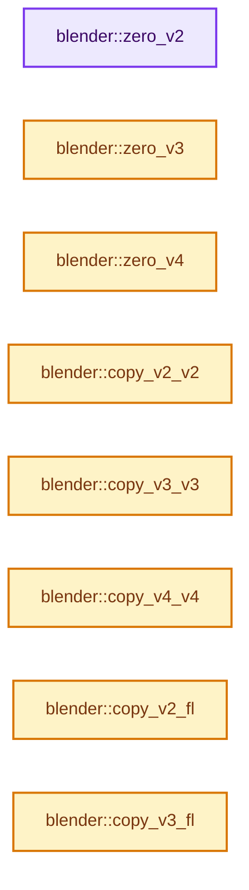

# 实现依赖专题：source/blender/blenlib/intern/math_vector_inline.cc

[实现依赖导航](../../README.md) · [符号索引](../../../00-课程指南/02-源码与提交索引/符号依赖与实现索引.md)

本专题从正文实际调用进入，集中保存共享实现。函数有稳定锚点，可从调用处直接跳到对应完整函数；递归与互相调用通过回链组织。

## 本文件的实现关系




## 完整成员与函数实现

<a id="f-3f0f4c37141bd4f2"></a>

### `blender::zero_v2`

实现位置：[source/blender/blenlib/intern/math_vector_inline.cc](../../../../../../../source/blender/blenlib/intern/math_vector_inline.cc) · L20—L24。

接口参数：

- `float r[2]`

**教学注释版**

<!-- annotated:46fdd4411c6468 -->

```cpp
MINLINE void zero_v2(float r[2])
{
  r[0] = 0.0f;
  r[1] = 0.0f;
}
```

<details>
<summary>核对原始源码：source/blender/blenlib/intern/math_vector_inline.cc · L20—L24</summary>

<!-- original:46fdd4411c6468:source/blender/blenlib/intern/math_vector_inline.cc:20:24 -->

```cpp
MINLINE void zero_v2(float r[2])
{
  r[0] = 0.0f;
  r[1] = 0.0f;
}
```

</details>

**沿实际写入检查状态**

- `r[0] = 0.0f;`
- `r[1] = 0.0f;`

**继续追踪实现**

本实现没有需要继续展开的显式调用；检查返回表达式、对象转换和调用者前置条件。

<a id="f-13235b08fdecb098"></a>

### `blender::zero_v3`

实现位置：[source/blender/blenlib/intern/math_vector_inline.cc](../../../../../../../source/blender/blenlib/intern/math_vector_inline.cc) · L26—L31。

接口参数：

- `float r[3]`

**教学注释版**

<!-- annotated:5339bfcf705e25 -->

```cpp
MINLINE void zero_v3(float r[3])
{
  r[0] = 0.0f;
  r[1] = 0.0f;
  r[2] = 0.0f;
}
```

<details>
<summary>核对原始源码：source/blender/blenlib/intern/math_vector_inline.cc · L26—L31</summary>

<!-- original:5339bfcf705e25:source/blender/blenlib/intern/math_vector_inline.cc:26:31 -->

```cpp
MINLINE void zero_v3(float r[3])
{
  r[0] = 0.0f;
  r[1] = 0.0f;
  r[2] = 0.0f;
}
```

</details>

**沿实际写入检查状态**

- `r[0] = 0.0f;`
- `r[1] = 0.0f;`
- `r[2] = 0.0f;`

**继续追踪实现**

本实现没有需要继续展开的显式调用；检查返回表达式、对象转换和调用者前置条件。

<a id="f-ebb683697baa0431"></a>

### `blender::zero_v4`

实现位置：[source/blender/blenlib/intern/math_vector_inline.cc](../../../../../../../source/blender/blenlib/intern/math_vector_inline.cc) · L33—L39。

接口参数：

- `float r[4]`

**教学注释版**

<!-- annotated:04ac924598a182 -->

```cpp
MINLINE void zero_v4(float r[4])
{
  r[0] = 0.0f;
  r[1] = 0.0f;
  r[2] = 0.0f;
  r[3] = 0.0f;
}
```

<details>
<summary>核对原始源码：source/blender/blenlib/intern/math_vector_inline.cc · L33—L39</summary>

<!-- original:04ac924598a182:source/blender/blenlib/intern/math_vector_inline.cc:33:39 -->

```cpp
MINLINE void zero_v4(float r[4])
{
  r[0] = 0.0f;
  r[1] = 0.0f;
  r[2] = 0.0f;
  r[3] = 0.0f;
}
```

</details>

**沿实际写入检查状态**

- `r[0] = 0.0f;`
- `r[1] = 0.0f;`
- `r[2] = 0.0f;`
- `r[3] = 0.0f;`

**继续追踪实现**

本实现没有需要继续展开的显式调用；检查返回表达式、对象转换和调用者前置条件。

<a id="f-e736ee2dd71cd821"></a>

### `blender::copy_v2_v2`

实现位置：[source/blender/blenlib/intern/math_vector_inline.cc](../../../../../../../source/blender/blenlib/intern/math_vector_inline.cc) · L41—L45。

接口参数：

- `float r[2]`
- `const float a[2]`

**教学注释版**

<!-- annotated:8f9b052609e510 -->

```cpp
MINLINE void copy_v2_v2(float r[2], const float a[2])
{
  r[0] = a[0];
  r[1] = a[1];
}
```

<details>
<summary>核对原始源码：source/blender/blenlib/intern/math_vector_inline.cc · L41—L45</summary>

<!-- original:8f9b052609e510:source/blender/blenlib/intern/math_vector_inline.cc:41:45 -->

```cpp
MINLINE void copy_v2_v2(float r[2], const float a[2])
{
  r[0] = a[0];
  r[1] = a[1];
}
```

</details>

**沿实际写入检查状态**

- `r[0] = a[0];`
- `r[1] = a[1];`

**继续追踪实现**

本实现没有需要继续展开的显式调用；检查返回表达式、对象转换和调用者前置条件。

<a id="f-037a0d5fa5060bd6"></a>

### `blender::copy_v3_v3`

实现位置：[source/blender/blenlib/intern/math_vector_inline.cc](../../../../../../../source/blender/blenlib/intern/math_vector_inline.cc) · L47—L52。

接口参数：

- `float r[3]`
- `const float a[3]`

**教学注释版**

<!-- annotated:a7ccaff552de67 -->

```cpp
MINLINE void copy_v3_v3(float r[3], const float a[3])
{
  r[0] = a[0];
  r[1] = a[1];
  r[2] = a[2];
}
```

<details>
<summary>核对原始源码：source/blender/blenlib/intern/math_vector_inline.cc · L47—L52</summary>

<!-- original:a7ccaff552de67:source/blender/blenlib/intern/math_vector_inline.cc:47:52 -->

```cpp
MINLINE void copy_v3_v3(float r[3], const float a[3])
{
  r[0] = a[0];
  r[1] = a[1];
  r[2] = a[2];
}
```

</details>

**沿实际写入检查状态**

- `r[0] = a[0];`
- `r[1] = a[1];`
- `r[2] = a[2];`

**继续追踪实现**

本实现没有需要继续展开的显式调用；检查返回表达式、对象转换和调用者前置条件。

<a id="f-0cf225fc326edf4a"></a>

### `blender::copy_v4_v4`

实现位置：[source/blender/blenlib/intern/math_vector_inline.cc](../../../../../../../source/blender/blenlib/intern/math_vector_inline.cc) · L54—L60。

接口参数：

- `float r[4]`
- `const float a[4]`

**教学注释版**

<!-- annotated:8513a06e665ed2 -->

```cpp
MINLINE void copy_v4_v4(float r[4], const float a[4])
{
  r[0] = a[0];
  r[1] = a[1];
  r[2] = a[2];
  r[3] = a[3];
}
```

<details>
<summary>核对原始源码：source/blender/blenlib/intern/math_vector_inline.cc · L54—L60</summary>

<!-- original:8513a06e665ed2:source/blender/blenlib/intern/math_vector_inline.cc:54:60 -->

```cpp
MINLINE void copy_v4_v4(float r[4], const float a[4])
{
  r[0] = a[0];
  r[1] = a[1];
  r[2] = a[2];
  r[3] = a[3];
}
```

</details>

**沿实际写入检查状态**

- `r[0] = a[0];`
- `r[1] = a[1];`
- `r[2] = a[2];`
- `r[3] = a[3];`

**继续追踪实现**

本实现没有需要继续展开的显式调用；检查返回表达式、对象转换和调用者前置条件。

<a id="f-cf07ce4f241d3a3c"></a>

### `blender::copy_v2_fl`

实现位置：[source/blender/blenlib/intern/math_vector_inline.cc](../../../../../../../source/blender/blenlib/intern/math_vector_inline.cc) · L62—L66。

接口参数：

- `float r[2]`
- `float f`

**教学注释版**

<!-- annotated:ee388326dc4ed8 -->

```cpp
MINLINE void copy_v2_fl(float r[2], float f)
{
  r[0] = f;
  r[1] = f;
}
```

<details>
<summary>核对原始源码：source/blender/blenlib/intern/math_vector_inline.cc · L62—L66</summary>

<!-- original:ee388326dc4ed8:source/blender/blenlib/intern/math_vector_inline.cc:62:66 -->

```cpp
MINLINE void copy_v2_fl(float r[2], float f)
{
  r[0] = f;
  r[1] = f;
}
```

</details>

**沿实际写入检查状态**

- `r[0] = f;`
- `r[1] = f;`

**继续追踪实现**

本实现没有需要继续展开的显式调用；检查返回表达式、对象转换和调用者前置条件。

<a id="f-18676f3d43803485"></a>

### `blender::copy_v3_fl`

实现位置：[source/blender/blenlib/intern/math_vector_inline.cc](../../../../../../../source/blender/blenlib/intern/math_vector_inline.cc) · L68—L73。

接口参数：

- `float r[3]`
- `float f`

**教学注释版**

<!-- annotated:9885984ef8d0f0 -->

```cpp
MINLINE void copy_v3_fl(float r[3], float f)
{
  r[0] = f;
  r[1] = f;
  r[2] = f;
}
```

<details>
<summary>核对原始源码：source/blender/blenlib/intern/math_vector_inline.cc · L68—L73</summary>

<!-- original:9885984ef8d0f0:source/blender/blenlib/intern/math_vector_inline.cc:68:73 -->

```cpp
MINLINE void copy_v3_fl(float r[3], float f)
{
  r[0] = f;
  r[1] = f;
  r[2] = f;
}
```

</details>

**沿实际写入检查状态**

- `r[0] = f;`
- `r[1] = f;`
- `r[2] = f;`

**继续追踪实现**

本实现没有需要继续展开的显式调用；检查返回表达式、对象转换和调用者前置条件。

<a id="f-da9251b67269c335"></a>

### `blender::copy_v4_fl`

实现位置：[source/blender/blenlib/intern/math_vector_inline.cc](../../../../../../../source/blender/blenlib/intern/math_vector_inline.cc) · L75—L81。

接口参数：

- `float r[4]`
- `float f`

**教学注释版**

<!-- annotated:66a2307bfd9f21 -->

```cpp
MINLINE void copy_v4_fl(float r[4], float f)
{
  r[0] = f;
  r[1] = f;
  r[2] = f;
  r[3] = f;
}
```

<details>
<summary>核对原始源码：source/blender/blenlib/intern/math_vector_inline.cc · L75—L81</summary>

<!-- original:66a2307bfd9f21:source/blender/blenlib/intern/math_vector_inline.cc:75:81 -->

```cpp
MINLINE void copy_v4_fl(float r[4], float f)
{
  r[0] = f;
  r[1] = f;
  r[2] = f;
  r[3] = f;
}
```

</details>

**沿实际写入检查状态**

- `r[0] = f;`
- `r[1] = f;`
- `r[2] = f;`
- `r[3] = f;`

**继续追踪实现**

本实现没有需要继续展开的显式调用；检查返回表达式、对象转换和调用者前置条件。

<a id="f-5d8d4ac0d4d3489c"></a>

### `blender::copy_v3_v3_uchar`

实现位置：[source/blender/blenlib/intern/math_vector_inline.cc](../../../../../../../source/blender/blenlib/intern/math_vector_inline.cc) · L85—L90。

接口参数：

- `unsigned char r[3]`
- `const unsigned char a[3]`

**教学注释版**

<!-- annotated:af8be207ecf412 -->

```cpp
MINLINE void copy_v3_v3_uchar(unsigned char r[3], const unsigned char a[3])
{
  r[0] = a[0];
  r[1] = a[1];
  r[2] = a[2];
}
```

<details>
<summary>核对原始源码：source/blender/blenlib/intern/math_vector_inline.cc · L85—L90</summary>

<!-- original:af8be207ecf412:source/blender/blenlib/intern/math_vector_inline.cc:85:90 -->

```cpp
MINLINE void copy_v3_v3_uchar(unsigned char r[3], const unsigned char a[3])
{
  r[0] = a[0];
  r[1] = a[1];
  r[2] = a[2];
}
```

</details>

**沿实际写入检查状态**

- `r[0] = a[0];`
- `r[1] = a[1];`
- `r[2] = a[2];`

**继续追踪实现**

本实现没有需要继续展开的显式调用；检查返回表达式、对象转换和调用者前置条件。

<a id="f-4acd2fff1ffdebcc"></a>

### `blender::copy_v4_v4_uchar`

实现位置：[source/blender/blenlib/intern/math_vector_inline.cc](../../../../../../../source/blender/blenlib/intern/math_vector_inline.cc) · L92—L98。

接口参数：

- `unsigned char r[4]`
- `const unsigned char a[4]`

**教学注释版**

<!-- annotated:ceec009457f7e6 -->

```cpp
MINLINE void copy_v4_v4_uchar(unsigned char r[4], const unsigned char a[4])
{
  r[0] = a[0];
  r[1] = a[1];
  r[2] = a[2];
  r[3] = a[3];
}
```

<details>
<summary>核对原始源码：source/blender/blenlib/intern/math_vector_inline.cc · L92—L98</summary>

<!-- original:ceec009457f7e6:source/blender/blenlib/intern/math_vector_inline.cc:92:98 -->

```cpp
MINLINE void copy_v4_v4_uchar(unsigned char r[4], const unsigned char a[4])
{
  r[0] = a[0];
  r[1] = a[1];
  r[2] = a[2];
  r[3] = a[3];
}
```

</details>

**沿实际写入检查状态**

- `r[0] = a[0];`
- `r[1] = a[1];`
- `r[2] = a[2];`
- `r[3] = a[3];`

**继续追踪实现**

本实现没有需要继续展开的显式调用；检查返回表达式、对象转换和调用者前置条件。

<a id="f-da0116edc90db83b"></a>

### `blender::copy_v2_v2_short`

实现位置：[source/blender/blenlib/intern/math_vector_inline.cc](../../../../../../../source/blender/blenlib/intern/math_vector_inline.cc) · L102—L106。

接口参数：

- `short r[2]`
- `const short a[2]`

**教学注释版**

<!-- annotated:5636dd7296eac9 -->

```cpp
MINLINE void copy_v2_v2_short(short r[2], const short a[2])
{
  r[0] = a[0];
  r[1] = a[1];
}
```

<details>
<summary>核对原始源码：source/blender/blenlib/intern/math_vector_inline.cc · L102—L106</summary>

<!-- original:5636dd7296eac9:source/blender/blenlib/intern/math_vector_inline.cc:102:106 -->

```cpp
MINLINE void copy_v2_v2_short(short r[2], const short a[2])
{
  r[0] = a[0];
  r[1] = a[1];
}
```

</details>

**沿实际写入检查状态**

- `r[0] = a[0];`
- `r[1] = a[1];`

**继续追踪实现**

本实现没有需要继续展开的显式调用；检查返回表达式、对象转换和调用者前置条件。

<a id="f-ebe908fda728b78d"></a>

### `blender::zero_v2_int`

实现位置：[source/blender/blenlib/intern/math_vector_inline.cc](../../../../../../../source/blender/blenlib/intern/math_vector_inline.cc) · L116—L120。

接口参数：

- `int r[2]`

**教学注释版**

<!-- annotated:56e10c18bcd471 -->

```cpp
MINLINE void zero_v2_int(int r[2])
{
  r[0] = 0;
  r[1] = 0;
}
```

<details>
<summary>核对原始源码：source/blender/blenlib/intern/math_vector_inline.cc · L116—L120</summary>

<!-- original:56e10c18bcd471:source/blender/blenlib/intern/math_vector_inline.cc:116:120 -->

```cpp
MINLINE void zero_v2_int(int r[2])
{
  r[0] = 0;
  r[1] = 0;
}
```

</details>

**沿实际写入检查状态**

- `r[0] = 0;`
- `r[1] = 0;`

**继续追踪实现**

本实现没有需要继续展开的显式调用；检查返回表达式、对象转换和调用者前置条件。

<a id="f-892d5a9f668d603d"></a>

### `blender::zero_v3_int`

实现位置：[source/blender/blenlib/intern/math_vector_inline.cc](../../../../../../../source/blender/blenlib/intern/math_vector_inline.cc) · L122—L127。

接口参数：

- `int r[3]`

**教学注释版**

<!-- annotated:7ff1be03ec719b -->

```cpp
MINLINE void zero_v3_int(int r[3])
{
  r[0] = 0;
  r[1] = 0;
  r[2] = 0;
}
```

<details>
<summary>核对原始源码：source/blender/blenlib/intern/math_vector_inline.cc · L122—L127</summary>

<!-- original:7ff1be03ec719b:source/blender/blenlib/intern/math_vector_inline.cc:122:127 -->

```cpp
MINLINE void zero_v3_int(int r[3])
{
  r[0] = 0;
  r[1] = 0;
  r[2] = 0;
}
```

</details>

**沿实际写入检查状态**

- `r[0] = 0;`
- `r[1] = 0;`
- `r[2] = 0;`

**继续追踪实现**

本实现没有需要继续展开的显式调用；检查返回表达式、对象转换和调用者前置条件。

<a id="f-80f68f9495f4b7b8"></a>

### `blender::copy_v2_v2_int`

实现位置：[source/blender/blenlib/intern/math_vector_inline.cc](../../../../../../../source/blender/blenlib/intern/math_vector_inline.cc) · L129—L133。

接口参数：

- `int r[2]`
- `const int a[2]`

**教学注释版**

<!-- annotated:766cfbd8b0e4c5 -->

```cpp
MINLINE void copy_v2_v2_int(int r[2], const int a[2])
{
  r[0] = a[0];
  r[1] = a[1];
}
```

<details>
<summary>核对原始源码：source/blender/blenlib/intern/math_vector_inline.cc · L129—L133</summary>

<!-- original:766cfbd8b0e4c5:source/blender/blenlib/intern/math_vector_inline.cc:129:133 -->

```cpp
MINLINE void copy_v2_v2_int(int r[2], const int a[2])
{
  r[0] = a[0];
  r[1] = a[1];
}
```

</details>

**沿实际写入检查状态**

- `r[0] = a[0];`
- `r[1] = a[1];`

**继续追踪实现**

本实现没有需要继续展开的显式调用；检查返回表达式、对象转换和调用者前置条件。

<a id="f-f2fe0c32e364418e"></a>

### `blender::copy_v3_v3_int`

实现位置：[source/blender/blenlib/intern/math_vector_inline.cc](../../../../../../../source/blender/blenlib/intern/math_vector_inline.cc) · L135—L140。

接口参数：

- `int r[3]`
- `const int a[3]`

**教学注释版**

<!-- annotated:f0b990333ac5e7 -->

```cpp
MINLINE void copy_v3_v3_int(int r[3], const int a[3])
{
  r[0] = a[0];
  r[1] = a[1];
  r[2] = a[2];
}
```

<details>
<summary>核对原始源码：source/blender/blenlib/intern/math_vector_inline.cc · L135—L140</summary>

<!-- original:f0b990333ac5e7:source/blender/blenlib/intern/math_vector_inline.cc:135:140 -->

```cpp
MINLINE void copy_v3_v3_int(int r[3], const int a[3])
{
  r[0] = a[0];
  r[1] = a[1];
  r[2] = a[2];
}
```

</details>

**沿实际写入检查状态**

- `r[0] = a[0];`
- `r[1] = a[1];`
- `r[2] = a[2];`

**继续追踪实现**

本实现没有需要继续展开的显式调用；检查返回表达式、对象转换和调用者前置条件。

<a id="f-fb52f9203c152acf"></a>

### `blender::copy_v4_v4_int`

实现位置：[source/blender/blenlib/intern/math_vector_inline.cc](../../../../../../../source/blender/blenlib/intern/math_vector_inline.cc) · L142—L148。

接口参数：

- `int r[4]`
- `const int a[4]`

**教学注释版**

<!-- annotated:c5af8ad49e09c3 -->

```cpp
MINLINE void copy_v4_v4_int(int r[4], const int a[4])
{
  r[0] = a[0];
  r[1] = a[1];
  r[2] = a[2];
  r[3] = a[3];
}
```

<details>
<summary>核对原始源码：source/blender/blenlib/intern/math_vector_inline.cc · L142—L148</summary>

<!-- original:c5af8ad49e09c3:source/blender/blenlib/intern/math_vector_inline.cc:142:148 -->

```cpp
MINLINE void copy_v4_v4_int(int r[4], const int a[4])
{
  r[0] = a[0];
  r[1] = a[1];
  r[2] = a[2];
  r[3] = a[3];
}
```

</details>

**沿实际写入检查状态**

- `r[0] = a[0];`
- `r[1] = a[1];`
- `r[2] = a[2];`
- `r[3] = a[3];`

**继续追踪实现**

本实现没有需要继续展开的显式调用；检查返回表达式、对象转换和调用者前置条件。

<a id="f-4117eb991b478458"></a>

### `blender::copy_v2_v2_db`

实现位置：[source/blender/blenlib/intern/math_vector_inline.cc](../../../../../../../source/blender/blenlib/intern/math_vector_inline.cc) · L152—L156。

接口参数：

- `double r[2]`
- `const double a[2]`

**教学注释版**

<!-- annotated:a91223f1854d7e -->

```cpp
MINLINE void copy_v2_v2_db(double r[2], const double a[2])
{
  r[0] = a[0];
  r[1] = a[1];
}
```

<details>
<summary>核对原始源码：source/blender/blenlib/intern/math_vector_inline.cc · L152—L156</summary>

<!-- original:a91223f1854d7e:source/blender/blenlib/intern/math_vector_inline.cc:152:156 -->

```cpp
MINLINE void copy_v2_v2_db(double r[2], const double a[2])
{
  r[0] = a[0];
  r[1] = a[1];
}
```

</details>

**沿实际写入检查状态**

- `r[0] = a[0];`
- `r[1] = a[1];`

**继续追踪实现**

本实现没有需要继续展开的显式调用；检查返回表达式、对象转换和调用者前置条件。

<a id="f-c589d75accd3ea79"></a>

### `blender::copy_v3_v3_db`

实现位置：[source/blender/blenlib/intern/math_vector_inline.cc](../../../../../../../source/blender/blenlib/intern/math_vector_inline.cc) · L158—L163。

接口参数：

- `double r[3]`
- `const double a[3]`

**教学注释版**

<!-- annotated:23beccc16e2a1e -->

```cpp
MINLINE void copy_v3_v3_db(double r[3], const double a[3])
{
  r[0] = a[0];
  r[1] = a[1];
  r[2] = a[2];
}
```

<details>
<summary>核对原始源码：source/blender/blenlib/intern/math_vector_inline.cc · L158—L163</summary>

<!-- original:23beccc16e2a1e:source/blender/blenlib/intern/math_vector_inline.cc:158:163 -->

```cpp
MINLINE void copy_v3_v3_db(double r[3], const double a[3])
{
  r[0] = a[0];
  r[1] = a[1];
  r[2] = a[2];
}
```

</details>

**沿实际写入检查状态**

- `r[0] = a[0];`
- `r[1] = a[1];`
- `r[2] = a[2];`

**继续追踪实现**

本实现没有需要继续展开的显式调用；检查返回表达式、对象转换和调用者前置条件。

<a id="f-1399886b8a078619"></a>

### `blender::copy_v4_v4_db`

实现位置：[source/blender/blenlib/intern/math_vector_inline.cc](../../../../../../../source/blender/blenlib/intern/math_vector_inline.cc) · L165—L171。

接口参数：

- `double r[4]`
- `const double a[4]`

**教学注释版**

<!-- annotated:6a55d7c5d04349 -->

```cpp
MINLINE void copy_v4_v4_db(double r[4], const double a[4])
{
  r[0] = a[0];
  r[1] = a[1];
  r[2] = a[2];
  r[3] = a[3];
}
```

<details>
<summary>核对原始源码：source/blender/blenlib/intern/math_vector_inline.cc · L165—L171</summary>

<!-- original:6a55d7c5d04349:source/blender/blenlib/intern/math_vector_inline.cc:165:171 -->

```cpp
MINLINE void copy_v4_v4_db(double r[4], const double a[4])
{
  r[0] = a[0];
  r[1] = a[1];
  r[2] = a[2];
  r[3] = a[3];
}
```

</details>

**沿实际写入检查状态**

- `r[0] = a[0];`
- `r[1] = a[1];`
- `r[2] = a[2];`
- `r[3] = a[3];`

**继续追踪实现**

本实现没有需要继续展开的显式调用；检查返回表达式、对象转换和调用者前置条件。

<a id="f-add3848dbbb4c190"></a>

### `blender::copy_v3fl_v3db`

实现位置：[source/blender/blenlib/intern/math_vector_inline.cc](../../../../../../../source/blender/blenlib/intern/math_vector_inline.cc) · L181—L186。

接口参数：

- `float r[3]`
- `const double a[3]`

**教学注释版**

<!-- annotated:ee77ad96a932ef -->

```cpp
MINLINE void copy_v3fl_v3db(float r[3], const double a[3])
{
  r[0] = float(a[0]);
  r[1] = float(a[1]);
  r[2] = float(a[2]);
}
```

<details>
<summary>核对原始源码：source/blender/blenlib/intern/math_vector_inline.cc · L181—L186</summary>

<!-- original:ee77ad96a932ef:source/blender/blenlib/intern/math_vector_inline.cc:181:186 -->

```cpp
MINLINE void copy_v3fl_v3db(float r[3], const double a[3])
{
  r[0] = float(a[0]);
  r[1] = float(a[1]);
  r[2] = float(a[2]);
}
```

</details>

**沿实际写入检查状态**

- `r[0] = float(a[0]);`
- `r[1] = float(a[1]);`
- `r[2] = float(a[2]);`

**继续追踪实现**

本实现没有需要继续展开的显式调用；检查返回表达式、对象转换和调用者前置条件。

<a id="f-e5118add6d0c3d37"></a>

### `blender::copy_v2db_v2fl`

实现位置：[source/blender/blenlib/intern/math_vector_inline.cc](../../../../../../../source/blender/blenlib/intern/math_vector_inline.cc) · L198—L202。

接口参数：

- `double r[2]`
- `const float a[2]`

**教学注释版**

<!-- annotated:e371d13fbe164e -->

```cpp
MINLINE void copy_v2db_v2fl(double r[2], const float a[2])
{
  r[0] = double(a[0]);
  r[1] = double(a[1]);
}
```

<details>
<summary>核对原始源码：source/blender/blenlib/intern/math_vector_inline.cc · L198—L202</summary>

<!-- original:e371d13fbe164e:source/blender/blenlib/intern/math_vector_inline.cc:198:202 -->

```cpp
MINLINE void copy_v2db_v2fl(double r[2], const float a[2])
{
  r[0] = double(a[0]);
  r[1] = double(a[1]);
}
```

</details>

**沿实际写入检查状态**

- `r[0] = double(a[0]);`
- `r[1] = double(a[1]);`

**继续追踪实现**

本实现没有需要继续展开的显式调用；检查返回表达式、对象转换和调用者前置条件。

<a id="f-5f291b6849fea907"></a>

### `blender::copy_v3db_v3fl`

实现位置：[source/blender/blenlib/intern/math_vector_inline.cc](../../../../../../../source/blender/blenlib/intern/math_vector_inline.cc) · L204—L209。

接口参数：

- `double r[3]`
- `const float a[3]`

**教学注释版**

<!-- annotated:09ef6a135fda85 -->

```cpp
MINLINE void copy_v3db_v3fl(double r[3], const float a[3])
{
  r[0] = double(a[0]);
  r[1] = double(a[1]);
  r[2] = double(a[2]);
}
```

<details>
<summary>核对原始源码：source/blender/blenlib/intern/math_vector_inline.cc · L204—L209</summary>

<!-- original:09ef6a135fda85:source/blender/blenlib/intern/math_vector_inline.cc:204:209 -->

```cpp
MINLINE void copy_v3db_v3fl(double r[3], const float a[3])
{
  r[0] = double(a[0]);
  r[1] = double(a[1]);
  r[2] = double(a[2]);
}
```

</details>

**沿实际写入检查状态**

- `r[0] = double(a[0]);`
- `r[1] = double(a[1]);`
- `r[2] = double(a[2]);`

**继续追踪实现**

本实现没有需要继续展开的显式调用；检查返回表达式、对象转换和调用者前置条件。

<a id="f-9d47a9745feb554d"></a>

### `blender::swap_v2_v2`

实现位置：[source/blender/blenlib/intern/math_vector_inline.cc](../../../../../../../source/blender/blenlib/intern/math_vector_inline.cc) · L211—L215。

接口参数：

- `float a[2]`
- `float b[2]`

**教学注释版**

<!-- annotated:31944686183236 -->

```cpp
MINLINE void swap_v2_v2(float a[2], float b[2])
{
  SWAP(float, a[0], b[0]);
  SWAP(float, a[1], b[1]);
}
```

<details>
<summary>核对原始源码：source/blender/blenlib/intern/math_vector_inline.cc · L211—L215</summary>

<!-- original:31944686183236:source/blender/blenlib/intern/math_vector_inline.cc:211:215 -->

```cpp
MINLINE void swap_v2_v2(float a[2], float b[2])
{
  SWAP(float, a[0], b[0]);
  SWAP(float, a[1], b[1]);
}
```

</details>

**继续追踪实现**

本实现没有需要继续展开的显式调用；检查返回表达式、对象转换和调用者前置条件。

<a id="f-5006770fa7cfc2f1"></a>

### `blender::swap_v3_v3`

实现位置：[source/blender/blenlib/intern/math_vector_inline.cc](../../../../../../../source/blender/blenlib/intern/math_vector_inline.cc) · L217—L222。

接口参数：

- `float a[3]`
- `float b[3]`

**教学注释版**

<!-- annotated:ccf76afa885db4 -->

```cpp
MINLINE void swap_v3_v3(float a[3], float b[3])
{
  SWAP(float, a[0], b[0]);
  SWAP(float, a[1], b[1]);
  SWAP(float, a[2], b[2]);
}
```

<details>
<summary>核对原始源码：source/blender/blenlib/intern/math_vector_inline.cc · L217—L222</summary>

<!-- original:ccf76afa885db4:source/blender/blenlib/intern/math_vector_inline.cc:217:222 -->

```cpp
MINLINE void swap_v3_v3(float a[3], float b[3])
{
  SWAP(float, a[0], b[0]);
  SWAP(float, a[1], b[1]);
  SWAP(float, a[2], b[2]);
}
```

</details>

**继续追踪实现**

本实现没有需要继续展开的显式调用；检查返回表达式、对象转换和调用者前置条件。

<a id="f-0dc4c6e001a7f640"></a>

### `blender::swap_v4_v4`

实现位置：[source/blender/blenlib/intern/math_vector_inline.cc](../../../../../../../source/blender/blenlib/intern/math_vector_inline.cc) · L224—L230。

接口参数：

- `float a[4]`
- `float b[4]`

**教学注释版**

<!-- annotated:bdb6812d63a84a -->

```cpp
MINLINE void swap_v4_v4(float a[4], float b[4])
{
  SWAP(float, a[0], b[0]);
  SWAP(float, a[1], b[1]);
  SWAP(float, a[2], b[2]);
  SWAP(float, a[3], b[3]);
}
```

<details>
<summary>核对原始源码：source/blender/blenlib/intern/math_vector_inline.cc · L224—L230</summary>

<!-- original:bdb6812d63a84a:source/blender/blenlib/intern/math_vector_inline.cc:224:230 -->

```cpp
MINLINE void swap_v4_v4(float a[4], float b[4])
{
  SWAP(float, a[0], b[0]);
  SWAP(float, a[1], b[1]);
  SWAP(float, a[2], b[2]);
  SWAP(float, a[3], b[3]);
}
```

</details>

**继续追踪实现**

本实现没有需要继续展开的显式调用；检查返回表达式、对象转换和调用者前置条件。

<a id="f-226daf6ca03c8844"></a>

### `blender::copy_v2_fl2`

实现位置：[source/blender/blenlib/intern/math_vector_inline.cc](../../../../../../../source/blender/blenlib/intern/math_vector_inline.cc) · L234—L238。

接口参数：

- `float v[2]`
- `float x`
- `float y`

**教学注释版**

<!-- annotated:398c4a600cc998 -->

```cpp
MINLINE void copy_v2_fl2(float v[2], float x, float y)
{
  v[0] = x;
  v[1] = y;
}
```

<details>
<summary>核对原始源码：source/blender/blenlib/intern/math_vector_inline.cc · L234—L238</summary>

<!-- original:398c4a600cc998:source/blender/blenlib/intern/math_vector_inline.cc:234:238 -->

```cpp
MINLINE void copy_v2_fl2(float v[2], float x, float y)
{
  v[0] = x;
  v[1] = y;
}
```

</details>

**沿实际写入检查状态**

- `v[0] = x;`
- `v[1] = y;`

**继续追踪实现**

本实现没有需要继续展开的显式调用；检查返回表达式、对象转换和调用者前置条件。

<a id="f-16dac73e7ccf137f"></a>

### `blender::copy_v3_fl3`

实现位置：[source/blender/blenlib/intern/math_vector_inline.cc](../../../../../../../source/blender/blenlib/intern/math_vector_inline.cc) · L240—L245。

接口参数：

- `float v[3]`
- `float x`
- `float y`
- `float z`

**教学注释版**

<!-- annotated:a718ed89c4630c -->

```cpp
MINLINE void copy_v3_fl3(float v[3], float x, float y, float z)
{
  v[0] = x;
  v[1] = y;
  v[2] = z;
}
```

<details>
<summary>核对原始源码：source/blender/blenlib/intern/math_vector_inline.cc · L240—L245</summary>

<!-- original:a718ed89c4630c:source/blender/blenlib/intern/math_vector_inline.cc:240:245 -->

```cpp
MINLINE void copy_v3_fl3(float v[3], float x, float y, float z)
{
  v[0] = x;
  v[1] = y;
  v[2] = z;
}
```

</details>

**沿实际写入检查状态**

- `v[0] = x;`
- `v[1] = y;`
- `v[2] = z;`

**继续追踪实现**

本实现没有需要继续展开的显式调用；检查返回表达式、对象转换和调用者前置条件。

<a id="f-40cbb36dfd57de9b"></a>

### `blender::copy_v4_fl4`

实现位置：[source/blender/blenlib/intern/math_vector_inline.cc](../../../../../../../source/blender/blenlib/intern/math_vector_inline.cc) · L247—L253。

接口参数：

- `float v[4]`
- `float x`
- `float y`
- `float z`
- `float w`

**教学注释版**

<!-- annotated:238f1ceaba6fce -->

```cpp
MINLINE void copy_v4_fl4(float v[4], float x, float y, float z, float w)
{
  v[0] = x;
  v[1] = y;
  v[2] = z;
  v[3] = w;
}
```

<details>
<summary>核对原始源码：source/blender/blenlib/intern/math_vector_inline.cc · L247—L253</summary>

<!-- original:238f1ceaba6fce:source/blender/blenlib/intern/math_vector_inline.cc:247:253 -->

```cpp
MINLINE void copy_v4_fl4(float v[4], float x, float y, float z, float w)
{
  v[0] = x;
  v[1] = y;
  v[2] = z;
  v[3] = w;
}
```

</details>

**沿实际写入检查状态**

- `v[0] = x;`
- `v[1] = y;`
- `v[2] = z;`
- `v[3] = w;`

**继续追踪实现**

本实现没有需要继续展开的显式调用；检查返回表达式、对象转换和调用者前置条件。

<a id="f-003a451165720800"></a>

### `blender::add_v2_fl`

实现位置：[source/blender/blenlib/intern/math_vector_inline.cc](../../../../../../../source/blender/blenlib/intern/math_vector_inline.cc) · L261—L265。

接口参数：

- `float r[2]`
- `float f`

**教学注释版**

<!-- annotated:20c515677e99c9 -->

```cpp
MINLINE void add_v2_fl(float r[2], float f)
{
  r[0] += f;
  r[1] += f;
}
```

<details>
<summary>核对原始源码：source/blender/blenlib/intern/math_vector_inline.cc · L261—L265</summary>

<!-- original:20c515677e99c9:source/blender/blenlib/intern/math_vector_inline.cc:261:265 -->

```cpp
MINLINE void add_v2_fl(float r[2], float f)
{
  r[0] += f;
  r[1] += f;
}
```

</details>

**沿实际写入检查状态**

- `r[0] += f;`
- `r[1] += f;`

**继续追踪实现**

本实现没有需要继续展开的显式调用；检查返回表达式、对象转换和调用者前置条件。

<a id="f-ccf32c1ce29b15d8"></a>

### `blender::add_v3_fl`

实现位置：[source/blender/blenlib/intern/math_vector_inline.cc](../../../../../../../source/blender/blenlib/intern/math_vector_inline.cc) · L267—L272。

接口参数：

- `float r[3]`
- `float f`

**教学注释版**

<!-- annotated:a5cddefef133e5 -->

```cpp
MINLINE void add_v3_fl(float r[3], float f)
{
  r[0] += f;
  r[1] += f;
  r[2] += f;
}
```

<details>
<summary>核对原始源码：source/blender/blenlib/intern/math_vector_inline.cc · L267—L272</summary>

<!-- original:a5cddefef133e5:source/blender/blenlib/intern/math_vector_inline.cc:267:272 -->

```cpp
MINLINE void add_v3_fl(float r[3], float f)
{
  r[0] += f;
  r[1] += f;
  r[2] += f;
}
```

</details>

**沿实际写入检查状态**

- `r[0] += f;`
- `r[1] += f;`
- `r[2] += f;`

**继续追踪实现**

本实现没有需要继续展开的显式调用；检查返回表达式、对象转换和调用者前置条件。

<a id="f-1d5add4ac1b3a385"></a>

### `blender::add_v2_v2`

实现位置：[source/blender/blenlib/intern/math_vector_inline.cc](../../../../../../../source/blender/blenlib/intern/math_vector_inline.cc) · L274—L278。

接口参数：

- `float r[2]`
- `const float a[2]`

**教学注释版**

<!-- annotated:14eb79884f504e -->

```cpp
MINLINE void add_v2_v2(float r[2], const float a[2])
{
  r[0] += a[0];
  r[1] += a[1];
}
```

<details>
<summary>核对原始源码：source/blender/blenlib/intern/math_vector_inline.cc · L274—L278</summary>

<!-- original:14eb79884f504e:source/blender/blenlib/intern/math_vector_inline.cc:274:278 -->

```cpp
MINLINE void add_v2_v2(float r[2], const float a[2])
{
  r[0] += a[0];
  r[1] += a[1];
}
```

</details>

**沿实际写入检查状态**

- `r[0] += a[0];`
- `r[1] += a[1];`

**继续追踪实现**

本实现没有需要继续展开的显式调用；检查返回表达式、对象转换和调用者前置条件。

<a id="f-60692cc4a79da4ce"></a>

### `blender::add_v2_v2v2`

实现位置：[source/blender/blenlib/intern/math_vector_inline.cc](../../../../../../../source/blender/blenlib/intern/math_vector_inline.cc) · L280—L284。

接口参数：

- `float r[2]`
- `const float a[2]`
- `const float b[2]`

**教学注释版**

<!-- annotated:5ee5f9f7a6d35b -->

```cpp
MINLINE void add_v2_v2v2(float r[2], const float a[2], const float b[2])
{
  r[0] = a[0] + b[0];
  r[1] = a[1] + b[1];
}
```

<details>
<summary>核对原始源码：source/blender/blenlib/intern/math_vector_inline.cc · L280—L284</summary>

<!-- original:5ee5f9f7a6d35b:source/blender/blenlib/intern/math_vector_inline.cc:280:284 -->

```cpp
MINLINE void add_v2_v2v2(float r[2], const float a[2], const float b[2])
{
  r[0] = a[0] + b[0];
  r[1] = a[1] + b[1];
}
```

</details>

**沿实际写入检查状态**

- `r[0] = a[0] + b[0];`
- `r[1] = a[1] + b[1];`

**继续追踪实现**

本实现没有需要继续展开的显式调用；检查返回表达式、对象转换和调用者前置条件。

<a id="f-e7930c6fdefe462c"></a>

### `blender::add_v3_v3`

实现位置：[source/blender/blenlib/intern/math_vector_inline.cc](../../../../../../../source/blender/blenlib/intern/math_vector_inline.cc) · L286—L291。

接口参数：

- `float r[3]`
- `const float a[3]`

**教学注释版**

<!-- annotated:99eed2a55ce201 -->

```cpp
MINLINE void add_v3_v3(float r[3], const float a[3])
{
  r[0] += a[0];
  r[1] += a[1];
  r[2] += a[2];
}
```

<details>
<summary>核对原始源码：source/blender/blenlib/intern/math_vector_inline.cc · L286—L291</summary>

<!-- original:99eed2a55ce201:source/blender/blenlib/intern/math_vector_inline.cc:286:291 -->

```cpp
MINLINE void add_v3_v3(float r[3], const float a[3])
{
  r[0] += a[0];
  r[1] += a[1];
  r[2] += a[2];
}
```

</details>

**沿实际写入检查状态**

- `r[0] += a[0];`
- `r[1] += a[1];`
- `r[2] += a[2];`

**继续追踪实现**

本实现没有需要继续展开的显式调用；检查返回表达式、对象转换和调用者前置条件。

<a id="f-20eb1a5d15341f2d"></a>

### `blender::add_v3_v3_db`

实现位置：[source/blender/blenlib/intern/math_vector_inline.cc](../../../../../../../source/blender/blenlib/intern/math_vector_inline.cc) · L293—L298。

接口参数：

- `double r[3]`
- `const double a[3]`

**教学注释版**

<!-- annotated:7aa764568b0d5d -->

```cpp
MINLINE void add_v3_v3_db(double r[3], const double a[3])
{
  r[0] += a[0];
  r[1] += a[1];
  r[2] += a[2];
}
```

<details>
<summary>核对原始源码：source/blender/blenlib/intern/math_vector_inline.cc · L293—L298</summary>

<!-- original:7aa764568b0d5d:source/blender/blenlib/intern/math_vector_inline.cc:293:298 -->

```cpp
MINLINE void add_v3_v3_db(double r[3], const double a[3])
{
  r[0] += a[0];
  r[1] += a[1];
  r[2] += a[2];
}
```

</details>

**沿实际写入检查状态**

- `r[0] += a[0];`
- `r[1] += a[1];`
- `r[2] += a[2];`

**继续追踪实现**

本实现没有需要继续展开的显式调用；检查返回表达式、对象转换和调用者前置条件。

<a id="f-7343b459d0d3db69"></a>

### `blender::add_v3_v3v3`

实现位置：[source/blender/blenlib/intern/math_vector_inline.cc](../../../../../../../source/blender/blenlib/intern/math_vector_inline.cc) · L300—L305。

接口参数：

- `float r[3]`
- `const float a[3]`
- `const float b[3]`

**教学注释版**

<!-- annotated:c6f41ef5eb3889 -->

```cpp
MINLINE void add_v3_v3v3(float r[3], const float a[3], const float b[3])
{
  r[0] = a[0] + b[0];
  r[1] = a[1] + b[1];
  r[2] = a[2] + b[2];
}
```

<details>
<summary>核对原始源码：source/blender/blenlib/intern/math_vector_inline.cc · L300—L305</summary>

<!-- original:c6f41ef5eb3889:source/blender/blenlib/intern/math_vector_inline.cc:300:305 -->

```cpp
MINLINE void add_v3_v3v3(float r[3], const float a[3], const float b[3])
{
  r[0] = a[0] + b[0];
  r[1] = a[1] + b[1];
  r[2] = a[2] + b[2];
}
```

</details>

**沿实际写入检查状态**

- `r[0] = a[0] + b[0];`
- `r[1] = a[1] + b[1];`
- `r[2] = a[2] + b[2];`

**继续追踪实现**

本实现没有需要继续展开的显式调用；检查返回表达式、对象转换和调用者前置条件。

<a id="f-354126f530a694d8"></a>

### `blender::add_v4_v4`

实现位置：[source/blender/blenlib/intern/math_vector_inline.cc](../../../../../../../source/blender/blenlib/intern/math_vector_inline.cc) · L314—L320。

接口参数：

- `float r[4]`
- `const float a[4]`

**教学注释版**

<!-- annotated:4d69f318794258 -->

```cpp
MINLINE void add_v4_v4(float r[4], const float a[4])
{
  r[0] += a[0];
  r[1] += a[1];
  r[2] += a[2];
  r[3] += a[3];
}
```

<details>
<summary>核对原始源码：source/blender/blenlib/intern/math_vector_inline.cc · L314—L320</summary>

<!-- original:4d69f318794258:source/blender/blenlib/intern/math_vector_inline.cc:314:320 -->

```cpp
MINLINE void add_v4_v4(float r[4], const float a[4])
{
  r[0] += a[0];
  r[1] += a[1];
  r[2] += a[2];
  r[3] += a[3];
}
```

</details>

**沿实际写入检查状态**

- `r[0] += a[0];`
- `r[1] += a[1];`
- `r[2] += a[2];`
- `r[3] += a[3];`

**继续追踪实现**

本实现没有需要继续展开的显式调用；检查返回表达式、对象转换和调用者前置条件。

<a id="f-bade405f288378e1"></a>

### `blender::sub_v2_v2`

实现位置：[source/blender/blenlib/intern/math_vector_inline.cc](../../../../../../../source/blender/blenlib/intern/math_vector_inline.cc) · L329—L333。

接口参数：

- `float r[2]`
- `const float a[2]`

**教学注释版**

<!-- annotated:62d4e504da6a33 -->

```cpp
MINLINE void sub_v2_v2(float r[2], const float a[2])
{
  r[0] -= a[0];
  r[1] -= a[1];
}
```

<details>
<summary>核对原始源码：source/blender/blenlib/intern/math_vector_inline.cc · L329—L333</summary>

<!-- original:62d4e504da6a33:source/blender/blenlib/intern/math_vector_inline.cc:329:333 -->

```cpp
MINLINE void sub_v2_v2(float r[2], const float a[2])
{
  r[0] -= a[0];
  r[1] -= a[1];
}
```

</details>

**沿实际写入检查状态**

- `r[0] -= a[0];`
- `r[1] -= a[1];`

**继续追踪实现**

本实现没有需要继续展开的显式调用；检查返回表达式、对象转换和调用者前置条件。

<a id="f-f37d18ab53de26ca"></a>

### `blender::sub_v2_v2v2`

实现位置：[source/blender/blenlib/intern/math_vector_inline.cc](../../../../../../../source/blender/blenlib/intern/math_vector_inline.cc) · L335—L339。

接口参数：

- `float r[2]`
- `const float a[2]`
- `const float b[2]`

**教学注释版**

<!-- annotated:4c39b25a308340 -->

```cpp
MINLINE void sub_v2_v2v2(float r[2], const float a[2], const float b[2])
{
  r[0] = a[0] - b[0];
  r[1] = a[1] - b[1];
}
```

<details>
<summary>核对原始源码：source/blender/blenlib/intern/math_vector_inline.cc · L335—L339</summary>

<!-- original:4c39b25a308340:source/blender/blenlib/intern/math_vector_inline.cc:335:339 -->

```cpp
MINLINE void sub_v2_v2v2(float r[2], const float a[2], const float b[2])
{
  r[0] = a[0] - b[0];
  r[1] = a[1] - b[1];
}
```

</details>

**沿实际写入检查状态**

- `r[0] = a[0] - b[0];`
- `r[1] = a[1] - b[1];`

**继续追踪实现**

本实现没有需要继续展开的显式调用；检查返回表达式、对象转换和调用者前置条件。

<a id="f-242908cb43e89d2e"></a>

### `blender::sub_v2_v2v2_db`

实现位置：[source/blender/blenlib/intern/math_vector_inline.cc](../../../../../../../source/blender/blenlib/intern/math_vector_inline.cc) · L341—L345。

接口参数：

- `double r[2]`
- `const double a[2]`
- `const double b[2]`

**教学注释版**

<!-- annotated:6cebb844252cc5 -->

```cpp
MINLINE void sub_v2_v2v2_db(double r[2], const double a[2], const double b[2])
{
  r[0] = a[0] - b[0];
  r[1] = a[1] - b[1];
}
```

<details>
<summary>核对原始源码：source/blender/blenlib/intern/math_vector_inline.cc · L341—L345</summary>

<!-- original:6cebb844252cc5:source/blender/blenlib/intern/math_vector_inline.cc:341:345 -->

```cpp
MINLINE void sub_v2_v2v2_db(double r[2], const double a[2], const double b[2])
{
  r[0] = a[0] - b[0];
  r[1] = a[1] - b[1];
}
```

</details>

**沿实际写入检查状态**

- `r[0] = a[0] - b[0];`
- `r[1] = a[1] - b[1];`

**继续追踪实现**

本实现没有需要继续展开的显式调用；检查返回表达式、对象转换和调用者前置条件。

<a id="f-da39d7342c417f4b"></a>

### `blender::sub_v3_v3`

实现位置：[source/blender/blenlib/intern/math_vector_inline.cc](../../../../../../../source/blender/blenlib/intern/math_vector_inline.cc) · L353—L358。

接口参数：

- `float r[3]`
- `const float a[3]`

**教学注释版**

<!-- annotated:01957c1d3ae493 -->

```cpp
MINLINE void sub_v3_v3(float r[3], const float a[3])
{
  r[0] -= a[0];
  r[1] -= a[1];
  r[2] -= a[2];
}
```

<details>
<summary>核对原始源码：source/blender/blenlib/intern/math_vector_inline.cc · L353—L358</summary>

<!-- original:01957c1d3ae493:source/blender/blenlib/intern/math_vector_inline.cc:353:358 -->

```cpp
MINLINE void sub_v3_v3(float r[3], const float a[3])
{
  r[0] -= a[0];
  r[1] -= a[1];
  r[2] -= a[2];
}
```

</details>

**沿实际写入检查状态**

- `r[0] -= a[0];`
- `r[1] -= a[1];`
- `r[2] -= a[2];`

**继续追踪实现**

本实现没有需要继续展开的显式调用；检查返回表达式、对象转换和调用者前置条件。

<a id="f-23781c252db8b30c"></a>

### `blender::sub_v3_v3v3`

实现位置：[source/blender/blenlib/intern/math_vector_inline.cc](../../../../../../../source/blender/blenlib/intern/math_vector_inline.cc) · L360—L365。

接口参数：

- `float r[3]`
- `const float a[3]`
- `const float b[3]`

**教学注释版**

<!-- annotated:4120cf4fb71291 -->

```cpp
MINLINE void sub_v3_v3v3(float r[3], const float a[3], const float b[3])
{
  r[0] = a[0] - b[0];
  r[1] = a[1] - b[1];
  r[2] = a[2] - b[2];
}
```

<details>
<summary>核对原始源码：source/blender/blenlib/intern/math_vector_inline.cc · L360—L365</summary>

<!-- original:4120cf4fb71291:source/blender/blenlib/intern/math_vector_inline.cc:360:365 -->

```cpp
MINLINE void sub_v3_v3v3(float r[3], const float a[3], const float b[3])
{
  r[0] = a[0] - b[0];
  r[1] = a[1] - b[1];
  r[2] = a[2] - b[2];
}
```

</details>

**沿实际写入检查状态**

- `r[0] = a[0] - b[0];`
- `r[1] = a[1] - b[1];`
- `r[2] = a[2] - b[2];`

**继续追踪实现**

本实现没有需要继续展开的显式调用；检查返回表达式、对象转换和调用者前置条件。

<a id="f-fbc7e50b048005df"></a>

### `blender::sub_v3_v3v3_db`

实现位置：[source/blender/blenlib/intern/math_vector_inline.cc](../../../../../../../source/blender/blenlib/intern/math_vector_inline.cc) · L374—L379。

接口参数：

- `double r[3]`
- `const double a[3]`
- `const double b[3]`

**教学注释版**

<!-- annotated:5bf9749ecfc192 -->

```cpp
MINLINE void sub_v3_v3v3_db(double r[3], const double a[3], const double b[3])
{
  r[0] = a[0] - b[0];
  r[1] = a[1] - b[1];
  r[2] = a[2] - b[2];
}
```

<details>
<summary>核对原始源码：source/blender/blenlib/intern/math_vector_inline.cc · L374—L379</summary>

<!-- original:5bf9749ecfc192:source/blender/blenlib/intern/math_vector_inline.cc:374:379 -->

```cpp
MINLINE void sub_v3_v3v3_db(double r[3], const double a[3], const double b[3])
{
  r[0] = a[0] - b[0];
  r[1] = a[1] - b[1];
  r[2] = a[2] - b[2];
}
```

</details>

**沿实际写入检查状态**

- `r[0] = a[0] - b[0];`
- `r[1] = a[1] - b[1];`
- `r[2] = a[2] - b[2];`

**继续追踪实现**

本实现没有需要继续展开的显式调用；检查返回表达式、对象转换和调用者前置条件。

<a id="f-01449ccd8e2e1640"></a>

### `blender::mul_v2_fl`

实现位置：[source/blender/blenlib/intern/math_vector_inline.cc](../../../../../../../source/blender/blenlib/intern/math_vector_inline.cc) · L402—L406。

接口参数：

- `float r[2]`
- `float f`

**教学注释版**

<!-- annotated:b9cd8591c21ea4 -->

```cpp
MINLINE void mul_v2_fl(float r[2], float f)
{
  r[0] *= f;
  r[1] *= f;
}
```

<details>
<summary>核对原始源码：source/blender/blenlib/intern/math_vector_inline.cc · L402—L406</summary>

<!-- original:b9cd8591c21ea4:source/blender/blenlib/intern/math_vector_inline.cc:402:406 -->

```cpp
MINLINE void mul_v2_fl(float r[2], float f)
{
  r[0] *= f;
  r[1] *= f;
}
```

</details>

**沿实际写入检查状态**

- `r[0] *= f;`
- `r[1] *= f;`

**继续追踪实现**

本实现没有需要继续展开的显式调用；检查返回表达式、对象转换和调用者前置条件。

<a id="f-680f65219a08d544"></a>

### `blender::mul_v2_v2fl`

实现位置：[source/blender/blenlib/intern/math_vector_inline.cc](../../../../../../../source/blender/blenlib/intern/math_vector_inline.cc) · L408—L412。

接口参数：

- `float r[2]`
- `const float a[2]`
- `float f`

**教学注释版**

<!-- annotated:31134172ab740d -->

```cpp
MINLINE void mul_v2_v2fl(float r[2], const float a[2], float f)
{
  r[0] = a[0] * f;
  r[1] = a[1] * f;
}
```

<details>
<summary>核对原始源码：source/blender/blenlib/intern/math_vector_inline.cc · L408—L412</summary>

<!-- original:31134172ab740d:source/blender/blenlib/intern/math_vector_inline.cc:408:412 -->

```cpp
MINLINE void mul_v2_v2fl(float r[2], const float a[2], float f)
{
  r[0] = a[0] * f;
  r[1] = a[1] * f;
}
```

</details>

**沿实际写入检查状态**

- `r[0] = a[0] * f;`
- `r[1] = a[1] * f;`

**继续追踪实现**

本实现没有需要继续展开的显式调用；检查返回表达式、对象转换和调用者前置条件。

<a id="f-00165156a06d1224"></a>

### `blender::mul_v3_fl`

实现位置：[source/blender/blenlib/intern/math_vector_inline.cc](../../../../../../../source/blender/blenlib/intern/math_vector_inline.cc) · L414—L419。

接口参数：

- `float r[3]`
- `float f`

**教学注释版**

<!-- annotated:405ba06ee5b9ef -->

```cpp
MINLINE void mul_v3_fl(float r[3], float f)
{
  r[0] *= f;
  r[1] *= f;
  r[2] *= f;
}
```

<details>
<summary>核对原始源码：source/blender/blenlib/intern/math_vector_inline.cc · L414—L419</summary>

<!-- original:405ba06ee5b9ef:source/blender/blenlib/intern/math_vector_inline.cc:414:419 -->

```cpp
MINLINE void mul_v3_fl(float r[3], float f)
{
  r[0] *= f;
  r[1] *= f;
  r[2] *= f;
}
```

</details>

**沿实际写入检查状态**

- `r[0] *= f;`
- `r[1] *= f;`
- `r[2] *= f;`

**继续追踪实现**

本实现没有需要继续展开的显式调用；检查返回表达式、对象转换和调用者前置条件。

<a id="f-da6a170a2c7b9ca5"></a>

### `blender::mul_v3db_db`

实现位置：[source/blender/blenlib/intern/math_vector_inline.cc](../../../../../../../source/blender/blenlib/intern/math_vector_inline.cc) · L421—L426。

接口参数：

- `double r[3]`
- `double f`

**教学注释版**

<!-- annotated:52183908284da6 -->

```cpp
MINLINE void mul_v3db_db(double r[3], double f)
{
  r[0] *= f;
  r[1] *= f;
  r[2] *= f;
}
```

<details>
<summary>核对原始源码：source/blender/blenlib/intern/math_vector_inline.cc · L421—L426</summary>

<!-- original:52183908284da6:source/blender/blenlib/intern/math_vector_inline.cc:421:426 -->

```cpp
MINLINE void mul_v3db_db(double r[3], double f)
{
  r[0] *= f;
  r[1] *= f;
  r[2] *= f;
}
```

</details>

**沿实际写入检查状态**

- `r[0] *= f;`
- `r[1] *= f;`
- `r[2] *= f;`

**继续追踪实现**

本实现没有需要继续展开的显式调用；检查返回表达式、对象转换和调用者前置条件。

<a id="f-c3cb822497b967a8"></a>

### `blender::mul_v3_v3fl`

实现位置：[source/blender/blenlib/intern/math_vector_inline.cc](../../../../../../../source/blender/blenlib/intern/math_vector_inline.cc) · L428—L433。

接口参数：

- `float r[3]`
- `const float a[3]`
- `float f`

**教学注释版**

<!-- annotated:27049d16baf9bb -->

```cpp
MINLINE void mul_v3_v3fl(float r[3], const float a[3], float f)
{
  r[0] = a[0] * f;
  r[1] = a[1] * f;
  r[2] = a[2] * f;
}
```

<details>
<summary>核对原始源码：source/blender/blenlib/intern/math_vector_inline.cc · L428—L433</summary>

<!-- original:27049d16baf9bb:source/blender/blenlib/intern/math_vector_inline.cc:428:433 -->

```cpp
MINLINE void mul_v3_v3fl(float r[3], const float a[3], float f)
{
  r[0] = a[0] * f;
  r[1] = a[1] * f;
  r[2] = a[2] * f;
}
```

</details>

**沿实际写入检查状态**

- `r[0] = a[0] * f;`
- `r[1] = a[1] * f;`
- `r[2] = a[2] * f;`

**继续追踪实现**

本实现没有需要继续展开的显式调用；检查返回表达式、对象转换和调用者前置条件。

<a id="f-628c0e4f1d2deb5b"></a>

### `blender::mul_v2_v2`

实现位置：[source/blender/blenlib/intern/math_vector_inline.cc](../../../../../../../source/blender/blenlib/intern/math_vector_inline.cc) · L435—L439。

接口参数：

- `float r[2]`
- `const float a[2]`

**教学注释版**

<!-- annotated:9520a1d1e0c942 -->

```cpp
MINLINE void mul_v2_v2(float r[2], const float a[2])
{
  r[0] *= a[0];
  r[1] *= a[1];
}
```

<details>
<summary>核对原始源码：source/blender/blenlib/intern/math_vector_inline.cc · L435—L439</summary>

<!-- original:9520a1d1e0c942:source/blender/blenlib/intern/math_vector_inline.cc:435:439 -->

```cpp
MINLINE void mul_v2_v2(float r[2], const float a[2])
{
  r[0] *= a[0];
  r[1] *= a[1];
}
```

</details>

**沿实际写入检查状态**

- `r[0] *= a[0];`
- `r[1] *= a[1];`

**继续追踪实现**

本实现没有需要继续展开的显式调用；检查返回表达式、对象转换和调用者前置条件。

<a id="f-7c71ba13f60a806a"></a>

### `blender::mul_v3_v3`

实现位置：[source/blender/blenlib/intern/math_vector_inline.cc](../../../../../../../source/blender/blenlib/intern/math_vector_inline.cc) · L441—L446。

接口参数：

- `float r[3]`
- `const float a[3]`

**教学注释版**

<!-- annotated:c97402411313ea -->

```cpp
MINLINE void mul_v3_v3(float r[3], const float a[3])
{
  r[0] *= a[0];
  r[1] *= a[1];
  r[2] *= a[2];
}
```

<details>
<summary>核对原始源码：source/blender/blenlib/intern/math_vector_inline.cc · L441—L446</summary>

<!-- original:c97402411313ea:source/blender/blenlib/intern/math_vector_inline.cc:441:446 -->

```cpp
MINLINE void mul_v3_v3(float r[3], const float a[3])
{
  r[0] *= a[0];
  r[1] *= a[1];
  r[2] *= a[2];
}
```

</details>

**沿实际写入检查状态**

- `r[0] *= a[0];`
- `r[1] *= a[1];`
- `r[2] *= a[2];`

**继续追踪实现**

本实现没有需要继续展开的显式调用；检查返回表达式、对象转换和调用者前置条件。

<a id="f-b93ae8731efc7e31"></a>

### `blender::mul_v4_fl`

实现位置：[source/blender/blenlib/intern/math_vector_inline.cc](../../../../../../../source/blender/blenlib/intern/math_vector_inline.cc) · L448—L454。

接口参数：

- `float r[4]`
- `float f`

**教学注释版**

<!-- annotated:a0a94dc956356c -->

```cpp
MINLINE void mul_v4_fl(float r[4], float f)
{
  r[0] *= f;
  r[1] *= f;
  r[2] *= f;
  r[3] *= f;
}
```

<details>
<summary>核对原始源码：source/blender/blenlib/intern/math_vector_inline.cc · L448—L454</summary>

<!-- original:a0a94dc956356c:source/blender/blenlib/intern/math_vector_inline.cc:448:454 -->

```cpp
MINLINE void mul_v4_fl(float r[4], float f)
{
  r[0] *= f;
  r[1] *= f;
  r[2] *= f;
  r[3] *= f;
}
```

</details>

**沿实际写入检查状态**

- `r[0] *= f;`
- `r[1] *= f;`
- `r[2] *= f;`
- `r[3] *= f;`

**继续追踪实现**

本实现没有需要继续展开的显式调用；检查返回表达式、对象转换和调用者前置条件。

<a id="f-feb0217278781607"></a>

### `blender::mul_project_m4_v3_zfac`

实现位置：[source/blender/blenlib/intern/math_vector_inline.cc](../../../../../../../source/blender/blenlib/intern/math_vector_inline.cc) · L464—L467。

接口参数：

- `const float mat[4][4]`
- `const float co[3]`

**教学注释版**

<!-- annotated:df7335368c59f0 -->

```cpp
MINLINE float mul_project_m4_v3_zfac(const float mat[4][4], const float co[3])
{
  return (mat[0][3] * co[0]) + (mat[1][3] * co[1]) + (mat[2][3] * co[2]) + mat[3][3];
}
```

<details>
<summary>核对原始源码：source/blender/blenlib/intern/math_vector_inline.cc · L464—L467</summary>

<!-- original:df7335368c59f0:source/blender/blenlib/intern/math_vector_inline.cc:464:467 -->

```cpp
MINLINE float mul_project_m4_v3_zfac(const float mat[4][4], const float co[3])
{
  return (mat[0][3] * co[0]) + (mat[1][3] * co[1]) + (mat[2][3] * co[2]) + mat[3][3];
}
```

</details>

**结果出口**

- `return (mat[0][3] * co[0]) + (mat[1][3] * co[1]) + (mat[2][3] * co[2]) + mat[3][3];`

**继续追踪实现**

本实现没有需要继续展开的显式调用；检查返回表达式、对象转换和调用者前置条件。

<a id="f-451411eead555474"></a>

### `blender::dot_m3_v3_row_x`

实现位置：[source/blender/blenlib/intern/math_vector_inline.cc](../../../../../../../source/blender/blenlib/intern/math_vector_inline.cc) · L469—L472。

接口参数：

- `const float M[3][3]`
- `const float a[3]`

**教学注释版**

<!-- annotated:23da5040b8479b -->

```cpp
MINLINE float dot_m3_v3_row_x(const float M[3][3], const float a[3])
{
  return M[0][0] * a[0] + M[1][0] * a[1] + M[2][0] * a[2];
}
```

<details>
<summary>核对原始源码：source/blender/blenlib/intern/math_vector_inline.cc · L469—L472</summary>

<!-- original:23da5040b8479b:source/blender/blenlib/intern/math_vector_inline.cc:469:472 -->

```cpp
MINLINE float dot_m3_v3_row_x(const float M[3][3], const float a[3])
{
  return M[0][0] * a[0] + M[1][0] * a[1] + M[2][0] * a[2];
}
```

</details>

**结果出口**

- `return M[0][0] * a[0] + M[1][0] * a[1] + M[2][0] * a[2];`

**继续追踪实现**

本实现没有需要继续展开的显式调用；检查返回表达式、对象转换和调用者前置条件。

<a id="f-c61340a43d692df2"></a>

### `blender::dot_m3_v3_row_y`

实现位置：[source/blender/blenlib/intern/math_vector_inline.cc](../../../../../../../source/blender/blenlib/intern/math_vector_inline.cc) · L473—L476。

接口参数：

- `const float M[3][3]`
- `const float a[3]`

**教学注释版**

<!-- annotated:8f02738c968d11 -->

```cpp
MINLINE float dot_m3_v3_row_y(const float M[3][3], const float a[3])
{
  return M[0][1] * a[0] + M[1][1] * a[1] + M[2][1] * a[2];
}
```

<details>
<summary>核对原始源码：source/blender/blenlib/intern/math_vector_inline.cc · L473—L476</summary>

<!-- original:8f02738c968d11:source/blender/blenlib/intern/math_vector_inline.cc:473:476 -->

```cpp
MINLINE float dot_m3_v3_row_y(const float M[3][3], const float a[3])
{
  return M[0][1] * a[0] + M[1][1] * a[1] + M[2][1] * a[2];
}
```

</details>

**结果出口**

- `return M[0][1] * a[0] + M[1][1] * a[1] + M[2][1] * a[2];`

**继续追踪实现**

本实现没有需要继续展开的显式调用；检查返回表达式、对象转换和调用者前置条件。

<a id="f-2539ad7c37adcff9"></a>

### `blender::dot_m3_v3_row_z`

实现位置：[source/blender/blenlib/intern/math_vector_inline.cc](../../../../../../../source/blender/blenlib/intern/math_vector_inline.cc) · L477—L480。

接口参数：

- `const float M[3][3]`
- `const float a[3]`

**教学注释版**

<!-- annotated:36d94b2a7ea82a -->

```cpp
MINLINE float dot_m3_v3_row_z(const float M[3][3], const float a[3])
{
  return M[0][2] * a[0] + M[1][2] * a[1] + M[2][2] * a[2];
}
```

<details>
<summary>核对原始源码：source/blender/blenlib/intern/math_vector_inline.cc · L477—L480</summary>

<!-- original:36d94b2a7ea82a:source/blender/blenlib/intern/math_vector_inline.cc:477:480 -->

```cpp
MINLINE float dot_m3_v3_row_z(const float M[3][3], const float a[3])
{
  return M[0][2] * a[0] + M[1][2] * a[1] + M[2][2] * a[2];
}
```

</details>

**结果出口**

- `return M[0][2] * a[0] + M[1][2] * a[1] + M[2][2] * a[2];`

**继续追踪实现**

本实现没有需要继续展开的显式调用；检查返回表达式、对象转换和调用者前置条件。

<a id="f-d85ecc12b2970448"></a>

### `blender::madd_v2_v2fl`

实现位置：[source/blender/blenlib/intern/math_vector_inline.cc](../../../../../../../source/blender/blenlib/intern/math_vector_inline.cc) · L495—L499。

接口参数：

- `float r[2]`
- `const float a[2]`
- `float f`

**教学注释版**

<!-- annotated:38b1a0dec89be7 -->

```cpp
MINLINE void madd_v2_v2fl(float r[2], const float a[2], float f)
{
  r[0] += a[0] * f;
  r[1] += a[1] * f;
}
```

<details>
<summary>核对原始源码：source/blender/blenlib/intern/math_vector_inline.cc · L495—L499</summary>

<!-- original:38b1a0dec89be7:source/blender/blenlib/intern/math_vector_inline.cc:495:499 -->

```cpp
MINLINE void madd_v2_v2fl(float r[2], const float a[2], float f)
{
  r[0] += a[0] * f;
  r[1] += a[1] * f;
}
```

</details>

**沿实际写入检查状态**

- `r[0] += a[0] * f;`
- `r[1] += a[1] * f;`

**继续追踪实现**

本实现没有需要继续展开的显式调用；检查返回表达式、对象转换和调用者前置条件。

<a id="f-4f81667c5d595c80"></a>

### `blender::madd_v3_v3fl`

实现位置：[source/blender/blenlib/intern/math_vector_inline.cc](../../../../../../../source/blender/blenlib/intern/math_vector_inline.cc) · L501—L506。

接口参数：

- `float r[3]`
- `const float a[3]`
- `float f`

**教学注释版**

<!-- annotated:06abad1b23dbbe -->

```cpp
MINLINE void madd_v3_v3fl(float r[3], const float a[3], float f)
{
  r[0] += a[0] * f;
  r[1] += a[1] * f;
  r[2] += a[2] * f;
}
```

<details>
<summary>核对原始源码：source/blender/blenlib/intern/math_vector_inline.cc · L501—L506</summary>

<!-- original:06abad1b23dbbe:source/blender/blenlib/intern/math_vector_inline.cc:501:506 -->

```cpp
MINLINE void madd_v3_v3fl(float r[3], const float a[3], float f)
{
  r[0] += a[0] * f;
  r[1] += a[1] * f;
  r[2] += a[2] * f;
}
```

</details>

**沿实际写入检查状态**

- `r[0] += a[0] * f;`
- `r[1] += a[1] * f;`
- `r[2] += a[2] * f;`

**继续追踪实现**

本实现没有需要继续展开的显式调用；检查返回表达式、对象转换和调用者前置条件。

<a id="f-b14866659666729f"></a>

### `blender::madd_v2_v2v2fl`

实现位置：[source/blender/blenlib/intern/math_vector_inline.cc](../../../../../../../source/blender/blenlib/intern/math_vector_inline.cc) · L508—L512。

接口参数：

- `float r[2]`
- `const float a[2]`
- `const float b[2]`
- `float f`

**教学注释版**

<!-- annotated:d17702dce4014c -->

```cpp
MINLINE void madd_v2_v2v2fl(float r[2], const float a[2], const float b[2], float f)
{
  r[0] = a[0] + b[0] * f;
  r[1] = a[1] + b[1] * f;
}
```

<details>
<summary>核对原始源码：source/blender/blenlib/intern/math_vector_inline.cc · L508—L512</summary>

<!-- original:d17702dce4014c:source/blender/blenlib/intern/math_vector_inline.cc:508:512 -->

```cpp
MINLINE void madd_v2_v2v2fl(float r[2], const float a[2], const float b[2], float f)
{
  r[0] = a[0] + b[0] * f;
  r[1] = a[1] + b[1] * f;
}
```

</details>

**沿实际写入检查状态**

- `r[0] = a[0] + b[0] * f;`
- `r[1] = a[1] + b[1] * f;`

**继续追踪实现**

本实现没有需要继续展开的显式调用；检查返回表达式、对象转换和调用者前置条件。

<a id="f-862faf7c108f3bb8"></a>

### `blender::madd_v3_v3v3fl`

实现位置：[source/blender/blenlib/intern/math_vector_inline.cc](../../../../../../../source/blender/blenlib/intern/math_vector_inline.cc) · L514—L519。

接口参数：

- `float r[3]`
- `const float a[3]`
- `const float b[3]`
- `float f`

**教学注释版**

<!-- annotated:e659673e6d695b -->

```cpp
MINLINE void madd_v3_v3v3fl(float r[3], const float a[3], const float b[3], float f)
{
  r[0] = a[0] + b[0] * f;
  r[1] = a[1] + b[1] * f;
  r[2] = a[2] + b[2] * f;
}
```

<details>
<summary>核对原始源码：source/blender/blenlib/intern/math_vector_inline.cc · L514—L519</summary>

<!-- original:e659673e6d695b:source/blender/blenlib/intern/math_vector_inline.cc:514:519 -->

```cpp
MINLINE void madd_v3_v3v3fl(float r[3], const float a[3], const float b[3], float f)
{
  r[0] = a[0] + b[0] * f;
  r[1] = a[1] + b[1] * f;
  r[2] = a[2] + b[2] * f;
}
```

</details>

**沿实际写入检查状态**

- `r[0] = a[0] + b[0] * f;`
- `r[1] = a[1] + b[1] * f;`
- `r[2] = a[2] + b[2] * f;`

**继续追踪实现**

本实现没有需要继续展开的显式调用；检查返回表达式、对象转换和调用者前置条件。

<a id="f-3da6245802b6dcfc"></a>

### `blender::madd_v3_v3v3v3`

实现位置：[source/blender/blenlib/intern/math_vector_inline.cc](../../../../../../../source/blender/blenlib/intern/math_vector_inline.cc) · L521—L526。

接口参数：

- `float r[3]`
- `const float a[3]`
- `const float b[3]`
- `const float c[3]`

**教学注释版**

<!-- annotated:ac24c7bfaca891 -->

```cpp
MINLINE void madd_v3_v3v3v3(float r[3], const float a[3], const float b[3], const float c[3])
{
  r[0] = a[0] + b[0] * c[0];
  r[1] = a[1] + b[1] * c[1];
  r[2] = a[2] + b[2] * c[2];
}
```

<details>
<summary>核对原始源码：source/blender/blenlib/intern/math_vector_inline.cc · L521—L526</summary>

<!-- original:ac24c7bfaca891:source/blender/blenlib/intern/math_vector_inline.cc:521:526 -->

```cpp
MINLINE void madd_v3_v3v3v3(float r[3], const float a[3], const float b[3], const float c[3])
{
  r[0] = a[0] + b[0] * c[0];
  r[1] = a[1] + b[1] * c[1];
  r[2] = a[2] + b[2] * c[2];
}
```

</details>

**沿实际写入检查状态**

- `r[0] = a[0] + b[0] * c[0];`
- `r[1] = a[1] + b[1] * c[1];`
- `r[2] = a[2] + b[2] * c[2];`

**继续追踪实现**

本实现没有需要继续展开的显式调用；检查返回表达式、对象转换和调用者前置条件。

<a id="f-055e703c27a85b00"></a>

### `blender::madd_v4_v4fl`

实现位置：[source/blender/blenlib/intern/math_vector_inline.cc](../../../../../../../source/blender/blenlib/intern/math_vector_inline.cc) · L538—L544。

接口参数：

- `float r[4]`
- `const float a[4]`
- `float f`

**教学注释版**

<!-- annotated:ee90283fa6c12d -->

```cpp
MINLINE void madd_v4_v4fl(float r[4], const float a[4], float f)
{
  r[0] += a[0] * f;
  r[1] += a[1] * f;
  r[2] += a[2] * f;
  r[3] += a[3] * f;
}
```

<details>
<summary>核对原始源码：source/blender/blenlib/intern/math_vector_inline.cc · L538—L544</summary>

<!-- original:ee90283fa6c12d:source/blender/blenlib/intern/math_vector_inline.cc:538:544 -->

```cpp
MINLINE void madd_v4_v4fl(float r[4], const float a[4], float f)
{
  r[0] += a[0] * f;
  r[1] += a[1] * f;
  r[2] += a[2] * f;
  r[3] += a[3] * f;
}
```

</details>

**沿实际写入检查状态**

- `r[0] += a[0] * f;`
- `r[1] += a[1] * f;`
- `r[2] += a[2] * f;`
- `r[3] += a[3] * f;`

**继续追踪实现**

本实现没有需要继续展开的显式调用；检查返回表达式、对象转换和调用者前置条件。

<a id="f-3987c10aa0e8c10e"></a>

### `blender::mul_v3_v3v3`

实现位置：[source/blender/blenlib/intern/math_vector_inline.cc](../../../../../../../source/blender/blenlib/intern/math_vector_inline.cc) · L546—L551。

接口参数：

- `float r[3]`
- `const float v1[3]`
- `const float v2[3]`

**教学注释版**

<!-- annotated:7e197df6f492aa -->

```cpp
MINLINE void mul_v3_v3v3(float r[3], const float v1[3], const float v2[3])
{
  r[0] = v1[0] * v2[0];
  r[1] = v1[1] * v2[1];
  r[2] = v1[2] * v2[2];
}
```

<details>
<summary>核对原始源码：source/blender/blenlib/intern/math_vector_inline.cc · L546—L551</summary>

<!-- original:7e197df6f492aa:source/blender/blenlib/intern/math_vector_inline.cc:546:551 -->

```cpp
MINLINE void mul_v3_v3v3(float r[3], const float v1[3], const float v2[3])
{
  r[0] = v1[0] * v2[0];
  r[1] = v1[1] * v2[1];
  r[2] = v1[2] * v2[2];
}
```

</details>

**沿实际写入检查状态**

- `r[0] = v1[0] * v2[0];`
- `r[1] = v1[1] * v2[1];`
- `r[2] = v1[2] * v2[2];`

**继续追踪实现**

本实现没有需要继续展开的显式调用；检查返回表达式、对象转换和调用者前置条件。

<a id="f-d2c54768ff956292"></a>

### `blender::negate_v2_v2`

实现位置：[source/blender/blenlib/intern/math_vector_inline.cc](../../../../../../../source/blender/blenlib/intern/math_vector_inline.cc) · L565—L569。

接口参数：

- `float r[2]`
- `const float a[2]`

**教学注释版**

<!-- annotated:fd47eb65e6bb23 -->

```cpp
MINLINE void negate_v2_v2(float r[2], const float a[2])
{
  r[0] = -a[0];
  r[1] = -a[1];
}
```

<details>
<summary>核对原始源码：source/blender/blenlib/intern/math_vector_inline.cc · L565—L569</summary>

<!-- original:fd47eb65e6bb23:source/blender/blenlib/intern/math_vector_inline.cc:565:569 -->

```cpp
MINLINE void negate_v2_v2(float r[2], const float a[2])
{
  r[0] = -a[0];
  r[1] = -a[1];
}
```

</details>

**沿实际写入检查状态**

- `r[0] = -a[0];`
- `r[1] = -a[1];`

**继续追踪实现**

本实现没有需要继续展开的显式调用；检查返回表达式、对象转换和调用者前置条件。

<a id="f-10baf09f690bcba8"></a>

### `blender::negate_v3`

实现位置：[source/blender/blenlib/intern/math_vector_inline.cc](../../../../../../../source/blender/blenlib/intern/math_vector_inline.cc) · L571—L576。

接口参数：

- `float r[3]`

**教学注释版**

<!-- annotated:197d1502a27023 -->

```cpp
MINLINE void negate_v3(float r[3])
{
  r[0] = -r[0];
  r[1] = -r[1];
  r[2] = -r[2];
}
```

<details>
<summary>核对原始源码：source/blender/blenlib/intern/math_vector_inline.cc · L571—L576</summary>

<!-- original:197d1502a27023:source/blender/blenlib/intern/math_vector_inline.cc:571:576 -->

```cpp
MINLINE void negate_v3(float r[3])
{
  r[0] = -r[0];
  r[1] = -r[1];
  r[2] = -r[2];
}
```

</details>

**沿实际写入检查状态**

- `r[0] = -r[0];`
- `r[1] = -r[1];`
- `r[2] = -r[2];`

**继续追踪实现**

本实现没有需要继续展开的显式调用；检查返回表达式、对象转换和调用者前置条件。

<a id="f-b680e10c32373391"></a>

### `blender::negate_v3_v3`

实现位置：[source/blender/blenlib/intern/math_vector_inline.cc](../../../../../../../source/blender/blenlib/intern/math_vector_inline.cc) · L578—L583。

接口参数：

- `float r[3]`
- `const float a[3]`

**教学注释版**

<!-- annotated:704ac1e61d5bb2 -->

```cpp
MINLINE void negate_v3_v3(float r[3], const float a[3])
{
  r[0] = -a[0];
  r[1] = -a[1];
  r[2] = -a[2];
}
```

<details>
<summary>核对原始源码：source/blender/blenlib/intern/math_vector_inline.cc · L578—L583</summary>

<!-- original:704ac1e61d5bb2:source/blender/blenlib/intern/math_vector_inline.cc:578:583 -->

```cpp
MINLINE void negate_v3_v3(float r[3], const float a[3])
{
  r[0] = -a[0];
  r[1] = -a[1];
  r[2] = -a[2];
}
```

</details>

**沿实际写入检查状态**

- `r[0] = -a[0];`
- `r[1] = -a[1];`
- `r[2] = -a[2];`

**继续追踪实现**

本实现没有需要继续展开的显式调用；检查返回表达式、对象转换和调用者前置条件。

<a id="f-3b5c284e08b20579"></a>

### `blender::negate_v4`

实现位置：[source/blender/blenlib/intern/math_vector_inline.cc](../../../../../../../source/blender/blenlib/intern/math_vector_inline.cc) · L585—L591。

接口参数：

- `float r[4]`

**教学注释版**

<!-- annotated:d770e224222dbd -->

```cpp
MINLINE void negate_v4(float r[4])
{
  r[0] = -r[0];
  r[1] = -r[1];
  r[2] = -r[2];
  r[3] = -r[3];
}
```

<details>
<summary>核对原始源码：source/blender/blenlib/intern/math_vector_inline.cc · L585—L591</summary>

<!-- original:d770e224222dbd:source/blender/blenlib/intern/math_vector_inline.cc:585:591 -->

```cpp
MINLINE void negate_v4(float r[4])
{
  r[0] = -r[0];
  r[1] = -r[1];
  r[2] = -r[2];
  r[3] = -r[3];
}
```

</details>

**沿实际写入检查状态**

- `r[0] = -r[0];`
- `r[1] = -r[1];`
- `r[2] = -r[2];`
- `r[3] = -r[3];`

**继续追踪实现**

本实现没有需要继续展开的显式调用；检查返回表达式、对象转换和调用者前置条件。

<a id="f-a2f31c322a8fde98"></a>

### `blender::negate_v4_v4`

实现位置：[source/blender/blenlib/intern/math_vector_inline.cc](../../../../../../../source/blender/blenlib/intern/math_vector_inline.cc) · L593—L599。

接口参数：

- `float r[4]`
- `const float a[4]`

**教学注释版**

<!-- annotated:58463cdfc33d19 -->

```cpp
MINLINE void negate_v4_v4(float r[4], const float a[4])
{
  r[0] = -a[0];
  r[1] = -a[1];
  r[2] = -a[2];
  r[3] = -a[3];
}
```

<details>
<summary>核对原始源码：source/blender/blenlib/intern/math_vector_inline.cc · L593—L599</summary>

<!-- original:58463cdfc33d19:source/blender/blenlib/intern/math_vector_inline.cc:593:599 -->

```cpp
MINLINE void negate_v4_v4(float r[4], const float a[4])
{
  r[0] = -a[0];
  r[1] = -a[1];
  r[2] = -a[2];
  r[3] = -a[3];
}
```

</details>

**沿实际写入检查状态**

- `r[0] = -a[0];`
- `r[1] = -a[1];`
- `r[2] = -a[2];`
- `r[3] = -a[3];`

**继续追踪实现**

本实现没有需要继续展开的显式调用；检查返回表达式、对象转换和调用者前置条件。

<a id="f-3616882f5bda4cd2"></a>

### `blender::negate_v3_db`

实现位置：[source/blender/blenlib/intern/math_vector_inline.cc](../../../../../../../source/blender/blenlib/intern/math_vector_inline.cc) · L601—L606。

接口参数：

- `double r[3]`

**教学注释版**

<!-- annotated:da9a8eefef1261 -->

```cpp
MINLINE void negate_v3_db(double r[3])
{
  r[0] = -r[0];
  r[1] = -r[1];
  r[2] = -r[2];
}
```

<details>
<summary>核对原始源码：source/blender/blenlib/intern/math_vector_inline.cc · L601—L606</summary>

<!-- original:da9a8eefef1261:source/blender/blenlib/intern/math_vector_inline.cc:601:606 -->

```cpp
MINLINE void negate_v3_db(double r[3])
{
  r[0] = -r[0];
  r[1] = -r[1];
  r[2] = -r[2];
}
```

</details>

**沿实际写入检查状态**

- `r[0] = -r[0];`
- `r[1] = -r[1];`
- `r[2] = -r[2];`

**继续追踪实现**

本实现没有需要继续展开的显式调用；检查返回表达式、对象转换和调用者前置条件。

<a id="f-b5f9b3aa5b91adf6"></a>

### `blender::invert_v2`

实现位置：[source/blender/blenlib/intern/math_vector_inline.cc](../../../../../../../source/blender/blenlib/intern/math_vector_inline.cc) · L608—L613。

接口参数：

- `float r[2]`

**教学注释版**

<!-- annotated:fee95187134f2a -->

```cpp
MINLINE void invert_v2(float r[2])
{
  BLI_assert(!ELEM(0.0f, r[0], r[1]));
  r[0] = 1.0f / r[0];
  r[1] = 1.0f / r[1];
}
```

<details>
<summary>核对原始源码：source/blender/blenlib/intern/math_vector_inline.cc · L608—L613</summary>

<!-- original:fee95187134f2a:source/blender/blenlib/intern/math_vector_inline.cc:608:613 -->

```cpp
MINLINE void invert_v2(float r[2])
{
  BLI_assert(!ELEM(0.0f, r[0], r[1]));
  r[0] = 1.0f / r[0];
  r[1] = 1.0f / r[1];
}
```

</details>

**沿实际写入检查状态**

- `r[0] = 1.0f / r[0];`
- `r[1] = 1.0f / r[1];`

**继续追踪实现**

- `BLI_assert` → [BLI_assert · L48](../BLI_assert.hh.md#m-57a88495704d)；[BLI_assert · L63](../BLI_assert.hh.md#m-d07050020cb5)。宏定义由构建条件选择。
- `ELEM` → [ELEM · L88](../../07-Intern运行时与平台/ghost/intern/GHOST_utildefines.hh.md#m-d28724a15928)；[ELEM · L135](../BLI_utildefines.hh.md#m-d6572de7cae0)。宏定义由构建条件选择。

<a id="f-f6fde51e351722a2"></a>

### `blender::invert_v3_safe`

实现位置：[source/blender/blenlib/intern/math_vector_inline.cc](../../../../../../../source/blender/blenlib/intern/math_vector_inline.cc) · L623—L634。

接口参数：

- `float r[3]`

**教学注释版**

<!-- annotated:e227d3b4491749 -->

```cpp
MINLINE void invert_v3_safe(float r[3])
{
  if (r[0] != 0.0f) {
    r[0] = 1.0f / r[0];
  }
  if (r[1] != 0.0f) {
    r[1] = 1.0f / r[1];
  }
  if (r[2] != 0.0f) {
    r[2] = 1.0f / r[2];
  }
}
```

<details>
<summary>核对原始源码：source/blender/blenlib/intern/math_vector_inline.cc · L623—L634</summary>

<!-- original:e227d3b4491749:source/blender/blenlib/intern/math_vector_inline.cc:623:634 -->

```cpp
MINLINE void invert_v3_safe(float r[3])
{
  if (r[0] != 0.0f) {
    r[0] = 1.0f / r[0];
  }
  if (r[1] != 0.0f) {
    r[1] = 1.0f / r[1];
  }
  if (r[2] != 0.0f) {
    r[2] = 1.0f / r[2];
  }
}
```

</details>

**沿实际写入检查状态**

- `r[0] = 1.0f / r[0];`
- `r[1] = 1.0f / r[1];`
- `r[2] = 1.0f / r[2];`

**继续追踪实现**

本实现没有需要继续展开的显式调用；检查返回表达式、对象转换和调用者前置条件。

<a id="f-48540c18a12b0f43"></a>

### `blender::dot_v2v2`

实现位置：[source/blender/blenlib/intern/math_vector_inline.cc](../../../../../../../source/blender/blenlib/intern/math_vector_inline.cc) · L636—L639。

接口参数：

- `const float a[2]`
- `const float b[2]`

**教学注释版**

<!-- annotated:68843de485b024 -->

```cpp
MINLINE float dot_v2v2(const float a[2], const float b[2])
{
  return a[0] * b[0] + a[1] * b[1];
}
```

<details>
<summary>核对原始源码：source/blender/blenlib/intern/math_vector_inline.cc · L636—L639</summary>

<!-- original:68843de485b024:source/blender/blenlib/intern/math_vector_inline.cc:636:639 -->

```cpp
MINLINE float dot_v2v2(const float a[2], const float b[2])
{
  return a[0] * b[0] + a[1] * b[1];
}
```

</details>

**结果出口**

- `return a[0] * b[0] + a[1] * b[1];`

**继续追踪实现**

本实现没有需要继续展开的显式调用；检查返回表达式、对象转换和调用者前置条件。

<a id="f-0f0cbb70f976786a"></a>

### `blender::dot_v2v2_db`

实现位置：[source/blender/blenlib/intern/math_vector_inline.cc](../../../../../../../source/blender/blenlib/intern/math_vector_inline.cc) · L641—L644。

接口参数：

- `const double a[2]`
- `const double b[2]`

**教学注释版**

<!-- annotated:2c108a3ffbef45 -->

```cpp
MINLINE double dot_v2v2_db(const double a[2], const double b[2])
{
  return a[0] * b[0] + a[1] * b[1];
}
```

<details>
<summary>核对原始源码：source/blender/blenlib/intern/math_vector_inline.cc · L641—L644</summary>

<!-- original:2c108a3ffbef45:source/blender/blenlib/intern/math_vector_inline.cc:641:644 -->

```cpp
MINLINE double dot_v2v2_db(const double a[2], const double b[2])
{
  return a[0] * b[0] + a[1] * b[1];
}
```

</details>

**结果出口**

- `return a[0] * b[0] + a[1] * b[1];`

**继续追踪实现**

本实现没有需要继续展开的显式调用；检查返回表达式、对象转换和调用者前置条件。

<a id="f-c88befa67d07591a"></a>

### `blender::dot_v3v3`

实现位置：[source/blender/blenlib/intern/math_vector_inline.cc](../../../../../../../source/blender/blenlib/intern/math_vector_inline.cc) · L646—L649。

接口参数：

- `const float a[3]`
- `const float b[3]`

**教学注释版**

<!-- annotated:5413d6dcbc092a -->

```cpp
MINLINE float dot_v3v3(const float a[3], const float b[3])
{
  return a[0] * b[0] + a[1] * b[1] + a[2] * b[2];
}
```

<details>
<summary>核对原始源码：source/blender/blenlib/intern/math_vector_inline.cc · L646—L649</summary>

<!-- original:5413d6dcbc092a:source/blender/blenlib/intern/math_vector_inline.cc:646:649 -->

```cpp
MINLINE float dot_v3v3(const float a[3], const float b[3])
{
  return a[0] * b[0] + a[1] * b[1] + a[2] * b[2];
}
```

</details>

**结果出口**

- `return a[0] * b[0] + a[1] * b[1] + a[2] * b[2];`

**继续追踪实现**

本实现没有需要继续展开的显式调用；检查返回表达式、对象转换和调用者前置条件。

<a id="f-bff0d798a3a3acf5"></a>

### `blender::dot_v3v3v3`

实现位置：[source/blender/blenlib/intern/math_vector_inline.cc](../../../../../../../source/blender/blenlib/intern/math_vector_inline.cc) · L653—L663。

接口参数：

- `const float p[3]`
- `const float a[3]`
- `const float b[3]`

**教学注释版**

<!-- annotated:91fb07d32b9c1b -->

```cpp
MINLINE float dot_v3v3v3(const float p[3], const float a[3], const float b[3])
{
  float vec1[3], vec2[3];

  sub_v3_v3v3(vec1, a, p);
  sub_v3_v3v3(vec2, b, p);
  if (is_zero_v3(vec1) || is_zero_v3(vec2)) {
    return 0.0f;
  }
  return dot_v3v3(vec1, vec2);
}
```

<details>
<summary>核对原始源码：source/blender/blenlib/intern/math_vector_inline.cc · L653—L663</summary>

<!-- original:91fb07d32b9c1b:source/blender/blenlib/intern/math_vector_inline.cc:653:663 -->

```cpp
MINLINE float dot_v3v3v3(const float p[3], const float a[3], const float b[3])
{
  float vec1[3], vec2[3];

  sub_v3_v3v3(vec1, a, p);
  sub_v3_v3v3(vec2, b, p);
  if (is_zero_v3(vec1) || is_zero_v3(vec2)) {
    return 0.0f;
  }
  return dot_v3v3(vec1, vec2);
}
```

</details>

**结果出口**

- `return 0.0f;`
- `return dot_v3v3(vec1, vec2);`

**继续追踪实现**

- `sub_v3_v3v3` → [blender::sub_v3_v3v3 · L360](math_vector_inline.cc.md#f-23781c252db8b30c)。
- `is_zero_v3` → [blender::is_zero_v3 · L963](math_vector_inline.cc.md#f-80d0c8ecffdfad5b)。
- `dot_v3v3` → [blender::dot_v3v3 · L646](math_vector_inline.cc.md#f-c88befa67d07591a)。

<a id="f-37ac8b268794e6b0"></a>

### `blender::dot_v4v4`

实现位置：[source/blender/blenlib/intern/math_vector_inline.cc](../../../../../../../source/blender/blenlib/intern/math_vector_inline.cc) · L665—L668。

接口参数：

- `const float a[4]`
- `const float b[4]`

**教学注释版**

<!-- annotated:e2e05546c8279e -->

```cpp
MINLINE float dot_v4v4(const float a[4], const float b[4])
{
  return a[0] * b[0] + a[1] * b[1] + a[2] * b[2] + a[3] * b[3];
}
```

<details>
<summary>核对原始源码：source/blender/blenlib/intern/math_vector_inline.cc · L665—L668</summary>

<!-- original:e2e05546c8279e:source/blender/blenlib/intern/math_vector_inline.cc:665:668 -->

```cpp
MINLINE float dot_v4v4(const float a[4], const float b[4])
{
  return a[0] * b[0] + a[1] * b[1] + a[2] * b[2] + a[3] * b[3];
}
```

</details>

**结果出口**

- `return a[0] * b[0] + a[1] * b[1] + a[2] * b[2] + a[3] * b[3];`

**继续追踪实现**

本实现没有需要继续展开的显式调用；检查返回表达式、对象转换和调用者前置条件。

<a id="f-a4fd0dea12046661"></a>

### `blender::dot_v3db_v3fl`

实现位置：[source/blender/blenlib/intern/math_vector_inline.cc](../../../../../../../source/blender/blenlib/intern/math_vector_inline.cc) · L670—L673。

接口参数：

- `const double a[3]`
- `const float b[3]`

**教学注释版**

<!-- annotated:faa00d0d120f0b -->

```cpp
MINLINE double dot_v3db_v3fl(const double a[3], const float b[3])
{
  return a[0] * double(b[0]) + a[1] * double(b[1]) + a[2] * double(b[2]);
}
```

<details>
<summary>核对原始源码：source/blender/blenlib/intern/math_vector_inline.cc · L670—L673</summary>

<!-- original:faa00d0d120f0b:source/blender/blenlib/intern/math_vector_inline.cc:670:673 -->

```cpp
MINLINE double dot_v3db_v3fl(const double a[3], const float b[3])
{
  return a[0] * double(b[0]) + a[1] * double(b[1]) + a[2] * double(b[2]);
}
```

</details>

**结果出口**

- `return a[0] * double(b[0]) + a[1] * double(b[1]) + a[2] * double(b[2]);`

**继续追踪实现**

本实现没有需要继续展开的显式调用；检查返回表达式、对象转换和调用者前置条件。

<a id="f-bc39965d11160982"></a>

### `blender::dot_v3v3_db`

实现位置：[source/blender/blenlib/intern/math_vector_inline.cc](../../../../../../../source/blender/blenlib/intern/math_vector_inline.cc) · L675—L678。

接口参数：

- `const double a[3]`
- `const double b[3]`

**教学注释版**

<!-- annotated:8f7724d32172e6 -->

```cpp
MINLINE double dot_v3v3_db(const double a[3], const double b[3])
{
  return a[0] * b[0] + a[1] * b[1] + a[2] * b[2];
}
```

<details>
<summary>核对原始源码：source/blender/blenlib/intern/math_vector_inline.cc · L675—L678</summary>

<!-- original:8f7724d32172e6:source/blender/blenlib/intern/math_vector_inline.cc:675:678 -->

```cpp
MINLINE double dot_v3v3_db(const double a[3], const double b[3])
{
  return a[0] * b[0] + a[1] * b[1] + a[2] * b[2];
}
```

</details>

**结果出口**

- `return a[0] * b[0] + a[1] * b[1] + a[2] * b[2];`

**继续追踪实现**

本实现没有需要继续展开的显式调用；检查返回表达式、对象转换和调用者前置条件。

<a id="f-44d28af163d5c2cc"></a>

### `blender::cross_v2v2`

实现位置：[source/blender/blenlib/intern/math_vector_inline.cc](../../../../../../../source/blender/blenlib/intern/math_vector_inline.cc) · L680—L683。

接口参数：

- `const float a[2]`
- `const float b[2]`

**教学注释版**

<!-- annotated:bd626e09f84084 -->

```cpp
MINLINE float cross_v2v2(const float a[2], const float b[2])
{
  return a[0] * b[1] - a[1] * b[0];
}
```

<details>
<summary>核对原始源码：source/blender/blenlib/intern/math_vector_inline.cc · L680—L683</summary>

<!-- original:bd626e09f84084:source/blender/blenlib/intern/math_vector_inline.cc:680:683 -->

```cpp
MINLINE float cross_v2v2(const float a[2], const float b[2])
{
  return a[0] * b[1] - a[1] * b[0];
}
```

</details>

**结果出口**

- `return a[0] * b[1] - a[1] * b[0];`

**继续追踪实现**

本实现没有需要继续展开的显式调用；检查返回表达式、对象转换和调用者前置条件。

<a id="f-40d958f32554ae33"></a>

### `blender::cross_v2v2_db`

实现位置：[source/blender/blenlib/intern/math_vector_inline.cc](../../../../../../../source/blender/blenlib/intern/math_vector_inline.cc) · L685—L688。

接口参数：

- `const double a[2]`
- `const double b[2]`

**教学注释版**

<!-- annotated:ed1cf4a999bd94 -->

```cpp
MINLINE double cross_v2v2_db(const double a[2], const double b[2])
{
  return a[0] * b[1] - a[1] * b[0];
}
```

<details>
<summary>核对原始源码：source/blender/blenlib/intern/math_vector_inline.cc · L685—L688</summary>

<!-- original:ed1cf4a999bd94:source/blender/blenlib/intern/math_vector_inline.cc:685:688 -->

```cpp
MINLINE double cross_v2v2_db(const double a[2], const double b[2])
{
  return a[0] * b[1] - a[1] * b[0];
}
```

</details>

**结果出口**

- `return a[0] * b[1] - a[1] * b[0];`

**继续追踪实现**

本实现没有需要继续展开的显式调用；检查返回表达式、对象转换和调用者前置条件。

<a id="f-ac8d04405fb5dad4"></a>

### `blender::cross_v3_v3v3`

实现位置：[source/blender/blenlib/intern/math_vector_inline.cc](../../../../../../../source/blender/blenlib/intern/math_vector_inline.cc) · L690—L696。

接口参数：

- `float r[3]`
- `const float a[3]`
- `const float b[3]`

**教学注释版**

<!-- annotated:059a41cbeb1dac -->

```cpp
MINLINE void cross_v3_v3v3(float r[3], const float a[3], const float b[3])
{
  BLI_assert(r != a && r != b);
  r[0] = a[1] * b[2] - a[2] * b[1];
  r[1] = a[2] * b[0] - a[0] * b[2];
  r[2] = a[0] * b[1] - a[1] * b[0];
}
```

<details>
<summary>核对原始源码：source/blender/blenlib/intern/math_vector_inline.cc · L690—L696</summary>

<!-- original:059a41cbeb1dac:source/blender/blenlib/intern/math_vector_inline.cc:690:696 -->

```cpp
MINLINE void cross_v3_v3v3(float r[3], const float a[3], const float b[3])
{
  BLI_assert(r != a && r != b);
  r[0] = a[1] * b[2] - a[2] * b[1];
  r[1] = a[2] * b[0] - a[0] * b[2];
  r[2] = a[0] * b[1] - a[1] * b[0];
}
```

</details>

**沿实际写入检查状态**

- `r[0] = a[1] * b[2] - a[2] * b[1];`
- `r[1] = a[2] * b[0] - a[0] * b[2];`
- `r[2] = a[0] * b[1] - a[1] * b[0];`

**继续追踪实现**

- `BLI_assert` → [BLI_assert · L48](../BLI_assert.hh.md#m-57a88495704d)；[BLI_assert · L63](../BLI_assert.hh.md#m-d07050020cb5)。宏定义由构建条件选择。

<a id="f-71334c1ecc57f554"></a>

### `blender::add_newell_cross_v3_v3v3`

实现位置：[source/blender/blenlib/intern/math_vector_inline.cc](../../../../../../../source/blender/blenlib/intern/math_vector_inline.cc) · L706—L711。

接口参数：

- `float n[3]`
- `const float v_prev[3]`
- `const float v_curr[3]`

**教学注释版**

<!-- annotated:a9050e1e44a158 -->

```cpp
MINLINE void add_newell_cross_v3_v3v3(float n[3], const float v_prev[3], const float v_curr[3])
{
  n[0] += (v_prev[1] - v_curr[1]) * (v_prev[2] + v_curr[2]);
  n[1] += (v_prev[2] - v_curr[2]) * (v_prev[0] + v_curr[0]);
  n[2] += (v_prev[0] - v_curr[0]) * (v_prev[1] + v_curr[1]);
}
```

<details>
<summary>核对原始源码：source/blender/blenlib/intern/math_vector_inline.cc · L706—L711</summary>

<!-- original:a9050e1e44a158:source/blender/blenlib/intern/math_vector_inline.cc:706:711 -->

```cpp
MINLINE void add_newell_cross_v3_v3v3(float n[3], const float v_prev[3], const float v_curr[3])
{
  n[0] += (v_prev[1] - v_curr[1]) * (v_prev[2] + v_curr[2]);
  n[1] += (v_prev[2] - v_curr[2]) * (v_prev[0] + v_curr[0]);
  n[2] += (v_prev[0] - v_curr[0]) * (v_prev[1] + v_curr[1]);
}
```

</details>

**沿实际写入检查状态**

- `n[0] += (v_prev[1] - v_curr[1]) * (v_prev[2] + v_curr[2]);`
- `n[1] += (v_prev[2] - v_curr[2]) * (v_prev[0] + v_curr[0]);`
- `n[2] += (v_prev[0] - v_curr[0]) * (v_prev[1] + v_curr[1]);`

**继续追踪实现**

本实现没有需要继续展开的显式调用；检查返回表达式、对象转换和调用者前置条件。

<a id="f-e3d6c1f38ab4a6f6"></a>

### `blender::len_squared_v2`

实现位置：[source/blender/blenlib/intern/math_vector_inline.cc](../../../../../../../source/blender/blenlib/intern/math_vector_inline.cc) · L719—L722。

接口参数：

- `const float v[2]`

**教学注释版**

<!-- annotated:613c872ba20f4d -->

```cpp
MINLINE float len_squared_v2(const float v[2])
{
  return v[0] * v[0] + v[1] * v[1];
}
```

<details>
<summary>核对原始源码：source/blender/blenlib/intern/math_vector_inline.cc · L719—L722</summary>

<!-- original:613c872ba20f4d:source/blender/blenlib/intern/math_vector_inline.cc:719:722 -->

```cpp
MINLINE float len_squared_v2(const float v[2])
{
  return v[0] * v[0] + v[1] * v[1];
}
```

</details>

**结果出口**

- `return v[0] * v[0] + v[1] * v[1];`

**继续追踪实现**

本实现没有需要继续展开的显式调用；检查返回表达式、对象转换和调用者前置条件。

<a id="f-089409f6f09f82ef"></a>

### `blender::len_squared_v3`

实现位置：[source/blender/blenlib/intern/math_vector_inline.cc](../../../../../../../source/blender/blenlib/intern/math_vector_inline.cc) · L724—L727。

接口参数：

- `const float v[3]`

**教学注释版**

<!-- annotated:9a37bb59ad6369 -->

```cpp
MINLINE float len_squared_v3(const float v[3])
{
  return v[0] * v[0] + v[1] * v[1] + v[2] * v[2];
}
```

<details>
<summary>核对原始源码：source/blender/blenlib/intern/math_vector_inline.cc · L724—L727</summary>

<!-- original:9a37bb59ad6369:source/blender/blenlib/intern/math_vector_inline.cc:724:727 -->

```cpp
MINLINE float len_squared_v3(const float v[3])
{
  return v[0] * v[0] + v[1] * v[1] + v[2] * v[2];
}
```

</details>

**结果出口**

- `return v[0] * v[0] + v[1] * v[1] + v[2] * v[2];`

**继续追踪实现**

本实现没有需要继续展开的显式调用；检查返回表达式、对象转换和调用者前置条件。

<a id="f-0fbc4e8d4d840b5e"></a>

### `blender::len_manhattan_v3`

实现位置：[source/blender/blenlib/intern/math_vector_inline.cc](../../../../../../../source/blender/blenlib/intern/math_vector_inline.cc) · L739—L742。

接口参数：

- `const float v[3]`

**教学注释版**

<!-- annotated:78858e38871af3 -->

```cpp
MINLINE float len_manhattan_v3(const float v[3])
{
  return fabsf(v[0]) + fabsf(v[1]) + fabsf(v[2]);
}
```

<details>
<summary>核对原始源码：source/blender/blenlib/intern/math_vector_inline.cc · L739—L742</summary>

<!-- original:78858e38871af3:source/blender/blenlib/intern/math_vector_inline.cc:739:742 -->

```cpp
MINLINE float len_manhattan_v3(const float v[3])
{
  return fabsf(v[0]) + fabsf(v[1]) + fabsf(v[2]);
}
```

</details>

**结果出口**

- `return fabsf(v[0]) + fabsf(v[1]) + fabsf(v[2]);`

**继续追踪实现**

- `fabsf` → [fabsf · L21](../../07-Intern运行时与平台/cycles/kernel/svm/radial_tiling_shared.h.md#m-02cc4c69cfb3)；[fabsf · L43](../../07-Intern运行时与平台/cycles/kernel/svm/radial_tiling_shared.h.md#m-04effe61803b)；[fabsf · L74](../../07-Intern运行时与平台/cycles/kernel/svm/radial_tiling_shared.h.md#m-927dd4eba7dc)；[fabsf · L25](radial_tiling_shared.hh.md#m-8348d6b3d08f)；[fabsf · L47](radial_tiling_shared.hh.md#m-13b7e0b6d84f)；[fabsf · L78](radial_tiling_shared.hh.md#m-326c83464a0d)；[fabsf · L21](../../07-Intern运行时与平台/cycles/kernel/osl/shaders/node_radial_tiling_shared.h.md#m-7c3ee12fc119)；[fabsf · L43](../../07-Intern运行时与平台/cycles/kernel/osl/shaders/node_radial_tiling_shared.h.md#m-9112db0e2dd1)；[fabsf · L74](../../07-Intern运行时与平台/cycles/kernel/osl/shaders/node_radial_tiling_shared.h.md#m-ee4e61908a6f)；[fabsf · L167](../../07-Intern运行时与平台/cycles/kernel/device/oneapi/compat.h.md#m-b039ee6c1601)；[fabsf · L265](../../07-Intern运行时与平台/cycles/kernel/device/metal/compat.h.md#m-6b21869e9f3f)。宏定义由构建条件选择。

<a id="f-5cbb0955da676dd1"></a>

### `blender::len_v2`

实现位置：[source/blender/blenlib/intern/math_vector_inline.cc](../../../../../../../source/blender/blenlib/intern/math_vector_inline.cc) · L744—L747。

接口参数：

- `const float v[2]`

**教学注释版**

<!-- annotated:1a3ca111ab2f27 -->

```cpp
MINLINE float len_v2(const float v[2])
{
  return sqrtf(v[0] * v[0] + v[1] * v[1]);
}
```

<details>
<summary>核对原始源码：source/blender/blenlib/intern/math_vector_inline.cc · L744—L747</summary>

<!-- original:1a3ca111ab2f27:source/blender/blenlib/intern/math_vector_inline.cc:744:747 -->

```cpp
MINLINE float len_v2(const float v[2])
{
  return sqrtf(v[0] * v[0] + v[1] * v[1]);
}
```

</details>

**结果出口**

- `return sqrtf(v[0] * v[0] + v[1] * v[1]);`

**继续追踪实现**

- `sqrtf` → [外部契约](https://eel.is/c++draft/)：这个边界按实际表达式及所属类型核对参数、返回值、寿命与失败行为。这里提供接口入口，不声称已解释该第三方版本的内部实现。

<a id="f-e133b1d4b907e65b"></a>

### `blender::len_v2v2`

实现位置：[source/blender/blenlib/intern/math_vector_inline.cc](../../../../../../../source/blender/blenlib/intern/math_vector_inline.cc) · L754—L761。

接口参数：

- `const float v1[2]`
- `const float v2[2]`

**教学注释版**

<!-- annotated:fc6bb7a04f4aee -->

```cpp
MINLINE float len_v2v2(const float v1[2], const float v2[2])
{
  float x, y;

  x = v1[0] - v2[0];
  y = v1[1] - v2[1];
  return sqrtf(x * x + y * y);
}
```

<details>
<summary>核对原始源码：source/blender/blenlib/intern/math_vector_inline.cc · L754—L761</summary>

<!-- original:fc6bb7a04f4aee:source/blender/blenlib/intern/math_vector_inline.cc:754:761 -->

```cpp
MINLINE float len_v2v2(const float v1[2], const float v2[2])
{
  float x, y;

  x = v1[0] - v2[0];
  y = v1[1] - v2[1];
  return sqrtf(x * x + y * y);
}
```

</details>

**沿实际写入检查状态**

- `x = v1[0] - v2[0];`
- `y = v1[1] - v2[1];`

**结果出口**

- `return sqrtf(x * x + y * y);`

**继续追踪实现**

- `sqrtf` → [外部契约](https://eel.is/c++draft/)：这个边界按实际表达式及所属类型核对参数、返回值、寿命与失败行为。这里提供接口入口，不声称已解释该第三方版本的内部实现。

<a id="f-4ad88eb0aa8d70ab"></a>

### `blender::len_v3`

实现位置：[source/blender/blenlib/intern/math_vector_inline.cc](../../../../../../../source/blender/blenlib/intern/math_vector_inline.cc) · L781—L784。

接口参数：

- `const float a[3]`

**教学注释版**

<!-- annotated:a5d70a115ce726 -->

```cpp
MINLINE float len_v3(const float a[3])
{
  return sqrtf(dot_v3v3(a, a));
}
```

<details>
<summary>核对原始源码：source/blender/blenlib/intern/math_vector_inline.cc · L781—L784</summary>

<!-- original:a5d70a115ce726:source/blender/blenlib/intern/math_vector_inline.cc:781:784 -->

```cpp
MINLINE float len_v3(const float a[3])
{
  return sqrtf(dot_v3v3(a, a));
}
```

</details>

**结果出口**

- `return sqrtf(dot_v3v3(a, a));`

**继续追踪实现**

- `sqrtf` → [外部契约](https://eel.is/c++draft/)：这个边界按实际表达式及所属类型核对参数、返回值、寿命与失败行为。这里提供接口入口，不声称已解释该第三方版本的内部实现。
- `dot_v3v3` → [blender::dot_v3v3 · L646](math_vector_inline.cc.md#f-c88befa67d07591a)。

<a id="f-58f946d5a3fd1414"></a>

### `blender::len_squared_v2v2`

实现位置：[source/blender/blenlib/intern/math_vector_inline.cc](../../../../../../../source/blender/blenlib/intern/math_vector_inline.cc) · L786—L792。

接口参数：

- `const float a[2]`
- `const float b[2]`

**教学注释版**

<!-- annotated:4fe0c9572beabc -->

```cpp
MINLINE float len_squared_v2v2(const float a[2], const float b[2])
{
  float d[2];

  sub_v2_v2v2(d, b, a);
  return dot_v2v2(d, d);
}
```

<details>
<summary>核对原始源码：source/blender/blenlib/intern/math_vector_inline.cc · L786—L792</summary>

<!-- original:4fe0c9572beabc:source/blender/blenlib/intern/math_vector_inline.cc:786:792 -->

```cpp
MINLINE float len_squared_v2v2(const float a[2], const float b[2])
{
  float d[2];

  sub_v2_v2v2(d, b, a);
  return dot_v2v2(d, d);
}
```

</details>

**结果出口**

- `return dot_v2v2(d, d);`

**继续追踪实现**

- `sub_v2_v2v2` → [blender::sub_v2_v2v2 · L335](math_vector_inline.cc.md#f-f37d18ab53de26ca)。
- `dot_v2v2` → [blender::dot_v2v2 · L636](math_vector_inline.cc.md#f-48540c18a12b0f43)。

<a id="f-ae487ac3ef64aa87"></a>

### `blender::len_squared_v3v3`

实现位置：[source/blender/blenlib/intern/math_vector_inline.cc](../../../../../../../source/blender/blenlib/intern/math_vector_inline.cc) · L794—L800。

接口参数：

- `const float a[3]`
- `const float b[3]`

**教学注释版**

<!-- annotated:d6208f57f6c61f -->

```cpp
MINLINE float len_squared_v3v3(const float a[3], const float b[3])
{
  float d[3];

  sub_v3_v3v3(d, b, a);
  return dot_v3v3(d, d);
}
```

<details>
<summary>核对原始源码：source/blender/blenlib/intern/math_vector_inline.cc · L794—L800</summary>

<!-- original:d6208f57f6c61f:source/blender/blenlib/intern/math_vector_inline.cc:794:800 -->

```cpp
MINLINE float len_squared_v3v3(const float a[3], const float b[3])
{
  float d[3];

  sub_v3_v3v3(d, b, a);
  return dot_v3v3(d, d);
}
```

</details>

**结果出口**

- `return dot_v3v3(d, d);`

**继续追踪实现**

- `sub_v3_v3v3` → [blender::sub_v3_v3v3 · L360](math_vector_inline.cc.md#f-23781c252db8b30c)。
- `dot_v3v3` → [blender::dot_v3v3 · L646](math_vector_inline.cc.md#f-c88befa67d07591a)。

<a id="f-c873370566848169"></a>

### `blender::len_v3v3`

实现位置：[source/blender/blenlib/intern/math_vector_inline.cc](../../../../../../../source/blender/blenlib/intern/math_vector_inline.cc) · L826—L832。

接口参数：

- `const float a[3]`
- `const float b[3]`

**教学注释版**

<!-- annotated:55f531bf671366 -->

```cpp
MINLINE float len_v3v3(const float a[3], const float b[3])
{
  float d[3];

  sub_v3_v3v3(d, b, a);
  return len_v3(d);
}
```

<details>
<summary>核对原始源码：source/blender/blenlib/intern/math_vector_inline.cc · L826—L832</summary>

<!-- original:55f531bf671366:source/blender/blenlib/intern/math_vector_inline.cc:826:832 -->

```cpp
MINLINE float len_v3v3(const float a[3], const float b[3])
{
  float d[3];

  sub_v3_v3v3(d, b, a);
  return len_v3(d);
}
```

</details>

**结果出口**

- `return len_v3(d);`

**继续追踪实现**

- `sub_v3_v3v3` → [blender::sub_v3_v3v3 · L360](math_vector_inline.cc.md#f-23781c252db8b30c)。
- `len_v3` → [blender::len_v3 · L781](math_vector_inline.cc.md#f-4ad88eb0aa8d70ab)。

<a id="f-c9dfda83fe4d1f04"></a>

### `blender::normalize_v2_v2_length`

实现位置：[source/blender/blenlib/intern/math_vector_inline.cc](../../../../../../../source/blender/blenlib/intern/math_vector_inline.cc) · L847—L862。

接口参数：

- `float r[2]`
- `const float a[2]`
- `const float unit_length`

**教学注释版**

<!-- annotated:6a7129f5e863d2 -->

```cpp
MINLINE float normalize_v2_v2_length(float r[2], const float a[2], const float unit_length)
{
  float d = dot_v2v2(a, a);

  if (d > 1.0e-35f) {
    d = sqrtf(d);
    mul_v2_v2fl(r, a, unit_length / d);
  }
  else {
    /* Either the vector is small or one of it's values contained `nan`. */
    zero_v2(r);
    d = 0.0f;
  }

  return d;
}
```

<details>
<summary>核对原始源码：source/blender/blenlib/intern/math_vector_inline.cc · L847—L862</summary>

<!-- original:6a7129f5e863d2:source/blender/blenlib/intern/math_vector_inline.cc:847:862 -->

```cpp
MINLINE float normalize_v2_v2_length(float r[2], const float a[2], const float unit_length)
{
  float d = dot_v2v2(a, a);

  if (d > 1.0e-35f) {
    d = sqrtf(d);
    mul_v2_v2fl(r, a, unit_length / d);
  }
  else {
    /* Either the vector is small or one of it's values contained `nan`. */
    zero_v2(r);
    d = 0.0f;
  }

  return d;
}
```

</details>

**沿实际写入检查状态**

- `d = sqrtf(d);`
- `d = 0.0f;`

**结果出口**

- `return d;`

**继续追踪实现**

- `dot_v2v2` → [blender::dot_v2v2 · L636](math_vector_inline.cc.md#f-48540c18a12b0f43)。
- `sqrtf` → [外部契约](https://eel.is/c++draft/)：这个边界按实际表达式及所属类型核对参数、返回值、寿命与失败行为。这里提供接口入口，不声称已解释该第三方版本的内部实现。
- `mul_v2_v2fl` → [blender::mul_v2_v2fl · L408](math_vector_inline.cc.md#f-680f65219a08d544)。
- `zero_v2` → [blender::zero_v2 · L20](math_vector_inline.cc.md#f-3f0f4c37141bd4f2)。

<a id="f-eadf14ff4f34a72a"></a>

### `blender::normalize_v2_v2`

实现位置：[source/blender/blenlib/intern/math_vector_inline.cc](../../../../../../../source/blender/blenlib/intern/math_vector_inline.cc) · L863—L866。

接口参数：

- `float r[2]`
- `const float a[2]`

**教学注释版**

<!-- annotated:f3b85d2f0f27e2 -->

```cpp
MINLINE float normalize_v2_v2(float r[2], const float a[2])
{
  return normalize_v2_v2_length(r, a, 1.0f);
}
```

<details>
<summary>核对原始源码：source/blender/blenlib/intern/math_vector_inline.cc · L863—L866</summary>

<!-- original:f3b85d2f0f27e2:source/blender/blenlib/intern/math_vector_inline.cc:863:866 -->

```cpp
MINLINE float normalize_v2_v2(float r[2], const float a[2])
{
  return normalize_v2_v2_length(r, a, 1.0f);
}
```

</details>

**结果出口**

- `return normalize_v2_v2_length(r, a, 1.0f);`

**继续追踪实现**

- `normalize_v2_v2_length` → [blender::normalize_v2_v2_length · L847](math_vector_inline.cc.md#f-c9dfda83fe4d1f04)。

<a id="f-fe336b5a5c42cb6e"></a>

### `blender::normalize_v2`

实现位置：[source/blender/blenlib/intern/math_vector_inline.cc](../../../../../../../source/blender/blenlib/intern/math_vector_inline.cc) · L868—L871。

接口参数：

- `float n[2]`

**教学注释版**

<!-- annotated:d5c0d7ae6ccc0f -->

```cpp
MINLINE float normalize_v2(float n[2])
{
  return normalize_v2_v2(n, n);
}
```

<details>
<summary>核对原始源码：source/blender/blenlib/intern/math_vector_inline.cc · L868—L871</summary>

<!-- original:d5c0d7ae6ccc0f:source/blender/blenlib/intern/math_vector_inline.cc:868:871 -->

```cpp
MINLINE float normalize_v2(float n[2])
{
  return normalize_v2_v2(n, n);
}
```

</details>

**结果出口**

- `return normalize_v2_v2(n, n);`

**继续追踪实现**

- `normalize_v2_v2` → [blender::normalize_v2_v2 · L863](math_vector_inline.cc.md#f-eadf14ff4f34a72a)。

<a id="f-8c5d962741014b2f"></a>

### `blender::normalize_v3_v3_length`

实现位置：[source/blender/blenlib/intern/math_vector_inline.cc](../../../../../../../source/blender/blenlib/intern/math_vector_inline.cc) · L878—L894。

接口参数：

- `float r[3]`
- `const float a[3]`
- `const float unit_length`

**教学注释版**

<!-- annotated:4b2984c28d8b57 -->

```cpp
MINLINE float normalize_v3_v3_length(float r[3], const float a[3], const float unit_length)
{
  float d = dot_v3v3(a, a);

  /* A larger value causes normalize errors in a scaled down models with camera extreme close. */
  if (d > 1.0e-35f) {
    d = sqrtf(d);
    mul_v3_v3fl(r, a, unit_length / d);
  }
  else {
    /* Either the vector is small or one of it's values contained `nan`. */
    zero_v3(r);
    d = 0.0f;
  }

  return d;
}
```

<details>
<summary>核对原始源码：source/blender/blenlib/intern/math_vector_inline.cc · L878—L894</summary>

<!-- original:4b2984c28d8b57:source/blender/blenlib/intern/math_vector_inline.cc:878:894 -->

```cpp
MINLINE float normalize_v3_v3_length(float r[3], const float a[3], const float unit_length)
{
  float d = dot_v3v3(a, a);

  /* A larger value causes normalize errors in a scaled down models with camera extreme close. */
  if (d > 1.0e-35f) {
    d = sqrtf(d);
    mul_v3_v3fl(r, a, unit_length / d);
  }
  else {
    /* Either the vector is small or one of it's values contained `nan`. */
    zero_v3(r);
    d = 0.0f;
  }

  return d;
}
```

</details>

**沿实际写入检查状态**

- `d = sqrtf(d);`
- `d = 0.0f;`

**结果出口**

- `return d;`

**继续追踪实现**

- `dot_v3v3` → [blender::dot_v3v3 · L646](math_vector_inline.cc.md#f-c88befa67d07591a)。
- `sqrtf` → [外部契约](https://eel.is/c++draft/)：这个边界按实际表达式及所属类型核对参数、返回值、寿命与失败行为。这里提供接口入口，不声称已解释该第三方版本的内部实现。
- `mul_v3_v3fl` → [blender::mul_v3_v3fl · L428](math_vector_inline.cc.md#f-c3cb822497b967a8)。
- `zero_v3` → [blender::zero_v3 · L26](math_vector_inline.cc.md#f-13235b08fdecb098)。

<a id="f-ebb89b456f034ce2"></a>

### `blender::normalize_v3_v3`

实现位置：[source/blender/blenlib/intern/math_vector_inline.cc](../../../../../../../source/blender/blenlib/intern/math_vector_inline.cc) · L895—L898。

接口参数：

- `float r[3]`
- `const float a[3]`

**教学注释版**

<!-- annotated:beb12e38c1f7e5 -->

```cpp
MINLINE float normalize_v3_v3(float r[3], const float a[3])
{
  return normalize_v3_v3_length(r, a, 1.0f);
}
```

<details>
<summary>核对原始源码：source/blender/blenlib/intern/math_vector_inline.cc · L895—L898</summary>

<!-- original:beb12e38c1f7e5:source/blender/blenlib/intern/math_vector_inline.cc:895:898 -->

```cpp
MINLINE float normalize_v3_v3(float r[3], const float a[3])
{
  return normalize_v3_v3_length(r, a, 1.0f);
}
```

</details>

**结果出口**

- `return normalize_v3_v3_length(r, a, 1.0f);`

**继续追踪实现**

- `normalize_v3_v3_length` → [blender::normalize_v3_v3_length · L878](math_vector_inline.cc.md#f-8c5d962741014b2f)。

<a id="f-2f24082eaa0a70ea"></a>

### `blender::normalize_v3_length_db`

实现位置：[source/blender/blenlib/intern/math_vector_inline.cc](../../../../../../../source/blender/blenlib/intern/math_vector_inline.cc) · L900—L922。

接口参数：

- `double n[3]`
- `const double unit_length`

**教学注释版**

<!-- annotated:e3b0919e41cca6 -->

```cpp
MINLINE double normalize_v3_length_db(double n[3], const double unit_length)
{
  double d = n[0] * n[0] + n[1] * n[1] + n[2] * n[2];

  /* a larger value causes normalize errors in a
   * scaled down models with camera extreme close */
  if (d > 1.0e-35) {
    double mul;

    d = sqrt(d);
    mul = unit_length / d;

    n[0] *= mul;
    n[1] *= mul;
    n[2] *= mul;
  }
  else {
    n[0] = n[1] = n[2] = 0;
    d = 0.0;
  }

  return d;
}
```

<details>
<summary>核对原始源码：source/blender/blenlib/intern/math_vector_inline.cc · L900—L922</summary>

<!-- original:e3b0919e41cca6:source/blender/blenlib/intern/math_vector_inline.cc:900:922 -->

```cpp
MINLINE double normalize_v3_length_db(double n[3], const double unit_length)
{
  double d = n[0] * n[0] + n[1] * n[1] + n[2] * n[2];

  /* a larger value causes normalize errors in a
   * scaled down models with camera extreme close */
  if (d > 1.0e-35) {
    double mul;

    d = sqrt(d);
    mul = unit_length / d;

    n[0] *= mul;
    n[1] *= mul;
    n[2] *= mul;
  }
  else {
    n[0] = n[1] = n[2] = 0;
    d = 0.0;
  }

  return d;
}
```

</details>

**沿实际写入检查状态**

- `d = sqrt(d);`
- `mul = unit_length / d;`
- `n[0] *= mul;`
- `n[1] *= mul;`
- `n[2] *= mul;`
- `n[0] = n[1] = n[2] = 0;`
- `d = 0.0;`

**结果出口**

- `return d;`

**继续追踪实现**

- `sqrt` → [外部契约](https://eel.is/c++draft/)：这个边界按实际表达式及所属类型核对参数、返回值、寿命与失败行为。这里提供接口入口，不声称已解释该第三方版本的内部实现。

<a id="f-dae48848aa1b146d"></a>

### `blender::normalize_v3_db`

实现位置：[source/blender/blenlib/intern/math_vector_inline.cc](../../../../../../../source/blender/blenlib/intern/math_vector_inline.cc) · L923—L926。

接口参数：

- `double n[3]`

**教学注释版**

<!-- annotated:a2614253b2b069 -->

```cpp
MINLINE double normalize_v3_db(double n[3])
{
  return normalize_v3_length_db(n, 1.0);
}
```

<details>
<summary>核对原始源码：source/blender/blenlib/intern/math_vector_inline.cc · L923—L926</summary>

<!-- original:a2614253b2b069:source/blender/blenlib/intern/math_vector_inline.cc:923:926 -->

```cpp
MINLINE double normalize_v3_db(double n[3])
{
  return normalize_v3_length_db(n, 1.0);
}
```

</details>

**结果出口**

- `return normalize_v3_length_db(n, 1.0);`

**继续追踪实现**

- `normalize_v3_length_db` → [blender::normalize_v3_length_db · L900](math_vector_inline.cc.md#f-2f24082eaa0a70ea)。

<a id="f-1438a0c9967461de"></a>

### `blender::normalize_v3_length`

实现位置：[source/blender/blenlib/intern/math_vector_inline.cc](../../../../../../../source/blender/blenlib/intern/math_vector_inline.cc) · L928—L931。

接口参数：

- `float n[3]`
- `const float unit_length`

**教学注释版**

<!-- annotated:7d36e77884c14d -->

```cpp
MINLINE float normalize_v3_length(float n[3], const float unit_length)
{
  return normalize_v3_v3_length(n, n, unit_length);
}
```

<details>
<summary>核对原始源码：source/blender/blenlib/intern/math_vector_inline.cc · L928—L931</summary>

<!-- original:7d36e77884c14d:source/blender/blenlib/intern/math_vector_inline.cc:928:931 -->

```cpp
MINLINE float normalize_v3_length(float n[3], const float unit_length)
{
  return normalize_v3_v3_length(n, n, unit_length);
}
```

</details>

**结果出口**

- `return normalize_v3_v3_length(n, n, unit_length);`

**继续追踪实现**

- `normalize_v3_v3_length` → [blender::normalize_v3_v3_length · L878](math_vector_inline.cc.md#f-8c5d962741014b2f)。

<a id="f-5f3257e657ef732c"></a>

### `blender::normalize_v3`

实现位置：[source/blender/blenlib/intern/math_vector_inline.cc](../../../../../../../source/blender/blenlib/intern/math_vector_inline.cc) · L933—L936。

接口参数：

- `float n[3]`

**教学注释版**

<!-- annotated:a3c9a60524706a -->

```cpp
MINLINE float normalize_v3(float n[3])
{
  return normalize_v3_v3(n, n);
}
```

<details>
<summary>核对原始源码：source/blender/blenlib/intern/math_vector_inline.cc · L933—L936</summary>

<!-- original:a3c9a60524706a:source/blender/blenlib/intern/math_vector_inline.cc:933:936 -->

```cpp
MINLINE float normalize_v3(float n[3])
{
  return normalize_v3_v3(n, n);
}
```

</details>

**结果出口**

- `return normalize_v3_v3(n, n);`

**继续追踪实现**

- `normalize_v3_v3` → [blender::normalize_v3_v3 · L895](math_vector_inline.cc.md#f-ebb89b456f034ce2)。

<a id="f-3c6c23a3612051db"></a>

### `blender::normal_short_to_float_v3`

实现位置：[source/blender/blenlib/intern/math_vector_inline.cc](../../../../../../../source/blender/blenlib/intern/math_vector_inline.cc) · L938—L943。

接口参数：

- `float out[3]`
- `const short in[3]`

**教学注释版**

<!-- annotated:b7c56bc4fa632c -->

```cpp
MINLINE void normal_short_to_float_v3(float out[3], const short in[3])
{
  out[0] = in[0] * (1.0f / 32767.0f);
  out[1] = in[1] * (1.0f / 32767.0f);
  out[2] = in[2] * (1.0f / 32767.0f);
}
```

<details>
<summary>核对原始源码：source/blender/blenlib/intern/math_vector_inline.cc · L938—L943</summary>

<!-- original:b7c56bc4fa632c:source/blender/blenlib/intern/math_vector_inline.cc:938:943 -->

```cpp
MINLINE void normal_short_to_float_v3(float out[3], const short in[3])
{
  out[0] = in[0] * (1.0f / 32767.0f);
  out[1] = in[1] * (1.0f / 32767.0f);
  out[2] = in[2] * (1.0f / 32767.0f);
}
```

</details>

**沿实际写入检查状态**

- `out[0] = in[0] * (1.0f / 32767.0f);`
- `out[1] = in[1] * (1.0f / 32767.0f);`
- `out[2] = in[2] * (1.0f / 32767.0f);`

**继续追踪实现**

本实现没有需要继续展开的显式调用；检查返回表达式、对象转换和调用者前置条件。

<a id="f-bf045935d051b884"></a>

### `blender::is_zero_v2`

实现位置：[source/blender/blenlib/intern/math_vector_inline.cc](../../../../../../../source/blender/blenlib/intern/math_vector_inline.cc) · L958—L961。

接口参数：

- `const float v[2]`

**教学注释版**

<!-- annotated:bad1b59e22e038 -->

```cpp
MINLINE bool is_zero_v2(const float v[2])
{
  return (v[0] == 0.0f && v[1] == 0.0f);
}
```

<details>
<summary>核对原始源码：source/blender/blenlib/intern/math_vector_inline.cc · L958—L961</summary>

<!-- original:bad1b59e22e038:source/blender/blenlib/intern/math_vector_inline.cc:958:961 -->

```cpp
MINLINE bool is_zero_v2(const float v[2])
{
  return (v[0] == 0.0f && v[1] == 0.0f);
}
```

</details>

**结果出口**

- `return (v[0] == 0.0f && v[1] == 0.0f);`

**继续追踪实现**

本实现没有需要继续展开的显式调用；检查返回表达式、对象转换和调用者前置条件。

<a id="f-80d0c8ecffdfad5b"></a>

### `blender::is_zero_v3`

实现位置：[source/blender/blenlib/intern/math_vector_inline.cc](../../../../../../../source/blender/blenlib/intern/math_vector_inline.cc) · L963—L966。

接口参数：

- `const float v[3]`

**教学注释版**

<!-- annotated:cd77262217fbbb -->

```cpp
MINLINE bool is_zero_v3(const float v[3])
{
  return (v[0] == 0.0f && v[1] == 0.0f && v[2] == 0.0f);
}
```

<details>
<summary>核对原始源码：source/blender/blenlib/intern/math_vector_inline.cc · L963—L966</summary>

<!-- original:cd77262217fbbb:source/blender/blenlib/intern/math_vector_inline.cc:963:966 -->

```cpp
MINLINE bool is_zero_v3(const float v[3])
{
  return (v[0] == 0.0f && v[1] == 0.0f && v[2] == 0.0f);
}
```

</details>

**结果出口**

- `return (v[0] == 0.0f && v[1] == 0.0f && v[2] == 0.0f);`

**继续追踪实现**

本实现没有需要继续展开的显式调用；检查返回表达式、对象转换和调用者前置条件。

<a id="f-b920d70391ae8807"></a>

### `blender::is_zero_v4`

实现位置：[source/blender/blenlib/intern/math_vector_inline.cc](../../../../../../../source/blender/blenlib/intern/math_vector_inline.cc) · L968—L971。

接口参数：

- `const float v[4]`

**教学注释版**

<!-- annotated:ef29777d3a2eaf -->

```cpp
MINLINE bool is_zero_v4(const float v[4])
{
  return (v[0] == 0.0f && v[1] == 0.0f && v[2] == 0.0f && v[3] == 0.0f);
}
```

<details>
<summary>核对原始源码：source/blender/blenlib/intern/math_vector_inline.cc · L968—L971</summary>

<!-- original:ef29777d3a2eaf:source/blender/blenlib/intern/math_vector_inline.cc:968:971 -->

```cpp
MINLINE bool is_zero_v4(const float v[4])
{
  return (v[0] == 0.0f && v[1] == 0.0f && v[2] == 0.0f && v[3] == 0.0f);
}
```

</details>

**结果出口**

- `return (v[0] == 0.0f && v[1] == 0.0f && v[2] == 0.0f && v[3] == 0.0f);`

**继续追踪实现**

本实现没有需要继续展开的显式调用；检查返回表达式、对象转换和调用者前置条件。

<a id="f-7c2e99a63294858f"></a>

### `blender::is_finite_v3`

实现位置：[source/blender/blenlib/intern/math_vector_inline.cc](../../../../../../../source/blender/blenlib/intern/math_vector_inline.cc) · L978—L981。

接口参数：

- `const float v[3]`

**教学注释版**

<!-- annotated:610f469921e0d3 -->

```cpp
MINLINE bool is_finite_v3(const float v[3])
{
  return (isfinite(v[0]) && isfinite(v[1]) && isfinite(v[2]));
}
```

<details>
<summary>核对原始源码：source/blender/blenlib/intern/math_vector_inline.cc · L978—L981</summary>

<!-- original:610f469921e0d3:source/blender/blenlib/intern/math_vector_inline.cc:978:981 -->

```cpp
MINLINE bool is_finite_v3(const float v[3])
{
  return (isfinite(v[0]) && isfinite(v[1]) && isfinite(v[2]));
}
```

</details>

**结果出口**

- `return (isfinite(v[0]) && isfinite(v[1]) && isfinite(v[2]));`

**继续追踪实现**

- `isfinite` → [isfinite · L125](../../07-Intern运行时与平台/cycles/util/math_base.h.md#m-ec002db2e0ff)。宏定义由构建条件选择。

<a id="f-ac0d1114b783ebe3"></a>

### `blender::is_one_v3`

实现位置：[source/blender/blenlib/intern/math_vector_inline.cc](../../../../../../../source/blender/blenlib/intern/math_vector_inline.cc) · L988—L991。

接口参数：

- `const float v[3]`

**教学注释版**

<!-- annotated:e20748117aba15 -->

```cpp
MINLINE bool is_one_v3(const float v[3])
{
  return (v[0] == 1.0f && v[1] == 1.0f && v[2] == 1.0f);
}
```

<details>
<summary>核对原始源码：source/blender/blenlib/intern/math_vector_inline.cc · L988—L991</summary>

<!-- original:e20748117aba15:source/blender/blenlib/intern/math_vector_inline.cc:988:991 -->

```cpp
MINLINE bool is_one_v3(const float v[3])
{
  return (v[0] == 1.0f && v[1] == 1.0f && v[2] == 1.0f);
}
```

</details>

**结果出口**

- `return (v[0] == 1.0f && v[1] == 1.0f && v[2] == 1.0f);`

**继续追踪实现**

本实现没有需要继续展开的显式调用；检查返回表达式、对象转换和调用者前置条件。

<a id="f-5cb3944ff2c53ef9"></a>

### `blender::equals_v2v2`

实现位置：[source/blender/blenlib/intern/math_vector_inline.cc](../../../../../../../source/blender/blenlib/intern/math_vector_inline.cc) · L1001—L1004。

接口参数：

- `const float v1[2]`
- `const float v2[2]`

**教学注释版**

<!-- annotated:f186be2119b689 -->

```cpp
MINLINE bool equals_v2v2(const float v1[2], const float v2[2])
{
  return ((v1[0] == v2[0]) && (v1[1] == v2[1]));
}
```

<details>
<summary>核对原始源码：source/blender/blenlib/intern/math_vector_inline.cc · L1001—L1004</summary>

<!-- original:f186be2119b689:source/blender/blenlib/intern/math_vector_inline.cc:1001:1004 -->

```cpp
MINLINE bool equals_v2v2(const float v1[2], const float v2[2])
{
  return ((v1[0] == v2[0]) && (v1[1] == v2[1]));
}
```

</details>

**结果出口**

- `return ((v1[0] == v2[0]) && (v1[1] == v2[1]));`

**继续追踪实现**

本实现没有需要继续展开的显式调用；检查返回表达式、对象转换和调用者前置条件。

<a id="f-f49aac9436333b4a"></a>

### `blender::equals_v3v3`

实现位置：[source/blender/blenlib/intern/math_vector_inline.cc](../../../../../../../source/blender/blenlib/intern/math_vector_inline.cc) · L1006—L1009。

接口参数：

- `const float v1[3]`
- `const float v2[3]`

**教学注释版**

<!-- annotated:6b2607029b48d7 -->

```cpp
MINLINE bool equals_v3v3(const float v1[3], const float v2[3])
{
  return ((v1[0] == v2[0]) && (v1[1] == v2[1]) && (v1[2] == v2[2]));
}
```

<details>
<summary>核对原始源码：source/blender/blenlib/intern/math_vector_inline.cc · L1006—L1009</summary>

<!-- original:6b2607029b48d7:source/blender/blenlib/intern/math_vector_inline.cc:1006:1009 -->

```cpp
MINLINE bool equals_v3v3(const float v1[3], const float v2[3])
{
  return ((v1[0] == v2[0]) && (v1[1] == v2[1]) && (v1[2] == v2[2]));
}
```

</details>

**结果出口**

- `return ((v1[0] == v2[0]) && (v1[1] == v2[1]) && (v1[2] == v2[2]));`

**继续追踪实现**

本实现没有需要继续展开的显式调用；检查返回表达式、对象转换和调用者前置条件。

<a id="f-8541980a212a141f"></a>

### `blender::equals_v4v4`

实现位置：[source/blender/blenlib/intern/math_vector_inline.cc](../../../../../../../source/blender/blenlib/intern/math_vector_inline.cc) · L1011—L1014。

接口参数：

- `const float v1[4]`
- `const float v2[4]`

**教学注释版**

<!-- annotated:70905daaabe468 -->

```cpp
MINLINE bool equals_v4v4(const float v1[4], const float v2[4])
{
  return ((v1[0] == v2[0]) && (v1[1] == v2[1]) && (v1[2] == v2[2]) && (v1[3] == v2[3]));
}
```

<details>
<summary>核对原始源码：source/blender/blenlib/intern/math_vector_inline.cc · L1011—L1014</summary>

<!-- original:70905daaabe468:source/blender/blenlib/intern/math_vector_inline.cc:1011:1014 -->

```cpp
MINLINE bool equals_v4v4(const float v1[4], const float v2[4])
{
  return ((v1[0] == v2[0]) && (v1[1] == v2[1]) && (v1[2] == v2[2]) && (v1[3] == v2[3]));
}
```

</details>

**结果出口**

- `return ((v1[0] == v2[0]) && (v1[1] == v2[1]) && (v1[2] == v2[2]) && (v1[3] == v2[3]));`

**继续追踪实现**

本实现没有需要继续展开的显式调用；检查返回表达式、对象转换和调用者前置条件。

<a id="f-7d166d7bb20a62a0"></a>

### `blender::equals_v4v4_int`

实现位置：[source/blender/blenlib/intern/math_vector_inline.cc](../../../../../../../source/blender/blenlib/intern/math_vector_inline.cc) · L1016—L1019。

接口参数：

- `const int v1[4]`
- `const int v2[4]`

**教学注释版**

<!-- annotated:964c7ebce1e747 -->

```cpp
MINLINE bool equals_v4v4_int(const int v1[4], const int v2[4])
{
  return ((v1[0] == v2[0]) && (v1[1] == v2[1]) && (v1[2] == v2[2]) && (v1[3] == v2[3]));
}
```

<details>
<summary>核对原始源码：source/blender/blenlib/intern/math_vector_inline.cc · L1016—L1019</summary>

<!-- original:964c7ebce1e747:source/blender/blenlib/intern/math_vector_inline.cc:1016:1019 -->

```cpp
MINLINE bool equals_v4v4_int(const int v1[4], const int v2[4])
{
  return ((v1[0] == v2[0]) && (v1[1] == v2[1]) && (v1[2] == v2[2]) && (v1[3] == v2[3]));
}
```

</details>

**结果出口**

- `return ((v1[0] == v2[0]) && (v1[1] == v2[1]) && (v1[2] == v2[2]) && (v1[3] == v2[3]));`

**继续追踪实现**

本实现没有需要继续展开的显式调用；检查返回表达式、对象转换和调用者前置条件。

<a id="f-e883f2cfaa54e771"></a>

### `blender::compare_v2v2`

实现位置：[source/blender/blenlib/intern/math_vector_inline.cc](../../../../../../../source/blender/blenlib/intern/math_vector_inline.cc) · L1021—L1024。

接口参数：

- `const float v1[2]`
- `const float v2[2]`
- `const float limit`

**教学注释版**

<!-- annotated:60980875b382d2 -->

```cpp
MINLINE bool compare_v2v2(const float v1[2], const float v2[2], const float limit)
{
  return (compare_ff(v1[0], v2[0], limit) && compare_ff(v1[1], v2[1], limit));
}
```

<details>
<summary>核对原始源码：source/blender/blenlib/intern/math_vector_inline.cc · L1021—L1024</summary>

<!-- original:60980875b382d2:source/blender/blenlib/intern/math_vector_inline.cc:1021:1024 -->

```cpp
MINLINE bool compare_v2v2(const float v1[2], const float v2[2], const float limit)
{
  return (compare_ff(v1[0], v2[0], limit) && compare_ff(v1[1], v2[1], limit));
}
```

</details>

**结果出口**

- `return (compare_ff(v1[0], v2[0], limit) && compare_ff(v1[1], v2[1], limit));`

**继续追踪实现**

- `compare_ff` → [blender::compare_ff · L416](math_base_inline.cc.md#f-05969a4cd4cc634f)。

<a id="f-201177e3ff1f8b64"></a>

### `blender::compare_v3v3`

实现位置：[source/blender/blenlib/intern/math_vector_inline.cc](../../../../../../../source/blender/blenlib/intern/math_vector_inline.cc) · L1026—L1030。

接口参数：

- `const float v1[3]`
- `const float v2[3]`
- `const float limit`

**教学注释版**

<!-- annotated:e25373fad7f08e -->

```cpp
MINLINE bool compare_v3v3(const float v1[3], const float v2[3], const float limit)
{
  return (compare_ff(v1[0], v2[0], limit) && compare_ff(v1[1], v2[1], limit) &&
          compare_ff(v1[2], v2[2], limit));
}
```

<details>
<summary>核对原始源码：source/blender/blenlib/intern/math_vector_inline.cc · L1026—L1030</summary>

<!-- original:e25373fad7f08e:source/blender/blenlib/intern/math_vector_inline.cc:1026:1030 -->

```cpp
MINLINE bool compare_v3v3(const float v1[3], const float v2[3], const float limit)
{
  return (compare_ff(v1[0], v2[0], limit) && compare_ff(v1[1], v2[1], limit) &&
          compare_ff(v1[2], v2[2], limit));
}
```

</details>

**结果出口**

- `return (compare_ff(v1[0], v2[0], limit) && compare_ff(v1[1], v2[1], limit) &&`

**继续追踪实现**

- `compare_ff` → [blender::compare_ff · L416](math_base_inline.cc.md#f-05969a4cd4cc634f)。

<a id="f-8d2afb191c0a24e7"></a>

### `blender::compare_len_v3v3`

实现位置：[source/blender/blenlib/intern/math_vector_inline.cc](../../../../../../../source/blender/blenlib/intern/math_vector_inline.cc) · L1038—L1043。

接口参数：

- `const float v1[3]`
- `const float v2[3]`
- `const float limit`

**教学注释版**

<!-- annotated:9732b3a7acb852 -->

```cpp
MINLINE bool compare_len_v3v3(const float v1[3], const float v2[3], const float limit)
{
  float d[3];
  sub_v3_v3v3(d, v1, v2);
  return (dot_v3v3(d, d) <= (limit * limit));
}
```

<details>
<summary>核对原始源码：source/blender/blenlib/intern/math_vector_inline.cc · L1038—L1043</summary>

<!-- original:9732b3a7acb852:source/blender/blenlib/intern/math_vector_inline.cc:1038:1043 -->

```cpp
MINLINE bool compare_len_v3v3(const float v1[3], const float v2[3], const float limit)
{
  float d[3];
  sub_v3_v3v3(d, v1, v2);
  return (dot_v3v3(d, d) <= (limit * limit));
}
```

</details>

**结果出口**

- `return (dot_v3v3(d, d) <= (limit * limit));`

**继续追踪实现**

- `sub_v3_v3v3` → [blender::sub_v3_v3v3 · L360](math_vector_inline.cc.md#f-23781c252db8b30c)。
- `dot_v3v3` → [blender::dot_v3v3 · L646](math_vector_inline.cc.md#f-c88befa67d07591a)。

<a id="f-f25025b1c128d9fb"></a>

### `blender::compare_size_v3v3`

实现位置：[source/blender/blenlib/intern/math_vector_inline.cc](../../../../../../../source/blender/blenlib/intern/math_vector_inline.cc) · L1045—L1061。

接口参数：

- `const float v1[3]`
- `const float v2[3]`
- `const float limit`

**教学注释版**

<!-- annotated:f62b1c9950a50a -->

```cpp
MINLINE bool compare_size_v3v3(const float v1[3], const float v2[3], const float limit)
{
  for (int i = 0; i < 3; i++) {
    if (v2[i] == 0.0f) {
      /* Catch division by zero. */
      if (v1[i] != v2[i]) {
        return false;
      }
    }
    else {
      if (fabsf(v1[i] / v2[i] - 1.0f) > limit) {
        return false;
      }
    }
  }
  return true;
}
```

<details>
<summary>核对原始源码：source/blender/blenlib/intern/math_vector_inline.cc · L1045—L1061</summary>

<!-- original:f62b1c9950a50a:source/blender/blenlib/intern/math_vector_inline.cc:1045:1061 -->

```cpp
MINLINE bool compare_size_v3v3(const float v1[3], const float v2[3], const float limit)
{
  for (int i = 0; i < 3; i++) {
    if (v2[i] == 0.0f) {
      /* Catch division by zero. */
      if (v1[i] != v2[i]) {
        return false;
      }
    }
    else {
      if (fabsf(v1[i] / v2[i] - 1.0f) > limit) {
        return false;
      }
    }
  }
  return true;
}
```

</details>

**结果出口**

- `return false;`
- `return true;`

**继续追踪实现**

- `fabsf` → [fabsf · L21](../../07-Intern运行时与平台/cycles/kernel/svm/radial_tiling_shared.h.md#m-02cc4c69cfb3)；[fabsf · L43](../../07-Intern运行时与平台/cycles/kernel/svm/radial_tiling_shared.h.md#m-04effe61803b)；[fabsf · L74](../../07-Intern运行时与平台/cycles/kernel/svm/radial_tiling_shared.h.md#m-927dd4eba7dc)；[fabsf · L25](radial_tiling_shared.hh.md#m-8348d6b3d08f)；[fabsf · L47](radial_tiling_shared.hh.md#m-13b7e0b6d84f)；[fabsf · L78](radial_tiling_shared.hh.md#m-326c83464a0d)；[fabsf · L21](../../07-Intern运行时与平台/cycles/kernel/osl/shaders/node_radial_tiling_shared.h.md#m-7c3ee12fc119)；[fabsf · L43](../../07-Intern运行时与平台/cycles/kernel/osl/shaders/node_radial_tiling_shared.h.md#m-9112db0e2dd1)；[fabsf · L74](../../07-Intern运行时与平台/cycles/kernel/osl/shaders/node_radial_tiling_shared.h.md#m-ee4e61908a6f)；[fabsf · L167](../../07-Intern运行时与平台/cycles/kernel/device/oneapi/compat.h.md#m-b039ee6c1601)；[fabsf · L265](../../07-Intern运行时与平台/cycles/kernel/device/metal/compat.h.md#m-6b21869e9f3f)。宏定义由构建条件选择。

<a id="f-35d37cef6d22a13d"></a>

### `blender::clamp_v2`

实现位置：[source/blender/blenlib/intern/math_vector_inline.cc](../../../../../../../source/blender/blenlib/intern/math_vector_inline.cc) · L1069—L1073。

接口参数：

- `float vec[2]`
- `const float min`
- `const float max`

**教学注释版**

<!-- annotated:d25914f4f1adcc -->

```cpp
MINLINE void clamp_v2(float vec[2], const float min, const float max)
{
  CLAMP(vec[0], min, max);
  CLAMP(vec[1], min, max);
}
```

<details>
<summary>核对原始源码：source/blender/blenlib/intern/math_vector_inline.cc · L1069—L1073</summary>

<!-- original:d25914f4f1adcc:source/blender/blenlib/intern/math_vector_inline.cc:1069:1073 -->

```cpp
MINLINE void clamp_v2(float vec[2], const float min, const float max)
{
  CLAMP(vec[0], min, max);
  CLAMP(vec[1], min, max);
}
```

</details>

**继续追踪实现**

- `CLAMP` → [CLAMP · L200](../BLI_utildefines.hh.md#m-69703e497120)。宏定义由构建条件选择。

<a id="f-bc39188e63e7b724"></a>

### `blender::clamp_v3`

实现位置：[source/blender/blenlib/intern/math_vector_inline.cc](../../../../../../../source/blender/blenlib/intern/math_vector_inline.cc) · L1075—L1080。

接口参数：

- `float vec[3]`
- `const float min`
- `const float max`

**教学注释版**

<!-- annotated:1771a3e97577f9 -->

```cpp
MINLINE void clamp_v3(float vec[3], const float min, const float max)
{
  CLAMP(vec[0], min, max);
  CLAMP(vec[1], min, max);
  CLAMP(vec[2], min, max);
}
```

<details>
<summary>核对原始源码：source/blender/blenlib/intern/math_vector_inline.cc · L1075—L1080</summary>

<!-- original:1771a3e97577f9:source/blender/blenlib/intern/math_vector_inline.cc:1075:1080 -->

```cpp
MINLINE void clamp_v3(float vec[3], const float min, const float max)
{
  CLAMP(vec[0], min, max);
  CLAMP(vec[1], min, max);
  CLAMP(vec[2], min, max);
}
```

</details>

**继续追踪实现**

- `CLAMP` → [CLAMP · L200](../BLI_utildefines.hh.md#m-69703e497120)。宏定义由构建条件选择。

<a id="f-e67ed96a3feeb610"></a>

### `blender::clamp_v4`

实现位置：[source/blender/blenlib/intern/math_vector_inline.cc](../../../../../../../source/blender/blenlib/intern/math_vector_inline.cc) · L1082—L1088。

接口参数：

- `float vec[4]`
- `const float min`
- `const float max`

**教学注释版**

<!-- annotated:d70f4ec59205ec -->

```cpp
MINLINE void clamp_v4(float vec[4], const float min, const float max)
{
  CLAMP(vec[0], min, max);
  CLAMP(vec[1], min, max);
  CLAMP(vec[2], min, max);
  CLAMP(vec[3], min, max);
}
```

<details>
<summary>核对原始源码：source/blender/blenlib/intern/math_vector_inline.cc · L1082—L1088</summary>

<!-- original:d70f4ec59205ec:source/blender/blenlib/intern/math_vector_inline.cc:1082:1088 -->

```cpp
MINLINE void clamp_v4(float vec[4], const float min, const float max)
{
  CLAMP(vec[0], min, max);
  CLAMP(vec[1], min, max);
  CLAMP(vec[2], min, max);
  CLAMP(vec[3], min, max);
}
```

</details>

**继续追踪实现**

- `CLAMP` → [CLAMP · L200](../BLI_utildefines.hh.md#m-69703e497120)。宏定义由构建条件选择。

<a id="f-8aeacb71419fb086"></a>

### `blender::line_point_side_v2`

实现位置：[source/blender/blenlib/intern/math_vector_inline.cc](../../../../../../../source/blender/blenlib/intern/math_vector_inline.cc) · L1096—L1099。

接口参数：

- `const float l1[2]`
- `const float l2[2]`
- `const float pt[2]`

**教学注释版**

<!-- annotated:e0c270b87200b3 -->

```cpp
MINLINE float line_point_side_v2(const float l1[2], const float l2[2], const float pt[2])
{
  return (((l1[0] - pt[0]) * (l2[1] - pt[1])) - ((l2[0] - pt[0]) * (l1[1] - pt[1])));
}
```

<details>
<summary>核对原始源码：source/blender/blenlib/intern/math_vector_inline.cc · L1096—L1099</summary>

<!-- original:e0c270b87200b3:source/blender/blenlib/intern/math_vector_inline.cc:1096:1099 -->

```cpp
MINLINE float line_point_side_v2(const float l1[2], const float l2[2], const float pt[2])
{
  return (((l1[0] - pt[0]) * (l2[1] - pt[1])) - ((l2[0] - pt[0]) * (l1[1] - pt[1])));
}
```

</details>

**结果出口**

- `return (((l1[0] - pt[0]) * (l2[1] - pt[1])) - ((l2[0] - pt[0]) * (l1[1] - pt[1])));`

**继续追踪实现**

本实现没有需要继续展开的显式调用；检查返回表达式、对象转换和调用者前置条件。
